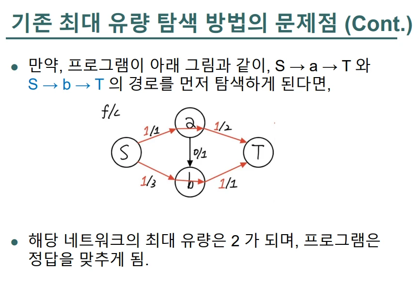
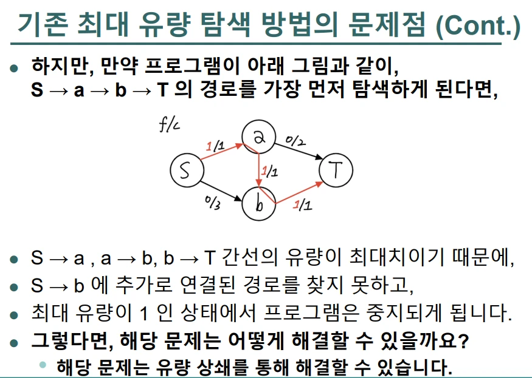

# Maximum Flow Problem

작성일 2022-12-04 · 최종 수정일 2022-12-05
{ .post-date }

- 최대 유량 문제 (Maximum Flow Problem) : 특정한 지점에서 다른 지점으로, 얼마나 많은 유량(flow)을 동시에 보낼 수 있는지 계산하는 문제, 네트워크 플로우라고도 한다.

## 기본 용어

1. 용량(Capacity) : c(u, v) ⇒ 정점 u에서 v로 전송할 수 있는 최대 용량
2. 유량(Flow) : f(u, v) ⇒ 정점 u에서 v로 실제 흐르고 있는 유량
3. 잔여 용량(Residual Capacity) : r(u, v) = c(u, v) - f(u, v)
4. 소스(Source) : s, 모든 유량이 시작되는 정점
5. 싱크(Sink) : t, 모든 유량이 도착하는 정점
6. 증가 경로(augment path) : 소스에서 싱크로 유량을 보낼 수 있는 경로

⇒ 더 이상 augmenting path가 없으면 iteration을 멈춘다.

> augmenting path : 소스에서 싱크로 갈 수 있는 경로를 residual capacity가 작은 값으로 채워넣은 경로를 말한다.

## 기본 속성

- 용량 제한 속성 : f(u, v) ≤ c(u, v)  
    ⇒ 유량은 용량보다 작거나 같다.
- 유량의 대칭성 : f(u, v) = -f(v, u)  
    ⇒ u에서 v로 유량이 흐르면, v에서 u로 음수의 유량이 흐르는 것과 동일하다.
- 유량의 보존성  
    ⇒ 각 정점에 들어오는 유량과 나가는 유량은 같다.

## 유량 상쇄

- DFS, 또는 BFS를 이용해서 augmenting path (유량이 흐를 수 있는 경로)를 찾는다.

- 만약 이와 같은 경우가 된다면, 최대 유량은 2가 되며, 정답을 맞추게 된다. 하지만 만약 이 예제처럼 S → a → T, S → b → T를 먼저 탐색한 것이 아니라, S → a → b → T를 먼저 탐색하게 된다면 다른 결과가 도출된다. (`BFS`를 이용한 탐색)

- 만약 DFS를 이용해서 S → a → b → T의 경로를 먼저 찾게 된다면, S → a, a → b, b → T 간선의 유량이 이미 최대치이기 때문에 추가로 연결된 경로를 찾지 못하고 프로그램이 중지된다.

> 이 문제를 해결하기 위한 방법이 바로 ‘유량 상쇄’이다.

- `유량 상쇄` : 유량 상쇄란, `모든 경로`에 기존에 존재하는 `간선`들과 `반대되는` 방향의 `간선`을 추가한 뒤, 각 간선으로 `유량`을 흘려보냈을 때, 반대 방향의 간선으로도 `음의 유량`을 흘려보냄으로써, `유량`을 `상쇄`시키는 것을 의미한다.  
    ⇒ 즉, 역방향을 고려해서 추가적으로 유량을 흘려보낼 수 있는 경로가 존재하는지 찾아본다.
- 현재 a → b 의 간선이 존재하고, `f(a, b) = 1`, `c(a, b) = 1`이다. 이 때 역간선 b → a의 유량  
    `f(b, a) = -1`이 되고, `(유량의 대칭성)` 용량 c(b, a)은 실제 존재하는 간선이 아니므로, 0이다.
- 따라서, 역간선 b → a의 `잔여 용량`  `r(b, a)` = `c(b, a) - f(b, a)` = `0 - ( -1 )` = `1`  
    즉, 역간선 b → a로 1의 유량을 추가적으로 흘려보낼 수 있게 된다. 해당 규칙은 두 정점이 서로에게 유량을 보내주는 것이 실제로 의미가 없기 때문에 성립할 수 있고, 소스에서 싱크로 가는 총 유량은 변하지 않는다.

## 포드-풀커슨 알고리즘

- 네트워크에 존재하는 `모든 간선`의 `유량`을 `0`으로 `초기화`하고, `역방향 간선`의 `유량`도 `0`으로 `초기화`한다. (포드-풀커슨, 에드몬드-카프 모두 처음에는 모든 간선의 유량과 역방향 간선의 유량을 0으로 초기화하는 과정을 거친다.)
- 소스에서 싱크로 갈 수 있는, 잔여 용량이 남은 경로를 DFS로 탐색한다. (augmenting path 탐색)
- 해당 경로에 존재하는 간선들의 잔여 용량 중, 가장 작은 값을 유량으로 흘려보낸다.
- 해당 유량에 `음수값`을 취해서, `역방향 간선`에도 흘려보낸다. (`유량 상쇄`)
- 더 이상 잔여 용량이 남은 경로가 존재하지 않을 때까지 반복한다.

## 에드몬드-카프 알고리즘

- 포드-풀커슨 알고리즘과 마찬가지로, 네트워크에 존재하는 모든 간선의 유량을 0으로 초기화하고, 역방향 간선의 유량도 0으로 초기화한다.
- 소스에서 싱크로 갈 수 있는 잔여 용량이 남은 경로를 `BFS`로 탐색한다.
- 해당 경로에 존재하는 간선들의 잔여 용량 중, 가장 작은 값을 유량으로 흘려보낸다.
- 해당 유량에 `음수값`을 취해서, `역방향 간선`에도 흘려보낸다. (`유량 상쇄`)
- 더 이상 잔여 용량이 남은 경로가 존재하지 않을 때까지 반복한다.
