# Backtracking

- `백트래킹 기법` : 해를 찾아가는 도중에 ‘`막히면`’, (즉, 해가 아니면) 되돌아가서 다시 해를 찾아 가는 기법이다.
- 백트래킹 기법은 `최적화 문제`와 `결정 문제`를 해결할 수 있다.  
    ⇒ 결정 문제 : 문제의 조건을 만족하는 해가 존재하는지의 여부를 Yes or No로 답하는 문제.
- 그리디는 근시안적으로 현재를 기준으로 가장 좋다고 판단되는 선택을 하기 때문에, 한 번 선택하거나 결정되면 되돌아갈 수가 없다. 이와 다르게 백 트래킹은 최적해가 아니라고 판단되면 되돌아가서 솔루션을 다시 판단할 수 있다.

## TSP (여행자 문제)

- `여행자 문제` : 여행자가 임의의 한 도시(노드)에서 출발하여 다른 모든 도시를 1번씩만 방문하고 다시 출발했던 도시로 돌아오는 최소 경로를 찾는 문제이다.  
    ⇒ 조건  
    1. `대칭성` : 도시 A에서 도시 B로 가는 거리는 도시 B에서 도시 A로 가는 거리와 같다.  
    2. `삼각 부등식` 특성 : 도시 A에서 도시 B로 가는 거리는 도시 A에서 다른 도시 C를 경유하여 도시 B로 가는 거리보다 짧다.
- TSP를 위한 알고리즘을 고안하려면, 먼저 다항식 시간 알고리즘을 가지면서 유사한 특성을 가진문제를 찾아서 활용한다. ⇒ TSP와 비슷한 특성을 가진 문제는 `최소 신장 트리(MST)` 문제이다.
- `MST`는 모든 점을 `사이클` 없이 연결하는 트리 중에서 트리 선분`(간선)`의 `가중치` 합이 `최소`인 트리를 말한다.
- MST는 모든 점을 연결하고, 또, 그 경로가 최소인 경로이므로 이 특성을 이용하여 TSP에 활용하도록 한다.

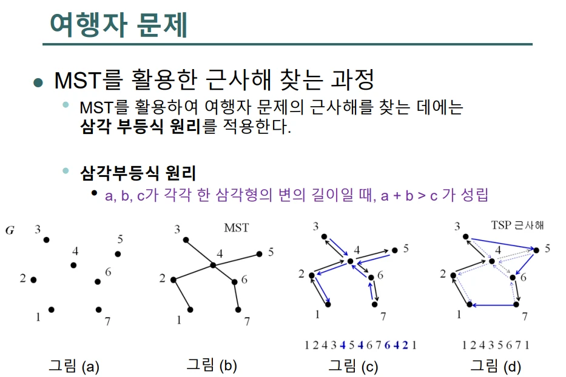

- 먼저, 점 1번에서 출발하여 MST를 찾는다. 여행자 문제는 다른 모든 도시를 한 번씩만 방문하고 돌아와야 하므로, MST에서는 이동 경로를 쓰고 앞에 나왔던 숫자를 제거한다.

1 2 4 3 4 5 4 6 7 6 4 2 1 ( 중복 제거 ) ⇒ 1 2 4 3 5 6 7 1

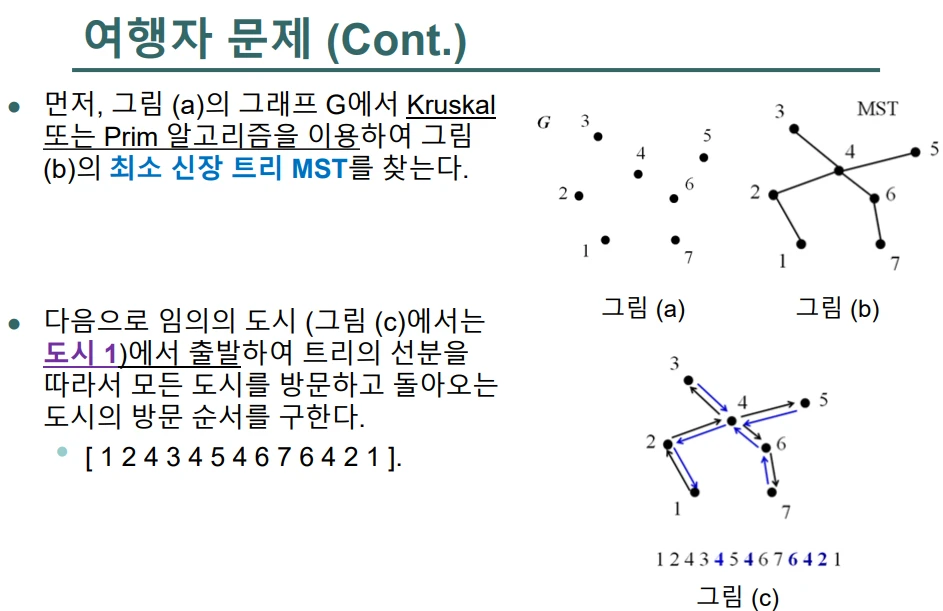

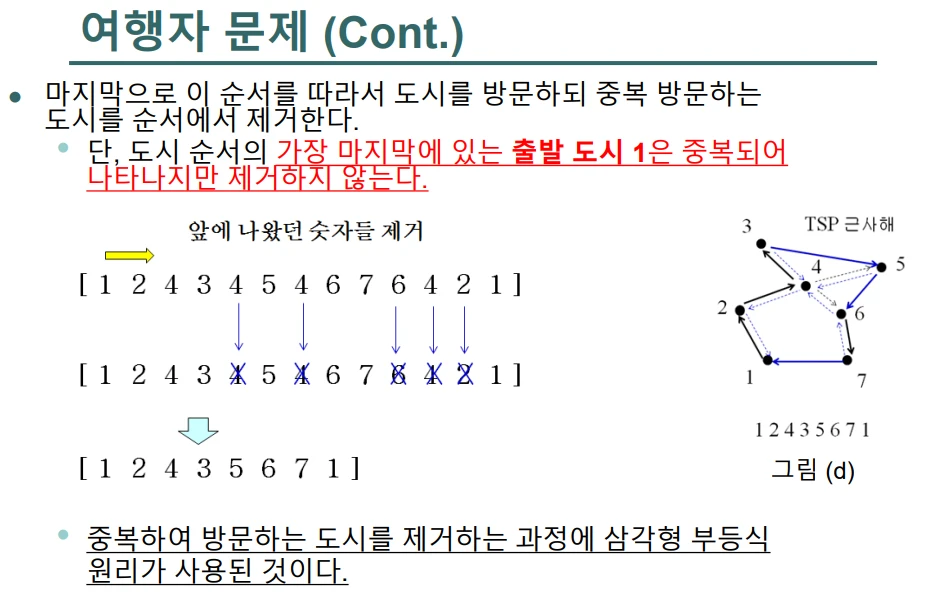

- 단, 출발 도시 1은 중복되어 나타나도 제거하지 않는다. ⇒ 다시 돌아가야 한다는 조건이 있기 때문이다.

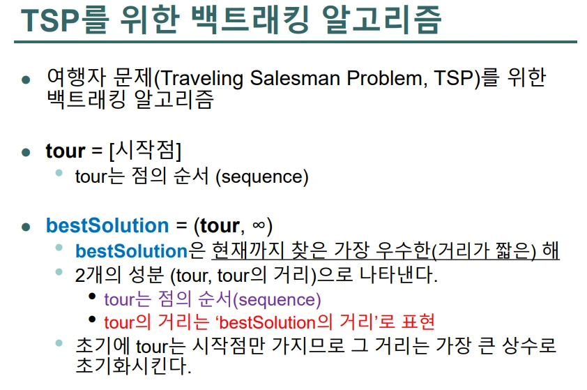

- `tour`는 도시의 순서(`sequence`)이고, 거리는 `bestSolution`으로 들어간다. 초기에는 `tour`가 `시작점`밖에 없으므로 (처음엔) `tour`는 `시작점`을 의미하고, `거리`는 `무한대`로 초기화한다.

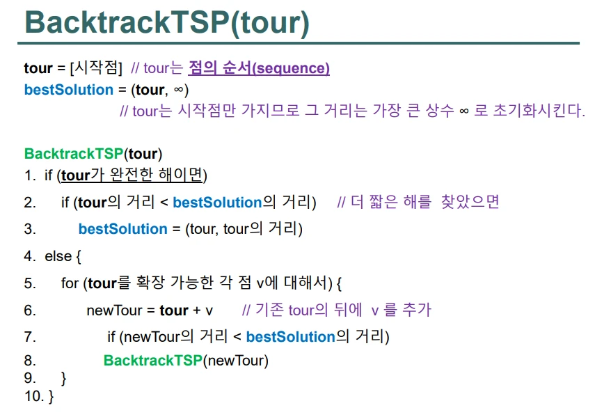

- if, else구조이다. tour가 완전한 해(모든 노드를 다 방문한 경우)는 if로 들어가고, 아니면 else로 들어간다.

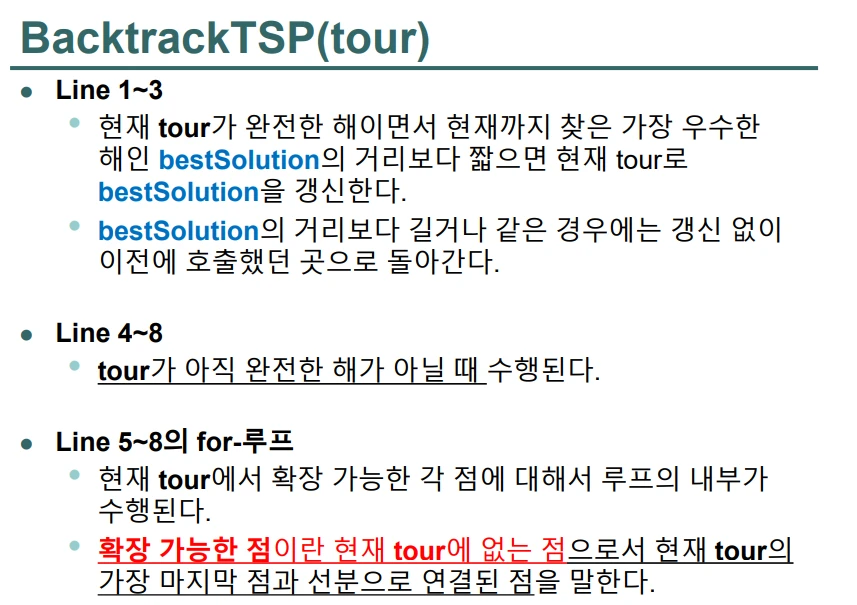

- 확장 가능한 점 : 현재 tour(sequence)에 없고, 가장 마지막에 방문한 점과 선분으로 연결된 점…
- 그러니까 이 알고리즘은, 일단 초기에는 시작점만 넣어주고, 거리를 무한대로 해놓는다. 그 다음 가지를 쳐가면서 거리를 판단하고, 다른 가지를 가서 비교하는데, 만약 조금만 들어가봤는데 이전의 최적해보다 크다면 더 찾아보지도 않고 그냥 그 가지를 버린다. (pruning, 가지치기)

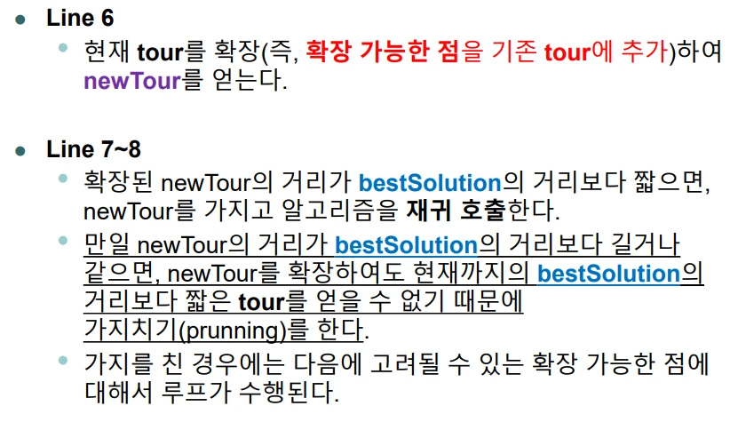

- pruning : 잘라낸다, 가지치기, 버리기를 한다는 의미의 용어
- 예시

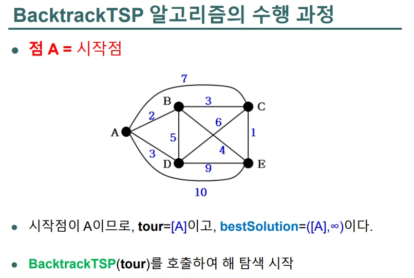

- 시작점은 A이므로 tour = A. tour는 sequence, bestSolution은 지금까지 방문한 것의 거리이다. 

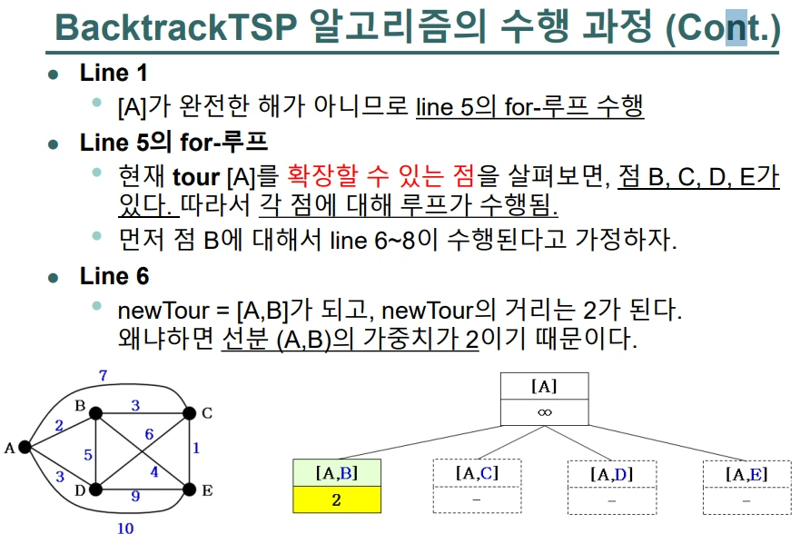

확장할 수 있는 점이란, 가장 최근에 방문한 점과 연결성을 갖는 점을 의미한다.

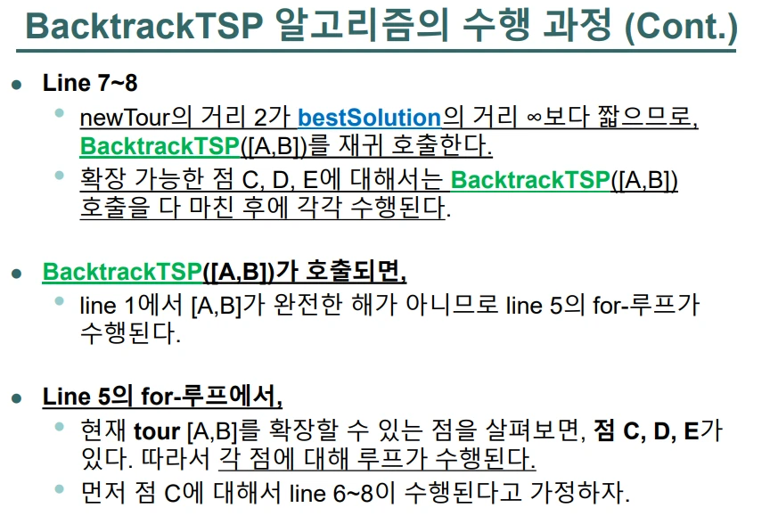

- 시작점은 A이고, 확장할 수 있는 점 B가 있으므로 B를 추가한다. 그러면 거리는 2가 되는데, 이 때 이전까지의 거리 `INF`와 `2`를 비교하면 2가 더 작으므로, `newTour` = `([A, B], 2)`가 된다. 이에 대해서 `BacktrackTSP([A, B])`를 재귀호출해서 다음으로 넘어간다. (확장 가능한 점 C, D, E가 있지만, `재귀호출`이므로 먼저 `B 가지`에 대해서 처리한 후 C, D, E로 가게 된다.)
- `재귀호출`이 되고 나면, `[A, B]`는 완전해가 아니므로, if condition이 아닌, else가 실행된다. else에서는 확장할 수 있는 점 C, D, E를 찾게 되고, 점 C로 확장할 수 있으므로 `newTour`가 갱신되어서 `newTour` = `([A, B, C], 5)`가 될 것이다.
- 재귀호출이기 때문에, 이 동작을 계속 반복하면서 B 가지를 완성해나간다.

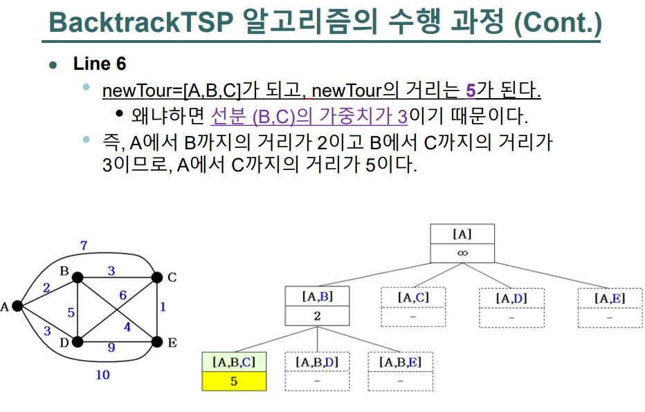

- 현재까지 `newTour` = `[A, B, C]`이고, 가중치는 2 + 3 = 5이다.

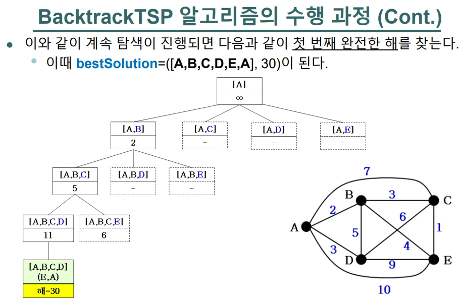

- 한 branch의 끝에 도달하면 `optimal solution`은 아니더라도, `완전한 해`를 하나 얻게된다. 완전한 해를 얻게 되면, `else condition`이 아니라, `if condition`으로 들어가게 된다. 현재 첫 번째로 얻게된 `bestSolution`은 `A→B→C→D→E→A` = 30이다. (다음 가지로 가지 않더라도, `bestSolution`보다 작다면 버리게 되는 것으로 보인다.)

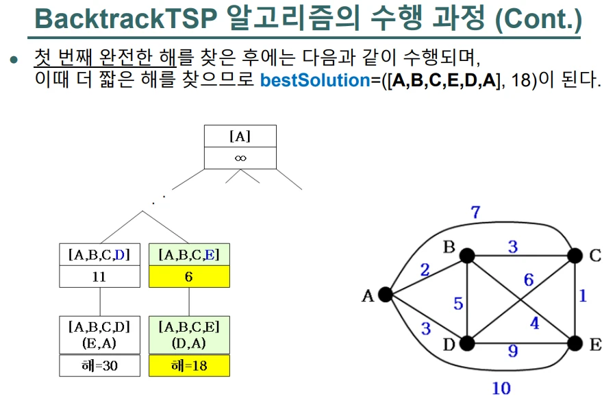

- 이런 식으로 재귀 호출을 따라가며 계속 찾아간다…

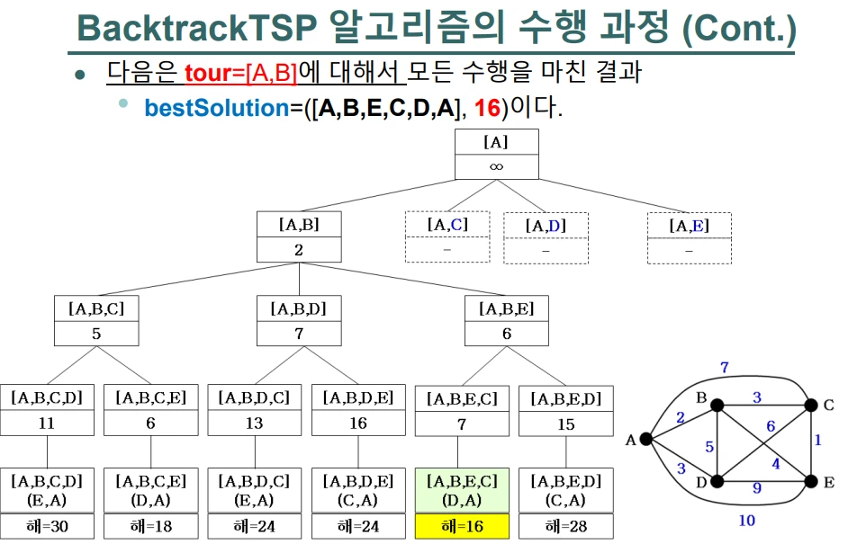

- 현재까지는 A→B 에서 나온 branch를 탐색한 것이고, 계속해서 찾아간다. 이 과정에서 지속적으로 가지치기를 수행하게 된다.

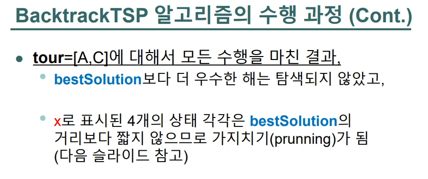

- 탐색해보면서, 한 `branch`의 최종 `bestSolution`을 얻기 전에, 이전에 얻은 `bestSolution`의 값(여기서는 16) 보다 `크거나`  `같다면`, `그냥 버린다`. `pruning`.

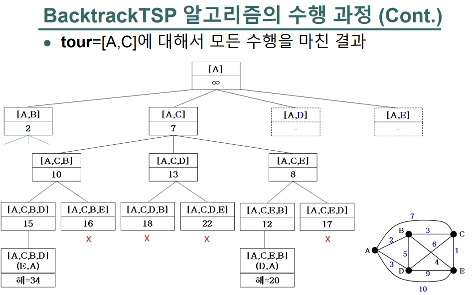

- 여기를 보면, 다른 가지를 탐색하는 도중에 이전의 가지에서 구한 `bestSolution` 보다 값이 작다면 그냥 버려버린다. 하지만, 최종해를 구할 때까지 이전에 구한 `bestSolution` 보다 값이 작다면, 일단 끝까지 탐색해본다.

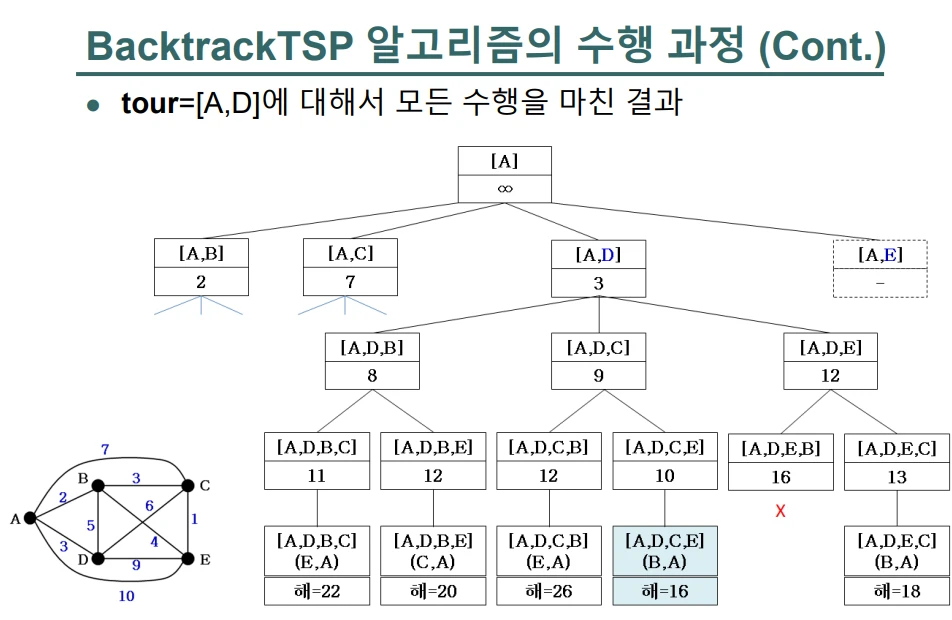

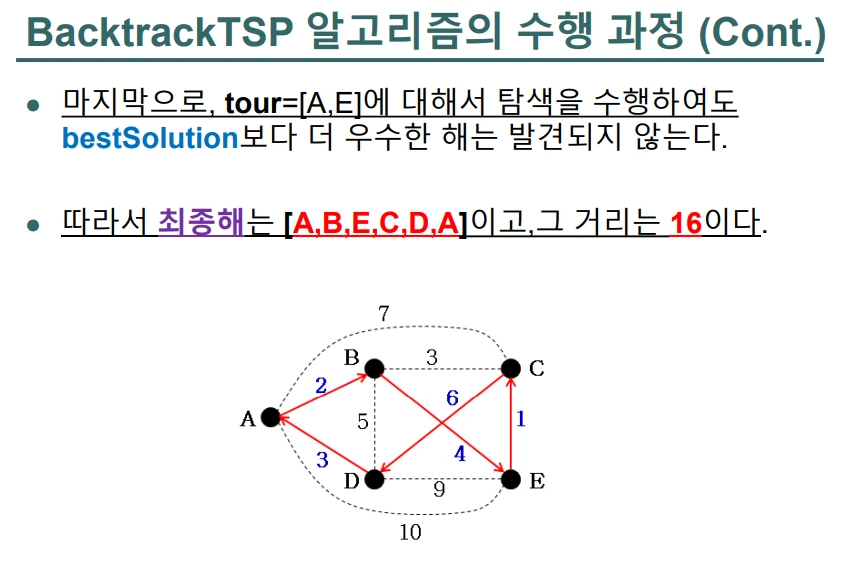
