# Huffman Coding

- 파일의 각 문자가 8bit (ASCII) 코드로 저장되면, 그 파일의 `bit`수는 `8*(파일의 문자 수)`이다.
- ASCII 코드는 0x00 ~ 0x7F(127, 총 128개)이다.

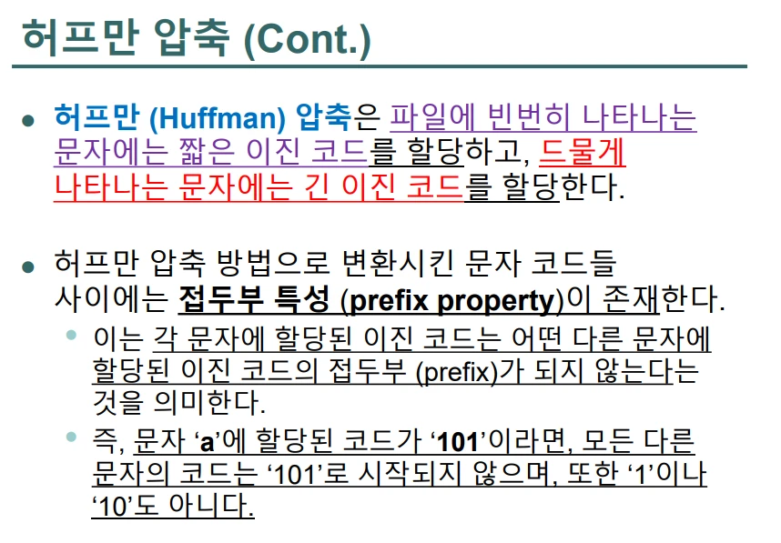

- `허프만 압축`은 파일에 `빈번히` 나타나는 문자에 대해서는 `짧은 이진 코드`를 할당, `드물게` 나타나는 문자에는 `긴 이진 코드`를 할당하는 방식이다.
- `접두부 특성` : 각 문자에 할당된 이진 코드는 어떤 다른 문자에 할당된 이진코드의 접두부(prefix)가 되지 않는다는 것을 의미한다.  
    ⇒ 즉, 문자 ‘a’에 할당된 코드가 만약 ‘101’이라면, 모든 다른 문자의 코드는 ‘101’로 시작되지 않으며, 또한 ‘1’이나 ‘10’도 아니다. why? 허프만 압축은 결국 이진 트리 구조를 이용하게 되는데, 이진 트리의 leaf node에만 문자가 존재하기 때문에, ‘101’로 할당된 문자가 있다는 것은, 루트 노드를 기준으로 우측으로 갔다가, 다시 좌측으로 갔다가, 다시 우측으로 오면 leaf node인 ‘a’가 존재한다는 것이다. 따라서, 접두부 특성이 적용된다고 볼 수 있다.

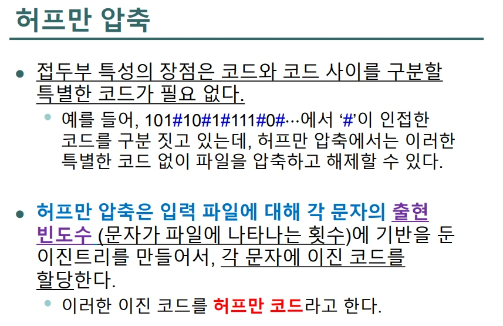

- `허프만 압축`은 `접두부 특성`이 있기 때문에, 코드와 코드 사이를 구분할 특별한 코드가 필요하지 않다. ⇒ leaf node에 문자가 있다는 특성이 있고, 접두부 특성이 있기 때문에 그냥 이진 코드를 따라가면 문자가 나옴.
- `허프만 압축`은 `입력 파일`에 대해 각 문자의 출현 `빈도수`에 기반을 둔 `이진트리`를 만들어서, 각 문자에 `이진 코드`를 `할당`한다. → 이러한 이진 코드를 `허프만 코드`라고 한다.

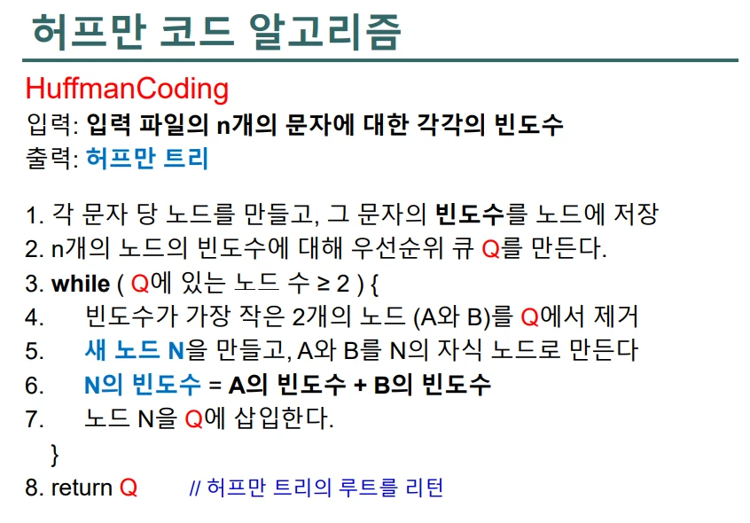

1. 문자의 빈도수를 체크하고, 모든 노드를 우선순위 Q에 넣는다.
2. 빈도수가 가장 낮은 두 개의 노드 A, B를 Q에서 제거하고 새로운 노드 N의 자식 노드로 만든다.
3. 그리고 새로운 노드 N의 빈도수는 A, B의 빈도수를 더한 값이 된다.
4. 노드 N을 Q에 삽입한다.
5. 이 과정을 우선 순위 Q에 들어있는 노드의 수가 2개 미만이 될 때까지 반복한다.

⇒ 이렇게 되면, 허프만 압축 과정을 거친 이진 트리가 리턴된다.

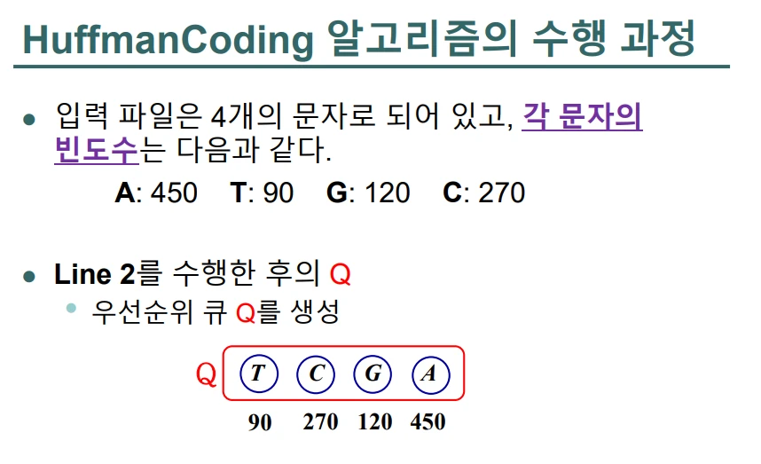

- 예제로 A, T, G, C를 고려한다고 한다. 빈도수는 위와 같다.
- 네 개의 노드를 우선 순위 Q에 넣고, 위에 나온 방식대로 허프만 코딩을 진행한다.

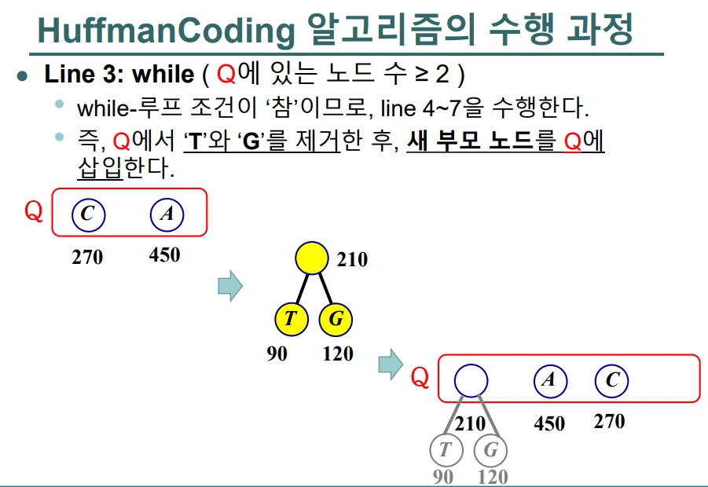

- Q안의 노드가 네 개 있으므로, while loop을 실행할 수 있다.
- 가장 빈도수가 작은 두 개를 제거해서 새로운 노드 N으로 만들어야 하므로, 빈도수가 가장 작은 T와 G를 Q에서 빼낸다. 
- 새로운 노드 N을 만들고, T와 G를 N의 자식 노드로 만든다.
- N을 Q에 추가한다.

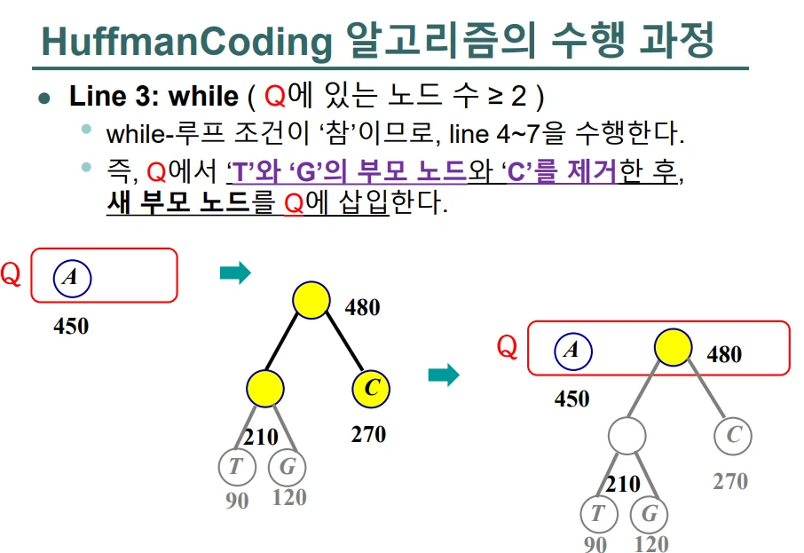

- 현재 한 번의 iteration을 돌았는데, Q에 있는 노드의 수가 3이므로 iteration을 더 돌 수 있다.
- 다시 빈도수가 가장 작은 두 개를 빼낸다.
- 다시 새로운 노드 N2를 만들어서 빼낸 노드 N(210)과 C(270)을 자식 노드로 추가한다.
- 그 뒤, N2를 Q에 추가한다.

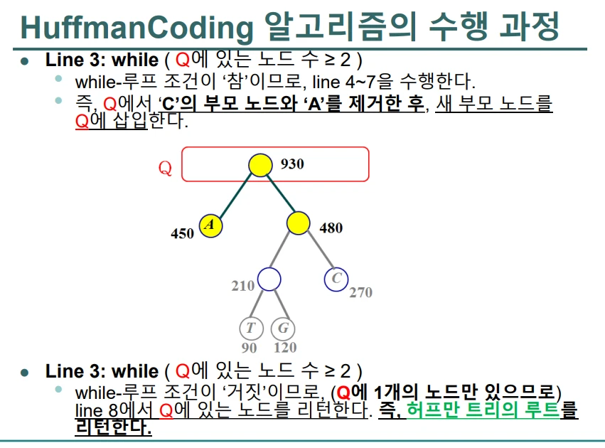

- 현재 Q에는 두 개의 노드가 있으므로, iteration을 더 돌 수 있다.
- 다시 한번 루프를 돌면, 위와 같은 결과가 나온다.
- 이제 N3 노드만 남았으므로, while loop가 종료된다. N3(930)
- 이제 허프만 트리의 루트 Q를 return한다.

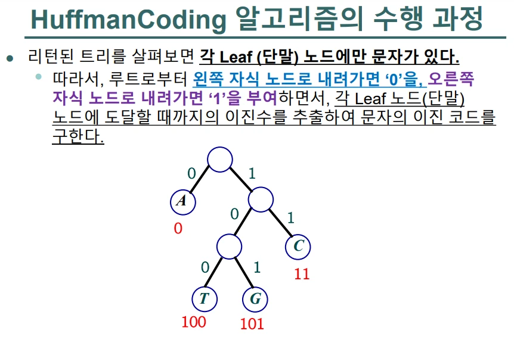

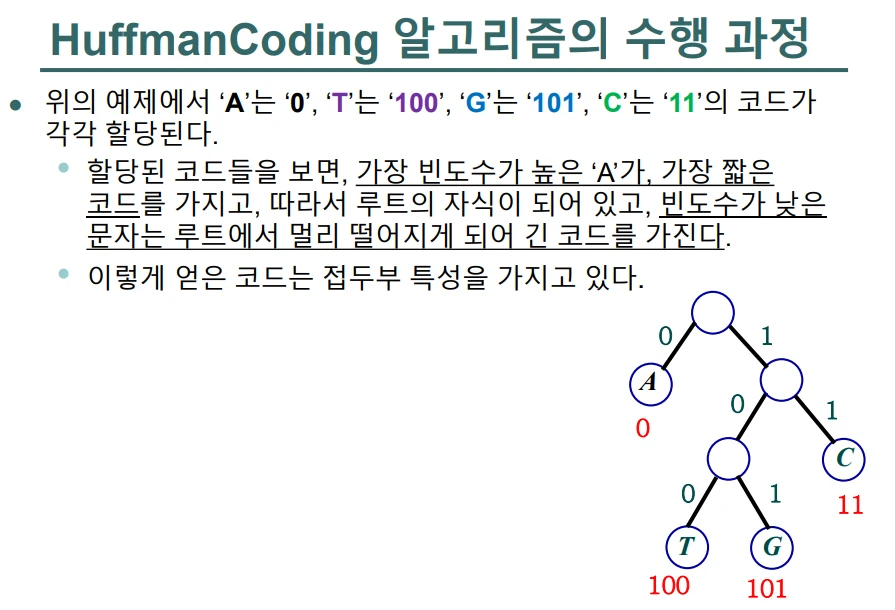

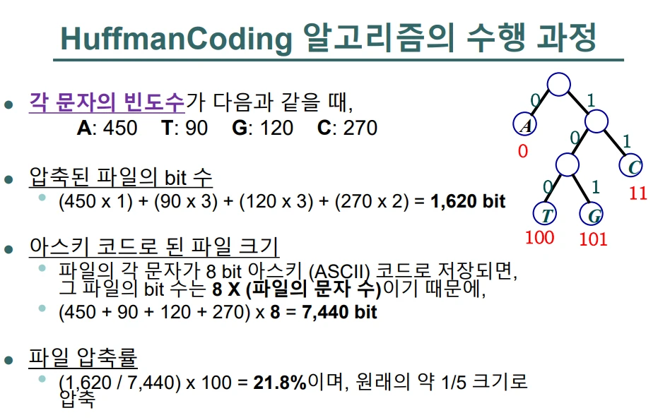

- 압축 전, (450 + 90 + 120 + 270) * 8 = 7,440 bit
- 압축 후, (450 * 1) + (90 * 3) + (120 * 3) + (270 * 2) = 1,620 bit

⇒ 파일 압축률 = (1,620 / 7,440) * 100 = 21.8% 원래의 약 1/5크기로 압축된다.

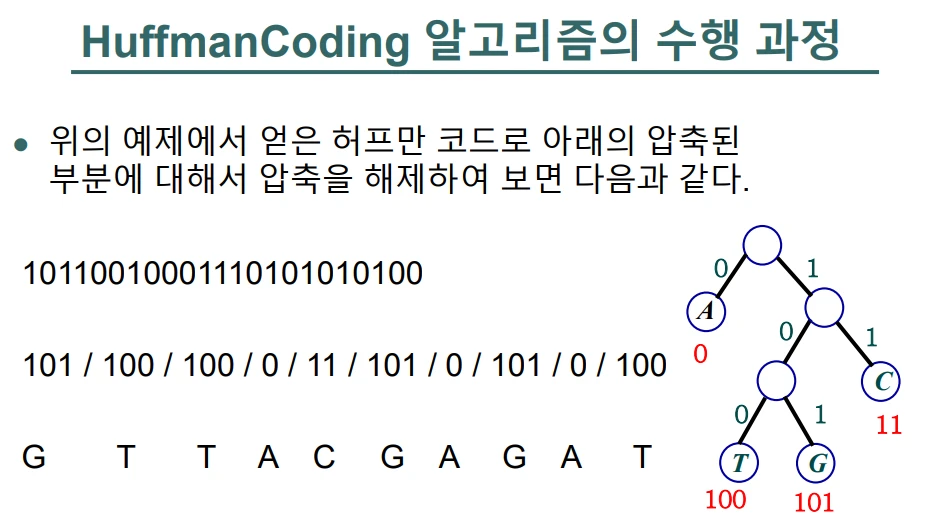

10110010001110101010100  
101/100/100/0/11/101/0/101/0/100
