# DP coinChange

- Dynamic Programming을 이용해서 동전 거스름돈 문제를 해결한다. 이전에 Knapsack 문제에서는 고려하는 물건 (i)를 선택하고, 그것에 대해서 무게 w를 1씩 늘려가면서 해를 구했었다.
- Dynamic Programming은 이전에 찾은 해를 끌어와서 사용할 수 있다는 점에서 각 해가 종속성(Dependency)를 가진다.

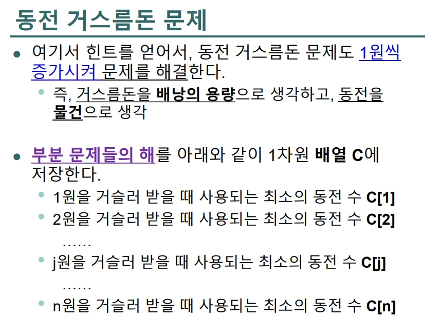

- 동전 거스름돈 문제는 1원씩 증가시키면서 문제를 해결할 수 있다.
- 부분 문제들의 해를 1차원 배열 C에 저장한다.

1원을 거슬러 받을 때 사용되는 최소의 동전 수 `C[1]`

…

j원을 거슬러 받을 때 사용되는 최소의 동전 수 `C[j]`

n원을 거슬러 받을 때 사용되는 최소의 동전 수 `C[n]`

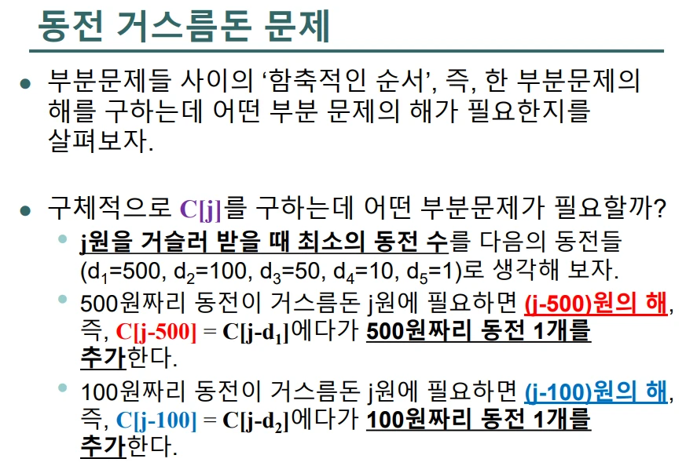

- 임의의 거스름돈 C[j]를 구하는 경우를 먼저 살펴보자.
- j원을 거슬러 받을 때 최소의 동전 수를 다음의 동전들 (d1 = 500, d2 = 100, d3 = 50, d4 = 10, d5 = 1)로 생각해보자.
- 500원짜리 동전이 거스름돈 j원에 필요하면, (j-500)원의 해, 즉, C[j-500] = C[j-d1]에다가 500원짜리 동전 1개를 추가한다.
- 문제에서 요구되는 것은 j원을 거슬러 받을 때 사용되는 최소의 동전 개수 C[j]이므로, C[j-dk]원에 dk 동전 1개를 추가하는 방식으로 진행되는 것이다.
- 100원짜리 동전이 거스름돈 j원에 필요하면 (j-100)원의 해, 즉, C[j-100] = C[j-d2]에다가 100원짜리 동전 1개를 추가한다.

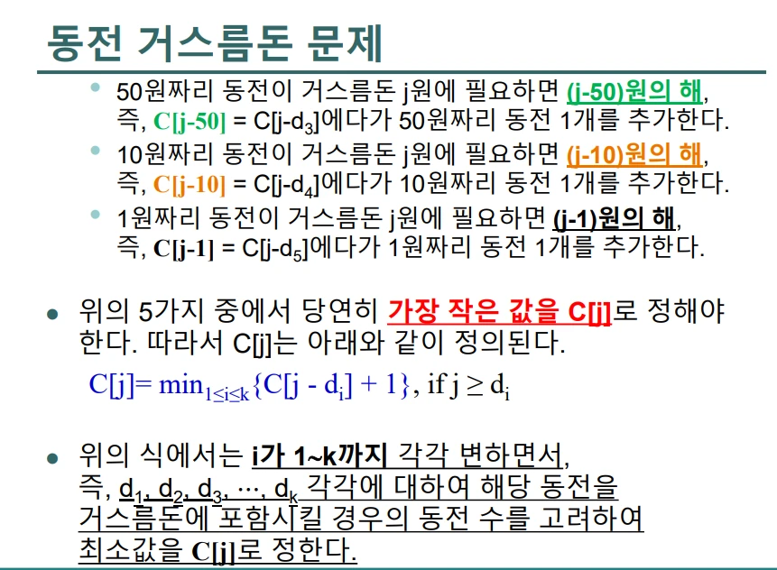

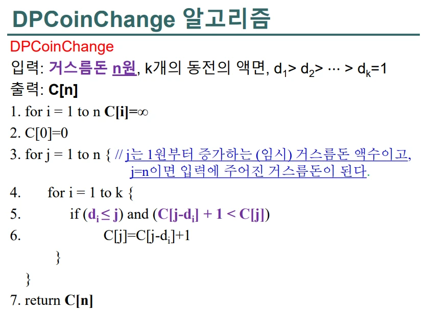

- 핵심 알고리즘 `if (di ≤ j) && (C[j-di] + 1 < C[j])`

if (di ≤ j)라는 것은, 현재의 금액 j에 거스름돈 di를 사용할 수 있는가 없는가를 따지는 것이다. 만약 true라면, 현재 j가 거스름돈 di보다 크거나 같은 것이므로, 거스름돈 di를 사용할 수 있게 된다.

C[j-di] + 1 &lt; C[j]. 먼저, C[n]은 금액이 n일 때 사용하는 최소 동전의 수이다. 앞선 조건에서 현재 금액 j에서 di를 사용할 수 있는 것이므로, di를 금액에서 뺀 상황을 고려하자. C[j-di]는 j원에서 di를 사용한다고 했을때를 가정한 것이고, C[j-di] + 1을 하면 j-di 금액에서 사용한 최소 동전의 수에서 di 하나를 추가한 다고 할 때, (+1) 그 것이 현재의 금액 j에서 사용된 최소 동전의 수 C[j]보다 큰지 작은지를 비교한다.

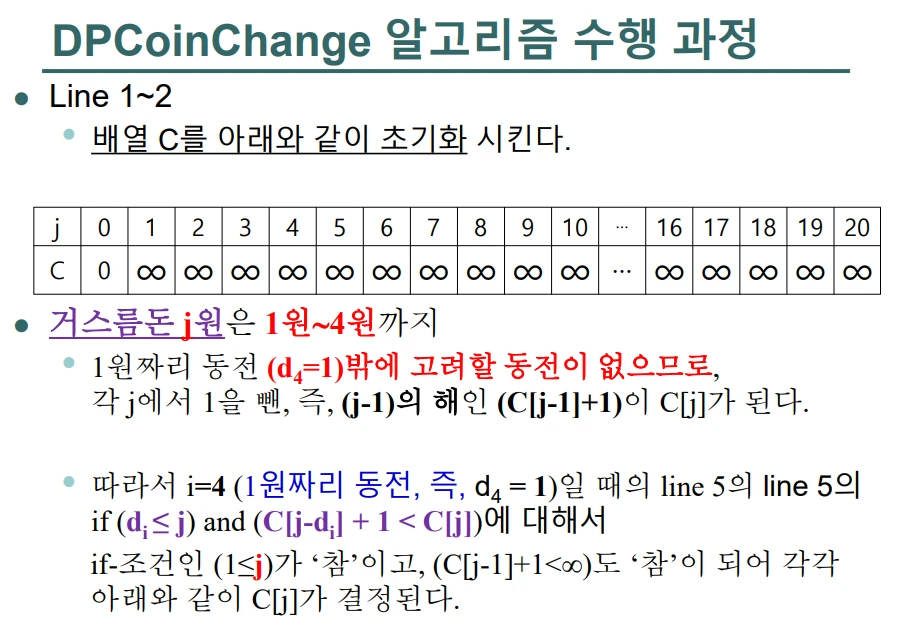

- 문제 상황

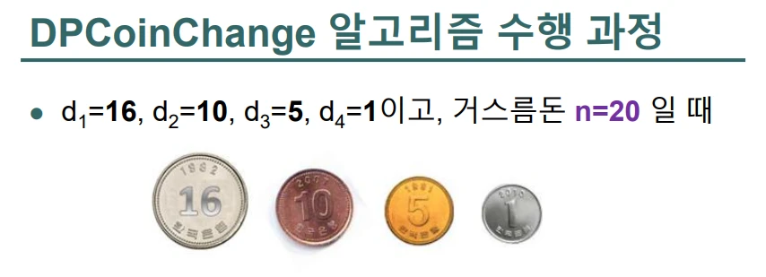

⇒ 16원짜리 거스름돈을 이용한다고 가정해보자.

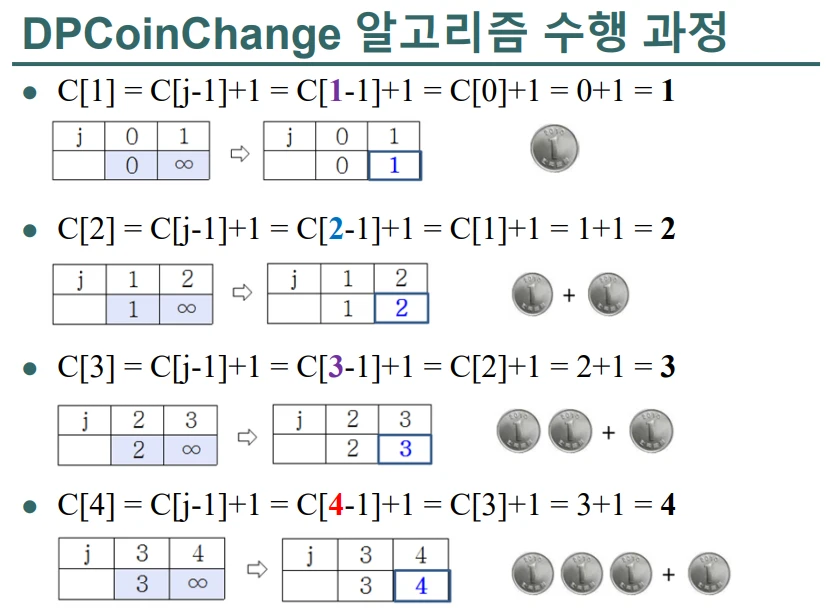

- C[1] ~ C[4] 는 5원짜리 동전을 사용할 수 없으므로, 모두 1원짜리 동전만 사용하게 된다. 

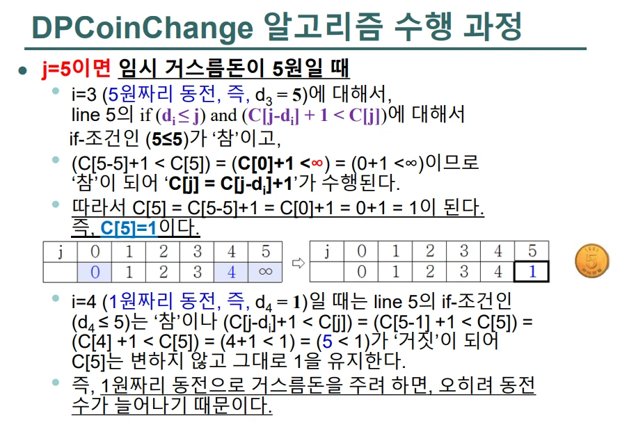

- j가 5라는 것은, 임시 거스름돈이 5원이라는 뜻. 이제부터 d3을 사용할 수 있게 된다.
- i=3, (5원짜리 동전. 즉, d3 = 5)에 대해서 조건문 `if (di ≤ j) && (C[j-di] + 1 < C[j])`에 대해서 if 조건인 `(5 ≤ 5)`가 참이고, `C[5-5] + 1 < C[5]` = `C[0] + 1 < INF`가 참이 되므로,   
    `C[j] = C[j-di] + 1`이 수행된다.
- i=4, (1원짜리 동전. 즉, d4 = 1)일 때는 line5의 if 조건인 (d4 ≤ 5)는 ‘참’이 되지만,   
    `C[j-di]+1 < C[j]` = `C[5-1] + 1 < C[5]` = `C[4] + 1` &lt; `C[5]` = `(4+1 < 1)` 은 ‘거짓’이 된다. 
- 즉, 1원짜리 동전으로 거스름돈을 주려고 하면 동전의 수가 늘어나기 때문에, 이러한 상황은 고려되지 않는다.

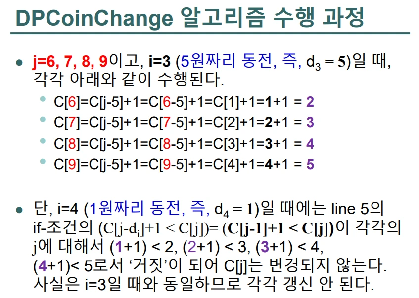

- j = 6, 7, 8, 9인 경우에는 i=3 (5원짜리 동전. 즉, d3 = 5) 를 사용하게 된다. Dynamic Programming이므로, 이전의 결과를 사용할 수 있다.
- 업데이트된 결과.

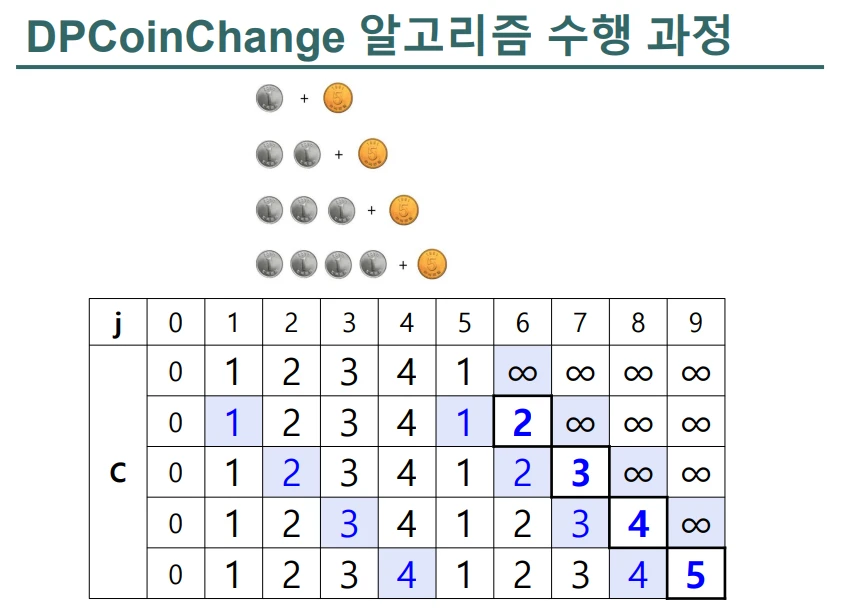

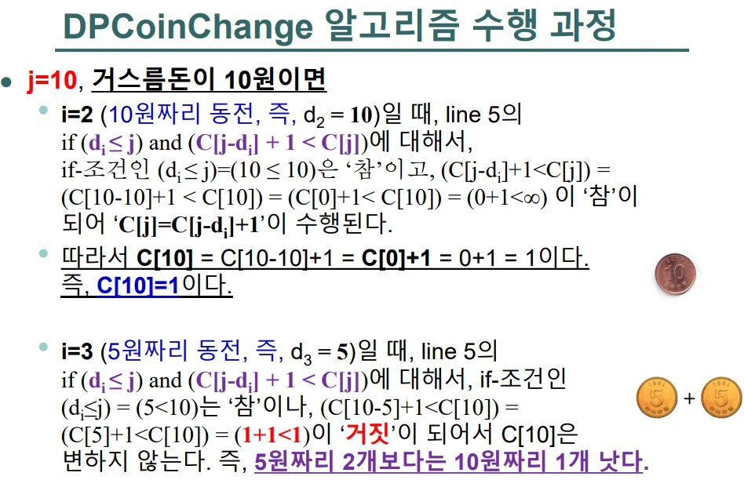

- 거스름돈이 10원이면, i=2 (10원짜리 동전. 즉, d2 = 10)일 때 line 5의 if조건이 참이되면서 수행된다.

`(di≤j)` = `(10 ≤ 10)` && `C[j-di] + 1 < C[j]` = `C[10-10] +1 < C[10]` = `C[0] + 1 < C[10]`

두 개의 condition이 참이 되므로, 수행 가능하다.

- 따라서, C[10] = C[10-10] + 1 = C[0] + 1 = 0 + 1 = 1이다. 즉, C[10] = 1이다.
- i = 3 (5원짜리 동전. 즉, d3 = 5)일 때는 실행될 수 없다. (조건을 만족하지 않기 때문)
- i = 4 (1원짜리)를 고려해보자.

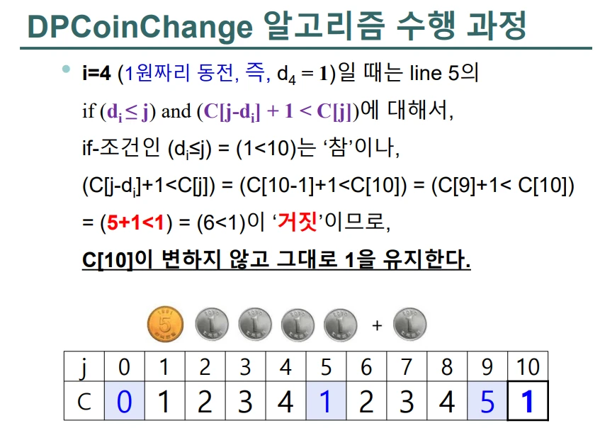

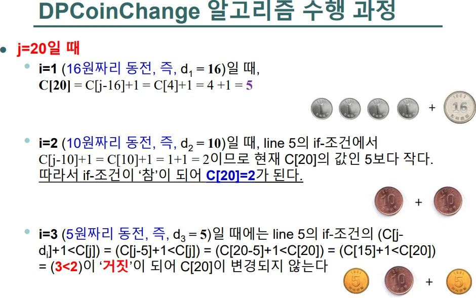

- i = 1 (16원짜리 동전. 즉, d1 = 16)
- `C[20]` = `C[j-16] + 1` = `C[4] + 1` = `4 + 1` = `5`
- i = 2 (10원짜리 동전. 즉, d2 = 10)
- `C[j-10] + 1` = `C[10] + 1` = `1 + 1` = `2` 이므로, 현재 C[20]의 값인 5보다 작다. 따라서, if 조건이 참이 되어서 `C[20]` = `2`가 된다.
- i = 3 (5원짜리 동전. 즉, d3 = 5)
- if의 조건 `C[j-di] + 1 < C[j]` 가 거짓이 되어서 C[20]이 변경되지 않는다.
- `C[15] + 1` = `2 + 1` = `3 < 2` 거짓임.
- i = 4 (1원짜리 동전. 즉, d4 = 1)
- if의 조건 `(C[20-1] + 1 < 2)` = `(5 < 2)` 거짓임.

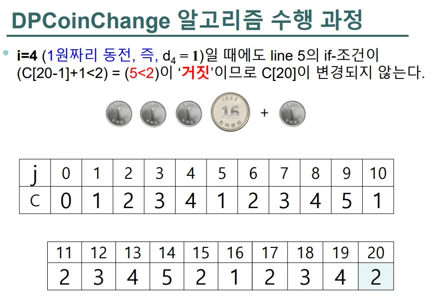

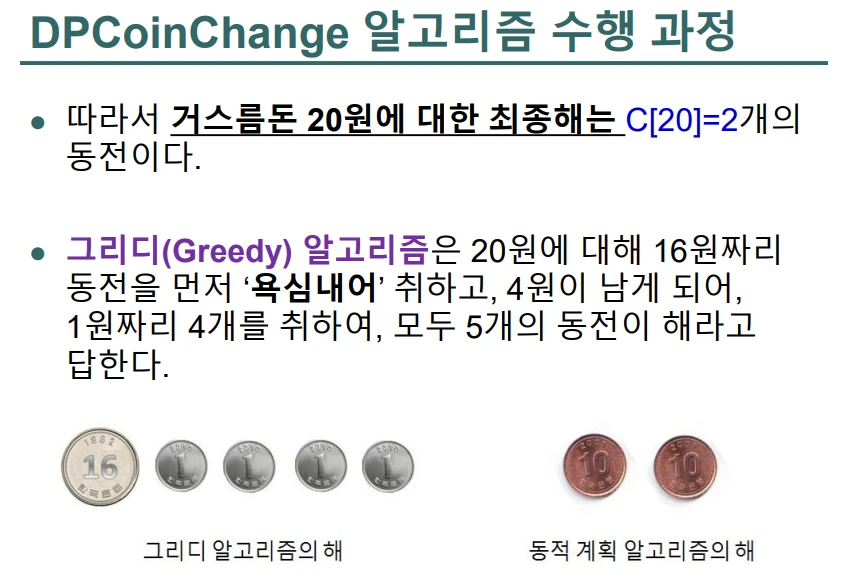

- 그리디 알고리즘으로 동전 거스름돈 문제를 해결할 때는 우선, 가능한 큰 동전을 선택하는 방식을 취했으므로, 현재 예제에서는 최적해가 나오지 않을 수도 있다.

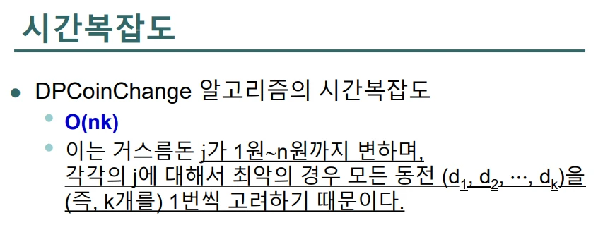
