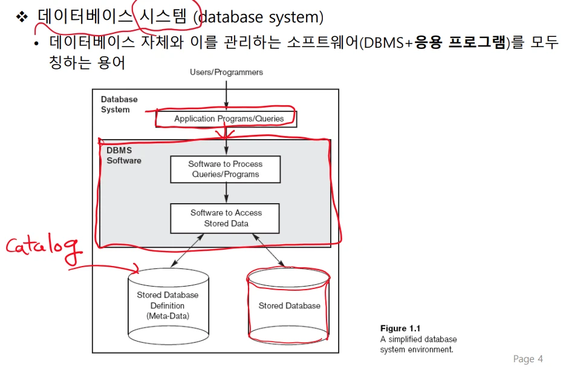
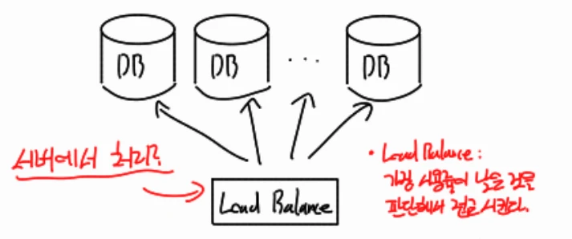

# 데이터베이스 개요

## [Database]

> 데이터란, 컴퓨터에서 사용되는 정보를 말한다.  
> 데이터는 메모리, 디스크 뿐만 아니라 DB에 저장할 수도 있다. (txt, json, xml, …)  

> 만약 Database가 없다면, Data를 txt 파일로 저장할 수밖에 없다. 그렇다면 어떤 문제가 생길 수 있을까? 이런 문제를 해결하는데 DB가 왜 도움이 될까?

- **DB가 없을 때의 문제점**

    - **데이터의 검색**이 **어렵다**. (체계적으로 나뉘어져 있지 않고, 텍스트 파일로만 나열되어 있기 때문에 처음부터 끝까지 순차적으로 탐색할 수밖에 없으며, 사람이 알아보기 어렵다.)
    - **데이터의 검색**이 어려우므로 **데이터의 갱신**도 어렵다. (수정, 삭제, 삽입 등)
    - 데이터를 txt 파일로 저장할 경우, **동시접근**을 처리하는 것이 어렵다. (성능도 저하된다.)

- **DB를 사용하는 이유**

    - 검색이 용이하다. (검색이 용이하도록 특별한 자료구조로 데이터를 보관하기 때문이다.)
    - 동시접근이 용이하다. (DB 접근을 관리해주는 특별한 SW인 **DBMS**[Database Management System]를 사용하여 동시접근을 관리해준다.)

> DB를 설계한다는 것은, 데이터의 중복없이 효과적으로 데이터를 관리할 수 있는 구조를 설계하는 것이다.

---

### &lt;데이터베이스의 개요&gt;

- **데이터** : 컴퓨터에서 사용될 수 있는 정보

- **데이터베이스** : **데이터**를 **규칙**에 따라 연결지어 보관하는 **데이터들의 집합**

    - **데이터베이스 시스템** : 데이터베이스 자체와 이를 관리하는 소프트웨어(DBMS + 응용 프로그램)를 모두 칭하는 용어이다.

- **DBMS** : 데이터베이스의 생성과 관리를 담당하는 S/W

데이터베이스 시스템의 구조. 최하단에 실제 물리적으로 데이터를 저장하는 부분의 definition을 가지고 있는 부분을 catalog라고 한다. (이를 Meta-Data라고 함.)

⇒ **Meta-Data** : 일반적으로 데이터에 관한 구조화된 데이터. 쉽게 말하면, 다른 데이터를 설명해주는 데이터이다. (Catalog) 대량의 정보 가운데에서 확인하고자 하는 정보를 효율적으로 검색하기 위해 Raw data를 일정한 규칙에 따라 구조화 혹은 표준화한 정보를 의미한다.

> 데이터베이스와 운영체제는 하는 일이 매우 유사하다.  
> DB는 여러 개의 Query를 동시에 수행되는 것처럼 보이도록 concurrent 처리를 할 수 있다.  
> 그 과정에서 동시접근 문제가 발생하지 않도록, critical section problem을 잘 처리해주는 역할을 한다고 볼 수 있다.

#### 데이터베이스 예시

> 미국인 2억명의 납세 정보를 보관하는 DB가 있다면, 약 1.6 TB의 크기를 가져야 한다.  
> 이것의 용량 자체가 크지는 않지만, 수많은 사용자가 사용할 수 있도록 설계가 필요하다.

⇒ 이처럼, 하나의 DB를 복사해서 여러 개의 DB를 만들고, Load Balancer를 통해서 사용률이 낮은 DB를 그때그때 판단해서 사용자를 접근시킨다.

예를 들어, read only DB는 update가 거의 없기 때문에 안정적이지만 결제 정보를 보관하는 DB는 새로운 값의 입력이 잦을 것이다. 이런 것을 적절하게 분리하여 안정성을 유지해야 한다.

> 그런데, DB도 결국 데이터를 실제로 보관하는 물리적인 공간이 필요하기 때문에 이용하기 위해서는 Disk에 접근하는 방법과 구조 등을 알아야 한다.   
>   
> 하지만 실제로 DB를 사용할 때는 이것을 몰라도 된다. 그 이유는 **DBMS의 Disk의 구조를 몰라도 사용할 수 있도록 Data를 Table로 구조화하여 추상화**하기 때문이다.

---

### &lt;데이터베이스의 특징&gt;

1. **데이터베이스 시스템의 자기 기술성**

    > **데이터베이스 시스템**은 실제 DB와, DB를 관리하는 DBMS + 응용 프로그램을 통틀어서 부르는 용어이다.

    - 자기 자신의 구조에 대해 설명한다.

        - **Database Catalog**에는 메타 데이터(Meta-Data)가 저장된다.

            ⇒ **Meta-Data**란? : 데이터베이스 자체에 대한 정보.  
            (**테이블 구조**, **테이블들이 저장된 위치**, **인덱스 형성 체계** 등, **내부적 정보**를 **관리**한다.)

            ⇒ Database Catalog는 Table 생성 시, 자동으로 만들어진다.

    - DB의 성능 향상을 위한 주요 사항들  
        1) Query Optimization  
        2) Concurrency  
        3) Transaction

1. **데이터와 프로그램의 분리** (DBMS)

    > 데이터가 실제 디스크 상에 저장될 때는 섹터, 오프셋, 블록 넘버 등의 지식이 필요하지만, DBMS를 이용하면 그러한 것을 알지 못해도 데이터를 원활하게 다룰 수 있다.

1. **데이터의 추상화** (Table)

    > **데이터 모델**(Data Model)을 사용하여 저장 구조의 자세한 내용은 사용자로부터 은닉시키고, 사용자에게는 각자의 요구에 맞는 부분만을 보여준다. (데이터 은닉 및 추상화)

1. **데이터에 대한 다양한 뷰**(View) **제공**

    > 사용자는 자신의 관심에 맞춰 전체 데이터에서 원하는 데이터 셋을 묶어 디스플레이 가능

1. **데이터의 공유와 다수 사용자 트랜잭션 처리**

    - **Transaction** : 서로 다른 사용자가 데이터에 동시접근할 때 요청이 모두 잘 처리되도록 만들어야 한다. **트랜잭션**이란, 여러 사람이 동시에 접근했을 때 한번에 하나만 처리되도록 **독립성**과 **원자성**을 지원하는 것이다.

        > 동시에 여러 사람이 처리할 때, 충돌이 발생한다면 **실행에 순서를 부여**하고, 그게 아니라면 **동시에 실행**시킨다.

<!-- -->

- Transaction의 주요 성질

    - **고립성**(isolation) : 트랜잭션이 마치 혼자서 수행된 것 같아야 한다.  
        ⇒ 한 트랜잭션이 수행되고 있을 때, 그 트랜잭션이 다루는 데이터에는 다른 트랜잭션이 개입하거나 볼 수 없다.
    - **원자성**(atomicity) : 트랜잭션은 수행되었거나, 말아야 한다. (All or Nothing)  
        ⇒ 일부만 수행되어서는 안된다.

---

### &lt;데이터베이스 사용자의 분류&gt;

- **DB 설계자**

    - 데이터베이스의 설계를 책임지는 사람
    - Table의 구조를 생성한다.

- **DB 응용 개발자**

    - DB를 사용하여 응용 프로그램을 만드는 사람
    - DB를 다루는데 필요한 전반적인 프로그래밍 지식 및 SQL을 잘 다뤄야 한다.

- **DB 최종 사용자** (end user)

- **DB Administrator** (DBA, DB 관리자)

    - DB의 전반적인 성능을 모니터링하고 튜닝해야 하며, 사용자를 관리한다.
    - DB의 Memory Size, 동시 접속 Tool 등을 관리하여 성능을 향상시킨다. (**Trouble Shooting**)
    - Bash, Python 등을 사용하여 DB 개발을 자동화한다. (**Script 활용**)

- **DBMS 설계 및 구현자**

---

### &lt;DBMS의 장점&gt;

- 사람이 관리하면 중복 또는 충돌이 발생할 수 있으나, DBMS의 관리를 거쳐 중복과 충돌을 최소화할 수 있다.

    - 동일한 데이터가 이곳 저곳에 중복되어 저장되는 것을 방지
    - 중복 제어를 통한 데이터의 일치성(consistency) 보장과 저장 공간 낭비 방지

- 접근 권한 등의 보안 기능을  확보할 수 있다.
- 지속적 기억 공간을 제공한다.

- 효율적 질의 처리를 위한 저장 구조를 제공한다.

    - 원하는 데이터를 빠르게 찾기 위해 인덱스 기능을 제공

- 백업과 회복 기능을 제공한다.

    - 주기적 백업이나 회복도 가능하다.

- 다수의 사용자 인터페이스를 제공한다.
- 데이터 간의 복잡한 관계를 체계적으로 표현한다.
- 데이터베이스의 무결성 제약 조건의 시행을 통해, 입력 범위를 제한하여 오류가 발생할 가능성을 더욱 낮출 수 있다.

- 동시성 (**Transaction**)

    - 여러 사용자가 동시에 DB를 접근하여 효율적으로 처리
    - 동시 접근 시에도 데이터의 손실 방지, 일관성을 보장한다. 

- 독립성 (**데이터와 프로그램의 분리**)

    - 추상화를 통해 DB 활용을 쉽게 만든다.

> 언제 DB 사용이 필요하지 않을까?  
>   
> DBMS 비용을 감당하기 어려운 경우.  
> 데이터가 잘 정의되어 있고 변경이 필요하지 않으며, 변경될 가능성이 적은 경우.  
> 다수 사용자의 데이터 접근이 필요하지 않은 경우.  
> DBMS 오버헤드로 인해 엄격한 실시간 데이터 처리 요구사항을 만족시키기 힘든 경우.
