# DBMS 아키텍처와 스키마

작성일 2023-10-13 · 최종 수정일 2024-10-14
{ .post-date }

## &lt;데이터 모델&gt;

- **데이터 모델**

    - 모델이란, 실제로 존재하는 것에서 관심있는 것만을 가져와 추상화한 것이다.

        ⇒ 따라서 똑같은 S/W를 짜더라도, 관심있는 분야에 따라 다른 데이터 모델을 추상화 할 수 있다.

- **데이터 모델링**

    - 현실 세계의 정보를 컴퓨터의 정보로 옮기는 것을 **데이터 모델링**이라고 한다.

    - 대표적으로 몇 개의 종류가 있다.

        - 계층적 (hierarchical) 데이터 모델

            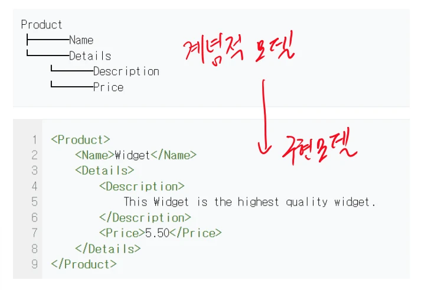

        - 관계 (relational) 데이터 모델

            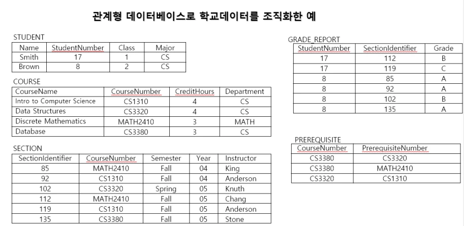

        - 객체 (object) 데이터 모델
        - 네트워크 데이터 모델

        ⇒ 데이터 모델은, 검색과 갱신을 수행하는 기본적 연산들도 포함한다.

---

## &lt;데이터 모델의 분류&gt;

### 개념적(고수준) 데이터 모델

- **ERD**를 이용한 데이터의 관계(개념적 모델)
- 계층적 모델을 의미함.

### 표현(구현) 데이터 모델

- 컴퓨터에서 표현하기 쉬운 중간 단계임.
- 대표적 모델은 **관계 모델**, XML 모델

### 물리적(저수준) 데이터 모델

- 레코드, 섹터, 블럭, 오프셋 등, OS나 DBMS가 처리하는 물리적 수준의 데이터
- 컴퓨터 H/W의 자세한 부분을 알아야 처리할 수 있다.

---

## &lt;데이터베이스 스키마(Schema)&gt;

> 데이터가 어떤 형식에 의해 나타내어지는 지를 보여주는 것을 **Schema**라고 한다.  
> 즉, 데이터베이스의 구조에 대해서 기술하는 것이다.  
> 데이터베이스 설계 과정에서 명시하며, 자주 변경되지 않는다.

### Schema Diagram

- 데이터베이스 스키마를 도식화한 것

- **Table의 이름**, **Attribute의 이름**, **일부 제약 조건 유형**들과 같은 스키마의 일부 관점만을 나타냄

    ⇒ 스키마는 데이터베이스에 필요한 Table의 종류, Table을 구성하는 Attribute의 정보를 말한다.

- 데이터베이스 스키마의 예시

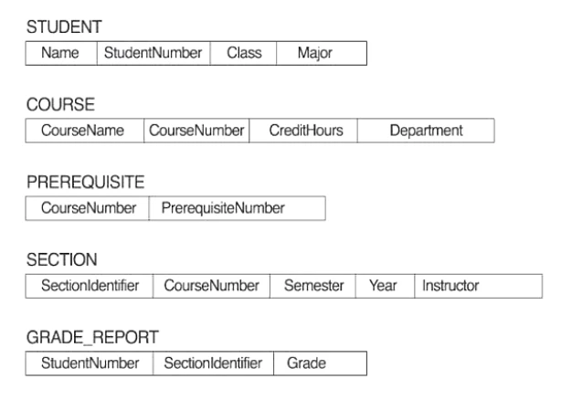

- **인스턴스**(instance) 또는 **어커런스**(occurrence)

    - 데이터베이스에 들어있는 데이터들(Schema에 맞는 형태로 들어가 있는 데이터들을 말함)

        - Schema는 자주 바뀌지 않고, Instance는 자주 바뀐다.

- **데이터베이스 상태** 또는 **스냅샷**(snapshot)

    - 특정 순간에 Schema 맞춰 데이터베이스에 보관되어 있던 Instance

- **Schema Evolution**

    - 새로운 field를 추가하거나, 필요없는 field를 삭제하는 과정.
    - 대부분의 DBMS는 시스템 운영 중에 스키마의 진화가 허용되도록 한다.

---

## &lt;3단계 스키마 아키텍처&gt;

### DB의 특징 중 세 가지

- 프로그램과 데이터의 분리(격리)
- 다중 뷰(view)의 지원
- 카탈로그에 메타 데이터 저장

### 3단계 스키마 아키텍처

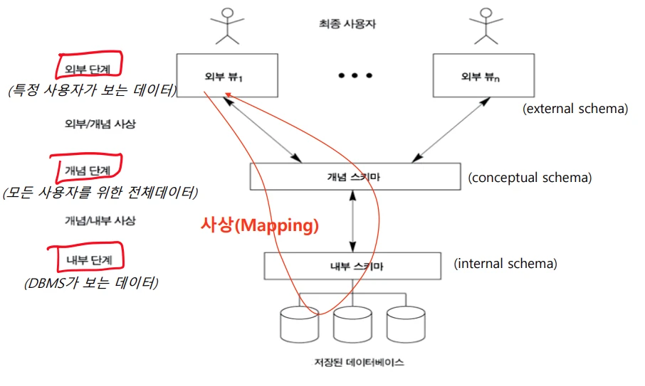

1) **외부 단계** : 특정 사용자가 보는 데이터 (**사용자 관점**)

> 개념 단계에서 스키마를 만들고, View도 만들어야 한다.  
> 사용자가 관심있는 데이터만 골라서 View를 제공할 수 있어야 함.

2) **개념 단계** : 모든 사용자를 위한 전체 데이터 (**조직 전체 관점**)

> 일반적으로  DB 설계자가 DB를 구조화하는 것을 말한다.  
> ⇒ 스키마 다이어그램으로 구조화

3) **내부 단계** : DBMS가 보는 데이터 (**DBMS 관점, H/W Level**)

> 내부 단계 스키마는 데이터를 어디에 어떻게 저장할 지,  
> 그리고 **Index를 생성하고 탐색하는 과정**에 중점을 둔다.

- Index : 디스크 상에 존재하는 데이터에 빠르게 접근하는 방법.

    - B tree, B+ tree 등을 이용한다.

> 3단계 스키마 아키텍처가 서로 데이터 Mapping 되어서 사용된다.

- 3단계 스키마 아키텍처의 예시

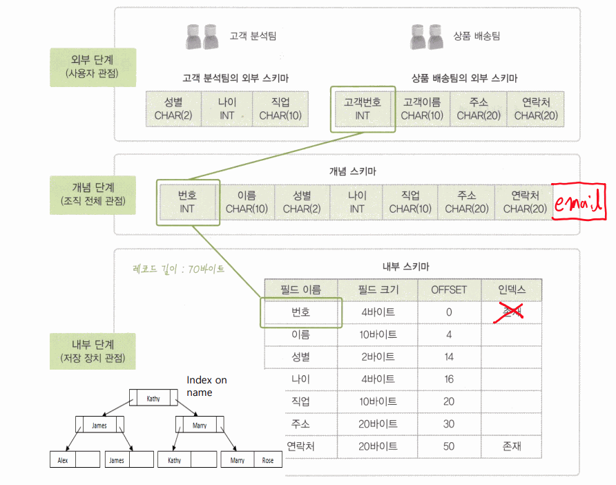

### 3단계 스키마 아키텍처의 장점

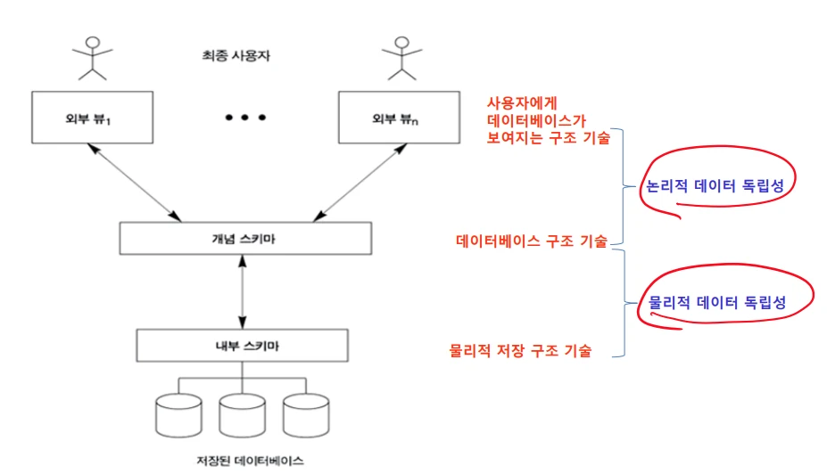

- **Modularization**

    - 데이터가 변경됐을 때, 발생하는 영향을 감소화시킨다.

    - 하위 단계의 스키마에 영향이 생겨도, 상위 단계에 영향을 주지 않도록 구조화된다.

        ⇒ 문제의 지역화 : Separation of Concerns

        > ex) 인덱스를 내부 단계에서 제거해도, 개념/외부 단계에서는 크게 가해지는 영향이 없다. (속도가 줄기는 할 것.) ⇒ **물리적 데이터 독립성**  
        >   
        > ex) 개념 단계에서 field를 추가해도 외부 단계에는 큰 영향이 없다.  
        > ⇒ **논리적 데이터 독립성**

---

## &lt;DBMS 언어&gt;

- DDL(Data Definition Language)

    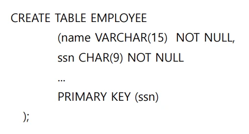

    - Schema를 만드는 언어

- DML(Data Manipulation Language)

    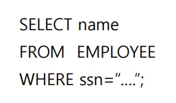

    - 데이터를 CRUD하는 언어(Select, Insert, Delete, Update)

> DDL, DML은 모두 SQL에 포함되어 있다.

- **SQL을 사용하는 방법**

    - DML은 범용 프로그래밍 언어에 삽입되어 사용될 수 있으며, 이때 범용 프로그래밍 언어를 **호스트**(Host) 언어라고 한다. Host 언어(Java, Python, Javascript 등)에서 DB와 통신할 때 DBMS 언어 사용된다. (내장)

---

## &lt;DBMS 아키텍처&gt;

- **중앙집중식 DBMS 아키텍처**

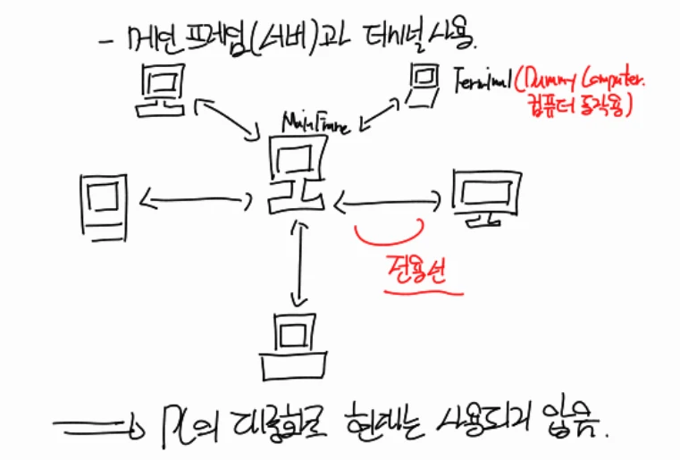

서버의 역할을 하는 Main Frame 컴퓨터를 두고, 데이터를 입력하고 필요한 정보를 출력하여 표시해주는 일을 터미널을 통해 수행한다.

⇒ 현재는 PC의 대중화로 인해 사용되지 않는다.

- **클라이언트/서버 아키텍처**

    > TCP/IP를 이용하여 PC와 데이터베이스 서버가 통신, 데이터를 주고 받는 구조이다.  
    > 인터페이스로 ODBC/JDBC 등을 사용하여 SQL query를 실행할 수 있다.

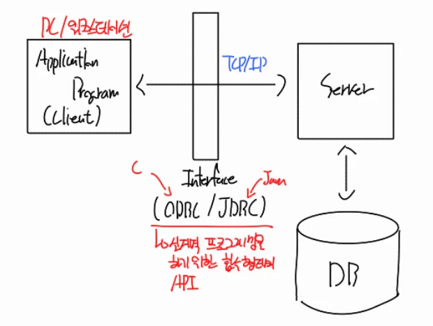

PC의 대중화로 인해 변경된 구조로서, 중앙집중식 DBMS 아키텍처에서 아래의 변화를 거친다.

1) 메인 프레임 → 서버

2) 터미널 → PC, 노트북, 스마트폰(Clients)

3) 전용선 → 인터넷(TCP/IP)

- **웹 응용을 위한 3층 클라이언트/서버 아키텍처**

    > PC와 데이터베이스 서버에서 요청을 처리하는 웹 서버가 생긴 3층 클라이언트/서버 구조.  
    > HTTP 웹 프로토콜을 사용해서 클라이언트의 요청을 구분하고, 여기서 데이터베이스 서버와 통신하여 데이터를 가져온 다음 전달해 줄 수 있다.

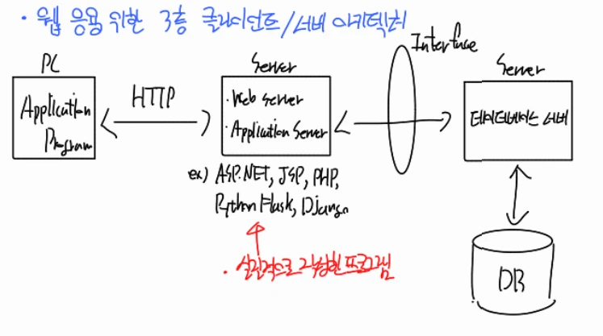

- **내장형(임베디드) 데이터베이스**

    > 다중 접속이 필요하지 않은 경우, 데이터 베이스를 Application 자체에 내장하는 방식이다.

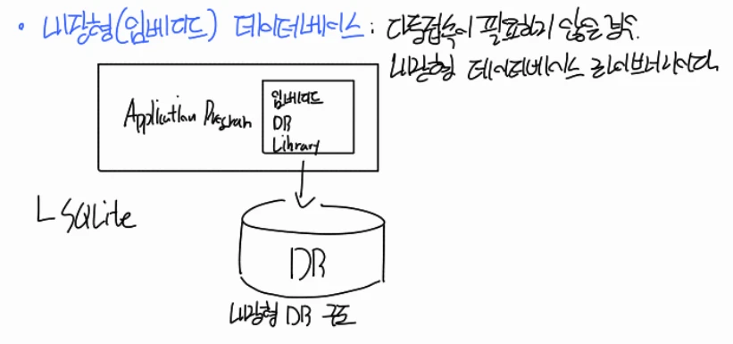
