# ER Diagram

## [ERD를 이용한 데이터베이스 모델링]

- 데이터베이스를 설계할 때 가장 먼저 할 일은?

    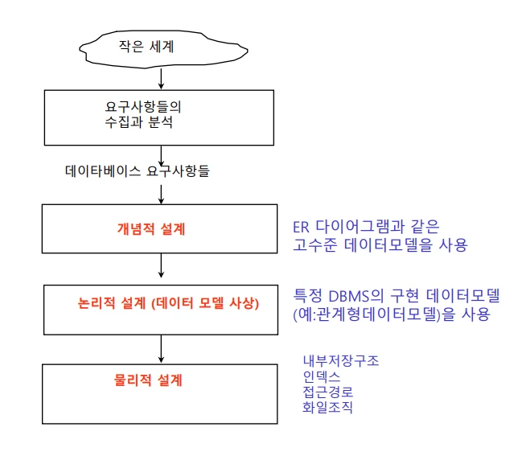

- **요구사항 수집과 분석**

    - 특정 집단의 요구에 맞게 데이터베이스를 설계하기 위해 요구를 분석한다.

- **개념적 설계**

    - ERD와 같은 고수준 데이터 모델을 사용 (***개념 데이터 모델***)

- **논리적 설계**

    - 특정 DBMS의 구현 데이터 모델 (***RDBS에서는 Table이 구현 데이터 모델***)

- **물리적 설계**

    - 내부 저장 구조, 인덱스, 접근 경로, 파일 조직 등을 다룸

> DB의 설계는 처음에는 개념적으로 접근하고, 점점 실체화/구체화 하는 과정이다.

### &lt;Example Database “Company”&gt;

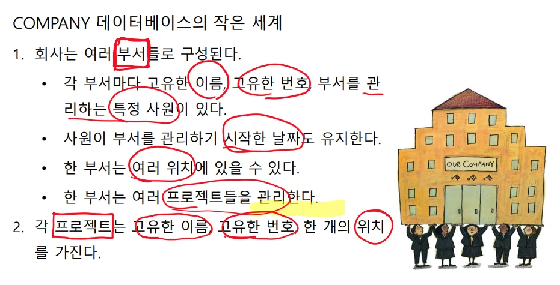

- 회사는 여러 **부서**들로 구성된다.

    - **부서**는 하나의 **Entity Type**이 될 수 있음.
    - **이름**, **고유한 번호**, **관리 사원**은 **Attribute**가 될 수 있음.
    - **부서 관리를 시작한 날짜**를 유지하므로, **Attribute**로 선정.
    - **부서**는 **여러 위치**에 있을 수 있고, 이를 **Attribute**로 표현해야 함.
    - 한 **부서**가 **여러 프로젝트들을 관리**하므로, 이를 **Attribute**로 표현해야 함.

- 각 **프로젝트**는 **고유한 이름**, **고유한 번호**, **한 개의 위치**를 가진다.

    - **프로젝트**는 하나의 **Entity Type**이 될 수 있음.
    - **고유한 이름**, **고유한 번호**, **한 개의 위치**는 **Attribute**가 될 수 있다.

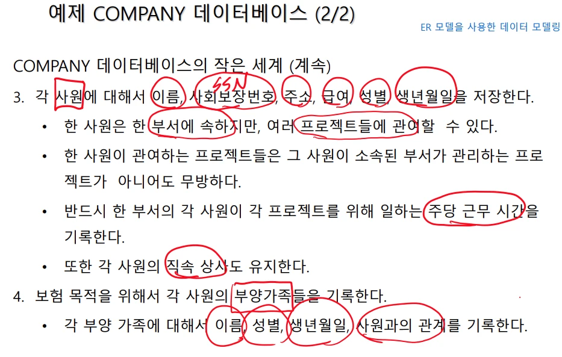

- 각 **사원**에 대해서 **이름**, **사회보장번호**, **주소**, **급여**, **성별**, **생년월일**을 지정한다.

    - **사원**은 하나의 **Entity Type**이 될 수 있음.
    - 한 **사원**이 **관여하는 프로젝트들**은, 그 사원이 **소속된 부서**가 **관리**하는 **프로젝트**가 **아니어도** 무방하다. ⇒ **자신의 부서가 관리하지 않더라도 프로젝트 참여 가능**
    - 반드시 한 부서의 각 **사원**이 **각**  **프로젝트를 위해 일하는**  **주당 근무 시간**을 기록하므로, 이 것을 **Attribute**로 표현해야 함.
    - 각 **사원**의 **직속 상사**를 유지해야 하므로, **Attribute**로 표현해야 함.

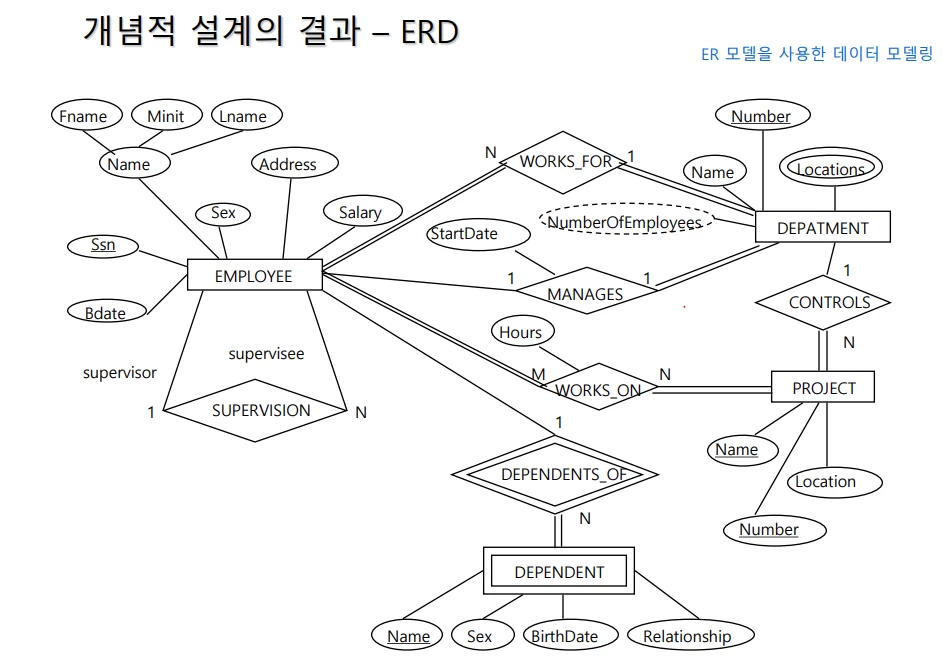

---

### &lt;ER Model&gt;

> DB의 개념적 설계를 위한 인기 있는 모델이다.

#### ER Model의 개념

- **Entity**

    - 실세계에서 독립적으로 존재하거나, 생각할 수 있는 실체
    - 최근에는 Object라는 용어로 지칭된다.
    - Table 내에 저장되어 있는 Row라고 볼 수 있으며, instance라고도 할 수 있다.

- **Attribute**

    - Entity를 기술하는 속성

> 실세계를 Entity, Attribute, Entity 간의 Relation으로 표현한다.

> ERD는 DBMS마다 표현하는 방법이 달라 보편화 되어 있지 않다.  
> 또한 Notation도 보편화 되어 있지 않다.

- **Entity Type**

    - 같은 Attribute를 갖는 Entity들의 집합. (**Class**와 동일하며, **Schema**라고 할 수 있음.)

    - Table이라고도 할 수 있으며, **Entity Type Name**은 **Table Name**이다.

        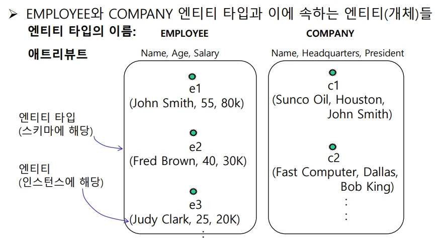

    - 엔티티 타입은 ERD에서 직사각형으로 나타낸다.

        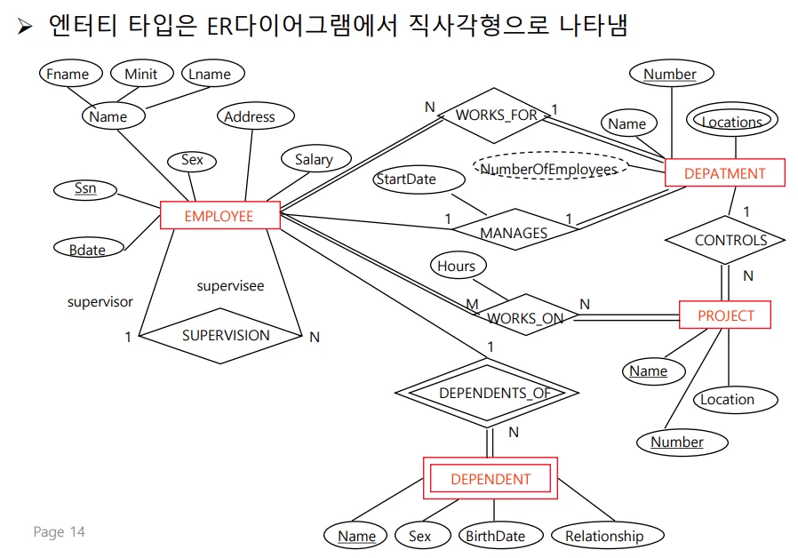

- ERD에서 Attribute의 표현

    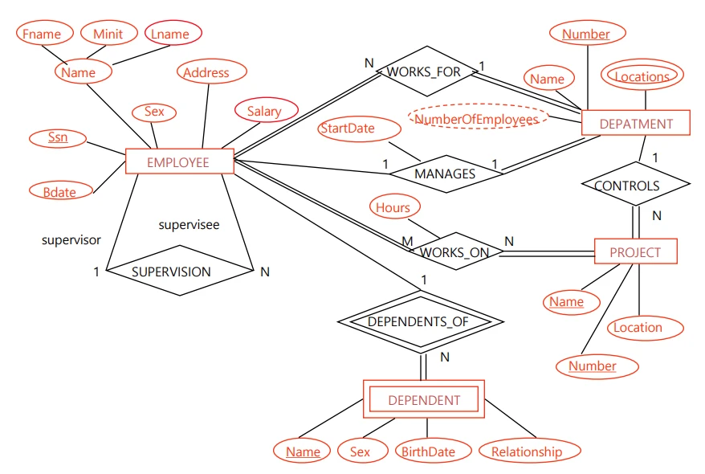

    - ERD에서 Attribute는 원으로 나타낸다. 반드시 특정한 Entity Type에 속해있다.

#### Attribute의 유형

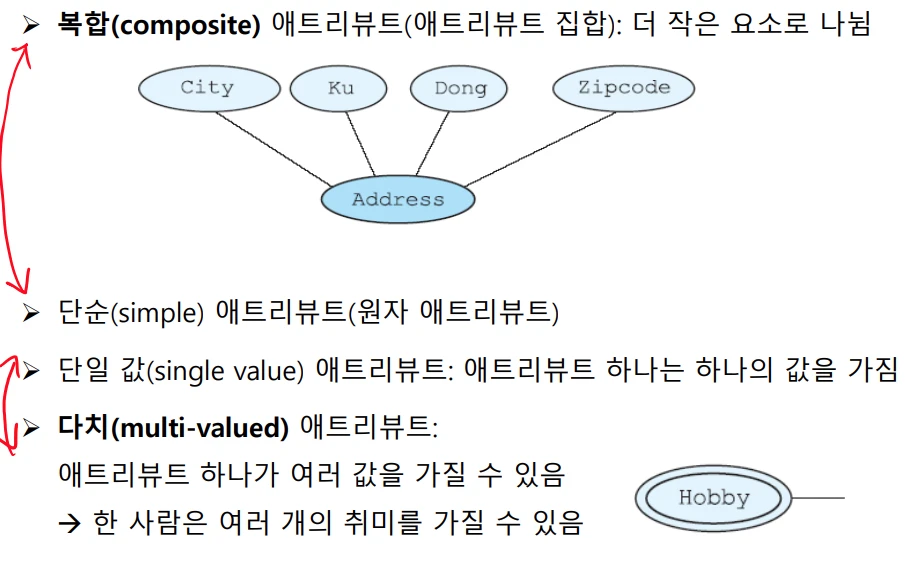

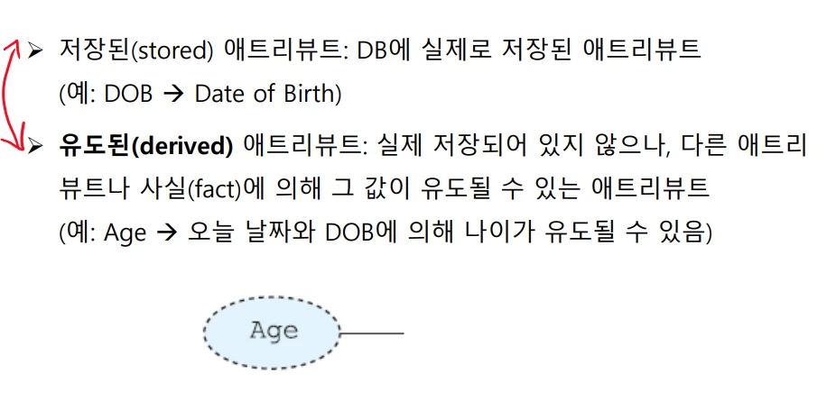

- **복합**(Composite) **Attribute**

    - 더 작은 요소로 나뉘는 Attribute이다.

- **단순**(single-value) **Attribute**

    - 하나의 원자값을 가지고 있는 Attribute이다.

- **다치**(multi-valued) **Attribute**

    - 여러 값을 가질 수 있는 Attribute이다. **외곽선을 두 줄로 나타낸다.**

        ⇒ ex. 한 사람은 여러 취미를 가질 수 있음.

- **저장된**(stored) **Attribute**

    - DB에 실제로 저장된 Attribute
    - ex. 사원의 생일 (Date Of Birth ⇒ DOB)

- **유도된**(derived) **Attribute**

    - 실제 저장되어 있지 않으나, 다른 Attribute나 사실(fact)에 의해 그 값이 유도될 수 있는 Attribute. 
    - ex. Age는 오늘 날짜와 DOB를 통해 유도될 수 있음.

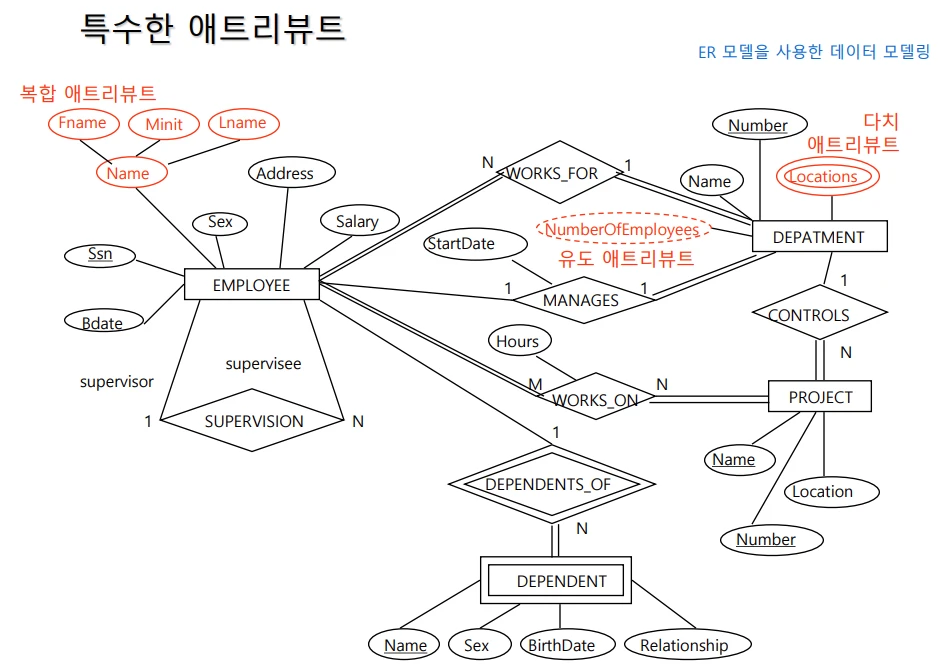

- 복합 애트리뷰트 : 한 애트리뷰트에 애트리뷰트를 선으로 연결하여 표현
- 유도 애트리뷰트 : 애트리뷰트의 외곽선을 점선으로 표현
- 다치 애트리뷰트 : 외곽선을 두 줄로 표현

#### Key Attribute

> 각 엔티티마다 서로 다른 값을 가지는 애트리뷰트.  
> 각각의 Tuple을 구분하는 역할을 한다.

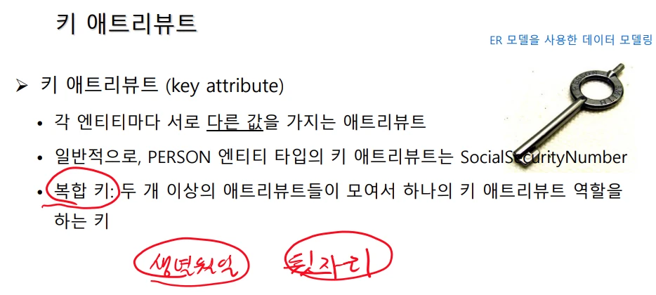

- **Composite Key Attribute**(복합 키 애트리뷰트)

    - 복합되어 사용되어야만 Key가 되는 애트리뷰트

    - ERD에서는 Attribute에 밑줄을 그어서 표현한다.

        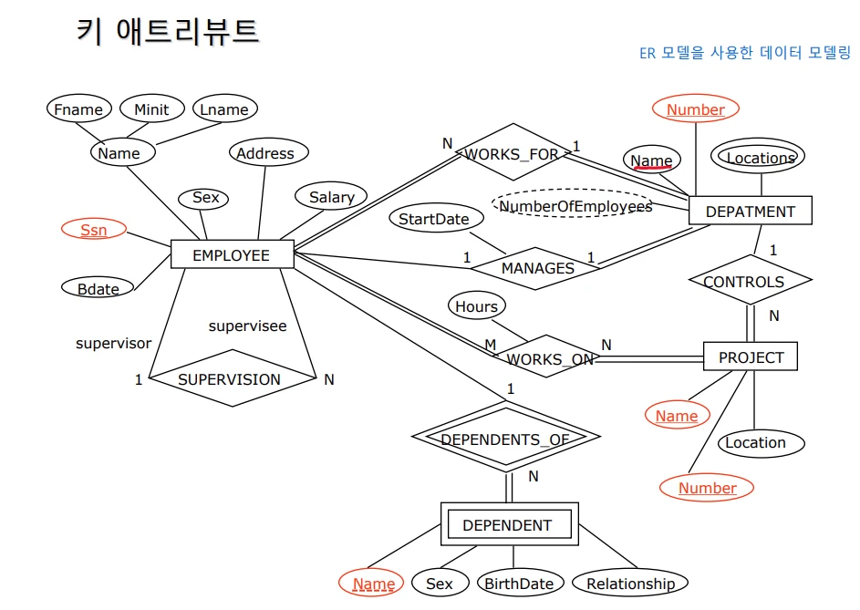

#### Company DB에 대한 초기 개념적 설계(ERD)

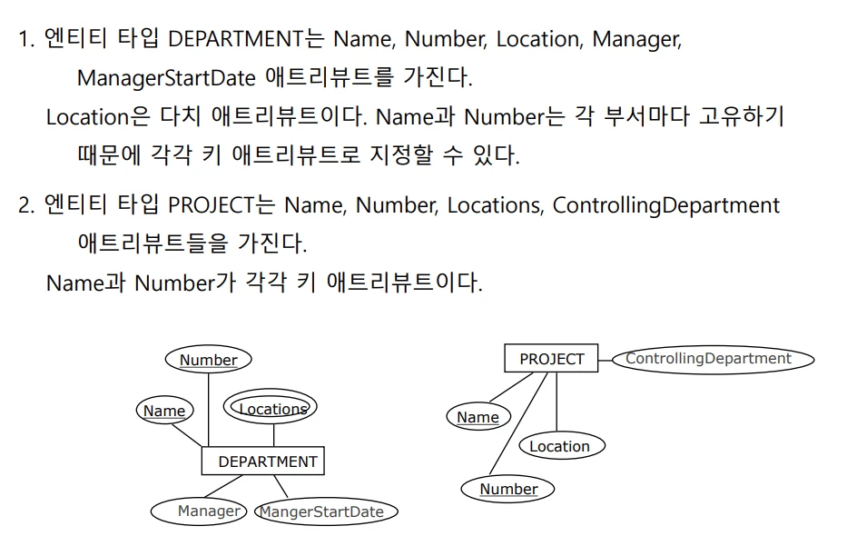

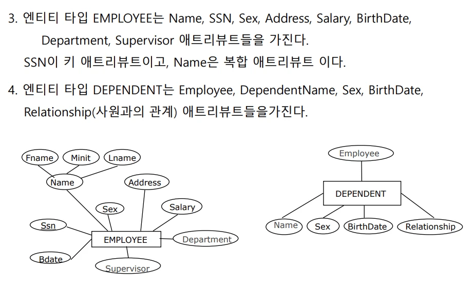

- 엔티티 타입의 애트리뷰트가 다른 엔티티 타입을 참조할 수도 있다.

    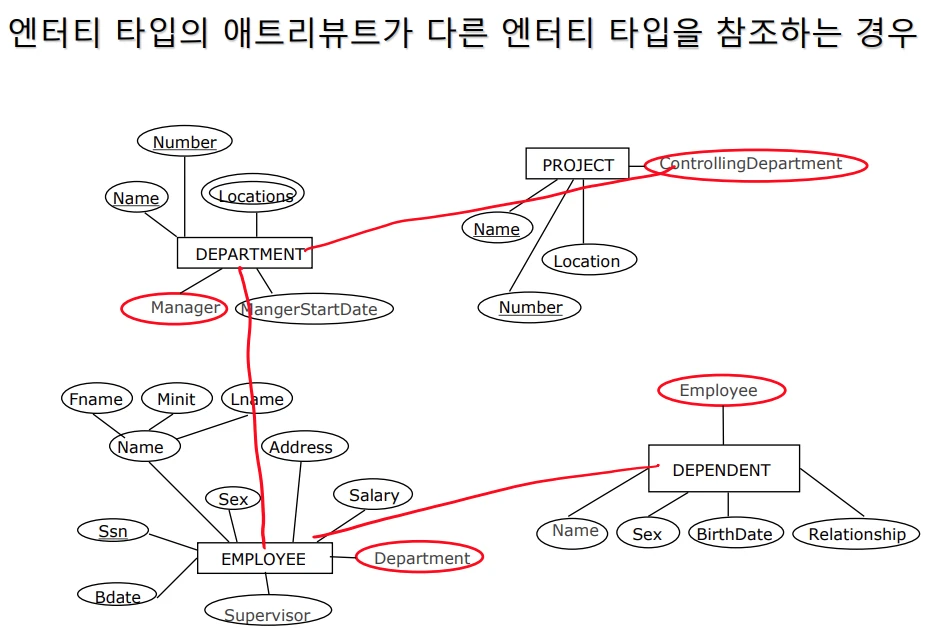

    - **PROJECT** Entity Type의 **Attribute**인 **ControllingDepartment**는, 해당 **PROJECT**를 관리하는 부서가 어디인지를 나타내는 것이다. 이때, 우리가 이미 **DEPARTMENT** Entity Type을 만들어 두었으므로, **DEPARTMENT**를 참조할 수 있다.
    - **EMPLOYEE** Entity Type의 Attribute인 Department는 해당 사원이 속한 부서이고, 부서는 DEPARTMENT로 만들어 두었으므로, 참조할 수 있다.
    - **DEPENDENT**(피부양자)  Entity Type은 부양 사원을 Attribute로 가지며, **EMPLOYEE** Entity Type을 만들어 두었으므로, 참조할 수 있다.

> 여기까지 표현을 마쳤다면, 이제 Entity 간의 관계를 표현해야 한다.

#### 관계 타입과 관계 인스턴스

> 관계 타입(관계 집합) R(Relation)은 엔티티 간의 연관들의 집합이다.

- **관계**와 **관계 타입**

    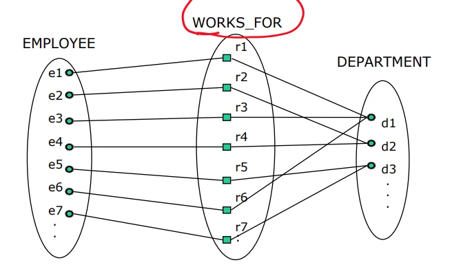

    - 이 그림에서 **관계 타입**은  **WORKS_FOR**이다. 
    - 서로 의미있는 정보를 갖도록 연관이 되는 Entity들을 선으로 연결하여 나타내는 것을 **관계**라고 하며, **WORKS_FOR** 관계 타입에서는 7개의 **관계 인스턴스**가 존재한다.

- **관계 타입의 차수**(degree)

    - 차수란, 관계에 참여하고 있는 엔티티 타입의 수를 의미한다.

    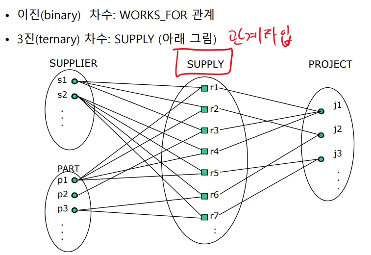

    - Relation Type **WORKS_FOR**는 두 개의 Entity Type이 관여하므로, **이진 차수**이다. 
    - Relation Type SUPPLY는 세 개의 Entity Type이 관여하므로, **삼진 차수**이다.

- **역할 이름과 순환적 관계**

    > 관계 타입은 ERD에서 다이아몬드로 나타낸다.

    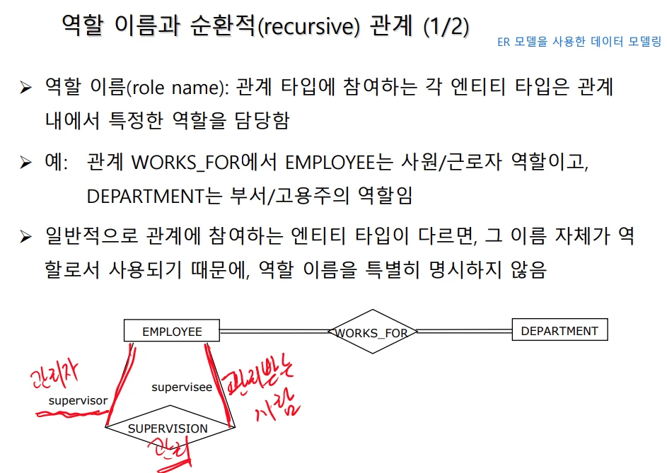

    - **관계 타입**에 참여하는 각 **엔티티 타입**은 관계 내에서 **특정한 역할을 담당**한다.
    - 일반적으로 관계에 참여하는 Entity Type이 다르면, 그 이름 자체가 역할이 되므로, **역할 이름**을 크게 명시하지는 않는다.
    - 하지만 **EMPLOYEE** Entity Type에서 **SUPERVISION** 관계 타입은, **EMPLOYEE** Entity Type이 자기 자신에 대해서 Relation을 갖는 순환 구조이므로, 반드시 **역할 이름**을 명시해 주어야 한다.

    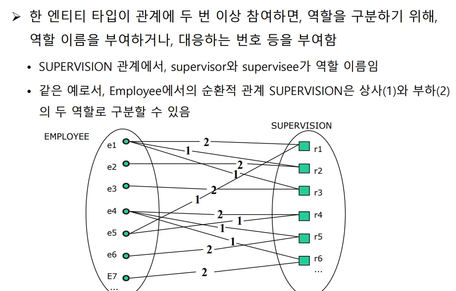

    - 이처럼 만약 한 엔티티 타입이 Relation에 두 번 이상 참여하면, 역할을 구분하기 위해 역할 이름을 부여하거나, 대응하는 번호 등을 부여해야 한다.

#### 관계 타입에서 제약 조건

- **Cardinality Ratio**

> Entity들이 관계에 참여하는 비율.  
> 관계는 1:1, 1:N, M:N 등 다양한 양상을 가질 수 있다.  
> **Cardinality Ratio**는 고객의 요구 사항에 맞추어야 한다.

- **1:1 Cardinality Ratio Example** (**MANAGES**)

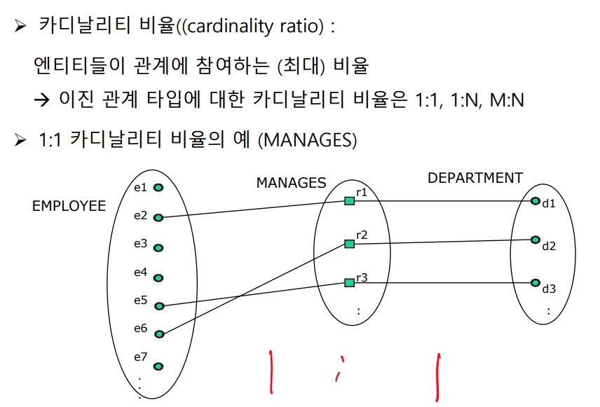

- **1:N Cardinality Ratio Example** (**WORKS_FOR**)

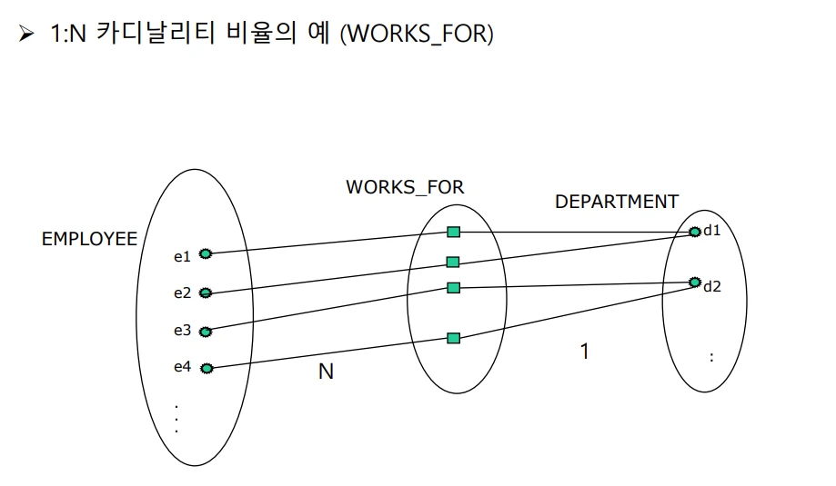

- **M:N Cardinality Ratio Example** (**WORKS_ON**)

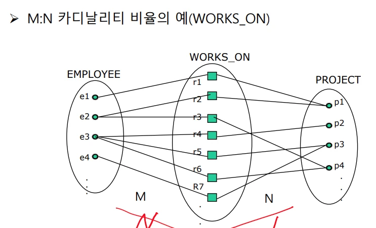

- Cardinality Ratio의 다른 표기법

    - (최소값, 최대값)을 사용한 표기법

        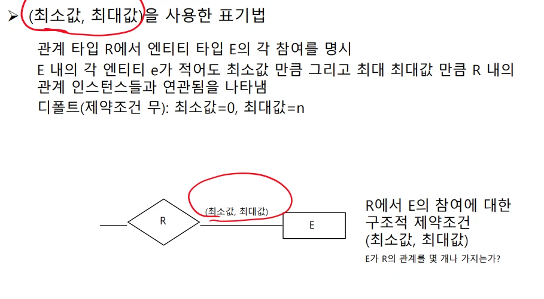

        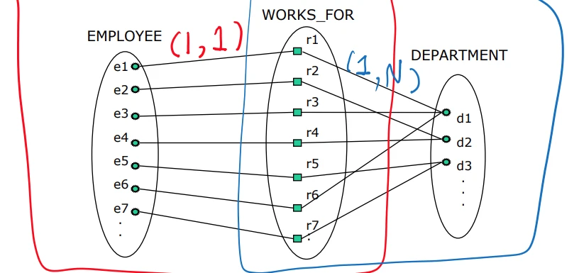

        - 특정한 Entity Type에 들어갈 수 있는 Entity의 개수는 계속해서 바뀔 수 있으므로, 만약 모든 Entity가 관계에 선택될 수 있다면, (최소값, 최대값) 표현에서 N으로 표현한다.

- **부분참여**와 **전체참여**

    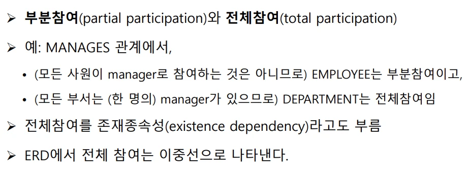

    - **부분참여** : Entity가 특정 Relation 내에서 **일부만** 참여하는 것

    - **전체참여** : Entity가 특정 Relation 내에서 **모두** 참여하는 것

        - 전체 참여는 ERD에서 **이중선**으로 나타낸다.

#### 관계 타입의 애트리뷰트

> 관계 타입도 애트리뷰트를 가질 수 있다.

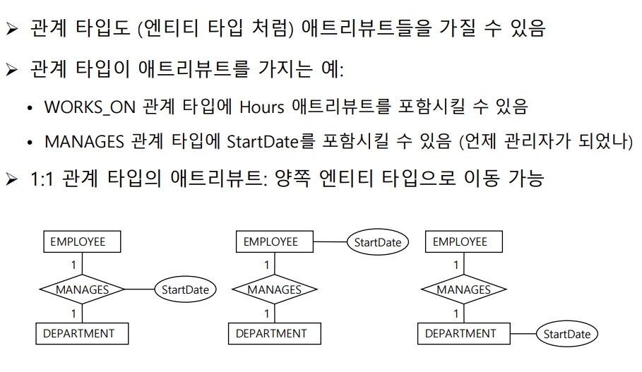

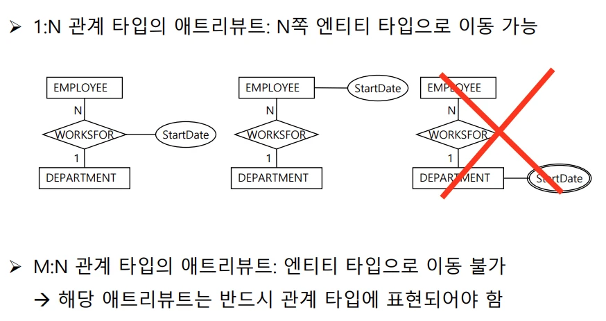

- **1:1 관계**에서 Relation이 Attribute를 가질 경우, 이 Attribute는 어느 쪽에서도 포함될 수 있다.
- **1:N 관계**에서 Relation이 Attribute를 가질 경우, 이 Attribute는 N쪽에서 Attribute로 표현된다.  
    (만약 1쪽으로 간다면, 해당 Attribute가 가진 의미가 퇴색될 수 있음. 위의 예시에서, **start_date**가 **DEPARTMENT**로 간다면, **EMPLOYEE**가 해당 **DEPARTMENT**에서 **일하기 시작한 날짜**라는 의미가 퇴색된다.)
- **M:N 관계**에서 Relation이 Attribute를 가질 경우, 이 Attribute는 어느 한 쪽으로도 이동할 수 없으며, **반드시 관계 타입에 표현**되어야 한다.

- **전체참여 예시**

    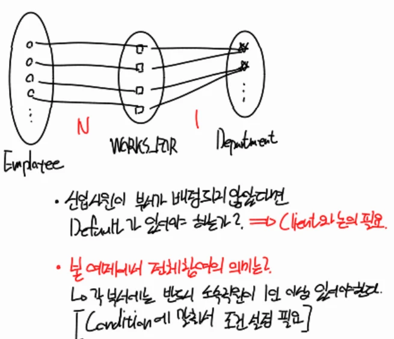

    - **WORKS_FOR**에서 **전체참여의 의미**는 무엇인가?

        ⇒ 모든 직원은 반드시 부서가 정해져 있어야 한다는 의미이다.  
        (만약 부서가 배정되지 않은 사원이 있다면, Default Value를 넣어야 하는지 Client와 논의)

#### Weak Entity Type(약한 엔티티 타입)

> 자신의 Key Attribute가 없는 Entity Type이다.

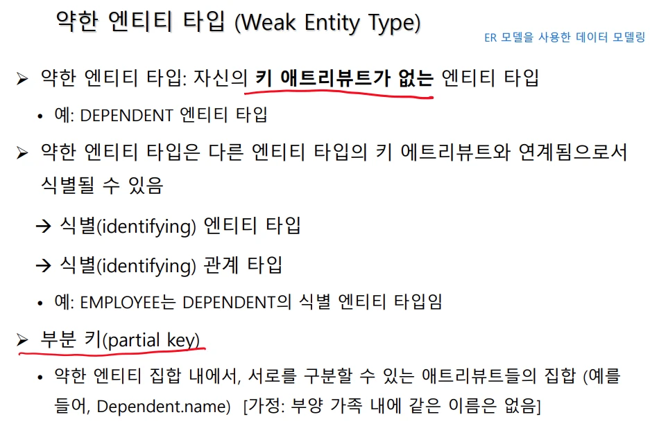

- **Weak Entity Type**은 각각의 Entity(Tuple)를 구별할 수 있는 Key Attribute가 없다.

    - ex. Company DB에서의 **DEPENDENT** Entity Type

- 이때, **Weak Entity Type**은 다른 **Entity Type**의 **Key Attribute**와 연계되어서 식별 가능하다.

    - **식별**(Identifying) Entity Type
    - **식별**(Identifying) Relation Type
    - ex. **EMPLOYEE**는 **DEPENDENT**의 **식별 Entity Type**이다. 왜냐면, DEPENDENT에는 부양 사원이 **Attribute**로 포함되며, 이것은 **EMPLOYEE**를 참조하는 것이기 때문이다.
    - **Weak Entity Type**은 **외곽선 두 줄**로 표현한다.

- **부분 키**(Partial Key)

    - 약한 엔티티 집합 내에서, 서로를 구분할 수 있는 애트리뷰트들의 집합.
    - 예를 들어, **Dependent.name** ⇒ 부양 가족 내에서 같은 이름은 없음.
    - 부분키는 **점선밑줄**로 표현한다.

> **DEPENDENT**는 **EMPLOYEE** Entity Type을 참조하고 있다. 참조를 하지 않는다면 **DEPENDENT** 내에서 각각의 **Entity를 식별할 수 있는 방법**인 **Key Attribute**가 없으므로, **DEPENDENT**는 **Weak Entity Type**이라고 할 수 있다. 이때, 같은 가족 내에서는 이름으로 서로를 구분할 수 있는데, 이를 **Partial Key**라고 한다.

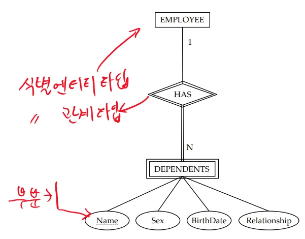

#### Company DB에 대한 ER 설계의 개선

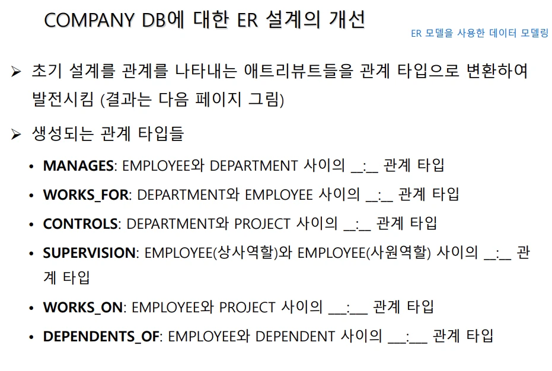

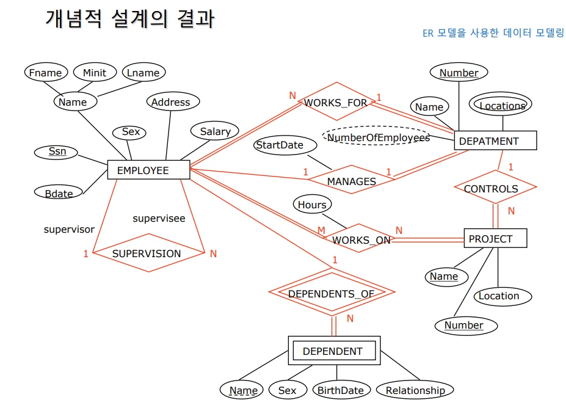

#### ER Diagram 표기법 요약

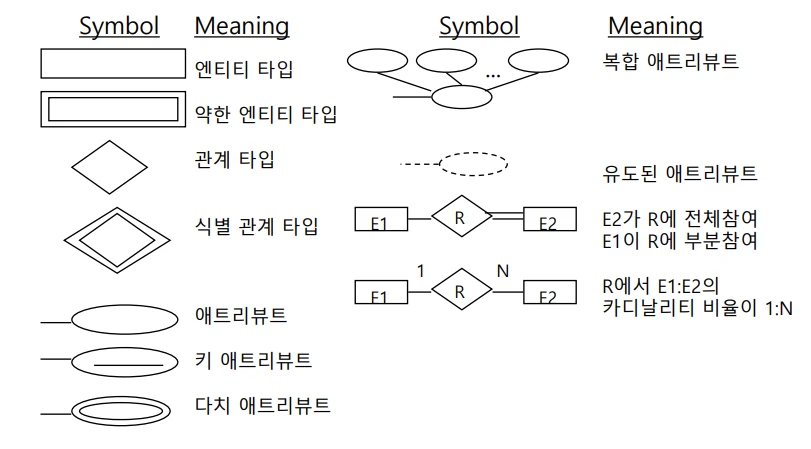

---

### &lt;ERD Example&gt;

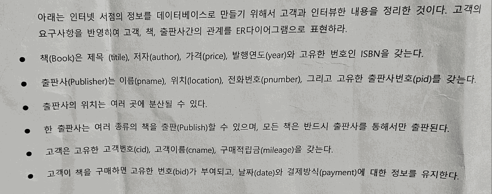

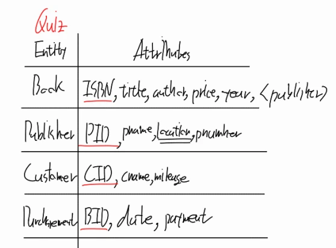

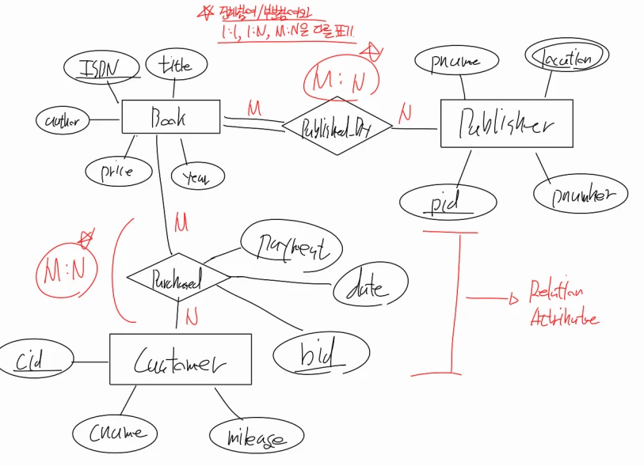
