# 관계형 데이터 모델과 제약 조건

작성일 2023-10-13 · 최종 수정일 2024-10-14
{ .post-date }

## [관계형 데이터 모델의 논리적 설계]

> **개념적 설계** : 개념적[고수준] 데이터 모델  
> **논리적 설계** : 구현[표현] 데이터 모델 ⇒ 관계 모델

---

### &lt;관계 모델의 용어&gt;

#### 관계 모델

- 관계 모델에서 데이터베이스는 **Table**의 **집합**으로 나타낸다.

    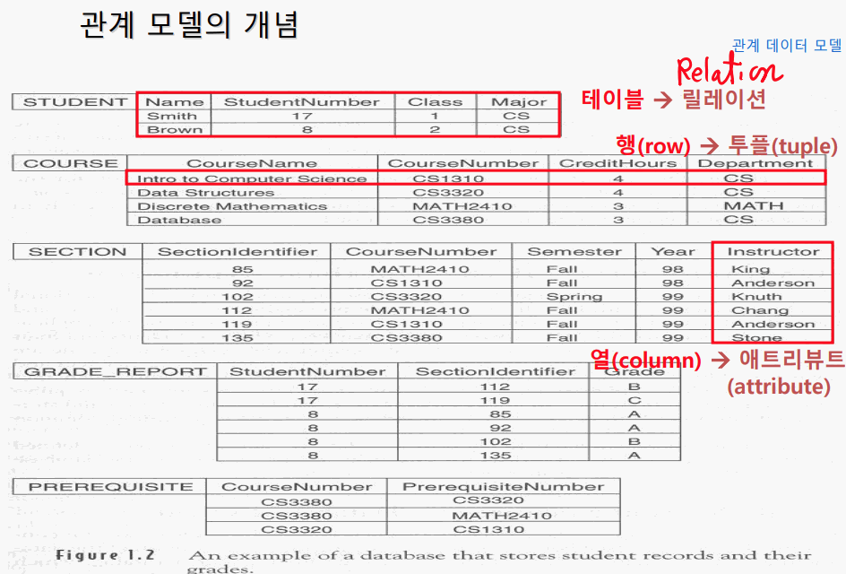

    - 각 **Table**(Relation)에는 **Row**(Tuple)가 존재한다.  
        ⇒ 관계 데이터 모델의 Relation은 개념적 설계에서의 Relation과는 다른 의미를 갖는다.
    - 각 Row에는 **Column**(Attributes)이 존재한다.
    - **Domain** : Attributes가 가질 수 있는 값의 집합.

- **ER 모델과의 비교**

    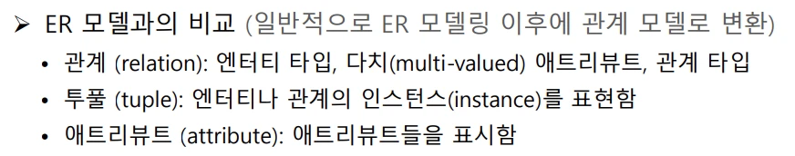

#### Null

- ‘**적용할 수 없음**(undefined)’의 의미.

    - ex. 전화번호가 없는 경우, 집주소가 없는 경우, 출신대학이 없는 경우.

- ‘**알려지지 않음**(unknown)’의 의미.

    - ex. 전화번호가 있으나, 아직 적용되지 않은 경우.

> Domain에 Null이 들어갈 수 있는 지 없는 지를 항상 염두에 두어야 한다.

#### Relation Schema(릴레이션 스키마)

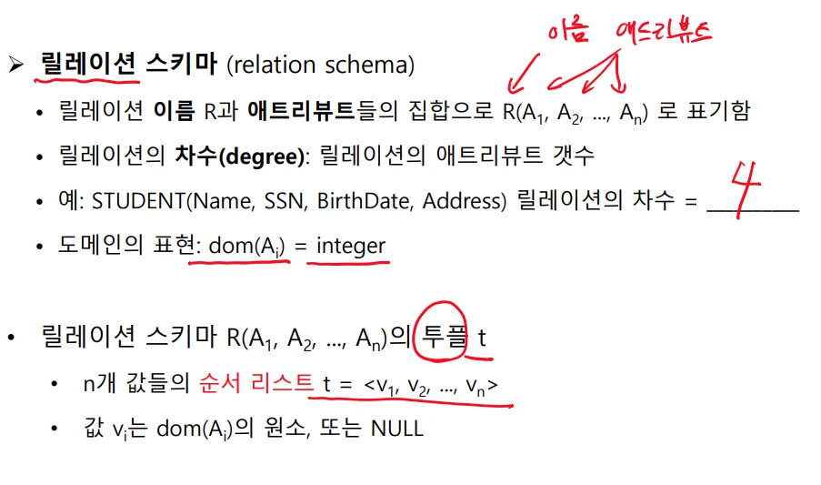

- 릴레이션(Table)의 이름 R과 애트리뷰트들의 집합으로 표기

    $$
    R(A1, A2, ..., An)
    $$

- **릴레이션의 차수**(degree)

    - 릴레이션의 애트리뷰트 개수
    - ex. STUDENT(Name, SSN, BirthDate, Address) ⇒ 릴레이션의 차수 : 4

    - 도메인의 표현 : dom(Ai) = integer 

        - Ai는 i번 째의 Attribute이다.

- **릴레이션 스키마 R<strong>(A1, A2, …, An)</strong>의 튜플 t**

    - n개 값들의 순서 리스트 t = &lt;v1, v2, …, vn&gt;
    - 값 vi는 dom(Ai)의 원소, 또는 NULL

    - 릴레이션 스키마 R에 대한 **릴레이션 상태** 또는 **릴레이션 인스턴스** r 또는 r(R)

        - 릴레이션 인스턴스 r(R)은 특정 시점에서의 상태; 실세계의 특정 상태.
        - 튜플의 집합; r = r(R) = {t1, t2, …, tm}
        - instance의 집합, snapshot과 같은 의미

#### Relation의 특성

- **Relation**은 **Tuple**들의 **집합**이다.

    - 중복을 허용하지 않는다.
    - 순서의 개념이 없다.

- **Tuple**은 **Attributes**의 **순서 리스트**(ordered list)이므로, 항상 순서를 유지해야 한다.

    - Attributes에 맞는 값이 들어가야 한다는 뜻.

- **Tuple** 내의 값은 더 이상 나눌 수 없는 **원자값**(Atomic Value)이어야 한다.

    - 값을 알 수 없거나 해당되는 값이 없으면, **NULL**이라는 특수 값을 사용한다.

> 다치/복합 Attribute는 관계 모델에서는 허용되지 않으므로, 추가적인 Attribute를 만들거나 Relation으로 빼내야 한다.

#### 관계 모델의 표기법 요약

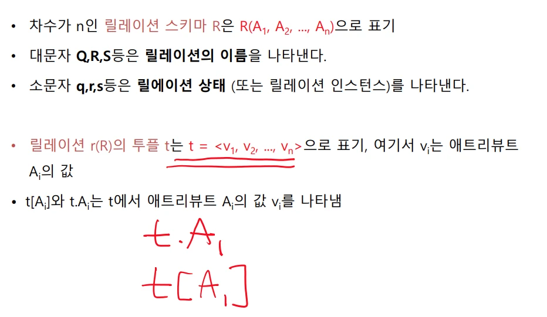

---

### &lt;관계 모델의 제약 조건&gt;

> **제약조건**은 모든 **Relation**의 **instance**들이 만족해야 하는 조건이다.  
>   
> 1) 도메인 제약조건  
> 2) 키 제약조건  
> 3) 널에 대한 제약조건  
> 4) 엔티티 무결성 제약조건  
> ⇒ 단일 Relation에 대한 제약조건  
>   
> 5) 참조 무결성 제약조건   
> ⇒ 여러 개의 Relations 사이의 조건

#### 1) 도메인 제약 조건

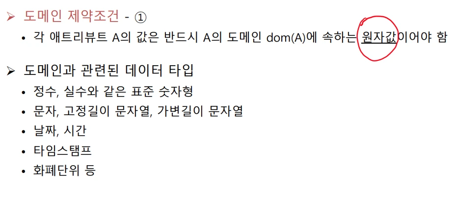

- 각 애트리뷰트 A의 값은 반드시 A의 도메인 dom(A)에 속하는 원자값이어야 함.

    - 즉, Tuple의 특정 Attribute는 들어갈 수 있는 값만 들어가야 한다는 뜻이다.

#### 2) 키 제약조건

- 릴레이션은 **튜플의 집합**이기 때문에, **모든 튜플은 중복되어서는 안된다.**

    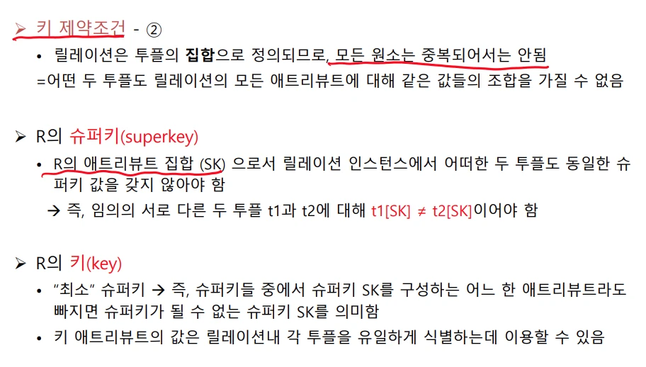

    - **Super Key** : Tuple이 중복되지 않도록 항상 Unique한 값을 갖는 Attributes의 조합.

        - 그러므로, R의 어떠한 Relation Instance들은 반드시 서로 다른 Super Key 값을 가져야 함.

            > ex. STUDENT Relation이 존재한다고 해보자.  
            >   
            > STUDENT Relation Schema  
            > | Name | SSN | HomePhone | Address | OfficePhone | Age | GPA |  
            > ⇒ 여기서 Superkey는, primary key가 될 수 있는 Attributes의 **조합**이다.  
            >   
            > Super key는 여러 개가 존재할 수 있다.

    - **Key** : **최소**  **슈퍼키** ⇒ 즉, 슈퍼키들 중에서 슈퍼키를 구성하는 어느 한 Attributes라도 빠지면 슈퍼키가 될 수 없는 슈퍼키를 의미한다.

    - **Candidate Key**(후보키) ⇒ **Key**가 될 수 있는 요소들. (**유일성 만족**)

        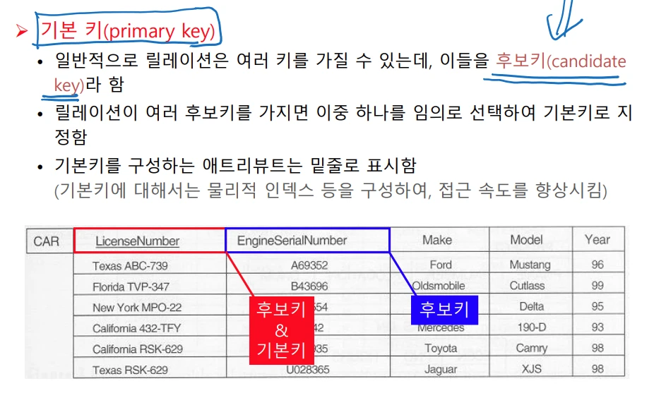

#### 3) NULL 제약조건

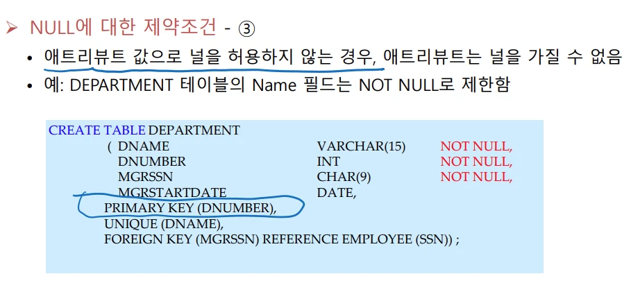

- NULL이 될 수 없는 Attributes들은 Not NULL 옵션을 설정해야 한다.

    - 현실적인 조건들을 반영해야 한다.

- **관계 데이터베이스 스키마**

    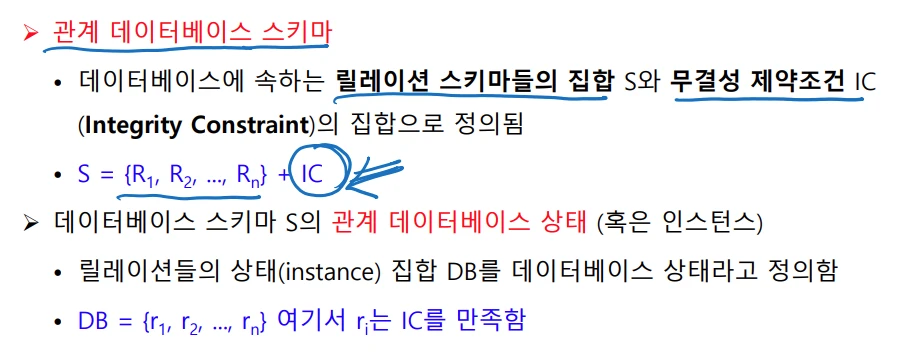

    - 데이터베이스에 속하는 **릴레이션 스키마들의 집합** S와 **무결성 제약조건 IC**(Integrity Constraint)의 **집합**으로 정의된다.

        $$
        S = \{R_{1}, R_{2}, ..., R_{n}\} + IC
        $$

    - 데이터베이스 스키마 S의 **관계 데이터베이스 상태** (혹은 인스턴스)

        - 릴레이션들의 상태(instance) 집합 DB를 **데이터베이스 상태**라고 정의한다.
        - 아래 조건을 만족하며, 여기서 ri는 IC를 만족해야 한다

        $$
        DB = \{r_{1}, r_{2}, ..., r_{n}\}
        $$

        > **정리**  
        >   
        > Relation의 상태 혹은 instance는 특정 순간에  Relation에 상태를 의미. 튜플의 집합.  
        > r = r(R) = {t1, t2, …, tn}  
        >   
        > 관계 데이터베이스의 상태 (혹은 인스턴스)는 이러한 r들의 집합을 말하며, 각각의 r은 반드시 무결성 제약조건 IC를 만족한다.  
        > DB = {r1, r2, …, rn}

        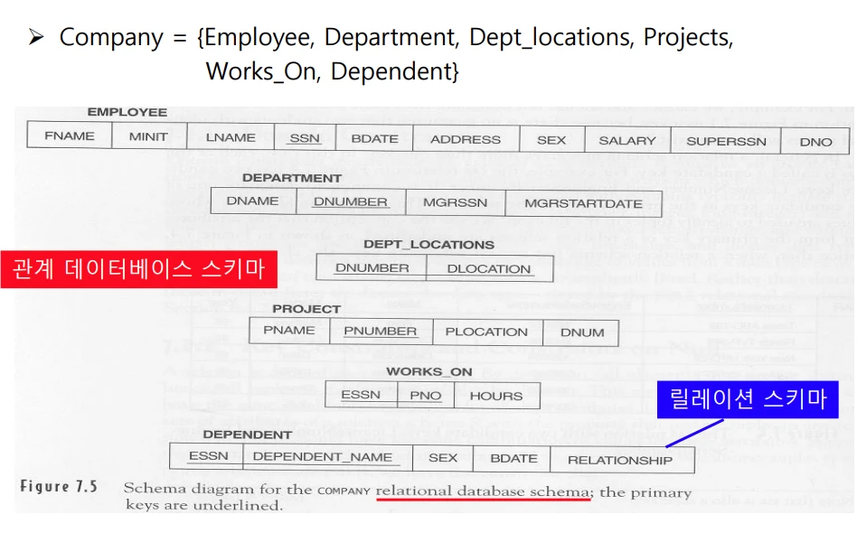

> 관계 데이터베이스 스키마 = 관계 스키마 집합(S) + 무결성 제약조건(IC)  
> ⇒ 그런데, 무결성 제약조건이라는 것은, 4), 5)만 포함하는 것인가?  
> ⇒ 모두 포함하는게 맞음!

- **무결성 제약조건**

#### 4) 엔티티 무결성 제약조건

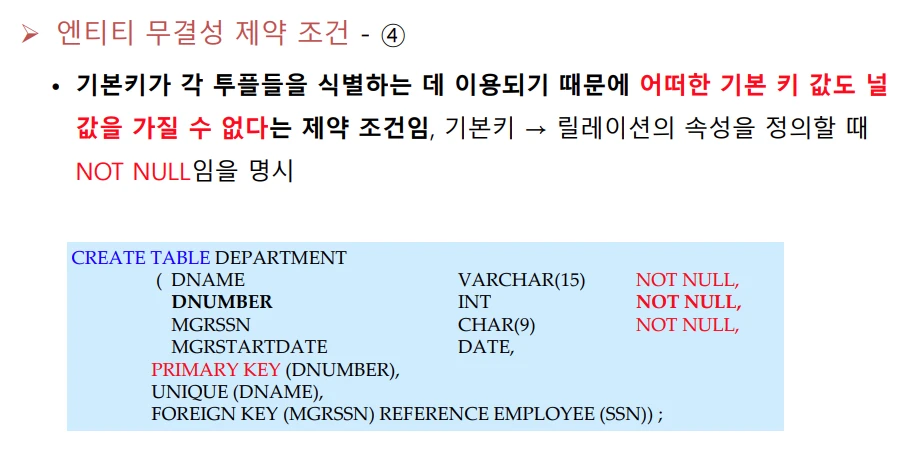

- 기본키가 각 튜플들을 식별하는데 사용되기 때문에, 어떠한 기본키도 값이 NULL이 될 수 없다.

> 지금까지는 단일 Relation에 대한 제약조건 이었고, 5)는 두 Relation에 대한 제약조건이다.

#### 5) 참조 무결성 제약 조건

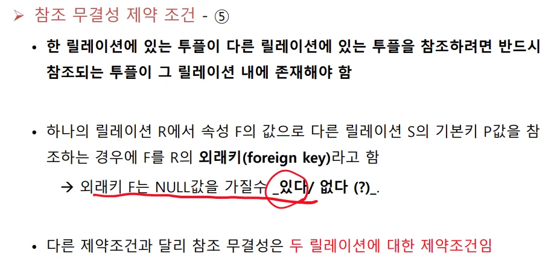

- 한 Relation의 Tuple이 다른 Relation의 Tuple을 참조하려면, 그 Tuple이 반드시 존재해야만 한다.

    > 하나의 Relation R에서 속성 F의 값으로 다른 Relation S의 기본키 P값을 참조하는 경우에, F를 R의 **외래키**(Foreign Key)라고 한다.  
    > ⇒ 정리하자면, 한 테이블의 Attribute가 다른 테이블의 기본키를 참조하면 외래키라는 뜻.

> 외래키는 항상 기본키를 참조하지만, NULL값을 가질 수 있다. 예를 들어, EMPLOYEE Relation에서 DNO이 DEPARTMENT Relation의 DNUMBER를 참조한다고 할 때, DNO을 반드시 가져야 하는게 아니라면 NULL이어도 된다. 다만 좋지는 않은 경우임.  
> 그리고, 만약 DNO을 반드시 가져야만 한다면 NULL이 될 수 없다.

#### 참조 무결성 제약 조건 예시

> **DEPARTMENT** 테이블을 **EMPLOYEE**에 한번에 붙여버리면 안되는걸까?  
> ⇒ 그래도 되기는 하지만, 매우 많은 중복이 발생하여 비효율적이다.  
> 참조를 한다면, DNO에서 integer value 하나로 DEPARTMENT를 참조할 수 있지만,  
> 참조를 하지 않는다면 EMPLOYEE의 모든 Tuple에 DEPARTMENT DNAME, MGRSSN, MGRSTARTDATE가 들어가야만 한다. 그리고 대부분이 똑같은 정보일 것이다.  
> 이것은 엄청난 수의 중복이 발생하기 때문에, 비효율적이라고 할 수 있다.

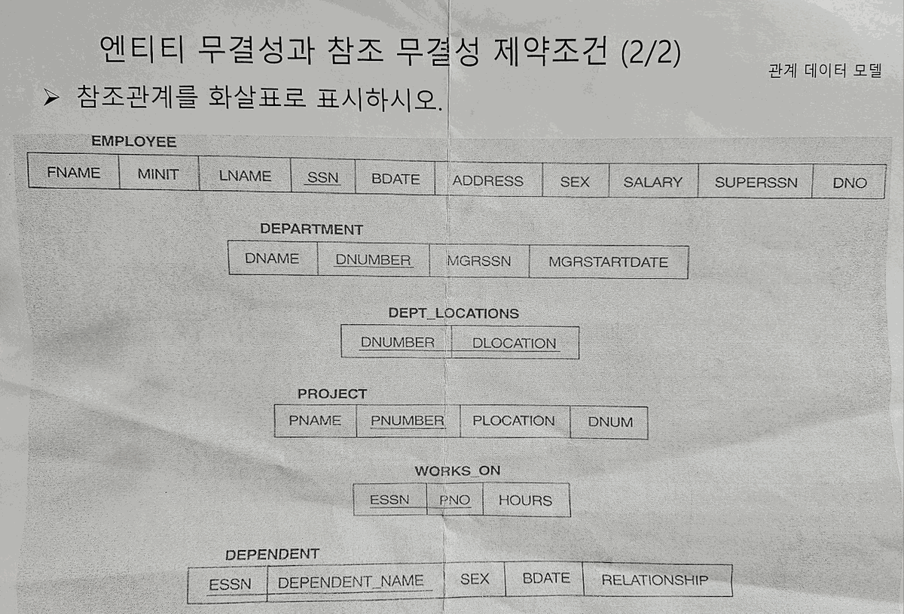

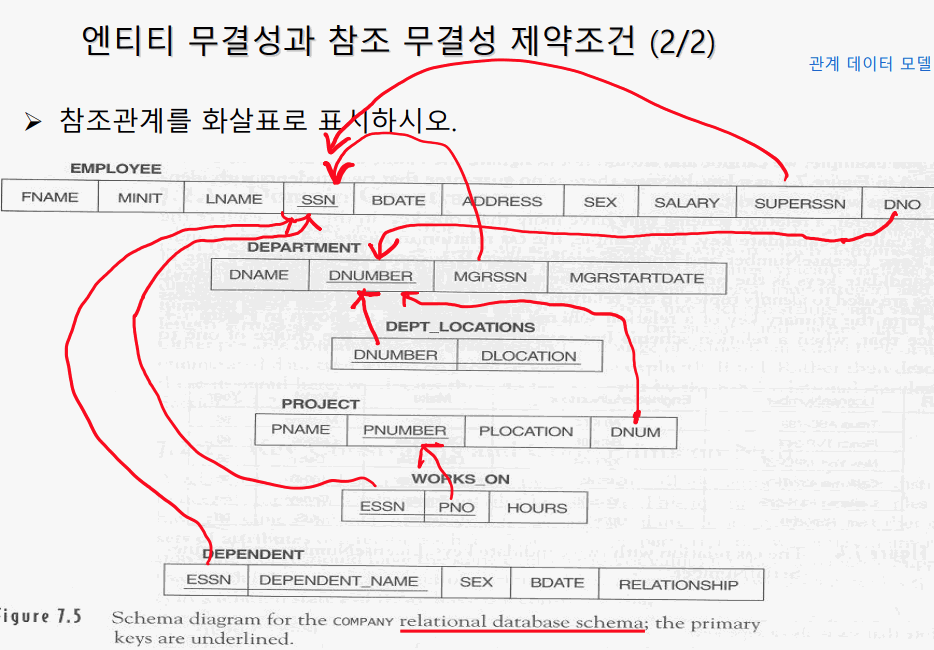

- SUPERSSN(**EMPLOYEE**) → SSN(**EMPLOYEE**)

    - 직속 상사의 사회보장번호 → 사원 사회보장번호 참조
    - Recursive이므로, Role name을 반드시 적어줘야 하는 것으로 보인다.

- MGRSSN(**DEPARTMENT**) → SSN(**EMPLOYEE**)

    - 부서 관리자의 사회보장번호 → 사원 사회보장번호 참조

- DNO(**EMPLOYEE**) → DNUMBER(**DEPARTMENT**)

    - 사원의 부서 번호 → 부서 번호 참조

- DNUMBER(**DEPT_LOCATIONS**) → DNUMBER(**DEPARTMENT**)

    - 부서가 위치한 지역에서, 부서의 번호 → 부서 번호 참조

- DNUM(**PROJECT**) → DNUMBER(**DEPARTMENT**)

    - 프로젝트를 담당하는 부서의 번호 → 부서 번호 참조

- PNO(**WORKS_ON**) → PNUMBER(**PROJECT**)

    - 사원이 일한 프로젝트의 번호 → 프로젝트 번호 참조

- ESSN(**WORKS_ON**) → SSN(**EMPLOYEE**)

    - 일한 사원의 사회보장번호 → 사원 사회보장번호

- ESSN(**DEPENDENT**) → SSN(**EMPLOYEE**)

    - 피부양자의 사회보장번호 → 사원 사회보장번호

> 다섯 개의 제약조건은 모든 릴레이션의 인스턴스들이 항상 만족해야 하는 조건이다.

---

### &lt;갱신 연산과 제약조건의 위반 처리&gt;

#### 관계 모델의 갱신 연산

- 추출 (retrieval) - Read

    - Read는 어떠한 제약조건도 위반하지 않는다. (이미 만족된 것을 읽기만 하기 때문이다.)

- 갱신 (update) - Write

    - 삽입 (insert)
    - 삭제 (Delete)
    - 수정 (Update)

> 갱신(삽입, 삭제, 수정) 연산을 하는 경우, 스키마에 정의된 (무결성) 제약 조건을 위반하지 않아야 한다.

#### Tuple의 삽입 연산 시 발생할 수 있는 제약조건 위반

- **도메인 제약조건** (**X**)

    - 잘못된 도메인의 값을 넣을 수 있으므로 **위반 가능**

- **키 제약조건** (**X**)

    - Primary Key는 항상 Unique 해야 하는데, 중복된 값을 넣을 수 있으므로 **위반 가능**

- **널에 대한 제약조건** (**X**)

    - **엔티티 제약조건에 포함된다고 볼 수 있음**.   
    - NULL이 되어서는 안되는 Attribute에 NULL을 넣어서는 안됨.   
        잘못해서 NULL을 넣을 수도 있으므로, **위반 가능**

- **엔티티 무결성 제약조건** (**X**)

    - Tuple의 Primary Key는 반드시 Not NULL이어야 한다.  
        잘못해서 NULL을 넣을 수도 있으므로 **위반 가능**

- **참조 무결성 제약조건** (**X**)

    - 외래키로 값이 참조되는 Relation의 Primary Key 값이 존재하지 않는 경우.  
        값이 없는 것을 참조하려고 할 수도 있으므로 **위반 가능**

> 삽입 연산 시에는 **모든 제약조건을 위반할 수 있다.**

#### Tuple의 삭제 연산 시 발생할 수 있는 제약조건 위반

- **도메인 제약조건** (**O**)

    - 값을 변경하는 것이 아니고 이미 만족된 것을 제거하는 것이므로, **위반 불가**

- **키 제약조건** (**O**)

    - 이미 Unique한 Primary Key를 가진 Tuple을 제거하는 것이므로, **위반 불가**

- **널에 대한 제약조건** (**O**)

    - 이미 NULL 조건을 만족한 Tuple을 제거하는 것이므로, **위반 불가**

- **엔티티 무결성 제약조건** (**O**)

- **참조 무결성 제약조건** (**X**)

    - 이미 외래키로 참조하고 있던 Relation의 Primary Key가 사라질 경우, 사라진 Primary Key를 참조하고 있던 외래키는 조건을 위반하게 되므로, **위반 가능**

> 삭제 연산 시에는 **참조 무결성 제약조건**만 위반할 수 있다.

> 삭제 연산이 참조 무결성 제약 조건을 위반하는 경우 취할 수 있는 세 가지 옵션  
> 1) Reject  
> 2) Default Value를 참조하게 만든다. (또는 Null로 값을 바꾼다.)  
> 3) Cascade Delete

⇒ 위의 세 가지 옵션 중 사용자가 응용의 특성에 맞게 적합한 것을 선택하는 것이 바람직함.

#### Tuple의 수정 연산 시 발생할 수 있는 제약조건 위반

> 수정 연산은 기본적으로 삭제 후 삽입과 같으므로, 모든 제약조건이 위반될 수 있음.  
> 단, Primary Key나 Foreign Key가 아닌 Attribute 값의 변경은 큰 문제가 없다.  
> ⇒ 도메인 제약조건의 위반 여부만 체크하면 된다.  
