# ER-관계 사상에 의한 관계 DB 설계

## &lt;DB 설계 단계&gt;

> 논리적 설계는 구현 데이터 모델인 관계 데이터 모델을 바탕으로, 데이터 모델 사상을 통해 진행한다.

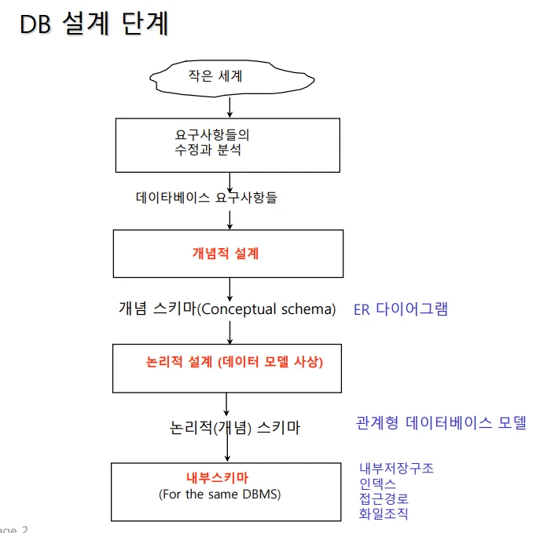

---

## &lt;ERD의 사상&gt;

- **개념적 설계**(ERD)

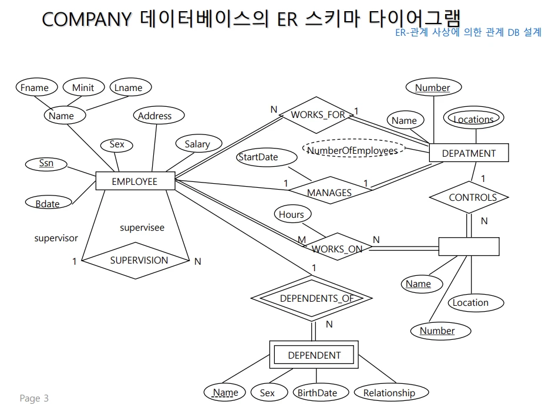

우측에 빈 Entity Type은 **PROJECT**이다.

- **논리적 설계**(관계 DB 스키마로 사상)

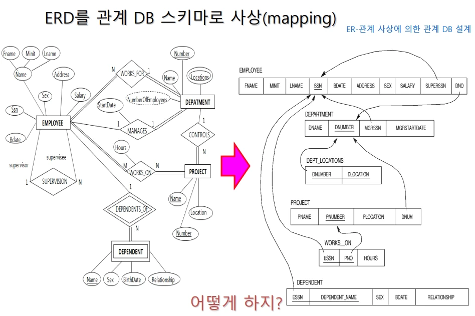

### 사상 1) Strong Entity Type

- **Strong Entity Type**을 Table로 바꾼다. 

    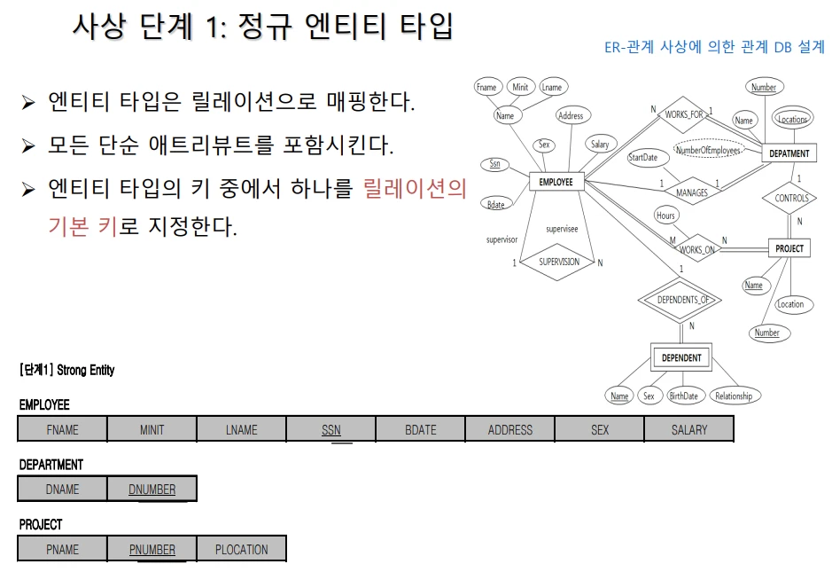

    - **EMPLOYEE**, **DEPARTMENT**, **PROJECT**

- 이때, **단순 Attribute**는 모두 **Attribute**로 표현한다.

    - **Composite Attribute**는 별도의 Attribute로 표현한다. (가장 단순한 방법. 혹은 Relation)
    - Tuple을 표현할 수 있는 **Key**를 지정한다.

### 사상 2) Weak Entity Type

- **Weak Entity Type**을 표현한다.

    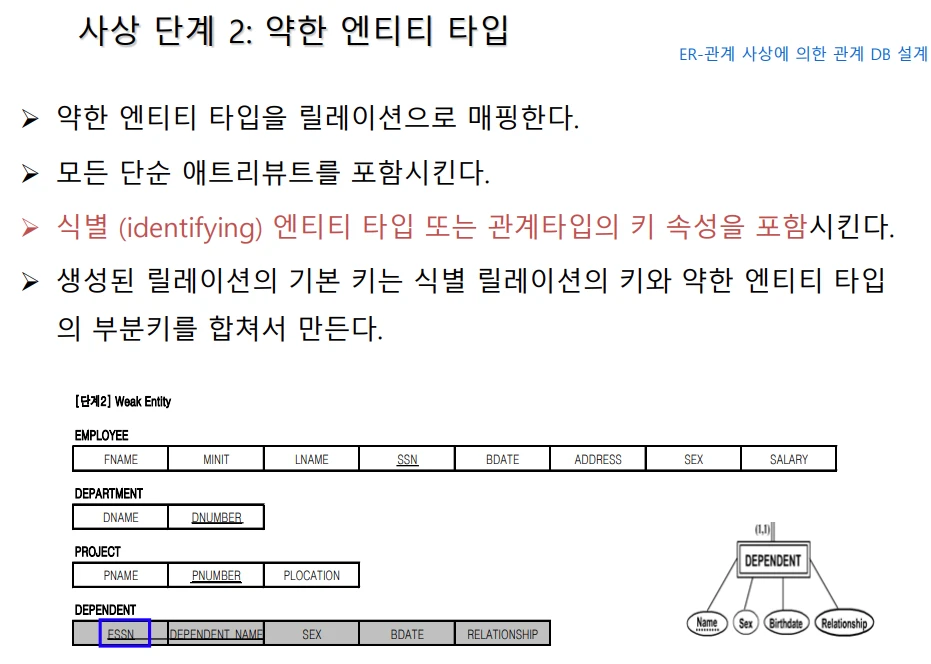

    - 직접적인 Primary Key가 없으므로, 식별 Entity Type의 Primary Key와 Weak Entity Type의 Partial Key를 합쳐서 구분이 필요하다.

        - ex. **DEPENDENT**의 경우, **EMPLOYEE**가 식별 Entity Type이며, Partial Key는 name이다.

    - 이때, **단순 Attribute**는 모두 **Attribute**로 표현한다.

        - Composite Attribute는 별도의 Attribute로 표현한다. (가장 단순한 방법. 혹은 Relation)
        - Tuple을 표현할 수 있는 Key를 지정한다.

### 사상 3) Relation 표현하기 (Cardinality Ratio에 따라서)

- **Entity Type**을 연관 짓는 **Relation**을 관계 모델로 사상할 때 크게 두 가지 접근법이 있다. 

    - **외래키 관점**에서 해결

    - **Relation**을 관계 데이터 모델에서의 Relation으로 표현 

        - 이때 만들어지는 새로운 Relation(Table)을 **관계 Relation**이라고 한다.

    - **1:1**,**1:N**, **M:N** 등의 **Cardinality Ratio** 표시 필요.

    - **부분참여**, **전체참여** 표시 필요.

        > Cardinality Ratio와 부분참여, 전체참여는 **Semantic**(내재적 의미)을 갖는다.

    - 개념적 수준의 Relation의 종류

        - **SUPERVISION**, **WORKS_FOR**, **MANAGES**, **CONTROLS**, **WORKS_ON, DEPENDENTS_OF**

- **1:1 관계를 Relation으로 나타내기**

    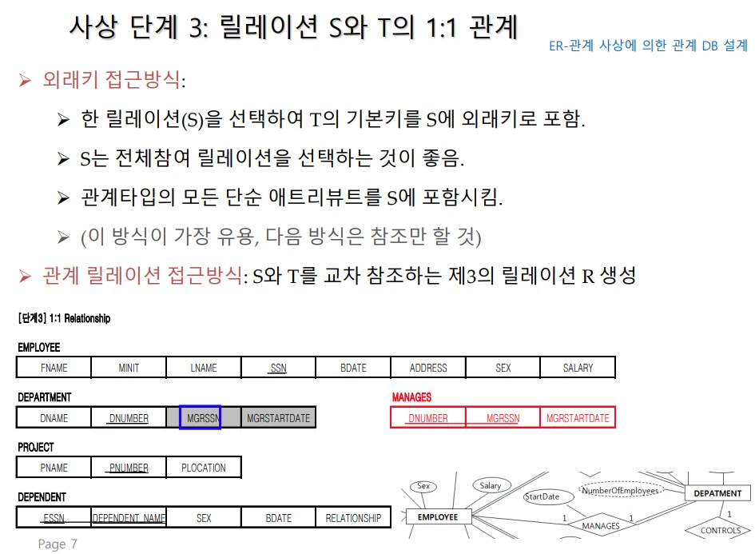

    - 1:1 관계에서는 둘 중 하나에다가, 다른 한 쪽의 Key를 포함시킨다.

        > **EMPLOYEE**, **DEPARTMENT** Relation을 예로 들자.  
        > **MANAGES** Relation을 보면 한 부서를 관리하는 사원은 반드시 한 명이므로, 1:1 관계임을 알 수 있다. 하지만 모든 사원이 포함되어야 하지는 않으며, 부서는 반드시 관리자가 있어야하기 때문에 전체참여임을 알 수 있다.  
        >   
        > 이때, **EMPLOYEE**의 **기본키**인 **SSN**을 **DEPARTMENT**에 **외래키**로 추가한다.  
        > 그리고 Relation의 Attribute인 **StartDate**를 **DEPARTMENT**에 추가한다.  
        > ⇒ **StartDate**를 **EMPLOYEE**에 추가할 수도 있겠지만, 그렇게 하면 참여하지 않는 사원들은 NULL 값을 가지게 되므로, 매우 비효율적이다.

- **1:N 관계를 Relation으로 나타내기**

    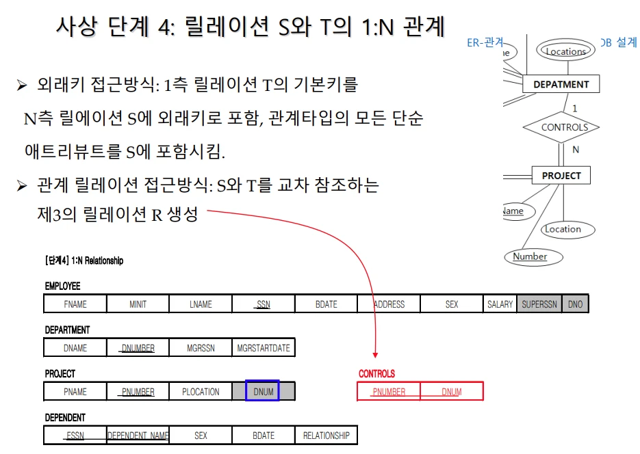

    - Table을 만들어도 되지만, 역시 **참조**를 해도 된다.

        > **DEPARTMENT**, **PROJECT** Relation을 예로 들자.  
        > **CONTROLS** Relation을 보면, 한 프로젝트는 반드시 참여하고 있는 부서가 있어야 되고, 한 프로젝트에 여러 부서가 참여할 수도 있다. 그러므로 1:N, 부분참여 전체참여 관계가 형성되어 있음을 알 수 있다.  
        >   
        > 이때, **DEPARTMENT**의 기본키인 **DNUMBER**를 **PROJECT**에 외래키로 포함시킨다.  
        > 만약 **PROJECT**의 기본키인 **PNUMBER**를 **DEPARTMENT**에 포함시키려면 여러 개의 프로젝트에 참여하고 있는 부서의 경우 **원자값으로 데이터를 보관할 수 없게 되므로** 문제가 발생하게 된다.

    - **SUPERVISION** (1:N)
    - **WORKS_FOR** (1:N)
    - **CONTROLS** (1:N)

    - **DEPENDENTS_OF** (1:N)

        - ***Q. 그런데, DEPENDENTS_OF는 Weak Relation이라서 외곽선이 두 줄인가?  
            A. Weak Relation이 아니라 Identifying Relation Type.***

- **M:N 관계를 Relation으로 나타내기**

    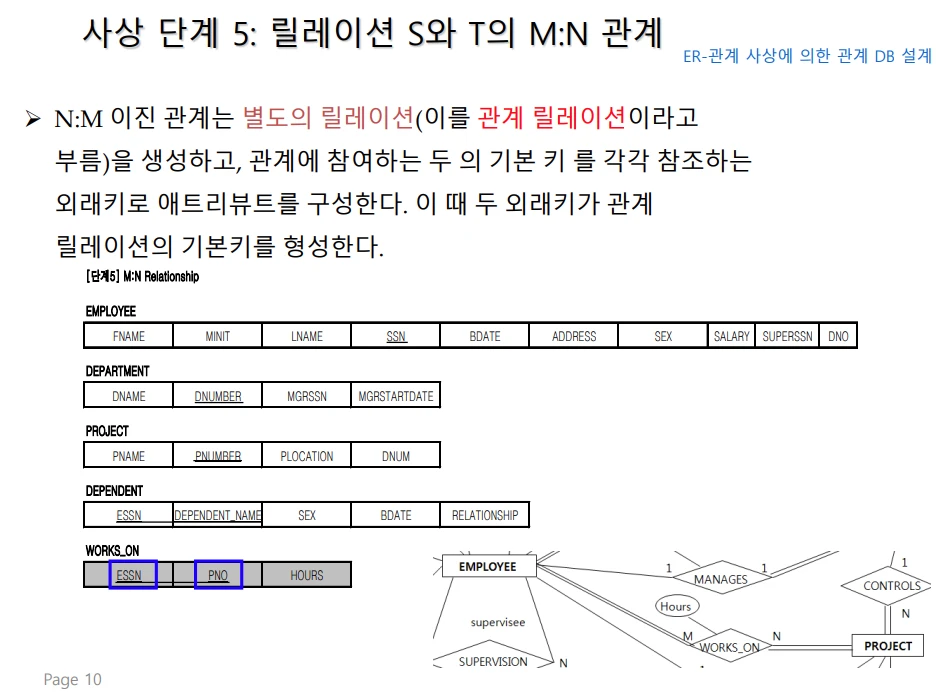

    - M:N 관계는 어쩔 수 없이 **Table을 새로 만들어야 한다.**   
        (다수의 Attribute가 관여되기 때문에, Attribute를 어딘가에 포함시킬 수 없음.)

        > **EMPLOYEE**, **PROJECT** Relation을 보자.  
        > **WORKS_ON** Relation을 보면, 한 프로젝트에는 여럿의 사원이 참여할 수 있고, 또, 한 사원이 여러 프로젝트에 참여할 수 있음을 알 수 있다. 또한 각 프로젝트는 반드시 사원이 존재해야 하며, 각 사원도 반드시 소속된 프로젝트가 있어야 하기 때문에 두 개 다 **전체참여**로 설정된 것을 알 수 있다.  
        >   
        > 이때, M:N 관계에서는 어느 한 쪽의 기본키를 참조하는 외래키를 만드는 방식으로는 해결할 수 없다. 왜냐면, 한 **사원**이 몇 개의 **PROJECT**에 참여할 지 예상할 수도 없기 때문이다. 반대로, 한 **PROJECT**에 몇 명의 **EMPLOYEE**가 있을지도 알 수 없기 때문이다.  
        >   
        > 따라서, M:N 관계는 반드시 새로운 Relation을 생성해서 해결할 수 있다. 각 **Relation**의 Primary Key를 모두 가져와서 Primary Key로 연결해 사용해야 한다. **WORKS_ON**이 가지고 있던 Attribute는 새롭게 만들어진 Relation의 Attribute로 추가된다.

### 사상 4) 다치 애트리뷰트

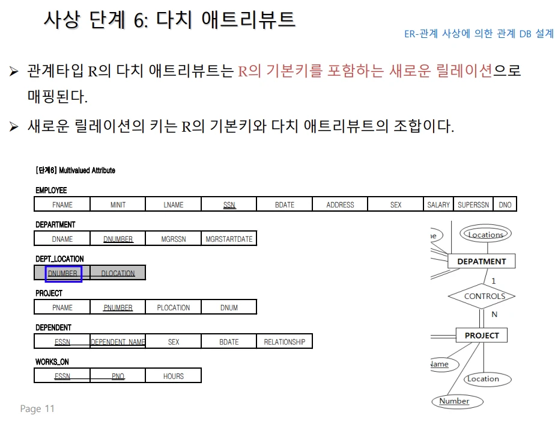

- 다치 애트리뷰트는 새로운 Relation으로 표현한다.

### 사상 5) n차 관계

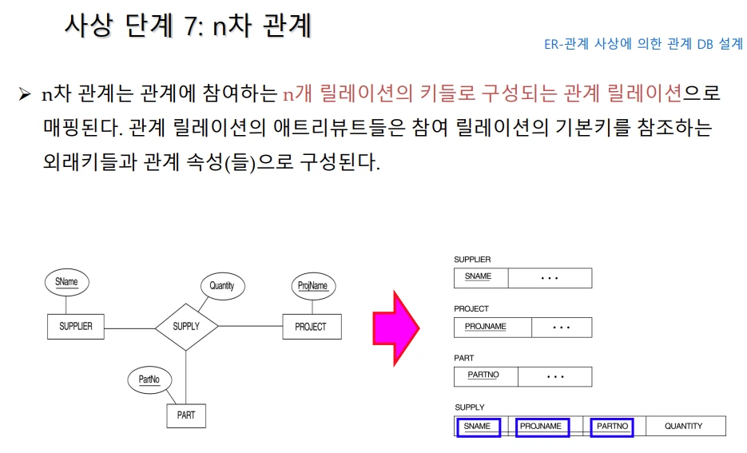

- **n차 관계**는 관계에 참여하는 **n개 Relation들의 키**들로 구성되는 **관계 릴레이션**으로 매핑된다.
- n차 관계의 관계 릴레이션의 애트리뷰트들은, 참여 릴레이션의 기본키를 참조하는 외래키들과 관계 속성으로 구성된다.

---

## &lt;최종 사상 결과&gt;

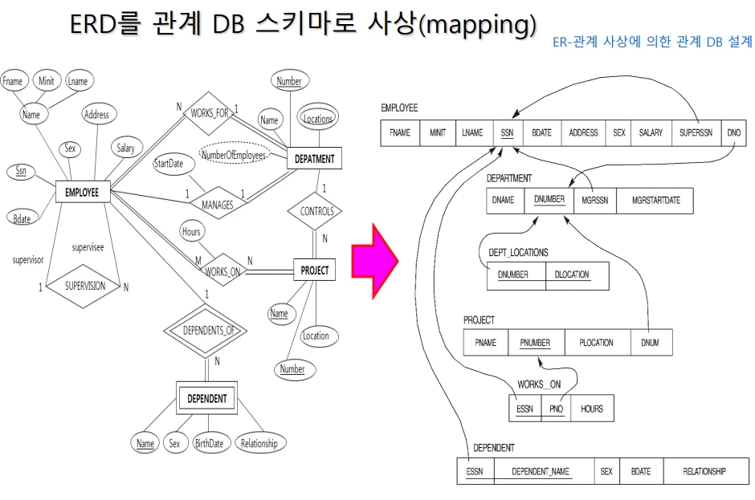

---

## &lt;Book Example Mapping&gt;

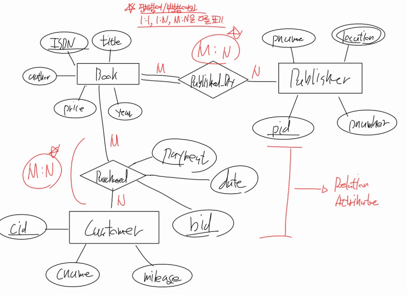

- Publish N:1 관계임…

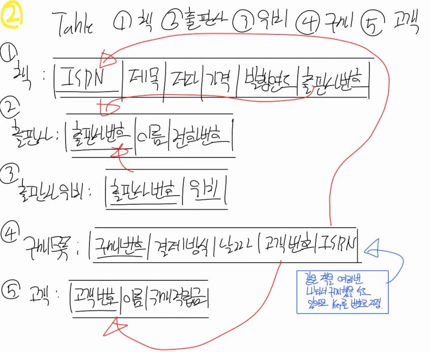

---

> 질문 사항   
>   
> 1) Relation의 애트리뷰트도 당연히 &lt;고유한&gt; 값일 수 있다. 그런데 만약 M:N 관계일 때는 관여하는 두 Table의 Key를 넣어줘야 하고, 그것만으로는 구분이 불가능한가?  
> ⇒ Key의 원칙에 따르면 Key는 Super Key들 중에서 최소여야 하므로, Key는 bid가 되어야 하는 것으로 보인다.  
>   
> 2) 만약 M:N Relation에서 양쪽 다 전체참여이고 Attribute가 없다면, 어떻게 표현하지?  
>   
> ⇒ Ex. USER(Table)와 STARTER_ITEMS(Table)가 있다고 해보자. USER는 게임을 플레이하는 유저의 정보이고, STARTER_ITEMS는 게임이 처음 시작될 때 제공되는 아이템들이며, 반드시 모두 나눠서 분배해야만 한다. 그런데 유저에는 직업이 있어서, 특별한 직업의 경우에는, 스타터 아이템을 여러 명이 나눠 갖는 것도 가능하다고 하자. 다만 스타터 아이템은 모두 선택이 되어야만 한다.  
>   
> 이런 상황에서 Relation을 표현하면 M:N 전체 참여가 가능해지며, Relation Attribute는 존재하지 않는다.  
>   
> 이 경우, 관계 Relation을 만들어야만 한다. 예를 들어 A라는 유저가 곡괭이와 삽을 가지고 싶은데, 이걸 얼마나 가질지 예측할 수 없으므로 Column을 만들어 놓을 수 없다. 그러므로 Relation을 새로 만드는 것이 정답이다.

> 1) M:N Relation Type이더라도, Relation Attribute가 존재하지 않는다면 Foreign Key 방식으로 문제 해결이 가능하다.  
> ⇒ Book Example의 경우에는 Book과 Publisher의 Relation이 M:N으로 표현되지만, Publisher의 Pid를 Book Table의 Attribute로 추가하고 Foreign Key로 지정하는 방식으로 해결했다. 이때, 전체참여인 Book 쪽에 Pid를 넣었다.  
>   
> 2) M:N Relation이 Attribute를 가질 경우, 새로운 Table을 만든다. 그런데 만약 기존의 Table의 Key를 조합하여 만든 Composite Key로는 Key의 역할이 불가능할 경우, 새로운 것을 도입해야 한다.  
> ⇒ Book Example의 경우에는 구매번호인 Bid를 새로 만들었다. 다만, 참조는 하게 만들어 주어야 할 것이다.

> 정리)  
>   
> 1. M:N 관계일 때 애트리뷰트를 갖지 않는다면 외래키 방식으로 해결이 가능할 수 있다.   
> 2. 다만 둘 다 전체참여일 경우에는 Relation 관점에서 해결해야만 한다.  
> 3. 그런데 만약 M:N 관계에서 애트리뷰트가 존재하는데 관련된 Relation들의 Key를 통하여 Composite Key를 만들어 내는 것 만으로는 구별이 불가능하다면 추가적인 Key를 도입해야만 한다. ⇒ Book Example에서는 Bid를 도입
