# 관계 대수 (Relational Algebra)

## &lt;관계형 데이터베이스에서의 질의(Query)&gt;

1. **Design Schema** (ERD → Table)
2. **Load Data** : 데이터는 보통 txt로 기록되어 있다. (.csv : comma separated values)
3. **Execute Queries**

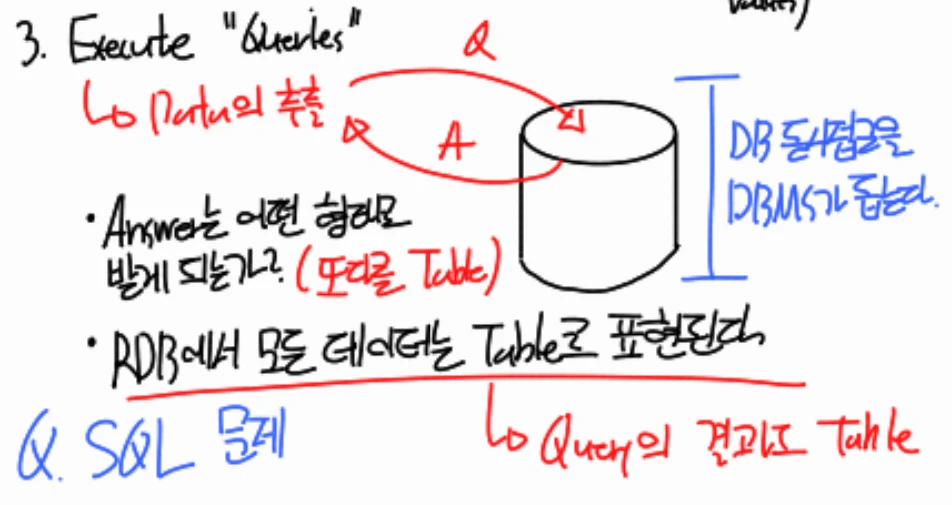

- Query를 통해 원하는 데이터를 전달받을 수 있으며, RDB에서 모든 결과는 Table로 표현된다.

    - 이때 DB에 대한 동시접근은 DBMS가 처리한다.

### Query(질의) 언어

> Query 언어는 DB에 데이터를 요청할 수 있는 언어이다.  
> 대표적으로 **관계 대수**, **SQL**이 있다.

- **데이터 모델**의 구성요소

    - 데이터베이스 **구조**와 **제약조건**의 정의
    - 관계를 다루기 위한 **연산**들의 집합

- 관계 대수 연산의 종류

    - 수학적 집합 연산 : 합집합, 교집합, 차집합, 카티션 프로덕트
    - 관계 데이터베이스를 위한 특별 연산 : Select, Project, Join 등

---

## &lt;관계대수&gt;

### 예시 테이블

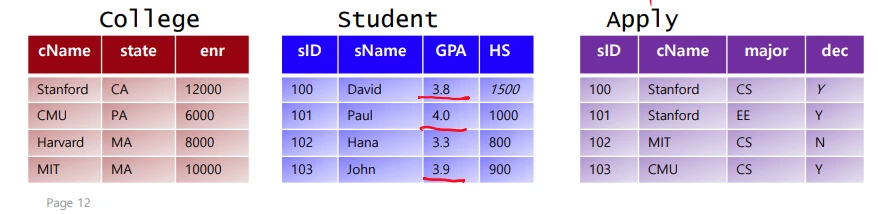

### Select 연산

> Relation에서 Tuple을 잘라내는 연산이다.

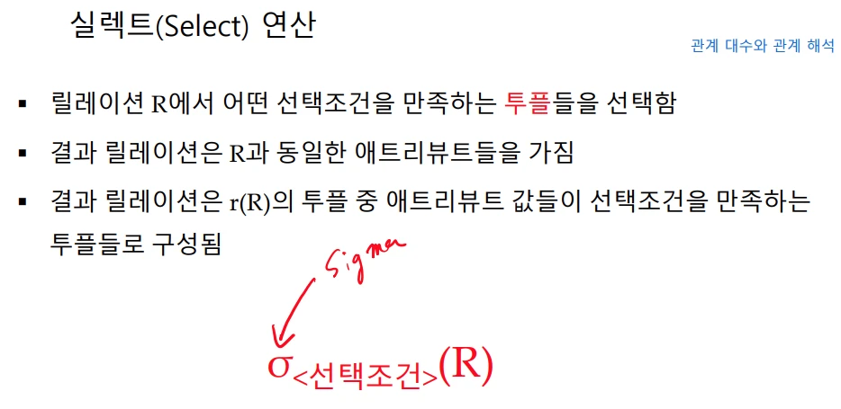

- ex. **Students with GPA &gt; 3.7 and HS &lt; 1000**

    - select는 기호 sigma로 표현한다.
    - condition에서 and는 ∧(and)로 표현된다.
    - 탐색할 Table의 이름을 적어야 한다.

$$
\sigma_{(GPA>3.7\bigwedge HS<1000)}(Student)
$$

- ex. **Applications to Stanford CS major**

    $$
    \sigma_{(cName='Stanford'\bigwedge major='cs')}(Apply)
    $$

### Project 연산

> Relation R에서 Attribute를 명시적으로 선택하는 연산.

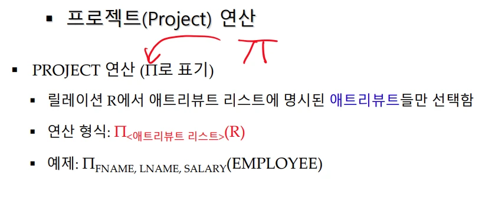

- ex. **ID and decision of all applications**

$$
\Pi_{sID, dec}(Apply)
$$

- ex. **ID and name of students with GPA&gt;3.7**

$$
\Pi_{sID, sName}(\sigma_{GPA>3.7}(Student))
$$

- ex. **List of application majors and decisions** (***Duplication 발생***)

$$
\Pi_{major,dec}(Apply)
$$

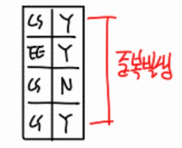

이렇게 Query를 실행할 경우, 중복이 발생하게 된다.

### Cartesian Product(카티션 곱)

> 두 집합에 대해서 가능한 모든 조합을 만들어내는 연산이다.  
> Relation을 연결지어서 정보를 얻어낼 수 있다.  
> Cartesian Product를 하면, Attribute name이 유지된다.

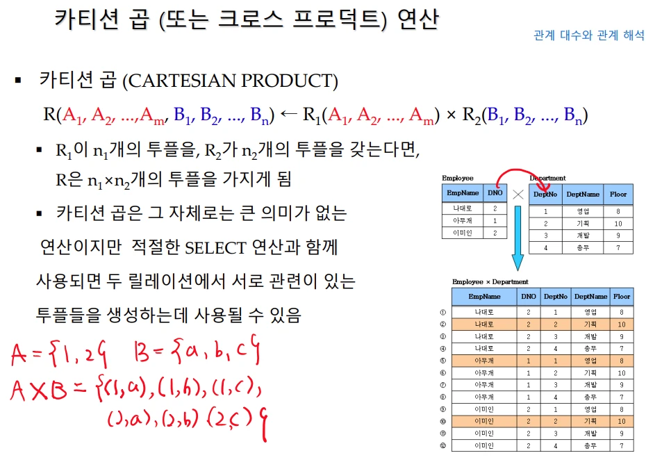

> Cartesian Product는 두 Relation에 대해 사용될 때 만들 수 있는 모든 조합을 만들어내지만, Semantic한 의미를 고려해서 의미가 있는 Tuple만 사용할 수 있도록 Select와 Project를 사용해야만 한다.

- ex. **Names and GPAs of students with HS &gt; 1000 who applied to CS and were rejected.**

$$
\Pi_{sName,GPA} 
\\( \sigma_
{
(Student.sID=Apply.sID\bigwedge HS>1000 \bigwedge major='cs'
\bigwedge dec='N')
}   (Student \times Apply))
$$

> ⇒ ***Q. 그런데 생각해보니, Cartesian Product를 쓰면 Project를 할 때 attribute의 name이 지정되어 있지 않으므로 renaming을 해야하지 않나?***  
>   
> ⇒ ***A. Cartesian Product는 attribute의 name이 유지된다. 그러므로 renaming 필요 x. 다만, Student와 Apply에서 이름이 같은 sID는 구분이 안되므로 지정해준다.***

- ex. **등록학생이 10000명보다 많고, CS 전공(major)에 지원자가 있는 학교의 이름을 구하시오.**

    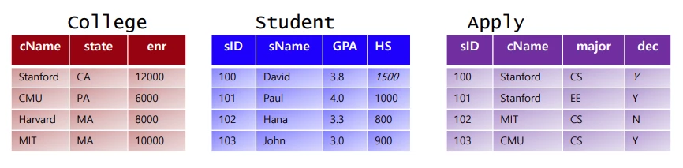

    $$
    \Pi_{cName}(\sigma_{(College.cName=Apply.cName\bigwedge enr>10000 \bigwedge major='cs')}(College\times Apply))
    $$

    - Apply.cName은 College.cName을 Foreign Key로 참조한다.

### Natural Join

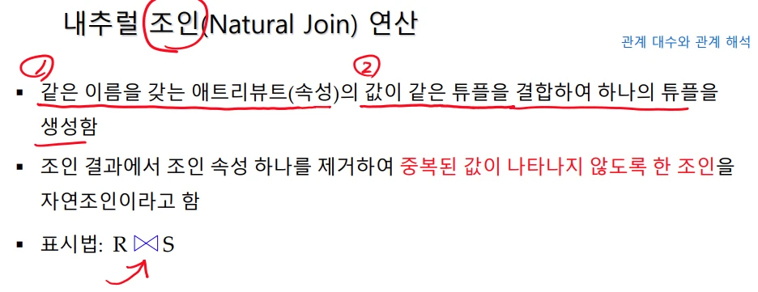

> Cartesian Product, Select, Project로 만들 수 있지만, Short cut의 역할을 한다.  
> 두 Relation에서 같은 이름은 갖는 Attribute에서, 값이 같은 튜플을 결합해 하나의 튜플을 생성한다.

⇒ Join 결과에서 Join 속성 하나를 제거해서 중복된 값이 나타나지 않도록 한 Join이다.

- **표기법**

$$
R⋈S
$$

- ex. **Names and GPAs of students with HS &gt; 1000 who applied to CS and were rejected**

$$
\Pi_{sName,GPA}
(
 \sigma
 _{
  (HS>1000
  \bigwedge 
  major='cs' 
  \bigwedge
  dec='N')
 }
 (Student⋈Apply)
)
$$

> ⇒ ***Q. sName, GPA는 renaming이 필요하지 않음?***  
> ⇒ ***A. 필요하지 않음. join을 하면 sName과 GPA는 unique하다.***

- ex. **Names and GPAs of students with HS &gt; 1000 who applied to CS at college with enr &gt; 10,000 and were rejected**

    - **Names and GPAs of students with HS &gt; 1000**

        - Select로 HS&gt;1000 이상인 애들을 Student에서 가져온다.
        - Project로 sName과 GPA를 자른다.

    - **who applied to CS … and were rejected**

        - CS 지원자이며 떨어진 학생이므로,  Student와 Apply는 join이 필요하다.
        - Select의 조건으로 major=’cs’ 

    - at college with enr &gt; 10,000 

        - 지원한 대학의 enr이 10000명 이상이므로, College와 Apply는 join이 필요하다.

$$
\Pi_{sName,GPA}
(
\sigma_
{
(enr>10000
\bigwedge
major='cs'
\bigwedge
dec='N'
\bigwedge
HS>1000)
} \\
(Student⋈(College⋈Apply)
)
)
$$

### Theta Join 연산

> Theta Join은 특정 조건을 만족하는 Join을 구현하는 연산이다.

- **표기법**

$$
R⋈_{\theta}S
$$

- **조인 선택률**(Join Selectivity)

$$
\frac{R⋈_{\theta}S}{R\times S}
$$

⇒ Cartesian Product로 나올 수 있는 모든 조합을 분모로 만들고, 만들어진 결과를 Theta Join의 결과로 한다. 이걸로 비율을 구하면 **조인 선택률**이다.

- ex. **Names and GPAs of students with HS &gt; 1000 who applied to CS and were rejected**

$$
\Pi_{sName,GPA}
(
\sigma_
{
(major='cs'
\bigwedge
dec='N'
\bigwedge
HS>1000)
}\\
(Student⋈_{(Student.sID=Apply.sID)}Apply)
)
)
$$

⇒ 이와 같이 **join condition**을 설정한다.

---

## &lt;집합이론&gt;

> Relation은 Tuple들의 집합이므로, 집합 연산을 적용할 수 있다.

- 집합의 특징

    - 원소 간에 중복이 없다.
    - 원소 간에 순서는 중요하지 않다.

### 집합 연산자

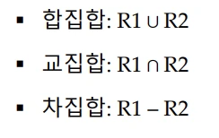

- 합집합 

    - 집합을 합친다.

- 교집합

    - 겹치는 값을 찾는다.

- 차집합

    - 겹치는 값을 뺀다.

### 집합 연산에서의 호환성

- 피연산자 Relation R1(A1, A2, …, An)과 R2(B1, B2, …, Bn)는 Attribute들의 개수가 동일하고, 대응되는 애트리뷰트들의 도메인이 호환성을 가져야만 함.

    - 즉, dom(Ai) = dom(Bi)여야 한다.

    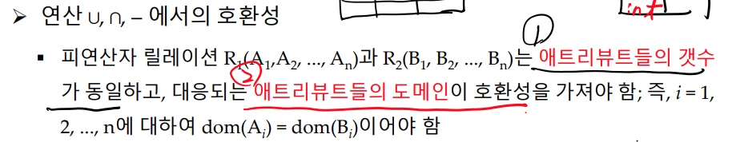

    - RDB에서는 다음과 같은 합집합 연산을 허용하지 않는다.

    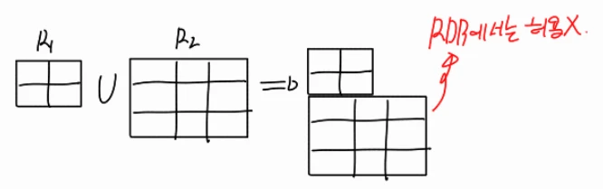

### 합집합 연산

- ex. **학생 이름과 학교 이름을 열거하라.**

$$
\Pi_{sName}(student)\bigcup \Pi_{cName}(college)
$$

⇒ 이때, Student의 sName과 College의 cName이 union으로 합쳐질 수 있는 이유는, dom(sName) = dom(cName)이기 때문이다.

> 이렇게 만들어낸 결과 Relation은 Query를 사용할 수가 없는데, 그 이유는 아예 새로운 Table, 그리고 새로운 Attribute를 만들어 버렸기 때문에 둘 다 이름이 없어서 지정이 불가능하기 때문이다.   
>   
> ⇒ 따라서, 새로운 이름을 지어주어야 한다.

### 차집합 연산

- ex. **어느 학교에도 지원하지 않은 학생의 아이디를 구하라.**

$$
\Pi_{sID}(Student)-\Pi_{sID}(Apply)
$$

⇒ 전체 학생의 sID는 Student에 있고, 대학에 지원한 학생들의 sID는 Apply에 있으므로, 각각 sID만 남기는 Projection을 한 다음 차집합 연산으로 지원한 사람들을 빼면 된다.

- ex. **어느 학교에도 지원하지 않은 학생의 아이디와 이름을 구하라.**

$$
\Pi_{sID, sName}(Student⋈_{Student.sID=N.sID}(\Pi_{sID}(Student)-\Pi_{sID}(Apply)))
$$

⇒ 먼저, 어느 학교에도 지원하지 않은 학생의 sID를 구하고, 그것을 이용하여 Student Table을 join한다. 그러면 sID, sName, GPA, HS를 얻을 수 있고, 여기서 Projection을 통하여 sID와 sName을 얻을 수 있다.

> 그런데 여기서 중요한 것이 하나 있는데, 차집합 연산을 통해 어느 학교에도 지원하지 않은 학생의 sID를 구할 수는 있지만, 그 결과도 결국 하나의 새로운 Table이다.  
>   
> 그러므로 Theta Join을 하기 위해서는 그 Table을 부를 새로운 이름이 필요한 것이다!  
> 이걸 하기 위해서 우리는 새로운 연산자인 Renaming Operator(재명명연산자)를 사용한다.  
> ⇒ 위의 예시에서는 재명명 연산자를 일단 생략하고, 새로운 Table의 이름을 N이라고 했음.

### 교집합 연산

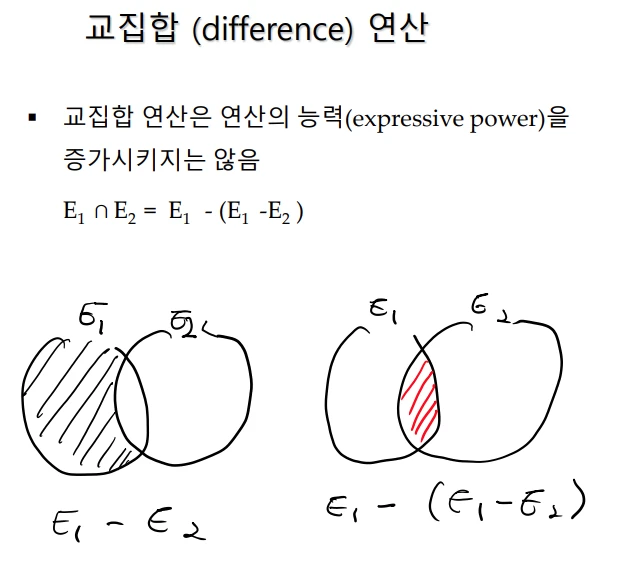

- 교집합 연산은 차집합을 통해 구현될 수 있는 것으로, 연산의 능력을 증가시키지는 않음.
- ex. **학생 이름과 학교 이름으로 동시에 사용되는 이름을 구하라.**

$$
\Pi_{cName}(College)\bigcap \Pi_{sName}(Student)
$$

### 재명명 연산

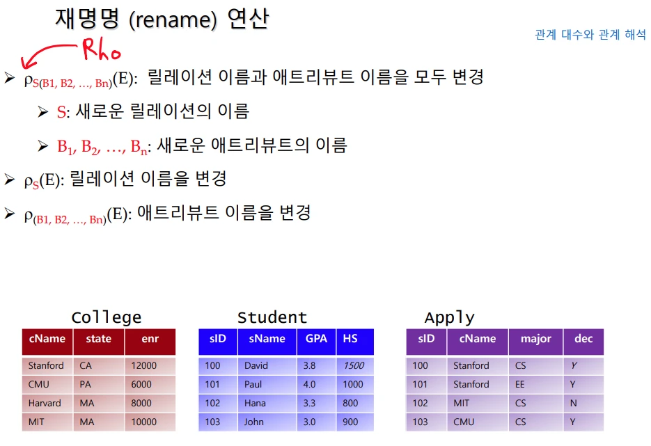

- 재명명 연산자는 Relation, 혹은 Attribute의 이름을 지정하거나 변경한다.
- 재명명 연산은 집합연산의 결과를 통합하기 위하여 필요하다.

- **표기법**

    - s는 새로운 relation의 이름
    - A1, A2, …, An은 S의 attribute1, 2, …, n의 이름
    - E는 대상 Relation
    - 항상 둘 다 변경해야 하는 것은 아니며, 원하는 것만 변경해도 된다.

$$
\rho_{s}(A1, A2, ..., An)(E)
$$

- ex. **학생 이름과 학교 이름을 열거하라.**

$$
\rho_{N}((\Pi_{sID}(Student) \bigcup \Pi_{sID}(Apply)))
$$

⇒ 이와 같이 관계 대수를 작성하면, 합집합 연산의 결과로 만들어진 Relation의 이름은 N이  된다.

- **Self Join**

    - 자기 자신(Relation)에게 Join하는 것을 Self Join이라고 한다.

- ex. **같은 주(State)에 있는 학교의 쌍(Pair)를 열거하라.**

$$
\Pi_{c1.cName, c2.cName} \\(\sigma_{(c1.cName<c2.cName)}(\rho_{c1}(college)⋈_{(c1.cName = c2.cName)}\rho_{c2}(college)))
$$

⇒ Join Condition은 반드시 Equality로 지정해 주어야 한다.

- **대입(Assign)을 이용하여 Query 표현하기**

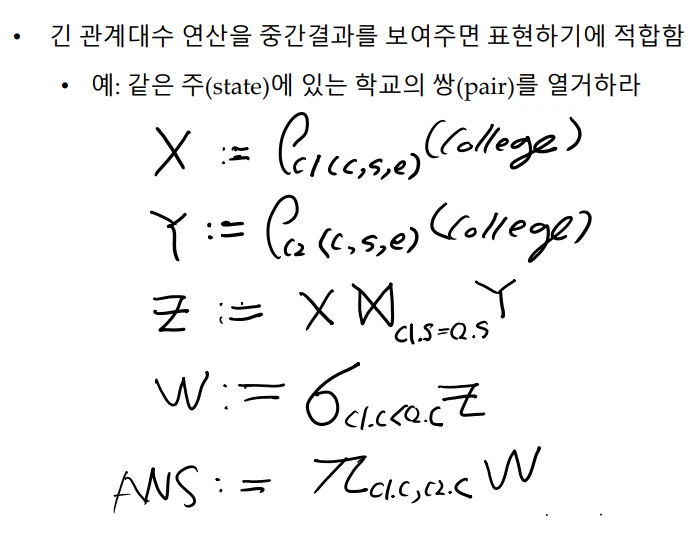

변수를 선언하듯이 관계 대수 질의를 작성할 수 있다.

### 질의 트리를 통한 표현법

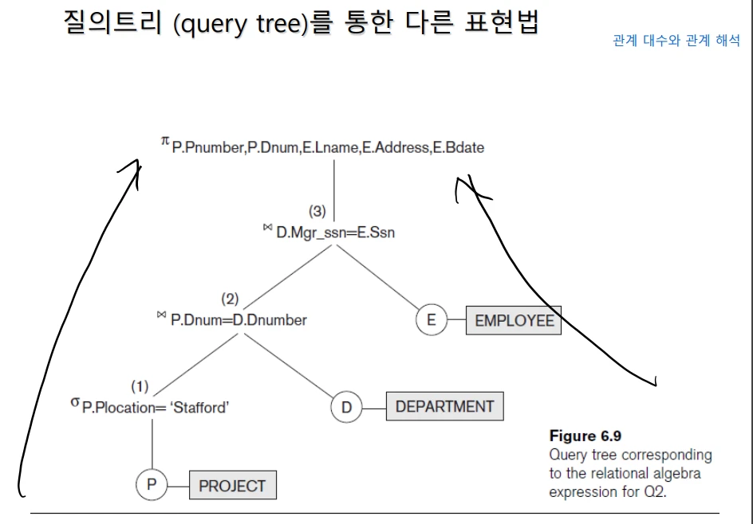

---

## &lt;관계 대수 요약&gt;

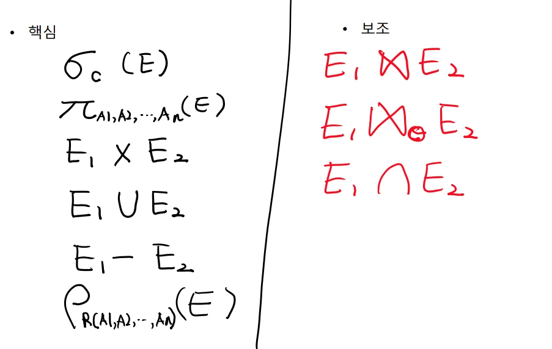
