# SQL-2

## &lt;SQL LAB-1&gt;

> SQLite에서 주석은 dash 두 번 “--”

### Basic SQL

```sql
drop table if exists Apply;
drop table if exists Student;
drop table if exists College;

create table College(cName text, state text, enrollment int,
primary key (cName));

create table Student(sID int, sName text, GPA real, sizeHS int,
primary key(sID));

create table Apply(sID int, cName text, major text, decision text,
primary key(sID, cName, major),
foreign key (sID) references Student(sID),
foreign key (cName) references College(cName));
```

여기서, 값의 제약 조건을 걸어주는 것이 **check**이다.

- **check**

    - check는 Table의 값이 변경될 때마다 확인해 주는 역할을 한다.

```sql
create table Student(
	sID int, sName text, GPA real, sizeHS int,
	primary key(sID), 
	check (GPA>=0.0 and GPA<=4.5) 
);
```

```sql
create table Apply(
	sID int, cName text, major text, decision text,
	primary key(sID, cName, major),
	foreign key (sID) references Student(sID) on delete cascade on update cascade,
	foreign key (cName) references College(cName) on delete cascade on update cascade
);
```

> 여기까지 진행하여 기존의 Table Schema를 수정했다면, 새로운 데이터를 추가한다.

⇒ 데이터가 추가됨.

- **value insert**

```sql
insert into Student values(111, 'Name', 4.9, 1000);
```

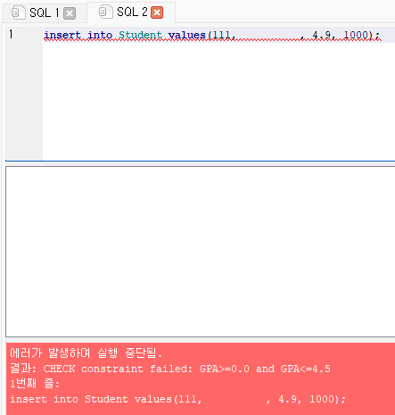

⇒ Check에 의해서 값 입력이 불가능하다.

- **value update**

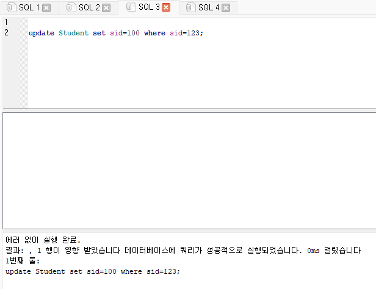

> on update cascade 설정에 의해서 참조된 모든 값이 변경된다.

### Query in SQL

> **관계대수**에서는 Table은 Tuple의 집합이었기 때문에 중복을 허용하지 않았었다. 그러므로 Projection을 했을 때 중복된 Tuple이 존재했다면 사라지게 했음.  
>   
> 반면, **SQL**에서는 **중복**이 **허용**된다. (명시적으로 이용해야 하는 경우가 있기 때문이다.)

```sql
SELECT A1, A2, A3, ..., An
FROM T1, T2, ..., Tn
WHERE Condition
```

> Query를 작성할 때는 가장 먼저 FROM을 결정한다. 이것은 TABLE을 선택하는 것과 같은 의미이다.

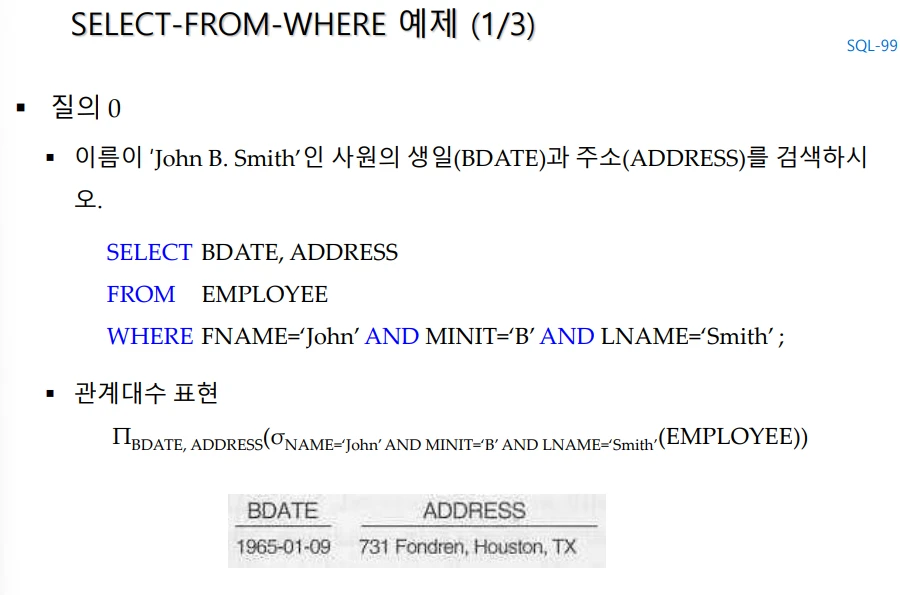

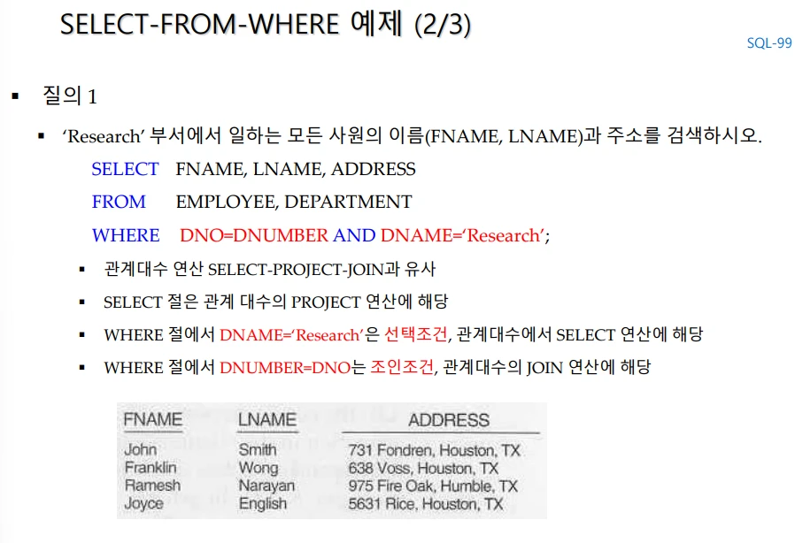

- FROM에서 두 개 이상의 Table을 고르는 것은, 두 테이블을 **Cartesian Product**를 하는 것과 같다. 이후 WHERE를 통해서 **Join Condition**을 명시해 주는 것이라고 생각할 수 있다.

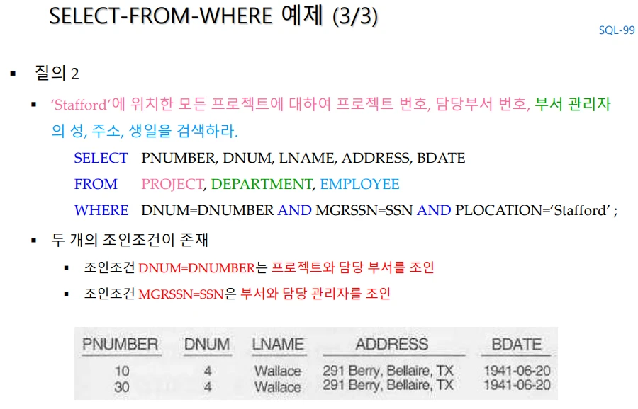

- PROJECT와 DEPARTMENT를 Join하기 위한 조건

    - DNUM=DNUMBER

- DEPARTMENT와 EMPLOYEE를 Join하기 위한 조건

    - MGRSSN=SSN

- 만약 조건이 없다면 WHERE를 명시하지 않아도 된다.

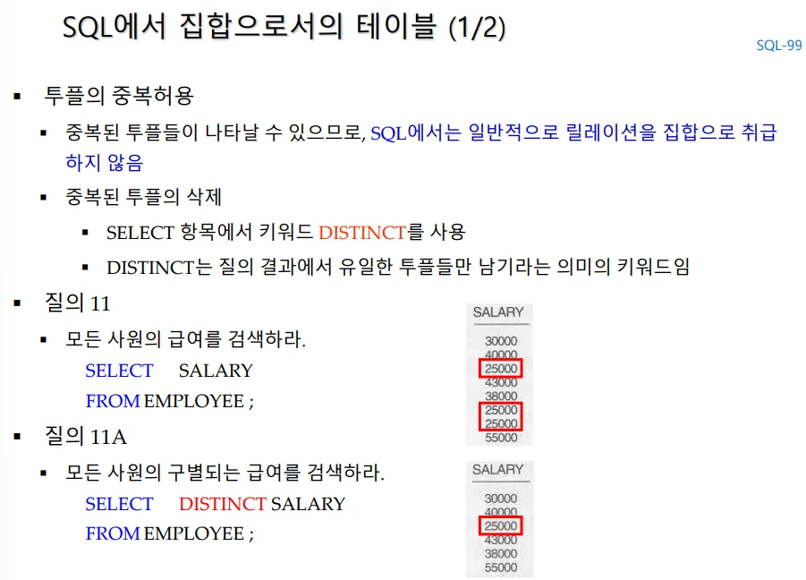

> 기본적으로 SQL은 Multi-set이기 때문에 중복을 허용한다. 따라서 “모든 직원들의 월급의 총합을 구하라.”라는 문제가 주어진다면 위와 같이 중복이 필요할 수 있다.  
>   
> 하지만 그렇지 않은 경우, DISTINCT Keyword를 붙여서 구분할 수 있다.

### SELECT, DISTINCT 실습

- **Example. 0**

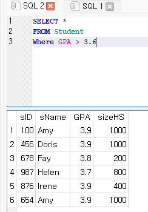

\*를 통해서 해당 Table의 모든 column을 선택하는 방법

- **Example. 1**

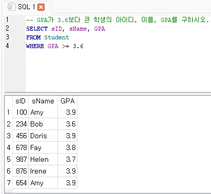

- **Example. 2**

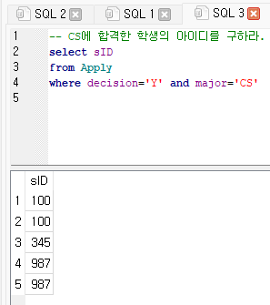

⇒ 다만 이렇게 구하면 중복이 발생하므로, DISTINCT keyword를 통해서 중복을 제거 가능하다.

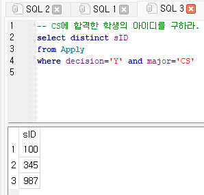

- **Example. 4**

> Cartesian Product를 확인해 보자.

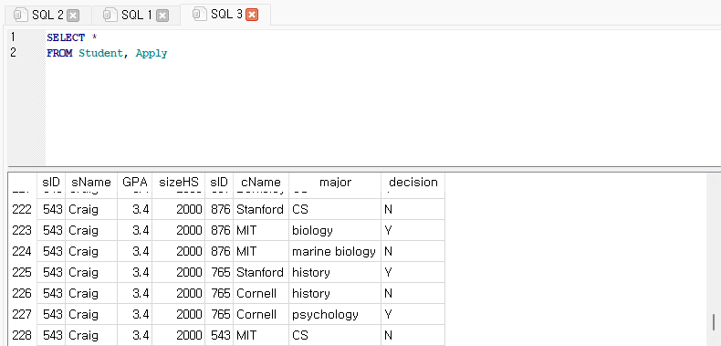

⇒ WHERE 절을 사용하지 않고 FROM을 두 개 이상 명시하면 Cartesian Product만 하고, Join Condition을 설정하지 않기 때문에 의미 있는 것만 남기지 않는다.

(*Student Table은 12개의 Tuple 존재, Apply Table은 19개의 Tuple 존재. 12\*19 = 228*)

> Join 할 때, 겹치는 Column Name은 그대로 유지된다.

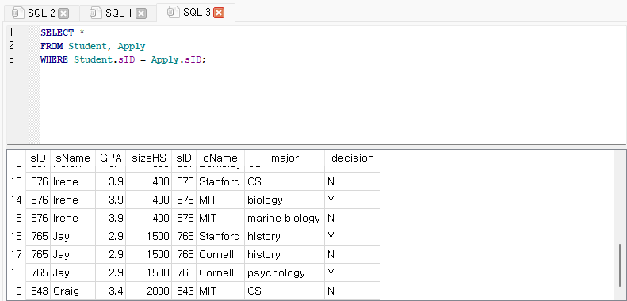

⇒ WHERE 절을 명시하여 이와 같이 의미있는 정보만 남길 수 있다.

- **Example. 5**

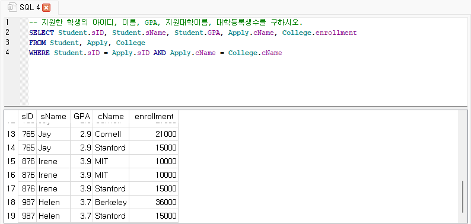

### Advanced SQL

- **LIKE** : 부분 문자열 패턴 파악

    - Q. 12 : Address가 분리되지 않고 하나의 String으로 보관되어 있다고 해보자.

    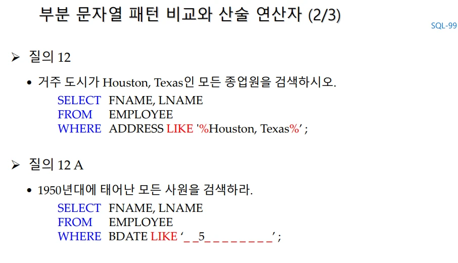

    ```sql
    SELECT FNAME, LNAME
    FROM EMPLOYEE
    WHERE ADDRESS LIKE '%Houston, Texas%';
    ```

    ⇒ %를 사용하면, 어떤 것이 와도 괜찮다는 뜻이다.

    - Q. 12-A : 1950년대에 태어난 모든 사원을 검색한다. (Underbar _의 활용)

    ```sql
    SELECT FNAME, LNAME
    FROM EMPLOYEE
    WHERE BDATE LIKE '__5________';
    ```

- **Example. 6**

    - bio 관련 학과에 지원한 학생의 아이디와 전공을 구하시오.
    - 단, bio 관련 학과는 반드시 이름에 ‘bio’가 들어간다.

    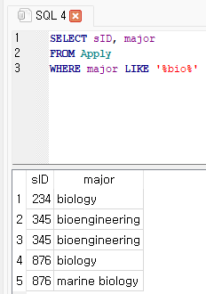

---

## &lt;SQL LAB-2&gt;

### SQL Query 내에서의 산술식 허용

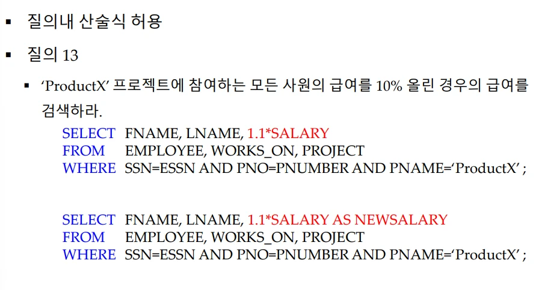

- SQL 내에서 간단한 연산식을 사용할 수 있다.

    - 예를 들어 SALARY를 10% 인상한 결과를 보고 싶다면 SELECT 절에서 1.1을 곱하면 됨.
    - 하지만 이렇게 하면 Column Name이 명시되지 않아 Nested Query에서 사용하기 어렵기 때문에 as 절을 이용하여 Column Name을 명시할 수 있다.

### SQL Query에서의 정렬

> Order by : 어떤 Column을 기준으로 정렬할지 결정할 수 있다.

```sql
ORDER BY DNAME DESC, LNAME ASC, FNAME ASC
```

⇒ 하나의 Column으로만 정렬할 수 있는 것이 아니라, 여러 개의 기준으로 정렬 가능

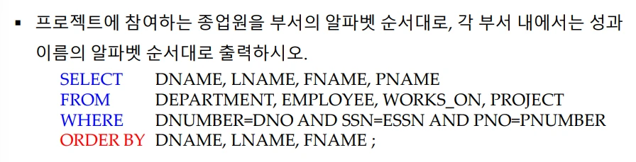

### 모호한 애트리뷰트 이름

> DNUMBER와 같은 Attribute는 여러 Table에서 같은 이름으로 사용될 수 있기 때문에 Join을 할 경우에는 Table Name을 명시해서 표현한다.

### 별명(Alias)

> 재명명 연산자와 동일한 기능. 반드시 있어야만 Query가 가능한 경우가 생긴다.

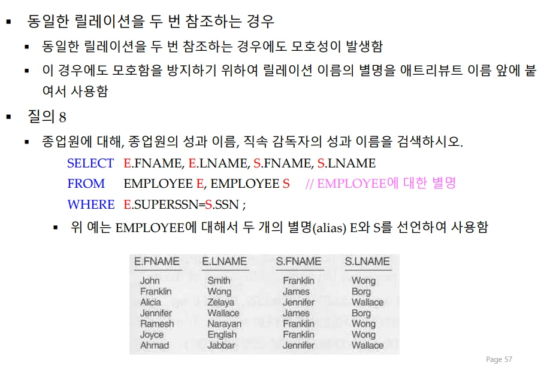

- 이전에도 Self Join을 사용할 때 Renaming이 반드시 필요했었음.
- SQL에서도 마찬가지로 Self Join 시에 Renaming이 필요함.
- 본래는 AS라는 키워드를 사용하지만, 생략도 가능함.

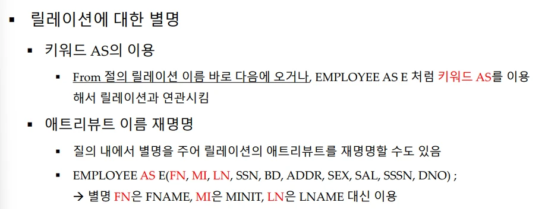

- Renaming을 사용하여 Attribute Name도 간단하게 만들 수 있음.

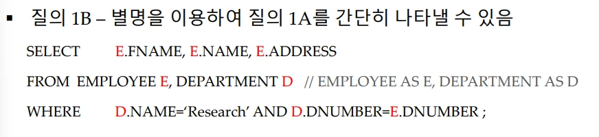

### LAB

- **Example. 1**

> 연산을 사용하여 column 구하기. float로 나누기 할 때는 반드시 .을 붙인다.

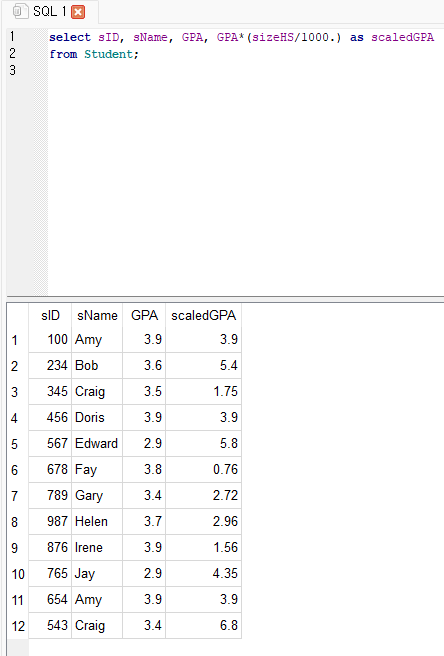

- **Example. 2**

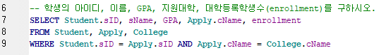

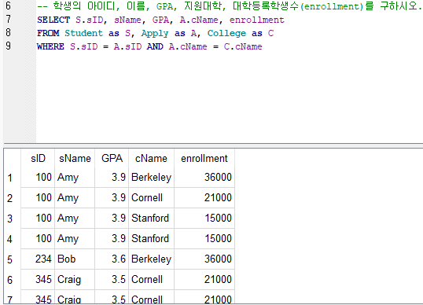

> Alias를 사용하여 축약

- **Example. 3**

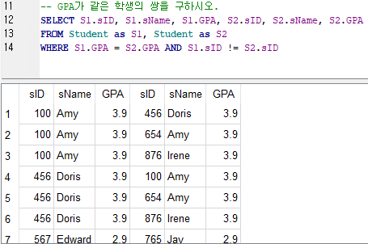

> Self Join을 할 때는 Renaming을 활용하고, Pair를 만들 때는 Where 절에 주의한다.  
> (중복을 만들지 않기 위해서)

> 단, 우리가 Join을 한다고 해서 반드시 S1.sID = S2.sID를 넣어서는 안된다.  이번의 경우에는 Pair를 구하는 것이기 때문에 Join Condition을 설정하면 안된다.

- 다만 위의 경우처럼 만들면, Amy - Doris, Doris - Amy Pair가 중복되기 때문에, Not Equal보다는 Greater와 같은 것을 사용하는 것이 좋다.

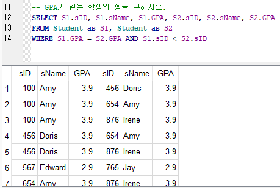

- **Example. 4**

> ORDER BY를 사용한 정렬

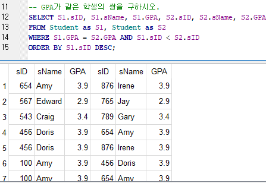

### 집합 연산자

> Table의 Tuple들에 대해서 집합 연산을 적용할 수 있다. 집합 연산자를 적용하기 위해서는 Table 간의 Column 개수와 Column Domain이 반드시 맞아야 한다.

> 기본적으로 관계대수는 Projection을 통해 중복을 제거하지만, SQL은 중복을 제거하지 않는다. (Distinct로 중복 제거) 하지만 UNION(합집합), EXCEPT(차집합), INTERSECT(교집합)은 그 자체로 &lt;집합 연산&gt;이기 때문에 중복을 제거한다.

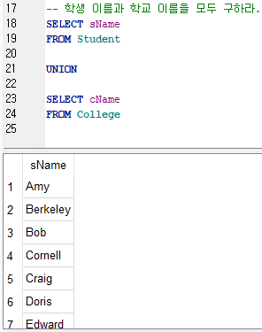

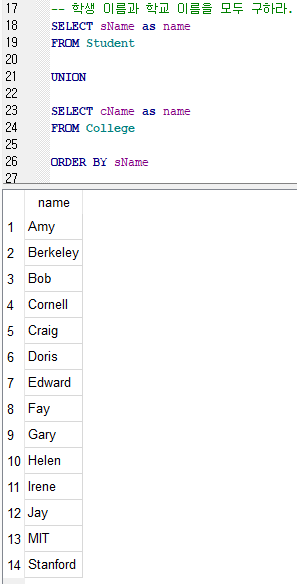

만약 정렬을 원할 경우, ORDER BY를 통해 순서를 결정한다.  
그리고 Column Name이 sName으로 의미를 파악하기 힘들기 때문에, 현재 의도에 맞추어 alias를 사용해 이를 변경한다.

> 다만 이렇게 하면 집합 연산을 하는 과정에서 중복이 제거되기 때문에 원하는 결과가 아니라면 적절하게 방법을 변경할 수 있어야 한다.  
>   
> 이때는, UNION ALL 이라는 키워드를 사용한다.

- **Example. 5**

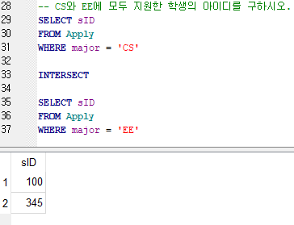

> 집합 연산을 사용하여 CS/EE에 모두 지원한 학생을 구하기

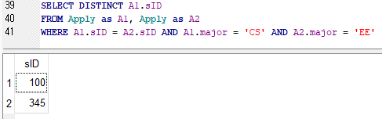

중복을 없애고 싶을 경우 DISTINCT 키워드 사용. 원할 경우는 사용하지 않음.

- **Example. 6**

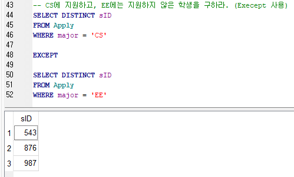

> Join을 사용하여 가능한가? ⇒ 불가능하다.  
> 모든 집합 연산자가 Join으로 대체가 가능하지는 않다.
