# SQL-3

작성일 2023-11-16 · 최종 수정일 2024-12-07
{ .post-date }

## &lt;Alias(테이블 별명)&gt;

테이블의 경우, 동일한 이름의 애트리뷰트를 가질 수 있기 때문에 Query 작성 시에 테이블 이름 다음에 점(.)을 작성하여 어떤 테이블의 어떤 애트리뷰트인 지를 명시할 수 있다.

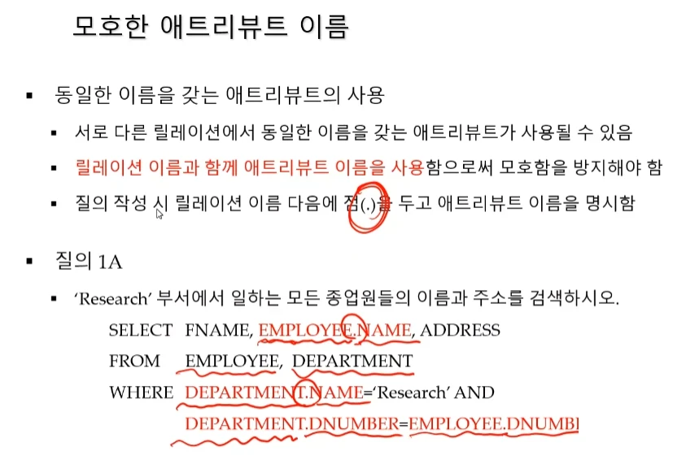

### Alias

만약 동일한 릴레이션을 두 번 참조하는 경우, 반드시 Alias가 필요하다.

- 종업원에 대해 종업원의 성과 이름, 직속 감독자의 성과 이름을 검색하시오.

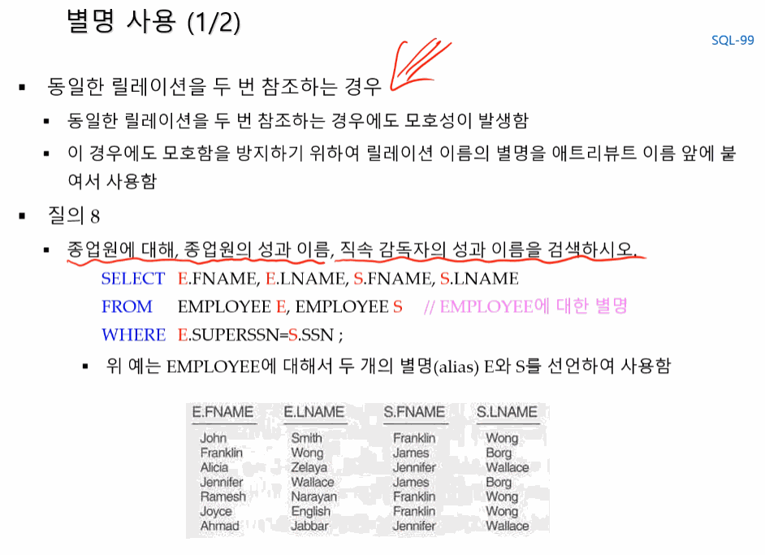

```sql
select e.fname, e.lname, s.fname, s.lname
from employee e, employee s
where e.superssn = s.ssn;
```

⇒ 같은 테이블이 여러 번 사용될 때, 각 테이블에 대한 별명을 지정하여 애트리뷰트를 구분 가능

```sql
select e.fname, e.lname, s.fname, s.lname
from employee as e(fn, mi, ln, ssn, bd, addr, sex, sal, sssn, dno), employee as s
where e.superssn = s.ssn;
```

⇒ as는 생략 가능하다.(Optional) 그런데, as를 쓰면 Attribute의 별명도 지정 가능하다.

> as는 테이블과 테이블 애트리뷰트에 별명을 지정하는 역할을 하며, 애트리뷰트 이름이 중복될 때 이 것들을 서로 구분하기 위해서 사용된다. 하지만 간단하게는 테이블 이름이 너무 길 때, 단순히 작성할 문자를 줄이기 위해서도 사용된다.

---

## &lt;Nested Query, IN&gt;

### Nested Query(중첩 질의)

> select … from … where 뒤에 새로운 (select ,,, from ,,, where ,,,) Query가 존재하는 것.

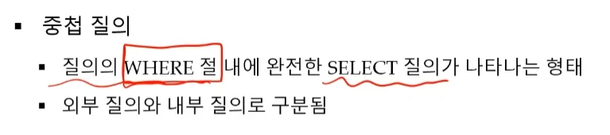

```sql
select ...
from ...
where ... 
(select ,,,
from ,,,
where ,,,)
```

⇒ 다음과 같이 Query가 중첩된 형태로 나타난다. 이것은 Join을 사용할 경우 나타내기 어려운 것들에 대해서 아주 유용하게 사용된다.

- **IN** 연산자 (반대는 **NOT IN**)

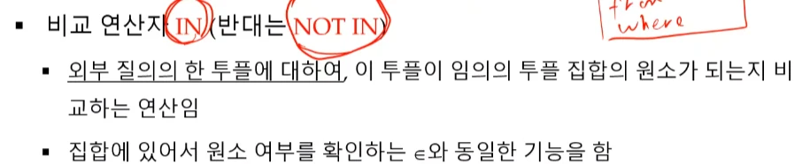

IN 연산자는 내부 질의의 결과에 속하는 외부 질의의 Tuple들만 골라서 출력해준다.

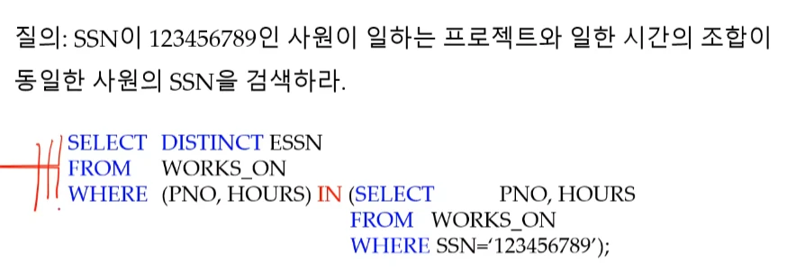

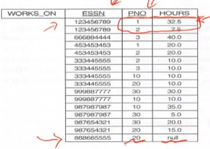

⇒ WORKS_ON Table에서 PNO와 HOURS만 가져오는 경우.

- Smith가 참여하는 프로젝트의 번호를 구하라.

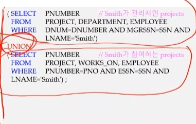

⇒ 집합 연산자 UNION을 사용하여 Smith가 관리자/참여자인 Project의 Number를 구해냈다.  
이를 다른 방법으로도 해결할 수 있다.

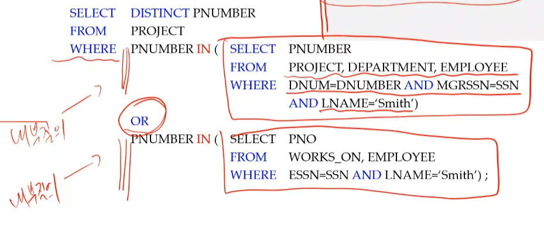

두 개의 **Nested Query**(내부 질의)를 OR로 연결하면, 둘 중 하나에만 포함될 때도 외부 질의의 Tuple을 선택할 수 있다. 

1) 첫 번째 내부 질의는 Smith가 관리자로 일하는 Project의 Number를 구하는 것이다. 

2) 두 번째 내부 질의는 WORKS_ON과 EMPLOYEE를 Join하여 Smith가 참여자로 일하는 Project의 Number를 구하는 것이다.

3) 외부 질의에서는 Project Table의 각각의 Tuple에 대해서, 각 Tuple이 두 개의 내부 질의 중 하나에 속한다면 출력을 하는 것으로 해석할 수 있다.

**LAB**

- CS에 지원한 학생의 아이디와, 이름을 구하시오. (join을 사용하여 구하기.)

```sql
select distinct Student.sID, sName 
from Apply, Student 
where Student.sID = Apply.sID and major='CS'
```

⇒ join을 할 경우, join condition을 적어주어야 한다.

- 중첩 쿼리를 사용하여 해결하는 방법

```sql
select sID, sName from Student where sID in
(select sID from Apply where major='CS')
```

Student Table에 들어있는 학생 한명 한명에 대해 테스트해 보아야 한다.  
내부 질의에서, CS에 지원한 학생의 sID를 뽑아내고, 그 sID가 내부 질의에 포함되어 있는 학생들만 sID와 sName을 뽑아낸다.  
⇒ 이 방법의 경우, 학생 한명 한명에 대해 테스트하기 때문에 학생이 중복되어 나오는 경우는 없다.

- CS에 지원한 학생의 GPA를 구하시오. (IN 사용/IN 미사용)

```sql
select GPA 
from Apply, Student 
where Apply.sID = Student.sID and major ='CS';
```

⇒ join을 사용할 때는, sID를 같이 불러오지 않는다면, (distinct의 사용이 불가능하므로) 중복을 효과적으로 제거하지 못한다.

```sql
select GPA 
from Student
where sID in (select sID
			from Apply
			where major = 'CS');
```

⇒ 하지만 in을 사용하면 한 명 한 명에 대해서만 따져주므로, 중복을 크게 고려하지 않아도 되기 때문에 매우 유용하다.

- CS에 지원하고, EE에는 지원하지 않은 학생의 아이디와 이름을 구하시오.

```sql
select S.sID, sName
from Student S, Apply A
where S.sID = A.sID and major='CS'

except

select S.sID, sName
from Student S, Apply A
where S.sID = A.sID and major='EE'
```

⇒ 차집합을 이용하여 해결하기. CS에 지원한 학생들의 집합에서 EE에 지원한 학생을 빼면, CS에는 지원했지만, EE에는 지원하지 않은 학생들만 남는다.

- 중첩 쿼리를 사용하여 해결하기

```sql
select sID, sName
from Student
where Student.sID in 

(select sID
from Apply
where major='CS') 

AND

Student.sID not in 
(select sID
from Apply
where major='EE')
```

⇒ CS에 지원한 학생들의 sID를 모으고, EE에 지원한 학생들의 sID를 모아서 AND로 묶어주면 된다. IN을 이용한 중첩 쿼리는 외부 쿼리와 내부 쿼리가 서로 다른 Table을 참조한다고 생각하면 편할듯 하다.

---

### ALL, ANY

- **ALL**

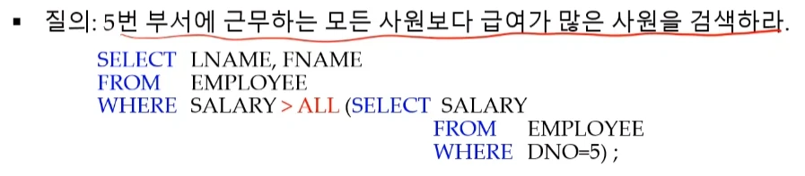

⇒ 위의 문제를 해결하려면, 먼저 5번 부서에서 근무하는 모든 사원의 급여를 알아야 할 것이다.

따라서 내부 질의를 통해서 먼저 5번 부서의 모든 사원의 월급을 가져오고, 외부 질의에서는 ALL을 사용해 모든 것보다 Salary가 큰 Tuple을 찾아낼 수 있다.

SALARY &gt; ALL

SALARY &lt; ALL

SALARY = ALL

이와 같이 다양한 형태로 사용 가능하다.

- **ANY**

ALL대신 ANY를 사용할 경우, 하나라도 만족되는 경우가 존재하면 Tuple을 선택한다.

(SQLite에서는 ALL, ANY를 지원하지 않는다.)

---

## &lt;상관 중첩질의(Correlated Nested Query)&gt;

- 내부 질의의 Where 절에 있는 조건에서 외부 질의에 선언된 릴레이션의 일부 애트리뷰트를 참조하는 경우에, 두 질의를 상관된 질의라고 한다.

    - 이전까지는 내부 질의의 결과를 외부 질의에서 참조했다.

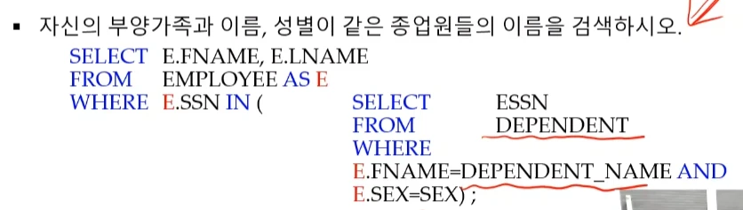

외부 질의에 있는 E의 하나 하나의 Tuple에 대해서, 먼저 내부 질의의 Query에 대해 적용해 실행을 하고, 그것이 외부 질의의 Where 절에 포함되는 지를 확인하는 것이다.

⇒ 그런데, 대부분의 상관 중첩질의는 비상관 중첩질의로 변환이 가능하다.

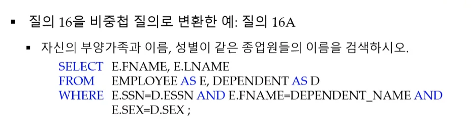

---

## &lt;EXIST 연산자&gt;

> IN 연산자는 외부 질의의 결과가 내부 질의의 결과에 포함되었는 지를 결정했다.  
> 이와 다르게, EXIST 연산자는 내부 질의의 결과가 공집합인지를 검사한다.

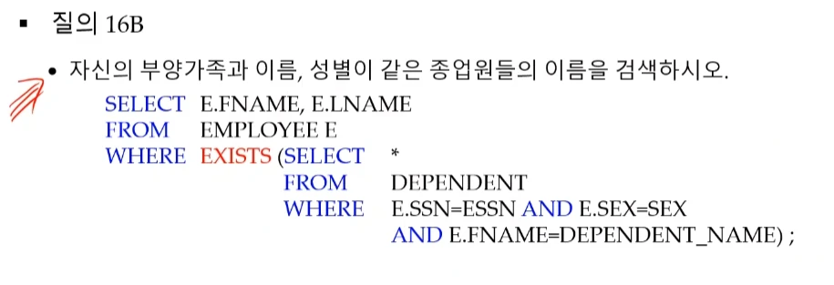

- 먼저 외부 질의에서 Employee의 각각의 Tuple을 구하고, 그 각각의 Tuple에 대해서, 내부 질의의 Query가 공집합인지 아닌지를 판단한다.  
    ⇒ 공집합이 아닌 경우에만 포함시킨다.

> 내부 쿼리에서 외부 쿼리에서 정의한 E를 참조하는 것은, 마치 이중 for loop에서 외부 for loop의 반복 변수를 내부 for loop에서 참조할 수 있는 것과 비슷한 개념이라고 생각하면 된다.  
>   
> 즉, 외부 쿼리에서 얻은 Tuple 하나하나에 대해서 내부 쿼리를 돌려보는 것이라고 생각하면 된다.

- 내부 질의의 결과가 존재할 경우에는 외부 질의의 Tuple을 포함시키고, 그렇지 않으면 포함시키지 않는다.
- **NOT EXIST**

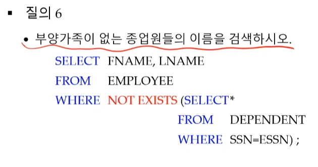

⇒ 부양가족이 있는 종업원들에 대해 검색한다면, EXISTS를 사용하면 될 것.

- **EXIST의 연결**

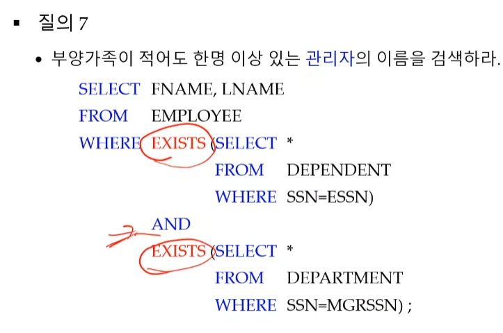

외부 질의에서 구한 각각의 Employee에 대해서 내부 질의를 모두 돌리고, AND로 엮어서 조건을 판단하는 Query이다.

외부 질의) 내부 질의 1), 2)가 만족되는 Employee를 선택한다.

내부 질의 1) 부양가족이 있는지 없는지 판단하는 부분이다.

내부 질의 2) 관리자인지 아닌지 판단하는 부분이다.

**LAB**

- 같은 주(state)에 다른 대학이 있는 대학의 이름과 주(state)를 구하시오.

```sql
select cName, state
from College C1
where exists
(select *
from College C2
where C1.state=C2.state and C1.cName <> C2.cName)
```

⇒ 내부 쿼리에서의 select는 큰 의미가 없으므로, 아무거나 가져와도 된다. 따라서 \*로 적어준다.

그리고 C1.cName과 C2.cName이 같으면 안되기 때문에, 조건을 추가해 주어야만 한다.

여기서 exists가 아닌 not exists를 사용하면, 정반대의 결과가 나오게 된다.

- 재학생수(enrollment)가 가장 많은 대학의 이름을 구하시오.

not exists를 사용하여, 자신보다 재학생 수가 많은 대학이, 없는 대학을 구하면 된다.

```sql
select cName, enrollment
from College C1
where not exists
(select *
from College C2
where C1.enrollment < C2.enrollment)
```

⇒ 여기서도 마찬가지로 \*을 이용할 수 있음.

- GPA가 가장 높은 학생의 이름과 GPA를 구하시오.

```sql
select sName, GPA
from Student S1
where not exists
(select *
from Student S2
where S1.GPA < S2.GPA)
```

- ALL/ANY를 이용하여 구현하기

```sql
select sName, GPA
from Student S1
where S1.GPA >= ALL (select GPA from Student S2);
```

---

## &lt;Aggregate Function(집단 함수)&gt;

> SQL 자체에 내장되어 있는 기능으로, Tuple 여러개에 대해서 적용될 수 있는 함수이다.

**LAB**

- 모든 학생의 GPA 평균을 구하시오.

```sql
select avg(GPA)
from Student;
```

- 최대/최소 GPA를 구하시오. (총합⇒sum())

```sql
select max(GPA), min(GPA), sum(GPA)
from Student;
```

- CS에 지원한 학생의 GPA 중에서 최소 GPA를 구하시오.

```sql
select min(GPA)
from Student, Apply
where Student.sID = Apply.sID and major='CS'
```

```sql
select min(GPA)
from Student
where sID in
(select sID
from Apply
where major='CS')
```
