# SQL-4

## &lt;집단 함수(Aggregate Function)&gt;

### Max/Min

> 특정한 Attribute를 지정하여서 Tuple 들 중에서 가장 큰/작은 값을 찾는 것

```sql
select sum(salary), max(salary), ...
```

### Count

> 해당 튜플들의 수를 반환, (\*)를 통해 모든 Tuple을 포함할 수도 있다.  
> 이전에 DB Architecture 설계를 할 때도 봤듯이, Derivated Attribute에 사용할 수도 있다.

```sql
select count(*)
from employee, department
where dno=DNUMBER and department='research'
```

- 특정 튜플을 선택하기 위해서 집단함수를 이용 : 중첩 질의 이용

```sql
select lname, fname
from employee
where (select count(*)
			from dependent
			where ssn=essn) >=2;
```

위의 내용은, 외부 질의에 있는 employee tuple 하나 하나에 대해서, 내부 질의의 조건을 만족하는 지를 테스트 하는 것이다.

**LAB**

- Ex 1. 모든 학생의 gpa의 평균을 구하시오.

    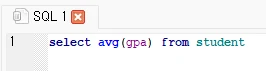

- Ex 2. CS에 지원한 학생 GPA 중, 가장 낮은 값을 구하시오.

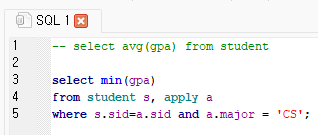

⇒ max도 구할 수 있음.

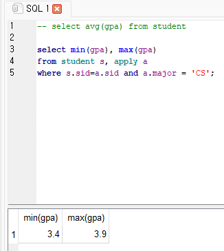

Ex 3. CS에 지원한 학생의 GPA 평균을 구하시오.

⇒ 간단하게 풀려고 하면 안된다. 왜냐면, 한 학생이 CS에 여러 번 지원했을 수도 있기 때문

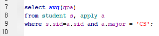

이 방식은 해결이 어려우므로, 다른 방법을 도입해야 한다. (중첩 질의)

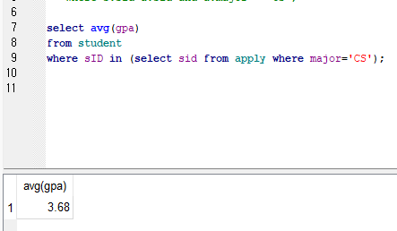

⇒ 학생의 GPA를 구하는데, 그 학생이 CS에 지원한 학생에 포함되는 지를 평가한다. 이 방식을 사용하지 않으면 학생의 sID가 중복되므로, 잘못된 결과가 나오게 된다.

Ex 4. 등록학생(enrollment)이 15,000 보다 큰 대학의 숫자를 구하시오. (count 사용)

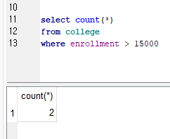

Ex 5. ‘Cornell’ 대학에 지원한 학생의 숫자를 구하시오.

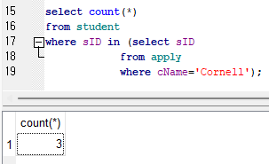

⇒ 중첩 질의를 사용해도 되고, distinct를 사용해도 된다.

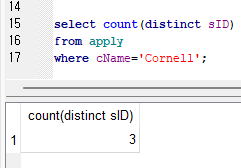

⇒ distinct

---

### Group By

> 이전까지는 내부 질의가 하나의 그룹을 구해내는 역할을 했었는데, 여러 개의 그룹으로 나눠줄 수도 있다. 이를 Group By로 사용할 수 있는데, Group By는 반드시 Aggregate Function과 함께 사용한다.

**LAB**

- Ex 1. 각 부서에 대해서, 부서 번호, 부서 내에 있는 종업원의 수, 평균 봉급은?

⇒ 하나의 속성에 대해서 그룹을 나누고, 그 그룹의 속성을 구해내는 것.

```sql
select DNO, count(*), avg(Salary)
from Employee
group by DNO;
```

- Ex 3. 각 대학별로 지원(application)의 숫자를 구하시오.

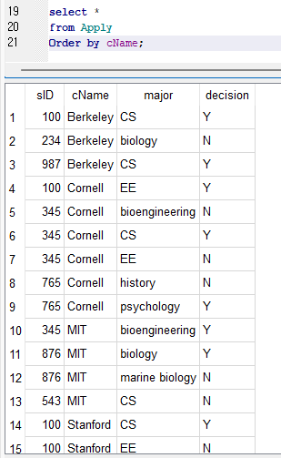

우선, 대학 이름을 기준으로 정렬하여 Tuple 들을 확인해 본다. 이후에는 cName을 기준으로 그룹을 나눠준다.

```sql
select cName, count(*)
from Apply
group by cName;
```

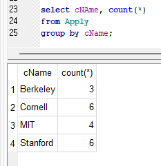

- Ex 4. 각 주(state) 별로 등록생 수(enrollment)의 합을 구하시오.

    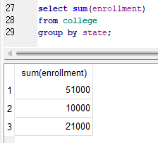

- Ex 5. 대학, 전공 별로 지원자의 최대 GPA, 최소 GPA를 구하시오.

⇒ 대학과 전공이 하나의 Pair가 되는 것이다. 그러므로 이전과는 다르게 attribute를 묶어서 group으로 표현할 수 있다.

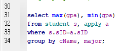

⇒ group by가 잘 되는지 확인해 보려면, 위의 group by를 order by로 묶어서 확인.

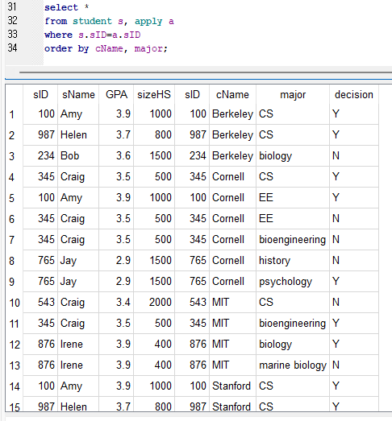

⇒ cName과 major의 pair로 정렬한 결과

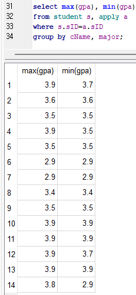

⇒ cName과 major의 pair로 정렬한 것을, group by로 변경한 것.

- Ex 6. 학생 아이디, 학생 이름, 학생이 지원한 대학의 숫자를 구하시오.

⇒ 결과를 확인하려면 다음과 같이 먼저 확인

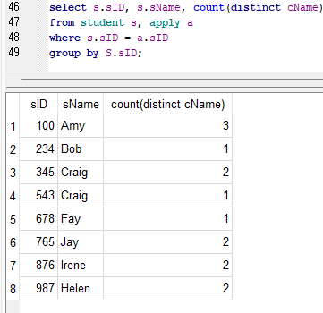

⇒ 그런데, 이렇게 하면 지원하지 않은 학생은 고려하지 못하게 된다.

따라서, 합집합을 사용해 지원하지 않은 학생도 추가해야 한다. 다양한 방법이 존재하지만, not in 또는 exist를 사용하면 된다.

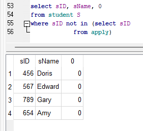

⇒ select 할 attribute의 값을 명시적으로 설정하면, 만들어 attribute를 만들어 낼 수 있다.

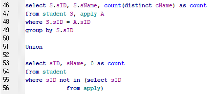

---

### Having

> Having을 이용하면, 각각의 그룹에 대해서 조건을 걸어줄 수 있다.

**LAB**

- Ex 1. 지원(Application)의 숫자가 5보다 작은 대학의 이름을 구하시오.

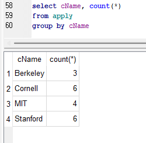

⇒ 먼저, 대학 별로 지원의 숫자를 구하고, 지원의 숫자가 5 이하인 대학을 구한다.

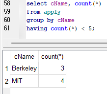

⇒ having은 보통 Aggregate Function과 함께 사용된다.

- Ex 2. 지원자(Applicant)의 숫자가 5보다 작은 대학을 구하시오.

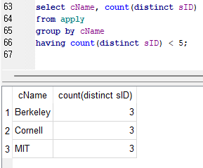

---

### NULL에 대한 고려

> Attribute가 NULL인지 아닌지를 체크하기 위해서는 “= NULL”을 사용하는 것이 아니라, IS NULL 연산자를 별도로 사용해야 한다.

```sql
SELECT FNAME, LNAME
FROM EMPLOYEE
WHERE SUPERSSN IS NULL;
```

⇒ 상사가 없는 사원의 이름을 검색하는 경우

- 현재 데이터베이스에는 NULL값이 없으므로, NULL을 임의로 넣어보자.

```sql
insert into students values(431, 'Kevin', NULL, 1500);
insert into students values(321, 'Lori', NULL, 1500);
```

⇒ 이로써 GPA가 NULL인 학생이 생겼음.

- Ex 1. 간단한 예제

```sql
-- GPA가 3.5 이상인 학생의 sid, sname, gpa를 구하시오.
select sid, sname, gpa
from student
where gpa >= 3.5;
```

```sql
-- GPA가 3.5 미만인 학생의 sid, sname, gpa를 구하시오.
select sid, sname, gpa
from student
where gpa < 3.5;
```

- Ex 2. 위 결과에 합집합 연산을 해보시오.

```sql
select sid, sname, gpa
from student
where gpa >= 3.5

union

select sid, sname, gpa
from student
where gpa < 3.5;
```

> 이렇게 하면 전체 학생이 나와야 되지만, 나오지 않는다. 왜일까? GPA가 NULL인 부분이 존재하기 때문이다. 데이터에는 항상 NULL이 존재할 수 있다.

```sql
select sid, sname, gpa
from student
where gpa >= 3.5 or gpa < 3.5 or GPA is NULL;
```

⇒ 반드시 is NULL 연산자를 사용해야 NULL을 체크할 수 있다.

### 추가한 값을 제거하기(NULL)

```sql
delete
from student
where gpa is null;
```

---

## &lt;SELECT SUMMARY&gt;

### SELECT

### FROM

### WHERE

### GROUP BY

group으로 묶어주는 것

### HAVING

group에 대한 조건

### ORDER BY

order by는 항상 맨 끝에 와야 한다.

---

## &lt;INSERT/DELETE/UPDATE&gt;

### Delete

한 번의 delete 명령으로 where 절의 조건을 만족하는 튜플을 모두 삭제한다.

```sql
insert into College values ('CMU', 'PA', 11500);
```

⇒ 카네기멜런 대학을 추가

- Ex 1. 어느 대학에도 지원하지 않은 학생의 sID를 구하시오.

```sql
select sID, sName
from Student 
where sID not in (select sID
								from Apply);
```

- Ex 2. 어느 대학에도 지원하지 않은 학생을 CMU 대학의 CS에 지원하게 만들고, 결과는 알려지지 않은 것으로 처리하시오.

```sql
insert into Apply
	select sID, 'CMU', 'CS', null
	from Student 
	where sID not in (select sID
									from Apply);
```

⇒ 이와 같이 Query의 결과를 다른 Table에 값으로 넣어줄 수 있다.

- Ex 3. EE에 지원했으나 떨어진 학생을, CMU EE에 합격한 것으로 처리하시오.

```sql
insert into Apply
	select distinct sID, 'CMU', 'EE', 'Y'
	from Apply
	where major ='EE' and decision ='N';
```

⇒ 실제로 결과로는 sID가 겹치는 Tuple이 없었는데, 겹치는 걸 하나 만들고 distinct 없이 추가하려고 하니 에러가 발생했음. (제약 조건, 실습 중에는 distinct를 추가하지 않음.)

### 참조 제약 조건

> 이전에 Table 구조를 설계할 때, Apply Table의 Tuple은 sID에 대해, Student Table에 on delete cascade, on update cascade로 설정했음. 또, cName은 College Table에 on delete cascade, on update cascade로 설정했음. 이 말은, 원본을 업데이트 하면 Apply Table에서도 변경사항이 적용된다는 것이다. 

- Ex 1. CMU 대학을 제거하기

```sql
delete from College
where cName = 'CMU';
```

⇒ cascade delete

- Ex 2. 2개보다 많은 전공(major)에 지원한 학생을 지우시오.

    - 방법 1) ⇒ 틀린 방법.  
        이 방법은 각 학생 별로, 각 전공에 몇 번 지원했는 지를 알아낸다.

        ```sql
        select sID, major, count(sID)
        from Apply
        group by sID, major;
        ```

    - 방법 2)

        ```sql
        select sID, count(distinct major) as cnt
        from Apply
        group by sID
        having count(cnt) > 2;
        ```

        ⇒ 이렇게 하면 찾아낼 수 있음.

        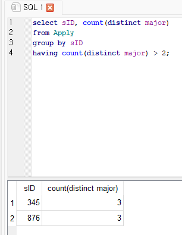

    - delete

    ```sql
    delete from Apply
    where sID in (select sID, count(distinct major)
    from Apply
    group by sID
    having count(distinct major) > 2);
    ```

### Update

```sql
update set column values(...);
```

---

## &lt;View&gt;

> View는 사용자가 원하는 형태의 결과를 보여줄 수 있는 기능

### View 만들기

```sql
create view view_name as <QUERY>
```

- 예를 들어, Department의 숫자나, 직원들의 월급 총합 등은 View로 만들 수 있다.  
- View를 통해 새롭게 생성된 가상 테이블(뷰)에 대해 SQL 질의를 사용할 수 있음.

```sql
select fname, lname
from WORKS_ON_NEW
where pname = 'Seena';
```

⇒ 이 때, WORKS_ON_NEW는 사전에 create view를 통해 저장했던 &lt;QUERY&gt;를 실행하는 것과 같다. 즉, 실제로 select를 수행할 때는 WORKS_ON_NEW가 Query로 대체되어 실행된다.

> 갱신할 수 없는 뷰  
>   
> 그룹화와 집단함수를 사용하여 정의된 뷰는 수정할 수 없고,  
> 일반적으로 다수의 테이블을 조인하여 정의한 뷰는 갱신할 수 없음.  
>   
> ⇒ View는 select할 시에 단순히 Query를 통해 값을 가져오는 과정이므로, 참조가 되어 있는 경우 등에서는 갱신이 불가능한 경우가 많다.  
>   
> 다만, View로 갱신할 수 있는 경우도 있다. 하지만 보통 Aggregate Function이나 Group By 등을 사용하여 View를 만드는 것이 일반적이므로, View는 거의 갱신이 불가능하다.
