# SQL-5

작성일 2023-11-29 · 최종 수정일 2023-12-14
{ .post-date }

## &lt;뷰(View)&gt;

> 지금까지는 개념 단계에서 실제 테이블을 가지고 데이터를 다뤘었음. 이런 데이터를 사용자의 편의에 맞춰 가상의 테이블로 변환할 수 있다. (실제로 존재하지는 않지만, 가상의 테이블로 만들 수 있음.)  
> ⇒ 뷰에 대한 질의를 기본 테이블들에 대한 질의로 변환하여 처리. 그러나 이 방식이 성능이 좋지는 않아서, Nested Query를 Single Query로 Optimize하는 알고리즘이 내부적으로 만들어져 있다.

- **Ex 1**. CS에 지원하고, 결과는 합격인 학생의 아이디, 대학 이름을 구하시오.

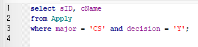

⇒ 우리는 이 결과를 Table에 저장해서 필요할 때마다 꺼내서 사용하고자 한다.

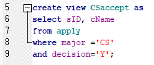

⇒ 이를 테이블처럼 사용할 수 있다.

- **Ex 2**. Stanford CS에 합격한 학생 중 GPA가 3.8 미만인 학생의 아이디, 이름, GPA를 구하시오.

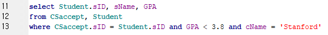

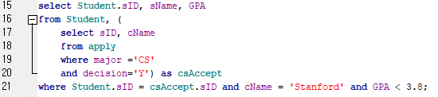

⇒ View를 직접 Query로 대체한 결과. 같은 결과를 보인다.

- **Ex 3**. Berkeley 대학의 CS에 합격한 학생의 아이디, 이름, GPA를 구하시오.

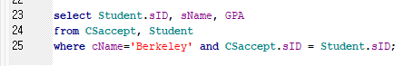

> View를 통해서 새로운 View를 만들어낼 수 있다.

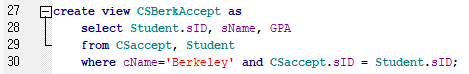

⇒ Berkeley CS에 합격한 학생의 View Table

- **Ex 4**. Berkeley CS에 합격한 학생 중 GPA가 3.8보다 높은 학생의 sID, 이름, GPA를 구하시오.

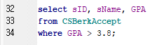

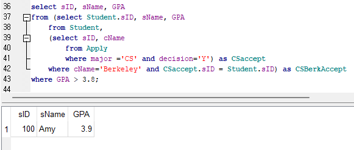

⇒ 내부 쿼리를 모두 대체하여 표현해 보기

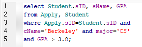

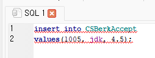

실행이 불가능한 문장. ⇒ View는 수정이 불가능함. 데이터가 두 곳으로 나뉘어져서 들어가야하고, 여기 없는 정보들(Student의 경우, Highschool Size 등도 넣어줘야 하니까, 만들 수 없는 것이다.)

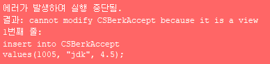

- **Ex 5**. 학생의 아이디, 이름, 고등학교 사이즈, 지원 대학, 대학의 주(state), 대학 등록학생, 지원학과, 지원 결과를 구하시오.

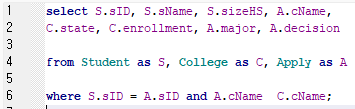

⇒ View로 만들어준다.

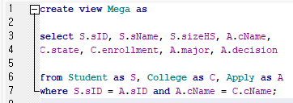

모든 정보를 다 가지고 있는 View인 Mega 생성

- **Ex 6**. GPA가 3.5보다 크고, CS에 지원했으며, 지원한 대학의 등록 학생 수가 15000 초과 학생의 아이디, 이름, 지원 대학 이름을 구하시오.

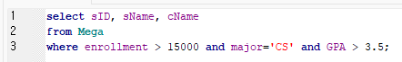

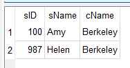

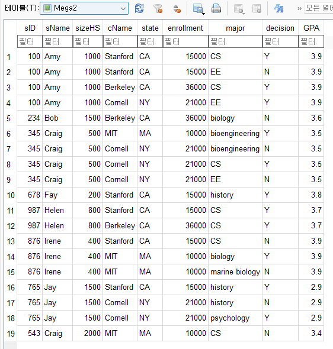

> 이 방식의 문제점은, 데이터의 중복이 너무 많기 때문에 데이터의 Consistency를 유지하기가 어렵다는 문제가 발생한다.

- **View 지우기**

⇒ Drop View ‘View_Name’

---

## &lt;SQL의 기타 기능&gt;

> 제대로 된 DBMS는 사용자의 개념이 존재하여 권한을 설정해 주어야 하는 부분이 존재하며, Host 언어와 결합하여 사용할 수 있다. Host 언어와 DBMS는 연결이 가능한 API들을 제공하므로, 이를 사용하면 직접적으로 DBMS와 Host Application이 Communication 할 수 있다.

- C/C++ : ODBC
- Java : JDBC (Java Database Connectivity)
- Python : Python Database API
- Python 실습

```python
import sqlite3 as sql

# connection을 획득
conn = sql.connect("F:\\class_3\\database\\sqlite_lab\\admission.db")

# Data를 탐색할 Cursor(일종의 pointer)를 획득
cursor = conn.cursor()

# Query 실행
result = cursor.execute("select * from Student")

print(result.fetchone())
print(result.fetchone())

result = conn.execute("select * from Apply")
query_list = result.fetchall()
print(f"query list len : {len(query_list)}")

# connection을 반환
conn.close()

# insert를 할 때는 transaction이 필요함
```

---

## &lt;Transaction&gt;

> 하나 또는 여러 SQL Query가 존재할 때, 하나의 단일 작업으로 간주되도록 만드는 것이다.  
> 따라서 중간에 다른 Query가 수행되지 못하는 것을 의미한다.

### Transaction의 필요성

- 동시작업

    - 데이터베이스에 여러 사용자가 동시에 접근하여 데이터베이스를 사용하는 것을 가능하도록 만든다.

- 고장(실패)에 대한 감내성(resilience)을 부여함

### 데이터베이스 동시접근의 문제점

> 다음과 같이 두 개의 Query가 거의 동시에 수행된다고 하자. (Concurrently)

- Query S1

```sql
update College Set enrollment = enrollment + 1000 where cName = 'Stanford'
```

- Query S2

```sql
update College Set enrollment = enrollment + 1500 where cName ='Stanford'
```

- **parallelism** : H/W적인 지원을 통해 실제로 동시에 수행되는 것
- **concurrency** : 실질적인 H/W는 하나이나, Multiplexing(Context Switching)을 통해서 여러 Task가 동시 수행되는 것처럼 만드는 것
- **Update가 이루어지는 과정**

> Read → Modify → Write

컴퓨터에서 모든 작업은 Disk에서 가져온 데이터를 메모리에 load하여 수정하는 방식으로 이루어진다. 그러므로, S1을 수행할 때 Disk에서 15000(enrollment)이라는 값을 가져와 16000으로 modify한 상태에서 write를 해야만 값이 Disk 상에서 변경되는 것이다.

그런데, 만약 S1에서 modify를 했을 때, S2가 수행되어서 각각 15000의 값을 복사했다고 해보자. 이 상태에서 서로 15000이라는 값을 수정하여 각각 서로 다른 time step에 저장하게 된다면, enrollment의 값은 15000 → 16000 → 16500이 될 수도 있다는 것이다. 

- Query S1

```sql
update Apply set decision = 'Y'
where sID in (select from Student where GPA > 3.9)
```

⇒ GPA가 3.9 이상인 학생들의 decision을 Y로 변경하는 작업.

- Query S2

```sql
update Student set GPA = (1.1)*GPA where sizeHS > 2500
```

> 위 두 개의 작업 또한 수행 순서에 따라 의도하지 않은 결과를 낼 수도 있다. 사실 두 개의 값 모두 valid한 값이지만, 문제가 되는 것은 서로 같은 값을 가져야만 하는 여러 개의 Table이 서로 다른 값을 가져서 Consistency가 유지되지 않을 수도 있다는 것이다.  
>   
> 문제가 발생한 이유는, 하나의 Query가 Atomic하게 취급되지 않고 내부적으로 나뉘어질 수 있도록 취급되었기 때문이다. (Read → Modify → Write가 나뉘어 짐.)

따라서 DBMS에서는 여러 개의 Query가 Atomic하게 분리(isolation)되어 수행되는 것과 같은 효과를 갖도록 해야만 한다.

가장 쉬운 방법은 실제로 &lt;반드시 한 번에 하나의 Query&gt;만 수행하도록 Serialization 하는 것이다. 그러나 이 방법은 Performance가 너무 떨어진다.

### 고장에 대한 감내성(Resilience To Failures)

> DBMS에 데이터를 Bulk Load하는 상황을 가정해보자. (큰 데이터)  
> 이것은 Insert를 여러 번 수행하는 방식이라고 볼 수 있다.

이렇게 Bulk Load를 하는 동안에, 전기가 나가서 어느 순간에 컴퓨터가 다운되었다고 가정하자. 이렇게 되면 어느 정도의 데이터는 Insert가 되었지만, 나머지는 되지 않았다고 할 수 있다.

그러므로 우리는 이 순간에 DBMS가 아예 데이터가 들어가지 않았던 순간으로 돌아가게 하거나, 데이터가 들어가지 않은 부분부터 Query를 다시 수행할 수 있도록 보장해 주는 것을 바랄 것이다.

```sql
insert into Archive select * from Apply where decision = 'N';
delete from Apply where decision = 'N';
```

(*모든 작업이 수행될 때는 그것이 바로 적용되는 것이 아니라, 메모리에서 수행된 후에 Bus를 거쳐 Disk로 전달되는 것이다.*)

> 그래서 이러한 두 가지 문제를 해결하기 위해 나온 개념이 Transaction이다. Transaction은 연속된 작은 작업(Update = Read → Modify → Write)을 하나의 단일 작업으로 만들어 Atomicity를 보장하는 역할을 하고, 수행 과정을 기록하여 작업 상태의 보존/유지를 돕는다.

데이터베이스에 Connection을 맺으면 그 순간에 Transaction이 실행되고 Query를 수행한다. 이후에 commit()이 수행되면 현재의 Transaction을 종료하고, 다음 Transaction이 시작된다.

autocommit은 각각의 SQL 문장이 Transaction으로 수행되도록 만든다. 이것은 **Locking**과 **Logging**의 결합으로 구현될 수 있다. (*Locking은 OS와 같은 개념이다.*)

DBMS는 하나의 Query가 수행될 때, 그 Query에 대한 Log를 남긴다. (어떤 작업이 수행됐는지…)  
그래서 Query 수행 도중에 문제가 생겨 시스템이 다운되었을 때, 그 Log를 바탕으로 이전의 상태를 판단한다. 

- 마치 OS가 데이터의 consistency를 보장하기 위하여 Process의 개념으로 작업을 구분하는 것처럼 DBMS에서도 Transaction을 도입하여 작업의 수행을 분리하는 것을 생각할 수 있다.

### Rollback

> 이전까지 하나의 Transaction으로 수행되었던 작업들이 수행되기 전의 시점까지 DBMS의 상태를 복원시키는 것을 말한다.

### Transaction의 성질

- **Atomicity** (원자성) : Transaction에 포함된 작업은 전부 수행되거나 아니면 전부 수행되지 않아야만 한다.
- **Consistency** (일관성 보존) : Transaction을 수행하기 전이나 수행한 후에 데이터베이스의 상태는 일관성을 유지해야만 한다.
- **Isolation** (고립성) : 수행 중인 Transaction에 다른 Transaction이 끼어들어 변경 중인 데이터를 훼손하는 일이 없어야만 한다. 
- **Durability** (지속성) : 수행을 성공적으로 완료한 Transaction으로 변경된 데이터는 데이터베이스에 영구히 남아있어야 한다.

- **여러 개의 Query가 순서를 중요시 한다면, 각 Query가 하나의 Transaction이 되도록 해야 한다.**

    - 즉, Commit() → Q1, Q2, …, Qn → Commit() 을 해야한다는 것이다.
    - 이렇게 하지 않으면 동시 수행은 안되지만 순서를 보장할 수는 없다.

---

## &lt;Transaction Lab&gt;

```python
import sqlite3 as sql

# connection을 획득
conn = sql.connect("F:\\class_3\\database\\sqlite_lab\\admission.db")

# Data를 탐색할 Cursor(일종의 pointer)를 획득
cursor = conn.cursor()

myData = (999, "Name", 4.0, 12000)
cursor.execute("insert into Student values(?, ?, ?, ?)", myData)

yourData = (9999, "Minchul", 3.5, 1000)
cursor.execute("insert into Student values(?, ?, ?, ?)", yourData)

# 여기까지 수행된 Query는 아직 Commit이 되지 않았으므로,
# 안전하게 Durability를 보장하기 위하여 Commit()을 수행해야 한다.

# commit을 수행하여 Query 수행 결과를 반영한다.
conn.commit()

cursor.execute("delete from Student where sID=999")
cursor.execute("delete from Student where sID=9999")
# 여기서도 마찬가지로 Commit을 수행하지 않으면, Durable하지 않다.
# 따라서 Commit()을 수행하여 Memory Buffer에만 담겨있던 내용을
# DB로 전달한다.
# conn.commit()

# 그런데 만약, Commit()을 하고싶은게 아니라 지금까지 수행한 결과를
# 되돌리고 싶다면 Rollback을 수행해야 한다.

result = cursor.execute("select * from Student")
result = result.fetchall()

for tuple in result:
    print(f"tuple : {tuple}")

# 결과를 되돌려서, 삭제를 Rollback한다.
# 즉, commit()을 하지 않았으므로, 결과는 반영되지 않는다.
conn.rollback()
conn.close()
```
