# 함수적 종속성과 정규화

## &lt;함수적 종속성&gt;

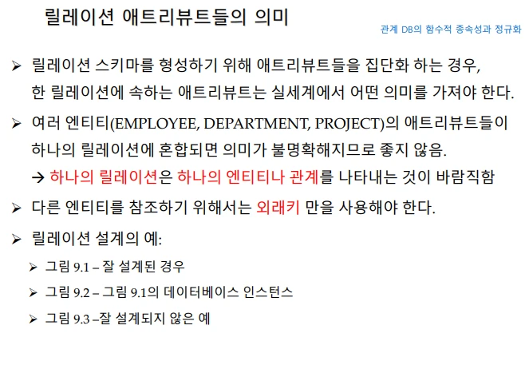

- 하나의 Relation에 여러 Entity의 Attribute들이 섞여있을 수 있는데, 이 방식은 바람직하지 않다.

### Company Database Schema

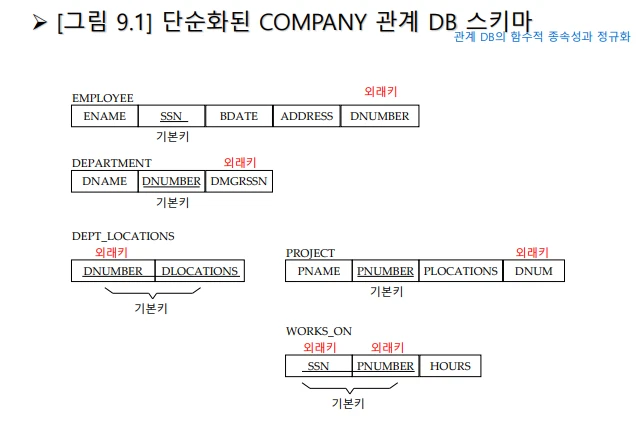

- Company DB는 잘 설계된 Schema이지만, 문제를 만들기 위해서 일부러 Schema를 수정해 보고자 한다.

### Modify Schema

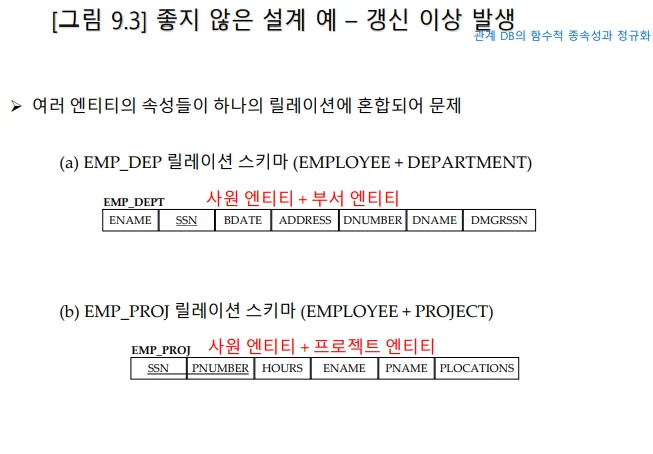

- 위와 같이 Schema를 수정하였고, 아래처럼 Tuple을 추가하였다.

### Anomalies on Update Actions

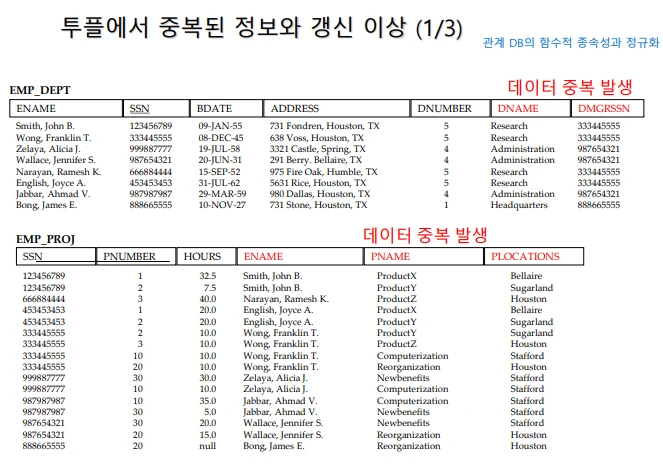

> 가장 큰 문제는 같은 내용의 데이터가 수차례 반복되어, 불필요한 중복이 발생하다는 것이다.  
> ⇒ 이것으로 인해서 어떤 문제 상황이 발생하게 될까?

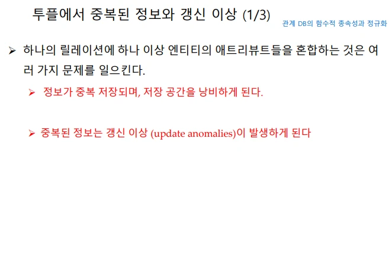

- 위와 같이 중복이 발생할 경우, Insert, Update, Delete를 할 때 문제가 발생할 가능성이 있다.

### Insert Anomalies

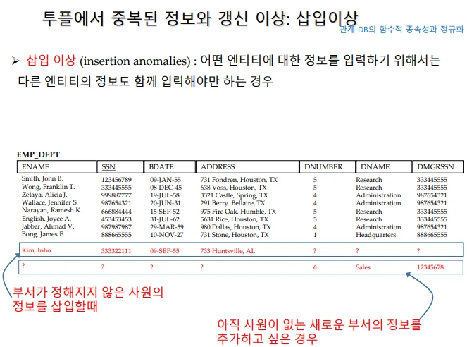

- 예를 들어, 김인호라는 신입 사원이 입사한다고 할 때, Project에 대한 정보가 지정되지 않았을 수도 있다. 하지만 이런 문제는 NULL 또는 Default Value로 문제를 해결할 수는 있다.
- 또는 기존에 없던 Sales라는 부서를 추가하고자 할 때, Manager는 결정했지만 사원을 뽑지 않은 경우에도 사원 데이터를 NULL로 설정하고자 한다. 하지만 이것은 불가능한데, 바로 Key에 중복이 발생하기 때문이다.

### Delete Anomalies

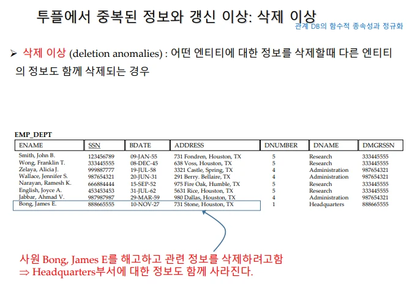

- Bong, James E라는 사람이 퇴사를 한다고 할 때, 이 사람의 정보를 제거한다면 그와 연결되어 있던 Headquarters의 유일한 정보가 삭제되기 때문에 문제가 될 수 있다.

### Modification Anomalies

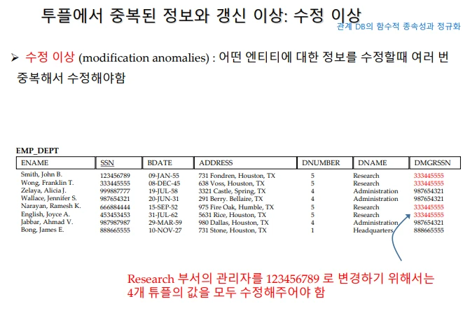

- 만약 한 부서의 관리자를 변경하고자 한다면, 해당 부서에 속한 모든 사람들에 대한 DMGSSN을 수정해 주어야 한다는 문제가 생긴다.

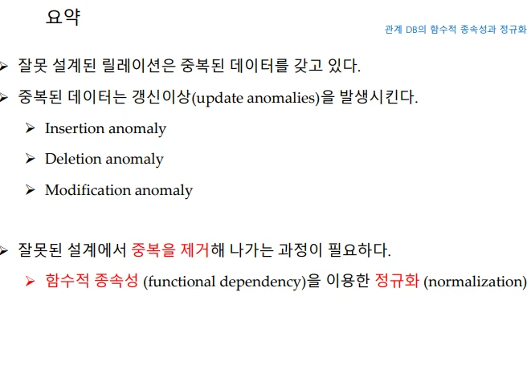

> Relation 설계가 잘못되면 중복되는 데이터가 나타나기 때문에, 여러 문제가 발생할 수 있게 된다.  
> 따라서 좋은 데이터베이스 설계란, Relation을 설계하는 과정에서 중복을 제거하는 과정이다.  
>   
> **함수적 종속성**을 통해 데이터베이스를 **정규화**(Normalization)하는 것이 설계를 개선하는 과정이다.

### 데이터베이스를 설계하는 대표적인 방법

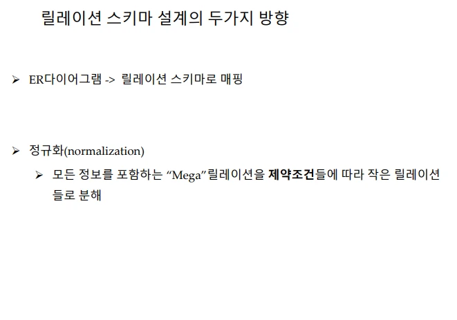

1. ERD ⇒ Relation Schema로 매핑
2. 정규화(Normalization) ⇒ 모든 Entity의 Attribute가 포함된 Mega Table을 만들고 여기서 Relation을 **함수적 종속성**(Functional Dependency)에 따라서 분해해 나가는 과정이다.

### 함수적 종속성이란?

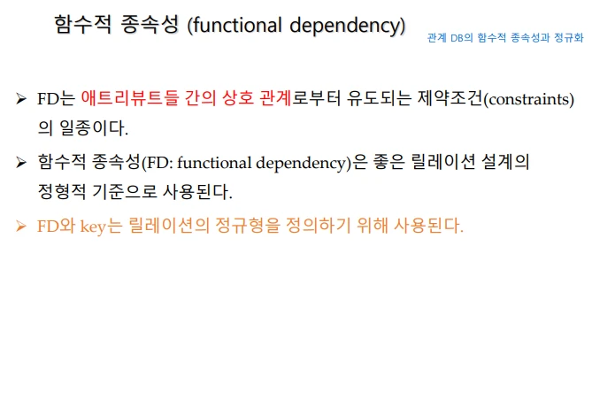

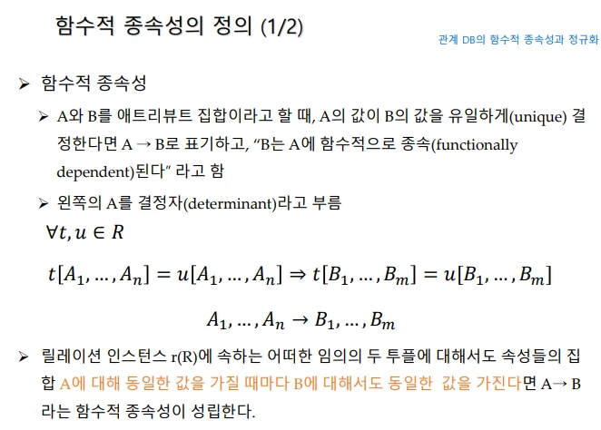

- A와 B를 Attribute의 집합이라고 할 때, A의 값이 B의 값을 유일하게 결정한다면  
    A → B 로 표기하고, B는 A에 함수적으로 종속된다고 한다.
- 이때, A를 결정자(Determinant)라고 한다.

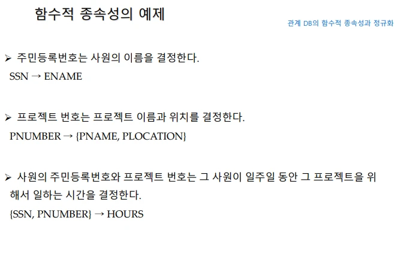

- SSN → ENAME

- PNUMBER → {PNAME, PLOCATION}

    - 집합으로 표시할 수 있음.
    - PNUMBER → PNAME, PNUMBER → PLOCATION 도 허용된다.

- {SSN, PNUMBER} → HOURS

> Functional Dependency는 기계적으로 결정하는 과정이 아니라, 의미론적으로 해석해서 결정하는 과정이다.

- ex)

    - SSN → HOURS (X)
    - PNUMBER → HOURS (X)

### Functional Dependency on Schema

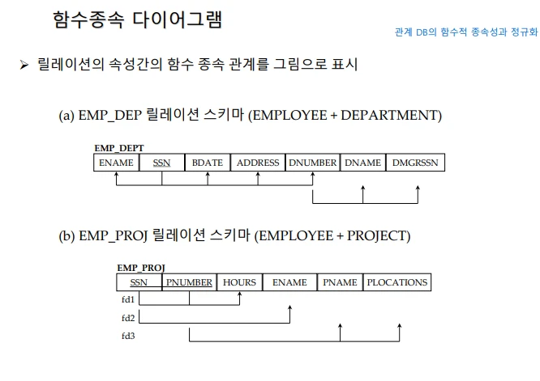

- 하나의 Attribute가 여러 개의 Functional Dependency에 대한 Determinant가 될 수도 있다.
- 또, 이행성 규칙에 의해서 SSN은 DNAME을 결정할 수 있다.

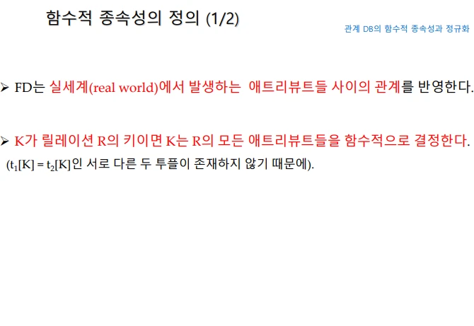

> Key Attribute는 그 Key가 속한 Relation의 모든 Attribute를 결정짓는 Determinant가 되어야 한다. (기능을 생각해보면 당연한 내용이다.)

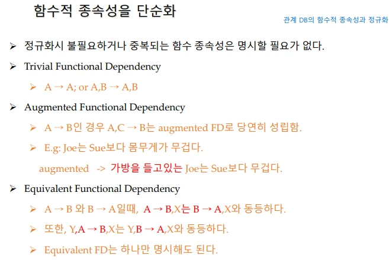

- Trivial Functional Dependency
- Augmented Functional Dependency

- Equivalent Functional Dependency

    - 당연한 것들은 굳이 포함하지 않는다.

### 함수적 종속성의 추론 규칙

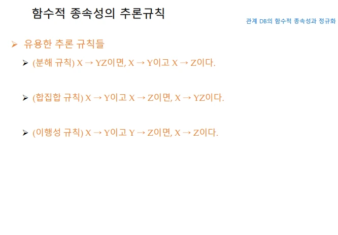

- 분해규칙 : X→YZ이면, X→Y, X→Z이다.
- 합집합 규칙 : X→Y이고 X→Z이면, X→YZ이다.

- 이행성 규칙 : X→Y이고 Y→Z이면, X→Z이다.

    - **Transitive Rule**(이행성 규칙)이라고도 한다.

### Attribute 집합의 클로져(Closure)

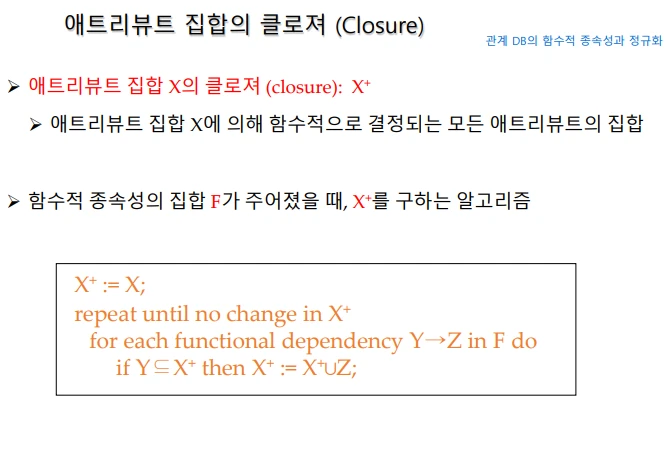

- X가 자기 자신인 X를 결정하는 것은 당연하므로, 초기에 X로 initialize 한다.
- 이후에 X가 가진 모든 FD를 탐색하면서 추가되는 Attribute들을 X의 Closure로 추가해 나간다.

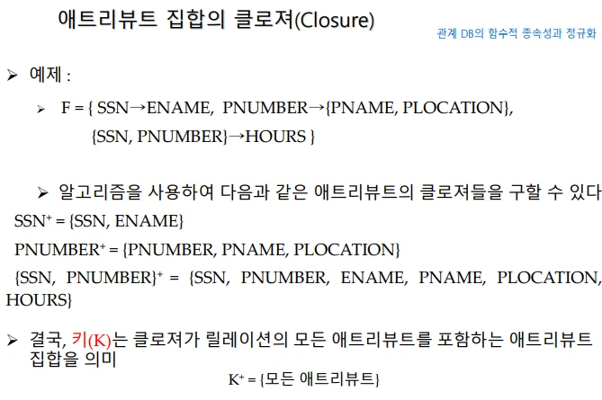

- 예를 들어, SSN의 Closure를 구해보자. 

    - 처음에는 SSN+ = {SSN}으로 시작한다.
    - SSN은 ENAME을 결정하므로, ENAME을 추가한다.

- 그리고 PNUMBER+를 구한다.

    - PNUMBER는 PNAME, PLOCATION을 결정한다.

- 마지막으로 {SSN, PNUMBER}+를 찾아본다.

    - SSN+, PNUMBER+ 각각의 Closure를 추가하고, Semantic하게 HOURS가 결정되는 것을 알 수 있다.

> 이와 같이 Closure를 결정할 수 있다.

> Key Attribute의 Closure는 자신이 속한 Relation의 모든 Attribute를 Closure에 포함시켜야 한다.

---

## &lt;정규화(Normalization)&gt;

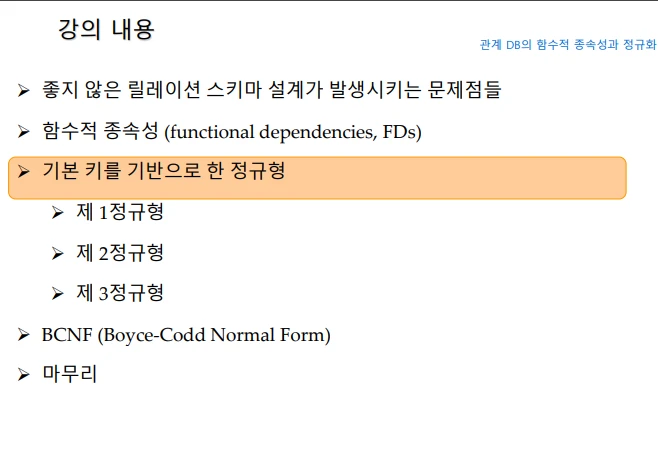

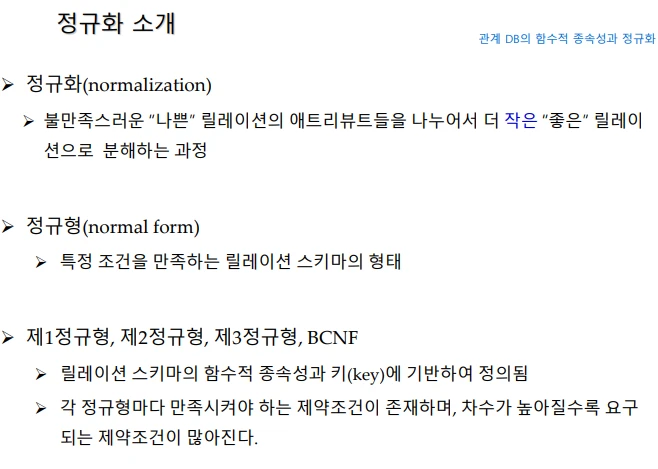

> 정규화는 큰 Mega Table에 Update Anomaly가 발생하지 않도록 더 작은 Table로 바꾸어 나가는 과정이다.

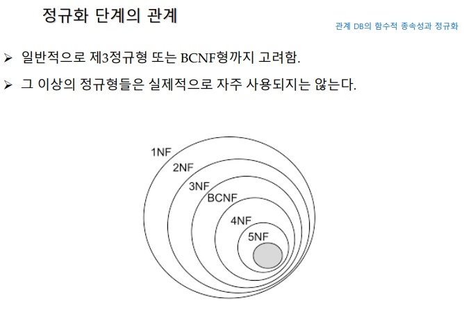

> 실제로 주로 사용하는 것은 1NF, 2NF, 3NF, BCNF 정도이다. (실무적으로 사용함)

### 제1정규형 (1NF)

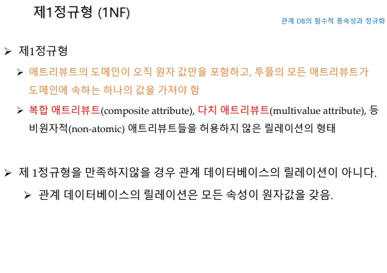

- 제1정규형 : 모든 Attribute가 Atomic Value를 갖는다.

    - 사실 이것은 Relational Database 자체에서 이미 만족되어야 하는 조건이다.

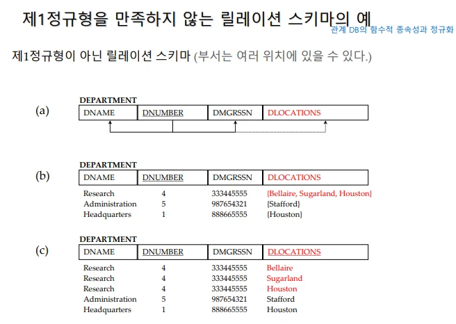

- (b)에서 다치 애트리뷰트를 (c&#41;로 변경하여 해결할 수는 있지만, Primary Key가 중복된다는 문제가 생겨서 1NF는 만족하지만, 데이터베이스 제약조건을 만족하지는 못한다.

### 제2정규형 (2NF)

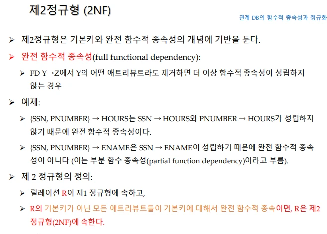

- **완전 함수적 종속성** : FD Y→Z에서, Y의 어떤 Attribute를 제거하면 더 이상 FD가 유지되지 않는 경우이다.

    - ex) {SSN, PNUMBER} → HOURS에서 SSN, PNUMBER 중 하나라도 제거하면 FD가 성립되지 않으므로 이 FD는 **완전 함수적 종속성**이다.
    - ex) {SSN, PNUMBER} → ENAME에서, PNUMBER를 지워도 FD가 성립하기 때문에 완전 **함수적 종속성**이 아니다.

> Relation R의 기본키가 아닌 모든 애트리뷰트들이 기본키에 대해서 완전 함수적 종속이면, R은 **제2정규형**(2NF)에 속한다.

- **2NF Example**

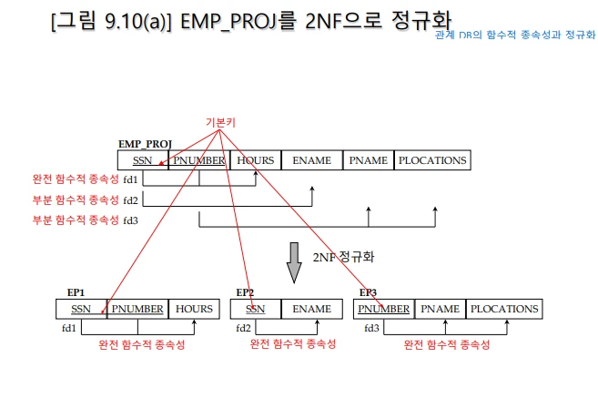

> EMP_PROJ에 따르면, 완전 함수적 종속성이 아니라 부분 함수적 종속성이 나타나는 FD가 존재한다. 따라서 완전 함수적 종속성을 갖는 것을 떼와서 별도의 Table로 만들어야 한다.

### 제3정규형(3NF)

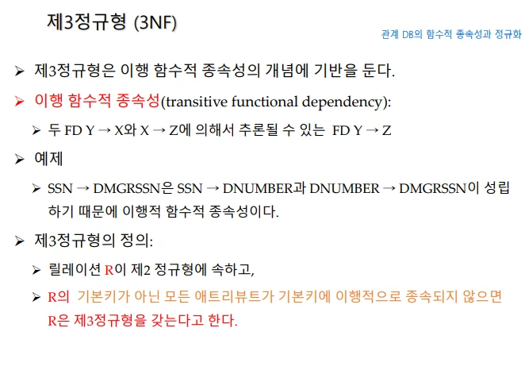

- **이행 함수적 종속성** : 이행성 규칙에 의해서 결정되는 FD

    - ex) SSN → DNUMBER, DNUMBER → DMGRSSN이면, SSN → DMGSSN이다.

> 제3정규형은 기본키가 아닌 다른 Attribute들이 기본키에 이행적으로 종속되지 않으면 제3정규형을 갖는다고 한다.

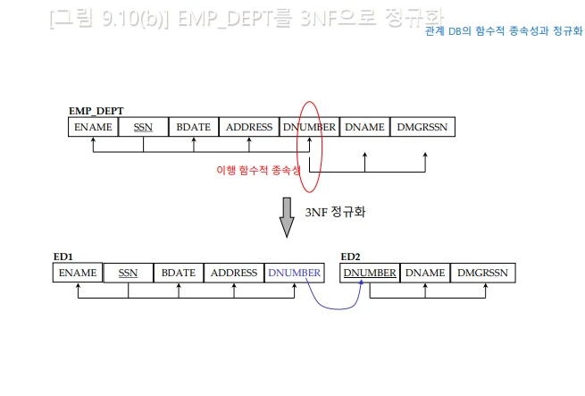

- EMP_DEPT Relation에서 SSN이 DNUMBER를 결정하고, DNUMBER가 DNAME, DMGSSN을 결정하기 때문에 이것은 **Transitive FD**가 성립하는 상황이라고 볼 수 있다.

    - 따라서 이것을 수정해야 한다.

- 따라서 DNUMBER와, 그것의 Closure Attribute는 별도의 Table로 분해해야 하며, 두 Relation을 Foreign Key로 연결해 주어야 한다.
- 이렇게 하면 모든 Attribute들에서 Relation의 Key에 대하여 Direct FD이 성립된다.

### BCNF

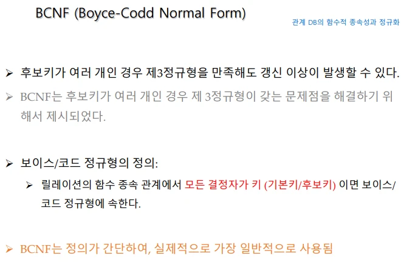

> 이전까지는 제3정규형까지만 있어도 Update Anomaly가 존재하지 않다고 생각했는데, 더 연구하다보니 갱신 이상이 발생할 수 있다는 것을 알게 되었다.

- BCNF에 따르면, Relation에 존재하는 모든 FD의 Determinant는 반드시 키여야 한다.

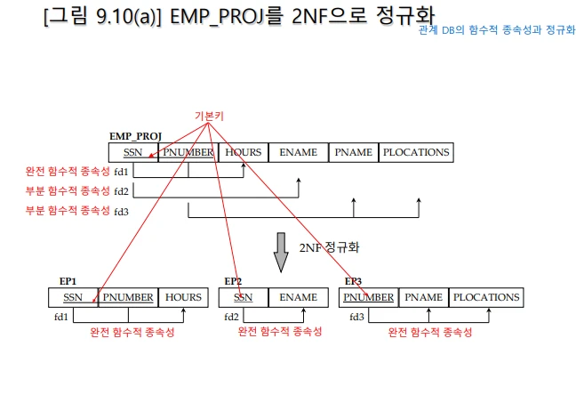

- fd1 : Determinant {SSN, PNUMBER}는 Key이다.
- fd2 : SSN 단독으로는 Key가 될 수 없으므로 BCNF를 만족하지 않는다.
- fd3 : PNUMBER 단독으로는 Key가 될 수 없으므로 BCNF를 만족하지 않는다.

⇒ **BCNF는 3NF보다 더 강력한 개념이라서 더 일반적으로 사용된다.**

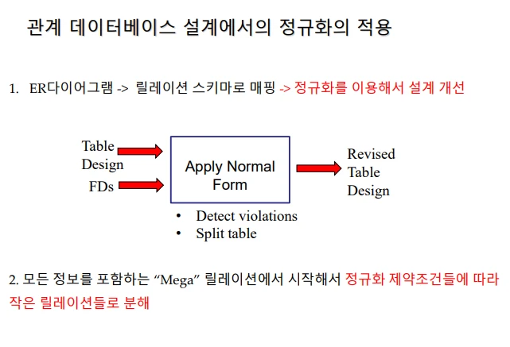

- 지금까지 배운 1NF, 2NF, 3NF or BCNF를 통해서 Mega Relation을 작은 Relation으로 분해해 나갈 수 있다.

### 정규화는 반드시 필요한가?

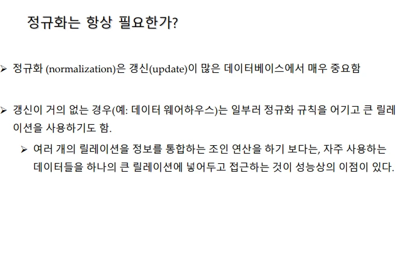

> 사실 Mega Table이 존재하면 매우 편리하게 값을 가져올 수 있다. 우리가 정규화를 하는 이유는 결국 Update Anomaly를 없애기 위해서 이므로, Insert, Delete, Update를 하지 않는 Database(Data Warehouse)를 사용한다면 Normalization을 꼭 하지는 않아도 된다.
