# 1주차: 하드웨어 구성 요소, 마이크로컴퓨터 구조, 운영체제 역할

작성일 2023-03-26 · 최종 수정일 2023-04-23
{ .post-date }

## 제 2장 : 기본 구조와 동작

- 하드웨어의 구성
- 소프트웨어의 역할
- 다중 작업
- 시동 과정
- 신호선의 동작

---

## 1. 하드웨어의 구성

#### 1-1 하드웨어 구성 요소

컴퓨터의 하드웨어는 크게 CPU, memory, I/O 장치로 구성되며, 모두 하나의 Bus로 연결되어 있다.

- 중앙처리장치(Central Processing Unit, CPU)

    - 프로그램 실행과 데이터 처리에 중추적인 역할을 하며, Processor라고도 부른다.
    - 컴퓨터의 주요 연산을 처리하며, 메모리로부터 데이터를 가져온 다음 그 데이터를 바탕으로 연산을 진행해 원하는 동작을 수행한다.

- 기억장치(memory) : RAM, ROM, Cache, Register …

    - 프로그램의 코드나 데이터를 기록하는데 사용된다.

    - 주기억장치(Main Memory, RAM)는 프로그램 실행 중에 주로 사용되는 반도체 메모리로서, 일반적으로 DRAM이 사용된다.

        RAM은 Volatile하기 때문에 전원이 들어오는 동안은 데이터가 유지되지만, 전원이 공급되지 않으면 기록된 데이터가 모두 사라진다.

        컴퓨터는 RAM에 필요한 데이터를 올려 사용하게 되고, CPU와 데이터를 주고 받게 된다.

    - 보조기억장치(Read Only Memory, ROM)는 데이터 저장에 주로 사용되며, 컴퓨터에서 사용되는 각종 드라이브를 말한다.

- 입출력장치(input/output device, I/O장치)는 컴퓨터와 사용자를 이어주는 인터페이스 역할을 하며, 사용자의 입력을 받아 컴퓨터에서 처리한 뒤 다시 사용자에게 전달해주는 기능을 한다.

#### 1-2 마이크로컴퓨터의 구성 요소

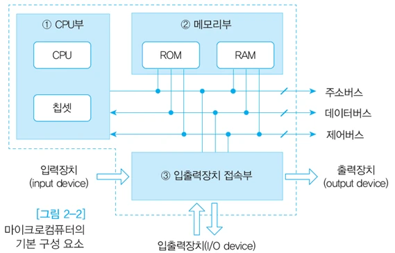

- 마이크로컴퓨터 : 마이크로프로세서를 CPU로 사용하는 소형 컴퓨터

마이크로컴퓨터도 마찬가지로 CPU, Memory, I/O 구조로 이루어지며 , 모두 하나의 버스로 연결되어 있다. CPU부에는 각종 연산과 시스템 관리에 관여하는 CPU와 칩셋이 있고, Memory부에는 RAM과 ROM이 있으며, 입출력장치 접속부는 CPU와 I/O의 인터페이스 역할을 한다. 

그리고 각각의 파트를 이어주는 하나의 버스를 통해 데이터를 주고 받는다.

※ 버스의 Collision 이슈 : 버스의 경로를 설계할 때 다른 것과 버스가 겹치거나 물리적으로 접촉이 생기는 경우 저항에 의해 값에 노이즈가 생길 수 있으므로, 항상 Optimal하게 설계해야 한다.

#### 1-3 Bus의 필요성

버스는 컴퓨터 내에서 정보를 교환하기 위해 CPU와 하드웨어 요소들을 연결해주는 신호선들의 집합으로서, 부품 간을 연결해주는 통신선의 역할을 한다. 하드웨어를 설계하는 과정에서 버스의 개수와 길이를 줄이는 것은 하나의 중요한 이슈로 고려할 수 있다. (버스의 길이는 데이터의 전송 속도와도 관련이 있음.)

버스는 컴퓨터 상에서 데이터, 주소, 제어에 사용되는 신호를 전달하기 위한 신호선의 Set이다.

※ Bandwidth : 데이터 버스가 한 번에 처리할 수 있는 데이터의 크기를 Bandwidth라고 한다.

- 버스의 종류

    - 주소 버스

        - CPU가 외부로 내보내는 주소 신호이며, memory 혹은 I/O 장치들로 단방향 전송된다.
        - 주소 버스 배선의 수는 CPU와 연결될 수 있는 기억장치의 최대 용량을 결정한다.   
            (ex. 주소 버스의 비트가 16bit라고 하면, 최대 2\^16개의 기억 장소들의 주소를 결정할 수 있게 된다.)

    - 데이터 버스

        - CPU가 memory나 I/O 장치와 데이터를 주고 받는 통로이다.
        - 데이터 버스 배선의 수는 CPU가 한 번에 전송할 수 있는 비트 수를 의미한다.
        - 양방향 전송이 가능하다. (Read/Write)

    - 제어 버스

        - CPU 내/외부의 장치를 동작시키는 제어 신호를 주고 받는 통로이다.  
            (기억장치 R/W, I/O의 R/W 등을 결정)
        - 단방향 또는 양방향 전송 모두 가능하다.
        - 제어 선의 수는 컴퓨터마다 다르다.

- CPU와 시스템 버스 간의 접속

※ 시스템 버스 : 시스템 버스란 메인 메모리와 CPU 사이에서 데이터를 전달하기 위해 사용되는 버스 선의 집합을 말한다. 시스템 버스는 주소 버스, 제어 버스, 데이터 버스로 구성된다.

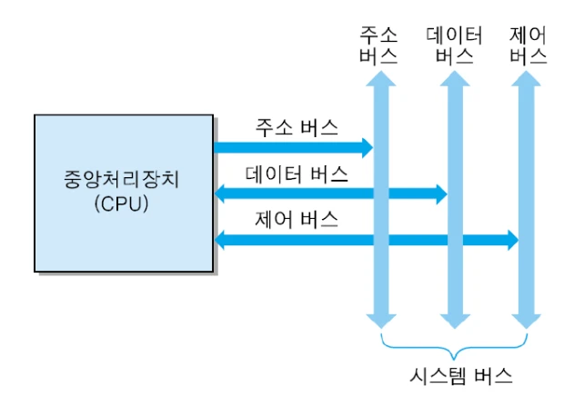

주소 버스는 단방향성을 가지고 있으며, CPU로부터 기억 장치 혹은 I/O 장치들로 정보를 전달하기만 한다. 데이터 버스와 제어 버스는 양방향성을 가지고 있어서 R/W 동작을 모두 지원한다.

- CPU와 기억 장치 간의 접속

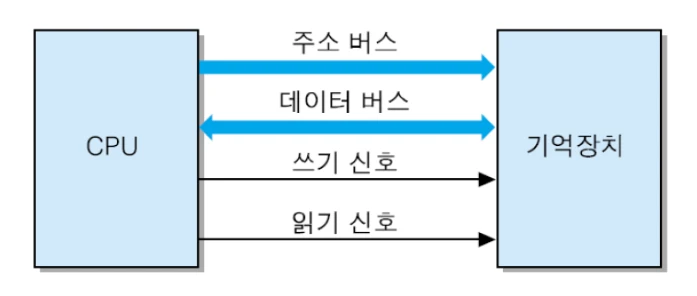

CPU는 메모리와 연결되어 동작을 수행한다. R/W 신호는 1bit 만을 사용하여 0과 1로 신호를 보내기 때문에 그림 상에서 얇은 화살표로 표현된다. 반면, 주소 버스와 데이터 버스는 많은 양의 데이터를 보내기 때문에 굵게 표현된다.

기억 장치에 쓰기 동작을 할 때는 CPU가 데이터를 저장할 기억 장소의 주소와 저장할 데이터를 각각 주소 버스와 데이터 버스를 통하여 보내는 동시에, 쓰기 신호를 활성화(1)한다.

기억 장치를 읽기 동작을 할 때는 CPU가 기억 장치 주소를 주소 버스를 통하여 보내는 동시에(단방향성) 읽기 신호를 활성화(1)한다. 일정 지연 시간이 경과한 후에 기억장치로부터 읽혀진 데이터가 데이터 버스 상에 실리게 되고, CPU는 그 데이터를 버스 인터페이스 회로를 통하여 읽는다. (양방향성)

- CPU와 I/O 장치의 접속

CPU와 I/O 장치의 접속은 중간 매개체인 시스템 버스를 통해 이루어지지만, 시스템 버스에서 I/O 장치로 바로 연결은 불가능하다. 시스템 버스에서 I/O 장치로 가기 전, I/O 장치 제어기(chipset)를 통해 제어를 전달한다.

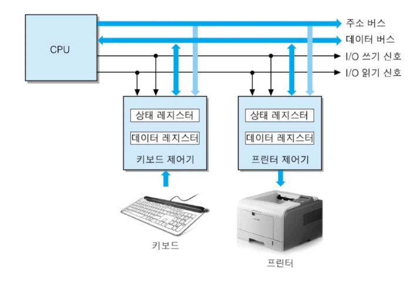

그림에서 I/O 장치 제어기를 보면 상태 레지스터와 데이터 레지스터라는 것들이 있다.

상태 레지스터는 I/O 장치의 현재 상태를 나타내는 비트를 저장하는 레지스터이다.  
ex) 준비 상태(RDY), 데이터 전송 확인(ACK) 비트 등이 있다.

데이터 레지스터는 CPU와 I/O 장치 간에 이동되는 데이터를 일시적으로 저장하는 레지스터이다.   
(버퍼의 역할을 하는 것으로 보인다. Queue 구조일 것이다.)

**about Controller**

저장 장치는 그 자체로는 자료를 읽고 쓸 수 없다. 어떤 물리적인 특정 공간에 특정 자료가 들어있을 뿐이기 때문이다. (RAM, Cache, HDD, Flash 등등…) 예를 들자면 HDD의 경우에는 Platter라고 하는 자기 원판의 특정 위치에 특정 자기 배열로 데이터가 저장되어 있다. 이런 자료를 읽고 쓰려면, 이런 저장 방식을 전부 알고 있으면서도 CPU의 요구에 맞게 필요한 위치에 자료를 쓰거나 읽을 수 있는 무언가가 필요할 것이다. 그 무언가를 컨트롤러라고 정의한다.

메모리 컨트롤러는 CPU가 원하는 동작을 대신 메모리에 수행한다. 전달받은 주소로 메모리에 어떻게 접근할 것인지를 제어하고, 그 다음에 원하는 값을 쓰거나 읽는 역할을 한다.

우리가 메인 메모리로 사용하는 RAM은 Volatile 특성을 갖고 있기 때문에 주기적으로 메모리에 기록된 내용을 갱신(Refresh)해 주어야 하는데, 이 또한 컨트롤러가 담당한다. 그리고 메모리가 동작하기에 적당한 전압을 계속해서 공급해주는 것도 메모리 컨트롤러의 일 중 하나이다.

HDD 후면의 기판도 HDD Controller라고 볼 수 있으며, SSD와 같이 복잡한 장치에서는 Controller의 성능이 SSD의 성능을 좌우하기도 한다. 심지어 단일 칩으로 구성된 USB 메모리 조차도 내부는 플래시 저장 영역과 컨트롤러 부분으로 구분되어 있다.

#### 1-4 마이크로컴퓨터 구조

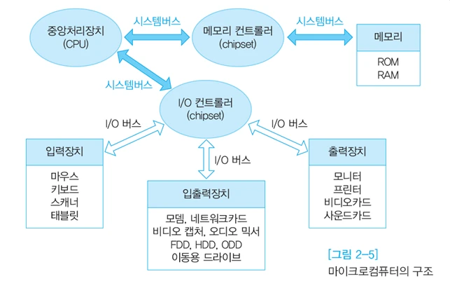

CPU와 I/O 장치는 시스템 버스인 I/O 버스와 연결되어 있지만, 중간에 위치한 I/O 컨트롤러 칩셋을 통해 데이터가 전달된다. I/O 컨트롤러에는 데이터 버퍼의 역할을 하는 데이터 레지스터와 상태 레지스터가 있다.

그리고 CPU와 메모리는 시스템 버스인 주소 버스와 데이터 버스로 연결되어 있는데, 사실 메모리 그 자체로는 데이터를 저장하는 역할밖에 수행하지 못하기 때문에 실질적인 처리 명령은 메모리 컨트롤러 칩셋이 수행한다.

- 메모리 컨트롤러와 I/O 컨트롤러

    - CPU를 도와 하드웨어를 제어하며, 대개 칩셋으로 구성된다.
    - 메모리 컨트롤러 : 메모리 장치를 제어
    - I/O 컨트롤러 : 입출력장치를 제어

- 시스템 버스와 I/O 버스

    - 시스템 버스

        - CPU, Main Memory, Chipset들과 연결된다.
        - RAM Module을 CPU에 동기시켜 제어시간을 절약한다.

        ⇒ 버스의 역할은 컴퓨터 내부의 하드웨어들을 전기적인 신호선을 통해 연결해주는 것인데, 결국 클럭도 버스를 통해서 타고 들어온다. RAM Module을 CPU에 동기시킨다는 것은 RAM이 같은 클럭으로 동작하도록 해서 데이터를 효율적으로 처리하도록 만든다는 뜻으로 생각된다.

    - I/O 버스

        - I/O 컨트롤러와 입출력장치 사이를 연결한다.
        - 비트 수와 속도가 다양한 여러 종류의 I/O 버스를 사용할 수 있으며, 컨트롤러가 이를 조절한다.

#### 1-5 칩셋(Chipset)

여러 칩과 회로가 모여 서로 연관된 기능을 수행하도록 설계된 제어 칩들의 조합을 말한다.

칩셋은 CPU 프로세서와 함께 시스템 전체를 제어한다. 버스 컨트롤러, 메모리 컨트롤러, I/O 컨트롤러, 인터럽트 컨트롤러, 타이머 등 다양한 종류의 내부 칩셋이 존재한다.

인텔 시스템에서 칩셋이란 용어는 두 개의 핵심적인 칩, 즉 노스브릿지와 사우스브릿지를 일컫는 말이기도 하다. 칩셋의 생산자와 마더보드의 생산자가 별개인 경우가 많다.

- 칩셋의 구성

    - 노스브릿지(North Bridge)

        - 메모리 컨트롤러를 포함, 주로 CPU와의 데이터 교환과 메모리 관리, AGP(Accelerated Graphics Port)와 PCI Express 16x 같은 고속 버스 제어, AGP & PCI-E 같은 고속 장치용 확장 카드 슬롯도 제어하는 등, 고속 & 연산 관련 장치를 제어한다.
        - 프로세서와 가깝게 위치하며, 속도가 빠르다.
        - CPU와 연결되는 호스트 인터페이스, 메모리 뱅크를 잇는 메모리 인터페이스, AGP 버스와 연결해서 그래픽카드를 제어하는 AGP 인터페이스가 있다.
        - 노스브릿지에서도 CPU와 메인보드가 연결된 것을 FSB(Front Side Bus)라고 하고, 메모리와 메인보드가 연결된 길을 Memory Bus라고 부른다.

        **AGP(Accelerated Graphics Port)**

        AGP란, 그래픽 카드를 메인보드에 연결하기 위한 연결 고성능 인터페이스이다. AGP는 1997년에 standard로 사용되고 있던 PCI(Peripheral Component Interconnect)를 대체하기 위하여 고안된 방식이다.

        AGP는 그래픽 카드를 빠르고 효율적으로 사용할 수 있도록 고안되었으며 아래와 같은 특징들을 가진다.

        1. Higher Bandwidth : AGP는 PCI보다 더 큰 Bandwidth를 가지며, 컴퓨터 시스템 내에서 더 빠른 데이터 통신이 가능해지도록 했다. AGP 1x는 266MB/s의 Bandwidth를 가지고, AGP 8x는 2.1GB/s의 Bandwidth를 가진다.
        2. Dedicated Bus : AGP는 그래픽 처리를 하기 위한 전용의 버스 선을 가진다. 이로서 더 빠르고 효율적인 데이터 처리가 가능해졌다. 기존의 PCI 방식은 공유 버스를 사용해서, 모든 타입의 데이터를 처리했기 때문에 다소 느리고 비효율적이었다.
        3. Sideband Addressing : AGP는 Sideband Addressing이라는 기능을 지원한다. 이는 그래픽 카드가 메인 데이터 버스를 사용하지 않고 컴퓨터 시스템에 제어 신호를 보낼 수 있도록 하는 기능이다. 이는 컴퓨터 시스템의 지연율을 줄이고 성능이 향상되도록 만들었다.
        4. Voltage Support : AGP는 더 높은 전압 레벨을 지원해서 더 다양한 종류의 그래픽 카드와 호환될 수 있다.

        이와 같은 특징을 가진 AGP는 현재는 더 높은 Bandwidth를 효율적으로 지원하는 PCI Express라는 standard로 대체되었다. 그러나 AGP는 컴퓨터 역사의 중요한 부분 중 하나이며, 현재까지도 많은 구형 시스템들은 AGP를 그래픽 카드 인터페이스로서 사용하고 있다.

        **PCI-E(Peripheral Component Interconnect Express)**

        PCI-E는 2004년에 최초로 고안된 새로운 인터페이스 형식으로서, 기존의 방식이었던 PCI와 AGP 방식을 대체하게 되었다. 현재는 컴퓨터의 각종 peripheral(주변 장치)들을 메인보드, 그래픽 카드, 네트워크 어댑터와 저장 장치 등에 연결해주는 standard interface로서 사용되고 있으며, 아래와 같은 특징들을 가진다.

        1. Higher Bandwidth : AGP와 마찬가지로 PCI-E는 PCI보다 더 큰 Bandwidth를 지원한다. PCI-E 1.0은 선 하나당 250MB/s의 Bandwidth를 가지며, 새로운 버전인 PCI-E 4.0은 선 하나당 최대 16GB/s의 Bandwidth를 가진다.
        2. Multiple Lanes : PCI-E는 laned based system으로서, 여러 개의 lane을 통해 병렬 처리를 함으로써 더 큰 Bandwidth를 얻게 되었다. 예를 들어, PCI-E 4.0 x16 슬롯의 경우에는 최대 64GB/s의 Bandwidth를 가지며, 이를 통해 고성능 그래픽 카드를 이상적으로 데이터를 처리할 수 있게 된다.
        3. Lane Configuration : PCI-E는 또한 Lane Configuration을 지원함으로써 더 유연한 인터페이스를 제공한다. 예를 들어, x16 슬롯 하나는 여러 개의 x8, x4 lane으로 나눠져서 네트워크 어댑터나 storage controller 같은 더 작은 크기의 디바이스를 다수 연결할 수 있다.
        4. Power Management : PCI-E는 더 효율적인 전력 관리 기능을 지원한다.
        5. Hot-Plugging : PCI-E는 시스템이 동작하는 동안 시스템 재부팅 없이 디바이스가 연결되거나 연결을 해제할 수 있는 기능을 지원한다. 이 기능은 특히 노트북이나 태블릿과 같이 빈번하게 연결과 해제를 해야하는 기기의 경우 유용하다.
        6. Backward Compatibility : PCI-E는 backward compatibility를 가져서 이전의 PCI 버젼들과 모두 호환되고, 이를 통해 구형 디바이스들이 PCI-E를 지원하는 새로운 메인보드와 호환되도록 한다.

        PCI-E는 PCI, AGP와 비교했을 때 더욱 빠른 데이터 전송 속도와 유연한 연결을 지원하는 새로운 인터페이스 형식이다. 사실상(de facto) 현대의 peripheral들을 메인 보드에 연결하는 standard 형식이 되었으며, 가까운 미래까지도 계속 사용될 것으로 생각된다.

        **Peripherals in Computer**

        컴퓨터 하드웨어에서 말하는 Peripheral은 PCI-E와 같은 인터페이스를 통해 컴퓨터의 메인보드에 연결되는 external device들을 말한다. 아래 예시는 PCI-E를 통해 메인보드와 연결되는 peripherals이다.

        1. Graphics Cards
        2. Network Adapters
        3. Sound Cards
        4. Storage Devices (SSDs, HDDs)
        5. Expansion Cards (USB Controllers, RAID Controllers, Video Capture Cards etc…)

        고속의 인터페이스를 필요로 하는 거의 모든 외부 장치들은 PCI-E를 통해 연결된다.

        **PCI-E slots**

        x16, x8, x1과 같은 용어들은 PCI-E에서 지원하는 PCI-E 슬롯 혹은 디바이스 lane의 개수를 의미한다.

        x16 : PCI-E x16 슬롯은 16개의 lane을 가지며, 가장 큰 Bandwidth를 가진다. 그리고 통상적으로 그래픽 카드와 같은 고성능 장치와 연결된다. x16 슬롯은 최대 16GB/s의 Bandwidth를 지원한다. (PCI-E version에 따라 다름.)

        x8 : PCI-E x8 슬롯은 8개의 lane을 가진다. x16보다 적은 lane을 갖지만 여전히 고성능 디바이스 연결에 사용될 수 있다. x8 슬롯은 최대 8GB/s의 Bandwidth를 지원한다. (PCI-E version에 따라 다름.)

        x1 : PCI-E x1 슬롯은 단일 lane을 가진다. x16, x8 보다는 현저히 적은 Bandwidth를 가지지만, 여전히 사운드 카드나 네트워크 어댑터와 같은 Low-Bandwidth를 갖는 peripheral들의 연결에 주로 사용된다. x1 slot은 최대 250MB/s의 Bandwidth를 지원한다. (PCI-E Version에 따라 다름.)

        - x4, x2 slot

        x4, x2 slot은 x1, x8, x16에 비해서는 자주 사용되지는 않지만, 여전히 메인보드와 디바이스 들에 장착되곤 한다. 예를 들어, mid-range 그래픽 카드들은 x16 슬롯 대신 x4 슬롯을 사용할 수도 있고, 고성능의 네트워크 어댑터나 storage controllers는 x4 슬롯이 지원하는 Bandwidth가 필요할 수도 있다.

        PCI-E는 하위 호환성을 지원하도록 설계되었기 때문에 Bandwidth가 감소하는 것을 감수하고 x8, x16의 연결로 활용할 수도 있다. 이와 유사하게 x4 슬롯은 여러 개의 x1 슬롯으로 분할되어 디바이스 연결에 사용될 수도 있다.

        **Network Adaptors**

        네트워크 어댑터란 컴퓨터에 있는 하드웨어 구성요소로서, 컴퓨터가 네트워크를 통해 다른 컴퓨터 장치와 통신할 수 있도록 하는 것이 주 목적이다. 또한 서버, 근거리 통신망(LAN) 또는 네트워크 장치를 통해 컴퓨터가 서로 통신할 수도 있다.

        네트워크 어댑터는 컴퓨터 메인보드에 직접적으로 내장되어 있거나, PCI-E 슬롯을 통해서 확장 연결될 수도 있다. RJ45와 같은 유선 이더넷 어댑터를 사용할 수도 있고, 또는 무선 Wi-Fi, Bluetooth 어댑터 등을 이용할 수도 있다.

        네트워크 어댑터는 LANs(Local Area Networks)를 통한 인터넷 연결에 필수적이며, 다양한 범위의 application에서 사용될 수 있다.

    - 사우스브릿지(South Bridge)

        - I/O 컨트롤러 포함, 키보드나 마우스 같은 입출력 장치 제어에 주로 사용된다. HDD나 ODD(Optical Drive)가 연결되는 IDE/SATA 포트, USB 포트, PCI, PCI-E 1x와 같은 저속 버스의 제어, 랜카드나 사운드카드와 같은 저속 확장 장치를 꽂는 PCI 슬롯 등의 제어를 담당한다. 주로 저속의 장치들을 말한다. (입출력 장치들은 대체로 저속이다.)
        - PCI, IDE, USB 등 주변 장치의 데이터 흐름을 제어하거나 전원 관리를 맡게 된다.
        - 최근에는 사운드 카드와 LAN 카드를 대신하는 사운드 코덱과 네트워크 기능을 넣는 것이 보편화되었다.
        - 키보드나 마우스로 정보를 입력하면 사우스브릿지는 곧 키보드와 마우스로부터 받은 정보를 노스브릿지를 통해 메모리로 보내게 된다. CPU는 메모리에서 정보를 받아 연산을 하고 결과를 도출해 낸 다음, 이 값을 그래픽 카드로 보내고, 그래픽 카드는 이 데이터들을 바탕으로 화상을 만들어 버퍼에 저장했다가 최종적으로 모니터에 보내 화면을 출력하도록 한다.

    **IDE(Integrated Drive Electronics)**

    IDE는 HDD, CD/DVD와 같은 Storage Controller를 연결하는 방식 중 하나이다. IDE는 1980년대에 기존 방식인 ST506과 ESDI를 대체하기 위하여 도입되었다.

    IDE 컨트롤러는 병렬 데이터 전송 방식을 사용하며, 이는 데이터가 여러 개의 라인을 통해 병렬적으로 전달된다는 것을 의미한다. 이는 기존의 Serial한 방식보다 더 빠른 데이터 전송을 가능하게 했다. 하지만, IDE 컨트롤러는 한 번에 전송할 수 있는 최대 속도와 데이터의 양에 한계가 있다.

    이에 따라 IDE는 결국 더 빠른 속도와 더 많은 양을 지원하는 새로운 storage controller 기술인 SATA (Serial ATA)와 SAS로 대체되었다. 

    - 프로세서와 펌웨어 칩까지 한 구성으로 보기도 한다.

- 칩셋의 구성 추세  
    CPU에 기존 Chipset의 기능이 탑재되기 시작하면서 기존의 노스브릿지와 사우스브릿지가 하나로 통합되어 가고 있다. 기존보다 더 나은 성능 향상을 위해서 CPU에 많은 기능이 이전되었고, 노스브릿지의 기능이 CPU로 많이 이전되었다. 이러한 추세에 맞춰 메인보드에 두 개의 Chipset 구분 없이 하나의 Chipset으로 통합되었다.

    현재는 USB, SATA, 오디오 등의 주변 장치를 연결해 주는 기능을 많이 하고 있다.  

    - 비디오 어댑터 인터페이스 : 데스크탑 컴퓨터에 꽂을 수 있는 확장 보드로서 컴퓨터에서 만들어진 이미지를 모니터에서 필요한 전자신호로 변환시켜주는 역할을 한다.

        - 노스브릿지에 포함시킴으로써 그래픽 전용 채널로 설계 가능
        - CPU에 내장함으로써 저가 설계의 GPU를 얻을 수 있음.

    - 프로세서 칩에 노스브릿지 내장

        - RAM Module, Video, South Bridge를 독립 채널로 분리

            - 데이터가 몰리는 전면버스(FSB)의 병목 현상을 해결할 수 있으며
            - 램 모듈 접근속도를 높여 멀티코어 프로세서의 성능을 향상시킴

        - 전통적인 노스브릿지의 거의 모든 기능을 CPU에 내장 시킴

            - ex. 인텔의 PCH(Platform Controller Hub)
            - 전통적인 사우스브릿지 + 노스브릿지의 일부 기능

    - 프로세서 칩에 칩셋을 모두 내장

    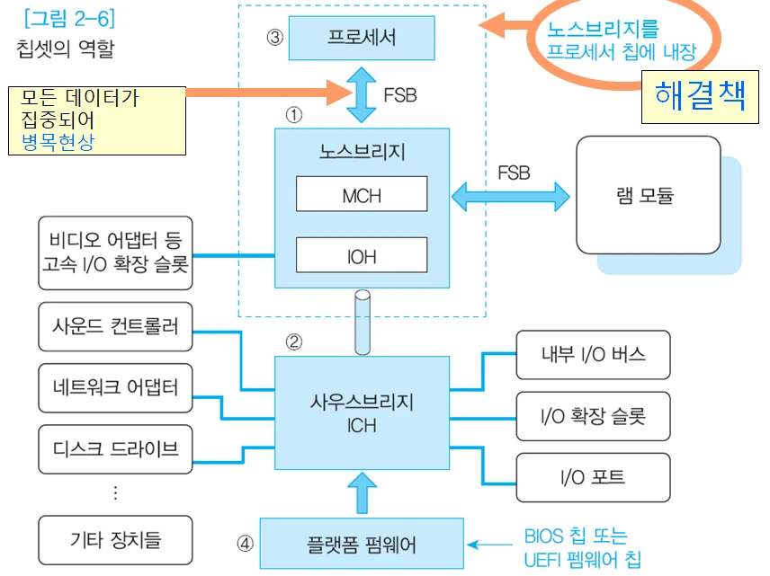

노스브릿지가 CPU, RAM의 주변에서 고성능 처리를 주로 담당하기 때문에 프로세서를 연결하는 FSB (Front Side Bus)에 너무 많은 데이터가 모이게 되어서 병목현상이 발생한다.

이 때문에 최근에는 노스브릿지의 기능을 CPU 칩 자체에 내장시켜서 문제를 해결하고 있다.

- 칩셋 호환

칩셋도 드라이버가 필요하며, 메인보드를 구입하면 칩셋 드라이버를 함께 제공한다.

만약 과거 운영체제에서 새 칩셋을 인식하지 못하면 칩셋 드라이버를 설치해주어야 한다.

#### 1-6 플랫폼과 허브

- 플랫폼

    - 편평한 장소를 의미하는 단어이다.

    - 사용 기반이 되는 컴퓨터 시스템이나 소프트웨어를 말하는 단어로 쓰이기도 한다.

        - 응용 프로그램이 실행될 수 있는 컴퓨터 시스템 자체
        - 하드웨어, OS 등이 실현될 수 있는 관련 기술 기반

- 허브

    - 중심부나 활동의 중심지

    - 컴퓨터 시스템이나 데이터 통신에서 여러 방향의 데이터가 한 곳에 모이는 장소나 연결 장치

        - 데이터 연결 장치나 네트워크 스위치
        - 허브는 항상 많은 데이터가 모이는 장소이기 때문에 병목현상이 발생할 수 있다.

#### 1-7 메인보드

- 메인보드 : 시스템 보드 혹은 마더 보드라고도 부른다.

- 메인보드의 제작 규격 : 폼팩터라고도 하며, 대표적으로 인텔이 제안한 ATX, BTX 규격 등이 있다.

    - 폼팩터 : 마더 보드는 규격이 다양하고, 이미 공용화돼서 바꾸기가 쉽지는 않다.

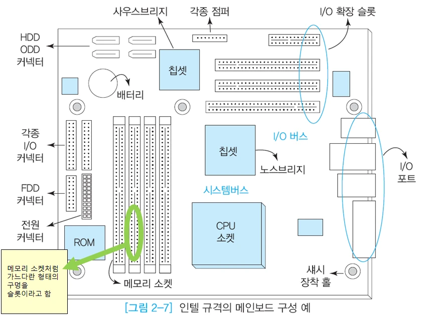

- 메인보드는 장착된 칩셋과 각종 커넥터를 사는 것이며, 메인보드에 연결되는 각종 peripheral들은 별도로 구매하여야 한다.

    - 대부분의 기본 확장카드는 CPU나 칩셋에 내장되어 가고 있는 추세이다.
    - 구버전의 슬롯과 포트는 계속 사라지고 있다.

- 메인보드란, 공통의 버스 배선과 인터페이스 회로를 모아 놓고 슬롯 형태의 작은 보드를 꽂아 사용하는 기판 구조에서 주가 되는 기판을 말한다. (마더보드라고도 한다.)

- 마더보드를 사용하는 목적

    - 확장성 : 네트워크 회선을 늘릴 때처럼 확장이 용이하다. (슬롯에 추가하는 방식이기 때문)
    - A/S성 : 군용 장비처럼 모듈 설계로 문제가 생긴 보드만 교체할 수 있다.

---

## 2. 소프트웨어의 역할

#### 2-1 역할 구분

- 시스템 소프트웨어 : 하드웨어를 효율적으로 다루기 위한 프로그램

    - 특히 운영체제는 대표적인 시스템 소프트웨어이며, 하드웨어와 응용 프로그램을 이어주는 중간자의 역할을 함으로써 사용자가 직접적인 하드웨어의 제어를 수행하지 않고도 컴퓨터를 사용하는 과정에서 효율적으로 하드웨어 자원을 활용할 수 있도록 해준다.

    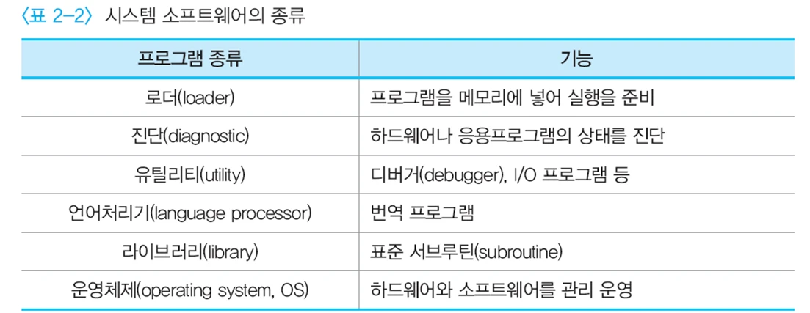

    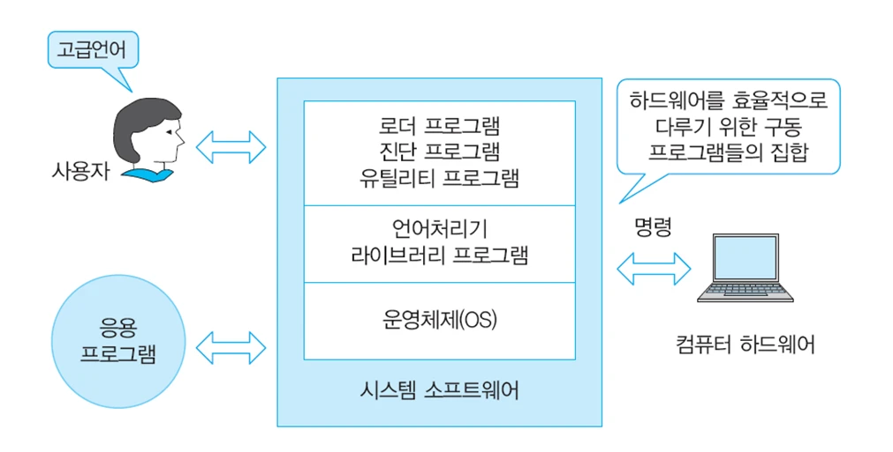

- 응용 프로그램 : 사용자 서비스를 위한 프로그램

    - 응용 프로그램은 문서 편집이나 자료 관리 등 사용자의 목적에 맞게 특정한 작업을 수행하는 프로그램을 말한다. 

#### 2-2 운영체제

- 운영체제란, 컴퓨터를 운영하는 프로그램을 가상으로 표현

- 시스템 구성 요소들의 중재자, negotiator 역할을 한다.

    - 사용자, 하드웨어, 소프트웨어 간 인터페이스를 제공한다.
    - 시스템 자원의 효율이 최대가 되도록 총괄하는 역할을 한다.

- 하드웨어를 장악한다.

    - 컴퓨터 시스템에서 H/W를 인식하지 못하면 자원 관리 및 보안 측면에서 위험할 수 있다.
    - 운영체제는 하드웨어 자원을 장악하여 응용 프로그램이 하드웨어를 이용하도록 도와준다.

- 다른 프로그램들을 관리한다.

    - 운영체제가 먼저 설치되어, 다른 시스템 소프트웨어와 응용 프로그램들의 동작을 지원하고 관리하는 역할을 한다.

- 드라이버(driver) 혹은 장치(device) 드라이버

    - 하드웨어나 주변 장치를 구동시킬 때 운영체제가 요구하는 정보가 들어 있는 소프트웨어 파일을 말한다.

- 커널(kernel)

    - 운영체제의 핵심부로, 컴퓨터가 실행되는 동안에는 항상 주기억장치에서 동작한다.
    - 하드웨어와 소프트웨어 요소들 사이의 통신과 시스템 자원을 관리한다.

- 시스템 콜(system call)

    - 커널에 운영체제의 서비스를 요청하는 절차
    - 응용프로그램은 프로그래밍 언어에서 지원하지 않는 기능을 운영체제의 루틴에서 호출하여 사용할 수 있다.
    - 운영체제는 여러 가지 저수준의 연산을 수행하기 위한 루틴들의 모음을 갖고 있다.

- 루틴

    - 특정한 작업을 수행하기 위해 자주 사용되는 프로그램이나 프로그램 소스의 일부, 자주 사용되는 작업을 Cache에서 보관하여 빠르게 처리할 수 있게 한다.

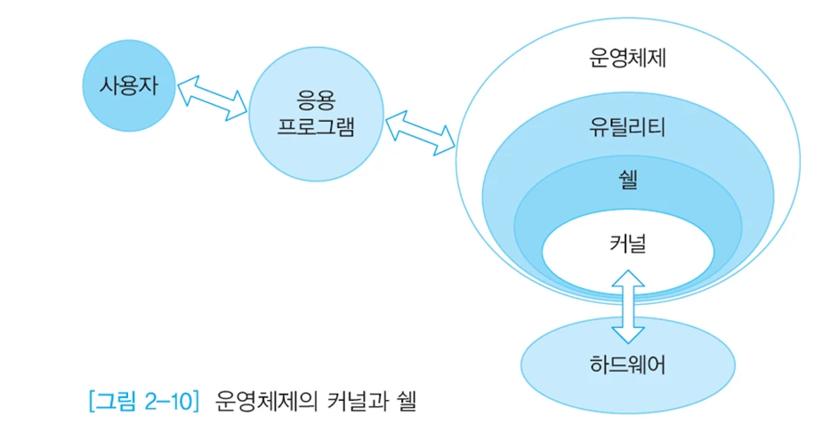

⇒ 이는 운영체제의 이상적인 구조를 바라본 그림으로, 특정한 운영체제의 구조와 일치하지는 않음.

- 운영체제의 쉘(Shell)

    - 프로그램이나 운영체제의 사용 불편을 개선하기 위해 메뉴 구동형의 사용자 인터페이스를 제공하는 유틸리티 프로그램

    - 커널을 감싸고 있는 외부 층의 개념

        - 사용자와 운영체제의 내부 커널을 인터페이스

        - 명령어 해석기(Command Interpreter)라고도 한다. (줄 단위의 명령어를 읽어 들인다고 하여 이렇게 불리기도 한다.)

            - 커널 서비스를 이용할 수 있도록 명령어의 라인이나 그래픽 인터페이스를 통해 사용자의 명령을 입력받고, 이를 하나 이상의 시스템 콜로 변환하여 명령을 처리한다.
            - interpreter 방식은 소스 코드의 각 행을 하나씩 실행하는 방식으로, compiler보다 속도가 더 느리지만 platform 의존성을 가지지 않는다.

    - 쉘의 의미

        - 소프트웨어적으로 어떤 프로그램을 감싸는 요소
        - 어떤 명령어나 까다로운 사용법을 사용하기 쉽게 해준다.

- 유틸리티(Utility)

    - 하드웨어, 운영체제, 응용프로그램을 관리하고 조화시킬 목적으로 설계된 소프트웨어
    - OS에도 다수의 유틸리티 프로그램들이 포함된다.

#### 2-3 윈도우 운영체제

- 윈도우 운영체제의 특징

    - GUI : 그래픽 사용자 인터페이스, 운영체제가 사용자와 대화하기 위해 아이콘이라는 그래픽 이미지를 사용하는 프로그램을 설계했다.
    - API : 응용 프로그래밍 인터페이스, 프로그래머가 사용자 인터페이스를 일관성 있게 만들 수 있도록 완벽한 Set의 함수와 자원을 제공해주는 시스템 소프트웨어이다.  
        ⇒ 윈도우의 TCP/IP 소켓을 이용한 온라인 주식 거래 등으로 활용 가능  
        ⇒ DirectX를 이용하여 매번 윈도우 운영체제의 허락을 받지 않고 H/W를 직접 조작

    - OLE(Object Linking and Embedding) : 애플리케이션 사이에서 데이터를 공유하는 기술이며, Windows에서 사용되는 기술이다.

        - 개체 연결 및 포함의 영문 약자이다.
        - 외부 문서 참조기능을 위한 윈도우 OS의 표준
        - 다른 응용프로그램에서 작성한 그림 등을 작성 중인 문서로 삽입해 가져올 수 있다.

        [http://www.terms.co.kr/easycom38.htm](http://www.terms.co.kr/easycom38.htm)

    - 오브젝트(Object)

        - 다른 문서에 삽입할 수 있는 문서나 문서의 일부를 말한다.

        - 개체의 속성 : 개체 자신이 무엇으로 만들어졌는지에 대한 독립적인 성격이나 정보

            - 다른 문서에 포함되어도 자신의 속성을 그대로 가진다. 즉, 서로 다른 프로그램이 공유할 수 있는 정보를 주고 받을 수 있지만, 그 정보가 본래 어떤 데이터인지에 대한 정보는 개체 자체에 독립적으로 포함된다는 뜻으로 해석된다.

- OLE 개체

    - OLE 개체 삽입 (OLE는 하드 링크, 심볼릭 링크와 같은 기능을 한다.)

        - 문서에 삽입된 개체를 선택하면 해당 응용 프로그램이 자동 실행되어 편집 가능하다.  
            ⇒ 상단에 임베드된 글을 확인해보면 비슷한 내용이 있다. 문서를 작성하는 동안에 ‘개체 삽입’을 수행하여 스프레드 시트(엑셀)에서 데이터를 가져왔다고 하고, 이후에 그 개체를 선택하면 스프레드 시트가 자동으로 열리는 등의 방식이다.

        - 개체 연결 : 작성 중인 문서의 내용을 외부 개체의 속성과 그 개체의 위치에 대한 정보에 연결만 한다. (리눅스에서 사용되는 심볼릭 링크와 비슷한 개념)

            - 개체를 포함하지 않아 작성된 파일 크기 작음
            - 한쪽 문서를 수정하면 연결된 다른 문서까지 변형

        [OLE 개체 연결](http://help.hancom.com/hoffice/webhelp/9.0/ko_kr/hcell/edit/objectlink.htm)

        - 개체 포함 : 외부 개체의 정보가 현재 문서의 개체로 포함되도록 속성을 가진 채로 복사 (리눅스에서 사용되는 하드 링크와 비슷한 개념)

            - 원본과 복사본이 별개로 존재
            - 파일 크기는 크지만 파일 관리에 편리

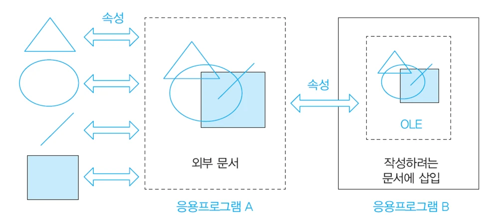

- 클립보드

    - 운영체제에서 관리하는 임시 저장소
    - 복사, 붙여넣기에 자주 사용되는 일시적인 메모리 버퍼이다. 일종의 Queue이자 Waiting Space이다.

#### 2-4 컴퓨터 언어

- 컴퓨터와 대화를 나눌 수 있는 일반적인 모든 수단 (Command Interpreter, System Call 등도 컴퓨터 언어의 일종이라고 판단할 수 있다.)
- 프로그래밍 언어보다 규모가 더 큰 상위 개념이다.

- 프로그래밍 언어

    - 컴퓨터 언어 중 명령어, 주소 지정 방식 등의 체계를 잘 갖추고 호환성이 있도록 범용으로 설계된 언어이다.
    - 컴퓨터와 대화하고 명령을 내리기 위해 설계된 인공적인 언어이다.

    - 고급 언어

        - 사람이 이해하기 쉬운 형태인 고수준 프로그래밍 언어

    - 어셈블리 언어

        - 기계어와 1:1인 저수준 (low-level) 프로그래밍 언어
        - CPU마다 기계어가 다르면 어셈블리 언어도 달라진다.

    - 기계어

        - CPU에서 실행 가능한 1과 0으로 구성된 이진 코드이다.
        - 제조사나 CPU마다 기계어가 달라진다.

- 프로그램 코드

    - 프로그래밍 언어로 작성된 문서
    - 소스 코드 : 인간이 읽을 수 있는 언어 (고급 언어, 어셈블리 언어로 구성됨)
    - 기계 코드 : 기계가 이해하는 언어 → 기계어

- 어셈블리 언어

    - 사람이 이해할 수 있는 고급언어와 기계어 사이에 존재하는, 기계마다 다른 CPU 고유의 중간 언어를 말한다.
    - 기계어와 정확히 1:1로 대응된다.

    - 어셈블리 명령어

        - CPU의 동작을 의미하는 아주 짧은 상징 기호로 표시된다.

        - 니모닉 (mnemonic, 연상 기호) 코드라고도 한다.

            - 기호를 보면 동작이 연상되는 코드라는 뜻이다.

- 고급언어가 기계어로 번역되는 과정

    - 기계어 명령

        - 연산 코드 (op code) 필드 ⇒ 명령, 동작을 지정한다. [연산자]

            - ex) 레지스터 A와 X의 내용을 더해 A에 저장. 이런 방식으로 연산자를 지정한다.

        - 오퍼랜드 (operand) 필드 ⇒ 연산의 대상을 찾는 법 [피연산자]

            - ex) 연산의 대상이 저장된 위치 X를 가리킨다.

- 번역 프로그램 

    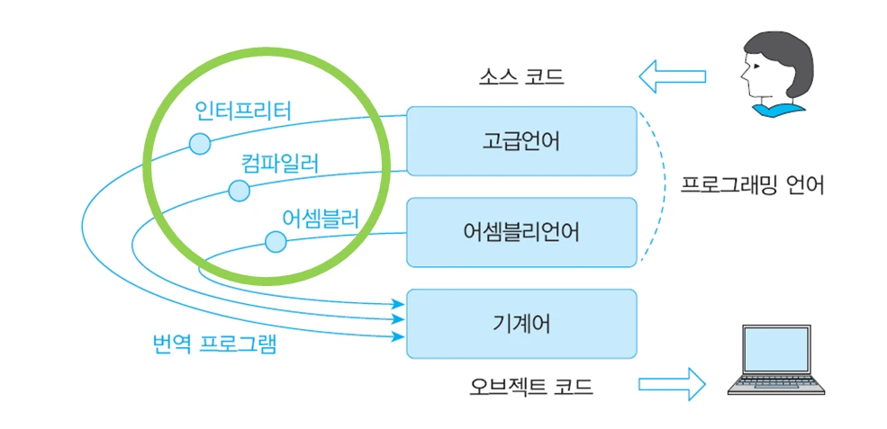

    - 프로그래밍 언어를 이진 기계어로 번역한다.

    - 번역 프로그램 (translator)

        - 사람이 작성한 소스 코드를 기계인 CPU가 실행할 수 있는 오브젝트 코드로 번역해주는 프로그램이다.

        - 언어처리기(Language Processor)라고도 한다.

            - 컴퓨터의 기종과 운영체제에 따라 언어처리기가 달라진다.

        - 오브젝트 코드 (object code)

            - 번역 프로그램의 결과물로서 일반적으로 기계어로 작성된 프로그램

            - 목적코드 : 오브젝트 프로그램이라고도 함.

                - 소스 코드 = 원시 코드 = 소스 프로그램
                - 오브젝트 코드 = 목적 코드 = 오브젝트 프로그램

- 번역 프로그램의 종류

    - 인터프리터 (interpreter) : 소스 코드를 한 줄씩 읽어 번역하고 실행하는 방식

        - 에러 찾기가 쉽고 메모리를 적게 차지하나 한 줄씩 실행하기 때문에 실행 속도가 느리다.
        - ⇒ ex. Command Interpreter, 대표적으로 Python

    - 컴파일러 (compiler) 

        - 소스 코드를 한 번에 모두 번역해 놓고 실행
        - 소스 코드를 미리 번역해 실행 파일을 생성, 메모리 공간을 많이 차지하나 실행 속도가 빠르다.
        - ⇒ ex. C언어 등 기존 대부분의 프로그래밍 언어.

    - 어셈블러 (assembler) : 주로 컴파일러 방식으로 진행된다.

        - 어셈블리 언어로 작성된 소스 코드를 기계어로 번역
        - CPU 제조사나 종류에 따라 달라진다.

- 절차지향 언어 vs 객체지향 언어

    - 절차지향 언어

        - 설계자 중심에서 동작과 절차를 중심으로 취급

            - 하드웨어 구동이나 컴파일러 설계 용이
            - 큰 규모의 프로그래밍은 작업이 복잡해 불리
            - 모듈화가 불가능하기 때문에 소프트웨어 생산성이 떨어질 수 있음

    - 객체지향 언어

        - 사용자 입장에서 사물의 실체와 동작을 중시

        - 프로그래밍 대상을 모두 객체로 정의

            - 복잡하고 방대한 소프트웨어를 구축하는데 유리하며, 모듈화를 통한 유지 보수에 용이하다.
            - 큰 규모의 프로그램도 단순화 ⇒ 생산성, 신뢰성이 높다.

    - 스크립트 언어

        - 다른 프로그램을 기반으로 실행되는 짧은 프로그램이나 명령어
        - 전통적인 범용 언어에 비해 대부분 제한된 능력을 보인다.

        - 단독으로 사용하지는 못하고 다른 프로그램과 연결해 사용된다.

            - 자바스크립트 (크롬 엔진 V8을 내장하여 실행)와
            - 비주얼베이직 스크립트가 대표적

        - 인터프리터 형태로 번역되어 실행 속도가 느리지만, 프로그램을 쉽고 빠르게 작성함으로써 에러 찾기와 수정에 용이하다.

#### 2-5 프로그램 결합하기(소스 코드를 기반으로 프로그램을 생성)

- 소스 프로그램을 기능별 모듈로 나누어 작성한다.

    - 서브루틴과 라이브러리 함수들 사용

- 실행 파일을 얻으려면 링크 과정이 필요하다.

    - 번역이나 실행에 추가로 필요한 다른 프로그램들을 참조하고 결합하는 과정
    - 라이브러리와 소스 코드를 연결하여 필요한 함수들을 가져오는 과정을 Link라고 한다.

- 서브루틴

    - 메인 프로그램의 독립적인 일부분으로, 필요할 때 호출되어 재사용할 수 있는 프로그램

        - C 언어의 함수가 대표적이다.

    - 서브루틴 호출과 복귀

        - 메인 프로그램에서 분기하면서 돌아올 복귀 주소를 메모리의 스택 (Stack) 영역에 저장해두었다가, 서브루틴 수행이 끝나면 스택에서 주소를 pop해서 돌아온다.

    - 서브루틴 파라미터

        - 메인 프로그램에서 서브루틴으로 작업을 의뢰하기 위해 보내주는 입력 데이터로 사용되는 매개변수를 말한다.

            - 함수를 예로 들면, 함수에 전달해주는 Arguments이다.
