# 2주차: CPU 스케줄링, 시동 과정, 신호선, CPU 프로세서

- 라이브러리

    - 자주 쓰는 단순 반복적인 프로그램에 대해 미리 작성해 놓은 표준 서브루틴
    - 대개 컴파일러 제조사가 제공하는 것만으로도 충분하지만, 사용자가 직접 라이브러리를 만들어서 배포할 수도 있다.

- 컴파일 과정

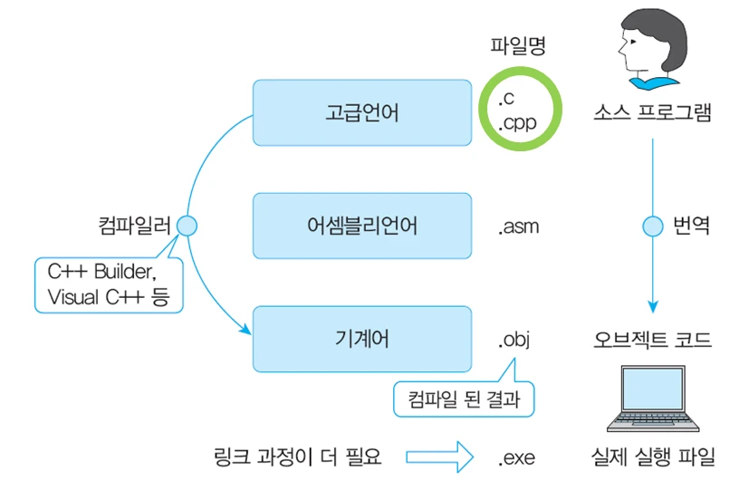

고급 언어(.c, .cpp, …) → 어셈블리 언어(.asm) → 기계어(.obj, .o) ⇒ Linking ⇒ .exe 생성 

[컴파일러를 사용해 번역 진행, 라이브러리 링킹을 통해 실행 파일 생성 가능]

- 링크

    - 컴파일의 결과로 생긴 사용자의 Object 코드와 라이브러리에서 제공된 Object 코드 등을 결합해 실제로 실행 가능한 파일을 만드는 과정

#### 2-6 하드웨어 흉내 내기

소프트웨어를 사용하여 특정 하드웨어를 흉내 내어 가상의 장치처럼 동작시킬 수 있다.

- 시뮬레이션(simulation)

    - 실제 하드웨어 구동 없이 실행되는 S/W적인 모의실험 방법
    - 시뮬레이터 : 모의 실험을 실시하는 장치나 프로그램

- 에뮬레이션(emulation)

    - 다른 하드웨어를 대신 구동해 특정 하드웨어를 모방
    - 에뮬레이터(emulator) : 기능을 흉내 내는 대리 실행 장치나 이를 구동해주는 프로그램

## 3. 다중작업

- CPU 스케줄링

- 멀티 스레드

    - 하나의 프로세스 내에서 여러 작업을 병렬적으로 처리하고자 프로세스 자원을 나눠서 처리하는 것을 말한다.

- Task(Job)

    - 컴퓨터 시스템에서 수행되는 하나의 작업 (Job과 같은 의미로 사용된다.)

- 다중작업

    - Multitask 혹은 Multitasking을 의미
    - 동시에 처리해야 할 여러 개의 작업을 말한다.

    ⇒ 서버용 PC가 아닌 개인 PC는 일반적으로 Single Processor 환경이다.

    - 대신 동시에 여러 개의 일을 처리할 수 있는 Multi-core를 도입해서 Multi-Threading을 통해 다중작업을 구현한다.

#### 3-1. CPU 스케줄링

- CPU 스케줄링

    - 다중작업에서 어떤 작업에 CPU의 처리 시간을 어느정도 할당할지 결정해주는 것을 말한다.  
        (기본적으로 waiting time과 finishing time을 최소화하는 것을 목표로 한다.)

        - CPU는 하나이고 작업이 여러개면 시간을 쪼개서 여러 작업을 동시에 처리하도록 한다.
        - 스케줄러 : OS의 일부로, 여러 작업이 시스템 자원을 공유할 때 순서나 일정을 조정해주는 프로그램을 말한다.

    - 라운드 로빈(순환순서) 방식

        - 순서를 순환하며 기회를 균등하게 분할하는 방식
        - 각 작업에 차례대로 일정한 시간을 균등하게 할당한다.

    - 우선순위 할당 방식

        - 각 응용 프로그램들에 대해 작업 우선순위에 따라 시간 할당비율 조정

- 우선순위 할당 방식

    - 응용프로그램이 차지하는 시간 비율에 따라 나누어진다.

        - 전면작업, 포그라운드(foreground) 작업

            - 다중작업 가능한 컴퓨터의 활성 창에서 수행되는 작업
            - 후면작업에 대해 실행 우선순위가 높다.
            - 사용자가 동작을 확인할 수 있다.

        - 후면작업, 백그라운드(background) 작업

            - 우선순위가 낮은 프로그램은 우선순위가 높은 프로그램이 쉴 때만 조작되는 상태  
                (포그라운드 작업이 동작될 때는 백그라운드 작업이 돌아갈 수 없다는 것처럼 표현되지만, 백그라운드 작업은 포그라운드 작업의 동작에 관계없이 동작될 수 있다.)
            - 사용자 간섭 없이 보이지 않는 뒷편에서 실행 중인 컴퓨터 프로세스이다.  
                (일반적으로 로그 처리, 시스템 모니터링, 스케쥴링, 사용자 통보 등이 포함된다.)
            - 사용자가 전면에서 다른 작업을 하는 동안, 이면에서 인쇄나 다운로드 등 다른 작업을 실행하는 환경을 말한다.

        **데몬(Daemon)**

        - 데몬은 백그라운드에서 연속적으로 실행되도록 설계된 백그라운드 프로세스의 일종으로, 발생 이벤트나 충족되는 조건을 대기한다. 이러한 프로세스들은 일반적으로 최소한의 시스템 리소스를 사용하며, 사용자로부터 입력을 거의 필요로 하지 않는 작업을 수행한다. Daemon 기능과 함께 시작되면, 데몬들은 부모 터미널로부터 분리된다. 
        - 데몬은 대개 부모 프로세스를 갖지 않기 때문에 PPID가 1이다. 따라서 프로세스 트리에서 init 바로 아래에 위치한다. 일반적으로 데몬이 되는 방법은 자식 프로세스를 fork하여 생성하고, 자식을 분기한 자신을 죽이면서 init이 고아가 된 자식 프로세스를 adapt 하는 방식으로 이루어진다.
        - 시스템이 시작될 때 만들어지는 데몬들은 주로 네트워크 요청, 하드웨어 동작, 여타 프로그램에 반응하는 기능 등을 담당하게 된다.

        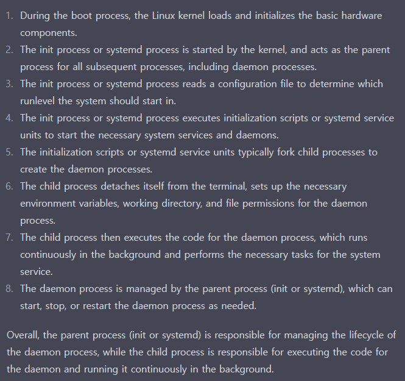

        1. Linux kernel이 메모리에 로드된다.
        2. 최초에 커널이 init process(최근에는 systemd가 주로 사용되지만, 편의상 init이라고 부른다.)를 생성하게 된다.
        3. init은 시스템의 runlevel에 대한 정보를 갖는 configuration file을 읽어들인다. 
        4. 이를 통해 필수 서비스와 데몬을 실행시키기 위한 initialization scripts 또는 service unit 들을 실행시킨다. 
        5. 그리고 이렇게 실행된 initialization scripts 혹은 service unit들이 daemon process들을 fork하게 된다.
        6. child process는 터미널에서 떨어져나가고(즉, 유저의 입력이 관여될 수 있는 foreground 작업에서 분리된다는 것으로 생각된다.), 데몬 프로세스를 생성하기 위한 필수적인 환경 변수나 working directory, 파일 권한 등을 설정한다.
        7. 그 뒤, child process는 데몬 프로세스의 코드를 exec 함으로써 백그라운드에서 지속적으로 동작하는 데몬 프로세스가 된다.
        8. 데몬 프로세스는 부모 프로세스인 init에 의해 관리된다.

        <!-- -->

        - 6번에서 자식 프로세스가 terminal과 떨어져나간다는 의미가 좀 모호한 것 같아서, 추가적으로 질문을 해보았다.

        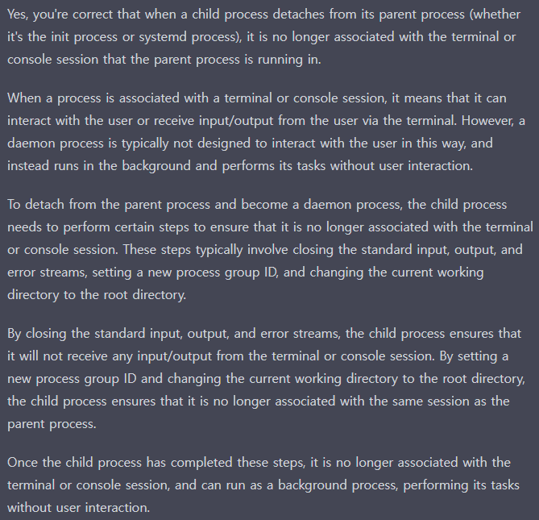

        어떤 프로세스가 Terminal 또는 Console session과 관련있다는 것은, terminal을 통해 user와 I/O를 주고받을 수 있다는 뜻이다. 그러나, 데몬 프로세스는 통상적으로 유저와 상호작용하도록 만들어지지 않았다. 대신 데몬 프로세스는 백그라운드에서 동작하며 유저와 상호작용을 하지 않으면서 자신이 맡은 일들을 처리한다.

        부모 프로세스로부터 떨어져나가 데몬 프로세스가 되기 위해서, 자식 프로세스는 terminal 또는 console session과의 관련을 끊기 위해 특정한 step을 거쳐야 한다. 이 단계는 일반적으로 standard I/O와 error stream을 닫고, 새로운 프로세스 그룹 ID를 설정하며, 현재 working directory를 root directory로 바꾸는 단계를 포함한다.

        이를 통해 자식 프로세스는 terminal이나 console session을 통해 어떠한 I/O도 입력받지 않는 것을 보증받을 수 있다. 또한, 새로운 프로세스 그룹 ID를 설정하고 현재 working directory를 root directory로 변경함으로써, 자식 프로세스는 부모 프로세스와 더 이상 관련되지 않는 것을 보증받을 수 있다.

        자식 프로세스가 이 단계를 모두 거치면, 더 이상 terminal 또는 console session과 관련되지 않으며, 따라서 백그라운드 프로세스로 동작할 수 있고, 유저와의 상호작용 없이 동작할 수 있게 된다.

        정리하자면, 위와 같은 과정을 거쳐서 (PPID를 바꿔버린다, 라는 의미라기 보다는) 부모는 그대로 있지만, 유저와의 상호작용을 끊고 백그라운드 프로세스로 동작할 수 있게 되는 것으로 생각된다.

        - 추가로, current working directory를 root directory로 바꾸는 이유가 명확히 설명되지 않아서 질문해보았다.

        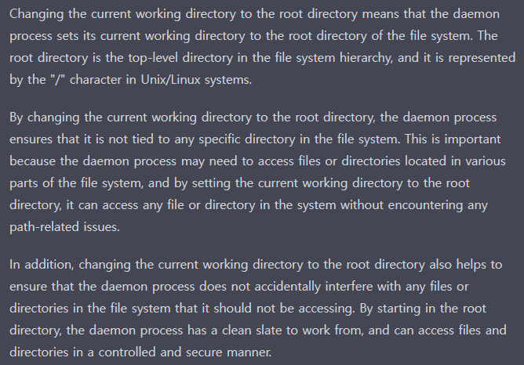

        current working directory를 root directory로 옮기는 것은 데몬 프로세스의 working directory를 root directory로 옮긴다는 것을 의미한다.

        working directory를 바꿈으로써, 데몬 프로세스는 파일 시스템의 특정 디렉토리에 종속되지 않게 된다. 이것은 매우 중요한데, 데몬 프로세스가 다양한 곳에 존재하는 여러 파일이나 디렉토리에 접근해야 할 수도 있기 때문이다.

        - 마지막으로, 프로세스의 working directory에 대해 질문해보았다.

        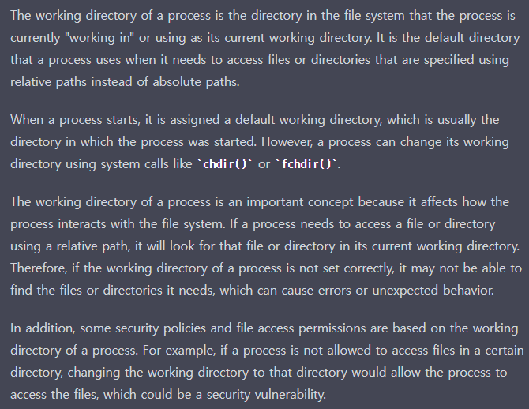

        process의 working directory는 현재 process가 사용하고 있는 directory를 말한다. 이는 프로세스가 파일 또는 디렉토리에 접근할 수 있는 기본 디렉토리가 되며, 프로세스가 절대 경로 대신 상대 경로를 이용하여 파일 또는 디렉토리에 접근할 때 사용할 수 있는 경로가 된다.

        프로세스가 시작되면, 주로 그 프로세스가 시작된 위치가 default working directory로 assign된다. 그러나, 프로세스의 working directory는 chdir(), 또는 fchdir() 등을 통해 변경될 수 있다.

        프로세스의 working directory는 중요한 개념인데, 왜냐하면 그것이 프로세스가 상호작용 할 수 있는 파일 시스템에 영향을 미치기 때문이다. 만약 프로세스가 상대 경로를 통해 파일 또는 디렉토리에 접근하면, 프로세스는 현재 working directory에 있는 파일 또는 디렉토리를 찾아보게 될 것이다. 그러므로, 만약 프로세스의 working directory가 적절하게 설정되어 있지 않는다면, 필요한 파일이나 디렉토리를 찾지 못하게 될 것이며, 이는 예기치 못한 에러를 발생시킬 수 있다.

        게다가, 몇몇 보안 정책과 파일 접근 권한등이 프로세스의 working directory를 바탕으로 한다. 예를 들어, 만약 어떤 프로세스가 특정 파일에 접근할 수 없다고 한다면, 그 프로세스의 working directory를 접근할 수 없는 그 파일을 가지고 있는 디렉토리로 바꿈으로써 해당 디렉토리의 파일에 접근할 수 있게 되며, 이는 보안 문제를 야기할 수 있다.

- 스레드(thread)

    - 컴퓨터에서 정상적으로 작업이 완료될 때까지 세부적으로 해야 하는 작은 일들에 대한 일정표.  CPU가 처리하는 일의 기본 단위를 말한다.

    - 운영체제는 각 작업에 대한 스레드를 생성해 관리한다.

        - 스레드 정보를 유지하기 위해 메모리에 저장해두고, 그 주소를 레지스터에 넣어서 관리.

#### 3-2 멀티스레드

- 멀티스레드(multi-thread) or 멀티스레딩(multi-threading)

    - 운영체제에서 여러 스레드를 동시에 관리하는 것  
        (하나의 큰 일을 수행하고자 모두 수행해야 하는 작은 일정표를 말함.)

        - 각 작업에 대한 줄거리와 진행 정보를 동시에 관리

## 4. 시동과정

- 롬 바이오스(ROM BIOS)

    - 메인보드에 장착된 ROM(Read Only Memory)에 내장된 프로그램

    - 부팅과 기본 입출력 시스템을 낮은 수준으로 제어한다.

        - 일종의 시스템 소프트웨어로, 대표적인 펌웨어이다.

    - 롬 바이오스의 역할

        - 컴퓨터 시스템의 부팅에 관계한다.
        - 운영체제를 도와 하드웨어를 저수준으로 제어한다.

    - 운영체제는 BIOS 정보로 하드웨어 상태를 파악한다.

        - OS와 응용프로그램들이 컴퓨터에 부착된 각종 하드웨어 장치에 대해 정확히 알아야 될 부담에서 해방시킨다. (ROM BIOS가 모든 하드웨어를 관리 및 제어)

- 반도체 메모리의 동작속도가 빠른 순서

    - 캐시메모리 : SRAM
    - 메인메모리 : DRAM
    - 바이오스 칩 : ROM

    - 섀도우 램(Shadow RAM)

        - ROM으로부터 읽어온 BIOS 루틴을 좀 더 빠르게 액세스하기 위하여 RAM의 특수한 영역에 넣어놓은 일종의 복사본을 말한다. 만약 CPU가 ROM에 접근할 일이 생긴다면, 먼저 RAM에 위치한 Shadow RAM에 접근하게 되고, 만약 Shadow RAM에 찾는 정보가 없다면 다시 ROM으로 접근하게 된다.
        - Shadow RAM은 interrupt handling이나 keyboard input, 그리고 video display와 같이 빈번하게 사용되는 BIOS 함수들을 이용할 때 주로 활용된다. 
        - 섀도우 램에서의 액세스는 대체로 60\~100ns 범위인데 반해, ROM의 액세스 시간은 125\~250ns 범위이다.

        - ROM의 주소와 내용이 복사된 램의 주소와 일치하게 된다.

            - CPU가 ROM 대신 액세스 속도가 빠른 RAM에서 복사본을 먼저 읽어와 실행속도가 증가된다.

- 시스템 설정 또는 CMOS 설정(CMOS setup)

    - 컴퓨터 메인보드의 바이오스 값을 설정하는 것

    - 기본적인 시스템 구성 환경과 선택 사항을 저장한다.

        - 롬 바이오스에 제공하는 실시간 시계 값
        - HDD, FDD, 모니터, 키보드 타입
        - 메모리 크기, 부팅 드라이브 우선순위
        - 바이러스 방지, 전원 관리 및 부팅 패스워드 옵션 등

        ⇒ 부팅에 사용되는 전반적인 기능 관리 및 H/W 설정 담당  
        바이오스를 설정하는 것이므로, Basic Input Output System을 설정하는 것이다.

    - 칩셋, 캐시, 램 타입이나 속도 설정 등은 주의해야 한다.

        - CPU 동작모드와 클락의 속도도 조정 가능하므로, 잘못 건드리면 시스템 하드웨어에 문제가 발생할 수도 있음.

        **ROM**

        컴퓨터에서 사용되는 ROM 메모리의 주요 용도는 컴퓨터의 BIOS나 UEFI 같은 펌웨어를 저장하는 내장형 롬으로 볼 수 있다. 특히 펌웨어에 주로 사용되었기 때문에 관습적으로 롬=펌웨어라고 부르기도 하지만, 최근에는 비싼 롬 메모리 대신 플래시 메모리 모듈을 부품에 내장해 펌웨어 저장용으로 쓰이기 때문에 기술적으로 보면 틀린 말이다.

        최근에는 ROM대신 싸고 쓰고 지우기 편한 플래시 메모리 모듈을 펌웨어나 S/W 저장용 매체로 쓰기 때문에 기록 작업이 쉬워졌지만, ROM을 쓰던 과거에는 굉장히 복잡해, 한 번 데이터를 기록하면 바꾸지 못했었다. 하지만 최근에도 한 번 설정을 세팅하고 그대로 출시하는 냉장고, 에어컨 등에는 아직도 Mask ROM이 들어간다.

        - 마스크롬(Mask ROM) : 반도체 생산 공정인 마스킹 단계에서 고정된 데이터 회로 패턴으로 생산하는 방식. 다른 ROM 소자와는 달리 물리적으로 데이터를 기록하므로 생산 후에는 내용을 변경할 수 없어 데이터 안정성이 높지만, 재프로그래밍은 원천적으로 불가능하다.
        - 피롬(Programmable ROM) : 생산 후에 내용을 한 번만 기록할 수 있는 롬이다. 그래서 OTP(One Time Programmable)이라고도 한다. 비트를 기록하는 각 셀마다 퓨즈가 들어있는데, 퓨즈가 이어져 있으면 1, 끊어져 있으면 0이라는 식으로 정보를 기록한다. PROM을 기록하는 롬 라이터는 기록하려는 어드레스 셀에 과전류를 흘려서 퓨즈를 끊는 식으로 프로그래밍 하기 때문에 한 번 기록한 PROM은 내용을 바꿀 수 없다.
        - 이피롬(Erasable PROM) : 자외선을 이용하여 기억된 내용을 지우고 다시 기록할 수 있는 롬이다. PROM과 비교했을 때 읽기와 쓰기 동작은 동일하게 할 수 있으며, 지우기 동작은 자외선을 쬐어서 수행한다. 내용을 지울 때는 롬 이레이저라는 장치를 사용해 20분 정도 넣고 돌린다. 여기서 지워버린 EPROM은 모든 셀이 1로 초기화되기 때문에 부분 삭제는 불가능하다.

        - 이이피롬(Electrically EPROM) : 전기적인 신호를 이용하여 기억된 내용을 지우고 다시 기록할 수 있는 롬이다. 자외선을 쓰지 않고도 내용을 지운 다음 재기록 할 수 있기 때문에 매우 편리하다. 제품에 따라서는 롬 라이터 없이 기록이 가능한 제품도 있다. 예전에는 메인보드의 ROM으로 EEPROM을 써서 바이오스 펌웨어를 저장했었다.

            UEFI로 넘어온 요즘은 용량과 가격 문제로 펌웨어 저장장치를 플래시 메모리 모듈로 많이 넘어왔지만 용량보다 안정성이 필요한 분야에는 아직도 많이 쓰인다.

        - 플래시 메모리(Flash Memory) : 전원이 끊겨도 데이터를 보존하는 특성을 가진 반도체이다. 전원이 꺼지면 기억된 정보를 모두 잃어버리는 메모리 반도체인 D램, S램과 달리 플래시 메모리는 데이터를 보존하는 비휘발성 메모리의 일종이다. 플래시 메모리는 전기적인 방법으로 정보를 자유롭게 쓰고 지울 수 있으며, 전력 소모가 적고 고속프로그래밍이 가능하다. 일반적으로 D램은 트랜지스터 1개와 커패시터 1개로 셀이 구성되지만, 플래시 메모리는 트랜지스터 1개로 하나의 셀을 구성한다.

            전원이 꺼지더라도 저장된 메모리를 보존하는 ROM의 장점과 정보의 입출력이 자유로운 RAM의 장점을 동시에 지닌 특성 때문에 디지털 카메라, MP3, 휴대전화, USB 드라이브 등 휴대형 기기에서 대용량 정보 저장 용도로 사용된다.

            플래시 메모리는 반도체 칩 내부의 전자회로 형태에 따라 NAND(데이터 저장)형과 NOR(코드 저장)형으로 구분된다. NAND 플래시는 용량을 늘리기에 쉽고, NOR 플래시는 읽기 속도가 빠른 장점을 가지고 있다. (SSD로 사용된다.)

- Default Value

    - 프로그램이나 하드웨어 장치의 기본 설정 값으로 사용자가 특별히 지정하지 않은 값

        - 바이오스, 메인보드 등도 제조사마다 고유의 설정 방법이 존재한다.
        - ROM에도 기본 값이 저장되어 있어, 디폴트로 되돌릴 수 있다.

- 메인보드의 CMOS

    - 메인보드에 장착된 CMOS

        - 배터리 백업을 받는 CMOS SRAM을 가리키는 말이다. (데이터 보존을 위해 배터리 사용)
        - 바이오스 설정 값을 저장하는 역할을 한다.

    - CMOS는 본래, 반도체 소자 방식 중 하나를 말한다.

    - CMOS(Complementary metal-oxide semiconductor)

        - 잡음 면역성이 강하고, 저소비전력이 특징이다.
        - 마이크로프로세서, SRAM 등의 디지털 논리회로와 이미지 센서 등 아날로그 회로에 폭넓게 사용되는 소자이다.

        **정리**

        - BIOS란?

            - 메모리, 디스크, 모니터와 같은 주변기기 사이의 정보 전송을 관장하는 프로그램이다. 컴퓨터의 H/W에 가장 접근되어 있는 함수들의 집합이며, BIOS는 ROM에 들어있기 때문에 흔히 ROM BIOS라고도 부른다. 컴퓨터 부팅 시에 특정 키를 누르면 나오는 CMOS setup 프로그램과 주변기기 초기화, 자체 진단 루틴 등도 ROM BIOS에 같이 포함되어 있다. ROM은 Read-Only이기 때문에 쓰기가 불가능하다. 따라서 주변기기에 대한 정보를 저장하려면 데이터를 쓸 수 있는 공간이 추가적으로 필요한데, 그곳이 바로 CMOS이다. (CMOS는 반도체 소자의 일종) 우리가 CMOS 셋업 프로그램을 이용해 장착된 주변기기에 대한 정보를 알려주면 BIOS는 그것에 기초하여 하드웨어를 인식하고 제어할 수 있게 되는 것이다.

        - BIOS의 시동과정

            - 각종 상태와 정보를 수집하고, 운영체제가 하드웨어를 장악해 사용자의 작업을 준비하는 과정을 의미한다. ⇒ 시스템 보안을 유지하기 위해서 반드시 컴퓨터에 연결된 하드웨어를 장악해야만 한다. 

                - BIOS의 정보를 보관하는 CMOS를 초기화시키는 바이러스가 등장하여 컴퓨터 해킹에 사용되기도 하였음.

            - 롬 바이오스에 들어있는 시동 프로그램이 담당한다.

                - POST(Power On Self Test) : 메인보드에 연결된 각종 하드웨어 장치를 점검하는 과정
                - 바이오스 복사 : 각 장치의 바이오스 정보를 램에 복사
                - 부팅 : 부트스트랩 로더 프로그램을 찾아 드라이브에 저장된 운영체제를 읽어 주기억장치인 램에 적재하는 과정

            - 운영체제는 시동과정에서 얻은 하드웨어 정보와 바이오스 정보를 인수해 컴퓨터 시스템을 장악한다.

            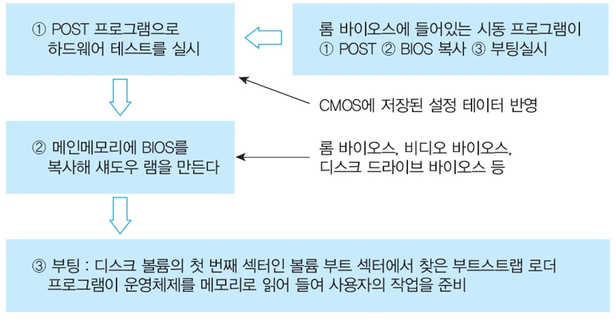

        - CMOS란?

            - CMOS SETUP이란, 컴퓨터에게 무엇인가를 알려주는 것이다. 어떤 하드 디스크가 장착되어 있는지, VGA(비디오카드)카드를 사용하는지 등등… 이런 것들은 컴퓨터를 사용하는 사람마다 다르기 때문에 공장에서 미리 일괄적으로 고정할 수가 없다. 따라서 사용자의 손을 통해서 CMOS에 데이터를 설정 정보를 저장하고, 컴퓨터는 그 CMOS의 내용을 읽어서 자신에게 어떤 주변기기들이 장착되어 있으며, 어떻게 제어를 해야할지 알게 되는 것이다.

- 부트스트랩 로더

    - 로드(load)

        - 디스크에서 프로그램이나 데이터를 메인 메모리(RAM)로 옮기는 과정이다.

    - 부트스트랩 혹은 부트스트래핑

        - 다른 복잡한 프로그램을 실행시키는 작은 프로그램의 작업 과정

            - 이 작은 프로그램을 부트스트랩 로더라고 한다.
            - 부트스트랩은 프로그램을 끌어올려 실행시킨다는 의미로 붙여진 이름이다.

    - 부팅(booting) ⇒ boot

        - 부트 스트래핑의 줄임말, 혹은 부팅 업(booting up)이라고도 한다.
        - 디스크에 저장된 운영체제를 메인 메모리로 새로 읽어 들여 컴퓨터의 사용을 준비하는 과정을 말한다.
        - 롬 바이오스 프로그램이 실시하는 시동 과정의 일부이다.

    - 부트스트랩 로더(bootstrap loader) 혹은 부트 로더(bootloader)

        - 부팅을 담당하는 프로그램
        - 디스크로부터 OS를 읽어 들여 주기억장치에 로드한다.
        - 볼륨 부트 섹터에 들어있으며, 디스크 볼륨의 첫 번째 섹터에 위치한다.

⇒ 즉, 부팅(부트스트랩)은 디스크에 저장되어 있는 운영체제를 RAM으로 Load함으로써 컴퓨터의 사용을 준비하는 과정이고, 이 역할을 하는 것이 부트로더(부트스트랩 로더)이다. 부트로더는 디스크의 첫 번째 섹터에 위치한다.

- 부팅의 종류

    - 콜드 부트(전압이 없는 상태)

        - 전원이 꺼져 메인 메모리의 내용이 모두 삭제된 상태에서 시작하는 부팅

        - 하드웨어적으로 컴퓨터를 완전하게 초기화한다.

            - 전원을 껐다가 다시 켜는 것이기 때문에 시간이 오래 걸리고, 전기적 충격이 가해진다.

    - 웜 부트(전압을 유지한 상태)

        - 컴퓨터의 전원이 켜져 있어 주기억장치에 내용이 아직 남아있는 상태에서 시작하는 부팅  
            (시스템 재시작이라고 볼 수 있다.)

        - CPU가 각 소자들을 소프트웨어 명령으로 리셋해준다.

            - 완벽한 리셋은 힘드나, 전기적인 충격은 적다.
            - 운영체제의 시스템 재시작 등이 웜부트라고 볼 수 있다.

- POST(Power On Self Test)

    - 롬 바이오스의 일부로, 컴퓨터를 켜거나 리셋 될 때 수행되는 내부 테스트 프로그램
    - 메인보드에 대해 자체적인 하드웨어 테스트를 실시한다.

    - 전원이 켜지면 POST 과정은

        - CMOS에 저장된 시스템 설정 값을 읽는다.
        - 메모리 테스트 실시, 키보드 등의 기본적인 H/W의 동작을 검사한다.
        - 메인보드에 달린 확장카드나 드라이브 등을 조사한다.

        ⇒ 이를 통해서 연결되어 있지 않은 디바이스를 검사하게 된다.

- 메모리와 하드디스크의 시작 위치

    - 컴퓨터를 켤 때 CPU가 바라보는 메모리의 번지는 정해져 있다.

    - IBM-PC 호환 기종의 경우, 0xFFFF0 번지부터 시작되도록 메인보드와 바이오스 제조자들이 미리 정해두었음.

        - ROM에 있는 바이오스 프로그램의 첫 시작 위치

    - 하드디스크의 시작 위치도 항상 일정해야 한다.

        - 첫 번째 섹터인 마스터 부트 섹터(Bootstrap Loader가 위치한 섹터)

            - 디스크 파티션 정보와 부팅에 사용될 파티션 혹은 디스크 볼륨에 대한 기본 정보가 저장된다.
            - 디스크 볼륨의 첫 섹터인 볼륨 부트 섹터에 있는 부트스트랩 로더 프로그램이 운영체제를 메모리로 로드한다.

- UEFI 규격

    - UEFI(Unified Extensible Firmware Interface)
    - 업계 표준의 펌웨어 인터페이스 설계 사양이다.

    - UEFI 규격의 펌웨어

        - 모든 IBM PC 호환 기종에서 사용하던 BIOS 펌웨어를 대체하는 것이 목적
        - 1990년대 중반부터 인텔이 개발해 EFI(Extensible Firmware Interface)라는 이름으로 인텔 아이태니엄 시리즈에 사용되었으며, 2005년 UEFI 포럼을 발족해 포럼에 공개해 현재의 이름인 UEFI로 변경되었다.

    - 운영체제와 플랫폼 펌웨어 사이의 소프트웨어 인터페이스를 정의한 설계 사양이다.  
        ⇒ ROM BIOS를 대체하는 것이 목적. 기존의 16비트 바이오스의 제약 사항을 극복하는 것이 목적이었음.

        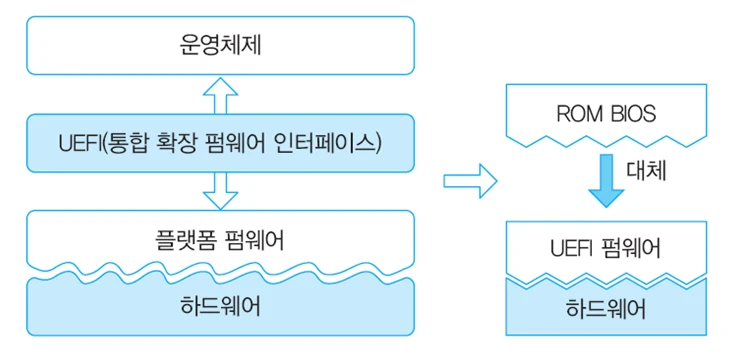

    - 시스템 BIOS, ROM BIOS, BIOS ⇒ 대체할 필요성이 대두됨.

        - 전원이 들어오고 실행되는 첫 번째 S/W
        - BIOS는 30년 이상 사용되어 불편하고, 대용량 HDD의 인식이 불가능하다.  
            또한 최신형 H/W를 인식하지 못하는 경우도 종종 있었음. H/W를 인식하지 못하는 것은 심각한 보안 문제를 초래할 수 있으므로 이러한 문제의 해결이 촉구되었다.

    - UEFI 펌웨어는 전통적인 BIOS를 능가한다.

        - GPT(GUID partition table) 지원(메인보드가 UEFI/EFI를 지원해야 한다)

            **GPT**

            BIOS 시절부터 사용한 MBR(Master Boot Record)의 파티션 테이블은 주 파티션을 최대 4개까지밖에 잡을 수 없고, 그 이상으로 나누려면 논리 파티션을 사용해야 한다. 운영체제와 부트로더가 지원하지 않으면 주 파티션에 설치된 운영체제로만 부팅 가능하며, 전체 디스크 크기가 2.2TB를 넘어서면 초과분의 공간은 사용할 수 없다.

            또한, MBR 부트로더의 크기가 512 바이트이므로 MS-DOS와 같이 간단한 운영체제가 아니면 MBR 부트로더로는 부팅할 수 없어 MBR 부트로더에서 파티션의 2차 부트로더를 실행시키는 방법으로 크기 제한을 우회했다.

            GPT는 파티션 정보를 기록하는 방식을 변경하여 주 파티션과 논리 파티션의 구분을 없애고, 2.2TB를 초과하는 디스크를 한 개의 파티션으로 사용할 수 있게 되었다. GPT의 파티션 테이블에 기록되는 정보가 많기 때문에 MBR을 GPT로 변환할 수 있지만, 그 반대로는 불가능하다.

            GPT 디스크로 부팅하려면 EFI가 필요하지만, 반대로 EFI는 GPT 뿐만 아니라 MBR 디스크도 부팅할 수 있다. 예를 들면, EFI 부팅용 USB의 경우 호환성을 고려하여 MBR 파티션 테이블을 사용한다.

            - MBR에 대한 상세한 설명

            [https://blog.forensicresearch.kr/11](https://blog.forensicresearch.kr/11)

            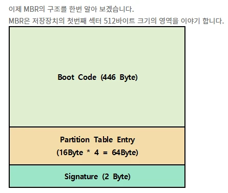

            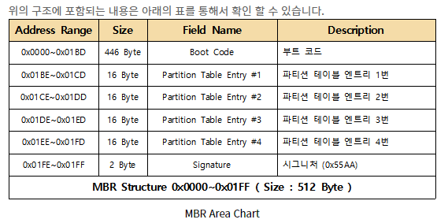

            1. MBR Boot Code

            컴퓨터 부팅 시에 POST(Power On Self Test) 이후에 저장 매체에 존재하는 첫 번째 섹터를 호출하게 되는데, 그 때 호출된 섹터에 존재하는 내용이다. 운영체제를 부팅하기 위해서 진행하는 부팅과정을 간단하게 나타내면 아래와 같다.

            BIOS → Pre POST → POST → reading MBR → reading VBR

            저장장치에서 첫 번째 섹터인 MBR은 자신의 부트 코드를 수행한다.

            부트 코드는 다음과 같은 작업을 한다.

            - MBR 파티션 테이블에서 부팅 가능한 파티션을 찾기
            - 부팅 가능한 파티션을 찾았을 경우 해당 파티션 테이블에 적혀있는 VBR로 이동
            - 부팅 가능한 파티션이 없을 경우, 오류 메시지를 출력

            파티션 테이블 엔트리가 총 4개까지 보유할 수 있기 때문에 부팅 가능한 주 파티션은 4개까지 생성이 가능하다. 따라서, 멀티 부팅할 경우에 4개의 운영체제를 설치할 수 있다. 하지만, 주 파티션이 아닌 데이터 저장을 위한 논리 파티션은 4개 이상 생성하는 것이 가능하다.

            1. Partition Table Entry
            2. Signature

            <!-- -->

            - 2.2TB 이상의 대용량 디스크로부터 부트
            - CPU나 다른 장치와 무관하게 동작한다.
            - 부팅 전에 실행되는 예비 OS의 역할 ⇒ 다양한 하드웨어에 접근하는 API를 제공하는 것으로 보인다.

            - 세련된 그래픽 사용자 인터페이스의 시스템 설정 메뉴

                - 그래픽 쉘 제공과 마우스 조작

    - UEFI 펌웨어의 역할

        - 기존 롬 바이오스의 서비스를 그대로 물려받음

        - 부트 서비스

            - 운영체제를 로드하는 부팅을 실시
            - UEFI 펌웨어가 플랫폼을 소유하는 동안에만 가능하다.   
                (따라서 시동 절차를 보면 1번이 부트 서비스인 것을 볼 수 있음.)  
                (즉, 부팅 중에만 가능, ExitBootServices 호출 이전에만 가능하다.)  
                (운영체제로 부팅 과정을 이임하기 이전을 의미하는 것으로 보임.)

        - 실시간 서비스(런타임 서비스)

            - OS 동작 중에도 시스템 설정과 한정된 그래픽 제어  
                (운영체제의 로드가 완료된 이후에 사용된다.)

                - 그래픽 출력 프로토콜(Graphics Output Protocol, GOP)

                **GOP**

                UEFI GOP는 시스템 펌웨어가 부트 로고, 스플래쉬 스크린(메인보드 제작사가 나오는 스크린으로 보인다), 그리고 다른 그래픽적 요소를 시스템 초기화 과정에서 보여줄 수 있도록 만든다. 또한 비디오 어댑터가 시스템 펌웨어, OS와 연결될 수 있도록 standard interface를 제공한다.

                UEFI GOP는 BIOS에서 사용되던 VGA BIOS 인터페이스와 비교할 때 추가적인 이점을 가진다. 향상된 그래픽, 더 빠른 부팅(fast boot), 더 유연하게 해상도와 가로세로비에 맞는 그래픽 디스플레이를 할 수 있는 기능 등이 있다. 추가적으로, 4K 해상도 디스플레이를 지원할 수 있고, 멀티모니터, 그리고 알파 블렌딩이나 하드웨어 가속(그래픽카드 가속)과 같은 고성능 그래픽 옵션을 제공한다. 그래픽카드에 GOP가 탑재되면 UEFI 그래픽카드의 가속 기능을 제한적으로 사용할 수 있기 때문에 UHD와 같은 고해상도로 출력할 수 있고, UEFI를 지원하는 운영체제를 사용하는 경우 드라이버가 설치되지 않은 상황에서도 고해상도 화면을 출력할 수 있다.

                결론적으로, UEFI GOP는 현대 컴퓨터에서 매우 중요한 standard이며, 부팅 과정 전후에 걸쳐 높은 성능의 그래픽 디스플레이를 가능하게 한다.

- 부트 매니저

    - UEFI 시동 과정의 부트 서비스를 담당하는 프로그램

        - 모든 드라이버와 OS 로더를 로드하는 책임을 진다.

        - BIOS의 시동절차와 가장 큰 차이점은

            - 부팅 전에도 파일 시스템과 다양한 응용프로그램 사용이 가능하다는 것이다.
            - OS 로더는 UEFI가 지원하는 일종의 응용프로그램이다.

        - 기존 MBR(Master Boot Record)과 BIOS 방식의 부팅도 지원 가능하다.

        - 안전 부트(secure boot)가 가능하다.

            - 디지털 서명이 없는 드라이버나 OS 로더의 부트를 막음

- UEFI의 시동과정

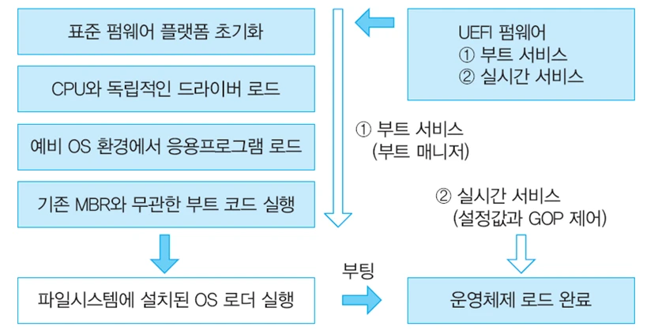

- 시동과정

    - BIOS의 시동절차와 거의 유사하다. (부트 서비스 과정, 부트 매니저가 관여한다.)

        - 하드웨어 초기화로 부품들의 종류를 확인, 하드웨어가 모두 정상인지 체크한다.
        - 드라이브, 비디오 등 각 장치의 드라이버를 로드한다.

        ⇒ 이 때 드라이버는 CPU와 독립적. 즉, CPU-independent한 드라이버로, 서로 다른 아키텍처 환경에서도 문제없이 돌아가게 된다.

        - 예비 OS 환경에서 응용프로그램을 로드한다. (UEFI는 사용 가능함)
        - 기존 MBR와 무관한 부트 코드를 실행

    - 최종적으로 원하는 드라이브에서 OS 로더 파일을 찾아 실행

        - OS 로더 파일은 일종의 UEFI 응용 프로그램 (응용프로그램이므로, UEFI는 사용 가능)

    - 부팅이 완료되면 부트 매니저는 부팅 과정 중에 얻은 정보를 모아 OS에게 제공하고 통제권을 넘기게 된다. 이 때 UEFI가 GOP와 같은 실시간 서비스를 지원하게 된다.

**UEFI informations**

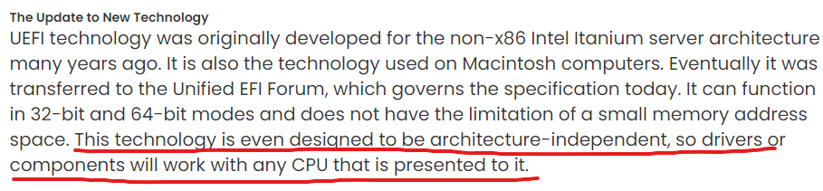

⇒ CPU와 독립적이어서 드라이버와 컴포넌트가 어떤 CPU와도 동작할 수 있다.

- UEFI vs BIOS

[What Is UEFI | HP® Tech Takes](https://www.hp.com/us-en/shop/tech-takes/what-is-uefi)

- UEFI

[What is UEFI or Unified Extensible Firmware Interface?](https://www.thewindowsclub.com/what-is-uefi-or-unified-extensible-firmware-interface)

BIOS의 한계는 16bit이며, 주소지정 가능한 공간과 MBR 파티션 저장 공간이 1MB밖에 되지 않는다. 따라서 BIOS가 사용할 수 있는 RAM의 양에는 한계가 있었으며, HDD 용량도 2TB 이상으로는 지원하지 못했다. 이런 한계를 극복하기 위해 인텔은 EFI를 도입했고, 이후에 UEFI Forum에 의해 공식적으로 UEFI라는 이름으로 도입되었다.

UEFI는 32bit와 64bit 아키텍처를 모두 지원하며, 따라서 BIOS보다 RAM 더 복잡한 연산을 수행하도록 활용할 수 있다. UEFI는 또한 CPU로부터 독립적인 아키텍처와 드라이버를 지원한다. BIOS와는 다르게, UEFI는 마우스로 상호작용이 가능한 인터페이스를 지원하기도 한다.

기존의 MBR과는 다르게 UEFI는 GUID Partition Table이라고 불리는 GPT를 지원한다. GPT를 통해 최대 2.2TB까지 지원이 가능했던 BIOS와는 다르게, 9.4ZB까지 지원이 가능해졌으며, 윈도우즈에서는 최대 128개의 주파티션까지 분할이 가능하다.

UEFI는 부트 매니저가 있어서 추가적인 부트 로더가 필요하지 않으며, 파일 시스템에 설치된 OS 로더를 실행하면 된다. 이 OS로더는 UEFI가 지원하는 일종의 응용프로그램이다. 그리고 BIOS와 비교했을 때 더 빠른 부팅을 지원하고, 더 나은 네트워크를 지원한다.

하드웨어의 발전에 따라, BIOS는 요즘 사용되는 장치들과 점점 더 성장해나가고 있는 UEFI가 필요한 파워를 감당하기에는 부족해지고 있다.

일반적으로, UEFI 사용이 가능한 시스템은 BIOS와 비교했을 때 더 빠른 부팅과 종료가 가능하다.

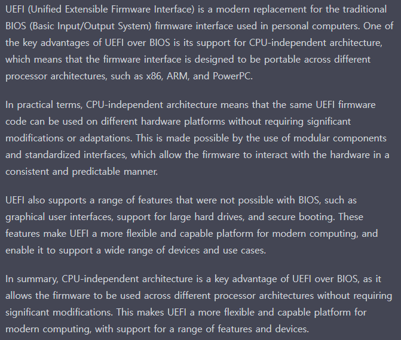

UEFI는 PC에서 사용되는 BIOS firmware interface를 대체할 수 있는 현대적인 대체 수단이다. UEFI의 핵심적인 이점은 바로 CPU-independent architecture를 지원한다는 것인데, 이 말은 firmware interface가 x86, ARM과 같은 프로세서 아키텍처의 종류에 관계없이 사용될 수 있도록 만들어졌다는 것이다.

실용적인 측면에서 보면, CPU-independent architecture는 동일한 UEFI firmware 코드가 어떠한 수정이나 적용없이, 하드웨어 플랫폼에 관계없이 사용될 수 있다는 뜻이다. 이를 통해 컴퓨터 하드웨어에 사용되는 컴포넌트들의 모듈화와 인터페이스의 표준화가 가능해졌고, 펌웨어가 하드웨어와 지속적이고 안정적으로 상호작용할 수 있게 되었다.

UEFI는 GUI(GOP), 하드 드라이브 용량 증가(주파티션 최대 개수 증가), secure booting 등 BIOS가 지원하지 않았던 기능들을 지원한다. 이 기능들 덕분에 UEFI는 현대 컴퓨터 시스템에서 더욱 폭넓게 사용될 수 있는 플랫폼을 지원하게 되었다.

요약하자면, CPU-independent architecture는 BIOS와는 다른, UEFI만의 장점이며, 특별한 수정없이, 프로세서 아키텍처의 종류에 관계없이 펌웨어가 사용될 수 있도록 만들었다. 이는 UEFI가 현대 컴퓨팅에서 더욱 유연하고 확장가능한 플랫폼을 지원하는데 기여하게 되었다.

**펌웨어와 드라이버의 차이**

- 펌웨어 : 펌웨어는 대부분의 하드웨어 장비에 내장되어 있고, 장비의 구동 및 제어를 위한 별도의 S/W이다. 장치의 복잡한 소프트웨어를 위한 작동 환경을 제공하고, 더욱 단순한 장치에서는 운영체제의 역할을 한다. 펌웨어는 하드웨어 내부의 롬에 저장되었지만, 롬은 저장된 데이터의 수정이 불가능한 메모리이기 때문에 내용을 변경하기 힘들었다. 하지만 전원이 꺼진 후에도 저장된 내용이 지워지지 않는 EPROM, EEPROM, Flash 등이 개발되면서 펌웨어의 수정이 가능해졌다. 펌웨어에는 다른 소프트웨어보다 먼저 하드웨어의 기본적인 동작을 제어할 수 있는 기능이 있으며, 컴퓨터의 기본적인 입출력을 담당하는 바이오스는 펌웨어의 일종이다. 펌웨어 개발자는 하드웨어에 내장되어 여러 가지 기능을 구현하는 소프트웨어를 개발하는 직무이다.
- 드라이버 : 드라이버는 하드디스크와 같은 보조기억장치에 저장되어 해당 장치의 구동을 돕는 소프트웨어로, 하드웨어 장치와 상호 작용하도록 설계되었다. 필수 장치 드라이버가 없으면, 해당 하드웨어 장치는 작동하지 않는다. 장치 드라이버는 하드웨어 장치와 그 장치를 사용하는 프로그램 또는 운영체제 간의 해석기 역할을 수행한다.
- 펌웨어와 드라이버의 큰 차이점은, 펌웨어는 하드디스크와 같은 보조기억장치에 저장되는 것이 아니라 주기억장치인 롬에 저장되어 장치의 구동을 직접 제어한다는 것이다.

- Instruction Set Architecture (ISA)

    [Instruction set architecture](https://en.wikipedia.org/wiki/Instruction_set_architecture)

    예를 들면 CPU와 같은 디바이스가 실행하는 instruction은 ISA(즉, Computer Architecture)에 의해 정해지며, 이런 장치를 implementation이라고 한다.

    일반적으로 ISA는 instructions, data types, registers, main memory 서포팅에 관여되는 하드웨어, 기초적인 특성들, (memory consistency[메모리 일관성], virtual memory, addressing modes) 그리고 컴퓨터 아키텍처의 implementations family의 I/O model을 결정하고 지원하는 역할을 한다.

    ISA는 implementation에서 돌아가는 머신 코드의 특성을 구체화한다. 이것은 implementation의 특성에 의존하지 않으며, implementation과의 binary compatibility를 제공한다.

    - about ISA

    [[ 컴퓨터구조 ] ISA (Instruction Set Architecture)](https://inyongs.tistory.com/108)

    **ISA(Instruction Set Architecture)**

    - ISA란? 하드웨어와 소프트웨어 사이의 Interface를 정의하는 것. 하드웨어와 프로그램 사이의 매개체 역할을 하는 것이다. ISA란 프로세서가 실행할 수 있는 명령어의 집합을 의미하며, 프로세서가 어떻게 일하는지를 결정한다. ISA는 프로세서가 실행 가능한 instructions의 정보를 포함하며, 이 instructions의 format도 포함하고, 프로세서가 지원하는 addressing modes(주소 지정 모드)도 포함한다.

    - 주소 지정 모드란? 프로세서가 메모리에 접근해서 데이터를 가져오고 저장하는 방식을 말한다. 이는 operand(피연산자) 또는 데이터가 저장되어야 할 메모리 주소를 계산하는 공식 또는 방법을 구체화한다.

        방법은 크게 다음 7가지가 있다.

        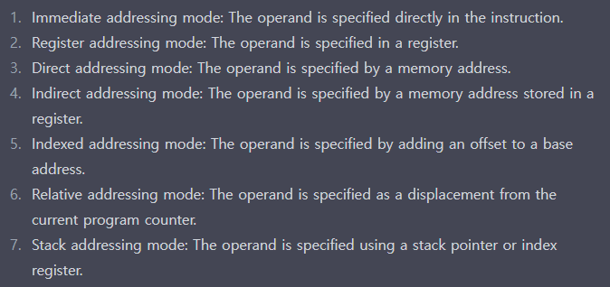

        각각의 방법에 따라 장단점이 구별되며, 속도, 효율성, 그리고 유연성 등이 사용 용도와 프로세서의 아키텍처에 따라 달라진다.

    - ISA를 구현하는 방법을 Microarchitecture라고 한다.

        Microarchitecture란? ISA가 하드웨어와 소프트웨어 사이를 연결하는 것이라면, 이것은 ISA를 구현하는 방법을 말한다. 예컨대, Intel과 AMD는 똑같은 x86이라는 Interface는 같지만, 실제로 어떻게 만드는지는 내부적으로 모두 구현하는 법이 다르다.

    **Binary Compatibility that ISA offers… (chatGPT)**

    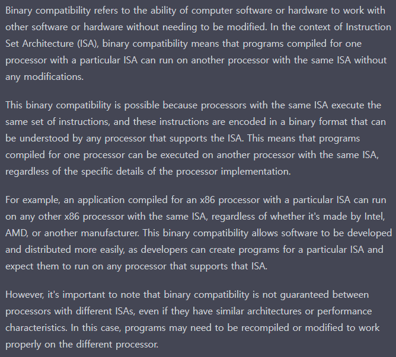

    Binary Compatibility는 컴퓨터 소프트웨어와 하드웨어가 수정될 필요 없이 다른 소프트웨어, 하드웨어와 일할 수 있도록 하는 것을 말한다. ISA의 관점에서, Binary Compatibility는 특정한 ISA를 사용하는 프로세서에서 컴파일된 프로그램이 똑같은 ISA를 사용하는 다른 프로세서에서 수정없이 동작될 수 있는 것을 말한다.

    Binary Compatibility는 ISA가 같으면 똑같은 명령어 집합을 사용하게 되며, 이 명령어들은 똑같은 바이너리 포맷으로 인코딩되기 때문에 같은 ISA를 지원하는 프로세서라면 어떤 프로세서에서든 똑같이 해석될 수 있기 때문에 가능하다. 이것이 의미하는 바는 한 프로세서에서 컴파일된 프로그램이 ISA가 같은 다른 프로세서에서, 그 프로세서의 구체적이고 디테일한 구현 방식에 관계없이 똑같이 동작될 수 있다는 것이다.

    예를 들어, 특정한 ISA를 사용하는 x86 프로세서로 컴파일된 프로그램은 똑같은 ISA를 사용하는 다른 x86 프로세서에서 사용될 수 있으며, 그 프로세서가 Intel에서 만들었든, AMD에서 만들었든, 또는 다른 제조사에서 만들었든 관계없이 똑같이 동작된다. Binary Compatibility는 소프트웨어 개발이 분산될 수 있도록 만들어주며, 개발자들이 특정한 ISA를 위한 프로그램을 만들고, 똑같은 ISA를 지원하는 다른 프로세서에서 동작되기를 기대할 수 있게 한다.

    그러나, Binary Compatibility는 서로 다른 ISA를 사용하는 프로세서에서는 적용되지 않는다. 두 프로세서가 아무리 유사한 아키텍처를 가지고 비슷한 성능과 특성을 가진다고 해도 말이다. 이런 경우, 프로그램이 제대로 동작될 수 있도록 재컴파일되거나 일부 수정되어야 할 것이다.

    - ISA의 Binary Compatibility에 관한 예제-1

    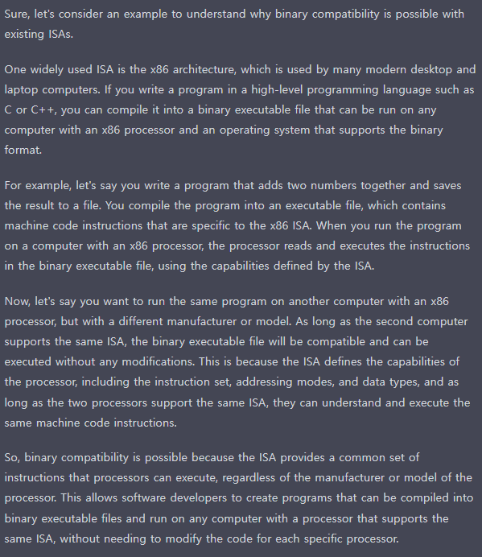

    - 유명한 프로세서들이 사용하는 ISA의 예시

    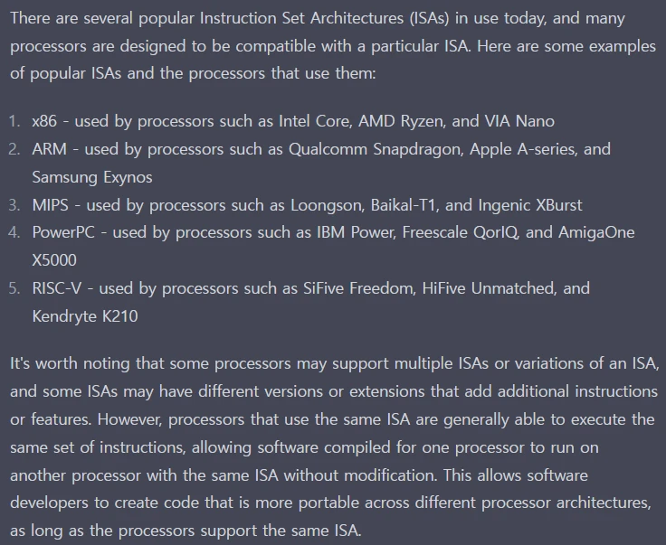

    **The difference with Computer Architecture and Instruction Set Architecture)**

    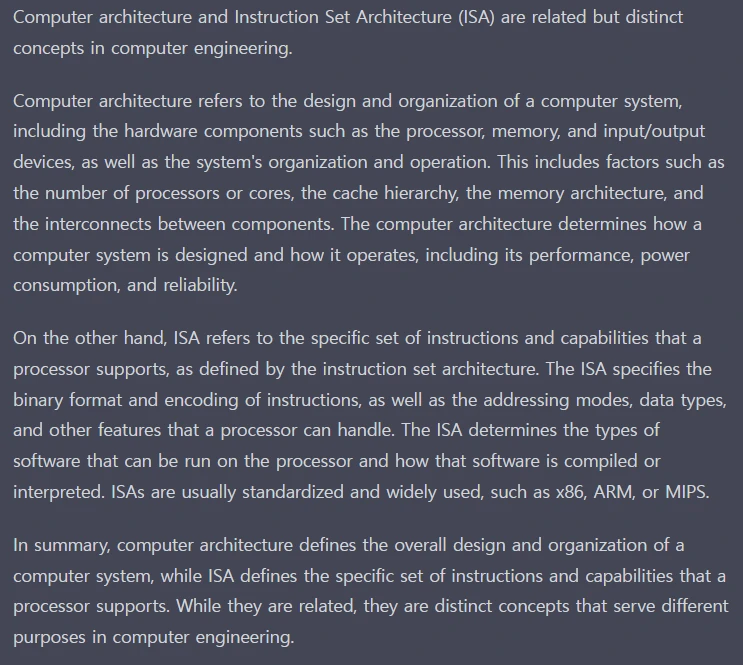

    - 컴퓨터 아키텍처란?

        - 컴퓨터 아키텍처는 프로세서, 메모리, I/O 디바이스 등과 같은 하드웨어 구성요소를 포함하는 컴퓨터 시스템의 설계와 구조 방식과 시스템의 구성과 동작을 모두 아우르는 말이다. 컴퓨터 아키텍처는 프로세서의 코어의 개수, 캐시 계층구조, 메모리 아키텍처, 각각의 구성요소 간의 연결 방법 등을 포함한다. 컴퓨터 아키텍처는 컴퓨터 시스템이 어떻게 설계되고 동작되며, 그것의 성능과 전력 소모, 신뢰성 등까지도 포함하는 내용이다.

    - ISA란?

        - ISA란 프로세서가 사용하는 특정한 명령어의 집합을 말한다. ISA는 바이너리 포맷과 명령어의 인코딩 형태를 결정하며, 그 뿐만 아니라 주소 지정 방식, 데이터 타입, 프로세서가 핸들할 수 있는 다른 특성들을 포함한다. ISA는 프로세서에서 동작할 수 있는 소프트웨어의 타입을 결정하며, 그 소프트웨어가 어떻게 컴파일되고 해석될 것인지를 결정한다, ISA는 보통 표준화되어 있으며, 대표적인 예로는 x86, ARM 또는 MIPS가 있다.

    - 요약

        - 컴퓨터 아키텍처는 컴퓨터 시스템의 전반적인 설계와 구조를 정의하며, 반면에 ISA는 프로세서가 지원하는 특별한 명령어 집합과 프로세서의 처리 방법(능력) 을 말한다. 그들은 서로 관계되어 있지만, 서로 구분되는 컨셉을 가지고 있으며 컴퓨터 엔지니어링에 사용되는 목적이 다르다.

    > Binary Compatibility : Binary Compatibility는 하드웨어와 소프트웨어에서 상당히 오래된 개념 중 하나이다. 만약 서로 다른 두 개의 컴퓨터가 똑같은 S/W를 재컴파일 하지 않고 똑같이 동작시킬 수 있다면, 두 컴퓨터는 Binary Compatible 하다고 말할 수 있다. 

    이는 한 ISA의 여러 implementations가 performance, physical size, and monetary cost가 다를 수 있도록 한다. 그럼에도 같은 머신 코드를 돌릴 수 있기 때문에, 더 부족한 성능에 낮은 가격의 machine이 고성능, 고가치의 machine과 software를 바꾸지 않고도 교체될 수 있도록 한다.

    또한 Binary Compatibility를 제공하는 것은 ISA의 implementations가 가진 microarchitectures의 발전도 가능하게 했다. 그래서 새로운 고성능의 implementation들은 이전 세대의 implementation이 동작시키던 Software를 동작시킬 수 있다.

    만약 OS가 표준 호환이 되는 application binary interface (ABI)를 유지한다면, 특정한 ISA에 대해서는, machine code가 미래의 implementation과 OS에서도 동작될 수 있을 것이다. 하지만, 만약 ISA가 여러 개의 OS를 지원한다면, 그것은 첫 번째 OS가 다른 OS에서 빌드된 machine code를 지원하지 않는 이상은, 한 OS에서 동작하는 machine code가 다른 OS에서 동작하는 것을 보장할 수 없을 것이다.

    하나의 ISA는 instructions나 여타 다른 것들을 추가하는 방식으로 확장될 수 있고, 또는 더 큰 addresses나 data values를 지원할수도 있을 것이다. 또한 확장된 ISA의 implementation은 여전히 이런 확장을 사용하지 않는 여러 ISA 버젼의 machine code를 동작시킬 수 있을 것이다. 그리고 이러한 확장을 사용하는 머신 코드들은 그 확장을 지원하는 implementations 위에서만 동작될 수 있을 것이다.

    ISA가 제공하는 binary compatibility는 컴퓨팅에서 가장 필수적인 추상화 중 하나이다.

    [UEFI](https://en.wikipedia.org/wiki/UEFI)

    UEFI는 ISA-independent device driver를 제공하며, 이는 non-volatile memory에 EFI byte code or EBC 형태로 저장된다. 

    특정 디바이스를 위한 몇몇 architecture-specific EFI drivers는 OS가 사용하기 위한 interface를 가질 수도 있다. 이것은 OS가 EFI 드라이버가 operating-system-specific drivers가 로드되기 전에 basic graphics and network functions를 사용할 수 있도록 한다.

    다른 경우로는, EFI 드라이버는 타입이 다른 디스크 볼륨으로부터 부팅을 할 수 있도록 만들어주기도 하는 파일시스템의 기능을 제공하기도 한다.

## 5. 신호선의 동작

- 하드웨어의 입장에서 전기 신호를 고려하는 동작을 살펴본다.

    - 신호선의 1과 0
    - 버퍼의 필요성

#### 5-1. 신호선의 1과 0

- 디지털 데이터의 논리 1과 0 ⇒ 전기적으로 표현될 수 있다.

    - 하이 레벨 : 논리 1(주로 + 전압)
    - 로우 레벨 : 논리 0(주로 0V 혹은 - 전압)

- 논리 레벨

    - 디지털 회로에서 전기 신호가 한정된 개수의 상태를 갖는 것

        - 다양한 전압 레벨이 사용될 수 있음
        - 하드웨어 시스템마다 고유한 레벨을 가짐

- 액티브 레벨

    - 디지털 회로의 신호가 High나 Low의 어느 한 레벨 중에서 의미 있는 동작을 하도록 신호의 활성상태를 설계하는 것

        - 액티브 레벨로 변하면 어떤 동작을 지시

    - 액티브 하이(active high)

        - 디지털 회로의 신호가 하이 레벨에서 본래 목적의 의미 있는 동작을 하도록 설계한 상태

    - 액티브 로우(active low)

        - 디지털 회로의 신호가 로우 레벨에서 본래 목적의 의미 있는 동작을 하도록 설계한 상태

- 신호의 액티브 레벨

    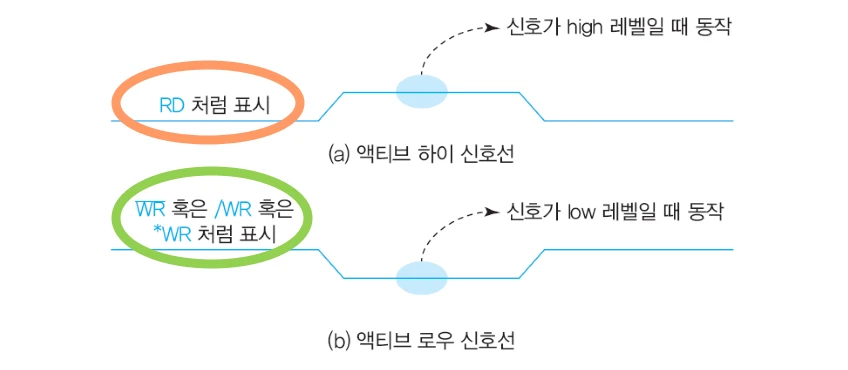

    신호선에 이름을 부여하는 방법으로 신호의 액티브 상태를 표시한다. (Active Low일 때 추가적인 기호를 달아서 차이를 표현한다.)

- 신호의 트리거 방식

    - 트리거

        - 어떤 하드웨어 장치를 동기(sync)에 맞추어 동작시킬 수 있도록 제공되는 신호  
            ⇒ 동기 신호는 clock을 의미하며, 서로 다른 디바이스들이 일관적인 시간대를 기준으로 동작하게 하는 기준을 제공한다.

    - 레벨 트리거(Level Trigger)

        - 신호선에 연결된 장치들이 입력 신호의 하이나 로우 레벨에 동기되어 동작하도록 설계하는 방식을 말한다.

    - 엣지 트리거(Edge trigger)

        - 신호선에 연결된 장치들이 입력 신호의 라이징(Rising) 엣지나 폴링(Falling) 엣지에서 동기되어 동작하도록 설계하는 방식을 말한다.

    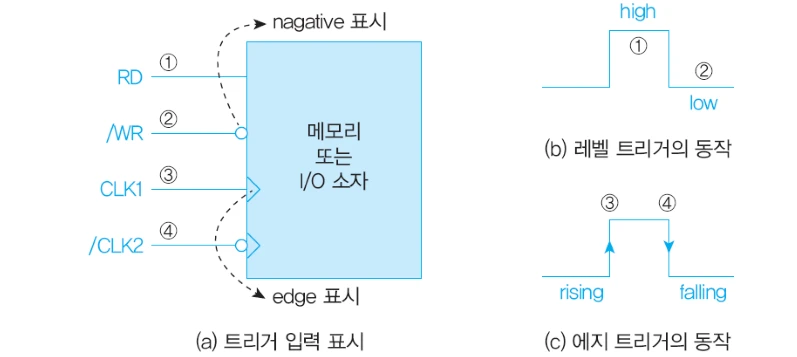

    H/W Diagram에서 네거티브 기호를 부여하는 방식을 통해 트리거 신호의 입력을 표시한다.

#### 5-2. 버퍼의 필요성

- 양방향 버스를 이용하려면 전송방향을 바꿀 때 양쪽 출력 레벨이 서로 충돌되지 않게 조치해야 한다. ⇒ 입출력 방향이 바뀌는 중간에 버스선을 잠시 끊는다.

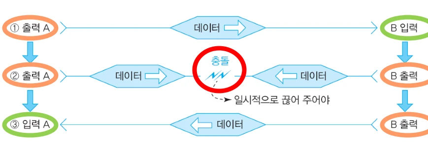

⇒ 양방향 통신이 가능한 라인에서, 출력 신호의 충돌을 방지하기 위해 일시적으로 연결을 끊어주는 과정이 필요하게 됨. 즉, 신호의 방향을 바꾸는 과정에서 잠시 해당 라인에 전류가 흐르지 않도록 처리해주는 로직이 있다는 것이고, 이 과정에서 전류가 흐르는 방향이 바뀌게 된다.

- 출력 신호의 충돌

    - 신호선에 연결된 양쪽 부품에 달린 하드웨어 핀들이 입력 단자 또는 출력 단자가 된다. (하드웨어 부품들에 부착된 핀들을 의미함)
    - 양쪽 단자 모두 하이 레벨을 출력하면 양쪽 출력 핀에서 흘러나온 전류가 서로 충돌해 부품에 손상이 가해지게 된다.

    - 하이 임피던스 상태

        - 고 임피던스 상태, 반도체 소자의 전기적 저항이 너무 커서 마치 전선이 끊어진(open) 것과 같은 효과를 주는 상태이다.

        - 3상태(tri-state)

            - 신호선의 레벨이 하이, 로우, 하이 임피던스의 3가지 전기적인 상태를 갖는 것.

        **High-Z(High-Impedance) from chatGPT**

        High-Impedance는 임피던스(impedance)란, 회로의 input impedance가 매우 높은 상태를 말한다. 회로가 전류의 흐름에 저항하는 정도를 나타내는 단위를 말한다. 

        High-impedance는 특정 전자 회로에서 loading effects를 피하기 위해 사용된다. Loading은 측정 도구의 임피던스가 실제로 측정되는 회로의 임피던스보다 낮을 경우 발생하며, 회로의 전류를 흡수하고, 회로의 동작에 영향을 미친다. 따라서 측정값이 부정확해 질 수도 있으며, 회로에도 악영향을 미칠 수 있다. High-impedance 회로는 signal amplification, impedance matching, signal filtering과 같은 애플리케이션에서 주로 사용된다.

        **Tri-state**

        tri-state는 high, low, high-impedance의 세 가지 전기적 출력 신호를 내보낼 수 있는 논리 회로를 말한다. high-impedance는 floating state 또는 disconnected state라고도 불리는데, 이는 어떠한 신호도 통과되지 않고 값이 정의되지 않기 때문이다.

        tri-state buffer는 일종의 논리 회로이다. 이는 output을 enable 하거나 disable 할 수 있는 control signal을 담당한다. control signal이 disable되면, 버퍼의 output이 high-impedance 상태가 되며, 이는 회로와 효과적으로 disconnect되는 기능을 제공한다. 만약 control signal이 enable되면, buffer의 output은 input signal에 따라 high, low가 된다.

        Tri-state 회로는 주로 다수의 디바이스가 하나의 버스를 공유하는 디지털 시스템에서 주로 사용된다. 이러한 시스템에서는, 각각의 디바이스가 디바이스가 선택되지 않았을 때 output을 enable 하거나 disable 할 수 있는 tri-state buffer와 버스를 통해 연결된다. 이렇게 함으로써, 디바이스들은 서로 간의 간섭 없이 물리적으로 같은 상태를 공유할 수 있게 된다.

        예를 들어 메모리 시스템에서는, 다수의 메모리 기기들이 공통 데이터 버스를 공유하게 된다. 각각의 메모리 디바이스들은 chip-select signal에 의해 통제되는 tri-state buffer를 통해 버스와 연결된다. 만약 특정한 메모리 디바이스가 선택될 경우, 그 디바이스의 tri-state buffer가 enable되며, 그것의 output data가 버스에 전달된다. 만약 디바이스가 선택되지 않을 경우, 그 디바이스의 tri-state buffer는 disable되며, 디바이스의 output은 버스로 전달되지 않는다.

        tri-state 회로는 Programmable Logic Devices(PLD), bus arbitration 회로와 같은 다른 Application에도 사용되며, 전압 레벨이 다른 디지털 시스템과 연결되는 회로의 인터페이스에도 사용된다.

        요약하자면, tri-state 회로는 output signal이 세 개의 상태를 갖도록 만들어주는 회로이다. (High, Low, High-Impedance) tri-state 회로는 디지털 시스템에서 다수의 디바이스가 서로 간의 간섭 없이 하나의 공통 버스를 공유하도록 만들어주며, 회로의 output signal 을 통제하기 위해 다른 application에서 사용되기도 한다.

        ⇒ tri-state buffer를 사용하여 MUX를 구성할 수 있다.

- 버퍼(buffer)

    - 소프트웨어적인 측면에서 버퍼

        - 속도를 완충해주는 메모리 상의 임시 저장소

            - 프로그램 작업 전환이나 송수신 장치 간에 사용
            - 대부분의 소프트웨어 작업은 데이터를 임시로 담아두는 공간으로 버퍼 메모리를 필요로 한다.  
                ⇒ 예를 들어 운영체제에서 Shared Memory에서 사용되는 Circular Queue 등을 고려할 수 있다. Message Passing 방식에서도 Synchronization 문제가 제기될 수 있는데, direct 방식으로 진행할 경우에는 Zero Capacity의 이점을 얻을 수도 있다.

    - 하드웨어적인 측면에서 버퍼

        - 전압 레벨을 완충해주거나

        - 전기적인 타이밍 속도를 조절해주는 부품

            - 대부분의 하드웨어 부품은 입출력 신호의 레벨이 서로 충돌하지 않도록 전기적인 버퍼를 사용한다. (tri-state buffer)

- 3상태 양방향 버퍼

    - 2상태 버퍼는 H, L 레벨을 출력

    - 3상태 버퍼는 H, L, high-Z의 세가지 레벨을 출력

        - 송수신 중간에 하이 임피던스 상태를 유지할 수 있도록 만들어 준다. (MUX)

## 제 3장 : 중앙처리장치

- 중앙처리장치는 장치의 기능을 설명하는 말

- 1971년 최초의 마이크로프로세서 개발

    - 요즘 거의 모든 CPU는 마이크로프로세서의 형태이다

- 마이크로프로세서, 프로세서, CPU ⇒ 동의어

- CPU 본래 기능은 명령어를 꺼내 해독하고 연산을 실행하거나, 프로그램에서 주어진 작업을 수행하는 일이다.

    - 연산장치, 레지스터, 제어장치의 원리와 동작을 이해

- CPU 명령어 사이클과 병렬계산

#### 제 3장의 구성

3.1 CPU 프로세서

3.2 보조 프로세서

3.3 레지스터

3.4 연산장치 (ALU)

3.5 CPU 명령어

3.6 제어장치

## 1. CPU 프로세서

- 프로세스 : 연산이나 데이터를 처리하기 위해 현재 진행되는 작업이나 프로그램을 말한다.

- 프로세서

    - 컴퓨터 내부의 처리장치

    - 컴퓨터 내부에 포함된 하나의 모듈(module), CPU 칩 혹은 컴퓨터 자체

        - 하드웨어 관점에서는 CPU
        - 소프트웨어 관점에서는 대개 번역 프로그램

- CPU의 기능

    - 명령어와 데이터를 처리하는 일 (데이터를 처리하고 데이터/주소 버스로 결과를 전송한다.)

        - 프로그램에서 주어진 명령어를 인출해 해독
        - 명령어에 따라 데이터를 인출해 연산을 수행, 그 결과를 저장하거나 다른 장치로 전송

- CPU의 구성 요소

    - 연산장치, 레지스터, 제어장치로 구성
    - CPU 내부 버스로 서로 연결되어 있음

    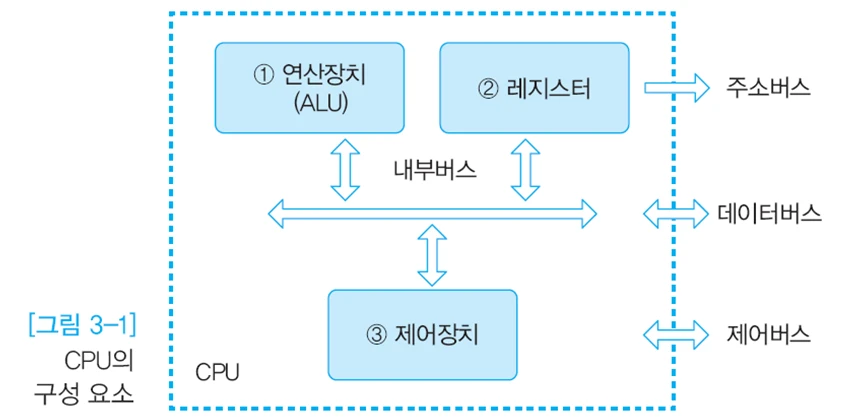

내부 버스는 하나로 연결되어 있는 Line이며, 무언가 충돌이 나면 끊어질 필요가 있다. (Tri-State로 만들어서 전류가 흐르지 않도록 하는 것 같은데, 이것을 구현하기 위해 내부적인 소프트웨어가 있거나 자체적으로 과전류를 감지하여 tri-state로 만드는 하드웨어가 있을 것)

- CPU의 기본 구성 요소

    - 연산장치(Arithmetic and Logic Operation Unit, ALU)

        - 산술 및 논리연산장치
        - 산술연산과 논리연산을 수행하는 하드웨어 부분

    - 레지스터

        - 연산을 위해 다양한 용도로 사용되는 CPU 내부의 일시적인 기억장소
        - 명령, 주소, 데이터 등을 일시 저장

    - 제어장치

        - 명령을 해석하고 실행하기 위한 제어신호 발생
        - 연산, 읽기, 쓰기 등 동작신호와 타이밍(timing) 신호

- 마이크로프로세서

    - 작은(micro) 처리장치(processor) 라는 뜻으로, &lt;반도체 칩에 집적시켜 소형화시킨 CPU&gt;라는 뜻이다. (Micro-Processor Unit, MPU)

        - 1970년대 이전 별개의 장치였던 연산장치, 레지스터, 제어장치 등을 반도체 칩에 집적시켜 CPU의 기능을 수행하도록 했다.

    - 마이크로프로세서, 프로세서, CPU, MPU는 동의어라고 볼 수 있다.

    - 컴퓨터 내부에는 하나의 MPU만 존재하는 것은 아니다

        - 메인보드에 장착된 가장 강력한 프로세서가 CPU
        - 비디오카드, 사운드카드 등 주변장치에도 다양한 종류의 프로세서들이 크고 작은 역할을 담당하고 있다.

- 마이크로컨트롤러(Micro-Controller Unit, MCU)

    - 범용이 아닌, 주로 산업용기기의 제어를 위해 만들어진 특수목적용 마이크로프로세서

    - 주된 형태는 one-chip 마이크로컴퓨터

        - CPU와 일정 용량 메모리, 일부 I/O 장치 및 접속회로

- CPU의 비트 판정 방법 2가지

    - 데이터 버스의 비트 수

        - CPU 내부와 외부 사이에 한 번에 주고받을 수 있는 데이터 버스의 비트 수

    - 범용 레지스터의 비트 수 (정확한 방법)

        - CPU 내부 범용 레지스터가 정수 연산에서 한 번에 처리할 수 있는 비트 수

    - ex) 인텔 펜티엄 계열의 프로세서 ⇒ 32비트 프로세서

        - CPU 외부 데이터버스는 64비트
        - 내부 데이터버스와 범용 레지스터는 32비트 (정확한 방법이므로, 32비트 프로세서)

- 64비트 CPU의 호환성

    - 64비트 버전으로 만들어야 최적의 성능을 지원할 수 있다.
    - 모든 프로그램이 64비트로 동작하는 것은 아니다.

    - 64비트 명령어 구조로 설계된 CPU는 32비트로 작성된 프로그램과의 호환성을 고려한 설계를 대개 포함한다.

        - 실제로는 완벽하게 호환되지는 않으며, 더 느려질 수도 있다.
        - 어떤 명령어는 제대로 동작하고 어떤 것은 제대로 동작하지 않을 수도 있다.

        ⇒ 즉, 완벽한 호환성을 기대하기는 힘들고, CPU의 비트수와 맞춰 소프트웨어를 개발하는 것이 필요하다는 말이다.

## 2. 보조프로세서

- 보조프로세서(혹은 코프로세서, coprocessor라고도 한다.)

    - 메인 프로세서에 없거나 부족한 기능을 도와 컴퓨터 시스템의 성능을 높여주는 특수목적용 프로세서를 말한다.

        - 메인 프로세서 없이는 단독으로 사용되지 않는다.

    - 보조프로세서의 종류는 사용 목적에 따라서 다양하다

        - 부동소수점 처리장치, 그래픽 가속기가 대표적이다.
        - 디지털신호처리(digital signal processing, DSP) 장치
        - 암호화(encryption) 장치 등

    ⇒ CPU 하나만으로 모든 일을 다 처리하는 것은 굉장히 비효율적일 수 있기 때문에 성능은 떨어지지만 특수한 목적을 수행하는 coprocessor를 도입함으로써 효율적인 시스템 동작을 구현할 수 있게 하는 것으로 보인다. 컴퓨터는 실행되는 프로세서를 위한 연산을 수행하는 것만으로도 충분히 바쁘고, 그걸 위해 Scheduling도 있는데 이 과정에서 부동소수점 처리 등의 보조적인 동작까지 수행할 시간은 부족하다.

- 부동소수점 처리장치(floating-point unit, FPU)

    - 수치연산(math 혹은 numeric) 보조프로세서
    - 대표적인 보조프로세서로 CPU가 범용으로 사용
    - 수치해석, 표 작성, 컴퓨터 그래픽, 게임, 멀티미디어를 처리할 때 빠른 속도의 부동소수점 연산을 수행한다. ⇒ 응용프로그램들이 자동으로 동작시키게 됨
    - 만약 FPU가 에러가 나면 부동소수점 연산에서 틀린 결과를 얻게 될 수도 있음

- 스프레드시트

    - 표 형태의 양식을 이용해 자동으로 계산하도록 만든 일종의 표 계산 프로그램

        - 대표적으로 Excel이 있다.
        - 부동소수점 연산이 사용되는 대표적인 작업이다.

- 그래픽 가속기(Graphics Accelerator)

    - 그래픽 데이터를 처리하기 위한 전용 보조프로세서

    - 주로 비디오카드에 장착, 윈도우 운영체제나 멀티미디어 환경에 적합하도록 프로그래밍

        - CPU가 보내주는 간단한 코드로 선을 그리는 등 고속으로 비트맵 그림을 재생
        - 범용으로는 프로그램이 가능하지 않음(특수한 목적만을 처리하는 보조프로세서)

    - 그래픽 데이터를 처리하는 CPU의 부담을 경감한다.

        - 큰 이미지나 영상을 빠르게 처리하거나 바꿀 때
        - 게임이나 애니메이션 같은 멀티미디어 데이터는 2D, 3D 화면과 특수효과를 위해 많은 양의 계산을 필요로 하는데, 이런 계산을 그래픽 가속기가 도와준다.

    - 컴퓨터에서 사용되는 그림

        - 비트맵 그래픽(비트맵 : 점으로 만든 지도라는 뜻)

            - 화면을 사진과 같은 화소로 구성한다.

            - 독립적인 모든 화소에 대한 색상 정보를 저장한다.

                - 모든 화소에 대한 정보를 담고 있기 때문에 디지털 카메라로 촬영한 사진에 있는 모든 화소의 색상 값을 가져 원본과 같이 표현하게 된다.

            - 화소 하나하나가 독립적이라 수정하기 매우 어렵다.

                - 축소, 확대하면 굵기가 변하고 계단현상이 발생한다.
                - 크기를 바꾸면 변형되어서 선명도가 떨어진다.

            - 압축되지 않은 .bmp 파일의 압축 방법에 따라 다양한 2차원 비트맵 그래픽 형식이 존재한다.

                - \*.jpg, \*.png, \*.gif 등

        - 벡터 그래픽(vector graphic) 

            - 화면을 디지털 도형으로 처리한다.

            - 선과 도형을 좌표, 크기, 방향으로 저장하는 컴퓨터 프로그래밍으로 작성되는 디지털 이미지

                - 위치, 간격, 방향, 굴절 등에 관한 정보가 수학적인 설명의 형태로 제공된다.
                - 나아가 색과 특정한 형태를 결정하는 정보도 가지고 있다. 예를 들어, 벡터 그래픽 파일에는 선을 그리기 위한 각 비트들이 저장되어 있는 대신에, 연결될 일련의 점의 위치가 들어 있다. ⇒ 파일 크기가 작아지고 선명도와 같은 질적인 손상 없이 임의로 확대하거나 축소 가능 (대표적인 프로그램이 일러스트레이터이다.)
                - 단, 비트맵 그래픽과 같이 사실적인 표현은 불가능하다.

            - 프로그램 코드 형태로 수정하기 쉽고, 크기가 작다.

                - 축소, 확대할 때 모양이 변형되지 않음

                - 객체지향 그래픽(object oriented graphic)

                    - 독립적으로 이동할 수 있는 여러 개의 도형을 합성하여 그림을 만들어내는 방식을 지원한다.

                - 독립적으로 이동할 수 있는 여러 개의 도형을 합성

            - 대표적인 2차원 벡터 그래픽 형식

                - \*.wmf, \*.emf

- FPU와 그래픽처리장치 내장

    - 요즘 CPU 프로세서 칩에는 FPU, GPU, 캐시를 내장

        - 싱글 코어 프로세서는 FPU를 코어의 일부로 취급하지 않음

            - 싱글 코어 프로세서는 FPU가 별도로 설계되어 있었음

        - 멀티 코어 프로세서는 FPU를 코어의 일부로 포함

    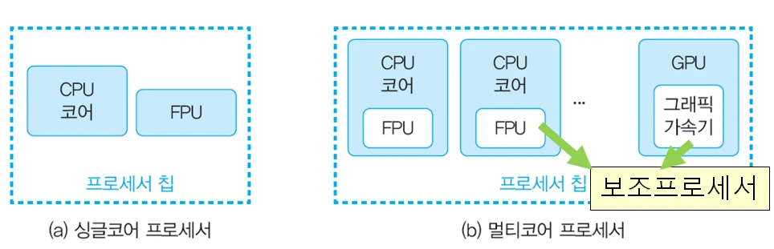

- CPU 코어

    - CPU 고유 기능이 이루어지는 핵심 부분
    - 프로그램 명령을 읽고 실행하는 단위

    - CPU가 단독으로 명령을 실행하는데 필요한 부분

        - CPU의 기본 구성 요소인 연산장치, 레지스터 및 실행과 관련된 제어장치들을 포함

## 3. 레지스터

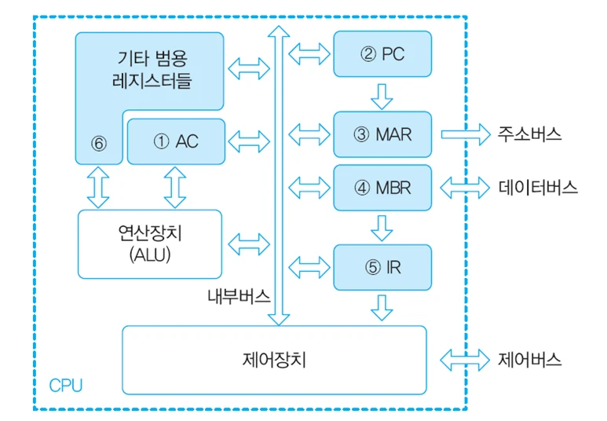

1. Accumulator(AC) 혹은 누산기

    - 연산에 가장 빈번하게 사용, 데이터를 일시 저장하는 역할
    - 연산 결과가 다시 자신에게 누적(accumulation)
    - 한정된 범용 레지스터의 사용 개수를 줄임

    ex) AC ← B + C 대신 AC ← AC + B 사용 가능

    - 레지스터 관련 데이터가 보관된다.

    ⇒ ALU가 연산하는 과정에서 임시적으로 데이터를 저장하는 역할

    - 더하기, 곱하기, Shift 등의 결과를 주 기억장치에 저장하는 것은 굉장히 느리기 때문에 중간 연산 결과를 저장하는 임시 레지스터의 역할을 함. AC는 ALU와 직접적인 버스로 연결되어 있기 때문에 데이터를 주고받는 속도가 매우 빠름. 연산 과정에서 생기는 중간 값들은 모두 AC에 저장이 되고, 최종 연산이 끝나면 주 기억장치로 이동하게 된다.

2. 프로그램 카운터(Program Counter, PC)

    - 다음에 인출해 올 명령어의 주소를 저장한다. 즉, 다음에 fetch해 올 데이터의 주소를 보관하는 역할이다. (Processor 내부에도 레지스터가 할당된 부분이 있어서, 다음 Running 때 실행될 위치를 기억하게 된다.)

3. 메모리 주소 레지스터(Memory Address Register, MAR)

    - 주소 버스로 주소를 출력하기 전에 임시로 저장, 메모리 주소를 저장하여 메모리 접근에 사용되는 역할을 함

4. 메모리 버퍼 레지스터(Memory Buffer Register, MBR)

    - 데이터 버스로 데이터를 읽고 쓸 때 임시로 저장, 메모리에서 읽은 데이터를 임시로 저장하는 레지스터의 역할을 함

5. 명령 레지스터(Instruction Register, IR)

    - 가장 최근에 인출된 명령어를 저장
    - CPU의 fetch cycle에 따라 PC가 지정하는 Main Memory(RAM)의 주소에 있는 Instruction을 IR로 옮기면 다음 Execution Cycle에 명령어 해독기에 의해 IR에 있는 명령어가 해독된다.

6. 기타 범용 레지스터들

    - 연산 도중에 일시적인 기억장소로 사용

<!-- -->

- 실제 프로세서는 훨씬 많은 레지스터를 사용

    - 각 레지스터에 붙이는 명칭들도 제조사마다 다름

    - 범용 레지스터 ⇒ 용도에 따라 다양한 이름이 붙는다

        - Accumulator : 데이터를 주로 저장
        - Pointer : 데이터의 주소를 저장(간접주소, 직접주소)
        - Counter : 데이터의 개수를 저장
