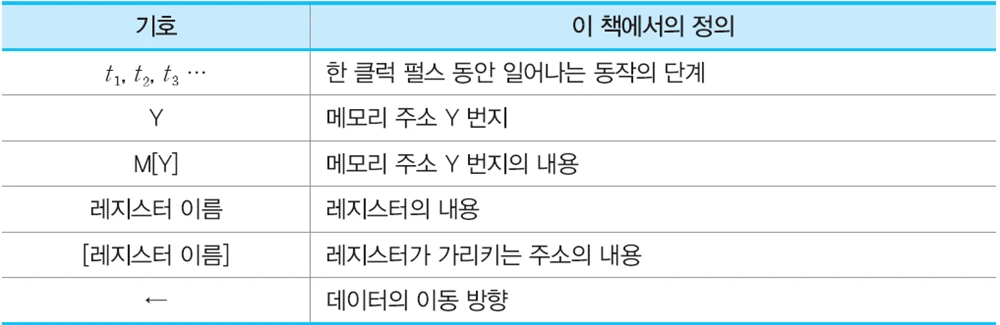
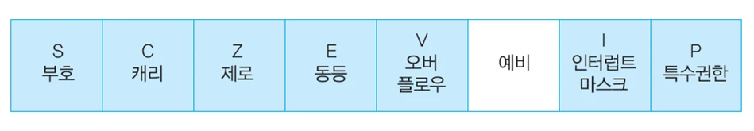
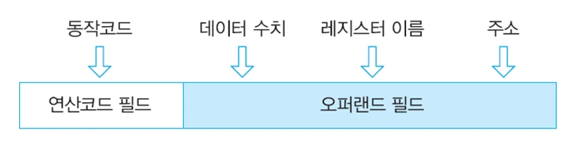
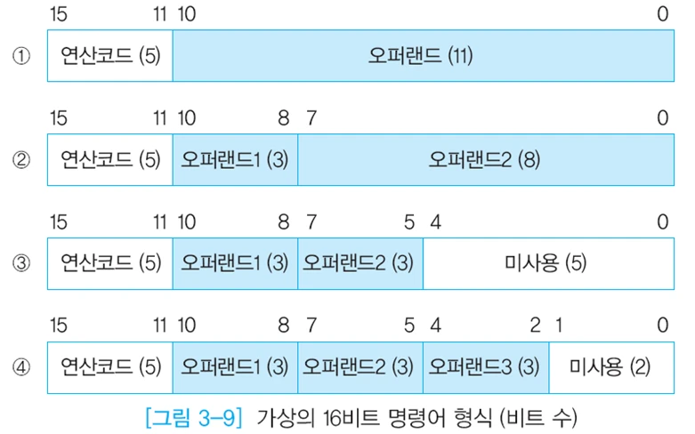
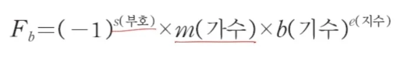
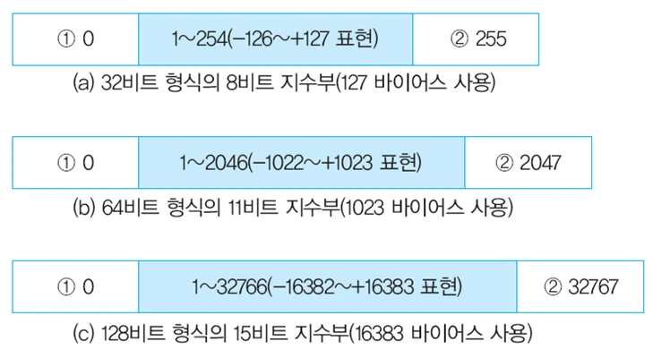
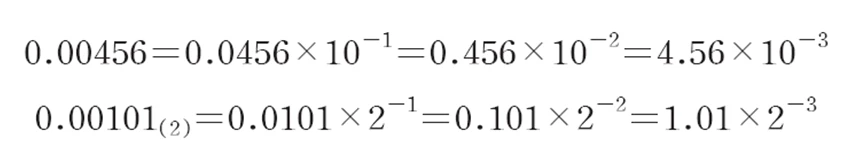
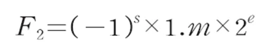
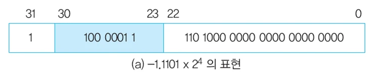
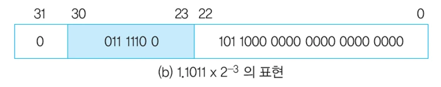

# 3주차: 연산장치, CPU 명령어

- 마이크로 연산

    - CPU에서 한 클럭 펄스 동안에 일어나는 세부 동작

        - 주로 레지스터 간 이루어지는 낮은 수준의 기본 동작

    - 대부분의 기계어는 매크로(macro) 명령어

        - 여러 개의 마이크로 연산이 합쳐진 형태
        - 여러 개의 클럭 펄스가 필요
        - 마이크로(micro) 형태로 세분화시킨 여러 개의 마이크로 연산이 단계 별로 수행

        ⇒ 즉, CPU 연산은 대체로 매크로 명령어로 수행되는데 매크로 명령어는 여러 개의 마이크로 연산이 합쳐진 상태라고 볼 수 있다.

- 레지스터 전송 언어(Register Transfer Language, RTL)

    - 레지스터의 동작을 기호로 나타낸 언어

        - 레지스터, 메모리, I/O 장치 간 전송과 연산과정 표시
        - &lt;어셈블리 언어의 중립적인 형태&gt;로 종종 사용

    

## 4. 연산장치

- 연산장치(ALU)

    - 수치 데이터에 대한 산술연산과 이진 데이터에 대한 논리 연산이 이루어지는 부분

    - 연산장치의 일반적인 구성 요소

        - 상태 레지스터(Status Register)

            - 최종 실행된 연산 결과의 상태를 저장

        - 2의 보수화기(2’s complementer)

            - 음수 연산을 위해 2의 보수를 생성

        - 산술연산장치 ⇒ 산술연산의 중간 결과를 Accumulator에 저장함(사칙연산 등)
        - 논리연산장치 ⇒ NOT, AND, OR, XOR 등 논리연산
        - Shift Register ⇒ 비트 열 이동

- ALU의 연산 동작

    - 가상의 어셈블리 명령어 ADD AC, B 정의
    - AC와 다른 범용 레지스터 B에 실린 데이터를 더해 다시 AC로 저장하는 산술 연산  
        ⇒ ALU의 내부장치인 산술연산장치가 사용될 것
    - &lt;어셈블리 명령어 ; 레지스터 전송 언어&gt;로 표시

    - ADD AC, B ; AC ← AC + B

        - 단일버스 구조는 3단계의 마이크로 연산이 필요함

        <!-- -->

        1. TEMP1 ← AC

            - AC의 내용을 임시 레지스터 TEMP1으로 전송

        2. TEMP2 ← B

            - B 레지스터의 내용을 임시 레지스터 TEMP2로 전송

        3. AC ← TEMP1 + TEMP2

            - TEMP1과 TEMP2의 값을 더해 AC로 전송

- 임시 레지스터

    - CPU 내부에서 연산과정을 돕는 임시 대피소

    - CPU 내부가 다중버스 구조면 개수를 줄일 수 있음

        - 동작 단계의 수, 즉, 마이크로 연산의 수를 줄여 실행시간 단축 가능

- 상태 레지스터(Status Register, or Flag Register)

    - 연산 결과에 따른 연산 장치의 상태를 저장하는 역할을 한다.

        - 최종 연산 결과의 상태를 Flag 비트에 저장한다. (On/Off 표현)

    - 조건 분기(branch) 명령들

        - 각 조건 플래그 비트의 상태에 따라 분기

    

    - 플래그 비트 설계 방법

        - 부호 : 0이면 양수, 1이면 음수  
            ⇒ 최종 실행된 산술연산 결과 값의 부호 비트 저장
        - 캐리 : 자리 올림수, 빌림수 발생하면 세트
        - 제로 : 연산결과가 0이면 세트
        - 동등 : 두 수 비교한 결과가 같으면 세트
        - 오버플로우 : 자릿수가 넘치면 세트
        - 인터럽트 마스크 : 인터럽트를 enable 하려면 0, 불가능이면 1로 설정
        - 특수권한 : 관리자 모드면 Set

## 5. CPU 명령어

- 명령어 세트

    - 특정 CPU를 위해 정의되는 명령어들의 리스트나 집합

    - 명령어 세트 구조(Instruction Set Architecture)를 ISA라고 한다.

        - CPU 명령어 세트는 컴퓨터 구조의 일부

    - CPU 명령어 세트를 설계할 때 고려 사항

        - 명령어 형식 : 연산코드와 오퍼랜드 필드의 비트 수
        - 주소 지정 방식(Addressing Modes) : 실제 피연산자를 찾아내는 방법(직접 vs 간접)  
            ⇒ 데이터를 꺼내올 때 주소로 접근을 해야하는데, 이 주소를 지정하는 방식을 어떻게 설정할 것인가 등을 다루는 내용
        - 연산의 종류 : 목적에 따라 실행할 연산의 종류
        - 데이터 타입 : 정수, 부동소수점 표현 방식과 비트 수

- 명령어 종류(ISA)

    - 산술연산 명령

        - 부호와 정수, 부동소수점 등을 고려
        - 사칙연산을 기본으로 하는 다양한 산술연산

    - 논리연산 명령

        - 비트 연산 등 각 데이터 단위 간 연산 고려
        - NOT, AND, OR, XOR 등을 기본으로한 다양한 논리 연산

    - 데이터 처리 및 메모리 연산 명령

        - 데이터의 입출력, 로드, 저장을 실행
        - 레지스터, 메모리와 I/O 장치 간의 데이터 전송 고려

    - 흐름제어 연산(Control Flow Operation) 명령

        - 프로그램의 실행순서를 바꾸는 명령을 실행  
        - 분기, 서브루틴 호출, 메인 프로그램으로 복귀 등 고려

- 명령어 형식

    - CPU의 명령어 형식(instruction format)

        - 명령어를 구성하는 비트를 여러 개의 필드로 나누어 정의한 것

            - 연산코드 필드와 오퍼랜드 필드가 대표적

        - 필드

            - 특정 데이터를 저장하도록 지정해 놓은 영

        

    - 연산코드(opcode)

        - 연산의 동작을 지정
        - 연산기호, 연산의 종류와 방법을 나타내는 동작코드

    - 오퍼랜드(operand), 피연산자

        - 연산에 필요한 대상이나 위치를 표시
        - 연산의 대상

- 명령어 형식의 설계

    - 한 명령어 안에 여러 개의 오퍼랜드 필드가 가능

    1) : 1-주소

    2) 3) : 2-주소

    4) : 3-주소 명령어 

    

    - 연산코드 n비트 : 최대 2\^n가지의 연산 종류 지정

    - 오퍼랜드 n비트 : 최대 2\^n개의 주소 지정 또는 2의 보수로 -2\^(n-1)\~(2\^(n-1)-1) 범위의 데이터 수치 표시 가능 (최대 주소 지정 범위는 2\^n개이며, 데이터의 수치가 위와 같다.)

        - 오퍼랜드 11비트

            - 2\^11=2048 개의 주소를 지정하거나
            - 2의 보수 -1024\~1023 범위 데이터 수치 표시

        - 오퍼랜드 1의 3비트, 오퍼랜드 2의 8비트

            - 2\^3=8개의 레지스터 지정(결국 주소를 지정하는 것이고, 레지스터 하나당 하나의 주소를 갖기 때문에 최대 8개의 레지스터를 나타낼 수 있다는 것으로 해석되는 듯 함.)
            - 2\^8=256개 주소나 2의 보수 -128\~127 범위 수치 표시

        - 오퍼랜드 1, 2 ⇒ 2개 레지스터 지정

        - 오퍼랜드 1, 2, 3 ⇒ 3개 레지스터 지정

- 명령어의 설계

    - 산술연산 ADD, Accumulator AC, 범용레지스터 B, C, D

    &lt;Assembly ; RTL(Register Transfer Language)&gt;

    1. ADD [Y] ; AC ← AC + AC + M[Y]

        - AC와 메모리 Y 번지의 내용을 더해 다시 AC에 저장한다.

    2. ADD B, [Y] ; B ← B + M[Y]

        - B 레지스터와 메모리 Y 번지 내용을 더해 다시 B에 저장한다.

    3. ADD B, C ; B ← B + C

        - B, C 레지스터 내용을 더해 다시 B 레지스터에 저장

    4. ADD B, C, D ; B ← C + D

        - C, D 레지스터 내용을 더해 B 레지스터에 저장

- 주소지정 방식(Addressing mode)

    - 명령어 형식에 포함된 오퍼랜드 필드에서 실제 피연산자를 찾아내는 방법

        - 연산의 대상인 실제 피연산자 위치를 다양하게 지정

    - 명령어 길이의 비트 수 제약에서 벗어나 더 큰 기억 용량이나 더 큰 단위의 데이터를 처리  
        ⇒ 더 큰 데이터가 존재하는 저장 장소를 주소로 가리킴으로써 더 큰 양의 데이터를 처리할 수 있도록 하는 방식이다.

    - 유효주소와 간접주소의 개념

        - 유효주소(effective address) : 실제 오퍼랜드의 주소, 즉, 실제 피연산자가 저장된 메모리의 위치를 말한다.
        - 간접주소 : 유효주소가 저장된 메모리 위치 (일종의 더블 포인터로 보인다)

- 주소지정 방식의 종류

    - 암시적(implied) 주소지정 방식

        - 오퍼랜드 없이 연산코드(opcode) 자신만으로 특정 레지스터의 동작을 암시, AC의 비트 증가, 감소, 반전(complement) 같은 연산
        - ex) INC ; AC ← AC + 1

    - 즉시(immediate) 주소지정 방식

        - 명령어 형식의 오퍼랜드 필드에 &lt;즉시 사용할 수 있는 데이터 수치&gt;로 실제 피연산자가 들어 있는 방식이다. (메모리에 접근하는 방식으로 오퍼랜드를 가져오는 것이 아니라 오퍼랜드에 값 자체가 들어있는 방식)
        - ex) ADD B, 90H ; B ← B + 90H

    - 직접(direct) 주소지정 방식

        - 오퍼랜드 필드에 실제 피연산자가 저장된 메모리 위치인 유효주소가 들어있음
        - 유효주소는 실제 오퍼랜드의 주소이며, 실제 피연산자가 저장된 메모리를 말함
        - 즉시와 직접의 차이는 메모리 내의 데이터이냐 아니냐로 차이가 발생함
        - ex) ADD B, [1234H] ; B ← B + M[1234H]

    - 간접(indirect) 주소지정 방식

        - 오퍼랜드 필드에 유효주소가 저장된 메모리 위치인 간접주소가 들어있음

        - ex) ADD B, [ [5678H] ] ; B ← B + M[ M[5678H] ]

            ⇒ 대괄호를 일종의 포인터처럼 받아들여도 된다.

        - 주소지정 방식의 비교

            - 직접 주소지정 방식은 메모리 참조 1회 필요(유효주소를 사용)
            - 간접 주소지정 방식은 메모리 참조 2회 필요(간접주소를 사용)

    - 레지스터 주소지정 방식

        - 오퍼랜드 필드에서 지정한 레지스터에 실제 피연산자가 존재하는 방식
        - ex) ADD B, C ; B ← B + C

    - 레지스터 간접 주소지정 방식

        - 오퍼랜드 필드에서 지정한 레지스터에 유효주소 저장
        - ADD B, [C] ; B ← B + M[C]
        - 암시적, 즉시, 레지스터 주소지정 방식은 피연산자가 CPU 내부에 재
        - 레지스터 주소지정 방식은 레지스터의 이름이 유효주소가 되는 셈  
            ⇒ 단, 실제로 포인터처럼 주소로 접근해서 값을 fetching 하는 것은 아님. 레지스터 저장장치 그 자체에 값이 들어있는 것)  
            ⇒ 직접 주소방식의 일종으로 볼 수 있음. 유효주소나 간접주소를 사용하는 방식이 아니고 실제로 저장장치에 들어있는 값 자체를 이용하는 방식이기 때문

        - 레지스터 간접 주소지정 방식과 상대 주소지정 방식, 인덱스 주소지정 방식은 레지스터 이름이 간접주소가 되는셈

            ⇒ 간접 주소지정 방식의 일종으로 볼 수 있음.

    - 상대 주소지정 방식(Relative Addressing Mode)

        - 오퍼랜드 필드에서 지정한 프로그램 카운터 PC에 저장된 주소 값과 변위 값 d를 더해 유효주소를 계산하는 방식
        - PC(Program Counter)는 CPU가 다음에 읽어올 명령이 존재하는 부분의 주소를 저장하는 역할을 한다.
        - ex) ADD B, [PC+d] ; B ← B + M[PC+d]

    - 인덱스 주소지정 방식(Indexed Addressing Mode)

        - 상대 주소지정 방식의 일종, PC 대신 인덱스 레지스터 IX를 별도로 사용하면 배열 연산에 유리함

            - 첫 배열 데이터 주소를 기준으로 변위 값 d를 가변시켜 나머지 배열 데이터의 주소를 연속적으로 지정

        - ex) ADD B, [IX + d] ; B ← B + M[IX + d]
        - 상대 주소지정 방식과 인덱스 주소지정 방식은 레지스터 간의 덧셈 1회이며, 메모리 참조는 1회 필요하다.

- 정수의 산술 연산

    - 2진 데이터의 정수 표현

        - 부호가 없는 양수 : 8비트로 10진수 0\~255 표시
        - 음수도 고려하면 : 첫 비트를 부호(sign) 사용

- 정수의 표현 (8비트 예시)

    - 양수 표현은 같지만 음수 표현은 3가지

        - 부호-크기 영역 표현 : 10진수 -127 \~ +127 표시

            - 부호, 크기 영역 비트로 나누어 양수와 음수 구분
            - 그렇기 때문에 -(2\^(n-1)-1) \~ +(2\^(n-1)-1)이 사용 가능하다.
            - 부호 비트가 0이면 양수, 1이면 음수

        - 1의 보수(1’s complement) 표현 : -127 \~ +127 표시

            - 음수는 양수에서 모든 비트의 1과 0을 반전시킴

        - 2의 보수(2’s complement) 표현 : -128 \~ +127 표시

            - 음수는 1의 보수 표현에 1을 더해 표시

    - 2의 보수를 많이 사용하는 이유 (음수를 하나 더 표현할 수 있음)

        - n비트로 표현 가능한 10진수의 범위

            - 부호-크기 영역, 1의 보수 표현 ⇒ -(2\^(n-1)-1) \~ +(2\^(n-1)-1)

            - 2의 보수 표현 ⇒ -(2\^(n-1)) \~ +(2\^(n-1)-1)

                - ex) 8비트 1000 0000 ⇒ 2의 보수 표현 -128

    > 1의 보수는 +0과 -0이 모두 존재한다. 이와 다르게 2의 보수는 0이 하나만 있으며, 00000000으로 표시된다. 2의 보수는 0을 하나로만 표시하게 되므로, -0의 공간이 남게되기 때문에 음수에서 1의 보수보다 한 가지 수를 더 표현할 수 있게 된다.

    [6. 데이터 표현 - 2의 보수를 사용하는 이유](https://devraphy.tistory.com/282)

- 정수의 표현 예제

    - 2의 보수 1101 0011을 10진수 값으로 변환하는 방법

        - 2의 보수 만드는 방법을 역순으로 시행하거나 아래의 방법 사용

    (부호비트에서 + 하면 값이 나옴)

    1 101 0011(2의 보수) = -128+1x2\^6+1x2\^4+1x2\^1+1x2\^0 

    = -128+64+16+2+1 = -45

    - 컴퓨터는 -연산을 수행하는 것보다 a + (-b)와 같이 음수를 덧셈으로 연산하는 것이 더 효율이 좋기 때문에 이와 같은 방식을 사용하는 것이 좋다.

- 가산기

    - 비트 수 자리만큼의 전가산기(full adder)로 구성
    - 보수화기를 추가해 2의 보수로 표현된 두 수를 더함
    - 보수를 쓰는 이유는 덧셈이나 뺄셈의 방법이 동일해지기 때문   
        ⇒ 덧셈이 뺄셈보다 더 효율적일 수 있음 (A - B → A + (-B))의 개념

    ex) 14 - 32 = (+14) + (-32) = -18

    2의 보수

    - 2진수 계산

    0000 1110 → +14

    1110 0000 → -32

    ---

    1110 1110 → -18 (-128 + 110 = -18)

- 곱셈기와 나눗셈기

    - 보수화기, 시프트 레지스터, 가산기 등으로 구성
    - 곱셈은 덧셈과 뺄셈보다 복잡하며, 나눗셈은 더 복잡하다

    - 반복적인 시프트 동작과 덧셈, 뺄셈 동작

        - 2진수 값을 좌, 우로 1비트 시프트하면 x2와 /2가 된다.

            - 만약 x5를 하고자 한다면, ← 2비트 시프트(4배) 한 뒤에, 기존 숫자를 더해주면 된다.
            - 만약 x7를 하고자 한다면, ← 3비트 시프트(8배) - 1 (기존 숫자 한 번 빼기)

        - 2진수 나눗셈의 결과는 많은 경우에서 무한 순환소수가 발생

            - 비트 수 제한에 따라 근사치로 표현

- 고정소수점과 부동소수점

    - 고정소수점(fixed point) 방식

        - 소수점 위치가 고정되고 정수부와 소수부로 표시
        - 매우 큰 수나 매우 작은 수는 표현하기 불편

    - 부동소수점(floating point) 방식

        - 소수점(point)의 위치를 편리하게 이동(floating)시켜 그 위치를 지수로 나타냄
        - 넓은 범위의 수를 나타낼 수 있어 과학 기술에 적합
        - 연산속도가 느려 대개 별도의 보조프로세서 사용(FPU)

    | 고정소수점 방식 | 부동소수점 방식 | 프로그래밍 방법 |
    |---|---|---|
    | 1230000000000 | 1.23x10\^12 | 1.23e12 |
    | 0.00000000000123 | 1.23x10\^-12 | 1.23e-12 |

- 부동소수점 방식의 표현

    - 실수를 가수부와 지수부로 표현

    - 가수부는 유효숫자로 정수부와 소수부 표시

        - 비트 수 제한으로 참값에 가까운 근사치로 표현

    - 지수부는 소수점의 위치를 고정

        - 프로그램 소스에서 지수를 표시하는 기호는 e나 E

- 유효숫자(significant figure)

    - 근삿값을 나타낼 때 자릿수를 나타내는 숫자 0을 제외한 나머지 신뢰할 수 있는 숫자  
        (즉, 그냥 사용 가능한 수를 말함)

        - 10진수에서 유효숫자 1\~9
        - 2진수에서 유효숫자 1

- 일반적인 부동소수점의 수식 표현

    

    - 부호(sign) s

        - 1이나 0으로 부호를 표시

    - 가수(mantissa) m

        - 유효숫자인 (정수).(소수)로 구성

    - 지수(exponent) e

    - 기수(base) b

        - 10진이나 2진으로 수의 진법을 표시

- IEEE 754 표준 2진 부동소수점 형식

    - 미국전기전자공학회(IEEE)에서 채택
    - 큰 수의 표현 범위를 늘리고 작은 수의 정밀도를 높이려면 비트 수를 늘려야 함  
        ⇒ 부동소수점 표현 자체가 approximate한 값이다. 정밀도를 높여서 더 자세하게 표현하려면 사용되는 비트 수를 늘리는 방법으로 얻을 수 있다.

- 지수 바이어스(exponent bias)

    - 2진 부동소수점 형식에서 지수에 일정기준 값을 더해 지수부를 부호가 필요 없는 영역으로 옮겨 저장

        - 부호를 갖는 지수를 2의 보수로 표현하면 두 수의 크기를 비교하기 어렵기 때문
        - 바이어스된 지수, 바이어싱 작업이라고도 한다.

    - IEEE 754 표준에서 지수부 값

        - 지수부가 k비트 ⇒ (2\^(k-1)-1) 바이어스된 지수로 저장

        - ex) 지수부가 8비트인 32비트 형식

            - 127 바이어스된 지수로 저장

            - 2의 보수로 표현된 기존의 지수에 10진수의 127에 해당하는 2진수 0111 1111을 더해서 지수부에 저장

                

- IEEE 754 표준에서 지수부 값

    - 지수부 값 1), 2)의 특수한 의미

        - 1) 제일 작은 값 0

            - 부호 비트가 0일 때 0, 1일 때 -0 표시
            - 부호 비트를 고려하지 않으면 ⇒ 표현할 수 있는 가장 작은 수보다 더 작은 0이 아닌 수를 말함(subnormal number)

        - 2) 제일 큰 값

            - 부호 비트가 0일 때 inf, 1일 때 -inf 표시
            - 부호 비트를 고려하지 않으면 ⇒ 숫자로 표현할 수 없는 유효하지 않은 연산 결과를 말함(not a number, NaN)

- 정규화(normalized) 형식

    - 부동소수점 수식 표현은 같은 수라도 소수점 위치에 따라 여러 가지로 표현되므로 혼동됨

이런 혼란을 피하기 위해 통일된 표준 형식을 사용

IEEE 754 표준의 2진 부동소수점 형식은 소수점 앞에 정수부로 항상 1이 오도록 정규화했음

- IEEE 754 표준 부동소수점 형식

    

    - 정수부를 1로 정규화
    - 모든 비트가 0일 경우 0으로 정의

    - 컴퓨터에 저장할 때

        - 첫 칸은 부호 비트

        - 가수부에서 소수점 오른쪽의 소수부만 저장

            - 소수점 앞의 정수부는 항상 1이므로 생략 가능 (효율성 증가)

        - k비트 지수부에 저장되는 값은 e + (2\^(k-1)-1)

            - (2\^(k-1)-1) 바이어스된 지수를 표현
            - 진법을 나타내는 2는 생략

**32비트 2진 부동소수점 형식 예제**

1. -1.1101x2\^4을 IEEE 754 표준의 32비트 2진 부동소수점 형식으로 저장하고, 이를 16진수로 표현하라.

    - 음수이므로 부호 비트에 1
    - 지수부는 4에 127 바이어스를 더해 4+127 = 131 또는 0000 0100  0111 1111에서  
        1000 0011
    - 가수부는 소수점 오른쪽의 1101이 맨 앞에 옴
    - 16진수로 표현하면 0xC1E80000

    

    ⇒ 2진 표현이므로, 2를 나타내는 데이터는 추가로 없음.  
    ⇒ 바이어스를 지수부에 더할 경우, 부호를 신경쓰지 않아도 되기 때문에 8번 비트가 1이되어도 문제가 되지 않음. 이 방식으로 지수부의 부호를 제거  
    ⇒ 32비트 2진 부동소수점의 표현에서 가수부의 정수부는 항상 1이 되도록 규칙으로 정해져 있으므로 가수부의 소수부만 고려하면 됨

2. 1.1011x2\^(-3)을 IEEE 754 표준의 32비트 2진 부동소수점 형식으로 저장하고, 이를 16진수로 표현하라.

    - 양수이므로 부호 비트에 0
    - 지수부는 -3에 127 바이어스를 더해 -3+127 = 124 또는 1111 1101 + 0111 1111에서  
        0111 1100
    - 가수부는 소수점 오른쪽의 1011이 맨 앞에 옴
    - 16진수로 표현하면 0x3E580000

    

<!-- -->

- 논리 및 시프트 연산

    - ALU 장치의 논리 연산

        - 논리연산은 컴퓨터 워드가 서로 대응하는 비트 위치 끼리, 주로 비트 단위로 데이터 연산

            - cf) 산술연산은 주로 비트의 묶음인 컴퓨터 워드 단위로 데이터 연산

        - 기본적인 논리연산 NOT, AND, OR, XOR을 이용

            - 다양한 논리연산에 응용 가능

        - 시프트 레지스터를 이용한 비트 열 이동으로

            - 다양한 시프트 연산을 수행

    - 마스크 연산

        - AND 연산으로 원하는 위치의 비트만 통과

    - 선택적 세트(selective set) 연산

        - OR 연산으로 원하는 위치의 비트만 1로 세트
