# 4주차: Languages and Strings, Finite State Machine

작성일 2023-04-05 · 최종 수정일 2023-04-22
{ .post-date }

## Languages and Strings

- Language Recognition : 다양한 문제의 집합을 해석하는데 사용할 프레임워크

Language(언어)란? 유한한 집합의 알파벳의 연속으로 구성된 유한(혹은 무한)한 길이의 문자열을 말한다. 

- String : 알파벳의 연속으로 만들어지는 유한한 sequence, 비어있을 수도 있음.
- ε : empty string
- Σ\* : 알파벳의 연속으로 만들어질 수 있는 모든 경우의 string을 말함.  
    ⇒ 여기서 \*는 Kleene Star (클레이니 스타)

- Counting

    - |s| : is the number of symbols in string S.
    - \#c(s) : is the number of times that c occurs in string S.

- Concatenation : st (or s || t) is the concatenation of s and t.

    - if x = good and y = bye, then xy = goodbye
    - Note that |xy| = |x| + |y|
    - ε is empty string, which is the identity for concatenation of strings

    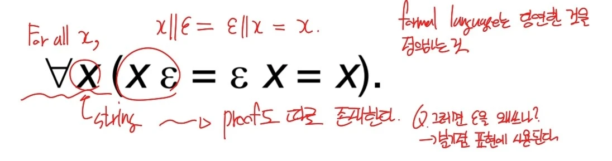

    즉, 모든 string에 대하여 ε이 concatenation되어 있다고 생각할 수 있다. 이는 어떻게 보면 필요하지 않은 것이라고 생각할 수도 있는데, ε을 통해서 분기를 표현할 수 있기 때문에 사용된다.

    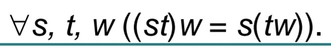

    - Concatenation is associative ⇒ 결합법칙 적용이 가능하다.

- Replication : For each string w and each natural number i, the string w\^i is :

    $$
    w^i = ε
    $$

    $$
    w^{i+1} = w^i || w
    $$

- Reversal : For each string w, w\^R is defined as …

    - if |w| = 0 then: (counting is 0)

    $$
    w^R = w = ε
    $$

    - if |w| ≥ 1 then: (counting is not 0)

    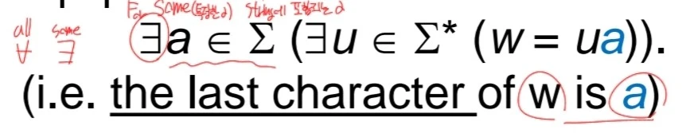

    So, define

    $$
    w^R = au^R = a || u^R
    $$

    즉, w = au 이고, w\^R = (ua)\^R 인데, R 제곱을 적용하면 a\^R || u\^R이 된다. a의 경우는 기존의 w에서 맨 마지막 character를 의미하므로 Reversal이 의미가 없다. u의 경우는 맨 마지막 character를 제외한 전체 string을 말하므로, Reversal이 적용되고, 위치가 바뀐다.

    ex) (nametag)\^R = (tag)\^R || (name)\^R = gateman

- substring : A string **s** is substring of a string **t** iff(if and only if, 필요충분조건) **s** occurs contiguously as a part of **t**

    ⇒ 즉, string s가 string t의 일부로 나타난다면 substring이라고 볼 수 있다.

- proper substring : A string **s** is a proper substring of a string **t** iff **s** is a substring of **t** and **s** ≠ **t**

    ⇒ 즉, 자기 자신은 proper substring이 아니다.

    ε is a substring of every string

- The Prefix Relations

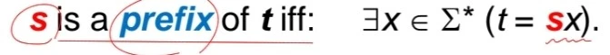

⇒ 즉, 가능한 모든 경우의 string x에 대하여, t = sx이면, t는 s의 prefix이다.

- proper prefix : **s** is a proper prefix of **t** iff : **s** is a prefix of t and **s** ≠ **t**

    ⇒ Every string is a prefix of itself.

    ε is a prefix of every string.

- The Suffix Relations

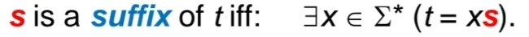

⇒ 즉, 가능한 모든 경우의 string x에 대하여, t = xs이면, t는 s의 suffix이다.

- proper suffix : s is a suffix of t and s ≠ t

    ⇒ Every string is a suffix of itself.

    ε is a suffix of every string.

- Defining a Language

    - A language is a (finite or infinite) set of string over a finite alphabet ∑

    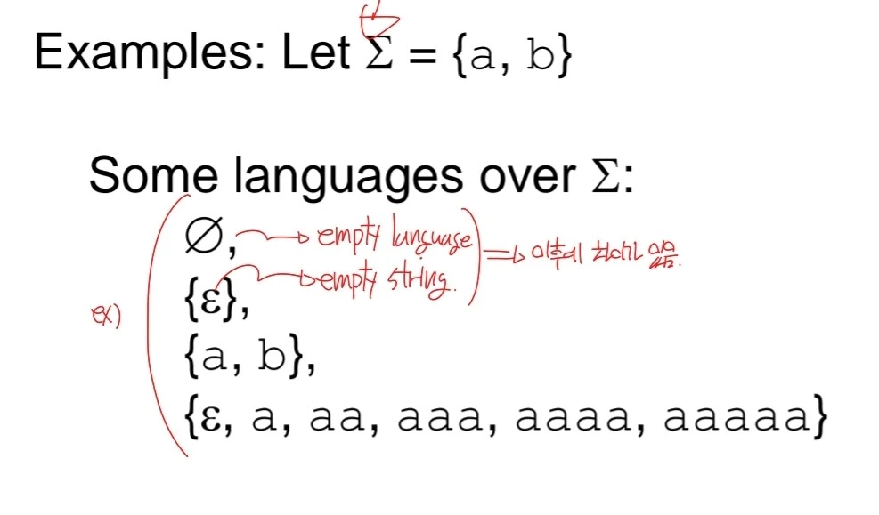

- The empty language

    - The empty Language
    - Let L = {} = ⌀

    L is the language that contains no strings, so it is empty string

    - The empty language is different from the empty string
    - Let L = {ε},

    The language that contains a single string, ε.  
    Note that L is different from ⌀

- Kleene Star

    - Let L be a language defined over some alphabet ∑. Then the Kleene star of L, L\* is:

    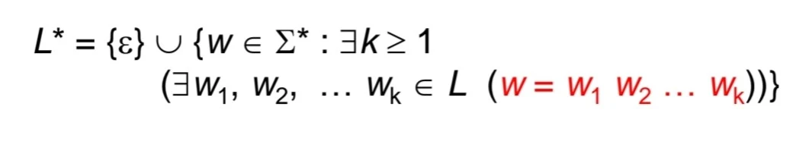

    ⇒ 즉, Kleene Star가 붙으면 무한 반복이라고 생각하면 됨

    Example:

    L = {dog, cat, fish}

    L\* = {ε, dog, cat, fish, dogdog, dogcat, fishcatfish, fishdogdogfishcat, …}

    ⇒ L의 요소가 single character일 수도 있지만, 이와 같이 string이 들어올 수도 있음.

## Finite State Machines

FSM은 Regular Expression을 입력으로 받는 머신이고, Finite State Machine에서 Accepts 되면 Regular Language로 바뀌게 된다.

- A Finite State Machine (FSM)

    - input으로 string을 받으며, output으로 Accept 또는 Reject를 출력하는 계산 장치
    - 공식적으로, a deterministic FSM (or DFSM) M은 다섯 개의 요소를 갖는다.

    M = (K, ∑, δ, s, A) ⇒ s는 initial state

    - **K** is a finite set of states
    - **∑** is an alphabet
    - **s** is the initial state that is included in K
    - **A** is the set of accepting states (Regular Language가 되는 경우)
    - **δ** is the transition function from (**K**(state) x **∑**(input symbol)) to **K**  
        ⇒ 즉, 천이 함수를 의미함. input이 하나 들어왔을 때 다른 상태로 이동하게 만들어주는 함수
    - String w가 M에 들어갔을 때, 끝까지 읽고나서 ε이 남게 되고, 이렇게 됐을 때 현재 위치한 state가 A에 속해있다면 Accept라고 판단한다. 그리고 M에 의해서 accept된 Language를 L(M)이라고 표시한다.

    - configuration

        configuration은 주어진 input string에서 글자 하나하나를 의미한다.

        - The initial configuration of a DFSM M, on input w, is:

        (S(M), W) ⇒ S is initial state

    - yields-in-one-step relation written |-M

    M이 configuration1에서 configuration2로 한 스텝만으로 이동할 수 있을 때, configuration1과 configuration2과 연관된다.

    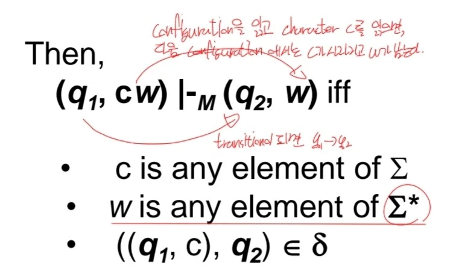

    - The yields Relations

        - yields (|-M\*) : 천이 과정을 함축해서 표현하는 방법, 즉, 한 개 이상의 transition을 거쳐서 configuration C1 → configuration C2로 갈 수 있다면, C1 |-M\* C2 라고 표현할 수 있다.

    - Computations Using FSMs

        - A computation by M is a finite sequence of configurations C0, C1, …, Cn for some n≥0

        such that:

        - C0 is an initial configuration
        - Cn is of the form (q, ε) ⇒ 현재 q state에 위치하며, 더 이상 읽을 것이 없는 상태. 이 때, q는 machine M이 갖는 상태 K의 원소이다. [ q ∈ K(M) ]

        C0 |-M C1 |-M C2 |-M … |-M Cn 

- Accepting and Rejecting

    A DFSM M accepts a string w iff:

    - (s, w) |-M\* (q, ε), for some q ∈ A  
        ⇒ 즉, initial state가 s, 그 상태의 string input이 w인 machine이 있다고 할 때, yields를 거치고 난 state인 q가 A(accepting states)의 원소라고 한다면 Accept 라고 한다.

    A DFSM M rejects a string w iff:

    - (s, w) |-M\* (q, ε), for some q ∉ A  
        ⇒ 이 경우, reject 되었다고 한다.
    - The language accepted by M, denoted L(M), is the set of all strings accepted by M.
    - Theorem : 모든 DFSM M에 대하여, input s가 있을 때 |s| step을 거치게 된다.

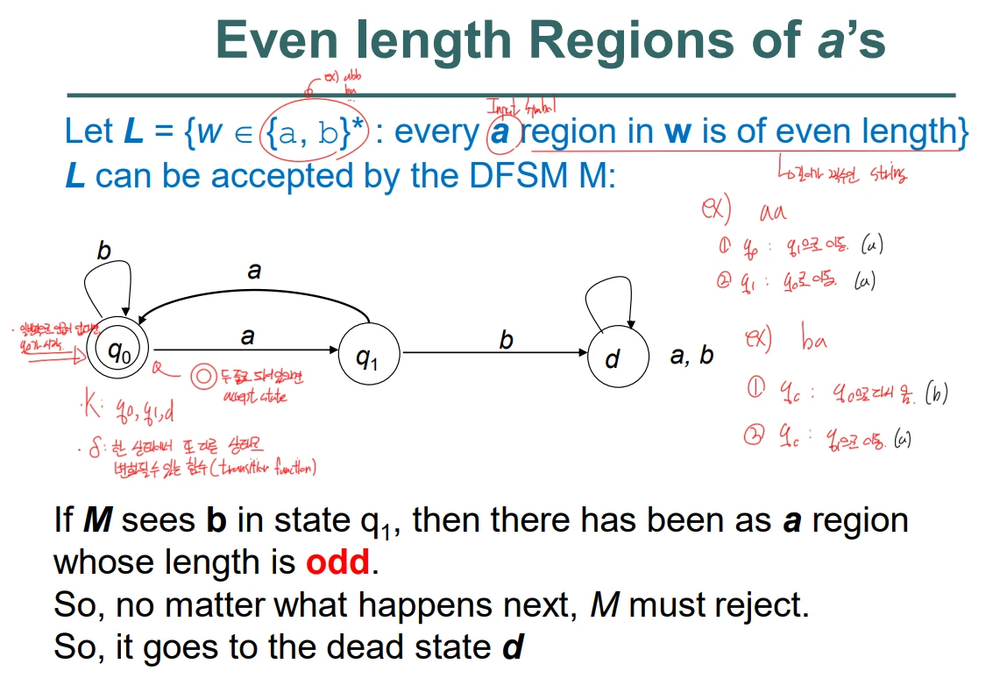

- Regular Languages

    - A language is regular iff it is accepted by some FSM

- Definition of NDFSM

    - input으로 string을 받으며, output으로 Accept 또는 Reject를 출력하는 계산 장치
    - 공식적으로, a deterministic FSM (or DFSM) M은 다섯 개의 요소를 갖는다.

    M = (K, ∑, Δ, s, A) ⇒ s는 initial state

    - **K** is a finite set of states
    - **∑** is an alphabet
    - **s** is the initial state that is included in K
    - **A** is the set of accepting states (Regular Language가 되는 경우)

    - **Δ** is the transition function from (**K**(state) x **∑**(input symbol)) to **K**  
        It is a finite subset of

        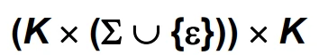

    - DFSM은 매 configuration마다 확실하게 transition되는 state가 정해져 있었다.
    - 하지만, NDFSM은 경쟁적인 transition이 존재하기 때문에 매 configuration마다 가는 경로가 달라질 수도 있으며, 심지어는 transition이 불가능할 수도 있다.
    - NDFSM에서는 glue라는 개념이 도입되는데, glue란, 모든 string에 ε이 concatenation되어 있다는 것을 이용해 최초에 분기를 나눠버리는 것을 말한다. 이를 ε-transition이라고 한다.

- Analyzing NDFSMs : Dealing with **ε** Transitions

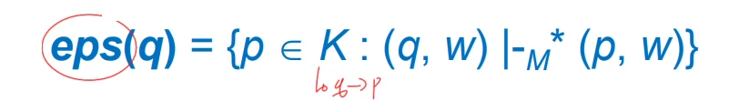

- An algorithm to Compute eps(q)

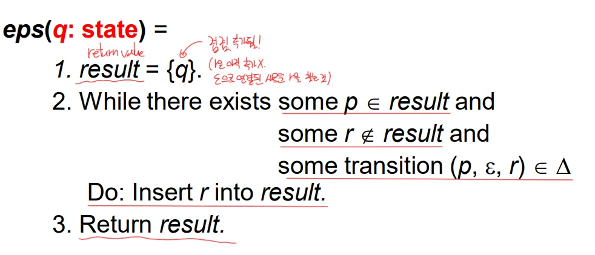

최초의 시작이 state q라고 한다면, result에는 q가 들어간다. 이후에 계속 transition을 진행하면서, unique한 최초의 transition r이 찾아진다면, r을 result에 넣는다. 할 수 있는 모든 transition이 진행된 후, result를 반환하는 것이 eps이다. 중요한 것은, eps의 정의는 string w가 변하지 않고 yields가 진행되는 것이므로 **ε**에 대해서만 transition이 일어나는 것이다. (즉, glue를 찾아가는 것)
