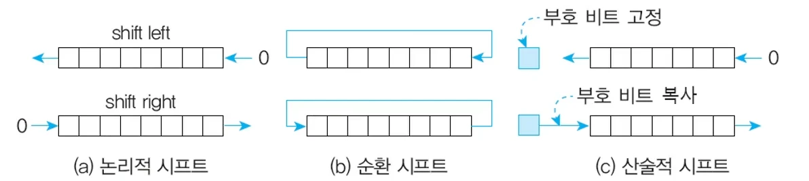
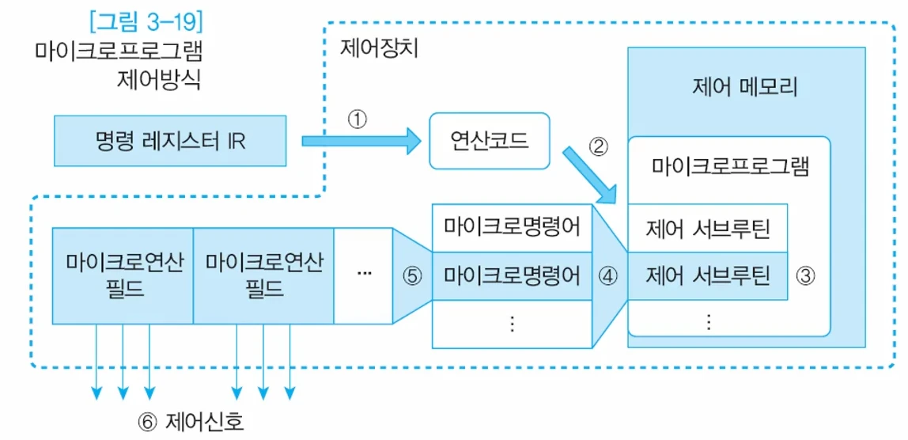
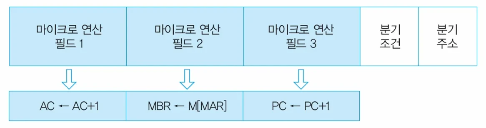
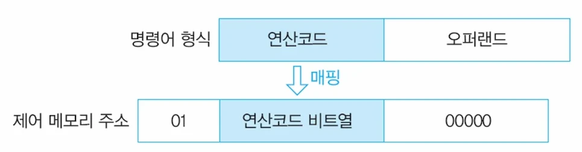
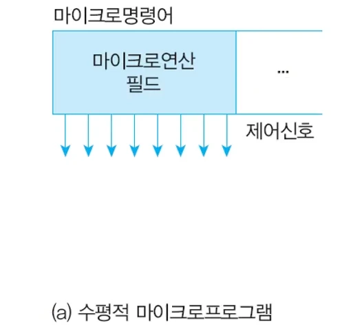
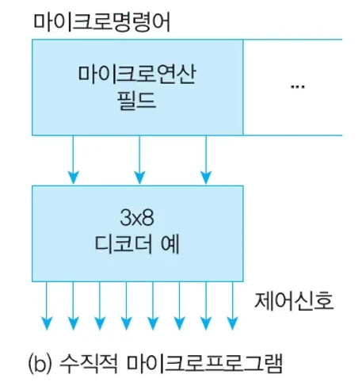
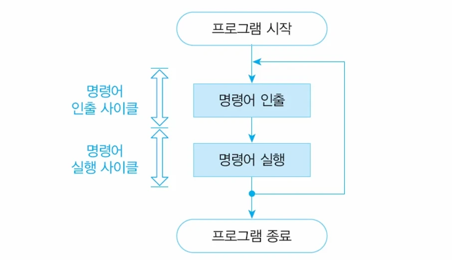
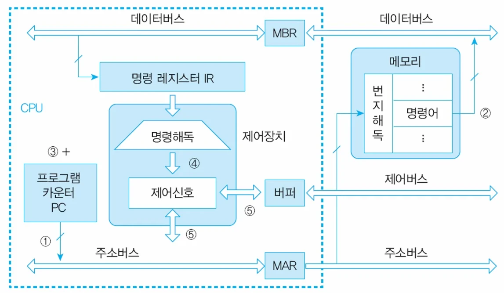
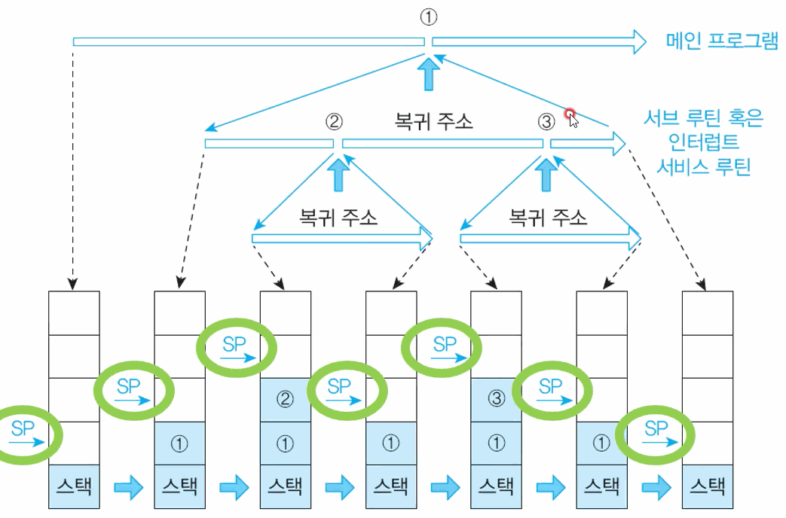

# 5주차: 논리연산 응용, 제어장치, 명령어 사이클

#### 논리연산의 응용

- 삽입 연산

    - AND로 원하는 값을 가져오는 것

- 비교(compare) 연산

    - XOR을 이용해 다른 값을 갖는 위치의 비트만 1로 찾아낸다. (XOR는 값이 다르면 1)

- 선택적 보수(selective complement) 연산

    - XOR 연산으로 원하는 위치의 비트만 1의 보수로 만든다.

- 시프트 연산

    - 논리적 시프트(logical shift) 연산

        - 부호를 고려하지 않음
        - 시프트 레지스터 비트들이 좌우로 1비트씩 이동
        - 곱셈이나 나눗셈 등에 적용 (← x2, → /2)

- 순환 시프트 연산(circular shift) 연산

    - 부호를 고려하지 않음
    - 부호 비트를 포함해 시프트 레지스터의 비트들이 좌우로 회전해 다시 반대쪽 입력으로 들어가는 방법
    - 직렬 데이터의 비트 전송 등에 사용된다.

- 산술적 시프트(arithmetic shift) 연산

    - 부호 비트를 제외한 나머지 비트들이 좌우로 이동
    - 2의 보수 표현에서 산술적 우측 시프트는 부호 비트가 우측으로 복사됨  
        (왼쪽일 경우에는 왼쪽으로 복사된다.)

    ⇒ 부호를 고려한 비트의 확장 등에 사용

    작은 비트 수의 데이터 앞자리에 부호 비트를 채워 넣어 큰 비트 수를 갖는 데이터로 만듦

## 제어장치

1. 제어방식
2. 제어장치의 구성
3. 마이크로프로그래밍

#### 1. 제어방식

- 제어장치의 역할

    - 메모리에서 명령어를 인출해 해독하고 명령을 실행하는데 필요한 제어신호를 발생  
        ⇒ (즉, 제어장치라는 것은 컴퓨터가 스케쥴링 등을 수행하고 있을 때, 다음에 수행할 명령어를 메모리에서 가져와야할 때 CPU가 가져오도록 시킬 수 있는 제어신호를 발생하는 것으로 생각할 수 있을듯.)

    - CPU 내외부에 필요한 제어 신호를 때에 맞추어 발생시킴

        - CPU 내부 버스 제어신호(CPU 내부의 다양한 레지스터가 동기적으로 동작할 수 있도록 내부 버스 제어신호를 발생시킴)
        - ALU와 레지스터 연산에 필요한 동작신호
        - CPU 외부 메모리나 I/O 장치에 읽기와 쓰기 신호 등을 보냄

    - 크게 두 가지 설계 방식이 있다.

        - 하드와이어 제어방식
        - 마이크로프로그램 제어방식

- 하드와이어(hardwired) 제어방식

    - 하드웨어만으로 마이크로연산을 수행하도록 구성  
        ⇒ 마이크로연산 : 한 클럭당 수행되는 CPU의 연산을 말한다.

    - 실행속도는 유리하나, 설계 유연성이 떨어진다.

        - 명령어의 종류나 설계를 바꾸려면 하드웨어 부품이나 배선을 재구성해야 하므로 큰 불편함이 따른다.

- 마이크로프로그램(microprogram) 제어방식

    - 제어메모리(일종의 ROM)에 저장된 마이크로 명령어를 찾아 순차적으로 실행, 대부분 이 방식을 사용한다.

    - 유연하고 체계적인 제어장치를 구성

        - 명령어 설계가 바뀌어도 제어메모리에 저장된 프로그램만 변경하면 된다.

- 마이크로프로그램 제어방식의 설계 순서

    1. CPU에 사용할 명령어 종류와 비트 패턴 결정  
    2. 각 명령어 실행에 필요한 하드웨어 구조 설계
    3. 각 명령어를 수행할 제어 서브루틴 마이크로프로그래밍

    ⇒ 마이크로프로그래밍 : 마이크로 프로그램을 작성하는 과정

- 마이크로프로그램 제어방식의 기본 구성 요소

    - 제어 메모리(control memory)

        제어장치 내부의 기억장치, 제어신호의 발생에 필요한 마이크로명령어들이 마이크로 프로그램으로 저장됨.  
        (즉, CPU가 사용하는 명령어는 ISA이고 이 ISA를 처리하기 위해 필요한 연산과정을 일으키기 위해 필요한 것이 제어신호이며, 이 제어신호를 발생시키는 것이 마이크로명령어이고, 마이크로명령어는 제어 메모리에 저장되는 것으로 보인다.)

    - 명령 해독기(instruction decoder)

        명령 레지스터 IR에 들어온 명령어를 해독해 연산코드(opcode)가 지시하는 동작을 실행할 제어 서브루틴의 시작 주소를 마이크로프로그램에서 찾아냄

    - 주소 해독기(address decoder)

        명령어의 오퍼랜드에서 유효주소나 간접주소를 찾아 실제 사용할 수 있는 유효주소를 레지스터에 저장(레지스터가 가장 빠르므로 레지스터에 저장)

- 제어장치의 구성

    - 제어신호 발생기

        CPU 내외부의 각 부분에 필요한 제어신호 발

    - 타이밍(timing) 발생회로

        - 제어신호 발생을 위해 정확한 타이밍을 만들어냄
        - CPU 내부 클럭 펄스를 이용

    - 기타 장치들

        - 마이크로명령어를 일시적으로 저장하는 버퍼 레지스터
        - 제어 메모리의 주소를 저장하는 레지스터
        - 마이크로명령어의 실행순서를 결정하는 장치 등

- 제어 서브루틴

    - 기계어 명령어 종류 하나를 처리, 제어신호를 발생시키는 마이크로 명령어들로 구성

    

    **명령어 집합**(: instruction set) 또는 **명령어 집합 구조**(: Instruction set architecture, ISA)는 [마이크로프로세서](https://ko.wikipedia.org/wiki/%EB%A7%88%EC%9D%B4%ED%81%AC%EB%A1%9C%ED%94%84%EB%A1%9C%EC%84%B8%EC%84%9C)가 인식해서 기능을 이해하고 실행할 수 있는 [기계어](https://ko.wikipedia.org/wiki/%EA%B8%B0%EA%B3%84%EC%96%B4) 명령어를 말한다.

    CPU의 명령어의 종류를 ISA(Instructions Set Architecture)라고 하고, 그 명령어의 형식은 연산코드(opcode)와 피연산자(operand)로 이루어진다. 명령어 레지스터 IR에서 명령어가 decode되면 연산코드로 제어장치에 입력된다.

    메모리로부터 코드가 버스를 통해 넘어오면 이것은 우선 프리페치 코드 큐에 쌓이고, 명령어 해독기에 의해 하나씩 해독되어 명령어로 바뀌게 된다. 코드란 매크로 명령어로 보면 되고, 명령어란 이것이 CPU 구조에 밀접하게 독자적인 형태로 바뀐 것을 말한다. 즉, 마이크로 명령어를 의미한다. CPU 연산은 대체로 매크로 명령어로 수행되며, 매크로 명령어는 여러 개의 마이크로 연산이 합쳐진 상태라고 볼 수 있다. (즉, 연산코드는 일종의 매크로이다. 왜냐면 CPU의 명령어 형식은 주로 연산코드 필드와 오퍼랜드 필드로 나눠지며, 할당된 비트 수에 따라 여러 명령어로 매칭될 수 있기 때문이다. 매크로는 여러 개의 마이크로 연산이 합쳐진 상태라고 볼 수 있다.) 마이크로 연산은 하나의 클럭 펄스 동안에 실행되는 기본적인 동작으로서, 예를 들면 시프트, 카운트, 클리어, 로드 등이 있다.

    각 마이크로 연산은 레지스터 전송 언어로 표현될 수 있다.    

    1. 명령 레지스터 IR에 들어온 명령어를 해독해 연산 코드를 구한다.
    2. 연산코드에서 해당 명령에 필요한 제어 서브루틴의 시작 주소를 계산한다.
    3. 제어 메모리의 마이크로프로그램에서 해당 제어 서브루틴을 찾는다.
    4. 제어 서브루틴에서 마이크로명령어를 차례대로 인출한다.
    5. 마이크로 명령어를 해독해 실행할 마이크로 연산의 종류를 결정한다.
    6. 각 마이크로 연산 필드에서 제어신호를 만들어 출력한다.

- 마이크로명령어(마이크로명령어)

    - 제어신호를 만드는 저수준의 제어 명령어 단위 (제어 메모리 내에 존재하는 마이크로프로그램 안에 제어 서브루틴이 존재하며, 각 제어 서브루틴은 마이크로 명령어로 해석될 수 있다.)
    - 마이크로명령어 형식은 여러 개의 마이크로 연산 필드를 포함한다.

    - 마이크로명령어 형식

        

        - 마이크로연산 필드는 필요한 마이크로 연산의 종류를 결정한다.

        - 분기 조건(branch condition)과 분기 주소

            - 유효 주소의 계산처럼, 공통으로 자주 사용하는 동작을 서브루틴으로 만들 때 제어 메모리를 효율적으로 사용

- 제어 서브루틴

    - 특정 명령어의 연산을 수행하기 위해 제어장치에서 연속적으로 수행되어야 할 마이크로명령어들의 조합을 말한다.
    - 각 기계어 명령에 해당하는 제어 서브루틴의 시작번지를 찾아 실행시키면 해당 제어신호가 발생한다.

    - 제어 서브루틴의 시작 주소 계산

        - 명령 레지스터에 저장된 명령어의 연산코드에서 제어 서브루틴의 시작 주소를 직접 매핑하는 것을 말한다.

        

- 마이크로코드(마이크로프로그램)

    - 제어 서브루틴을 모아 제어 메모리 내부에 저장한 것을 말한다.

- 제어신호를 만드는 방법

    - 가장 빠른 방법은 마이크로명령어의 마이크로연산 필드에서 제어 신호를 직접 출력하는 것.

    - 수평적(horizontal) 마이크로프로그램

        - 마이크로연산 필드의 비트를 그대로 이용해 그 비트수만큼 1:1로 대응하도록 제어 신호선을 출력하는 방법

            - 장점 : 하드웨어가 간단해 제어신호 발생시키는 시간이 빠른 반면,
            - 단점 : 비트수가 늘어 제어 메모리를 많이 차지한다.

        

    - 수직적(vertical) 마이크로프로그램

        - 마이크로연산 필드의 비트를 디코더로 해독해 제어 신호선의 개수를 늘리는 방법

            - 장점 : 마이크로명령어의 비트 길이가 줄어 제어 메모리를 적게 차지하는 반면,
            - 단점 : 디코더 회로를 통과하므로 시간이 지연된다.

        

## 제 4장 : 명령어 처리

- CPU 명령어 사이클과 병렬계산

    - 1990’s 말부터 슈퍼 컴퓨터는 수많은 마이크로프로세서를 연결해 대규모 병렬컴퓨터로 설계
    - 병렬 계산을 하지 않는 대부분의 컴퓨터는 1940년대 폰 노이만이 설계한 명령어의 순차 실행을 기반해서 만들어진다.
    - 파이프라인 구조
    - 슈퍼스칼라, SIMD 구조
    - VLIW, 멀티코어 프로세서 구조

<!-- -->

1. CPU 명령어 사이클
2. 병렬계산
3. 파이프라인 구조
4. 슈퍼스칼라 구조
5. VLIW 구조
6. 병렬컴퓨터

## CPU 명령어 사이클

- 명령어 기본 사이클
- 명령어 인출 사이클
- 명령어 실행 사이클
- 간접 사이클
- 서브루틴 호출과 복귀
- 인터럽트 사이클
- CPU 명령어 사이클

- CPU 사이클

    - 일반적으로 명령어의 사이클을 의미한다.
    - CPU 내장 캐시의 액세스 타임 등에서 사이클 개수 ⇒ CPU 클럭 개수

- 명령어 기본 사이클

    - CPU의 명령어 사이클(instruction cycle)

        - 프로그램에서 주어진 명령어를 실행하기 위해 반복적으로 수행해야 하는 일련의 연속적인 동작을 의미함

        - 명령 또는 명령어(instruction)

            - CPU가 동작을 수행하는데 필요한 설명이나 지

    - 명령어 인출(instruction fetch) 사이클

        - CPU가 메모리에서 명령어를 읽어오는 단계

    - 명령어 실행(instruction execution) 사이클

        - CPU가 명령을 수행하는 단계

    

    ⇒ 즉, 명령어 인출 사이클 + 명령어 실행 사이클이 명령어 기본 사이클이다.

- 제어장치와 명령어 사이클

    

    - 명령어 인출 사이클

        1. 명령어가 저장된 주소를 지정  
            (PC에 저장된 주소를 주소버스를 통해 메모리로 전달)
        2. 메모리의 해당 주소에 들어있는 명령어를 꺼내옴  
            (해당 주소에서 명령어를 fetch해서 가져온다.)
        3. 프로그램 카운터에 다음 명령어의 주소를 준비  
            (PC에 다음에 실행할 주소를 저장한다.)

        <!-- -->

        - PC가 가리키는 메모리 주소에서 명령어를 순서대로 인출해 명령 레지스터 IR로 전송

        - 명령어 인출 사이클을 연속된 마이크로 연산으로 표시한다.

            - t1 : MAR ← PC

                - PC에 저장된 명령어 주소를 MAR로 전송

            - t2 : MBR ← M[MAR], PC ← PC + 1

                - MAR번지 메모리의 명령어를 MBR로 전송하고, PC를 증가시켜 다음 명령어의 주소를 준비
                - PC 값 증가는 가변 → 4바이트 명령을 인출하면 PC+4

            - t3 : IR ← MBR

                - 메모리에서 인출해온 명령어를 IR로 전송
                - 이후에는 제어장치 속으로 전송하면서 해독 실행.

    - 명령어 실행 사이클

        1. 명령어를 해독  
            (제어장치에 들어가서 연산코드를 제공하기 전에 decode 실행)
        2. 명령어 실행에 필요한 CPU 내외부 제어신호 발생  
            (제어장치 내에서 연산코드→제어메모리→제어 서브루틴→마이크로프로그램→마이크로필드 연산(RTL)→제어신호 발생 순서로 진행됨)

        <!-- -->

        - 명령 레지스터 IR에 저장된 명령을 해독하고 CPU 내외부에서 명령어 실행에 필요한 제어신호들을 발생

        - &lt;가상&gt;의 어셈블리 명령어 설계

            - 데이터 처리 및 메모리 연산 명령 MOV
            - 산술연산 명령 ADD
            - 흐름제어 연산 명령 JUMP

        - 명령어 실행 사이클을 연속된 마이크로 연산으로 표시

            - 어큐물레이터 AC, 범용 레지스터 B, 프로그램 카운터 PC, 명령의 오퍼랜드 필드에 포함된 유효주소 Y 사용

    - 어셈블리 명령어 MOV 설계

        - MOV B, [Y] ; B ← M[Y]

            - 오퍼랜드에 포함된 메모리 주소 Y번지의 내용을 B 레지스터로 전송

        - 명령어 실행 사이클을 &lt;연속된 마이크로연산&gt;으로 표시

            - t1 : MAR ← Y

                - 메모리 주소 Y를 MAR로 전송

            - t2 : MBR ← M[MAR]

                - MAR 번지 메모리 내용을 MBR로 전송

            - t3 : B ← MBR

                - MBR의 내용을 B 레지스터에 전송

    - 어셈블리 명령어 ADD 설계

        - ADD [Y] ; AC ← AC + M[Y]

            - AC의 내용을 오퍼랜드에 포함된 주소 Y의 내용과 더해 저장

        - 명령어 실행 사이클을 &lt;연속된 마이크로연산&gt;으로 표시

            - t1 : MAR ← Y

                - 메모리 주소 Y를 MAR로 전송

            - t2 : MBR ← M[MAR]

                - MAR 번지 메모리 내용을 MBR로 전송

            - t3 : AC ← AC + MBR

                - AC와 MBR의 합을 구해 다시 AC에 저장

    - 어셈블리 명령어 JUMP 설계

        - JUMP Y

            - 프로그램의 흐름이 오퍼랜드에 포함된 주소 Y로 분기

        - 명령어 실행 사이클을 &lt;마이크로연산&gt;으로 표시

            - t1 : PC ← Y

                - 분기 주소 Y를 PC로 전송

- 유효주소와 간접주소

    - 유효주소 : 실제 피연산자가 저장된 메모리 위치
    - 간접주소 : 유효주소가 저장된 메모리 위치

- 간접 사이클(indirect cycle) ⇒ 실행 사이클의 일부

    - 오퍼랜드 필드에 포함된 간접주소로부터 실제 피연산자가 저장된 위치인 유효주소를 읽어오는 단계를 말한다.

    - 간접 사이클을 &lt;연속된 마이크로연산&gt;으로 표시

        - IR(오퍼랜드) : 명령 레지스터 IR의 오퍼랜드 필드

        - t1 : MAR ← IR(오퍼랜드)

            - 오퍼랜드에 있는 간접주소를 MAR로 전송

        - t2 : MBR ← M[MAR]

            - MAR 번지 메모리 내용인 유효주소를 MBR로 전송

        - t3 : IR(오퍼랜드) ← MBR

            - MBR의 내용을 IR(오퍼랜드)로 전송
            - 명령어의 새로운 오퍼랜드 필드에 유효주소가 준비

- 메모리의 스택(stack) 영역

    - 서브루틴을 호출할 때 메인 프로그램의 위치로 다시 돌아올 복귀 주소를 저장

    - 스택포인터(stack pointer, SP)

        - CPU 레지스터 중 하나이며, 현재 상태에서 이용 가능한 스택 영역의 최종 위치를 표시,
        - 항상 스택 영역의 최상위나 최하위 주소를 가리킴

    - 스택 영역에 내용을 넣거나 꺼낼 때는 SP를 기준

        - 주로 후입 선출(LIFO) 방식

            - 서브루틴이 완료되면, 복귀 주소는 스택 영역에 들어간 역순으로 출력된다.

        

**실습**

- memcpy() 함수는 변수를 메모리에 저장하고 비트를 읽어오는 것으로, 다음 조건 하에서 정상 동작함

    - 인텔 CPU일 것 : 자료형 선언에서 32비트 int, float 등 정수나 실수의 비트 수가 CPU마다 다를 수 있기 때문이다

    - 엔디언 방식이 CPU마다 다를 수 있기 때문

        - 엔디언 : 메모리에 변수를 저장하는 때문(리틀 엔디안과 빅 엔디안)

    - 윈도우 운영체제일 것 : windows.h 헤더 파일에 포함

- 문제1 : 재귀 함수를 이용해 다음과 같이 양의 정수를 10진수에서 2진수로 변환하는 프로그램을 작성하라.

    - 재귀 함수

        - 순환 함수
        - 함수 안에서 다시 자기 자신을 호출하는 함수
        - 메모리가 많이 요구되지만, 반복문 형태를 통해 간단하게 해결된다.

- 문제2 : pow()와 atoi() 함수를 이용해 다음과 같이 양의 10비트 정수를 10진수에서 2진수로 변환하는 프로그램을 작성하라.

    - atoi(아스키 문자열) ⇒ 10글자까지 숫자로 변환
    - pow(x, y)

- 문제3 : memcpy() 함수를 이용해 다음과 같이 2의 보수로 표현되는 32비트 정수를 10진수에서 16진수 및 2진수로 변환되는 프로그램을 작성하라.

    - memcpy() 함수

        - memcpy(도착 주소, 출발 주소, 바이트 수)
        - 메모리에 저장된 변수를 다른 주소에 복사

- 문제4 : memcpy() 함수를 이용해 다음과 같이 2의 보수로 표현되는 8비트 정수를 10진수에서 16진수 및 2진수로 변환되는 프로그램을 작성하라.
- 문제5: pow() 함수를 이용해 다음과 같이 2의 보수로 표현되는 8비트 정수를 2진수에서 10진수로 변환하는 프로그램을 작성하라

- 문제6 : 10진 실수 값을 IEEE 754 표준의 32비트 2진 부동소수점 형식으로 구하는 프로그램을 작성하라.

    - 32비트 형식의 16진수 표현
    - 32비트 형식의 2진수 표현 (4비트씩 끊어 읽기)
    - 부호(1) - 지수(8) - 가수(32) 비트로 구분해 표
