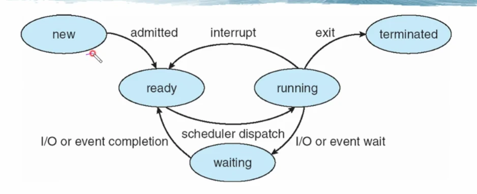
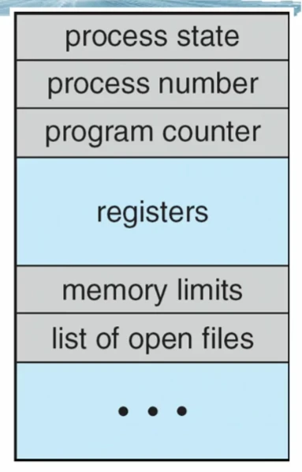
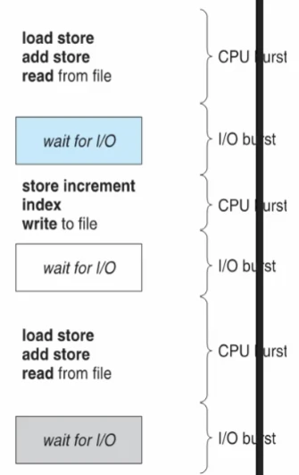
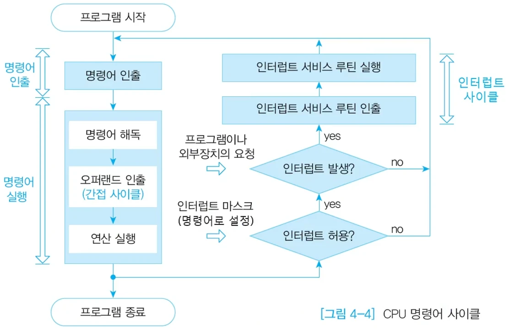
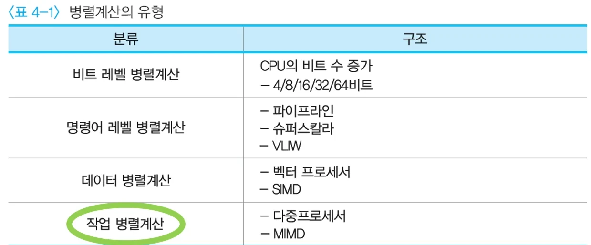
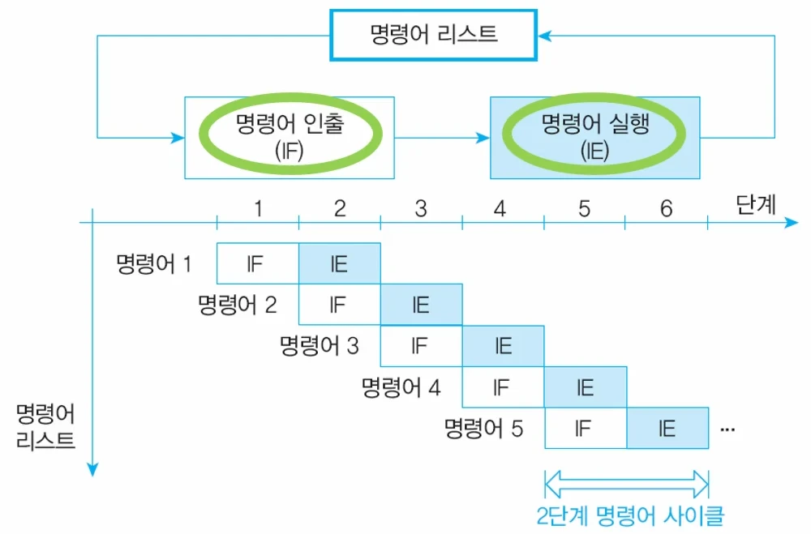

# 6주차: 병렬처리, 명령어 파이프라인

- **서브루틴 호출**과 **복귀**

    - 흐름제어연산 명령 CALL, RETURN

    - 서브루틴 호출과 복귀 명령에 관한 고려사항

        - 스택 영역은 번지가 감소하는 방향으로 늘어나고, 복귀 주소는 메모리 번지 하나를 차지하는 것으로 가정한다.
        - 스택포인터 SP, 프로그램 카운터 PC, 명령어의 오퍼랜드 필드에 포함된 유효주소 Y 사용

- 어셈블리 명령어 CALL 설계

    - CALL Y

        - 메모리 주소 Y 번지에 저장된 서브루틴을 호출

    - 명령어 실행 사이클을 &lt;연속된 마이크로연산&gt;으로 표시

        - t1 : MBR ← PC

            - 메인 프로그램의 복귀 주소인 PC의 내용을 MBR로 전송

        - t2 : MAR ← SP, PC ← Y

            - 스택포인터 SP가 가리키는 주소를 MAR로 전송하고, PC를 Y 번지로 이동시켜 서브루틴의 시작 주소를 준비

        - t3 : M[MAR] ← MBR, SP ← SP-1

            - MBR에 저장된 복귀 주소를 MAR 번지에 저장하고, SP를 감소시켜 다음 저장소의 위치를 준비

- 어셈블리 명령어 RETURN 설계

    - RETURN

        - 서브루틴을 끝내고 메인 프로그램으로 복귀

    - 명령어 실행 사이클을 &lt;연속된 마이크로연산&gt;으로 표시

        - t1 : SP ← SP + 1

            - 메인 프로그램의 복귀 주소가 저장된 스택 위치를 계산

        - t2 : MAR ← SP

            - 현재 스택포인터 SP가 가리키는 주소를 MAR로 전송

        - t3 : PC ← M[MAR]

            - MAR 번지 메모리에 저장된 복귀 주소를 PC로 전송

- 인터럽트(interrupt)

    - 높은 우선 순위를 갖는 이벤트 또는 프로세스를 말하며, 이는 CPU에 즉각적으로 요청을 보낸다. 현재 CPU에서 실행되고 있는 프로세스로부터 실행을 가로챌 수 있으며, 이 과정에서 context switching을 통해 실행되고 있던 프로세스의 정보를 main memory 혹은 HDD 등에 저장한다.

    - 프로그램의 정상 처리순서를 방해하는 서비스 요구

        - 일반적인 서브루틴과 달리, asynchronous하게 CPU에 서비스를 요구한다.

    - CPU 외부장치나 프로그램 요청에 의해 발생

        - 하드웨어 인터럽트 ⇒ 주로 CPU 외부 장치에서 발생
        - 소프트웨어 인터럽트 ⇒ 프로그램 요청으로 발생  
            (응용 프로그램에서 I/O 요청 등)

    - 인터럽트 요구 수용하려면 CPU가 작업을 중단하고

        - 인터럽트 서비스 루틴(ISR), 인터럽트 핸들러 프로그램을 먼저 실행한다.
        - 인터럽트 처리 전에 복귀 주소, CPU 레지스터 상태, 메모리 참조 주소 값 등을 스택에 저장, 처리후 복원한다.

- Process : 실행중인 프로그램을 말한다. 프로세스는 메인 메모리에 위치한 실행 중인 코드와 데이터, 프로그램의 상태(다음에 실행될 코드의 번지수), 모든 범용 레지스터의 값 등을 가지고 있다.

- OS 안에서의 Stack

    - Stack 영역은 컴퓨터의 메모리 영역이며, 각 함수에서 생성된 임시적인 정보, 변수 등을 저장한다.
    - function이 새로운 변수를 선언할 때마다 이는 stack에 push된다. 함수가 종료될 때마다 생성되었던 모든 임시 변수들이 pop되어서 사라진다.

- OS 안에서의 Heap

    - Heap 영역은 컴퓨터의 메모리 영역이며, 자동으로 관리되는 공간이 아니고 CPU에 의해 철저하게 관리되지는 않는, 다소 자유로운 공간이다. C언어의 malloc(), calloc() 등을 통해서 메모리를 할당할 수 있게 된다. 사용이 끝난 변수는 free()를 통해 할당을 해제해 주어야 한다.

- Process State

    - new : 프로세스가 새롭게 생성된 상태
    - running : 요청이 실행되고 있는 상태 (CPU에 올라가서 연산이 수행되고 있는 상태)
    - waiting : 프로세스가 특정 이벤트의 수행을 대기하고 있는 상태
    - ready : 프로세서가 CPU에 배정되기를 기다리고 있는 상태
    - terminated : 프로세스의 수행이 끝난 상태

- Process Control Block(PCB) : 프로세스에 대한 각종 정보를 블록으로 저장하고 있는 메모리 공간, 운영체제가 프로세스 스케줄링을 위해 프로세스에 관한 모든 정보를 갖고 있는 자료구조이다.

- **Process State** : Running, Waiting, etc…
- **Program Counter** : 다음 명령어가 수행될 위치를 저장함
- **CPU registers** : 프로세스 수행에 필요한 레지스터의 값들
- **CPU scheduling information** : 우선 순위, 스케쥴링 큐 포인터 등
- **Memory-management information** : 프로세스에 할당된 메모리의 정보
- **Accounting information** : CPU used, clock time elapsed since start, time limits 등
- **I/O status information** : 프로세스에 할당된 I/O 디바이스들과 파일

- **CPU Burst**

CPU Burst란, 프로세스가 ready가 되기 전까지 CPU를 사용하는 시간을 말한다.

- Long bursts

    - Process is CPU bound

- Short bursts

    - Process I/O bound

- CPU burst 이후에 바로 I/O burst 실행
- 여러 개의 프로세스가 있을 때 프로세스들에게 CPU burst를 분배하는 것이 주된 문제 중 하나로 고려된다.

- Scheduling Criteria

    - **Job(or Process) Scheduler**

        - Queue(Buffer) 안에 들어 있는 Job의 실행 순서, 실행 시간 등을 결정하는 방식

    - **preemptive Scheduling** : 선점형 스케쥴링

        스케쥴링에 있어서 인터럽트를 허용하는 방식이다. 그러므로, 한 프로세스가 CPU에서 실행되고 있을 때 만약 우선 순위가 더 높은 프로세스가 Ready Queue에 들어온다면, CPU에 있는 프로세스와 Ready Queue에 있는 프로세스를 Context Switching(Dispatch & Context Switching)으로 교체하는 방식이다.

    - **Non-preemptive Scheduling** : 비선점형 스케쥴링

        스케쥴링에 있어서 인터럽트를 허용하지 않는 방식이다. 반드시 수행이 끝나야 다른 프로세스의 수행이 가능해진다.

    - **Scheduling Criteria**

        - CPU Utilization : 가능한 CPU를 바쁘게 만드는 것. Idle 상태의 CPU가 없도록 만드는 것
        - Throughput : 주어진 단위 시간당 수행이 완료되는 프로세스의 수
        - Turnaround time : 특정한 프로세스의 수행을 끝마치는데 걸리는 시간
        - Waiting time : 특정 프로세스가 ready queue에서 대기한 시간

- 좋은 스케쥴링 방법을 만드는 법

    - CPU 효율성 극대화 : CPU가 항상 작업을 수행하도록 만든다.
    - Throughput 극대화 : 짧은 시간 안에 가능한 많은 수의 프로세스를 수행한다.
    - 공정성 : 최대한 모든 프로세스가 공정하게 수행 시간을 가질 수 있도록 한다.
    - Turnaround time 최소화 : 각 프로세스들의 turnaround time을 최소화해서 수행이 끝마치는데 걸리는 시간을 최소화한다.
    - Waiting time 최소화 : 각 프로세스들의 Waiting time을 최소화해서 ready queue에서 대기하는 시간을 최소화한다.

- 다중 인터럽트

    - 인터럽트 서비스 프로그램이 진행되는 도중 또 다른 인터럽트가 발생하는 환경   
        ⇒ 다중 서브루틴의 개념

    - 인터럽트 마스크(mask) 혹은 마스킹(masking) 방법

        - 인터럽트가 발생했을 때 특정한 것을 받아들이지 않도록 금지 플래그 설정
        - 인터럽트 불가능 설정 ⇒ 새로운 인터럽트 서비스는 허용되지 않고 대기
        - 인터럽트 가능 상태 ⇒ 새로운 인터럽트 요구 수용(enabled)

    - 우선 순위 방법(Priority)

        - 현재 작업보다 순위가 낮은 인터럽트가 들어오면 대기
        - 순위가 높은 인터럽트가 들어오면 먼저 처리

    - 인터럽트 사이클

        - 명령어 사이클의 일부
        - 인터럽트 서비스 루틴의 시작 주소를 호출해 인터럽트 요구를 처리하는 단계

        - ISR 호출을 &lt;연속된 마이크로연산&gt;으로 표시

            - t1 : MBR ← PC (PC는 다음에 수행될 주소이므로, Memory Buffer Register에 저장)

                - 메인 프로그램의 복귀 주소인 PC 내용을 MBR로 전송

            - t2 : MAR ← SP, PC ← ISR의 시작 주소 [서브루틴 호출과 다른 부분]

                - 스택포인터 SP가 가리키는 주소를 MAR로 전송, PC를 인터럽트 서비스 루틴의 시작 주소로 이동한다. (시작 주소는 인터럽트 벡터 테이블에서 찾는다.)

            - t3 : M[MAR] ← MBR, SP ← SP-1

                - MBR에 저장된 복귀 주소를 MAR 번지에 저장, SP를 감소시켜 다음번 저장소의 위치를 준비

        

    - 명령어 인출
    - 명령어 실행
    - 인터럽트 사이

- CPU 명령어 사이클

    - 기본 사이클(명령어 인출, 명령어 실행) + 간접 사이클(오퍼랜드 필드에 포함된 유효주소에서 실제 값을 가져오는 과정) + 인터럽트 사이클 (인터럽트 서비스 루틴 인출 및 실행)

    - 실제 사이클의 과정은

        - 명령어 인출
        - 간접 사이클
        - 명령어 실행
        - 인터럽트 사이클

        의 순서로 이루어진다.

## 병렬계산

- 병렬처리와 순차처리
- 병렬계산
- 속도상승과 효율

#### 병렬처리

- 작업을 동시에 병렬로 처리한다는 일반 의미

- 병렬처리

    - 여러 개의 처리장치로 여러 개의 작업을 동시에 처리

- 순차처리

    - 동시에 실행하지 않고 시간적인 순서대로 작업을 처리

- 병렬처리 하드웨어의 구성

    - 명령어를 여러 개의 장치에 분산시켜 동시에 처리해 작업 시간을 줄이도록 설계

        - 병렬처리와 순차처리 할 작업을 효과적으로 구분, 각 프로세서간 통신문제 해결 필요

- 병렬계산(Parallel computing)

    - 컴퓨터의 병렬처리 작업을 일컫는 용어
    - 병렬처리 작업을 수행하는 방법이나 구조

    - 동시에 많은 계산이 수행되는 계산 형태

        - 큰 문제는 작게 쪼개어 작은 문제들로 만들어 동시에 풀 수도 있다는 논리에서 출발 (Divide & Conquer)

    - 병렬계산의 유형 (작업 병렬계산 외에는 싱글코어 프로세서도 가능)

        

        - 비트 레벨 병렬계산

            - 반도체 CPU 프로세서 내부에서 컴퓨터 워드의 비트 수를 늘려 한 번에 처리할 수 있는 비트 수를 늘린 것

        - 명령어 레벨 병렬계산

            - 프로그램의 결과에 영향을 주지 않으면서 명령어의 순서를 재배열하고 그룹으로 묶어 병렬로 실행

        - 데이터 병렬계산

            - 각 처리장치가 같은 작업을 하면서 데이터를 분산시키는 방식, 서로 다른 데이터 조각을 처리하는 구조
            - 처리방법은 동일하나, 많은 데이터를 가질 때 유리

        - 작업 병렬계산(task parallelism)

            - 다른 말로는 기능 병렬계산, 제어 병렬계산이라고도 부른다.
            - 다중프로세서를 이용한 작업
            - 실행 장치가 서로 다른 병렬 컴퓨터에 작업을 분배하는데 중점, 같은 작업이나 서로 다른 작업을 나누어 실행

    - 속도 상승과 효율

        - 병렬 계산의 속도 상승(S)

            - 병렬 계산과 순차 계산의 걸린 시간의 비율로 정의

                - 속도 상승의 이론적인 최대치 ⇒ 병렬 계산에 사용된 프로세서 개수 P

                $$
                S = ts/t
                $$

                S = 순차 계산에 걸린 시간 / 병렬 계산에 걸린 시간

        - 병렬 계산의 효율(E)

            - 속도 상승의 이론적인 최대치에 비해 실제로 얼마나 효과가 있는지 표시, 0\~1 사이의 값을 가진다.

            $$
            E=S/Smax * 100%
            $$

            E = 병렬계산의 속도 상승 / 속도 상승의 이론적인 최대치 \* 100%

## 파이프라인 구조

- 명령어 파이프라인
- 파이프라인의 속도 상승
- 슈퍼 파이프라인
- 파이프라인의 한계

#### 명령어 파이프라인

- 하나의 명령어 사이클을 여러 단계로 나누고 각 단계에서 동시에 다른 명령어를 처리하도록 CPU를 설계하는 것을 말한다.

    - 이런 작업을 파이프라이닝이라고 한다.

- 파이프라인의 깊이는 총 단계의 수

    - 각 단계는 독립적인 모듈로 구성되어, 서로 다른 명령어를 다른 단계에서 동시에 처리하도록 설계한다.

- 2단계 파이프라인 구조

    - 명령어 파이프라인의 단계 수, N = 2

        - 단계 1 : 명령어 인출(instruction fetch, IF)
        - 단계 2 : 명령어 실행(instruction execution, IE)

    
