# 7주차: 슈퍼스칼라, 기억장치, 메모리 계층

작성일 2023-04-19
{ .post-date }

- 2단계 파이프라인 구조

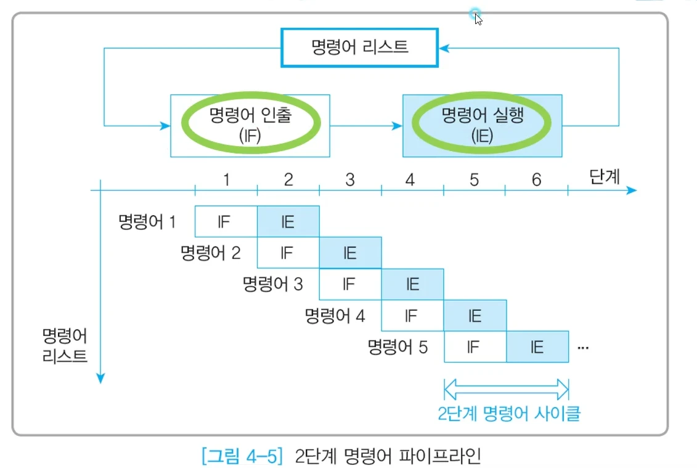

파이프라인 구조는 이와 같이 명령어 인출(Instruction Fetch)과 명령어 실행(Instruction Execution) 으로 나뉘어진다.

- 명령어 사이클의 단계 구분

    - 1번부터 6번까지 순차적으로 실행된다.

    <!-- -->

    1. 메모리에 저장된 명령어를 인출
    2. 명령어를 해독 ⇒ 연산 코드와 오퍼랜드 필드 분리
    3. 오퍼랜드 필드에서 유효주소를 찾아냄(간접주소와 유효주소)
    4. 유효주소로 메모리에 저장된 실제 피연산자를 인출(operand)
    5. 연산을 실행해 명령어 수행을 완료
    6. 연산결과를 저장

    ⇒ 실제 피연산자가 명령어 자체에 포함되거나 레지스터에 저장된 경우 3, 4 과정이 생략된다.

    (데이터를 꺼내올 필요가 없고, 연산 코드 자체가 어떤 레지스터를 사용할지 나타내기 때문)

---

- 4단계 파이프라인 구조

    1. 명령어 인출(Instruction Fetch, IF)
    2. 명령어 해독(Instruction Decode, ID)
    3. 연산 실행(Execution, EX)
    4. 연산 결과 저장(Write-back, WB)

    <!-- -->

    - 요즘은 파이프라인 구조가 수십 단계로 나뉘지만, 무한정 늘리지는 않는다.

        - 분기가 발생하면 버리는 단계가 더 많아지므로 효율이 저하될 수 있음.

    - 최근의 CPU는 여러 개의 명령어 파이프라인과 연산 파이프라인을 갖도록 설계

    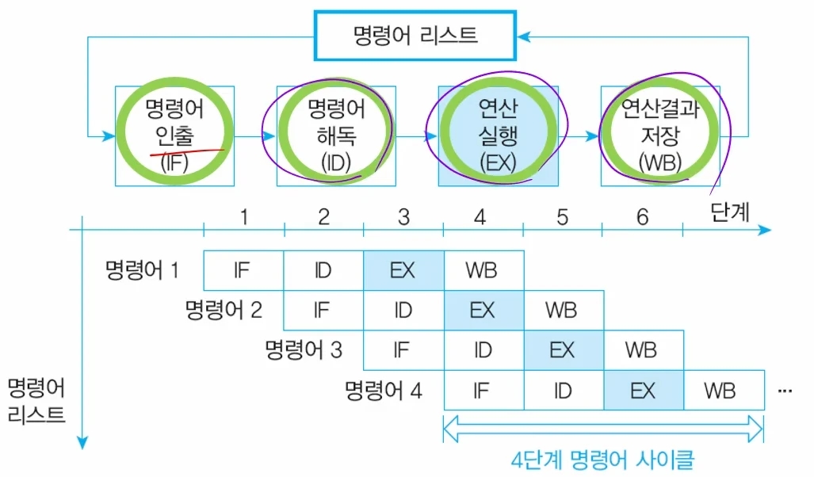

---

- 파이프라인의 속도상승

    - 병렬계산을 하지 않을 때 명령어 처리에 걸리는 총 시간
    - 단계 수 N, 명령어 개수 i, 각 단계에 걸리는 시간은 T로 동일하다고 가정.

    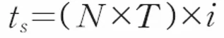

    - 명령어 처리에 걸리는 시간 t(s)는 N\*T\*i 이다.

    - 이 구조가 전체 명령어 처리에 걸리는 총시간

        - 첫 명령어 통과에 N\*T 시간, 두 번째 명령어부터 나머지 i-1개는 주기 T씩 추가

    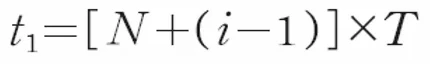

    - 파이프라인 구조 사용시 병렬계산의 속도 상승이 가능

    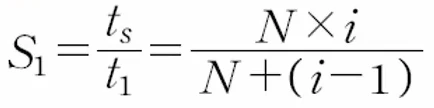

    - 명령어 개수 커지면 i → inf 에 근접하면서 단계수 **N**에 근접한다.

- 슈퍼 파이프라인(super-pipeline) 구조

    - 기존 파이프라인의 단계 수는 유지하면서 각 단계 내에서 처리 속도를 몇 배로 높여주는 CPU 설계 기술

        - 단계 내부에서 더 작은 단계들로 세분화시키고, 클럭속도를 높여 빠르게 처리

    - 슈퍼 파이프라인 차수 sp를 정의

        - 파이프라인 구조의 한 단계 내에서 처리 속도를 몇 배로 높이는지 나타내는 비율

- 해당 그림은 이전 그림의 처리속도를 2배로 높인 것.

    - 슈퍼 파이프라인 차수 sp = 2
    - 파이프라인 단계수 N = 4

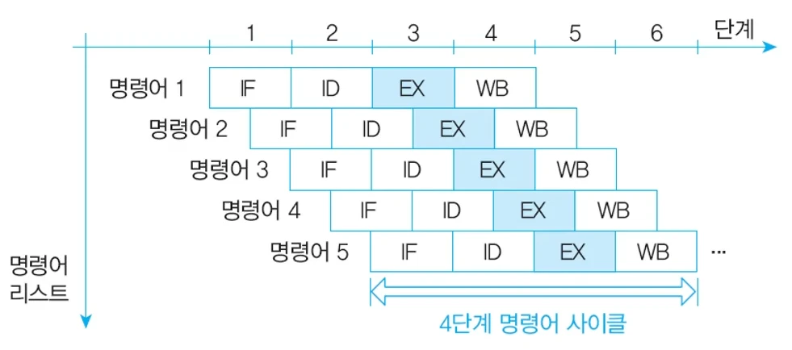

- 슈퍼 파이프라인의 속도 상승

    - 슈퍼 파이프라인 차수 sp

        - 단계 수 N, 명령어 개수 i, 각 단계 시간은 T로 통일

    - 이 구조가 전체 명령어 처리에 걸리는 총 시간

        - 첫 명령어 통과에 N\*T 시간, 두 번째 명령어부터 나머지 i-1개는 T/sp씩 추가

        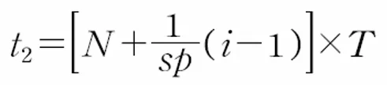

    - 슈퍼 파이프라인 구조 사용시 병렬계산의 속도 상승 (t2/ti)

        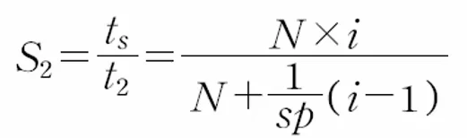

        - 명령어 개수 커지면 i → inf 에 근접하면서 **sp\*N**에 근접

---

- 파이프라인의 한계

    - 파이프라인의 동작 원리

        - 파이프를 통해 물이 순차적으로 아래로 흐르는 이치를 이용

    - 단계를 늘려도 작업이 무한정 빨라지지 않는다.

    - 공장에서 작업자가 작업을 무한정 빨리 할 수 없음.

        - 10분에 1대 꼴로 생산하던 자동차 생산라인의 단계 수를 2배로 늘리면 5분에 1대 꼴로 자동차가 생산될까? ⇒ 현실적인 수준에서는 확신할 수 없는 부분이다.
        - 각 단계의 작업 속도가 자재투입 속도를 따르지 못하면 생산성 향상에는 한계 존재

    - 파이프 라인의 단계 수를 늘릴 수록

        - 대체로 속도 상승 비율은 좋아진다. 하지만 이론적인 최대치까지 개선되지는 않는다.

    - 파이프라인의 제약 조건

        - 시스템 자원의 사용에 충돌이 없어야 함

            - 다른 단계에서 메모리나 입출력장치 등 시스템 자원을 먼저 차지해 사용하고 있으면 기다려야 한다. (non-preemption)

        - 명령어 간에 상호 의존성이 없어야 함

            - 앞 명령의 실행 결과를 얻은 데이터나 주소를 사용해야 한다면 실행 순서를 지키고 기다려야 함

        - 모든 명령어가 같은 단계를 거쳐야 낭비가 없음

            - 모든 명령이 모든 단계를 거치는 것이 아니므로, 단계가 적어도 되는 명령은 시간이 낭비되는 것

            - 각 단계의 처리시간이 동일해야 함

                - 한 단계 주기는 가장 긴 단계를 기준
                - 낭비를 줄이려면 가능한 각 단계별 처리 시간이 같아지도록 잘게 나눠야함

            - 명령어는 순차적으로 실행되어야 함

                - 인터럽트나 서브루틴으로 분기가 발생하면 파이프라인에 있던 명령어들을 버리게 되므로, 처리가 지연된다.

- 파이프라인의 성능저하를 줄이는 방법

    - 지연분기(delayed branch) 활용

        - 분기 명령 앞뒤에 위치한 다른 명령어들의 순서를 적절히 재배치해 실행 순서를 바꾸는 것을 말함

    - 분기예측(branch prediction)

        - 명령이 분기하는지 예측했다, 분기하면 파이프라인에 유입된 명령들을 변화시켜 처리지연을 방지

            - 정적 예측 ⇒ 컴파일러에서 분기를 미리 예측
            - 동적 예측 ⇒ 실행 도중 발생된 자료를 활용(branch가 발생하면 그 때 가서 조절)

        - 효율 높고 비순차적 추론이 가능한 실행엔진과 다중 분기예측, 데이터 흐름분석, 예측실행 등의 기술이 필요함.

---

#### 슈퍼스칼라 구조

- 슈퍼스칼라(superscalar) 구조

    - 한 명령어 사이클 동안 여러 개의 명령어를 동시에 처리할 수 있도록 설계한 CPU 구조
    - 여러 개의 여분의 실행 장치들이 중요
    - 최근 대부분의 CPU는 슈퍼 스칼라 구조를 가짐

    - 슈퍼스칼라 차수 ss를 정의

        - ss : 한 명령어 사이클 동안 동시에 처리할 수 있는 명령어 개수

- 슈퍼스칼라 구조에 필요한 장치들

    - 여러 개의 명령어 인출 장치 ⇒ 한 번에 여러 명령어를 실행하므로, 여러 개를 가져올 수 있어야 하는 것으로 보인다.
    - 실행순서에 관계없이 동시에 실행되어도 무관한, 서로 독립적인 명령어들을 판단해 골라내는 장치이다. (즉, 종속성을 가지지 않는 서로 독립적인 명령어들을 판단해 동시에 실행시킬 수 있는 것…)
    - 당연하게도, 동시에 여러 명령어를 처리하게 되므로, 여러 개의 독립적인 명령어 실행 장치들이 필요하다. ⇒ 이 개수만큼 실행할 수 있을 것.

- 한 명령어 사이클 동안 여러 명령어를 읽어와, 어떤 명령이 독립적인지 찾아 그것들을 먼저 동시에 실행한다.

    - 이전의 결과에 종속되는 명령어들은 동시에 실행되지 못하고 기다려야 하므로 속도 저하

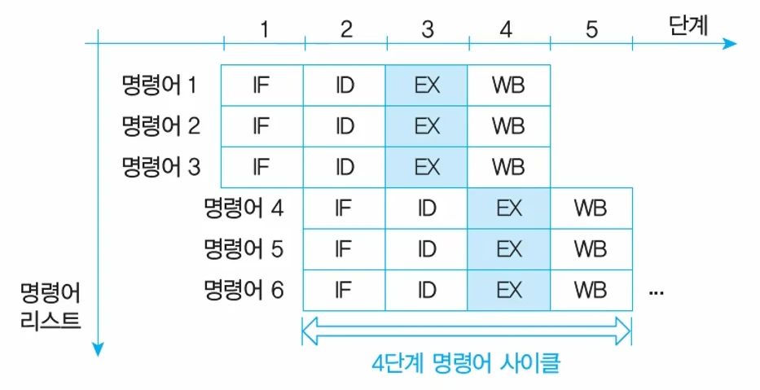

스칼라 차수가 3인 명령어 실행 구조

- 슈퍼스칼라 차수 ss

    - 단계 수 N, 명령어 개수 i, 각 단계 시간은 T로 통일

- 이 구조가 전체 명령어 처리에 걸리는 총 시간

    - 명령어는 i/ss 세트로 나누어진다. ⇒ 차수가 ss이므로, 당연하게도 ss로 나눈 개수만큼 세트가 생성된다.
    - 첫 명령어 세트 통과에 N\*T시간, 두 번째 세트부터 나머지 i/ss-1 세트는 T씩 추가

    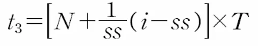

- 슈퍼스칼라와 파이프라인에서 병렬계산의 속도 상승

    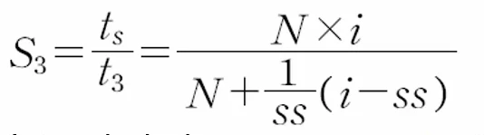

    명령어 개수 커지면 i → inf, **ss\*N**에 근접한다.

- 슈퍼스칼라와 슈퍼 파이프라인

    - 슈퍼 파이프라인 차수 sp = 2
    - 슈퍼스칼라 차수 ss = 3
    - 파이프라인 단계 수 N = 4

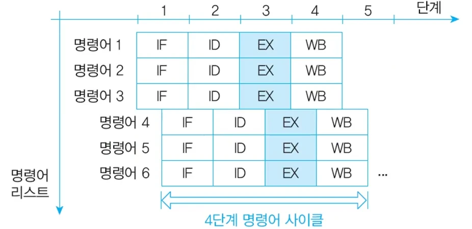

- 슈퍼스칼라와 슈퍼 파이프라인의 속도 상승

    - 단계 수 N, 명령어 개수 i, 각 단계 시간은 T로 동일

- 이 구조가 전체 명령어 처리에 걸리는 총시간

    - 명령어는 i/ss 세트로 나누어진다.
    - 첫 명령어 세트 통과에 N\*T 시간, 두 번째 세트부터 나머지 i/ss-1 세트는 T/sp씩 추가

    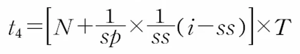

- 슈퍼스칼라와 슈퍼 파이프라인 병렬계산의 속도 상승

    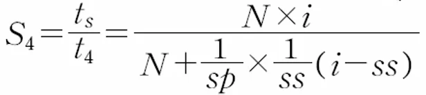

    - 명령어 개수 커지면 i → inf, **sp\*ss\*N**에 근접

---

## 5. 기억장치

- 메모리(memory, 기억장치)의 역할

    - 프로그램 명령이나 데이터를 저장

    - 프로그램은 메모리에서 활동 중

        - 메인 메모리가 클수록 동시에 많은 프로그램을 실행할 수 있다.

- 램 상주 프로그램(terminate and stay resident, TSR)

    - 실행 후 종료 될 때 제거되는 다른 프로그램들과 달리, 전체나 일부가 메모리에 남아 항상 대기하는 프로그램이다.

        - 필요할 때 부르면 즉시 나타나 일을 수행한다.

    - 운영체제의 커널과 바이러스 백신이 대표

- 주기억장치(main memory, 메인 메모리)

    - 프로그램의 동작에 주로 사용

    - 현재 동작하는 프로그램들과 데이터를 저장

        - 전원이 들어온 상태에서 작업이 실행 중일 때 사용

    - 주로 고속의 램 모듈 같은 반도체 메모리 사용

- 보조기억장치(auxiliary memory)

    - 혹은 2차 기억장치 → 자료의 저장에 주로 사용

        - 전원이 종료된 후에도 프로그램과 데이터를 안전하게 저장하는 것이 주요 목적

    - 싸고 대용량이 요구되는 각종 드라이브가 대표적

- IEEE 1541 표준(2002)의 새로운 메모리 용량 표시

    - 디지털 용량의 10진법과 2진법 단위를 명확히 구분

        - 비트(bit) → 기호 b
        - 바이트(byte) → 기호 B로 표시.
        - 바이트는 인접한 비트의 묶음으로, 8비트를 주로 사용하나, 꼭 8비트일 필요는 없음.(어느정도 관습적이고 사회적인 약속의 영역)

- 엔디언(endian)

    - 메모리 주소와 같은 논리적으로 1차원적인 공간에 여러 개의 연속된 자료를 배열하는 방법

    - 여러 단위로 구성된 자료를 저장할 때

        - 빅 엔디언(big-endian) ⇒ 큰 단위를 먼저 저장
        - 리틀 엔디언(little-endian) ⇒ 작은 단위를 먼저 저장
        - 미들 엔디언 (middle or mixed endian) ⇒ 둘을 혼합

    - 메모리는 보통 낮은 주소에서 시작해 높은 주소 쪽으로 저장, 또한 보통 한 주소에 한 바이트가 저장된다.

    - 여러 바이트로 이루어진 변수를 메모리에 저장할 때

        - 빅 엔디언 ⇒ 큰 단위의 바이트가 앞 번지에 오고
        - 리틀 엔디언 ⇒ 작은 단위의 바이트가 앞 번지로 옴

        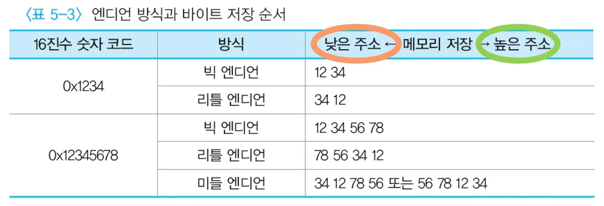

        - 프로그래밍에서 보통 메모리에 저장되는 변수의 첫 바이트를 그 변수의 주소로 삼는다. ⇒ 이를 m번지라고 해보자.

        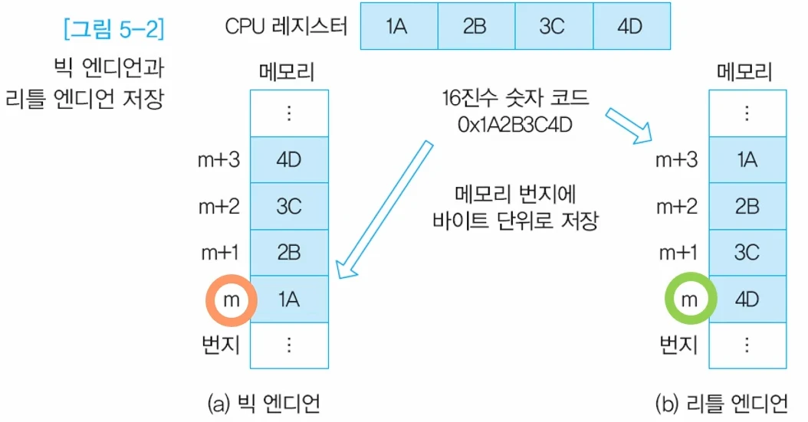

    - 성능에 큰 차이는 없다.

        - 인텔 프로세서는 전통적으로 리틀 엔디언 사용
        - 일반적으로 네트워크 주소는 빅 엔디언 사용

---

#### 메모리 계층 구조

- 읽기와 쓰기 (DMA와 Dispatch에 밀접하게 연관이 있는 내용)

    - 메모리 읽기(memory read), 메모리 쓰기(memory write), 입출력장치 읽기(I/O read), 입출력장치 쓰기(I/O write)

    - CPU는 읽기와 쓰기 동작의 주체

        - 읽기 동작은 메모리나 입출력장치에서 CPU 쪽으로 데이터가 입력, 쓰기 동작은 CPU에서 데이터가 출력

    - 읽기 시간(read time), 쓰기 시간(write time)

        - 주소를 보낸 순간부터 동작이 완료되기까지 걸린 시간

- 액세스 타임(access time, 접근 시간)

    - CPU가 데이터의 저장 위치에 접근을 완료하거나 응답을 받기 시작하는 데 걸린 시간

        - 액세스 타임은 저장된 위치를 찾는데 걸린 시간, 전송 속도는 실제 전송이 이루어지는 데이터 전달 속도를 말함.

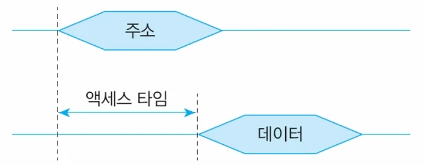

- 메모리나 I/O에 새로운 주소가 도달한 시점부터 데이터를 출력하거나, 기록하기 시작하는 데 걸린 시간을 말한다.

- 액세스 타임의 단위는 시간

    - ms, uc, ns, ps
    - 보조기억장치들은 ms 단위이고, 반도체 메모리는 ns 단위이다.

- 메모리 계층 구조

    - CPU에 가까울수록 상위 계층으로 분류되며, CPU에 가까울수록 Access Time이 작아진다. (즉, 액세스 속도가 빨라짐)

- 임시 파일들(temporary files)

    - 스왑 파일처럼, 운영체제와 응용프로그램들은 하드디스크에 주기적으로 자기가 관리하는 데이터나 프로그램을 임시 파일로 저장

---

- 가상 메모리(Virtual Memory, 가상기억장치)

    - 주로 하드디스크의 일부를 확장된 램으로 가정해 부족한 메인 메모리의 일부로 사용하는 것

        - 논리적 공간이라 물리적으로 연속적일 필요는 없음.

- 하드디스크 스와핑(swapping) 혹은 스왑(swap)

    - 메인 메모리의 내용과 보조기억장치인 하드디스크의 내용을 상호 교환하는 것

    - 스왑 파일은 가상 메모리를 사용할 때 실제 메모리인 램에 대한 확장으로 하드디스크에 만들어지는 파일이다.

        - 일반적인 운영체제 ⇒ 페이지, 페이징

- 페이지(page), 가상 페이지

    - 가상 메모리 공간을 일정한 크기로 나누어, 메인 메모리와 하드디스크 사이에 한 번에 이동하는 단위를 말한다. (dump)

        - OS는 다량의 페이지로 구성된 가상 메모리를 관리한다.  
            ⇒ 즉, 데이터를 옮기는 단위가 page이고, 그냥 그게 연속적으로 되어있는 논리적 가상메모리 구조를 유지한다는 것.

- 페이지 프레임(page frame)

    - 가상의 기억공간을 다룰 수 있도록 할당된 메인 메모리 영역, 하드디스크의 페이지들 중 하나를 복사해 할당
    - 여러 개의 페이지 프레임들이 존재. 즉, 가상 메모리에 존재하는 페이지를 메인 메모리에 가져와서 사용할 수 있는 영역이 특별하게 존재한다는 뜻.

- 페이징(paging), 페이지 교체(replacement)

    - 메인 메모리와 하드디스크 사이의 페이지 교환 동작
    - OS가 참고하려는 페이지가 메인메모리에 없으면, 하드디스크에 저장해 둔 페이지를 참조해 가져온다.

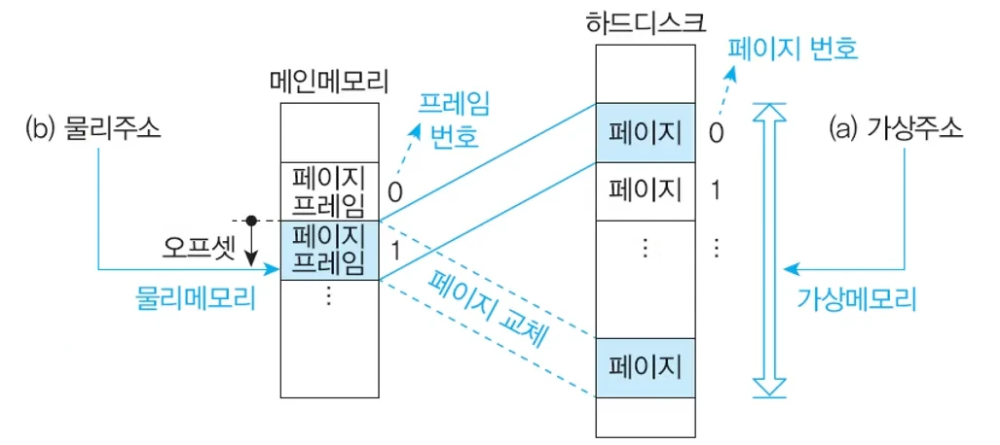

- 가상주소와 물리주소

    - 물리메모리(physical memory)

        - 가상 메모리에 대응하는 용어로, 실제 메모리를 말함.

    - 가상주소(virtual address)

        - 가상메모리를 관리하는 주소
        - 물리주소로 변환해서 사용해야 함

    - 물리주소(physical address)

        - 실제 메모리 주소

        - 오프셋(offset) 값을 이용해 가상주소의 비트 수를 줄인다.

            - 페이지 프레임으로 사용하는 시작주소에서 지정하려는 주소까지 차이인 변위(displacement) 값 알면 계산
            - 오프셋은 실제 주소값을 다 계산하려면 비트 수가 커지므로, 상대적인 단위를 이용해서 주소 연산에 필요한 비트 수를 줄이고 간략화하는 것으로 보인다.

    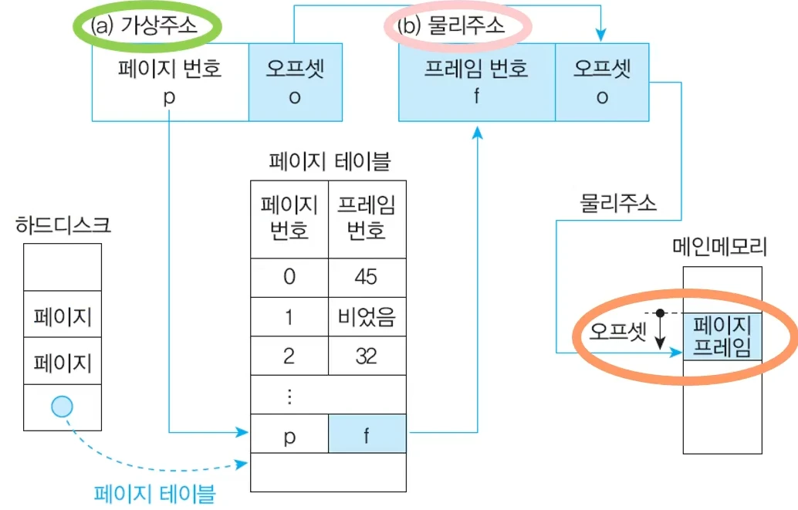

    페이지 테이블에서 페이지 번호 n번이 프레임 번호 k번과 매칭이 되는 것이 표현된다. 하드디스크에 저장된 페이지는 가상주소로 표현되고, 이것이 페이지 테이블에 와서 프레임 번호와 매칭되는 것이다. 프레임이란 하드디스크에서 가져온 프레임이 메인 메모리 상에서 저장되는 공간을 말한다. 

    가상주소로 표현된 페이지 번호는, 오프셋을 사용해 사용되는 비트 수를 줄이게 된다. 페이지와 페이지 프레임은 크기가 똑같이 나뉘어져 있기 때문에, 오프셋을 이용하면 물리 주소 변환이 쉽게 가능해진다. 이를 통해 가상주소를 물리주소로 변환하고, 이 오프셋을 바탕으로 메인 메모리 상에서 페이지 프레임에 쉽게 접근이 가능하다.

    - 가상주소 물리주소 매칭과 오프셋에 대한 글

    [OS #8. 메모리 관리(Memory Management) Part1](https://devowen.com/252)
