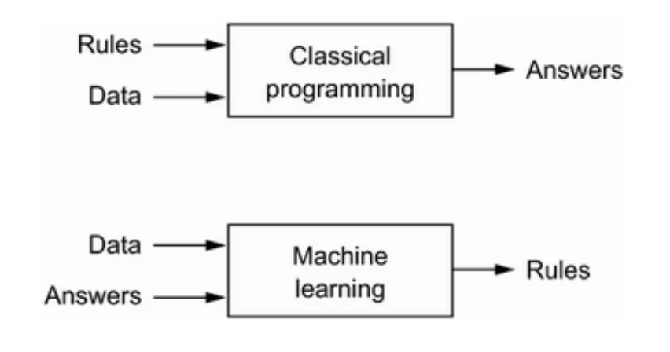

# History of ML & DL

## &lt;고전적 인공지능과 신경망 기반의 인공지능의 발전&gt;

> 고전적인 인공지능은 Rule Based로 만들어졌었고, 학습이라는 개념이 존재하지 않았다. 그래서 정해진 규칙에 대해서만 판단을 내릴 수 있었고, 그렇기 때문에 새로운 데이터에 대한 확장성이 떨어진다는 단점이 존재했다.

### 고전적 인공지능과 신경망 기반의 인공지능

- 고전적 인공지능

    - Rule과 Data가 Function에 들어가면 Classical Programming 알고리즘에 따라 Answer를 도출하는 방식이다.

- (신경망 기반) 머신 러닝

    - Data와 Answers가 신경망에 들어가면, 신경망에서 데이터로부터 Answer에 도달하는 Rule을 뽑아내는 방식이다. (즉, 정답을 도출해 내는 Parameter의 값을 얻어내는 것)

> 고전적 인공지능과 최신 AI의 가장 큰 차이점은 **학습**의 유무이다.

### 50s **Perceptron**(신경망의 기본 구성 요소)

> 1950년대, 코넬 대학교 항공 연구소에서 인지/심리를 연구하는 Rosenblatt이 제안한 머신이다. Perceptron은 Input을 받으면 Output으로 1 또는 -1을 내보낸다. 그 과정에서 Input에 각각 가중치를 곱하고 모두 더한 다음 활성화 함수를 거친다.

- **학습의 필요성**

> 만약 Rule Based로 특정 사람이 비만인지 아닌지를 판단한다고 해보자. 처음에는 잘 되다가 나중에 새로운 사람의 데이터를 넣어보니 (실제로는 비만인데) 비만이 아니라고 나왔다. 그러면 Rule Based의 인공지능이, 이 데이터가 비만이라고 판단할 수 있도록 Rule을 변경해 주어야 하는데, 실질적으로 그걸 찾아내는 것이 불가능했기 때문에 스스로 정답에 가까운 결과를 낼 수 있도록 하는 학습의 필요성이 대두되기 시작했다.  
>   
> ⇒ 그러나 이 당시에는 가중치(parameter)값을 효과적으로 변경하는 체계적인 시스템이 존재하지 않았다.

### 60s~70s 다계층 Perceptrons

> 50년대에 제안된 개념인 Perceptron을 뉴런화 하기 시작했다.  
>   
> 각각의 Perceptron에 필요한 모든 가중치들의 적절한 값을 찾아내는 방법이 없었기 때문에 개발이 점점 지연되었다.  
> ⇒ 학습의 개념과 필요성은 제시되었으나, 효과적인 방법론이 제안되지 못했음.

### 80s~90s 신경망 학습 방법의 개발

> 1986년 Nature 학술지에 신경망을 체계적으로 학습시키는 방법인 Back Propagation을 개발.  
> 실제 Output Vector의 값과 Desired Output Vector 간의 차이(오차)를 줄여나가는 방식으로서, 차이가 크면 값을 많이 바꾸고 차이가 적으면 적게 바꾸는 방식을 자동화 하는 것이다.

- **90s Convolution Neural Network**(CNN, Convolution Net)

> 인간 시각 신경의 처리과정을 모사한 컨볼루션 신경망의 등장

> 이 사이에서는 H/W적인 한계 때문에 신경망 학습이 매우 어려웠음.

### 2010이후, 대규모 데이터와 GPU의 사용

> 대규모 이미지 데이터가 많아지고, 고성능 그래픽 카드를 이용한 프로그래밍이 가능해졌다.  
> 이에 따라 8개 계층, 이미지 분류 정확도가 83.6%에 달하는 AlexNet이 등장하기도 했다.

---

## &lt;인공지능의 활용 방안&gt;

- Classification : 확률 출력을 통한 분류
- Retrieval : 유사한 이미지 찾기
- Detection : Object Detection. 위치와 형태의 동시 검출, 교통량 등
- Segmentation : 이미지에서 각 픽셀이, 어떤 것인지 Classification 하기

⇒ 모두 CNN을 응용하는 방식이다.
