# Math for ML

작성일 2023-09-28 · 최종 수정일 2026-02-17
{ .post-date }

## [Math for ML]

> Machine Learning을 하는데 필요한 기본적인 수학을 복습한다.

---

### &lt;Linear Algebra&gt;

> 선형대수학은 벡터를 다루는 수학이다.

#### Roadmap

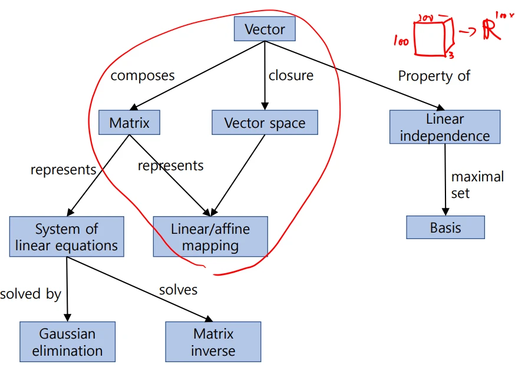

- 위 Roadmap에서 Matrix, Vector Space, Linear/affine mapping이 중요하다.
- **특히 Matrix와 Vector의 곱이 갖는 의미가 중요하다.**

#### Scalar

- Scalar는 하나의 수를 의미한다.
- Integers, Real Numbers, Rational Numbers, etc.

#### Vector

- Vector란 하나의 Object로서, 서로 합쳐지거나 스칼라를 곱해서 다른 Object나 같은 종류의 Object를 생성할 수 있는 것을 말한다.

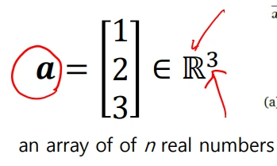

실수 공간에서의 3차원 벡터를 나타낼 때 사용하는 표기

#### Matrices

- Matrix는 숫자로 구성된 array를 2차원으로 쌓아 만든 것이다.

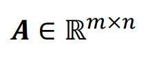

m x n 차원을 갖는 Matrix의 표기

#### Vector Spaces

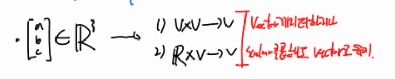

1) vector는 vector끼리 곱하거나 2) scalar를 곱해도 vector로 유지된다는 특성을 갖는다. 이처럼 벡터에 원소를 서로 더하거나 배수로 늘이고 줄일 수 있는 공간을 Vector Space라고 한다.

#### Vector Subspace

벡터가 존재하는 차원 아래에 그 차원보다 작은 차원의 공간이 존재할 수 있으며, 그 공간을 Vector Subspace라고 한다.

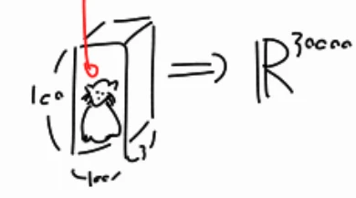

예를 들어 위와 같이 100 x 100 x 3 갖는 고양이의 RGB 이미지가 있다고 해보자. 해당 이미지의 모든 값들을 일렬로 늘어뜨리면 30,000 차원의 벡터가 되므로, 이 사진의 차원은 30,000 차원이라고 할 수 있다. 그런데 만약, 특정 100 차원 안에 고양이의 모습이 모여 있다고 할 수도 있으며, 이 차원을 찾아내서 유용한 정보를 얻어내야만 한다.

⇒ 이처럼 특정 Vector Space 내에는 무수히 많은 Vector Subspace가 존재할 수 있고, 특정 Vector Subspace에 의미있는 정보가 모여있을 수도 있다.

#### Linear Dependence

어떤 벡터 A가 다른 벡터 B에 대해서 Scalar배로 표현될 수 있다면, A와 B는 Linear Dependent 하다.

#### Linear Independence

어떤 벡터 A가 다른 벡터 B에 대해서 Linear Dependent 하지 않으면 Linear Independent 하다.

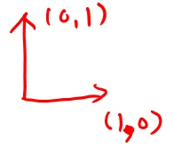

Scalar 배로 표현이 불가능한 경우

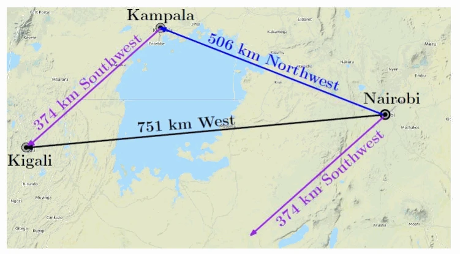

374km, 506km의 벡터는 서로 Linear Independent 하지만, 374km, 506km 벡터의 Combination 벡터는 751km 벡터와 Linear Dependent 하다.

#### Basis Vector

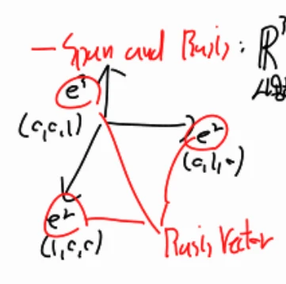

특정 Vector 공간은 Basis Vector로 표현될 수 있으며, 해당 Vector 공간안에서 나타낼 수 있는 Vector 는 Basis Vector의 Combination으로 표현할 수 있다.

일반적으로 3차원 실수 공간에서 Basis Vector는 (1, 0, 0), (0, 1, 0), (0, 0, 1)로 표현하는데, 항상 이것으로 표현해야만 하는 것은 아니고 얼마든지 바뀌어도 된다. 왜냐면, Basis Vector가 바뀌더라도 Vector 공간은 3차원으로 표현되기 때문이다.

---

### &lt;Linear Mappings&gt;

> Vector Transformation의 의미

- 어떤 벡터를 구성하는 element의 값이 변한다는 것은 어떤 의미를 가지고 있을까?  
    ⇒ Matrix가 나타내는 공간의 변화를 의미한다.

- 벡터에 매트릭스를 곱하면 벡터 공간이 변화하게 된다.

    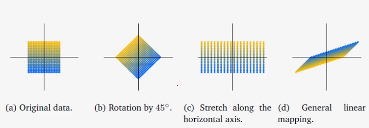

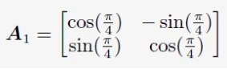

회전 변환

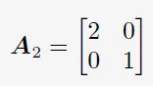

x축으로 늘이기

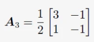

상하 반전 후 공간을 찌그러 트리기

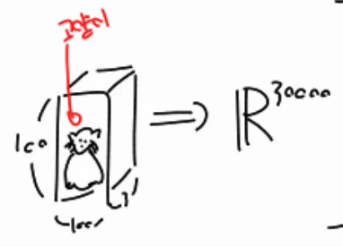

⇒ 이곳에 Matrix를 곱하면, Vector 속에 있는 특정 Vector Subspace에 존재하는 고양이를 변형시킬 수 있게 된다.

> 이처럼, Vector에 Matrix를 곱하고 또 다시 Matrix를 곱하고… 이런 식으로 계속해서 Vector Space를 변형시키면서 의미있는 것을 찾아가는 것이 딥러닝의 기본이다.

#### Coordinates

벡터 공간에서 벡터의 좌표를 표현할 수 있는 좌표계. Basis Vector가 무엇인지에 따라 다르게 표현됨.

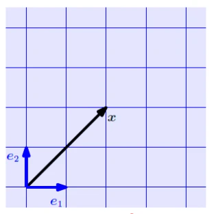

e1(1, 0), e2(0, 1)의 Basis, x = 2e1 + 2e2

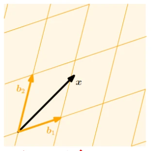

Basis가 달라졌을때 x는 대략, x = 1.1b1 + 0.7b2

#### Basis Change

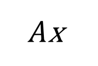

A의 columns를 basis로 하는 x 좌표를 standard basis의 좌표로 변환한다.

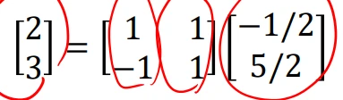

⇒ 즉, (1, -1), (1, 1)을 Basis vector로 하는 x를 Standard Basis Coordinates를 기준으로 변경한다는 것.

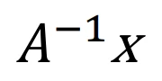

Standard basis에서의 x좌표를 A의 columns basis 기준으로 하는 좌표로 변환한다.

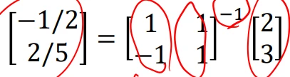

> Matrix와 Vector를 곱하는 것은, 공간을 펴거나 찌그러트리는 것을 의미한다.

#### Eigendecomposition

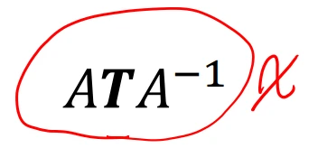

벡터와 매트릭스의 곱을 연산할 때, Eigendecomposition을 사용하면 계산이 좀 더 쉬운 형태로 식을 변형할 수도 있다.

위의 식의 의미는 아래와 같다.

1) A\^(-1)x : Standard Basis로 변환

2) T : 회전 변환

3) A : 기존의 basis로 변환

---

### Dot Product

> 두 벡터가 얼마나 유사한 벡터인지 검사하는 방법. 두 벡터 사이의 각과 직교성을 검사한다.

#### Norm

Norm은 벡터의 사이즈를 표현하는 방법이다.

- L1 norm

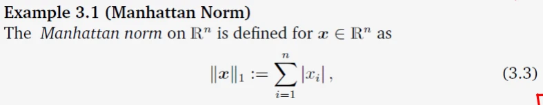

- L2 norm

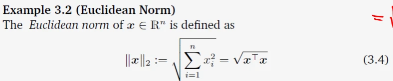

⇒ L2 norm이 default norm이다.

- Angles and Orthogonality

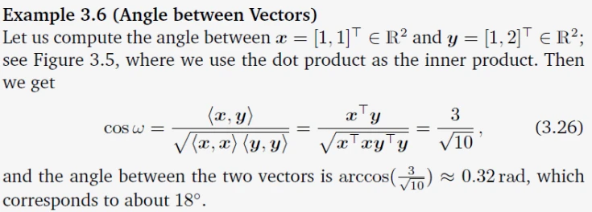

⇒ 위와 같이 계산하면 두 벡터 사이의 각(cos w)를 구할 수 있으며, 이를 **cosine similarity**라고 한다.  
이는 두 벡터가 벡터 공간에서 얼마나 유사한지를 나타낸다.

#### Determinant

- Determinant는 n x n matrix에서만 정의된다.

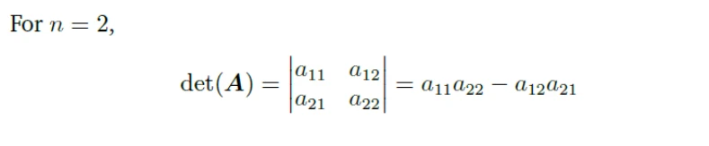

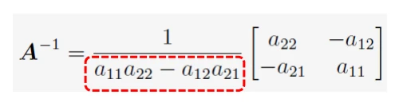

2 x 2 Matrix에서 determinant는 위와 같이 구한다. 따라서 determinant가 0이 아니어야 역행렬을 구할 수 있으며, 역행렬이 존재하지 않는다면 determinant는 0이다.

Determinant는 Matrix의 성질을 나타낸다.

1) **Invertibility** : n x n Matrix에 역행렬이 존재하는지 여부를 검사한다.

2) **Scaling Factor** : n x n Matrix를 Linear Transformation(선형 변환)에 적용 할 때, Matrix의 Determinant는 그 선형 변환으로 Scale이 얼마나 달라질지를 나타낸다. 만약 Determinant가 1이라면 해당 변환은 부피를 유지하는 변환이라고 할 수 있으며, 1보다 크다면 stretching, 1보다 작다면 compression이라고 볼 수 있다. 만약 Determinant가 음수라면, Reflection(반전)이 일어난다.

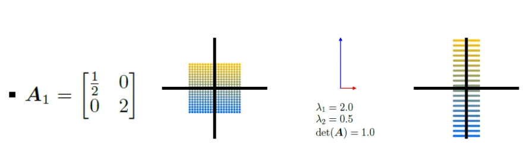

⇒ A1을 적용하면 일어나는 Transformation. Determinant가 1이므로 Volume은 유지된다.

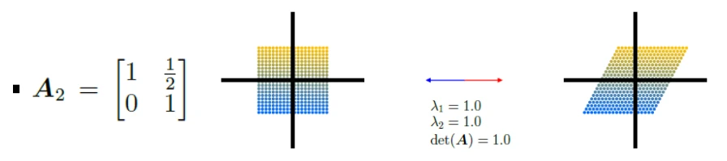

⇒ A2를 적용하면 일어나는 Transformation. Determinant가 1이므로 Volume은 유지된다.

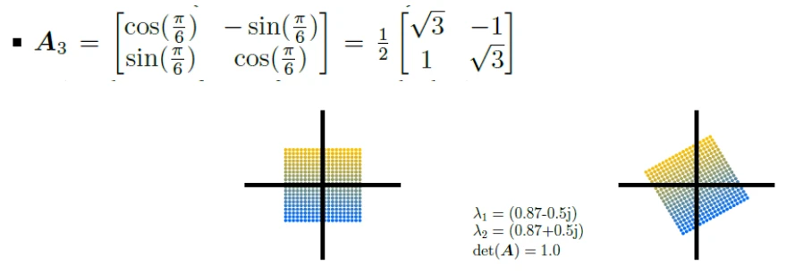

⇒ A3를 적용하면 일어나는 Transformation. Determinant가 1이므로 Volume은 유지된다.

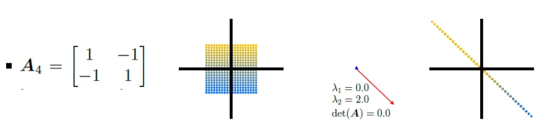

⇒ A4를 적용하면 일어나는 Transformation. Determinant가 0인 것은 차원의 축소를 의미하며, 이는 역행렬이 존재하지 않음을 의미한다. 즉, 두 개의 축을 가지고 있는 이차원에서 일차원으로의 축소는 가능하지만, 한 개의 축을 가지고 있는 일차원에서 이차원으로의 확대는 불가능하다는 의미이다.

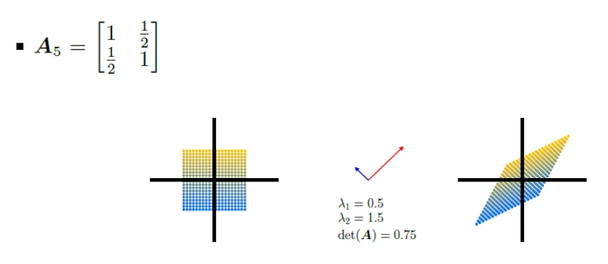

⇒ A5를 적용하면 일어나는 Transformation. Determinant가 0.75이므로 Volume이 축소된다.

---

### &lt;Eigenvalues and Eigenvectors&gt;

> 고유값과 고유벡터는 Matrix에 대한 특성이다.

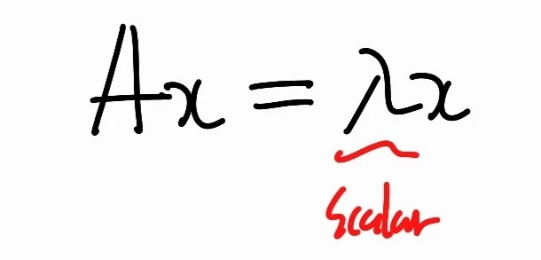

Vector와 Matrix를 곱하면, 그 결과는 EigenValues와 EigenVector의 곱으로 표현된다.

⇒ 이 말은 즉슨 벡터의 방향은 그대로인 벡터가 존재한다는 것이며, Scalar 곱으로 표현된다는 뜻.

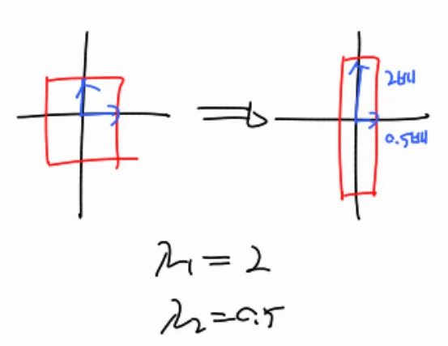

⇒ 이런 경우, Eigenvalue는 2, 0.5가 된다.

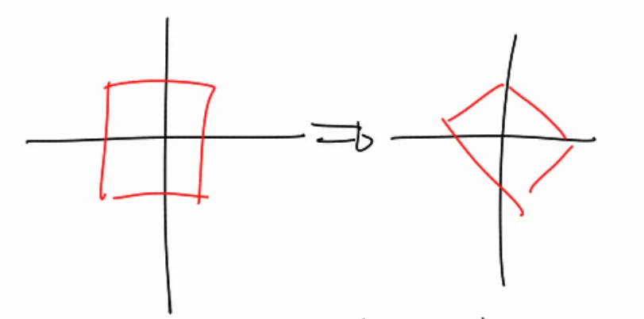

⇒ 이런 경우, 방향이 유지되는 벡터가 존재하지 않으므로 eigenvalue는 complex number가 된다.

#### Rank

Matrix를 구성하는 Vector들이 구성할 수 있는 Vector Space의 차원을 의미한다.
