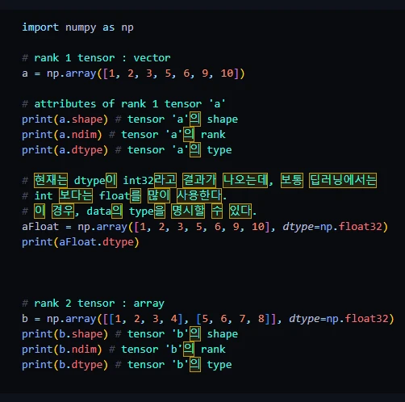
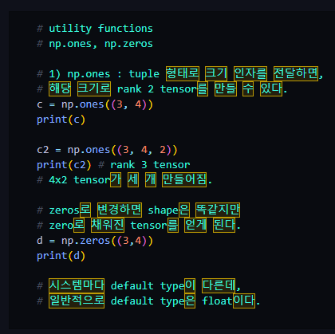
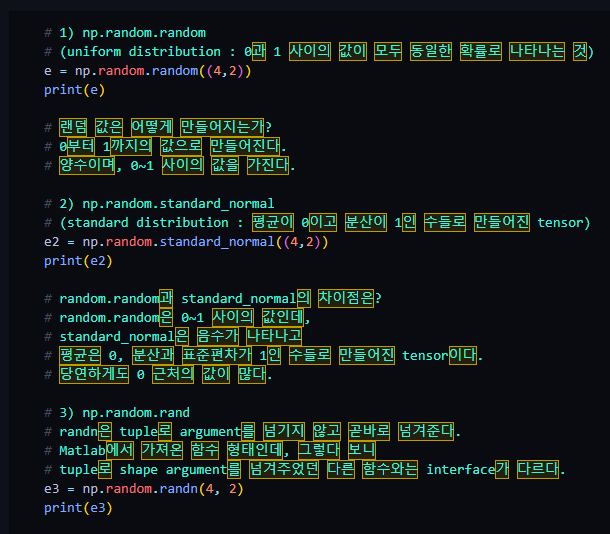
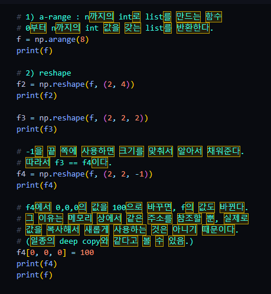
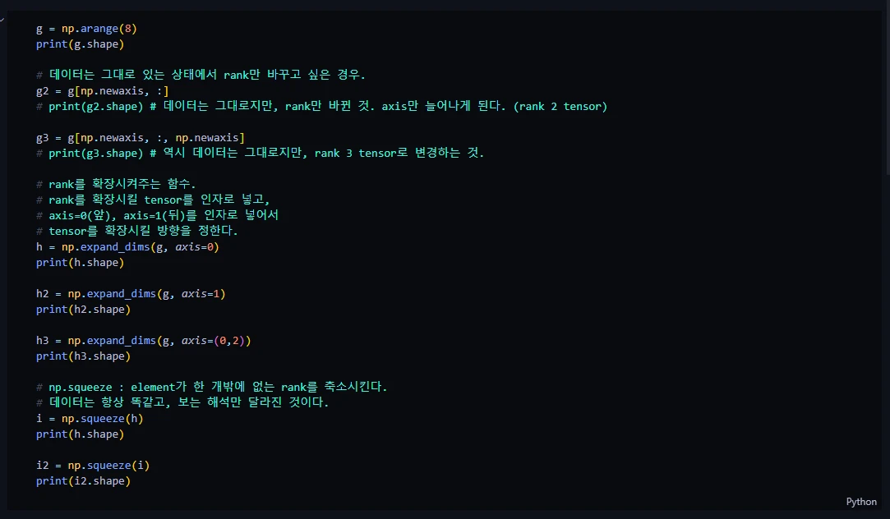
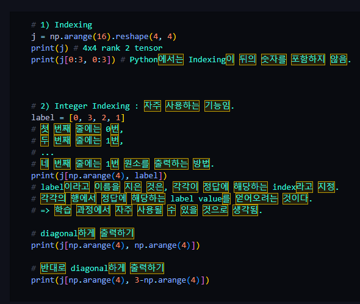
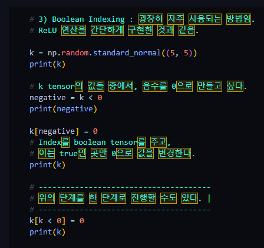
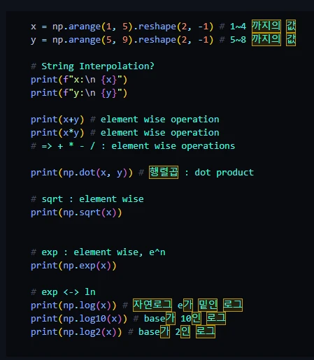
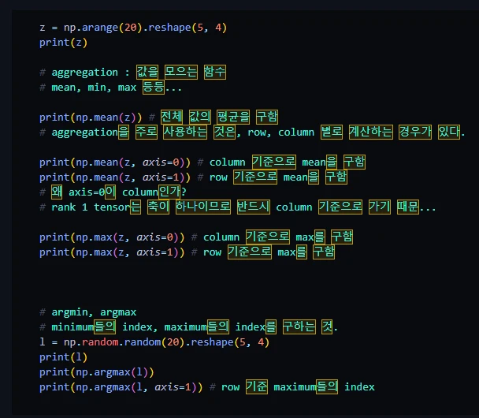
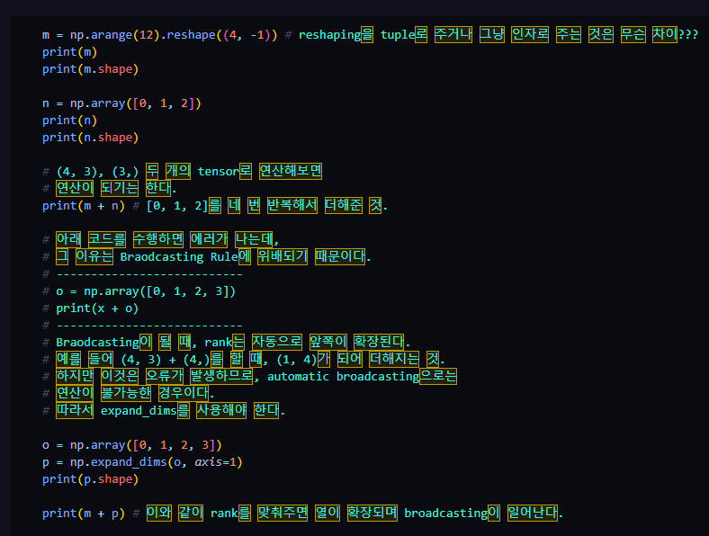

# NumPy for ML

## [NumPy for ML]

---

### &lt;Tensor Creation&gt;



- shape
- ndim
- dtype
- np.array([…], dtype=…)





- np.random.random((n, m))

    - 0~1 사이의 값

- np.random.standard_normal((n, m))

    - 평균이 0이고 분산이 1인 값

- np.random.rand((n, m))

    - standard_normal과 같지만, interface가 약간 다름

---

### &lt;Reshaping&gt;



- np.arange(n)

    - 0:n으로 vector를 생성함

- np.reshape(tensor, (n, m))

    - tensor의 shape를 바꿈

- tensor[n, m, l] = 값 접근 가능

    - 이전에 사용하던 tensor[n][m][l]과는 다름.



- g = np.arange(8)

- g2 = g[np.newaxis, :]

    - axis=0에 새로운 차원 확장

- np.expand_dims(tensor, axis=n)

    - axis=n으로 tensor의 dimension을 확장함
    - 이때 axis=0, 1, …, n 순으로 큰 차원에서 작은 차원으로 들어간다.

- np.expand_dims(tensor, axis=(0, 2))

    - axis=0과 axis=2를 확장
    - 그렇다면 기존에 있던 vector의 값은 row 값이 될 것.

---

### &lt;Indexing & Slicing&gt;





- np.range(n).reshape(m, k)

    - reshape는 Tuple을 넣어도 되고, 인자로 전달해도 됨.

- Indexing의 종류

    - 기본 Indexing이 다르다.

    ```python
    import numpy as np

    a = np.arange(20)
    a = np.reshape(a, (2, 5, -1))
    print(a[0][0][0])
    # 0
    ```

    - Tensor Indexing

    ```python
    a = np.arange(20)
    a = np.reshape(a, (4, 5))
    print(a[0:4, 0:3])
    # 0 1 2
    # 5 6 7
    # 10 11 12
    # 13 14 15
    # => Python에서 n:m은 m을 포함하지 않는 integer를 반환.
    # => 위와 같은 방식으로 하면, Tensor 자체를 잘라낸다.
    ```

    - Integer Indexing

    ```python
    a = np.arange(20)
    a = np.reshape(a, (4, 5))
    print(a[[1, 2, 3, 4], [1, 2, 3, 4]])
    # (1, 1), (2, 2), (3, 3), (4, 4)가 매칭돼서 나온다.
    ```

    - Boolean Indexing

    ```python
    a = np.random.rand(4, 5)
    negative = a < 0 # Tensor
    a[negative] = 0

    print(a)
    ```

---

### &lt;Array Math&gt;



- Tensor의 사칙연산은 element wise 연산
- np.dot(X, W) ⇒ dot product
- Transpose : X.T W.T
- np.sqrt(x)
- np.exp(x)
- np.log(x) ⇒ 자연로그
- np.log10(x)
- np.log2(x)

---

### &lt;Aggregation Functions&gt;



⇒ 잘못된 내용 있음. rank 2 tensor에서는 axis=0은 row, axis=1은 column 기준임. 왜냐면, tensor에서 axis는 큰 차원부터 따짐. rank 1 tensor인 vector는 axis=0이 column이므로, column이 가장 작은 axis이다.

```python
z = np.range(20).reshape(5, 4)

print(np.mean(z)) # 평균
print(np.mean(z, axis=0)) # rank 2 tensor이므로, row 기준
print(np.mean(z, axis=1)) # rank 2 tensor이므로, column 기준

print(np.max(z, axis=0)) # element의 합이 가장 큰 row
print(np.max(z, axis=1)) # element의 합이 가장 큰 column

print(np.min(z, axis=0)) # element의 합이 가장 작은 row
print(np.min(z, axis=1)) # element의 합이 가장 작은 column

l = np.random.random(20).reshape(5, 4)
print(np.argmax(l)) # 값이 가장 큰 element의 index
print(np.argmax(l, axis=0)) # rank 2 tensor이므로, row를 기준으로 값이 가장 큰 것들의 idx.
# 즉, column이 나오게 될 것임. 왜냐면, row를 기준으로 가장 큰 것의 idx를 모으면 column의
# 길이만큼의 vector가 된다. (rank 2 tensor 기준)
# 반대로, axis=1으로 하면 column 기준이므로, column을 기준으로 가장 큰것의 idx를 모으면
# row의 길이만큼의 vector가 된다.
```

---

### &lt;Broadcasting&gt;



- **Broadcasting**

    - Tensor의 rank를 자동으로 키워 더해주는 것.
    - 예를 들어 (4, 3) + (4, 1)을 한다면 (4, 1)을 각 Row에 더해준다.
    - 이와 다르게,(4, 3) + (1, 4)를 한다면 (1, 4)를 각 Column에 더해준다.
