# Forward Pass

## [Logistic Regression]

> Deep learning의 기본이 되는 Logistic Regression

---

### &lt;Binary Classification&gt;

> Logistic Regression을 이용한 Supervised Learning, Binary Classification

---

#### Forward Pass

- Deep Learning에서 가장 기본적인 것은 **Classification**(분류)이다.

- Deep Learning의 근간을 이루는 것은 Neural Network이며, Neural Network의 특징 중 하나는 **계층적으로 나뉘어져 있다**는 것이다. **어째서 계층적으로 나뉘어져 있는 것일까?**

    - 계층이 적으면 특정 Layer에 부담이 커져서 **적은 학습**에도 **가중치**가 **크게 변하기 때문에** 값을 조금씩 바꿔갈 수가 없다. 그러므로 많은 레이어를 만들어서 계층별로 학습에 대한 부담을 조금씩 나눠갖도록 해서 값을 조금씩 바꿔나가도록 할 수 있게 만든 것이다.

- Original Input은 각 Layer를 지나면서 지속적으로 연산을 거친다. (이 과정에서 Transformation을 한다고 생각할 수 있다.)

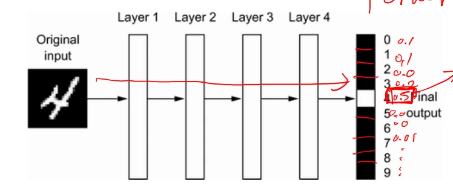

⇒ 이와 같이 Input이 Layer를 거쳐서 **예측값**을 **도출**하는 과정을 **Forward Pass**라고 한다. 위의 예시에서는 손글씨 예제를 입력받아서 Layer를 거치면서 **Linear Transformation**을 거치고, 이를 통해 얻어낸 결과를 바탕으로 0~9 중 어떤 숫자일지 확률을 결정하게 한 다음, 가장 확률이 높은 것을 정답으로 예측한다.

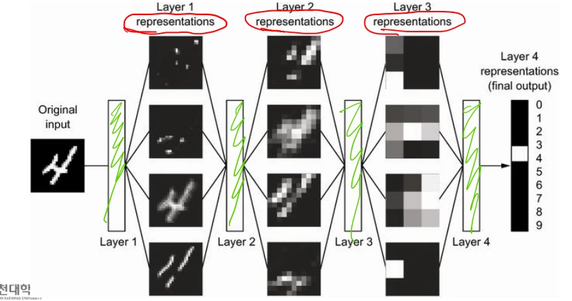

> **Forward Pass**는 그저 Original Input에 대한 **Representation**을 바꿔가는 과정이며, 각 계층에서 Layer가 어떻게 표현을 바꿀 것인지는 아무도 모른다. (학습을 하며 바꿔나가는 것)

#### How deep learning works? (Supervised Learning)

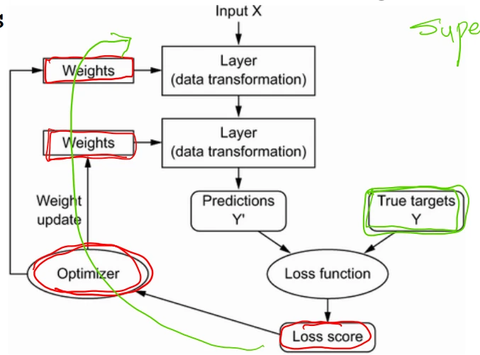

- 이와 같은 구조에서 Original Input이 모든 Layer를 거치면 Prediction Value **ŷ**을 얻는다. 이 과정에서 각 Layer에서 어떤 **Representation**이 나올지는 각 **Layer**의 **Weight**에 따라 달라진다.
- 기계학습에서 학습의 의미는 **Hyperparameter**를 조절하고 결정하는 과정이다.

⇒ 이 값을 어떻게 조절하고 결정할 지는, 얼마만큼 잘 예측하고 못했는지를 검사하면 된다.

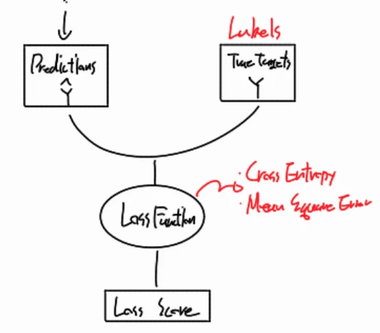

- Supervised Learning에서 정답(True Target Y)은 **Label**이라고 한다.
- Label과 Prediction의 오차를 평가해서 얼마나 맞췄고 얼마나 틀렸는지를 나타낸다.

- 이때, 오차를 나타내기 위해 오차를 계산하는 함수를 **Loss Function**이라고 한다.

    - Loss Function으로는 Mean Squared Error, Cross Entropy 등을 사용한다.

---

#### Backward Pass

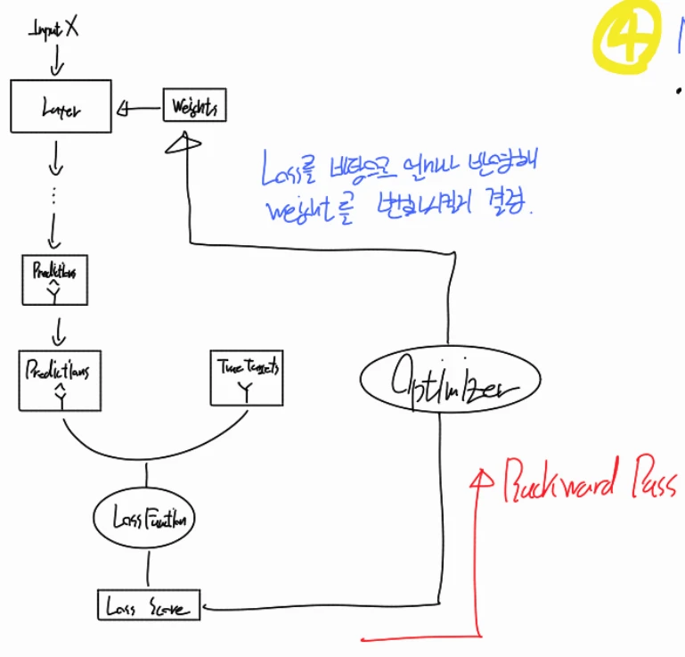

- 이와 같은 과정을 거쳐서 Loss Score를 얻으면, 이를 바탕으로 Weight를 변경하는데, 이 과정을 **Backward Pass**라고 한다.

> 단, Supervised Learning은 정답이 있어야만 의미가 있는 학습 방법이기 때문에 실제로는 굉장히 어렵다. 학습의 종류는 크게 세가지이다.  
>   
> Supervised Learning  
> Un-supervised Learning  
> Semi-supervised Learning

#### Binary Classification

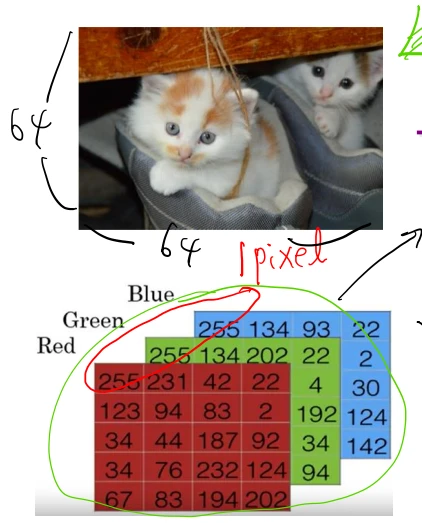

- 위와 같이 64 x 64 x 3 고양이 사진이 있다고 가정해보자. 64 x 64 x 3 = 12,288 이므로, 해당 사진을 벡터로 늘어뜨리면 다음과 같이 표현될 수 있다.

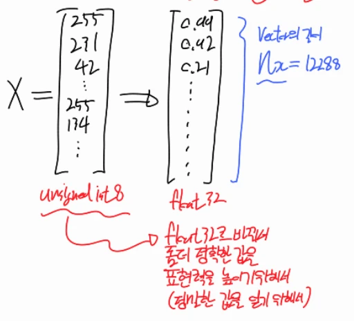

- 해당 벡터의 차원(nx)은 12,288 차원이며, 이는 vector의 길이가 12,288 이라는 뜻이다.

- RGB 이미지의 경우 한 픽셀의 값이 uint8로 표현되는데, 이를 float32로 바꿀 수도 있다.

    - 이렇게 바꾸는 이유는, uint8은 0~255까지의 값만 가져서 각 픽셀의 값을 256개로 밖에 표현할 수 없다. 하지만 float32로 변경하면 값을 표현할 수 있는 범위가 실수 단위로 늘어나기 때문에 좀더 정밀한 값을 얻을 수 있다.

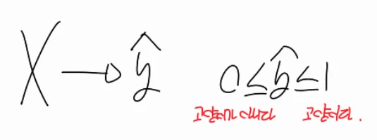

위와 같은 과정을 거쳐 Original Input X로부터 ŷ을 얻어낸다. 이 값은 확률이므로, 항상 0과 1 사이이며, 본 예제에서는 1에 가까울 수록 Input이 고양이의 사진일 확률이 높다는 것이고, 0에 가까울 수록 Input이 고양이 사진일 확률이 낮다는 것이다.

#### Notation

- (X, y) : 입력과 정답을 묶은 한 세트이며, Example이라고 부른다.

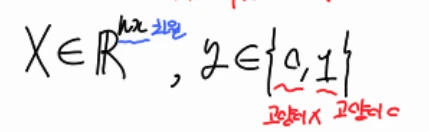

Vector의 길이는 nx, 정답은 0 또는 1이다.

- examples : 일반적으로 학습 데이터는 수백만 개를 사용한다.

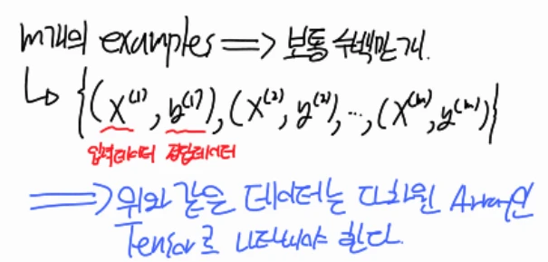

⇒ m개의 examples를 묶으면 아래와 같이 표현할 수 있다.

- m개의 examples의 집합

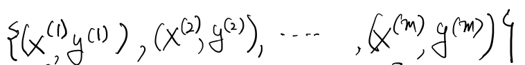

- m개의 example의 Input data 집합 X

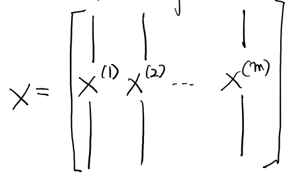

- m개의 example에 대한 정답 Y

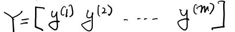

- X, Y의 차원 및 shape

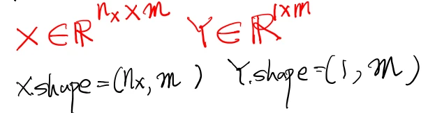

⇒ X(nx, m), Y(1, m), 데이터는 rank를 맞춰서 표현해 주는 것이 좋다.

---

#### Logistic Regression

> Layer가 하나인 신경망을 Logistic Regression이라고 한다.

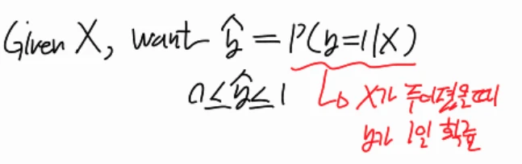

⇒ Input Data X가 주어졌을 때, y = 1일 확률 ŷ을 얻어낸다. ( 0 ≤ ŷ ≤ 1)

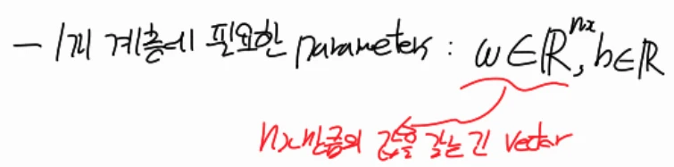

⇒ 1개 계층에 필요한 parameter는 w(weight), b(bias)이며, w는 한 x 벡터의 길이인 nx만큼의 크기를 갖고, bias는 하나의 scalar 값이다.

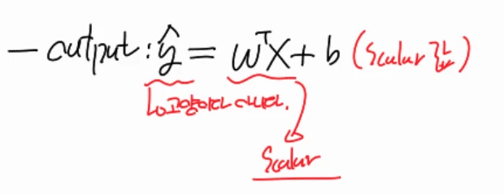

⇒ 즉, 하나의 Layer를 거치면 Input Data Vector X와 Weight가 곱해지고, w\^T (1, nx)와 X (nx, 1)를 곱하면 (1, 1) Scalar 값이 나오게 된다. b(bias) 또한 scalar 값이므로, 둘을 곱하면 어떠한 값이 나오게 되는데, 이를 **Sigmoid Function**(Logistic Function)에 넣어서 고양이일 확률 ŷ을 얻어낸다.

---

#### Sigmoid Function(Logistic Function) ⇒ Activation Function(활성화 함수)

> S자 형태로 그려지는 함수를 일반적으로 Logistic Function이라고 부른다.

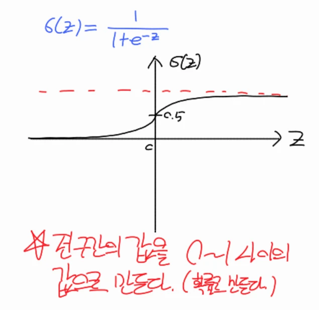

---

#### Loss Function(손실 함수)

> y와 ŷ를 비교할 함수를 Loss Function이라고 한다.  
> Loss Function은 기호 L로 표현한다.

- 가장 간단한 Loss Function은 벡터 공간에서 Euclidean Distance를 구하는 것이다.

- **Squared Error**

$$
L(ŷ, y)= \frac{1}{2}(ŷ - y)^2
$$

⇒ 미분했을 때 나오는 상수를 제거하기 위해서 앞에 상수 1/2를 붙여주기도 한다.

- **Cross Entropy**

    $$
    L(ŷ, y) = -\{ylogŷ +(1-y)log(1-ŷ)\}
    $$

    - y = 1인 경우 : -logŷ
    - y = 0인 경우 : -log(1-ŷ)

> Cross Entropy에서는 왜 log를 사용할까?  
> 1. 숫자가 너무 커지는 것을 방지함  
> 2. log(xyz) = logx + logy + logz 로 분리되는 것 처럼, 편미분할 때 매우 편하게 계산 가능함

---

#### Cost Function

> m개의 Loss의 평균을 구하는 함수  
> Cost Function은 기호 J로 나타낸다.

$$
J(w, b) = \frac{1}{m}\Sigma_{i=1}^{m}L(ŷ^{(i)},y^{(i)})
$$

- 이제 Cost Function을 얻었으므로, Loss의 평균을 최소화할 수 있는 w, b 값을 찾기 위해 미분해야 한다. 하지만, J(Cost Function)는 변수가 12,288개 + 1개나 되는 함수이기 때문에 미분이 굉장히 어렵다.

> 만약 Cost Function이 Convex(볼록) 함수라면 미분이 쉽겠지만, 이것은 12,288 + 1 차원의 함수이기 때문에 현실적으로 나타낼 수 없다는 문제점이 있다.

⇒ 이 문제를 해결하기가 매우 어렵기 때문에 컴퓨터가 반복적으로 근사해서 값을 찾도록 만든다. 이를 **Gradient Descent**라고 한다.

- Numerical Solution : 수학적인 해결이 불가능할 때 근사적으로 해결하는 것(Approximation)
- Analytical Solution : 수학적 해결이 가능할 때 해결하는 것

#### Gradient Descent(경사하강법)

> m개의 Loss의 평균에 대한 식은 구했지만 최솟값을 만드는 **Weight**와 **Bias**를 찾지 못하는 상황에서 Numerical Solution을 통해 근사적으로 값을 찾아나가는 과정

- 실제로, 현재 문제에서는 W가 12,288개가 존재하기 때문에 이 함수를 Graph로 나타내기는 매우 어렵다. 하지만 지금은 가상의 함수를 만들고 w를 하나의 스칼라값처럼 표현해보자.

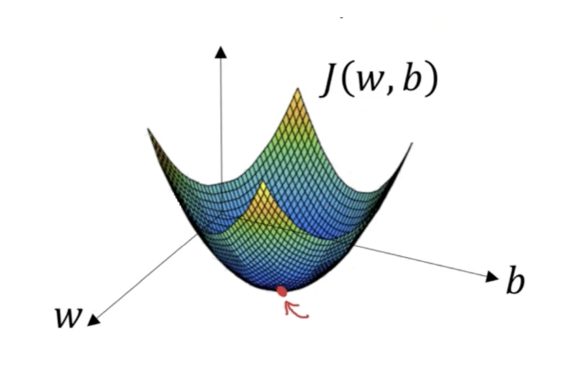

이 상황에서 랜덤한 지점 하나를 골랐을 때, 이 지점이 최소가 되는 지점인지를 어떻게 알 수 있을까?

> 여러가지 방법이 존재할 수 있지만, 현재 내가 위치한 지점 주변의 값들이 나보다 큰지를 비교하면 알 수 있을 것이다. **하지만, Cost Function 자체가 몇 만 차원이 넘는 복잡한 함수이기 때문에 계산하는데 Overhead가 굉장히 크다는 문제가 있다.**  
>   
> ⇒ 해결법  
>   
> **Cost Function의 한 지점에서 양옆 지점의 기울기를 구해서 감소하는 지점으로 이동한다.**  
>   
> 이것은 Cost Function J(w, b)를 미분해보면 알 수 있다. (J’ = 0인 지점을 구할 수가 없는 것인지 J’ 자체를 못구하는 것은 아니기 때문에 값을 넣어보면 기울기는 알 수 있다.)

- **Gradient** (기울기)

미분을 통해서 어느 방향으로 W를 이동시킬지 확인해보자.

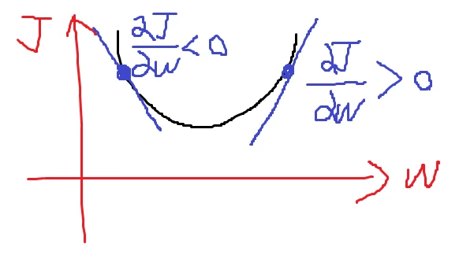

각 지점에 있을 때 W를 변화시켜야 한다.

$$
w = w - \alpha(\frac{\partial J}{\partial w})
$$

$$
b = b - \alpha(\frac{\partial J}{\partial b} )
$$

> 위와 같이 Cost Function을 w, b에 대해서 편미분하고, 이전의 값에서 빼주면 현재 지점을 기준으로 w, b를 업데이트할 수 있다. 위의 그림과 같이 기울기가 +인 지점에 위치한다면, 기울기를 빼면 weight가 감소하여 J가 최소인 지점으로 갈 수 있고, 기울기가 -인 지점에 위치한다면, 부호가 +로 바뀌면서 weight가 증가해 J가 최소인 지점으로 갈 수 있다.  
>   
> 이 과정을 반복하면서, 기울기가 0인 지점을 구하게 되면 학습이 완료된 것이다.

- **Learning Rate** (학습률)

위의 식에서 α를 통해서 w, b가 변화되는 정도를 조절할 수 있는데, 이를 **학습률**이라고 한다.
