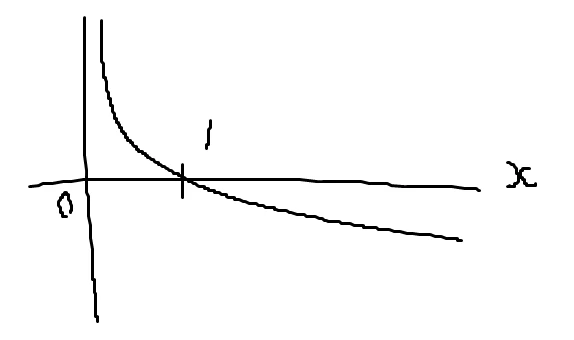
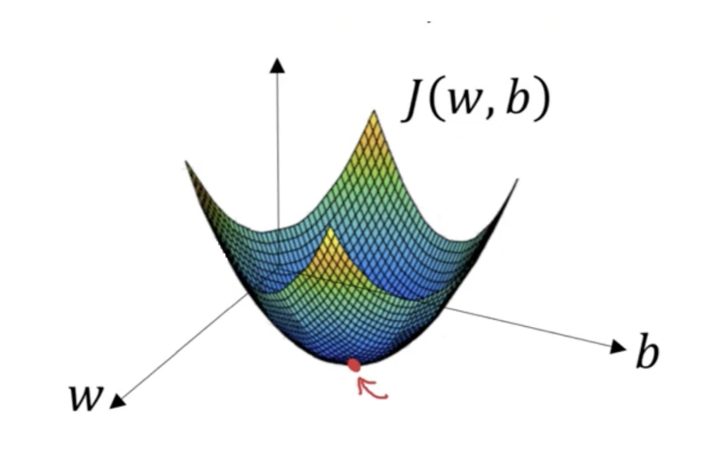
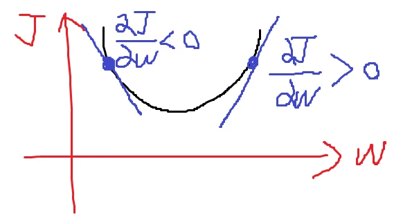
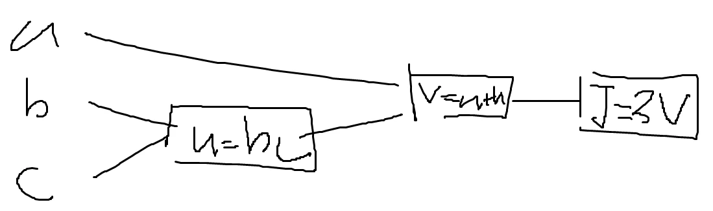

# 3주차 수업 중 정리: Loss Function, Gradient Descent, Back Propagation

작성일 2023-09-25 · 최종 수정일 2023-09-28
{ .post-date }

## Logistic Regression (cont.)

- output을 얻어냈음. (ŷ)

- 이제 얻어낸 예측치를 결과값과 비교하여 오차가 얼마나 되는지 확인한다.

    - 이때 사용되는 것이 **Loss Function**이다.

---

### Loss Function

y와 ŷ를 비교할 함수를 Loss Function이라고 한다. (L)

- Loss Function : L(ŷ, y)

가장 간단한 방법은 벡터 공간에서 distance를 구하는 것이다.

#### **Squared Error**

L(ŷ, y) = 1/2 (ŷ-y)\^2

제곱을 미분했을 때 상수를 없애기 위해 종종 1/2를 붙이기도 한다.

⇒ Loss Function의 종류는 굉장히 많다.

#### **Cross Entropy**

y, ŷ이 비슷하면 loss가 작아진다.

L(ŷ , y) = -(ylogŷ + (1-y)log(1-ŷ))

- y = 1인 경우 : -logŷ 

    - ŷ = 1이면 좋다. (오차가 없는 것)

    

    ⇒ 그런데, 우리는 ŷ에 sigmoid를 적용했기 때문에 관심있는 영역은 0 ≤ x ≤ 1이다.  
    즉, ŷ이 0에 가까워지면 loss값이 커지고, ŷ이 1에 가까워지면 loss가 없는 것이다.

- y = 0인 경우 : -log(1-ŷ)

    - ŷ = 0에 가까우면 오차가 없는 것으로 보인다.

> 딥러닝에서 가장 많이 사용되는 Loss Function은 Cross Entropy이다.  
> 또한, Cross Entropy는 Binary Classification에만 사용하는 것이 아니라 여러 Class가 존재할 때도 사용할 수 있다는 데서 확장성을 가진다.

⇒ 그런데, Cross Entropy에 왜 log가 도입될까?

1. 숫자가 너무 커지는 것을 방지할 수 있다. 
2. log(xyz) = logx + logy + logz : 편미분할 때 매우 편하게 계산할 수 있다. 즉, 곱하기 연산으로 되어있는 것들을 더하기로 바꾸기 때문에 유용하다.

---

### Cost Function

- m개 Loss의 평균

J(w, b) = 1/m sigma(i = 1  to m) L(ŷ[i], y[i])

⇒ Computer 쪽은 용어가 통일되지 않은 경우가 많아서, 이걸 Cost Function이 아니라 Loss Function으로 부르기도 한다.

Cost Function의 variable은 weight와 bias이다.

이제 Cost Function을 얻었으므로, Loss의 평균을 최소화 할 수 있는 w, b 값을 찾기 위해 미분해야 한다. 하지만 J(Cost Function)는 변수가 12000개의 w + 1개의 b이기 때문에 미분이 굉장히 어렵다.

(Convex, 볼록한 함수면 쉽겠지만 이것은 미분이 어렵다.)

⇒ 이걸 따라가기 어렵기 때문에 컴퓨터가 반복적으로 근사하게 만들어서 값을 찾는다. 이를 Gradient Descent라고 한다.

numerical solution : 해결이 불가능할 때 반복 근사적으로 해결하는 것(approximation)

analytical solution : 해결이 가능할 때 계산으로 해결하는 것

---

### Gradient Descent

실제로 w는 12000개의 변수가 존재해서 그림으로 나타내기 어렵지만, 지금은 그릴 수 있는 것처럼 하나의 스칼라값처럼 표현해보자.

이 상황에서 랜덤한 지점 하나를 잡았을 때, 그 지점이 최소인 지점인지 어떻게 알 수 있을까?  
⇒ 여러가지 방법이 있을 수 있지만, 현재 내가 위치한 지점 주변의 값들이 나보다 작은지 큰지를 비교하면 알 수 있을 것이다. **하지만, Cost Function 자체가 굉장히 복잡한 함수이기 때문에 계산하는데 Overhead가 매우 크다.** 

- 만약 내가 산에 올라가 있다고 해보자. 그러면 내 몸이 좀 기울어져 있을 것이다. 그 상태에서 눈을 감고 있다면, 내가 기울어져 있는 방향으로 내려가면 아래로 내려갈 수 있다는 것을 알 수 있다. 이와 같이 Cost Function에서도 어느 방향으로 기울어져 있는지를 검사하면 된다.

    ⇒ 이것은 J를 미분해보면 된다. (J’ = 0인 값을 구할 수 없는 것이지, 미분해볼 수는 있다.)

#### Gradient (기울기)

이제 미분을 통해서 어느 방향으로 w를 이동할지 알려준다.

각 지점에 있을 때, w값을 변화시켜야 한다.

w = w - α(∂J/∂w)

b = b - α(∂J/∂b)

⇒ 이 식에서 α값에 따라 w, 혹은 b가 변화되는 정도가 달라진다.

> 위의 식에 α를 **Learning Rate**라고 하며, 이에 따라 학습의 정도가 정해진다.

---

### Training Procedure

- forward pass

입력 데이터를 Layer에 넣어서 Prediction 값을 얻는다. ⇒ Loss 값까지 얻어냄

- compute gradients 

w := w - α(∂J/∂w)

b := b - α(∂J/∂b)

⇒ 이것은 정확한 값은 아니다. 그러므로 계속해서 반복해야 한다.

- Repeat

이 작업을 언제까지 반복해야 할까? gradient가 변화하지 않을 때까지.

> 그런데 사실 ∂J/∂w를 구하는 것은 매우 어렵다. 복잡한 합성 함수를 미분할 때는 어떻게 해야할까?

#### Computation Graph

J(a, b, c) = 3(a + bc)

1. b와 c를 u로 묶는다. (u = bc)
2. a와 더한다. (v = a + u)
3. J = 3v

<!-- -->

- forward pass

⇒ 실제로 Pytorch가 내부적으로 이렇게 구현함. (포인터를 통해서)

ex) a = 5, b = 3, c = 2, v = 11, J = 33

- 여기서 Gradient의 값은 무엇인가?

∂J/∂a, ∂J/∂b, ∂J/∂c 등이 있다.

∂J/∂v = 3

∂v/∂a = 1

∂v/∂u = 1

∂u/∂b = c 

∂u/∂c = b

---

### Back Propagation

- Chain Rule : a가 변하는 정도에 따라 J가 얼마나 변하는지 구하는 법

∂J/∂a = (∂J/∂v) * (∂v/∂a) = 3 * 1 = 3

∂J/∂b = (∂J/∂v) * (∂v/∂u) * (∂u/∂b) = 3 * 1 * c = 3 * 1 * 2 (c = 2)

⇒ 이렇게 보면, b의 영향이 두 배 더 크다.

---

### Logistic Regression Recap

1. x1, w1, x2, w2, b

⇒ Z = w1\*x1+w2\*x2+b

1. a = σ(Z) (시그모이드 통과, a = ŷ)
1. Loss Function L(a, y)
1. ∂L/∂w1, ∂L/∂w2, ∂L/∂b를 구한다.

∂L/∂w1 = (∂L/∂a) * (∂a/∂Z) * (∂Z/∂w1)

∂L/∂w2 = (∂L/∂a) * (∂a/∂Z) * (∂Z/∂w2)

∂L/∂b = …
