# Backward Pass & Vectorizing

작성일 2023-09-28 · 최종 수정일 2024-11-23
{ .post-date }

## [Backward Pass & Vectorizing]

> Forward Pass를 거쳐 최종적으로 얻어낸 값을 바탕으로 Parameter를 업데이트 하는 과정인 Backward Pass를 다루고, Logistic Regression을 효율적으로 만드는 Vectorizing을 알아본다.

---

### &lt;Backward Pass&gt;

> Forward Pass 이후, Parameter를 업데이트 하는 과정을 Backward Pass라고 한다.

#### Computation Graph

- J(a, b, c) = 3(a + bc)의 관계를 갖는 모델이 있다고 해보자.

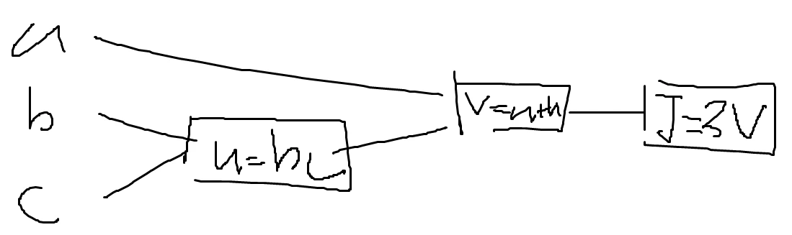

- 위와 같이 그림이 나타날 때, 아래의 값은 어떻게 구할 수 있을까?

$$
\frac{\partial J}{\partial a},\frac{\partial J}{\partial b}
$$

위의 식에서, 각 parameter의 값을 다음과 같이 가정해보자.

ex) a = 5, b = 3, c = 2, v = 11, J = 33

- 이 식에서 우리는 Cost Function J를 거쳐 도출되는 값이 최소가 되는 지점을 찾기 위해 a, b Parameter를 업데이트 해야한다. 그러기 위해서는 Gradient를 구해야 하고, 각 지점에서 구해지는 Gradient의 종류는 다음과 같다.

$$
\frac{\partial J}{\partial v}, \frac{\partial v}{\partial a}, \frac{\partial v}{\partial u}, \frac{\partial u}{\partial b},
\frac{\partial u}{\partial c}
$$

그리고 각각의 값은 다음과 같다. (a = 5, b = 3, c = 2일때 각각의 미분 결과)

∂J/∂v = 3

∂v/∂a = 1

∂v/∂u = 1

∂u/∂b = c 

∂u/∂c = b

---

#### Back Propagation

- 이제 a 또는 b가 변화함에 따라 J가 얼마나 변화하는지 알아보기 위해 **chain rule**을 적용한다.

$$
\frac{\partial J}{\partial v} = (\frac{\partial J}{\partial v}) * (\frac{\partial v}{\partial a}) = 3 *1=3
$$

$$
\frac{\partial J}{\partial v} = (\frac{\partial v}{\partial u}) * (\frac{\partial u}{\partial b}) = 3  * 1 * c = 3 * 1 * 2 = 6
$$

> 이 결과를 바탕으로, 값의 변화가 J에 미치는 영향이 b가 a보다 두 배 더 크다는 것을 알 수 있다.

---

#### Implementing Logistic Regression

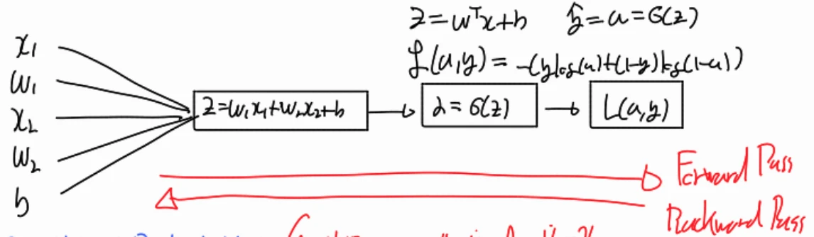

- 우리가 여기서 할 것은 w(혹은 b)를 업데이트하는 것이다.

    ⇒ ***Q. 여기서 w1, w2, b 각각에 대해서 Gradient를 구해야 하는가?***

    ⇒ ***A. 아마도 그런듯 하다. 왜냐면, w 전체의 변화에 대해서 L의 값의 변화를 구할 수는 없다.  
    그러므로 모든 weight에 대해서 각각 구해주어야 하는 것이 맞는 듯 하다.***

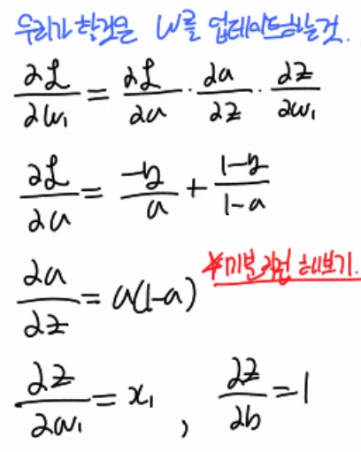

a는 sigmoid function을 미분한 것

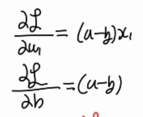

w1, b의 차이는 x1, 1

> 위와 같이 Chain Rule을 통해 Back Propagation을 하기 위해서는 학습 과정에서 얻은 변수 a, y, x 등을 모두 저장해 두어야 한다. 그래서 Training Time에 많은 Memory가 필요한 것이다. (RAM 또는 GPU Memory. 혹은 H/W상의 Cache)

- Logistic Regression On m Examples

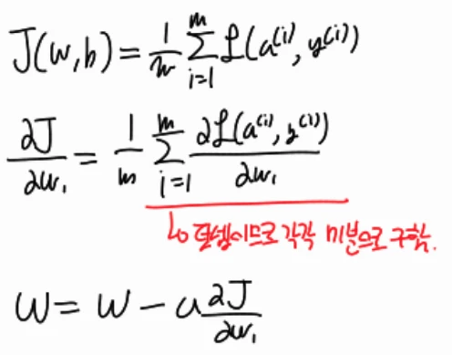

J는 cost function이며, m개의 example에 대해서 얻어낸 예측값을 Loss Function L에 통과시켜 Loss값을 얻고, 각각의 값을 더해서 m으로 나누면 Loss의 평균을 얻어낼 수 있다.

이렇게 얻어낸 기울기 값을 바탕으로 w 값을 갱신하면 Back Propagation이 이루어진 것이다.

#### Logistic Regression Pseudo Code

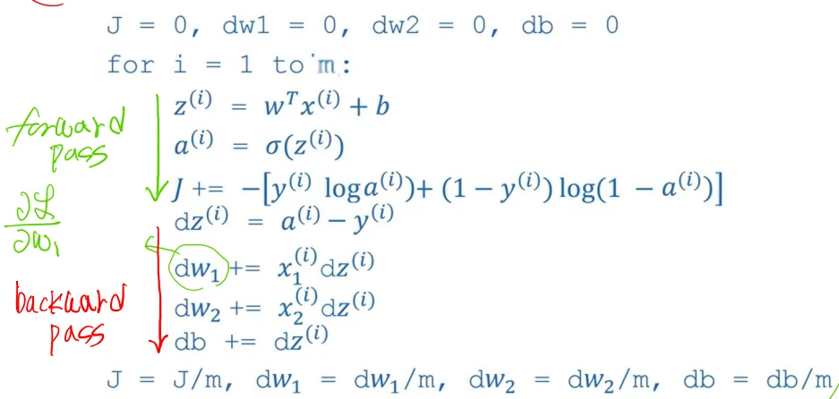

> 1) w는 모든 example에 대해서 똑같은 것을 적용한다. 그러므로 superscript를 붙이지 않는다. 이후에 다층 신경망의 vectorization에서 w의 dimension은 변하지 않는 것도, w는 모든 데이터에 대해서 동일하게 적용되기 때문이다.  
>   
> 2) dz는 example마다 달라지므로, subscript를 적용하지 않는다. (하단 이미지 참조) 계산해 보면, dz = a - y가 나온다.  
>   
> 3) dz까지는 x1, x2로 나뉘어지지 않는다. 하지만 dw1, dw2부터는 나뉘어지는데, 그 이유는 다음과 같다. (하단 이미지 참조) 아래 이미지를 보면, z(i)를 w1으로 미분하면, x1만 남는 것을 확인할 수 있다. W matrix는 example에 따라 달라지는 것이 아니기 때문에 이와 같이 만들어진다.

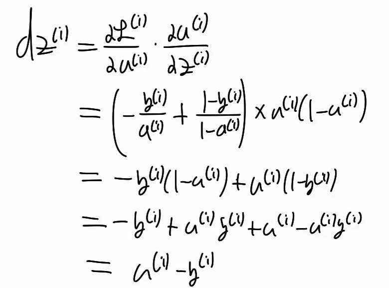

2)

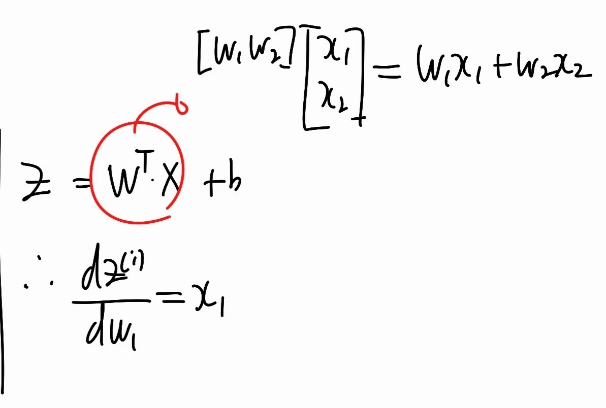

3)

- <strong>주요 함수 미분(</strong>Loss Function, Sigmoid Function)

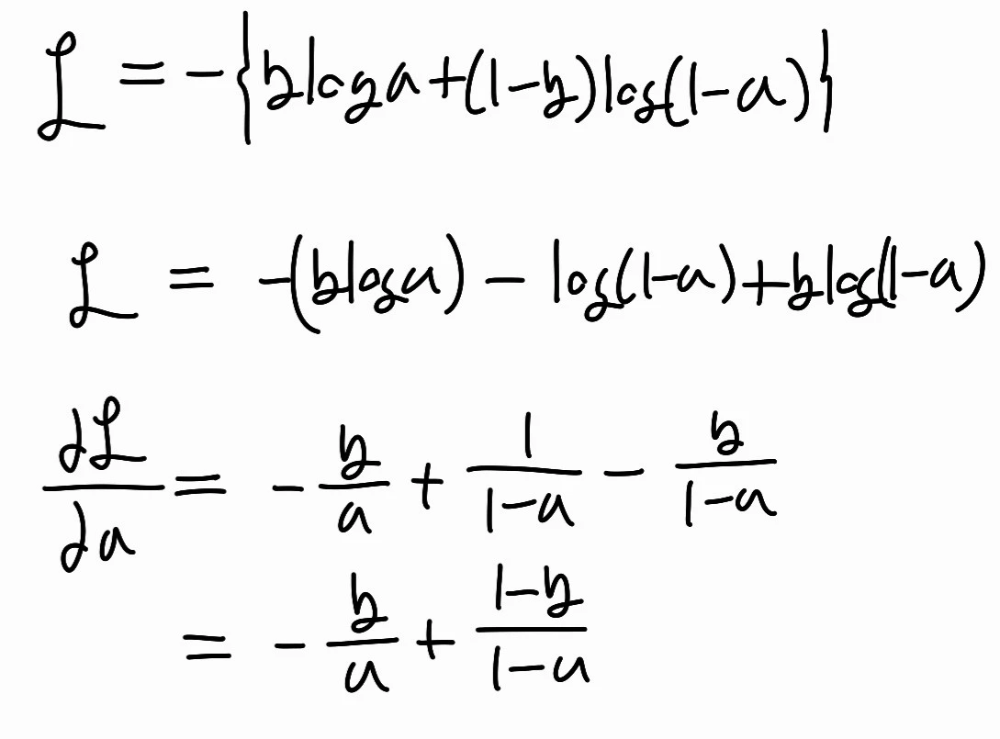

⇒ 부호 잘못

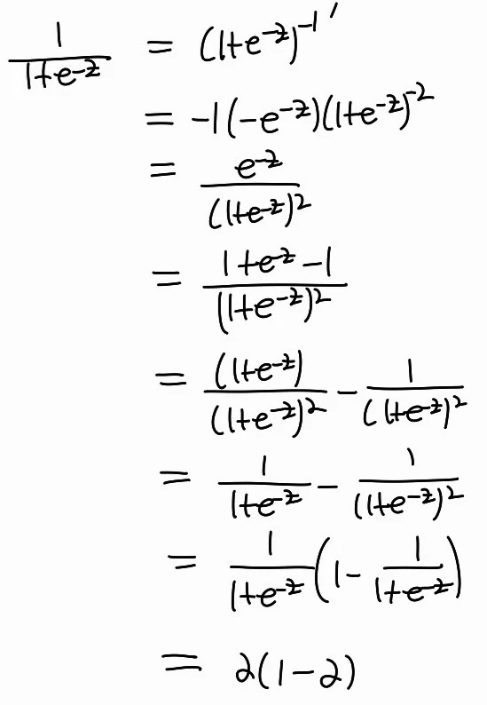

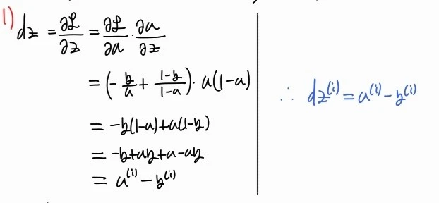

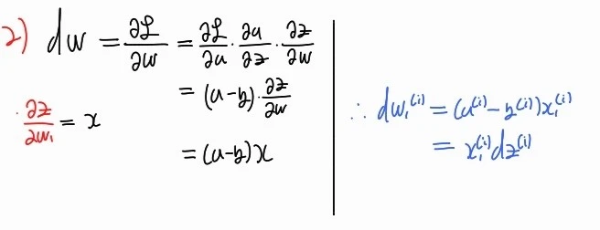

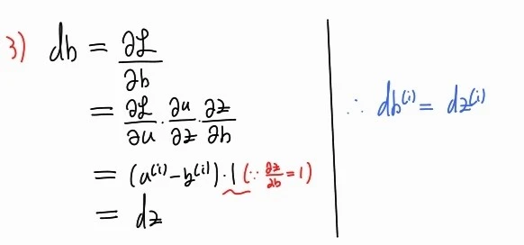

1) J, dw1, dw2, db 변수를 0으로 초기화

2) m개의 example에 대해서 다루므로, 1 to m for loop 생성 (range in 1:m)

3) forward pass

3-1] 1개의 x data에 weight를 곱하고 bias를 더해 z 계산

3-2] z를 sigmoid function에 넣어서 0~1 사이의 값으로 변환

3-3] 얻어낸 예측값을 Cost Function에 넣어 Loss Score를 얻어냄

4) backward pass

4-1] dz, dwn, db를 구해서 m개의 examples에 대한 parameter 변화값을 누적시킴

4-2] 3~4 과정을 m번 반복함

5) 현재 구한 것은 m개의 값에 대한 합이므로, 구한 값들을 m으로 나눠 평균을 구한다.

> 이렇게 얻어낸 값을 바탕으로 w1, w2, …, w12,288, b를 갱신하고 epoch을 반복한다.

#### epoch

> epoch이란, 학습에 사용하고자 하는 m개의 세트 example을 적어도 한번씩 학습하는 과정을 말한다. 예를 들어 m개의 examples가 있을 때 m개의 example을 한 번씩 layer에 입력시키면서 최종적으로 가중치를 갱신시켰다면 그것을 1 epoch이라고 할 수 있다.   
>   
> 일반적으로 머신러닝에 있어서 데이터를 구하는 것이 굉장히 어렵기 때문에 동일한 데이터에 대해서 적게는 몇 십 epoch, 많게는 몇 백 epoch까지 반복하며 학습하는 경우가 일반적이다.

---

### &lt;Vectorizing&gt;

> 머신러닝 학습과정은 굉장히 많은 양의 데이터를 처리하기 때문에 병렬처리가 필수적이다. 이를 위해 필요한 명령어들에 대해 살펴본다.

#### What is Vectorization?

- 이전에 pseudo code에서 사용하던 방식은 m번의 loop를 순차적으로 실행하고, 그 뿐만 아니라 각각의 loop에서 수많은 for loop를 돌기 때문에 굉장히 오랜 시간이 걸린다는 단점이 있다. 이것을 극복하기 위해서 병렬처리를 할 수 있도록 코드를 vectorization한다.
- pseudo code

z = wx+b

dz = 0

for i in range(nx):

z += w[i]*x[i]

dz += b

⇒ 이와 같이 코드를 작성하면 아무리 성능이 좋은 H/W를 쓰더라도 순차적으로 연산하기 때문에 학습이 오래걸릴 수밖에 없다.

- vectorization

```python
import numpy as np

z = np.dot(w, x) + b
```

⇒ 이렇게 연산하면  w에 x를 곱하고 더하는 과정을 컴퓨터 내부의 H/W를 최대한 끌어와서 병렬처리를 하도록 만든다. 만약 학습에 CPU를 이용할 경우, CPU 자체에 내장되어 있는 병렬처리용 Instruction을 사용하여 학습을 진행하고, Tensorflow나 Pytorch를 이용하여 GPU, TPU 학습을 진행할 경우에는 자체적인 멀티 코어를 사용해 성능을 대폭 향상시킨다.

> Vectorization은 Parallelization을 하는 것이 아니다.   
> Vector, Matrix를 병렬처리 API로 넘기는 것이다.

#### Vectorization Example

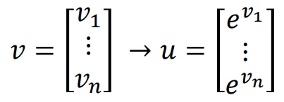

다음과 같은 벡터 v가 있을 때, exponential을 취할 때도 vectorization이 가능하다. 바로 numpy 자체에서 지원하는 병렬처리 API를 사용하면 된다.

```python
u = np.exp(v)
```

이 외에도 다양한 연산이 존재한다.

```python
np.log(x)
np.abs(y)
```

#### Vectorizing Logistic Regression

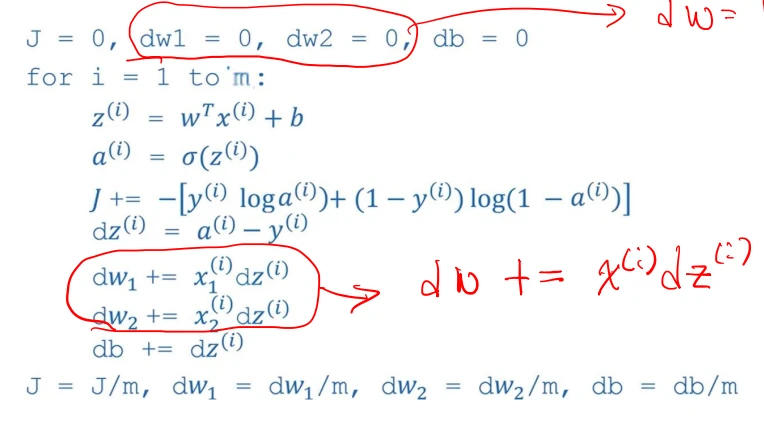

⇒ 위와 같이 Logistic Regression 학습 과정의 pseudo code가 있을때, 어떤 것들을 Vectorizing 해야 학습 속도를 향상시킬 수 있을까?

1. 초기화 과정

pseudo code의 첫 줄에서는 학습에 필요한 변수들을 초기화한다.

이 변수들을 초기화 할 때도 np.zeros((nx, 1))을 이용하는 것이 좋다.

1. dz(i)

dz(i)에서 사용되는 a는 input x에 가중치 w를 곱하고 bias b를 더한 것을 sigmoid function에 넘겨서 0~1 사이의 Scalar 값으로 변환한 것이다. 또한 y는 true target이므로 정답이다. 그렇기 때문에 둘 다 scalar 값이므로 vectorization 할 것이 없다.

- 위 pseudo code의 for loop은 forward pass, backward pass로 이루어지기 때문에 두 단계를 각각 나눠서 vectorization을 진행한다.

#### 1) Vectorization on Forward Pass

**1) Z**

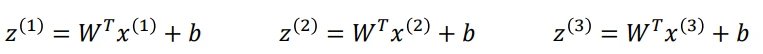

위와 같이 총 m개의 example에 대한 z를 구하고 있는데, 이전까지는 for loop을 돌았기 때문에 각각 한번씩 연산을 통해서 구하게 되었다. 이를 한 번에 얻고자 한다면 어떻게 해야할까?

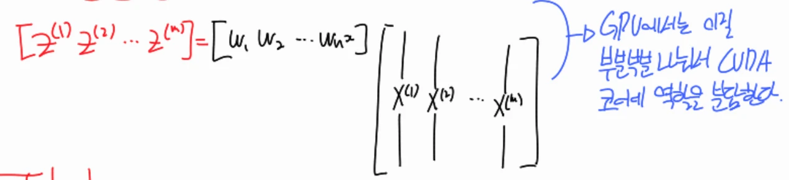

이와 같이 nx개의 값을 갖는 (1, nx) 가중치 벡터를 두고, input data X는 (nx, m) Matrix로 만들어서 정리하면 (1, nx) * (nx, m) 으로 연산이 가능하며, 결과적으로 (1, m) 크기의 결과 벡터가 나오게 될 것이다. 그리고 bias b는 scalar이므로 그냥 더해주기만 하면 된다. 따라서 아래와 같이 작성한다.

```python
np.dot(w', X) + b
```

⇒ (1, m) + (1,) : 이것이 연산 가능한 이유는 numpy 자체에서 broadcasting을 지원하기 때문이다.

**2) a**

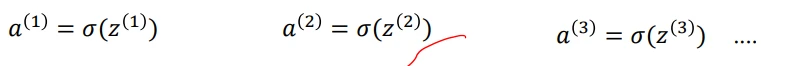

a는 1)번에서 구한 z값을 sigmoid에 입력시켜 0~1 사이의 확률값으로 변화시키는 함수이다. 이것 또한 1)번과 마찬가지로 m개의 값을 구해야하는데, 어쨌든 한번 한번 모두 sigmoid function에 넣어주어야 하는 것이므로 vectorization 할 것은 없고, 그냥 sigmoid에 넣어주면 된다. 다만, numpy는 자체적으로 sigmoid를 지원하지 않기 때문에 sigmoid를 구현할 필요는 있다.

$$
a = \frac{1}{1+e^{-x}}
$$

> **sigmoid 구현하기**  
>   
> sigmoid의 식은 위와 같으며, numpy는 자체적으로 구현되어 있지 않다.  
> 그러므로 np.exp(-z)를 이용해 구현하면 된다.

```python
sigmoid = 1/(1+np.exp(-Z))
```

⇒ 이렇게 하면 element wise로 모든 값에 대해서 vectorization된 방식으로 exponential을 계산한다.

#### 2) Vectorization on Backward pass

1) dz

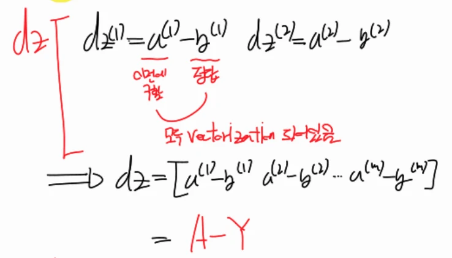

dz는 a - y인데, a는 forward pass 과정에서 이미 vectorization 된 상태로 구했으며, y는 정답이므로 이미 vectorization 되어 있다. 따라서 두 개를 빼기만 하면 되므로 vectorization 할 것이 없다.

2) dw

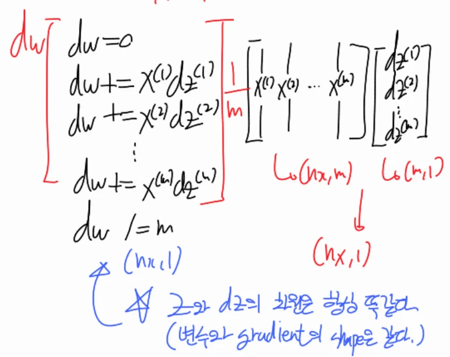

dw는 (nx, m) X data matrix와 (m, 1) dz를 곱해서 (nx, 1)의 크기로 얻어낼 수 있다. m으로 나누는 것은 scalar로 나누는 것이므로 broadcasting을 통해서 간단하게 나눠질 수 있다. 이를 vectorization하기 위해서는 아래와 같이 할 수 있다.

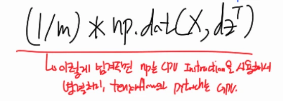

3) db

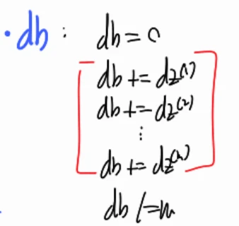

db도 dw와 비슷하게 db 변수에 (m, 1) 크기인 dz를 더해주므로 vectorization이 가능하며, broadcasting을 통해 m으로 쉽게 나눌 수 있다.

#### Vectorization Summary

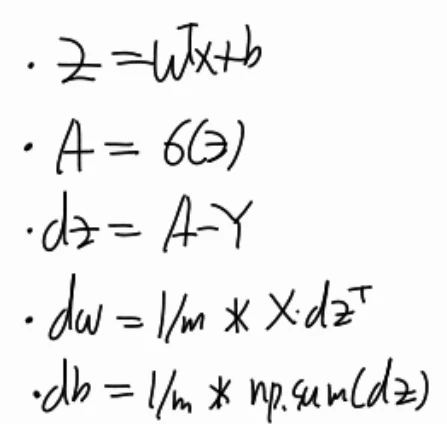

위의 요소들을 Vectorization 할 수 있다.

$$
w = w - \frac{\partial J}{\partial w}
$$

$$
b = b - \frac{\partial J}{\partial b}
$$

⇒ 지속적으로 epoch을 거치면서 parameter를 업데이트하고, 더 이상 update가 되지 않을 때 학습을 종료하면 된다.
