# Multi Layer Network

작성일 2023-10-16 · 최종 수정일 2025-04-18
{ .post-date }

## &lt;Neural Networks (계층 늘리기)&gt;

> 이전에는 Logistic Regression을 이용해서 단일 Layer를 구성했었지만, 이번에는 Logistic Regression을 이어붙여서 Multi-layer를 만들어보자.

### Logistic Regression

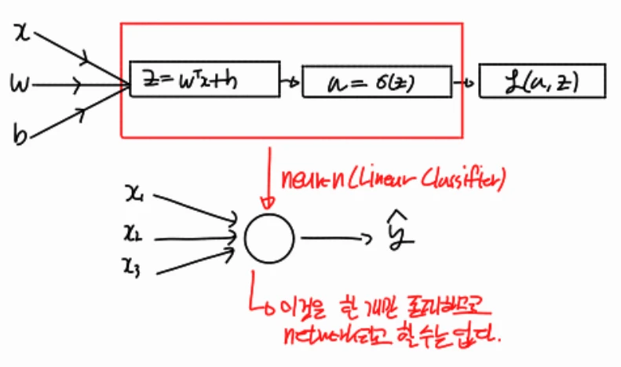

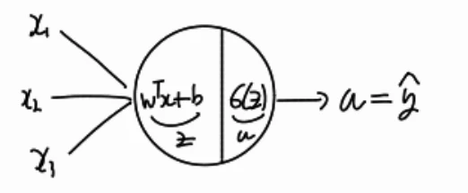

- Logistic Regression은 위와 같은 모양이며, 하나의 Linear Classifier의 기능을 한다.

    - 그런데 이것은 레이어가 한 개만 존재하므로, “Neural Network”가 아니다.

### Slightly Deeper Neural Network

> Logistic Regression의 Node를 이어붙여 하나의 Hidden Layer를 만들고, 이것을 하나의 Node가 있는 Output Layer와 이어붙인, 간단한 Network를 구성해보자.

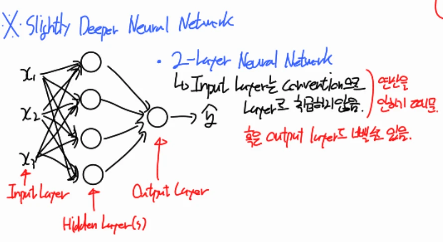

> Input Layer는 Convention에 따라 Layer로 취급하지 않는다. (별도의 연산이 없기 때문)

- 그런데, 왜 아래의 조합을 각각 하나의 계층으로 쳐서 두 개의 계층으로 보지 않는 걸까?

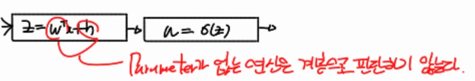

> 그 이유는, 머신러닝에서는 Parameter가 없는 연산은 계층으로 판단하지 않기 때문이다.  
> Parameter가 존재하는 연산을 해야 학습에 따라 의미있는 변형을 가할 수 있기 때문이다.

### Parameters in Neural Network Example

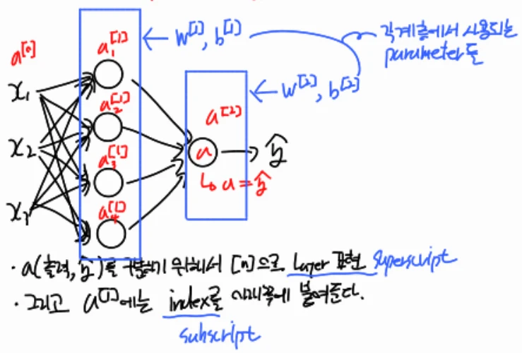

> 각각의 Layer에서 출력은 a로 표현하며, 활성화 함수인 Sigmoid를 거칠 경우 ŷ를 의미한다.  
> ⇒ Activation Function을 거치기 때문에 a라고 쓴다.  
>   
> Network에서는 Layer를 a\^[n]으로 표현하며, Input Layer는 a\^[n]이다. **Superscript**  
> 그리고, 밑에는 index를 붙여 몇 번째 Node인지 표현한다. **Subscript**

- 위와 같은 Network에서 사용되는 parameter는 다음과 같다.

    - **Hidden Layer**(a_1\^[1], a_2\^[1], a_3\^[1], a_4\^[1])

        - w\^[1], b\^[1]

        > 이렇게 표현하는 것을 보니, Weight와 Bias는 각 노드가 갖도록 하는게 아니라 한 Layer를 기준으로 갖게 하는 것이 맞는 것 같다.  
        >   
        > 위의 예시에서도 W\^[1], b\^[1]으로 표현한다.

    - **Output Layer**(a\^[2])

        - w\^[2], b\^[2]

### Input과 Weight의 행렬곱

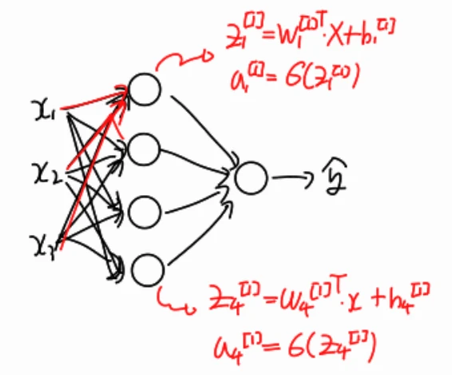

- 위의 예시와 같이, 모든 Node가 Fully Connected 되어 있다고 해보자. 이 상태에서 a_1\^[1]의 결과를 구하려고 한다.

    - Z_1\^[1] = W_1\^[1]’ * X + b_1\^[1]
    - a_1\^[1] = sigmoid(Z_1\^[1])

    > X(3, 1)  
    > W_1\^[1]&#40;3, 1) “*Input이 세 개 이므로 (3, 1)*”  
    > ⇒ 따라서, 행렬곱 할 때 W1을 Transpose해서 연산 진행.  
    >   
    > b_1\^[1]&#40;1, 1)  
    > Z_1\^[1]&#40;1, 1)  
    > ⇒ 따라서, a_1\^[1]은 (1, 1)이다.

- 이번에는 a_1\^[4]의 결과를 구해보자.

    - Z_4\^[1] = W_4\^[1]’ * X + b_4\^[1]
    - a_4\^[1] = sigmoid(Z_4\^[1])

    > 결과적으로 나오는 값들의 Size는 a_1\^[1]과 동일하다.  
    > X(3, 1)  
    > W_4\^[1]&#40;3, 1)  
    >   
    > b_4\^[1]&#40;1, 1)  
    > Z_4\^[1]&#40;1, 1)  
    > ⇒ 따라서, a_4\^[1]은 (1,1)이다.

### Hidden Layer 연산의 Vectorization

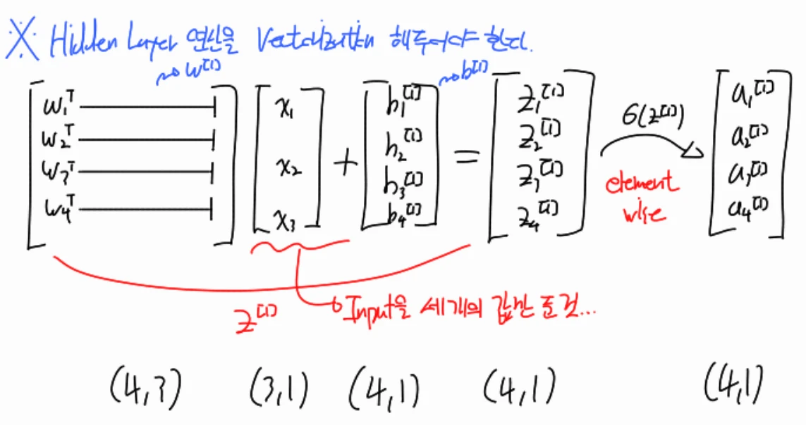

- W\^[1] : input이 세 개 이고, Hidden Layer의 Node가 네 개이므로 (4, 3)

- X : input이 세 개 이므로 (3, 1)

    ⇒ 연산하기 위해서는 W_1을 Transpose 해야 함.

- b\^[1] : node가 네 개 이므로, (4, 1)
- Z\^[1] : 결과적으로, (4, 1)
- a\^[1] : sigmoid는 element wise operation 이므로, (4, 1)

> 이제 a\^[1]을 구했으므로, a\^[2]를 연산한다.

### m개의 Example에 대한 a\^[1]의 Vectorization

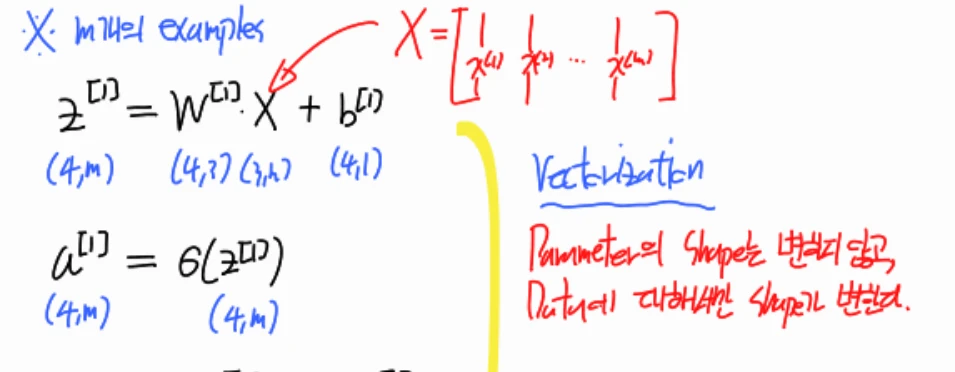

- X : input의 개수가 m개이므로, 이어붙이면 (3, m)이 된다.

- W\^[1] : Hidden Layer의 node가 네 개이고, Input이 세 개이므로, (3, 4)이다. 그런데, 연산을 하기 위해서는 Transpose를 하므로, (4, 3) 이다.

    ⇒ 둘을 행렬곱 하면, (4, m)이 된다.

- b\^[1] : bias는 네 개의 노드에 대해서 더해지는 것이므로, (4, 1)이다.
- Z\^[1] : Z\^[1]&#40;4, m) + b\^[1]&#40;4, 1)을 하면, bias가 Broadcasting에 의해 차원이 늘어나면서 더해지므로, 연산이 가능하다.
- a\^[1] : sigmoid(Z\^[1])는 element wise 연산이므로, 차원이 그대로 유지된다. (4, m)

> a\^[2]에서는 a\^[1]이 X의 역할을 한다.

> a\^[1]은 m개의 example 각각에 대해서, 네 개의 노드가 Input을 전달받아 가중치를 곱하고 sigmoid를 통해 예측한 확률을 나열한 것들이 m개만큼 존재하는 것이다.

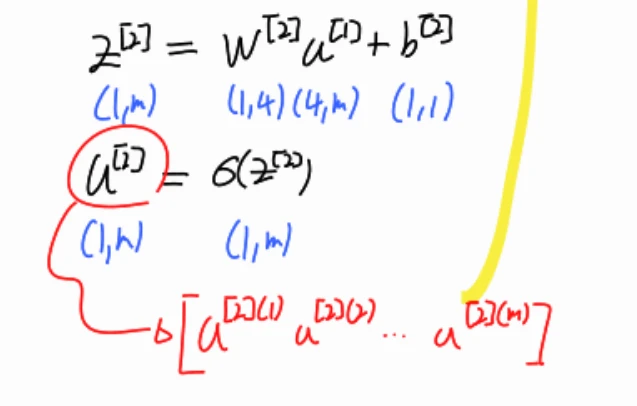

- a\^[1] : 이전 단계에서 (4, m)임을 구했다.

- W\^[2] : Hidden_Output으로 연결된 Edge 수가 네 개이며, 노드가 한 개로 축소된다. 따라서 (4, 1)이며, Transpose를 하면 (1, 4) 이다.

    ⇒ 둘을 행렬곱 하면, (1, m)이 된다.

- b\^[2] : bias는 한 개의 노드에 대해서 더해지는 것이므로, (1, 1)이다.
- Z\^[2] : Z\^[2]&#40;1, m) + b\^[2]&#40;1, 1)을 하면, bias가 Broadcasting에 의해 차원이 늘어나면서 더해지므로, 연산이 가능하다.
- a\^[2] : sigmoid(Z\^[2])는 element wise 연산이므로, 차원이 그대로 유지된다. (1, m)

### Activation Function의 필요성

> 한 노드의 끝에 들어가는 Activation Function은 왜 들어가는 것일까?

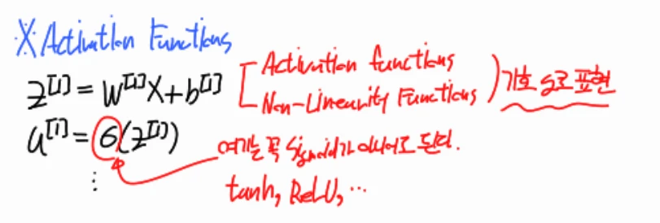

**Activation Function**은 꼭 Sigmoid가 아니어도 되며, Sigmoid, tanh, ReLU, Leaky ReLU 등 다양하게 있다.

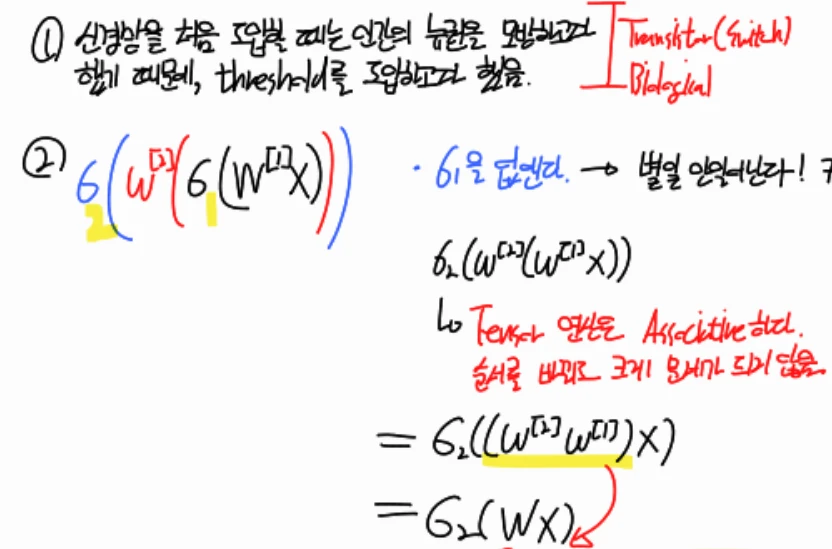

- 신경망을 처음 도입할 때는 인간의 뉴런을 모방하고자 했기 때문에, Threshold를 도입하고자 Activation Function을 사용했다.
- (2)가 현재의 구조를 간략하게 나타낸 것인데, 만약 중간에 sigmoid_1이 사라진다면, 결과적으로 식은 두 개의 Layer로 취급되는게 아니라 하나의 Layer에 대해서 sigmoid를 취하는 것과 동일해진다.  
    ⇒ 즉, Layer의 의미가 사라지게 된다.

> 만약 Activation Function이 없다면 일계층과 똑같은 함수가 된다.  
> ⇒ Non-linearity Function이 있어야만 계층이 의미를 갖게 된다.  
>   
> 그만큼 Activation Function의 역할이 아주 크다고 할 수 있다.

- Vector에 Matrix를 곱하는 것은 공간 속에서 Linear Transformation을 하는 것과 같다.

    > 이때, 중간에 Activation Function이 들어가야 Non-linear Transformation이 돼서 학습이 의미를 갖게 된다.

### Sigmoid Function의 문제점

> Sigmoid는 신경망이 처음 등장했을 때부터 사용된 것으로, 인간의 뉴런을 모델링한 것이다.  
> 그러나 최근에는 여러가지 문제점이 존재한다는 것이 밝혀져 잘 사용하지 않는다.

> 1. Saturated Neurons Kill the Gradients  
> ⇒ Sigmoid의 가파른 값의 변화 때문에 Gradient의 의미가 퇴색된다.  
>   
> 2. Sigmoid Outputs Are Not Zero- Centered  
> ⇒ 양수만 나오게 된다. 음수도 표현할 수 있는 것이 좋다.  
>   
> 3. Exponential Calculation is a bit Comput Expensive.  
> ⇒ Exponential 함수의 계산이 다소 어렵다.

⇒ 2), 3)은 약간 minor한 문제이고, 1)이 가장 큰 문제이다.

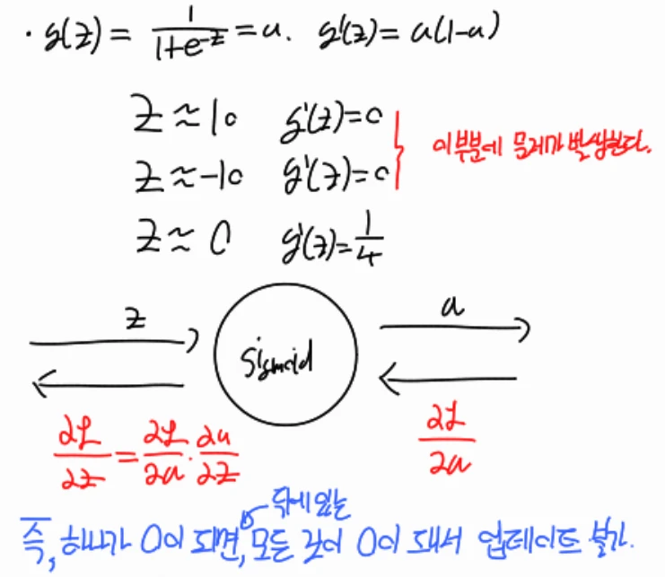

- 만약 sigmoid를 사용하는 한 Node가 있다고 할 때, 만약 역전파 과정에서 기울기가 0이 나오게 된다면 곱해지는 값이 0이기 때문에 **학습** 자체가 **불가능**해진다.

> 이렇게 Parameter Update가 없어져 버리는 것을 **Gradient Vanishing**이라고 한다.  
> (Network가 Shallow할 때는 괜찮은데, Deep 할 때는 문제가 된다.)

### Activation Functions Examples

- **tanh**

    - tanh는 sigmoid의 문제점 2)를 해결한 함수로서, 미분하면 1 - a\^2의 형태이다.

- **ReLU** : max(0, z)

    - 0보다 작거나 같으면 값이 0, 크면 그대로의 값을 반환한다.
    - 3)을 해결했으며, 계산이 매우 쉽다. (max만 비교하면 됨.)

    - 1) Gradient Vanishing의 문제가 해결된다. 양수 부분에서는 기울기가 1이다.

        > 그러나, 음수일 때는 여전히 Vanishing이 발생한다. 또, 음수가 없다.  
        > 이걸 약간 개선한게 Leaky ReLU이다.

    > 그러나, Leaky ReLU를 사용한다고 해서 성능이 개선되지는 않는다. 그래서 대부분 제일 간단한 ReLU를 사용한다.

### Logistic Regression Network의 Backward Propagation

- 2 Layer 구조에서 다음 값을 구해내어야 한다.

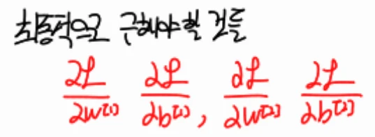

$$
\frac{\partial L}{\partial W^{[1]}}, \frac{\partial L}{\partial b^{[1]}}, \frac{\partial L}{\partial w^{[2]}}, \frac{\partial L}{\partial b^{[2]}}
$$

⇒ w\^[1], b\^[1], w\^[2], b\^[2]의 변화에 따라 Loss 값이 변하는 정도를 알아내고자 한다. (학습)

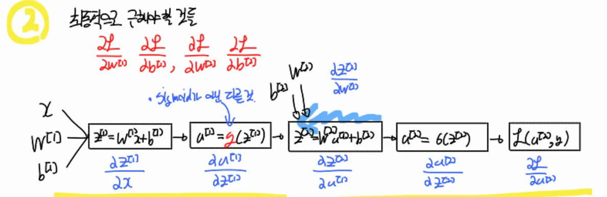

- 이 식에서 Chain Rule을 통해 답을 도출해 내어야 한다.
- **w2 구하기**

$$
\frac{\partial L}{\partial w^{[2]}} = 
\frac{\partial L}{\partial a^{[2]}}
*
\frac{\partial a^{[2]}}{\partial z^{[2]}}
*
\frac{\partial Z^{[2]}}{\partial w^{[2]}}
$$

> 그런데 우리는 activation function으로 sigmoid를 사용했다.

$$
\frac{\partial L}{\partial a^{[2]}}*\frac{\partial a^{[2]}}{\partial z^{[2]}}
$$

⇒ 또한 우리는 이 식의 미분 결과가 <strong>(a-y)</strong>임을 이미 알고 있다. 그러므로 위의 식을 아래와 같이 표현할 수 있다.

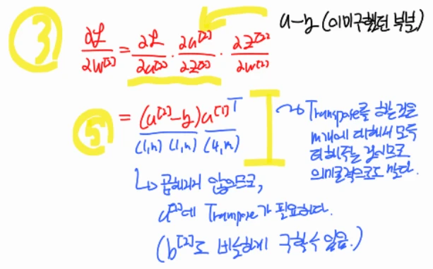

$$
(a^{[2]}-y)a^{[1]}
$$

이때, dz/dw가 a\^[1]으로 표현되는 이유를 생각해보자.

> z = W’ * X + b 이고, dz/dw의 결과는 X이다.  
> 그런데, 두 번째 layer에 들어온 X가, 사실은 a\^[1]이므로, a\^[1]을 남겨준 것이다.  
> a\^[1]은 layer 1의 출력이므로 최소 네 개의 행을 가지며, m개에 대해서 vectorization 했으므로, 그 크기는 (4, m)이라고 생각할 수 있다.  
>   
> a\^[2], y는 모두 vectorization 된 값이고, (1, m)이다. 따라서 dL/dw\^[2]를 구하려면, 식에 약간의 Transpose를 해주어야 한다.  
>   
> 결과적으로, (1, 4)를 얻게 된다.  
> ⇒ 왜냐면, layer 2는 가중치를 네 개 가지기 때문에 dw는 <strong>(1, 4)</strong>가 되어야 한다.  
> 또한, 가중치의 dimension 표현은 행 벡터로 표현되는 Input과 곱하기 위해 열벡터로 한다.  
>   
> ⇒ <strong>b\^[2]</strong>도 비슷하게 구할 수 있으며, 곱해지는 값이 1이 될 것이다.

- dL/dw\^[2]를 구했으므로, dL/dw\^[1]을 구해보자.

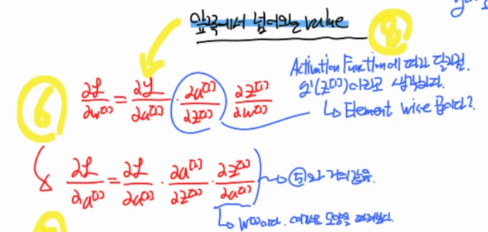

- dL/dw\^[1]도 역시 chain rule로 구해낼 수 있다.

- 그런데 이때, dL/da\^[1]은 앞쪽에서부터 쭉 미분해서 구해낼 수 있다.

    ⇒ 위의 이미지에서 블록 별로 미분한 값을 보면 알 수 있다!

> 이때, da\^[1]/dz\^[1]은 sigmoid가 아닌 어떠한 다른 activation function도 올 수 있으므로, g’(z\^[1])이라고 표현할 수도 있다.

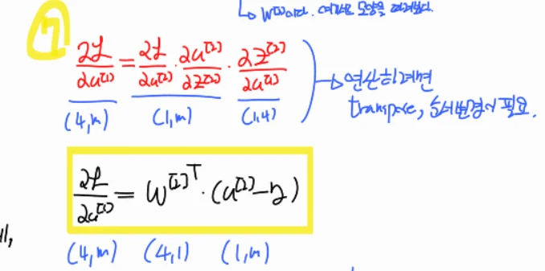

- 먼저, dL/da\^[1]을 구해보자. dL/da\^[2] * da\^[2]/dz\^[2]는 익히 알던 것처럼, a\^[2] - y로 구해낼 수 있다.
- 그리고 dz\^[2]/da\^[1]을 해보자. a\^[1]은 두 번째 Layer의 Input이다. 그러므로 미분을 하고 나면 w\^[2]가 남게 된다. (Input에 대해서 미분하므로, 당연히 w\^[2]가 됨.)
- 이제 이것을 곱하면, 위와 같은 결과가 나온다.

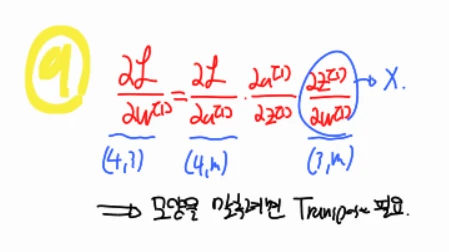

- <strong>dz[1]/dw[1]</strong>은 input X임을 쉽게 알 수 있을 것이다. vectorization 된 결과이므로, 당연하게도 dimension은 <strong>(3, m)</strong>이다.

    ⇒ da\^[1]/dz\^[1]이 scalar이므로 이것은 배제한다. 결과를 구해보니, dimension이 맞지 않으므로 transpose가 필요하다.

### Backward Propagation 결과

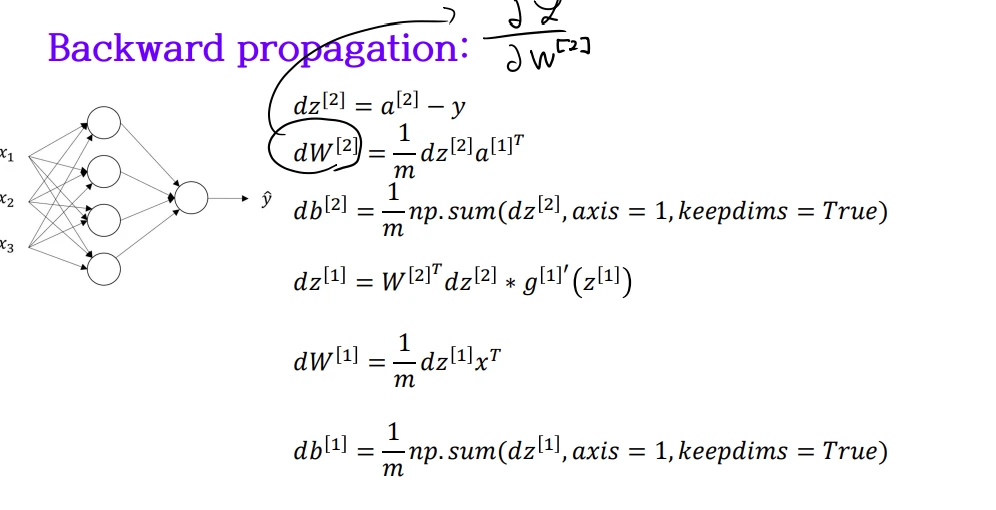

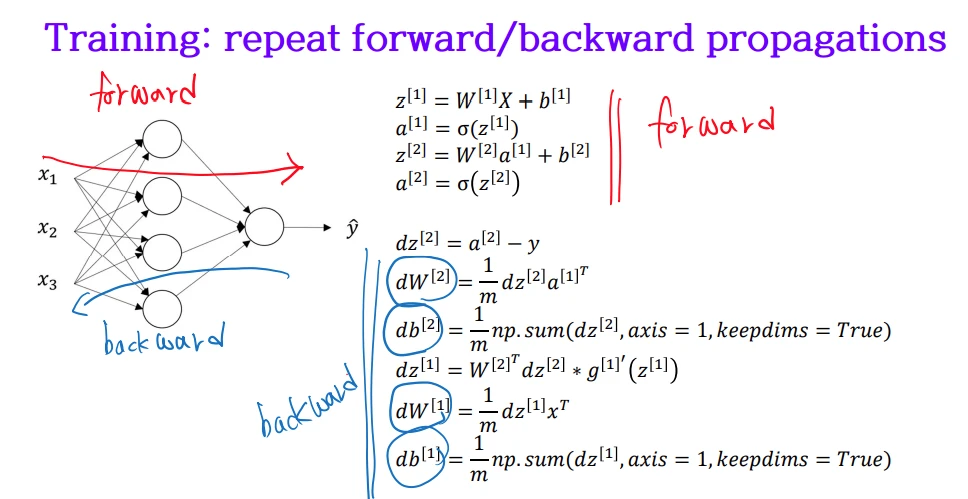

### Random Initialization

> 지금까지 Forward Pass, Backward Pass를 통해 추론과 학습을 진행하는 과정에 대해 살펴보았다. 이 과정에서, 학습 때 &lt;parameter&gt; 값을 Loss값에 따라 업데이트 했다.  
> 그런데, 이 parameter의 초기값을 어떻게 설정하는 것이 좋을까?

- 다음과 같은 경우를 생각해보자.

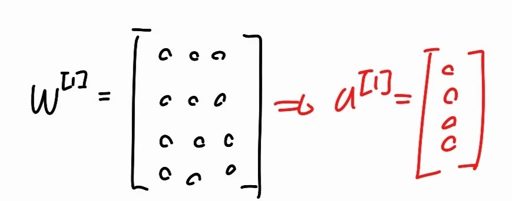

가중치의 초기값을 0으로 만들었다고 해보자.   
(초기값을 0으로 한 것 보다는, 모두 같은 값으로 설정한 데에 집중해보자.)  
이렇게 했을 때 어떤 문제가 발생할 수 있을까?

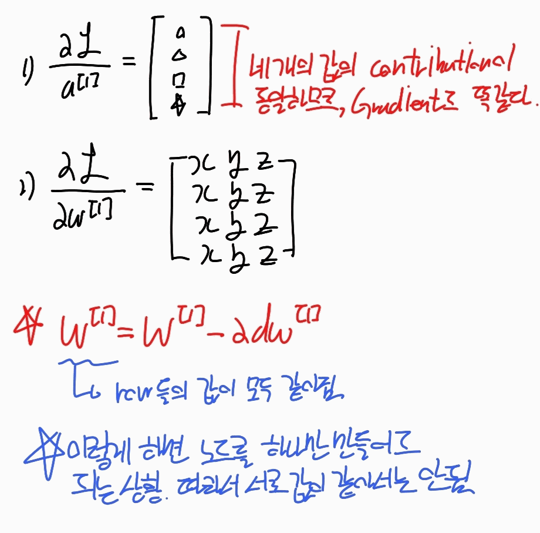

- 가중치가 동일하다면, 결국 각각의 가중치의 Contribution이 동일하므로, Gradient도 동일하다. 

    - 따라서, dw를 구해도 모두 같은 값으로 구해지게 될 것이다.
    - 이것은 노드를 여러개 사용하는 의미가 퇴색된다.

> 따라서, 가중치를 초기화 할 때는 Random Value로 설정한다.

---

> 정리

- m개의 example에 대해서 vectorization하고 parameter의 gradient를 구하면, 그 gradient의 shape는 그 레이어를 미분하기 이전의 shape와 같다.  
    ⇒ 그럴 수밖에 없는게, 그렇지 않으면 가중치를 update 할 수가 없다.

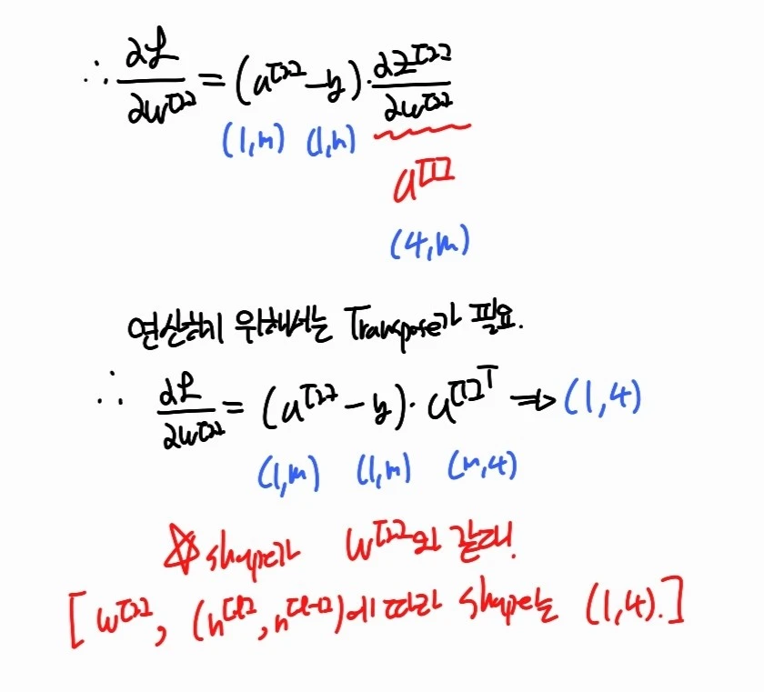

- m개의 example에 대해서 vectorization을 한 것을 가지고 parameter에 대한 gradient를 구한다.  
    그러면 그때의 gradient는 m개의 값에 대한 합이다. ⇒ 따라서 반드시 m으로 나눠야 한다.

    - 1개의 example은 for loop 각각에서 더해서 나중에 m으로 나눈 것.
    - vectorization에서는 한 번에 더해진다.

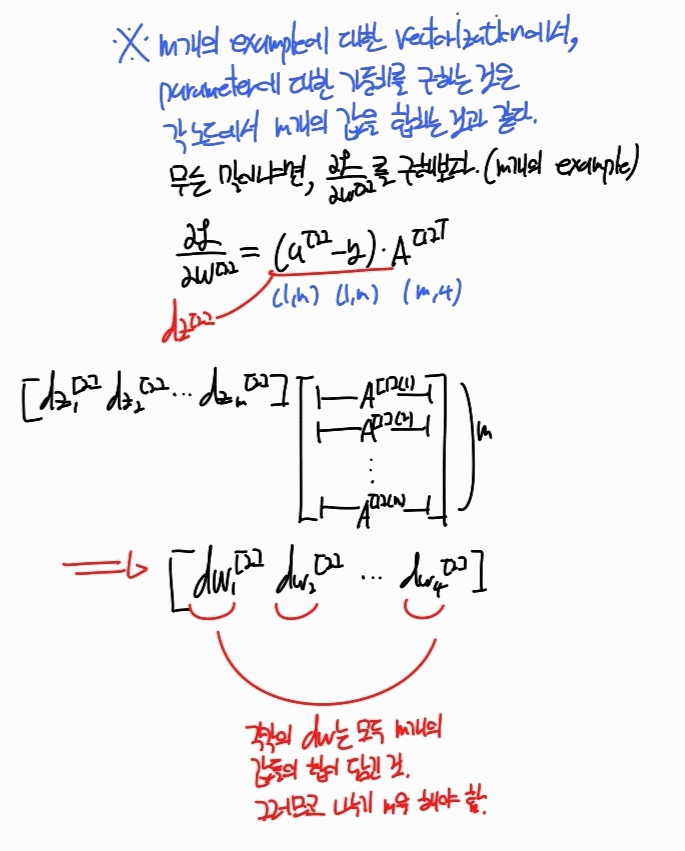

⇒ **반드시 나누기 m이 필요함!**

- Cost Function J에 대해서 parameter를 업데이트 해야 되는데, Loss Function으로 미분을 하는 이유는 무엇일까?

    ⇒ 그 이유는 Cost Function은 결국 모든 Loss 값들의 합이고, 그렇기 때문에 summation임을 알 수 있다. 이것을 미분하면 각 항인 Loss들에 대해서 한 번씩 미분을 하는 것이다.

    > 따라서 1개의 example에 대해서 구한다면 (for loop을 돌기 때문에) 한 번의 loop에서 dw, dz 등에 + 하고, for loop이 끝나면 m으로 나눠준다.  
    >   
    > 반면 m개의 example에 대해서 vectorization을 했다면, 그것은 한 번에 모든 것을 계산하는 것이기 때문에 연산 자체가 m개의 결과를 한 번에 합쳐버리는 의미를 가지고, 또한 그 결과는 각 parameter의 shape와 같다. shape가 같은 이유는 update 하기 위해서는 그대로 빼줘야 하기 때문이다. 그러나 **m**으로 **나누는**  **것**은 1개 example의 경우와 **똑같다!**
