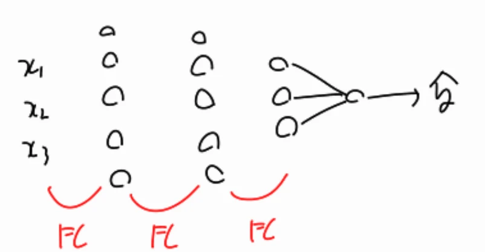
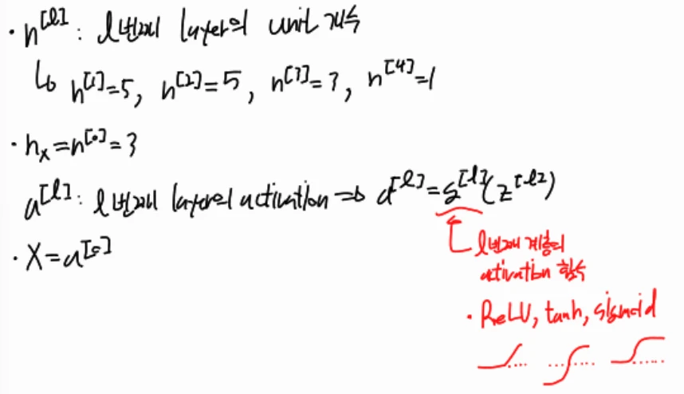
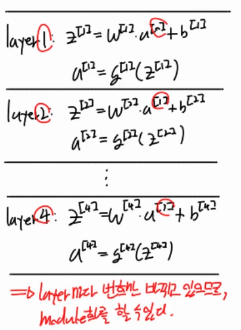
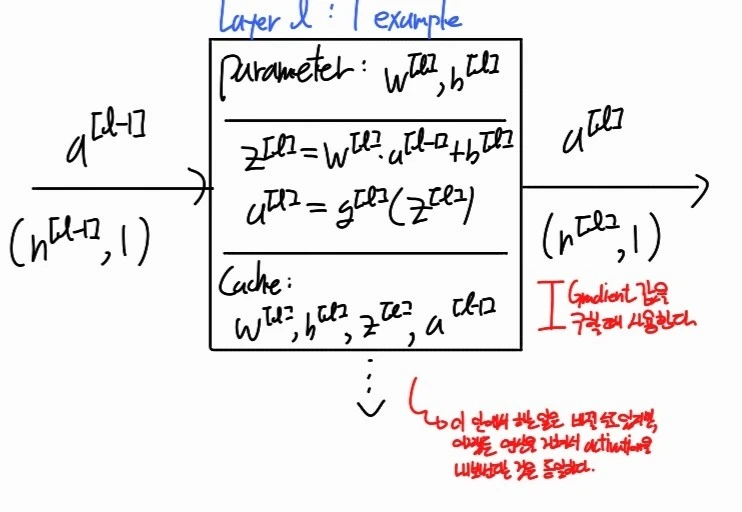
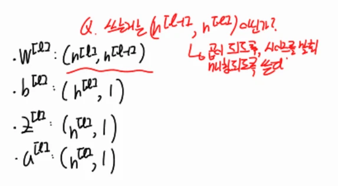
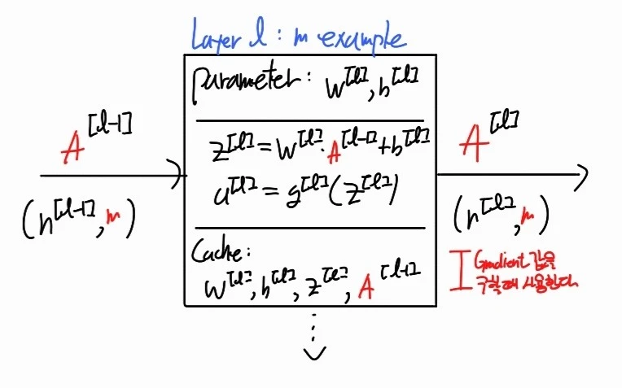
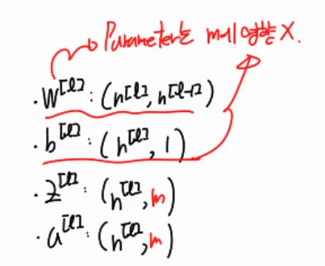
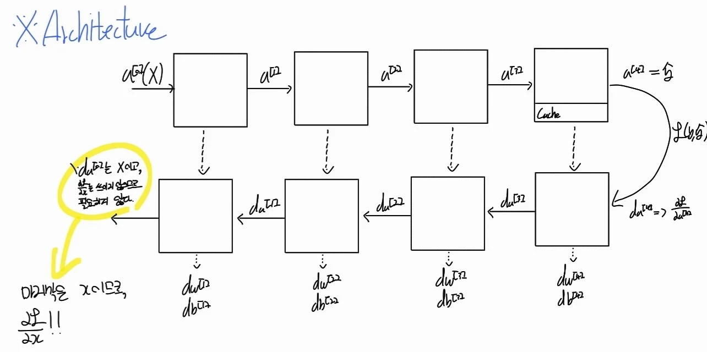
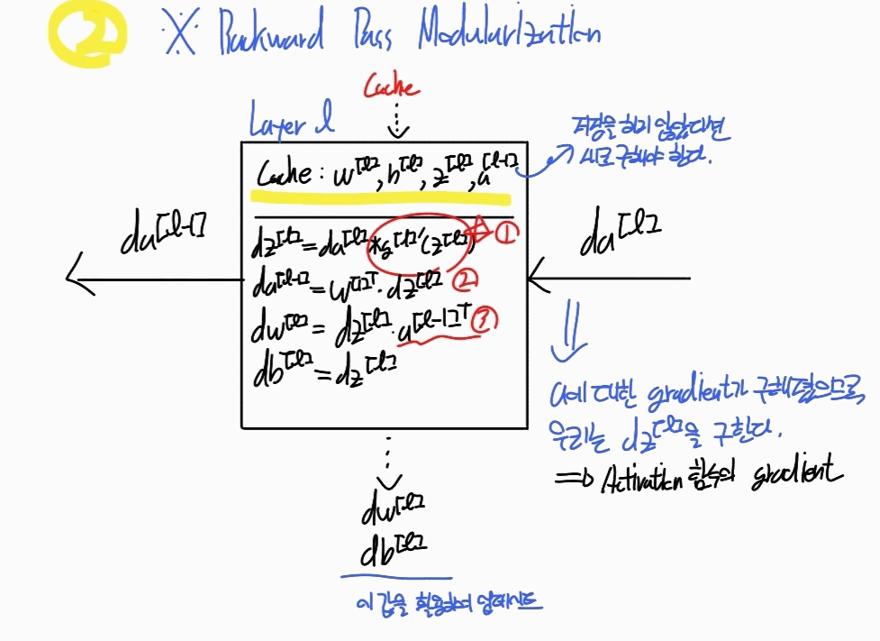

# Multi Hidden Layer Network

## &lt;Multi Hidden Layer Network&gt;

- Neural Network란, 계층을 반복적으로 여러 개 쌓는 네트워크이다.

    - 그래서 Layer가 깊어질 수록 더욱 효과적으로 학습을 진행할 수 있다.

- 그런데, Layer의 개수를 늘리는게 아니라 한 Layer가 여러 개의 Node를 갖도록 할 수도 있다.

    - 이것을 Soft Vector 방식이라고 한다.

- 그렇다면, 계층이 더 깊은 것이 효과적일까? 아니면 한 Layer의 노드 수가 많은 것이 더 좋을까?

> 일반적으로 계층이 깊은 것이 더 효과가 좋다고 알려져 있다. 그 이유는, 계층의 역할을 주목하면 알 수 있다.  
>   
> 계층(Layer)은 입력받은 데이터가 결과를 낼 수 있도록 데이터의 표현을 바꿔주는 역할을 한다. 그런데, 사람이 아는 표현에서 컴퓨터가 알 수 있는 표현으로 데이터를 조작하는 것은 사실 한 번에 이루어지기가 매우 어렵다. 그래서 많은 계층을 만들고, 조금씩 변화를 중첩시켜 가면서 최종적으로 결과를 얻어내는 것이 더 효과적인 것이다.

### Deep Neural Network Notation

> Hidden Layer가 세 개 있는 Layer를 생각해보자.

- n[l] : l번째 layer의 node 개수

    - n[1] = 5, n[2] =5, n[3] = 3, n[4] = 1
    - Input Layer는 특별하게 nx = n[0] = 3으로 표현한다.

- a[l] = l번째 layer의 **activation**(a값) ⇒ a[l] = g[l]&#40;z[l])
- X = a[0]

## &lt;Modularization(Forward Pass)&gt;

> 이렇게 Layer가 많은 Neural Network를 구현할 때, 어떻게 구현하는 것이 효과적일까? 간단하게 생각해 보면, 각각의 Layer에서 하는 기능이 비슷한 부분을 modularization해서 재사용 가능한 코드로 만들면 사용하기 아주 편리할 것이다.

- **Layer별 동작**

- 현재 네 개의 레이어가 존재하고, 각각의 동작을 정리해 보았다. 이때, 각각의 레이어에서의 동작은 Input값인 a의 index가 달라진다는 차이만 존재한다.

    - 그러므로, 해당 부분을 제외한 다른 부분은 동일하게 사용해서 모듈화가 가능하다.

### Layer l에서의 Modularization(1개의 Example)

> 하나의 example을 학습할 때의 layer l의 기능을 정리하고, modularization 한다.

- 현재 정의하고자 하는 것은 모듈이므로, Input과 Output을 먼저 정의해야 한다.

    - Layer l의 **input**으로는 <strong>a[l-1]</strong>이 들어오며, **output**으로는 <strong>a[l]</strong>이 나간다.
    - 이때, **Input**의 shape는 **(n[l-1], 1)**, **Output**의 shape는 <strong>(n[l], 1)</strong>이다.
    - Input이므로, Row Vector로 표현해야 한다. 

    - 그런데 왜 (n[l-1], 1)이지?

        - 어쨌든 들어오는 거는 (n[l-1], 1)이 맞다. 단지 이게 모든 노드에 똑같이 들어갈 뿐이지… 또, 곱해지는 것도 이 사이즈가 맞고, 달라지는 것은 가중치 사이즈이므로, 어쨌든 이게 맞다.
        - 나가는 것은 현재 레이어의 노드 개수이다. 이게 맞는게, 어쨌든 노드 개수만큼 Output이 나가야만 하니까 그럼.

- layer의 index가 l일 때, 들어오는 parameter는 w[l], b[l]이 있다.

- input을 **a**라고 표현할 때, input은 <strong>a[l-1]</strong>이다.

    - 그 외의 것들은 일반적인 식으로 표현된다.

- Layer에는 특별하게 **Cache**라는 것이 존재한다.

    - Cache의 기능은 **W[l]**, **b[l]**, **z[l]**, <strong>a[l-1]</strong>을 저장하는 기능을 하며, 이후에 Backward Propagation 과정에서 필요한 값을 저장하는 것이다.

### Shape의 일반화(1개의 Example)

- W[l]

    - W는 항상 연산할 수 있도록 Transpose로 Shape를 맞춰준다.

        - 단, Logistic Regression에서는 (n\^[l-1], n\^[l])로 Shape를 설정하고 Transpose 한다.

    - 현재 레이어의 index가 l이라고 할 때, 가져야 하는 가중치는 이전 노드와 연관이 있다. 이전 레이어인 Layer l-1에서 나오는 Output은, Layer l의 Input이 되며, 이것은 Row Vector이다.  
        그래서 Layer l의 Input의 Shape는 (n[l-1], 1)이다.  
        이 상태에서 가중치를 곱하는데, Layer l의 노드 개수만큼으로 차원을 바꿔주어야 하므로, 당연하게도 W[l]의 shape는 (n[l], n[l-1])이 된다.

    - parameter이므로, m개의 example에 대해 모두 다루더라도, 변경되지 않는다.

- b[l]

    - 노드의 개수만큼 필요하므로, (n[l], 1)
    - parameter이므로, m개의 example에 대해 모두 다루더라도, 변경되지 않는다.  
        ⇒ Broadcasting을 통해 연산됨.

- z[l]

    - 노드의 개수만큼 생성되므로, (n[l], 1)
    - m개의 example에 대해 모두 다룬다면, m개의 데이터가 될 것이다. (왜냐면, 노드 개수만큼 출력이 나오는데, vectorization을 하므로 n[l]개의 값이 m개가 나와야 함.)

- a[l]

    - z[l]과 shape가 같아야 하므로, (n[l], 1)
    - z[l]과 똑같이, m개의 example에 대해 다룬다면 (n[l], m)이 될 것이다.

### Layer l에서의 Modularization(m개의 Example)

> m개의 example을 학습할 때의 layer l의 기능을 정리하고, modularization 한다.

- m개의 example을 다루므로, 혼돈을 피하기 위해 a를 A로 표현한다.

    - 왜냐면, 이전까지 a는 vector Input이었지만, 이제는 Matrix Input이기 때문이다.
    - 이에 따라 Input, Output도 A가 되며, Shape는 각각 (n[l-1], m), (n[l], m)이 된다.

> 이로써, 반복적으로 사용 가능한 Module을 생성해 내었다.

### Shape의 일반화(m개의 Example)

- W[l]

    - W[l]은 parameter이므로, 이전과 차이가 없다.
    - Input을 다음 Layer의 노드에 맞게 shape을 수정하도록 만들면 된다.

- b[l]

    - b[l]은 parameter이므로, 이전과 차이가 없다.

- Z[l]

    - z[l]은 m개의 example에 대해서 다루면, n[l]개의 값을 m개 출력해야 하므로, (n[l], m)이 된다.

- A[l]

    - A[l]은 m개의 example에 대해서 다루면, (n[l], m)이 된다. (Z[l]과 똑같음.)

---

## &lt;Modularization(Backward Pass)&gt;

> 이전에 Forward Pass에 대해서 Module을 생성했으므로, 이번에는 Backward Pass에 대해서 Module을 생성해 본다.

### 전체 Architecture

- 최종적으로는 위와 같은 Architecture를 얻게 될 것이다.

    - Forward Pass 과정에서 Cache로 **w[l]**, **b[l]**, **z[l]**, <strong>a[l-1]</strong>을 저장했다.
    - 각각의 Module은 하나의 Layer를 의미하므로, Backward Pass를 할 때 각 Layer의 Cache에서 매칭되는 Layer로 값을 전달해 줘야 한다.
    - Backward Pass 과정에서 각 Layer는 얻어낸 업데이트 값 **dw**, **db**를 내보내야 한다.

Backward Pass Module Architecture.

> Backward Pass 과정에서 Layer l에 Input으로 들어오는 것은 Forward Pass 과정에서 Layer l이 내보낸 값의 미분이라고 할 수 있다. (***정확히 역의 과정을 수행하는 것.***)

- Backward Propagation 과정에서 우리는 무엇을 구하는가?

    - a[l]은 주어지므로, 구할 필요가 없다.
    - parameter 값을 구하기 위해 결국 아래의 값을 구해야 한다.

    $$
    \frac{\partial L}{\partial w^{[l]}} = \frac{\partial L}{\partial a^{[l]}}\frac{\partial a^{[l]}}{\partial z^{[l]}}\frac{\partial z^{[l]}}{\partial w^{[l]}}
    $$

    - 따라서 우리는 dz[l]을 먼저 구한다.

- dz[l]

- db

    - **요거는 차원이 안맞는게 맞음. 대신 이건 np.sum을 통해서 직접 차원을 맞춰주어야 함.**

- 이렇게 해야 하는 이유는, 이건 행렬곱을 통해서 차원이 줄어들지 않기 때문에, 직접 더해서 차원을 맞춰줘야함,
