# Regularization

작성일 2023-12-09 · 최종 수정일 2024-11-16
{ .post-date }

> 이전까지는 Net. Architecture를 다뤘고, 이제는 Training 방법을 다룬다.

> 사실, 인공지능에서는 Training 방법이 매우 중요하다.  
> ⇒ **Network**가 깊어지고, **Parameter**가 커질수록 Architecture 자체보다는 **Training**이 더 중요하다.

## &lt;Workflow of machine learning&gt;

> 인공지능으로 문제를 해결하기 위해서는 ML, DL이 적용 가능한지 검토한다. 적용이 가능하다면 아래 Step을 따라간다.

1. Define the task
2. Develop a model
3. Deploy the model

### Step 1. Define the task

> 문제를 해결하기 위해 인공지능적인 방법을 도입하기 전, 먼저 Task를 Define 해야 한다.

- **Frame the problem** : 문제를 구체화한다.

    - Supervised Learning, Non-supervised Learning, Self-supervised Learning 등, 어떠한 방법론을 적용하여 해결 가능한 지 결정한다.

- **Collect a Data set** : 학습시킬 Data를 수집한다.
- **Understand your data** : Data의 특성을 이해하고, 활용 방안을 고려한다.
- **Choose a measure of success** : 어느 정도의 성공치를 목표로 하는지 결정한다.

### Step 2. Develop a model

> 인공지능적인 방법을 도입하기 위해 Model을 설계한다.

- **Prepare the data** : data를 동일하게 사용할 수 있도록 가공한다.
- **Choose an evaluation protocol**(metric) : 인공지능의 학습 정도를 판단하기 위한 평가 항목을 결정한다. ⇒ 예를 들면, Loss Function을 설정해야 한다.

> 그런데, 사실 Loss는 학습 과정에서 학습이 잘 진행되는 것을 확인하기 위해서 도입하는 것이기 때문에 실제로는 Accuracy와 같은 요소를 사용해야 한다.

- **Beat a baseline** : 성능의 최소요구치를 설정한다.
- **Scale Up** : 모델을 데이터에 Overfitting시킨다.  
    ⇒ 기본적으로 학습 과정에서는 Training Data에 어느정도 Overfitting 시킬 필요가 있다.  
    이후에 Regularization을 통해 조절해 가면서 Validation Dataset과 Test Dataset에 대한 성능을 확보하는 것이다.

- **Regularize and tune your model** : 모든 데이터에 대해 잘 동작하도록 데이터를 Regularization 한다.

> 이때 **Scale Up**과 **Regularized and tune your model**이 가장 중요하다.

### Step 3. Deploy a model

> 정해진 설정에 따라 실제 모델을 구현한다.

- **Explain your work to stakeholders and set expectations** : 이해관계자(매니저)에게 모델에 대해 설명하고, 기대치를 설정한다.

- **Ship an inference model** : 추론 모델을 생성한다.

    - 이때는 학습된 값을 바탕으로 추론 결과만 낼 수 있는 모델을 말한다.
    - 따라서 Cache 등의 값들은 존재하지 않는다.

- **Monitor your model in the wild** : 모델이 다양한 데이터셋에 대해서 어떻게 동작하는지 계속해서 모니터링하며 성능을 확인한다.
- **Maintain your model** : 지속적으로 모델을 발전시킨다.

### Developing a model is a highly iterative process

> 모델을 개발하는 과정은 매우 반복적인 작업이다.

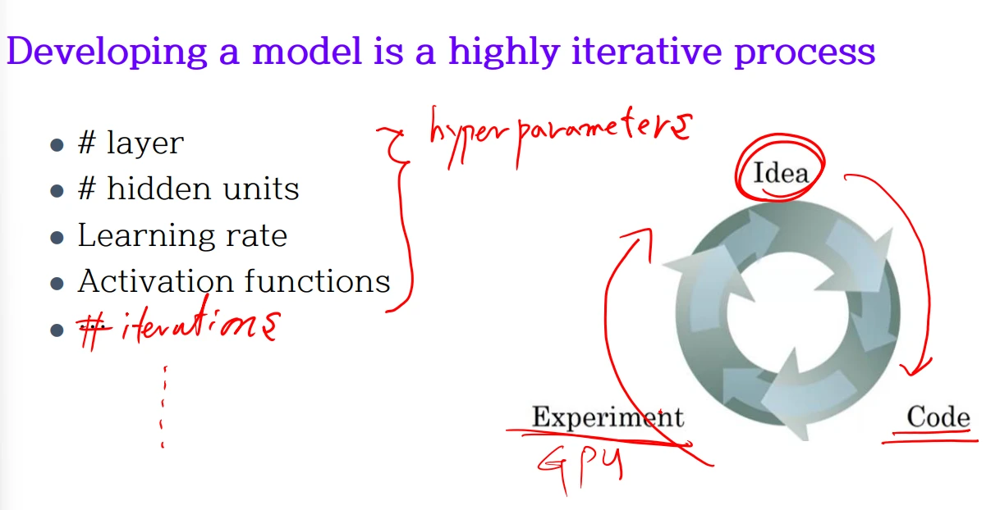

- 모델을 개발하는 과정은 매우 반복적인 작업이며, 다음 과정이 반복된다.

    - **Idea** : 모델을 설계하는데 필요한 아이디어를 구상(수정)한다.
    - **Code** : 모델을 코드로 설계한다.
    - **Experiment** : 코드로 작성한 모델에 대해 여러 실험을 진행한다.

    ⇒ 이 과정을 반복하면서 원하는 성능이 나올때까지 계속해서 **Hyperparameter**를 수정한다.

---

## &lt;Splitting datasets to Train/Val/Test sets&gt;

### Datasets

> 학습과정에서 필요한 모든 데이터를 데이터셋이라고 한다.  
> 또한, Hyperparameter를 설정할 때도 Dataset을 사용해야 한다.

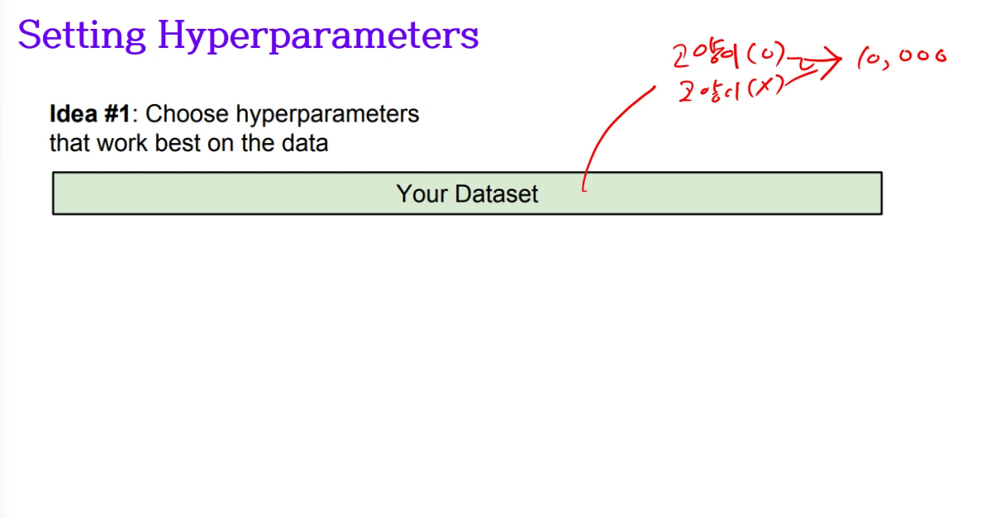

- 다음과 같이 Dataset이 존재한다고 하자. 이 데이터는 고양이 또는 고양이가 아닌 어떤 것에 대한 사진이며, 총 10,000장이다. 이걸 가지고 학습을 진행한다.

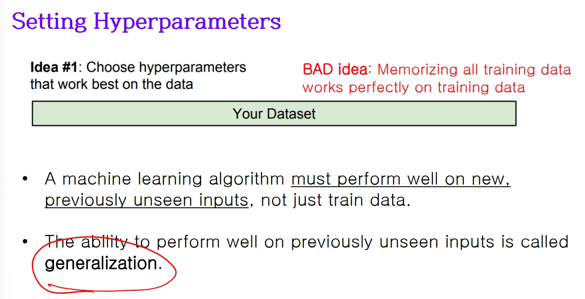

- 그런데, 학습 결과로 나온 Accuracy가 만족스럽지 못해 Hyperparameter를 바꾸고 Accuracy를 개선하는 과정을 계속 거치다보면, 필연적으로 모델이 해당 데이터에 대해 **Fitting**된다.

    - 왜냐면, 모델이 데이터에 대한 정답을 그냥 외워버릴 수도 있기 때문이다.

- 즉, 고정적인 데이터에 대해서만 학습하는 것은 100%의 Accuracy를 달성하는 것이 매우 쉽다.

> **Generalization** : 학습 과정에서 사용한 데이터 뿐만 아니라 모든 데이터에 대해 잘 동작하도록 만드는 것을 **Generalization**이라고 한다.

⇒ 따라서 우리는 모델이 모든 데이터에 대해 잘 동작하도록 만들기 위하여 데이터셋을 분리해보자.

### Test Data 분리

> 기존에는 Training Data만 존재했지만, 이제는 전체 데이터에서 일부를 학습시키지 않고(*모델에게 보여주지 않고*) 학습이 끝난 후에 Test 데이터로 사용해보자.

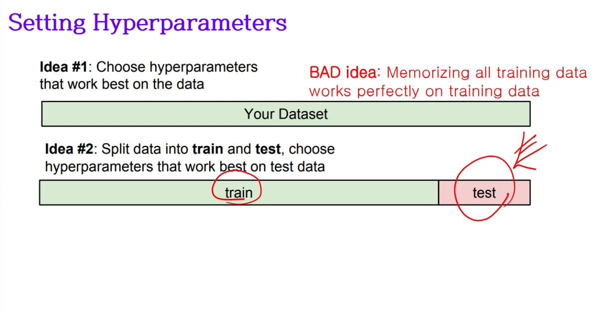

- 그런데, 이 방법에도 여전히 문제가 존재한다. 그것은 바로 Test에 대한 결과에 따라 계속해서 Hyperparameter를 사용하기 때문에, 결국 간접적으로 Train 데이터를 보고 학습하는 것과도 같다고 볼 수 있다는 것이다.

    ⇒ 따라서 Test Data는 최종적으로 1~2번만 사용한다.

### Validation Data 분리

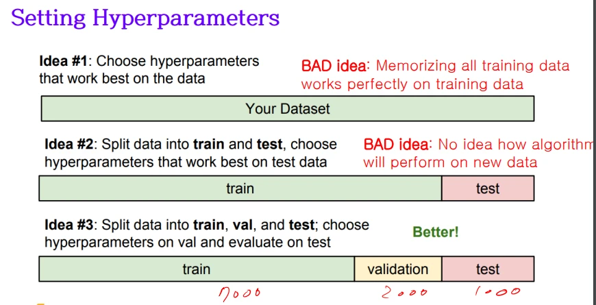

- 이와 같이 원본 데이터셋에서 Validation 데이터셋을 분리하여, Hyperparameter를 업데이트 하는 용도로만 사용해보자.

> 하지만 이 방법은 Train Dataset의 양 자체가 너무 적어진다는 문제가 생긴다.  
> ⇒ 이 때문에 Cross Validation을 사용한다.

### Cross-Validation

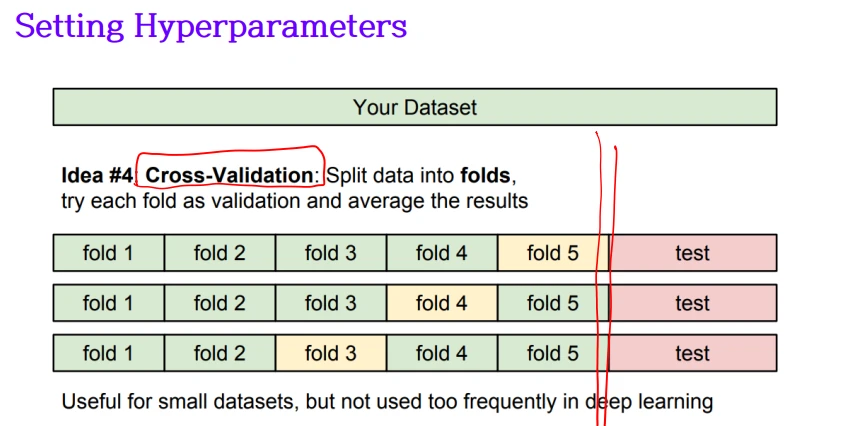

- 이와 같이 원본 Dataset을 Train Dataset과 Test Dataset으로 나눈 다음, Train Dataset을 다시 여러 개의 fold로 나눈다.

- 그리고 여러 개의 모델을 만든 뒤, 각 모델이 Validation Dataset으로 서로 다른 fold를 사용하도록 학습시킨 후에, 결과를 평균낸다.

    ⇒ 이러면 학습 데이터가 부족한 문제를 일부 해결할 수 있다.

### Guideline for training datasets

> **train dataset**과 **test**(*validation & test*)를 나눈 이유를 좀 더 생각해보자.

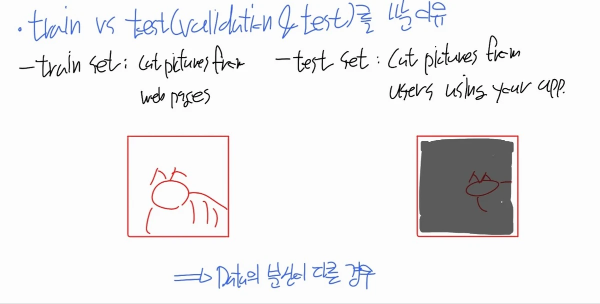

- 이와 같이 고양이의 사진에 대한 데이터가 있다고 해보자. 이때, train dataset에는 낮에 촬영된 고양이의 사진이 들어있고, test dataset에는 밤에 촬영된 고양이 사진이 들어있다고 해보자.

    > 이러면, Dataset의 분산이 매우 다르다고 볼 수 있다. 이것은 모델의 성능에 아주 크리티컬한 영향을 줄 수 있기 때문에, 반드시 train/test dataset의 distribution을 같게 하는 것이 매우 중요하다고 할 수 있다.

### Overfitting and Underfitting

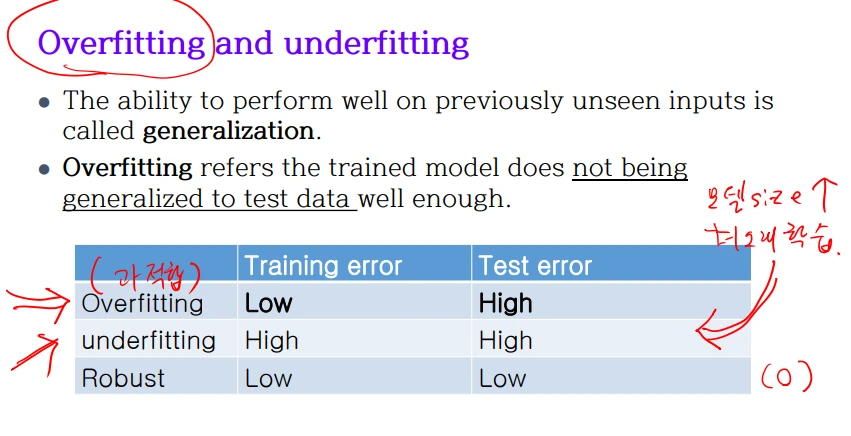

- 모델이 이전에 보지 못했던 데이터셋에 대해서도 좋은 성능을 보이게 만드는 것을 **Generalization**이라고 한다.
- Model이 **Overfitting** 된다는 것은, Test Data에 대해서도 **Generalized**한 성능을 보이지 못한다는 것이다.

> **만약 모델이 Underfitting 됐다면?**  
> 학습이 덜 됐거나, 모델의 성능이 떨어지는 경우이다. 이럴 경우 모델의 사이즈를 키우거나 Iteration의 수를 늘리는 방법이 있다.  
>   
> **만약 모델이 Overfitting 됐다면?**  
> 현재 데이터셋을 과도하게 학습한 것이다. 이런 경우 데이터셋을 늘리는 것이 가장 좋은 방법이지만, 현실적으로 데이터를 늘리는 것은 매우 어렵다.   
> Data Augmentation을 사용하기도 하지만, 모든 Domain에서 이것이 통하지는 않으므로, 완벽한 해결법은 아니다.  
>   
> 만약 모델이 Train Dataset에 대해서는 좋은 성능을 보이지만 Test Dataset에 대해서는 안좋은 성능을 보인다면, 이때 **Generalized Error**가 존재한다고 말한다.

- **Regularization** : 모델의 Overfitting을 해소하기 위하여 사용되는 모든 기술들을 통틀어 **Regularization**이라고 부른다.

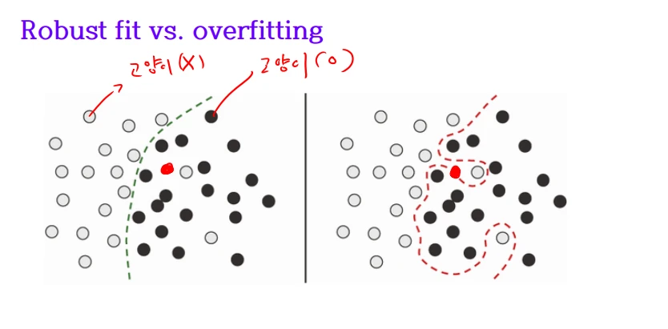

- **Robust**(강건한) **Fitting**과 **Overfitting**의 차이는 무엇일까?

    먼저 **Overfitting**은 현재 데이터셋의 **특징**을 **너무나도 세세하게 학습**해 버리기 때문에, 오른쪽 이미지와 같은 경우라고 볼 수 있다. 오른쪽 이미지를 보면, 검은색 데이터 사이에 들어가 있는 흰색 데이터를 완벽하게 구분짓고 있는 것을 볼 수 있는데, 이것은 모델이 세세한 특징까지 학습해 버린 것으로 생각할 수 있다.

반면 **Robust Fitting**은 모델의 세세한 특징까지는 학습하지 않는다. 대신 **일반적인 특징을 위주로 학습**하여서, 새로운 데이터가 들어오더라도 최대한 **Generalize**한 성능을 보일 수 있다.

> 또한 Overfitting은 Dataset이 Noisy 할 때 많이 발생할 수 있다. Noisy 할수록 모델이 데이터셋의 세세한 Noise까지 학습할 가능성이 높아서 일반화 성능이 떨어질 수 있는 것이라고 생각할 수 있다.

---

## &lt;Regularization&gt;

> 모델의 Overfitting을 감소시킬 수 있는 기본적인 Regularization 테크닉에 대해 알아보자.

### Weight Regularization

> Parameter인 Weight가 최대한 비슷한 비중을 가지며 학습될 수 있도록 하는 방식이다.

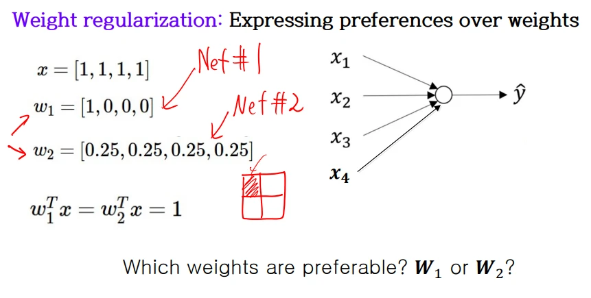

- 위의 이미지에서 weight가 w1, w2처럼 초기화되는 경우가 있다고 해보자. 두 가중치와 input값에 대해서 행렬곱을 수행한 결과는 같다. 그렇다면 둘 중 어느 것이 더 좋다고 할 수 있을까?

> w1은 모델이 데이터의 매우 작은 부분만 보고도 결과를 예측해버리는 경우라고 할 수 있다. 이렇게 되면, 약간이라도 다른 데이터가 들어오게 되면 예측 성능이 매우 저하되고, 이에 따라 Generalization이 확보되지 않을 수도 있다.  
>   
> 따라서 좋은 모델이라면, 가중치가 최대한 비슷한 비중으로 학습되도록 만드는 것이 중요하다고 할 수 있다.

### 1) L2 Regularization

> L2 Regularization은 특정한 가중치가 과도한 가중치를 갖지 못하도록 만들고, 모든 가중치가 최대한 비슷한 비중으로 학습될 수 있도록 Cost Function을 수정하는 방식을 말한다.

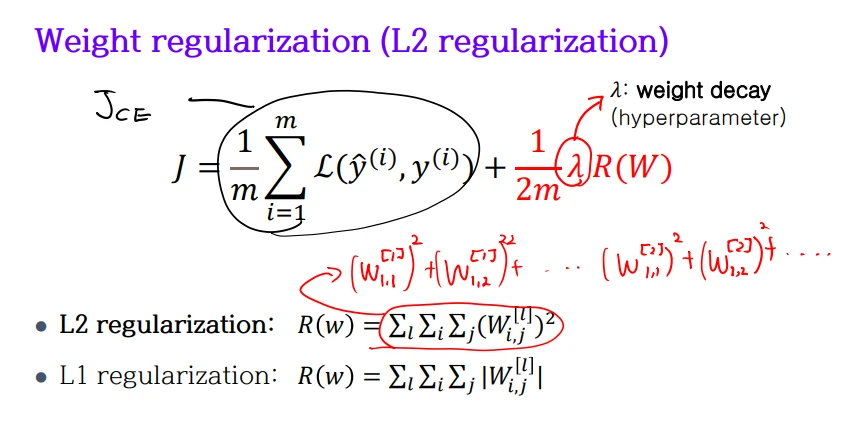

- 위의 식에서 검은색으로 동그라미 친 부분은 이전까지 우리가 알고 있던 &lt;Cost Function&gt;을 구하는 부분이라고 할 수 있다.
- 그런데 여기에, 빨간색으로 **L2 Regularization**을 더해준다.

> L2 Regularization의 의미를 생각해보자. 기본적으로 Cost Function을 최소화하는 것이 학습의 목적이라고 할 수 있다. 그런데 여기에 L2 Regularization Term을 더해준다는 것은, 해당 Term까지 최소화 시킨다는 것을 의미한다. 이때 곱해지는 **weight decay**는 hyperparameter이다.

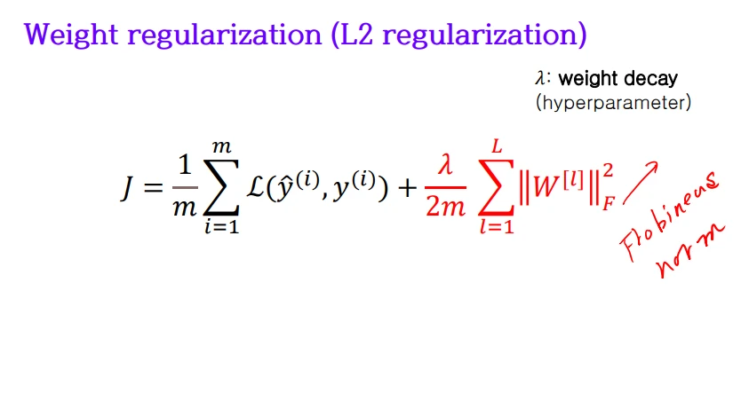

- L2 Regularization Term은 **Frobenius Norm**을 사용한다.
- **Frobenius Norm**의 의미는 무엇일까? 이것은 모델을 구성하는 모든 가중치의 값의 **제곱합**이다. **제곱합**이기 때문에 미분을 할 경우 2가 계수로 나오게 되므로, 분모에 2를 붙여서 지워준다.  
    (*아래에서 확인 가능*)

- 이 항을 추가하는 이유는 무엇일까? 우리의 목적은 **Cost Function을 최소화**하는 것이다. 그런데 여기에 L2 Term을 추가하게 되면, **L2 Term을 반영하여 최소화 시킨다**는 것을 의미한다. 기본적으로 모든 가중치의 제곱합을 Cost Function에 반영하게 된다면, Cost Function을 최소화하기 위해서는 **모든 가중치의 값이 비슷하게 만들면 된다는 것을 직관적으로 알 수 있다.**

> 그렇다면 L2 Term으로만 Cost Function을 만들면 되는 것 아닐까? 꼭 그렇지만은 않다. 그 이유는, 그렇게 하면 모든 가중치의 값이 “정말로 같아져” 버리기 때문이다. 그러면 우리가 이전에 수 차례 다뤘던 것처럼 결국 모든 노드의 Gradient가 같아져 버리기 때문에, Logistic Regression과 똑같아지게 된다.  
>   
> 따라서 우리는 반드시 기존 Cost Function에 Term을 추가하도록 해야 한다.

### Why λ is called weight decaying hyperparameter?

> 실제 Gradient를 구해보고, L2 Term의 의미를 파악해보자.

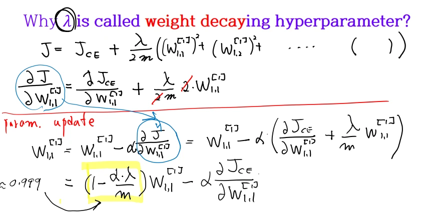

- 예를 들어서 우리가 Cost Function을 W(1,1)[1]에 대해서 미분을 했고, 이걸 바탕으로 Parameter를 Update한다고 하자. 그러면 위의 이미지에서 **param update** 부분과 같이 식을 작성할 수 있을 것이다. 이 상황에서 결과 식을 <strong>W(1,1)[1]</strong>에 대해 정리할 수 있다.

> 이 식에서 <strong>W(1,1)[1]</strong>의 앞에 붙은 계수는 1보다 아주 약간 작은 값이 될 것이다. 따라서 <strong>W(1,1)[1]</strong>과 거의 비슷하지만, 약간 작은 값이 나오게 되며, 거기에다가 우리가 구한 **Gradient**를 빼게 된다.  
>   
> 따라서 **λ**는 **hyperparameter**로서, parameter update 과정에서 어느 항에 비중을 더 많이 둘 것인지를 결정해준다. 만약 **λ**값이 **작다면**, **기존 Parameter**에 **비중을 많이 두어서** 가중치의 **업데이트**가 상대적으로 **적어지고**, **λ**값이 **크다면**, **기존 Parameter**에 **비중을 적게 두어서** 가중치의 **업데이트**가 상대적으로 **많아지게 된다.**

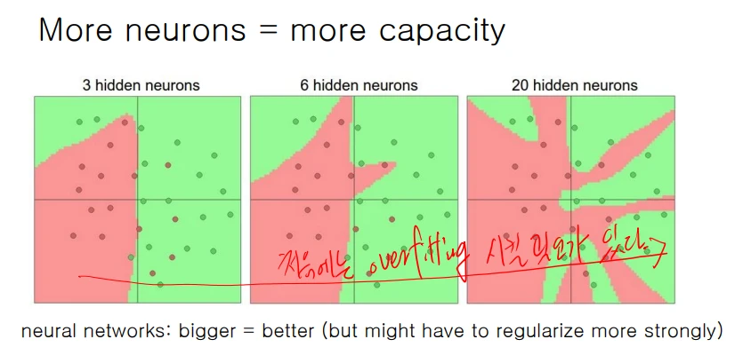

- 모델에 뉴런이 많다는 것은, 뉴런이 더 많은 정보를 학습할 수 있다는 것이다. 따라서 준비된 데이터셋을 학습하기 위하여 모델이 어느 정도의 뉴런을 가져야 하는 지를 알 필요가 있으므로, 초기에는 모델을 Overfitting 시킬 필요가 있다.
- 어느 정도 Overfitting이 되고 나면 Regularization Technique들을 적용하면서 Fitting을 해소하는 방법을 도입할 수 있다.

### 2) Dropout

> Dropout이란, 학습 과정에서 Random하게 노드를 선택해 일부 노드의 출력을 0으로 만드는 것이다.

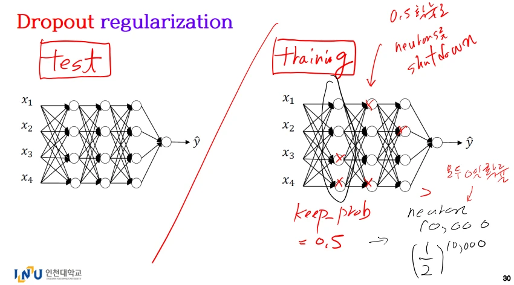

- Dropout을 다룰 때는 **Keep_prob**라는 **Hyperparameter**가 존재해서, 이 값에 따라 Training에서 노드의 출력을 얼마나 끌 지를 결정할 수 있다. 

    - 즉, 한 번 Train을 할 때마다 각 노드에 대해서 0과 1 사이의 random값을 만들고, 그 값이 **keep_prob**보다 크다면 Dropout 하는 것이다. (*keep_prob는 노드의 출력을 유지할 확률*)
    - Dropout은 Mask를 통해서 구현된다.
    - **keep_prob**는 layer마다 값이 다를 수 있다. 모든 Layer에 동일하게 적용되는 것이 아니다.

> 왜 Dropout을 할까? 그 이유 역시 Regularization이다. 학습 과정에서 어떠한 Parameter가 과도한 가중치를 가지고 많은 비중을 차지한 채로 학습을 하고 있을 수도 있기 때문에, 랜덤하게 출력값을 Drop하면서 최대한 비중있게 학습 되도록 만들겠다는 것이 의도이다.

### Implementing Dropout

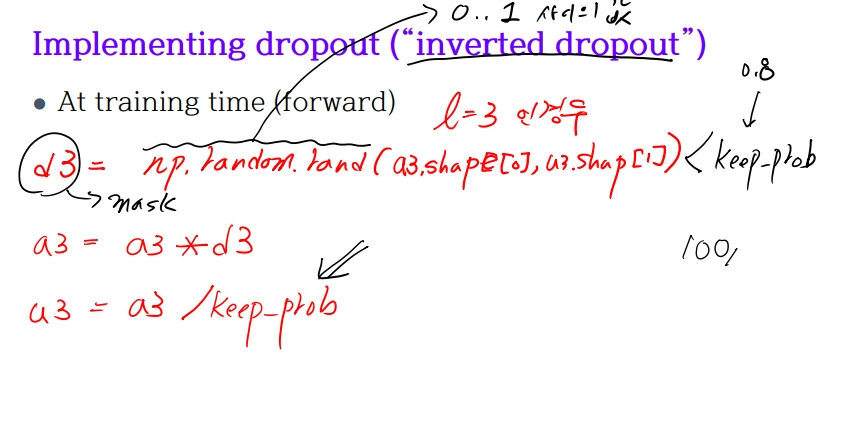

- forward pass 과정에서, 위와 같이 만들면 Dropout을 구현할 수 있다. (*l = 3*)

```python
keep_prob = 0.8 # 유지 확률 80%

# a3는 layer 3의 activation이다.
d3 = np.random.rand(a3.shape[0], a3.shape[1]) < keep_prob
# keep_prob보다 값이 작은 것을 찾아내는 것.
# 값이 작다면 True이므로 1, 크다면 False이므로 0이 된다.
# 즉, activation의 크기만큼 mask를 생성하는 것.

a3 = a3 * d3
# 생성한 mask를 activation과 곱한다.

a3 = a3 / keep_prob
```

> 여기서 중요한 것이 하나 있다. 바로, activation을 keep_prob로 나눠주는 것이다. 왜 이것을 하냐면, Dropout을 하는 순간 값의 분포가 변화하게 된다. (*즉, 평균이 변화한다.*)  
> 이러면 모델이 다른 데이터를 학습한다고 판단할 수 있으므로, 문제가 될 수 있다. 따라서 우리는 a3의 값을 수정해 주어야 한다.  
>   
> 그럼 어떻게 할까? keep_prob가 0.8이었다면, a3를 0.8로 나눠주면 된다. 그러면 값의 분포가 이전과 동일해진다. 이것을 **Inverted Dropout**이라고 한다.  
> ⇒ 안그러면 Test Time에 값을 곱해주어야 한다.

### Forward/Backward in Dropout

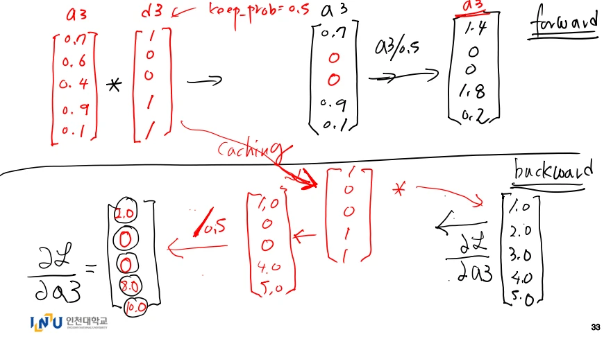

> 약간 잘못된 부분이 존재하는데, keep_prob가 0.5이고 activation이 충분히 길다고 한다면, 확률적으로 activation이 딱 절반 Dropout될 것이다. 하지만 여기서는 대략적으로 나타낸 것이고, 위의 숫자가 들어맞게 하려면 keep_prob = 0.6이라고 표현되어야 맞을 것이다.

- Forward

    - Dropout이 돼서 [0.7, 0, 0, 0.9, 0.1]이 되었다. 이전에 말한 것처럼 분포를 맞추기 위해서 Inverted Dropout을 수행, 0.5로 나누어준다. 그러면 값이 두 배가 된다.

- Backward

    - 만약 Gradient를 구했더니 값이 [1.0, 2.0, 3.0, 4.0, 5.0]이었다고 해보자. 이제 여기에 우리가 구했던 Mask를 그대로 곱해주어야 하는데, 그 이유는 **Forwardpass에서 영향을 준 것에 대해서만 실질적으로 Gradient를 업데이트 해주는 것이 맞기 때문**이다.
    - 따라서 da3는 [1.0, 0, 0, 4.0, 5.0]이 되고, 이전과 똑같이 0.5로 나누어서 최종적으로 Gradient를 구할 수 있다.

### Other techniques to prevent overfitting

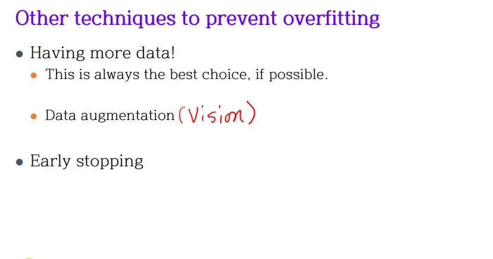

- 가능하다면 더 많은 데이터를 가지는 것이 항상 좋다. 하지만 이것은 현실적으로 어려울 수 있기 때문에, **Data Augmentation**을 통해 구현할 수도 있다.
- 혹은 **Early Stopping**을 도입할 수도 있다.

### Data Augmentation

> 데이터 증강은 현재 가지고 있는 데이터셋을 조작하여 마치 새로운 데이터처럼 다루는 것이다. 대체로 Computer Vision Domain에서 자주 다룬다.

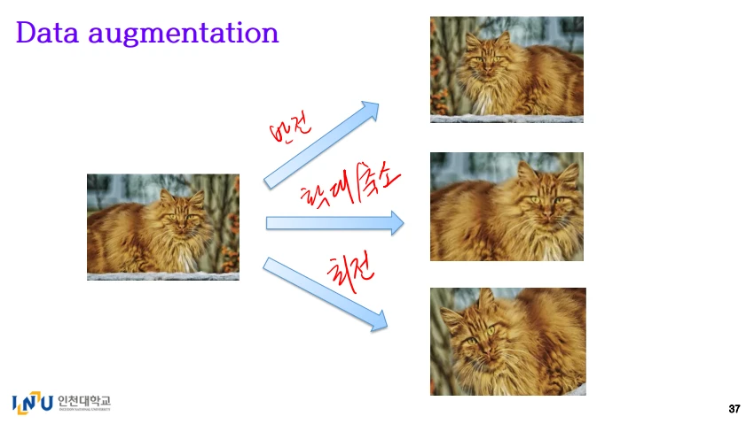

### Early Stopping

> 학습을 하다보면 Training Data에 대해서는 Loss가 낮아지지만, Validation Data에 대해서는 Loss가 높아지는 순간이 생긴다. 그 순간에 대비해서 도입하는 방법이 Early Stopping이다. 따라서 **Early Stopping**은 Overfitting이 될 징조가 보이면 학습을 빠르게 종료시켜 버리는 방법이다. 

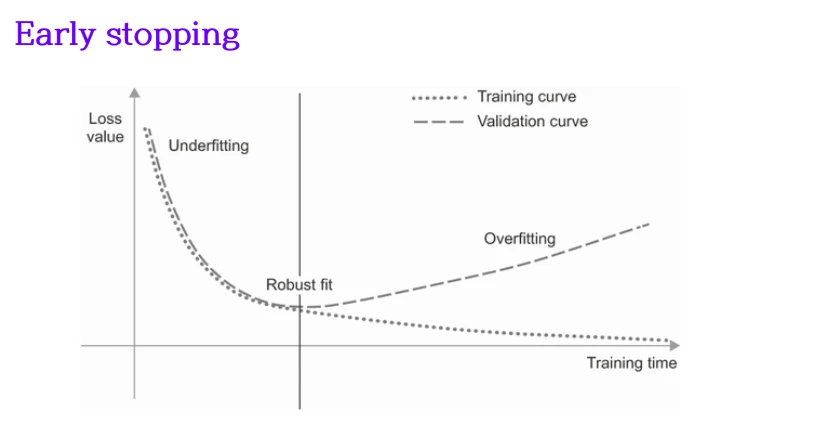
