# Weight Initialization

작성일 2023-12-10 · 최종 수정일 2024-11-15
{ .post-date }

## &lt;Preprocessing of inputs&gt;

> 이전에 우리가 다뤘던 고양이 예측 문제에서는 Image를 Data로 다뤘다. 특히 Image는 0~255 사이의 uint값을 갖기 때문에 우리는 Input Data를 255로 나눠서 float32로 만들어 주었다.  
> ⇒ 이로써 실수로 바꿔 값의 표현력을 키우고, 값이 큰 것의 가중을 감소시켰다.

### Normalizing Training Data

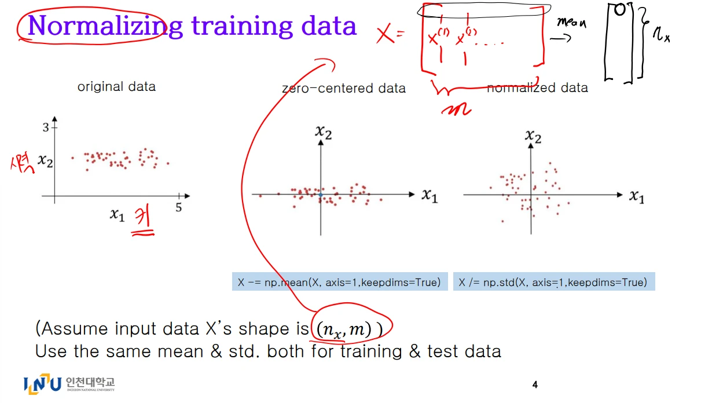

- 위와 같이 데이터의 분포를 조작한다고 해보자.

    - Original Data
    - Zero-Centered Data : 모든 값을 평균으로 뺀 것
    - Normalized Data : 데이터가 표준정규분포를 따르도록 Normalize한 것

- 이미지 데이터는 값이 0~255이기 때문에 Normalize가 크게 중요하지는 않지만, 키-시력 등의 데이터라면 Normalize가 매우 중요하다.

### Why Normalize Inputs?

> 왜 Normalize를 하지 않으면 학습이 오래 걸릴까? (*왜 Normal Distribution을 따라야 할까?*)

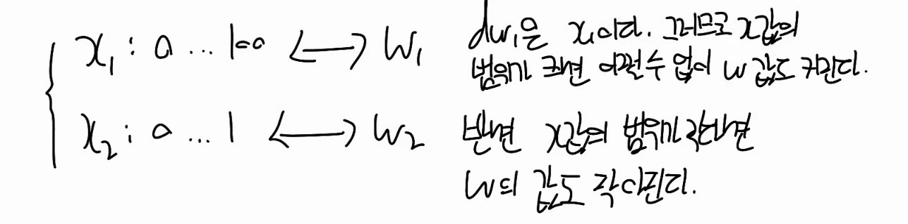

- 만약 Normalize를 하지 않아서 값의 범위가 0~100이라고 해보자. 그런데, Gradient를 구하는 과정에서 w1의 gradient를 구하는 과정에, x1의 값이 그대로 들어가게 된다. (*아래 식 참조*)

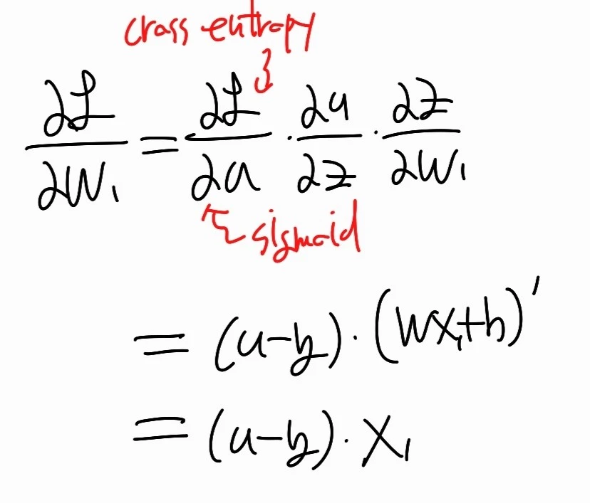

⇒ 이와 같이 x1이 들어가게 된다는 것을 알 수 있다.

> 따라서 Normalization을 하지 않으면, Gradient가 매우 크게 나오게 돼서 Parameter가 매우 크게 업데이트 되고, 그러면 올바른 Parameter를 찾기 어려워지게 될 수 있다. 이 때문에 학습이 오래 걸릴 수 있는 것이다.  
>   
> 따라서 Normalization을 통해 값을 최대한 작게 만드는 것이 올바른 학습에 유리하다.

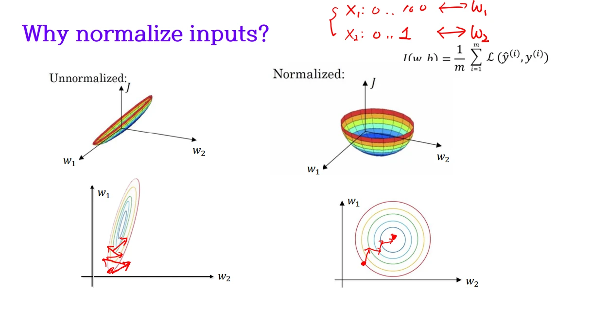

- **Unnormalized** : w1, w2의 업데이트를 고려할 때, w1은 조금만 값을 바꿔도 값이 크게 바뀌게 되고, w2는 값을 많이 바꿔도 조금밖에 바뀌지 않기 때문에 Optimal Parameter를 찾기가 어렵다.
- **Normalized** : 반면 Normalized를 했을 때는 Parameter 값의 차이가 너무 크지 않기 때문에, Cost Function에 대해서 Gradient Descent를 수행할 때 값을 업데이트하기가 좋다.

---

## &lt;Weight Initialization&gt;

> 가중치의 초기값을 설정하는 방법에 대해서 알아보자.

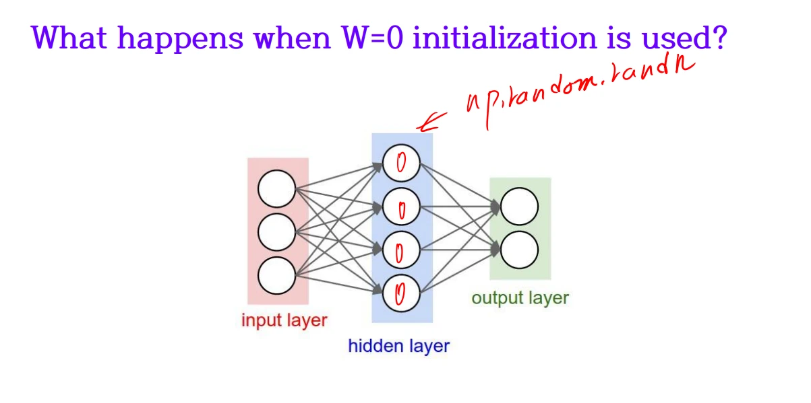

- 만약 모든 가중치의 값을 0, 또는 같은 값으로 설정한다면 모든 가중치의 activation이 똑같아지므로, Gradient가 똑같아져서 Logistic Regression과 다를 바가 없게 된다.
- 따라서 Weight는 반드시 서로 다른 Random 값을 갖도록 설정해야 한다.

⇒ 그렇다면 어떻게 해야할까?

### Idea 1) Small Random Numbers

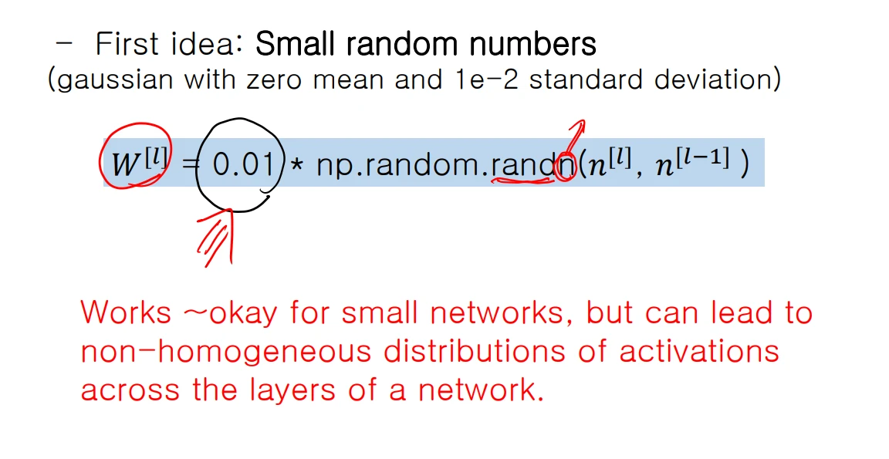

> 이와 같이 평균이 0이고 표준편차가 1/100인 가우시안 분포를 따르는 랜덤한 값으로 가중치를 초기화하는 방식은 작은 네트워크에서는 잘 동작한다. 하지만, 네트워크의 깊이가 깊어질수록 문제가 발생하게 된다.

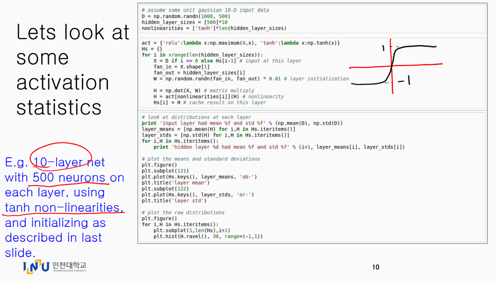

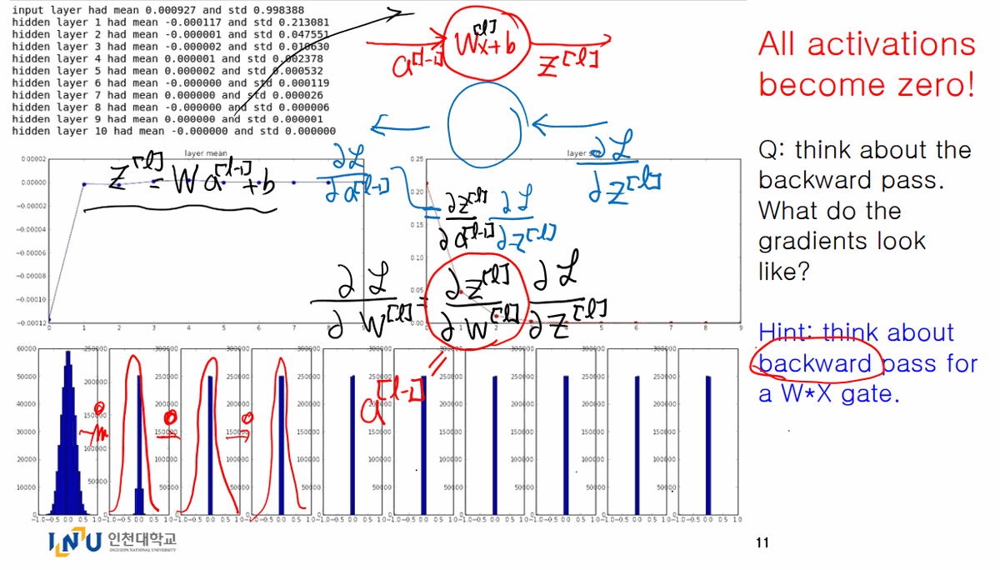

- 위 슬라이드를 봐보자. 이전에 Input Data도 **Normal Distribution**으로 만들었다. 여기에다가 **Small Random Numbers**로 초기화한 가중치를 곱해 **Activation**을 만들어보자. 현재 **Activation Function**으로는 **tanh**를 사용했는데, 이 과정을 반복하면 레이어를 거칠수록 activation의 **standard deviation이 사라지는 것을 확인**할 수 있다.  
    (*평균은 변하지 않지만, Standard Deviation이 감소하면서 값들이 0에 수렴하게 되는 것이다.*)

- 즉, activation의 값이 대부분 0으로 비슷하게 나타나기 때문에, **Gradient**도 0이 되어서 Parameter가 업데이트되지 않는 **Gradient Vanishing**이 발생한다.

### Idea 2) Slightly Bigger Numbers

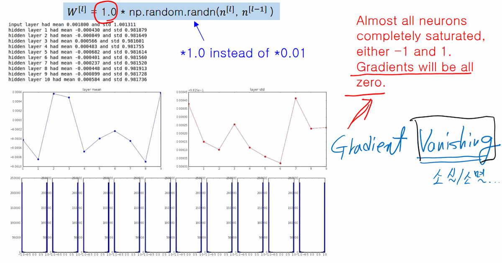

- 그렇다면 이번에는 표준편차가 1인 난수로 가중치를 초기화 해보자. 하지만 이번에도 역시 문제가 발생하는데, activation이 -1과 1에 가까운 값들만 나오는 것을 확인할 수 있다. 그런데 Forward에서 문제가 발생하는 것은 아니다. 하지만 Backward에서는 문제가 발생한다. 현재 사용하고 있는 Non-linear activation function이 tanh이고, tanh에서는 값이 -1과 1에 가까우면 Gradient가 0이 되므로, **Gradient Vanishing**이 발생하는 것이다.

> 이러한 문제를 어떻게 해결해야 할까?   
> ⇒ 우리는 새로운 초기화 방법을 도입해야 한다.

### Vanishing/Exploding Gradients

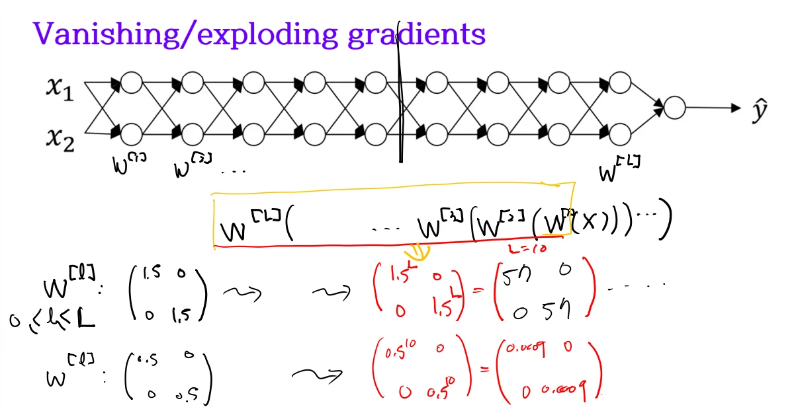

- L개의 layer가 있고 쭉 Forward를 진행한다고 해보자. (*현재는 Activation이 없다고 생각해보자.*)
- 가령, 모든 레이어의 가중치값이 [1.5 0; 0 1.5] 혹은 [0.5 0; 0 0.5]였다고 해보자. 그러면 어떤 일이 발생할까?  
    ⇒ 값이 매우 커지거나 값이 매우 작아진다. **Gradient Exploding**/**Gradient Vanishing**이 발생할 수 있다.

> 따라서 weight의 값이 조금만 커지거나, 조금만 작아지게 되어도 Layer가 깊어짐에 Gradient가 사라지게 될 수도 있다는 것이다!

### Xavier Initialization

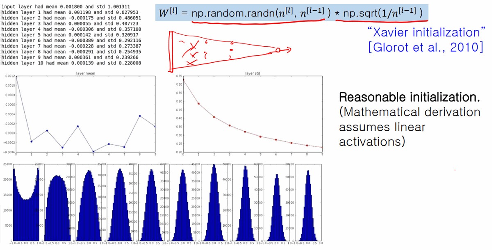

- **Xavier Initialization**은 Layer를 지날수록 값이 점점 작아지니까, Layer의 입력 Feature 개수의 제곱근으로 나눠주는 것이다. ⇒ **값을 키워준다는 의미이며, Standard Deviation을 키우겠다는 것.**

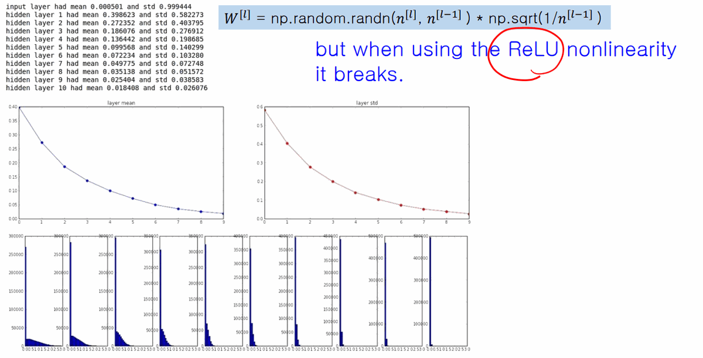

- 다만 Xavier Initialization은 **ReLU**를 사용하면 **효과가 매우 떨어지게 된다.** Standard Deviation이 급격하게 줄어들지는 않지만, 결국에는 Layer가 깊어지면 Standard Deviation이 감소하게 된다.
- 이것은 ReLU가 음수 부분은 0으로 잘라버리기 때문에 값이 반 날라간다. 따라서 아무리 Standard Deviation을 늘려주어도, tanh보다는 성능이 떨어지는 것이다.

> Xavier는 Logistic Function에서 주로 사용된다.

### He Initialization

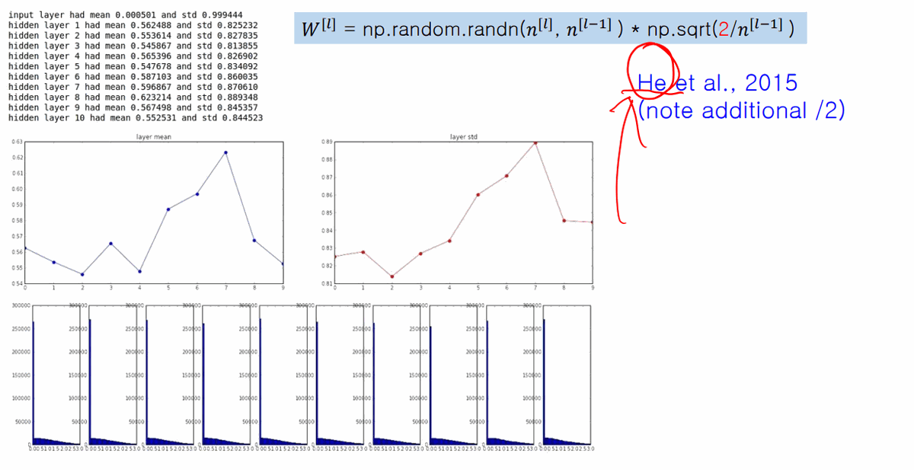

- He는 Xavier와 큰 차이는 없다. 단지 2를 추가로 곱해줘서 값이 유지될 수 있도록 하는 것이다.
