# Batch Normalization

## &lt;Batch Normalization&gt;

### Batch Normalization

> Batch Normalization의 등장에 따라, 초기화는 Minor한 문제가 되었다. 이전까지는 activation을 거칠 때 값의 Standard Deviation이 사라지는 것이 큰 문제가 되었다. 그래서 Weight를 잘 결정해주었는데, 이제는 Batch Normalization이라는 기법을 도입해서 값을 강제로 늘려준다.

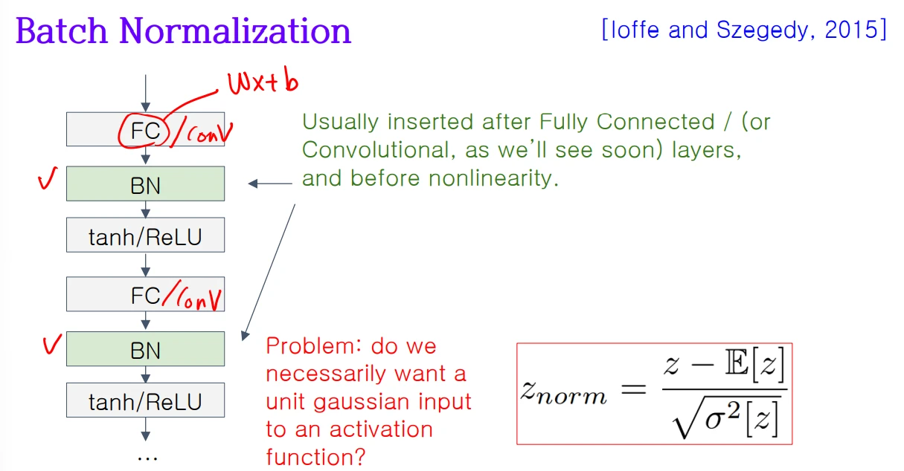

- 이와 같이 Activation을 거치기 전에 Batch Normalize Operator를 배치하여 값의 분산이 너무 크면 줄여주고, 분산이 너무 작으면 키워주는 연산을 진행한다.
- 따라서 평균은 0이 되며, Standard Deviation으로 나눠줘서 표준편차가 1인 표준정규분포를 따르게 된다.

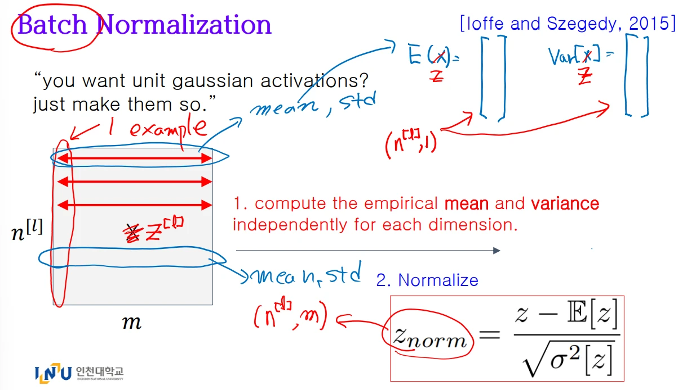

- l번째 레이어에서 Z[l]은, Feature는 n[l]개 존재하며 example 개수가 m개이기 때문에 Shape이 (n[l], m)으로 표현된다.
- 우리는 m개의 데이터를 한 번에 처리되도록 Vectorization을 했었다. 하지만 실제로는 이것이 불가능한 경우도 있기 때문에, 일반적으로 example의 전체 개수인 m개보다는 적은 수로 정해서 한 번씩 Forward/Backward를 할 수도 있다. 이 때 사용되는 데이터를 **Mini**  **Batch**라고 한다.  
    ⇒ 여기서는 그냥 m개의 example을 다루는 **Batch**라고 해보자.

- 이걸 Normalize하려면 어떻게 해야할까? 당연하게도, **Row 방향**으로 **평균**과 **Standard Deviation**을 구해야 한다.
- 따라서 이렇게 계산하면, 평균의 Shape은 (n[l], 1)이고, 표준편차의 Shape도 (n[l], 1)이다.

> 이렇게 구한 mean과 stddev를 Broadcasting을 통해 Z에 대해서 평균을 빼주고, 표준편차로 나눠주면 Normalize가 되는 것이다.

- 그런데, Batch Normalization Operator를 Activation 앞에 두냐, 뒤에 두냐로도 논쟁이 있다. 하지만 만약 ReLU를 사용한다면, 표준정규분포를 따르기 때문에 음수가 50%이므로 모두 데이터가 절반이 잘리게 되는 문제가 생긴다. 우리가 이런 것을 원했던 것은 아니다. 우리는 단지 데이터의 분산을 키워서 Gradient Vanishing을 없애고자 했던 것이다.  
    ⇒ 이 문제를 해결해 보고자 한다.

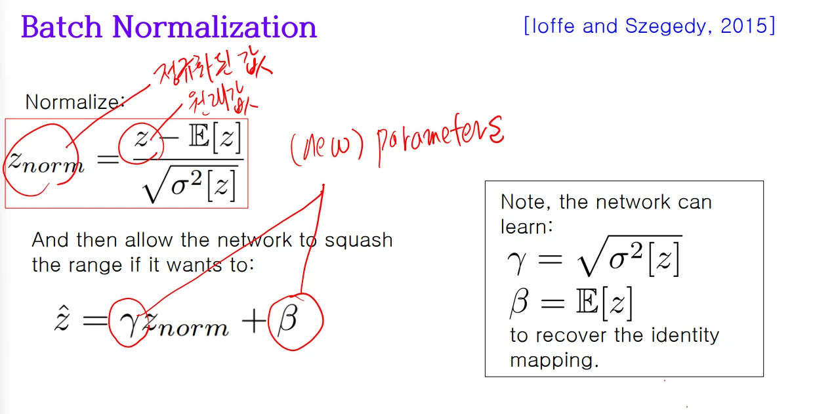

- 새로운 parameter인 γ와 β를 추가한다. 즉, 우리가 반드시 평균이 0이고 표준편차가 1인 표준정규분포를 따르게 하기 보다는, 무언가 그때그때 적절한 가우시안 분포가 되도록 모델이 스스로 학습하도록 만드는 것이다.
- 즉, γ는 새로운 Stddev가 되고, β는 새로운 mean이 된다.

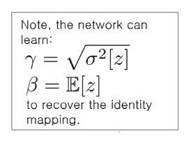

> 그런데 만약, 이 네트워크가 Loss를 줄이기 위해서 Batch Normalization을 하지 않는 것이 더 좋겠다고 판단한다면, γ와 β를 이와 같이 설정해서 원래값으로 돌려줄 수는 있다.

### Batch Normalization in Forward (Training Time)

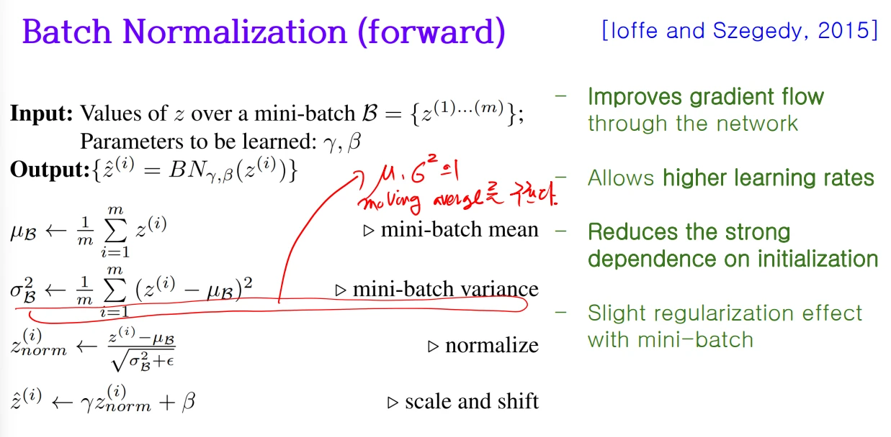

- Batch Normalization은 Forward 과정에서 다음 Step을 거친다.

    - Mini-Batch의 Mean을 구한다.
    - Mini-Batch의 Variance를 구한다.
    - Normalize를 수행한다. 우선적으로는 표준정규분포를 따르도록 만든다.
    - 이후, γ로 곱하고 β를 더해서 학습된 정규분포를 따르도록 만든다.

    > 그런데 Mini-Batch에서의 Normalize Operation들은 모두 미분 가능한 연산이기 때문에, 역시 Backward에서 문제없이 Gradient를 구할 수 있다.

### Batch Normalization in Backward (Training Time)

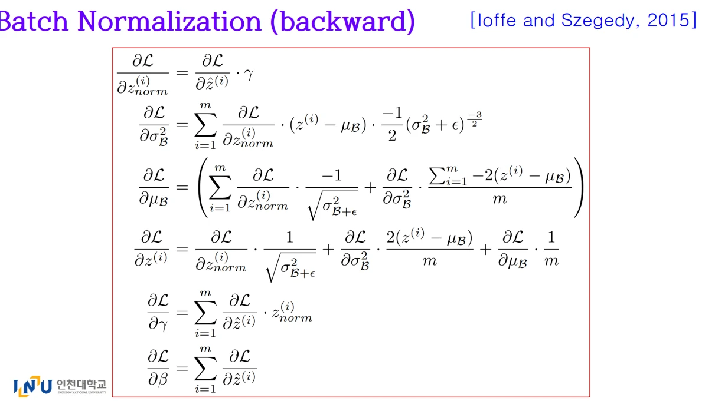

- 이와 같이 Gradient를 구해서 parameter를 update할 수 있다.

> 이와 같이 Batch Normalization을 수행해서 Activation이 정상적인 분포를 가지게 되기 때문에 Gradient Vanishing이나 Gradient Exploding을 방지할 수 있게 되었다.  
>   
> 또한, 이전에는 Weight Initialization이 매우 중요했었다. 하지만 Batch Normalization을 쓴다면 초기화를 대충해도 웬만해서는 학습이 잘 진행된다. Activation을 거치는 과정에서 분포가 잘못되는 것이 원인이었고, 이걸 해결했기 때문에 Weight의 초기값은 크게 중요하지 않게 된 것이다.

### Batch Normalization in Convolutional Network

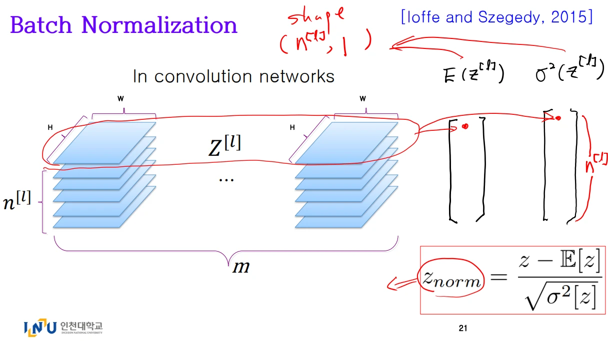

- Batch Normalization은 사실 Convolutional Network에서 처음 등장했다. 그래서, Conv Network에서 Batch Normalization이 어떻게 이루어지는 지를 한번 알아보자.
- 이전에는 우리가 Image를 Flatten해서 (n[l], m)으로 다뤘지만, Convolutional Network는 이미지를 Flatten하지 않고 그냥 사용한다.
- 이미지는 Input으로 들어올 때 Channel이 세 개이지만, 연산이 이루어지는 과정에서는 채널이 매우 많아지기도 하고, Height와 Width가 감소하기도 한다. 
- 여기서는 Rank 4 Tensor를 다루게 된다. 
- 이전에는 우리가 (n[l], m)의 Z[l]에 대해서 평균과 표준편차를 구했고, 그것이 (n[l], 1)이었다. 이제는 n[l]이 Channel을 의미하고, 각각의 채널마다 Height와 Width가 존재한다. 그렇기 때문에 Z[l]에서의 평균과 표준편차도 각각의 채널에 대해서 구해주어야 한다.
- 따라서, Convolutional Network에서 Z[l]의 Shape은 이전과 똑같이 (n[l], 1)이 된다.  
    ⇒ 아무래도 각 채널별로 m개의 평균, 표준편차를 구한 뒤, 다시 그것에 대해서 평균을 취해주는 방식인 것으로 생각된다.

### Batch Normalization (Training Time) 정리

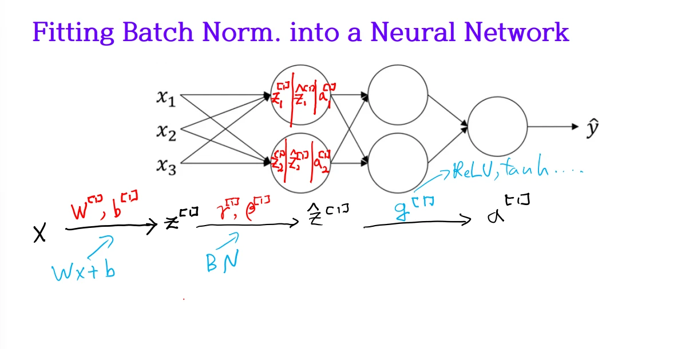

- Batch Normalization이 추가되면, 하나의 Node에서의 동작이 약간 바뀌게 된다. 

    - Z를 구한다.
    - Z가 표준정규분포를 따르도록 노멀라이즈 한 다음, γ를 곱하고 β를 더해서 Batch Normalize를 한다. 이것이 Z hat이다.
    - 이것을 Activation에 넣어서 Layer의 출력값을 구해낸다.

- X를 통해서 Z[1]을 구하고, Z[1]에서 Z[1] hat을 구하고, 다음으로 a[1]을 구한다.
- 이때, Z[1]을 구하기 위해서는 parameter W[1], b[1]이 필요하고, Z[1]에서 Z[1] hat을 만들기 위해서는 γ[1], β[1]을 사용해야 하며, 다음으로는 구해진 Z[1] hat을 Activation Function에 통과시켜서 activation a[1]을 얻어낸다.
- 이런 과정이 반복적으로 수행된다.

---

### Batch Normalization (Test Time)

> 그런데, Training Time에서 적용했던 Batch Normalization을 Testing Time에서 그대로 사용하기에는 문제가 있다. 바로, Mean과 Stddev를 구할 데이터의 개수가 충분하지 않다는 것이다.  
> 이걸 어떻게 해결해야 할까? ⇒ Training Time에서 Mean과 Stddev를 빌려온다.

### Exponentially Weighted Moving Average

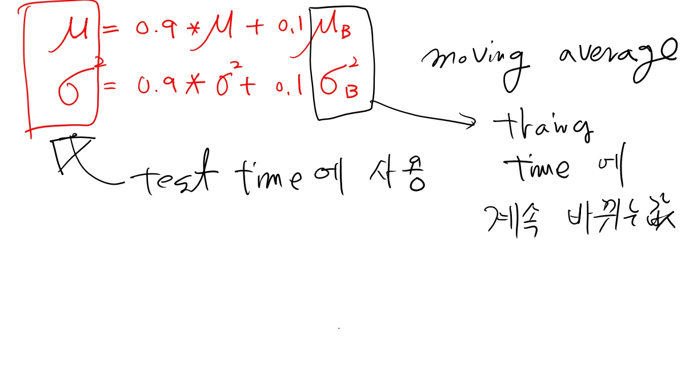

Training Time에서 평균 μ와 표준편차 σ를 기록하기 위하여 현재의 평균과 표준편차, 그리고 이전의 평균과 표준편차에 대해서 비율을 정해 μ와 σ에 대한 값을 기록해둔다. 그리고 Training Time에서 Loop를 돌 때마다 Moving Average로 값을 업데이트 한다.  
⇒  **그리고 이것을 Layer마다 저장하는 것이라고 생각하면 되겠다.**

> 이런 방식으로 Moving Average를 통해 Training Time에서 평균과 표준편차를 기록해두면, Test Time(혹은 Inference)에서 데이터의 개수가 충분하지 않더라도 Batch Normalization을 실행할 수 있게 된다.

- 따라서, 논문에서는 Training Time에 Moving Average를 구하는 코드가 빠져있다고 볼 수 있다.

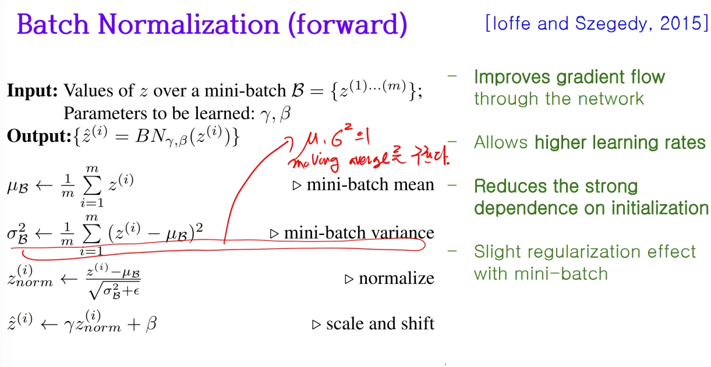

⇒ 여기서 중간에 Moving Average를 통해 평균과 표준편차를 Layer별로 기록해 두어야 한다. 그리고 이걸 Test Time에 사용하게 된다.

### Batch Normalization (Test Time)

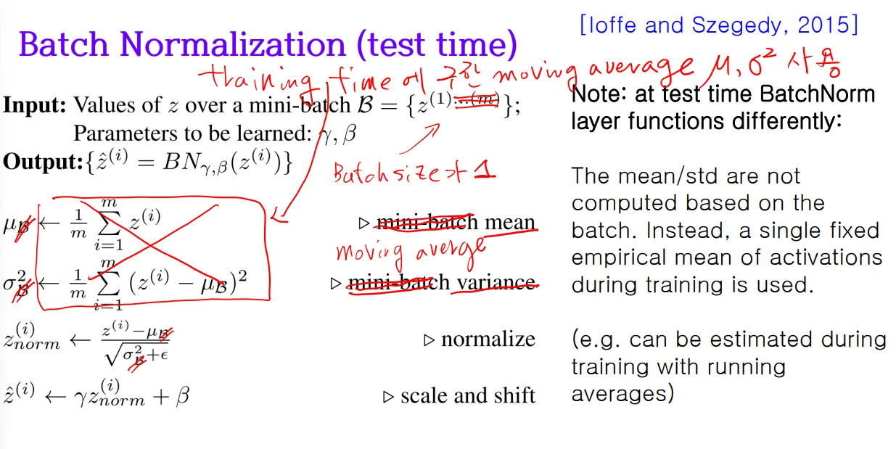

⇒ Test에서 사용하는 평균과 표준편차는 Training Time에 **Moving Average**를 통해 구한 것이라고 생각하면 된다.

### Bias?

> 그런데 만약 Batch Normalization을 사용한다면, Bias를 사용하지 않아도 된다. 그 이유는 Bias를 더하는 것은 해석해보자면 데이터의 평균을 변화시킨다는 것인데, 그런데 결국 Normalization에 의해서 평균이 0이 되기 때문에 아무 의미가 없는 행동이라는 것이다.
