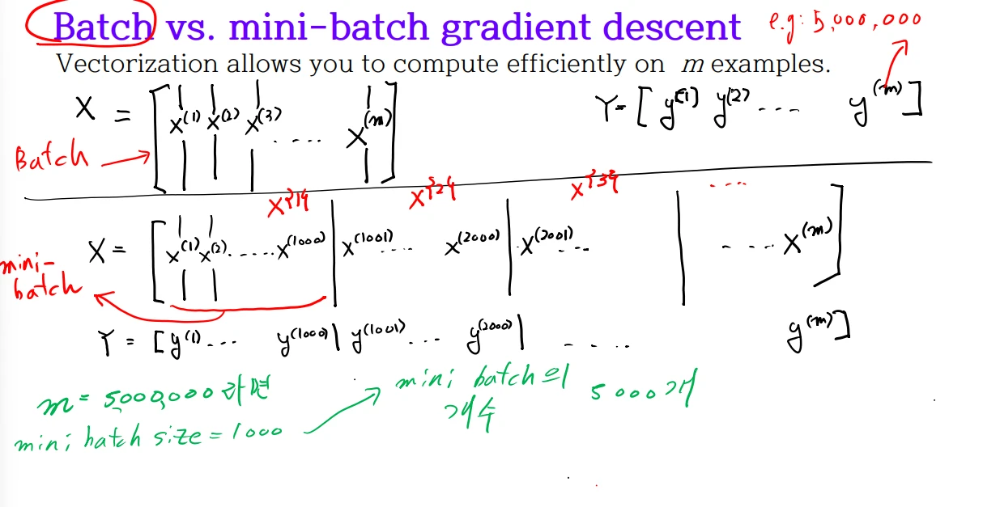
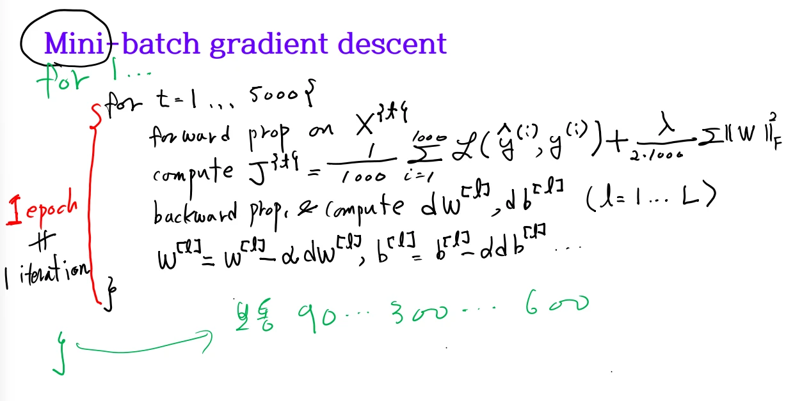
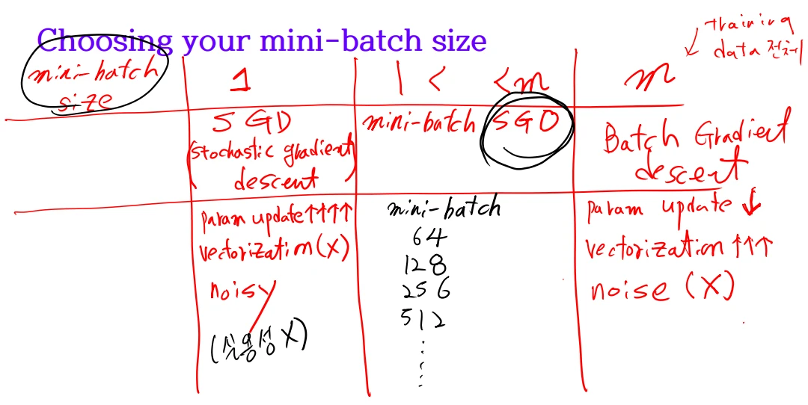
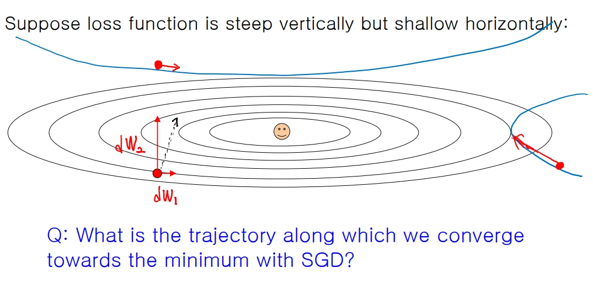
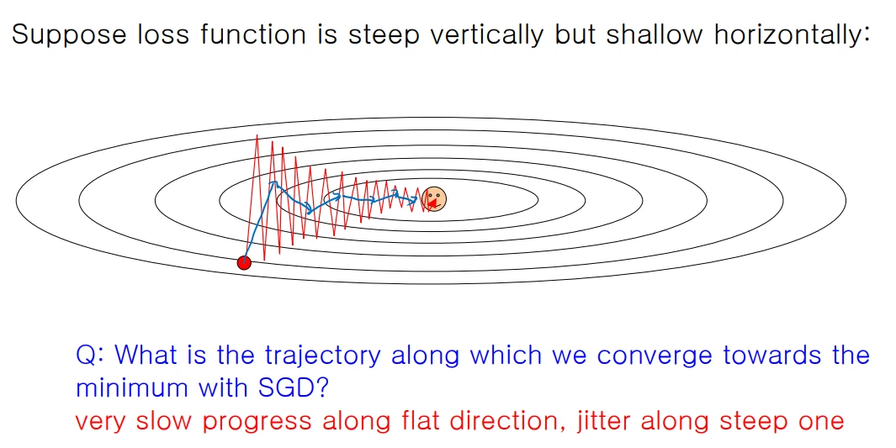
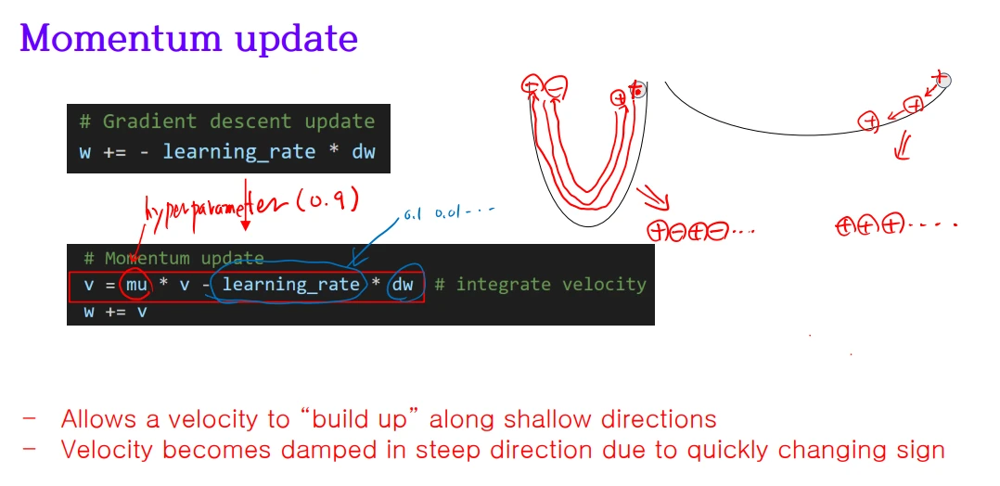
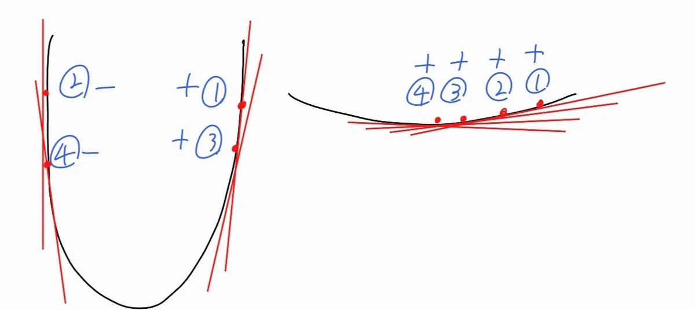
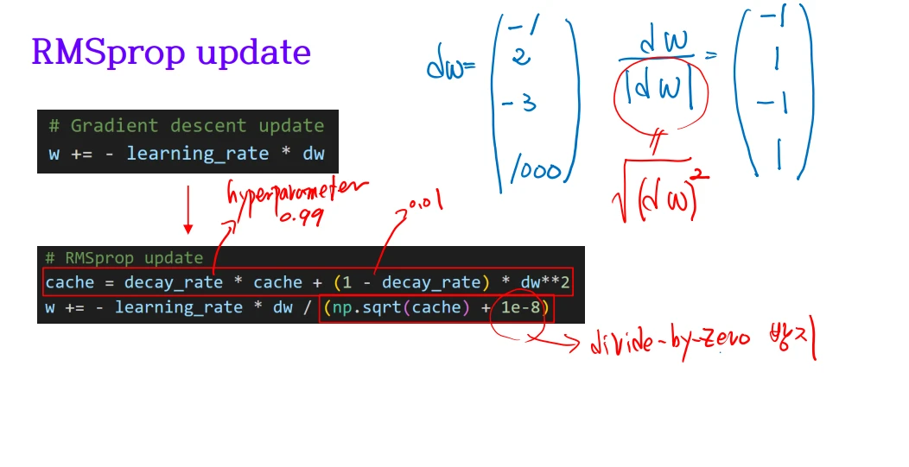
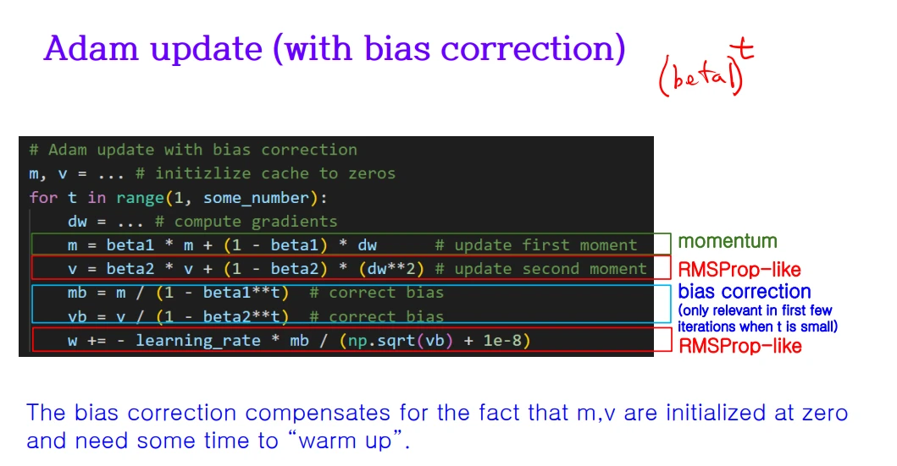
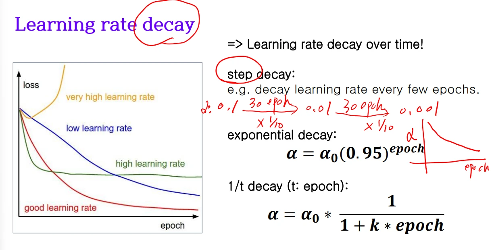

# Optimization

작성일 2023-12-10 · 최종 수정일 2024-11-15
{ .post-date }

> 우리가 지금까지 해왔던 것은, 어떻게 하면 Training 과정을 더 빠르고 효율적으로 진행할 수 있을지, 그 방법들을 알아보는 과정이었다.  
>   
> 그런데, 사실 Develop 과정에서는 Experiment가 가장 오랜 시간이 소요된다. 따라서 우리는 다양한 Optimization을 통해 Experiment 시간을 감소시킬 방법을 알아보고자 한다.

## &lt;Mini-batch Gradient Descent&gt;

- 이전에 Vectorization을 하면서 Batch라는 것이 등장했었다. Batch는 학습을 빠르게 진행하기 위해서 여러 개의 데이터를 하나의 Tensor로 묶은 것을 말한다. 즉, 우리는 여러 개의 데이터를 Tensor로 만들고 이를 Network에 넣어 한 번에 처리했었다. 그런데 사실 이렇게 학습하는 것은 현실적으로 불가능한 경우가 많다. 
- 예를 들어서, 전체 데이터의 개수가 5,000,000개라고 해보자. 현실적으로 이 모든 것을 한 번에 Vectorization해서 학습에 사용할 수 없기 때문에, 이걸 나눠줘야 한다.

- 그래서 이걸 나누는 사이즈가 **Mini-batch Size**(*여기서는 예를 들어 1000이라고 하자.*)이고, **Mini-batch Size**에 따라 Original Data가 나눠진 것을 **Mini-batch**라고 한다.

    데이터를 나눴으므로, 마찬가지로 **y**(Target Value)도 나눠준다.

### Mini-batch Gradient Descent

- 예를 들어, 전체 데이터의 개수가 5,000,000개고, Mini-batch Size가 1,000이기 때문에 1 epoch은 5000번의 Iteration으로 표현된다.
- **forward propagation on X{t}** : Mini-batch X{t}에 대해서 forward pass를 진행한다.
- **compute J{t}** : Cost Function을 계산한다. 이때, **L2 Regularization**을 사용한다.
- **backward propagation** & **compute gradients** : backward pass를 진행하고, gradients를 구한다.
- **update** : **parameter**를 **update**한다.

> Mini-batch를 나눠서 처리하면 좋을까 안좋을까? 결국 어쩔 수는 없는 것이다. 왜냐면, H/W의 한계에 의해서 어쩔 수 없이 도입한 것이기 때문이다.

### Why Mini-batch?

> 일반적으로 **Batch Gradient Descent**(# iterations = # epochs인 경우)에서는 항상 같은 데이터를 다루고, 그리고 그것으로부터 구한 Loss가 줄어드는 방향으로 학습하기 때문에, 절대로 Cost가 상승하지 않는다.  
>   
> 하지만 **Mini-batch Gradient Descent**는 **Batch Data**가 **서로 다른 독립적인 데이터**라고 볼 수 있다. 그래서 **Cost가 항상 줄어들지는 않을 수 있다.**

⇒ 그렇다면, 대체 왜 (*Memory 관점에서의 이유를 배제하고*) Mini-batch를 사용할까?

### Choosing your Mini-batch Size

> [https://light-tree.tistory.com/133](https://light-tree.tistory.com/133) ← 참고한 사이트.

### **Batch Gradient Descent**

Batch Gradient Descent는 전체 데이터셋을 하나의 Batch로 만들고, 이를 바탕으로 Loss를 구해 Gradient를 계산한 뒤, Parameter를 Update하는 방식이다. 즉 여기서는 전체 데이터셋에 대한 Loss로 Cost Function을 만들고, 이것을 각각의 parameter로 미분하여 gradient를 구한 다음 parameter를 update한다는 것이 가장 큰 특징이다. 이것은 몇 가지 장점을 가진다.

- Parameter Update 횟수가 적다.
- Vectorization으로 인해 속도가 매우 빠르다.
- 전체 데이터에 대해서 Error Gradient를 계산하기 때문에, Noise가 매우 적고, 안정적으로 Optimal Parameter로 수렴하게 된다.

> 결국 이 방식이 가장 좋지만, Practical하게는 Batch Gradient Descent가 H/W의 한계로 인해 사실상 불가능하므로, 다른 방법을 찾아야 한다.

### **Stochastic Gradient Descent**

**Stochastic Gradient Descent**는 한 개의 데이터에 대해서 Error Gradient를 구해 계산하고, Gradient Descent를 수행하는 알고리즘이다. 

- Parameter Update 횟수가 매우 많다.
- Vectorization을 이용하지 않으므로, 학습 속도가 매우 느리다.
- 매번 다른 데이터에 대해서 Parameter를 업데이트하므로 Cost Function이 매번 달라져서 Shooting이 자주 발생할 수 있으며, 이는 Noise가 많다는 것을 의미한다.

> 이 방식은 실용성이 거의 없다고 볼 수 있다.

### (Mini-batch) Stochastic Gradient Descent

이 방식은 SGD와 BGD의 중간 정도의 방법으로, 현실성을 고려하여 높은 성능을 얻을 수 있는 최적의  방법이라고 할 수 있다.  
⇒ 일반적으로 SGD라고 하면, 거의 Mini-batch SGD를 말한다.

---

## &lt;Parameter Updates&gt;

### Changing Optimizer

> 지금까지 우리의 목적은 Experiment Time을 줄이는 것이었다. 기존에 우리는 단순히 Gradient에 Learning Rate를 곱하고 이것을 이전 Parameter 값에서 빼는 방식으로 Parameter Update를 진행했는데, 이 방식을 바꾼다면 **학습이 훨씬 빠르게 진행될 수 있다.**  
> (SGD가 느린 이유는, 학습 과정에 많은 Noise가 발생하기 때문이다.)

- Test Time에는 Batch Normalization의 평균과 표준편차를 구할 수 없으므로 Training Time에서 Layer 별로 Moving Average를 통해 얻은 평균과 표준편차를 사용한다.

### Momentum

- 위의 그림이 Cost Function J를 나타내고, 이때 dW1과 dW2가 위와 같이 나타났다고 해보자. 여기서는 두 벡터의 합으로 Cost가 이동하게 될 것이다. (*즉, Gradient의 양에 비례해서 움직인다.*)

- 따라서, 값의 업데이트가 이와 같이 굉장히 Fluctuate하게 일어난다. 어떻게 보면 이것은 방향성만 잘 잡아준다면, 더 빠른 업데이트가 가능할 수도 있을 것이다.  
    ⇒ 이것이 Momentum의 핵심 아이디어이며, 이를 잡기 위해 **Exponentially Moving Average**를 적용한다.

> 즉, Momentum은 Noise를 줄이는 것이 목표이다. 기울기가 +와 -를 반복할 경우에는 변화량을 줄여주는 역할을 하고, 기울기가 +만 계속되거나 -만 계속된다면 변화량을 늘려주는 역할을 한다.

- **Momentum**은 **velocity**를 의미하는 **v**라는 값을 만들고, 이를 **누적**시켜 나간다. v는 이전 값을 기억하기 때문에, 변화량을 조절할 수 있는 역할을 한다.

    이때 **hyperparameter µ**를 도입하여 사용한다. 위의 코드를 참고하면 이전의 v값에 **µ**를 곱해서 이전의 값을 참고할 비율을 조절하고, 거기에 learning rate를 곱한 gradient를 빼는 방식으로 v값을 업데이트 한다. 이후에 실제 W에 v를 더해서 parameter를 update한다.

왜 이것이 더 효과가 좋을까? 그 이유를 생각해보자. 만약 w1에 대한 cost function이 왼쪽과 같고, w2에 대한 cost function이 오른쪽과 같다고 해보자.

> v의 초기값은 0이다.

- w1 (*왼쪽 상황*)

    v값을 기억하면서 moving average를 적용하기 때문에, momentum이 감소하게 된다.

- w2 (*오른쪽 상황*)

    v값을 기억하면서 moving average를 적용하기 때문에, momentum이 증가하게 된다.

> 즉, v값을 도입함에 따라 Momentum이 큰 update는 변화량을 줄여주고, Momentum이 작은 update는 변화량을 크게 만들어 준다. 이로써 이전에 SGD에서는 해결할 수 없었던 Fluctuation Updating 문제를 해결할 수 있게 되었다.

### RMSprop

> RMSprop은 Root Mean Square Propagation이라는 뜻으로, Momentum이 추구하는 바와 매우 비슷한 Optimizer이다.

> RMSprop은 Noise를 줄이기 보다는 Feature Dimension 간의 격차가 너무 클 때, 그 격차를 줄이는 방법을 다룬다. 그래서 각 Feature들 간의 변화량을 Normalize하는 것이다.

- 이 방식은 hyperparameter decay_rate를 도입한다. (*예를 들면 0.99*) 
- **RMSprop**은 모든 방향에서 가중치가 동일하게 이동하길 바라는 것이다. 

- 예를 들어, dw/|dw|를 하게 되면 dw vector는 normalize 된다. 이런 방식을 활용해 방향성은 유지하되, 절대적인 변화량은 최대한 동일하게 맞추는 것이다.

    - 아이디어 자체는 Moving Average와 유사한 점이 있다.
    - 다만 실제로 값을 1까지 만들어버리는 것은 아닌 것 같고, 이전에 구했던 기울기는 점차 누적시키면서, 새롭게 구한 기울기의 제곱을 약간씩 누적시키는 방식이다.
    - 이로써 미분값이 큰 곳은 큰 값으로 나누어주고, 미분값이 작은 곳에서는 작은 값으로 나누어서 Noise를 제거하는데 도움이 된다.

- 이렇게 구한 **cache** 값의 제곱근으로 **gradient**를 나누어 주며, 이걸 바탕으로 update를 진행한다.
- 이때 나눠주는 값이 너무 작은 나머지 0으로 표현될 수 있기 때문에 divide-by-zero를 방지하기 위하여 아주 작은 값을 분모에 더해줘야 한다.

> 약간의 정리를 하자면, RMSprop은 Moving Average를 통해 가중치를 누적하는데, 특히 가중치의 제곱합이 누적된다는 것이 중요한 것 같다. 가중치의 제곱합을 구하기 때문에, 미분값이 큰 곳에서는 값이 크고, 미분값이 작은 곳에서는 값이 작다. 따라서 이것의 제곱근으로 dw를 나눠주게 되면, gradient의 noise를 줄이는데 도움이 된다.  
>   
> (*왜냐면, 큰 값은 작게 되고, 작은 값은 어느 정도 크게 될 수 있으니까.*)

### Adam

- Adam은 Momentum과 RMSprop을 모두 합쳐 사용하는 방식이다. 
- **Momentum**에서는 **mu**라는 **hyperparameter**를 사용했었고, **RMSprop**은 **decay_rate**라는 **hyperparameter**를 사용했었다. 여기서는 그 두 개가 **beta1**, **beta2**로 표현되며, **Momentum**으로 구한 **mb** 값을 **RMSprop**에서 구한 **vb**의 **제곱근**으로 **나눠주는 방식**을 취한다.

> 그런데 한가지 추가되는 점이 있다. 바로 Bias Correction인데, v값과 m값이 처음에는 Trend와 조금 동떨어져 있을 수 있다. 그래서 처음에는 값을 약간 키워줘야 한다.  
>   
> 따라서 Loop index t를 도입하고, mb, mv를 1보다 작은 수로 나눠서 값을 크게 만들어 준다. 그러다가 Loop가 돌면서 값이 업데이트 될 때마다 mb, vb 값을 크게 만드는 정도를 줄여줘서 Trend를 따라가도록 만들어준다.

---

## &lt;Learning Rate Decay&gt;

- Optimization은 모두 Learning Rate와 곱해서 업데이트를 하게 된다. 결국 Learning Rate가 매우 중요한 요소라는 것이다.
- Learning Rate를 어떻게 설정하냐에 따라서 학습이 되냐 안되냐가 결정될 수도 있다.
- 그런데 Learning Rate는 항상 고정되어 있는 것이 아니라, 학습을 하는 과정에서 Adaptive하게 조절해 줄 수 있다.

- **High Learning Rate**

    Learning Rate가 너무 클 경우, 학습이 잘 되다가 Optimal Point를 찾지 못하고 그 근처를 맴돌면서 학습이 잘 되지 않을 수 있다.  
    ⇒ 따라서, 어느 정도 학습이 되었을 때는 Learning Rate를 조절하면서 변화량을 적당하게 조절해 줄 필요가 있다는 것이다.

> Learning Rate Decay의 방법은 여러가지가 있지만, 단지 줄여나가는 방법에 차이가 있을 뿐 본질적인 의미는 같다.

- **Step Decay**

    예를 들어, 처음에는 Learning Rate를 초기에 0.1로 사용했다고 해보자. 이후에 30 Epoch을 진행할 때마다 Learning Rate를 1/10로 감소시키는 것이다. 그러면 30 Epoch부터는 Learning Rate가 0.01이 될 것이고, 그 다음 30 Epoch 뒤에는 0.001이 될 것이다.

- **Exponential Decay**

    다른 방법으로는 0과 1 사이의 값을 설정하고, 이걸 epoch의 index로 제곱한 것을 Learning Rate에 곱해주면서 Exponential하게 감소시키는 것이다.

- **One of t**(1/t) **Decay** (t : Epoch)

    또 다른 방법에서는 Learning Rate에 값을 곱해주는데, k라는 상수에 Epoch의 index를 곱해주고, 그 값에 1을 더한 것으로 Learning Rate를 나눠주는 것이다. 이렇게 하면 점차 Learning Rate가 감소되도록 만들 수 있다. (*Exponential Decay와 거의 유사하다.*)
