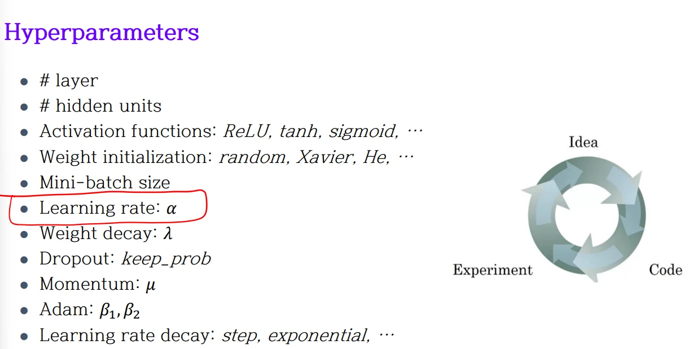
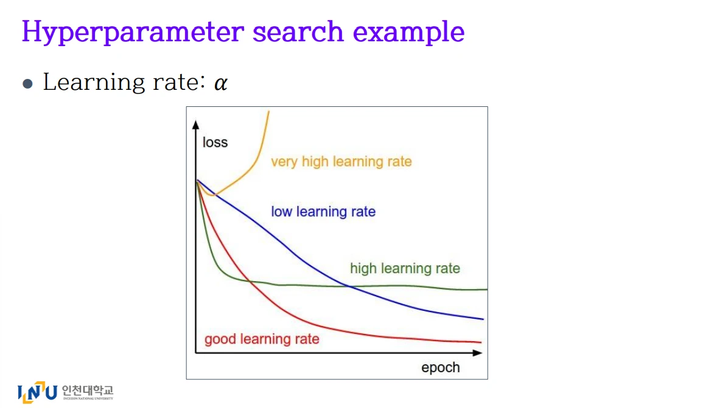
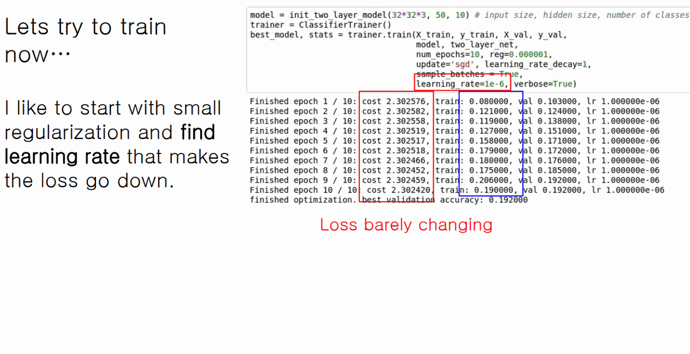
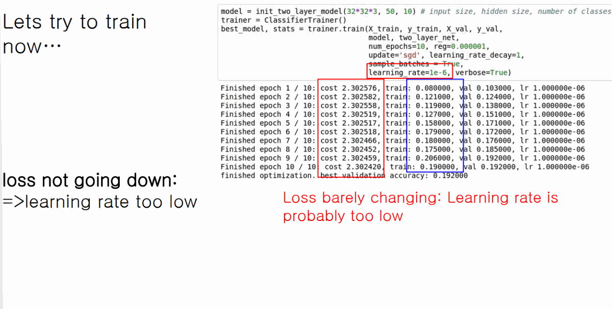
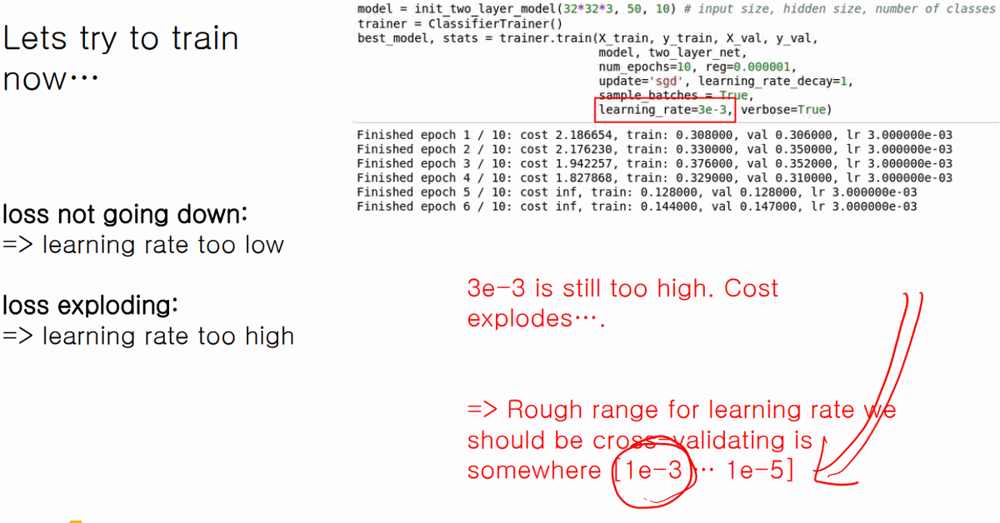
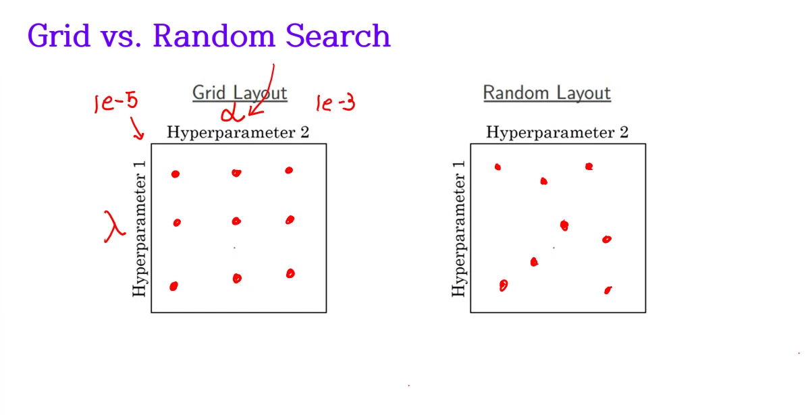
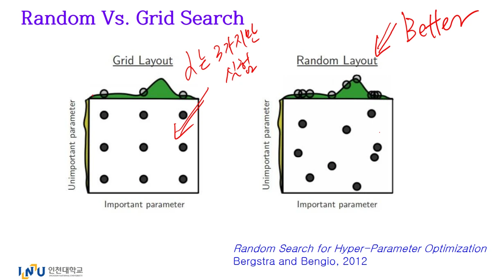
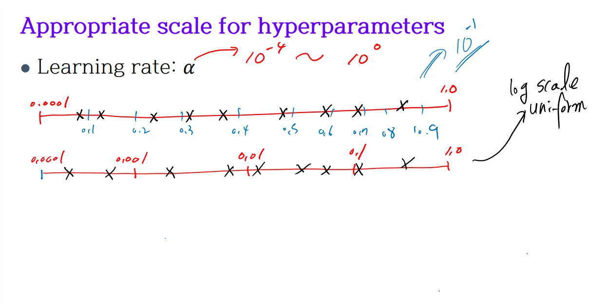
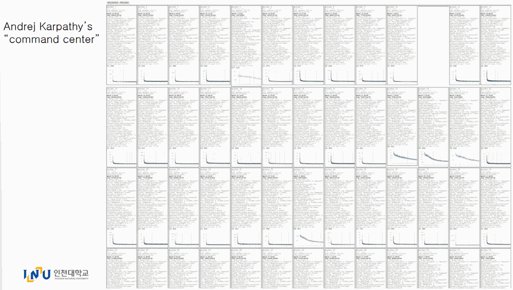
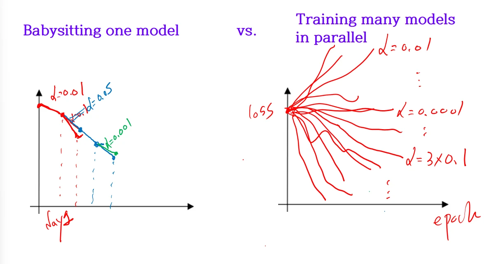

# Hyperparameter Tuning

작성일 2023-12-10 · 최종 수정일 2024-11-15
{ .post-date }

## &lt;Hyperparameter Tuning&gt;

> 이전까지는 Hyperparameter의 수가 그렇게 많지는 않았다. 하지만 다양한 Regularization 방법론들을 배워보면서, 많은 Hyperparameter들이 추가되었다.



### Hyperparameter Search Example



- Hyperparameter를 어떻게 세팅해야 될 지 살펴보자. 우선 Learning Rate에 대해 생각해보자.



- 일반적으로 학습 초반에는 Regularization 방법들을 꺼놓고 시작하는 경우가 많고, 어느정도 학습이 진행됐을 때 Regularization을 켜는 경우가 많다.
- 이번에는 Learning Rate를 10의 -6승으로 설정해봤다. 그랬더니 Cost가 감소하지도 않고, Accuracy가 상승하지도 않는 것을 볼 수 있다.



- 이번에는 Learning Rate를 10의 6승으로 설정해봤다. 그랬더니 Cost가 역시 감소하지 않았고, Accuracy가 상승하기는 하지만, 크게 높아지지는 않는 것을 볼 수 있다.

    ⇒ Learning Rate를 너무 크게 설정하면 NAN이 등장할 수 있다. 혹은 Optimal Parameter를 선택하지 못하고 지나쳐버리는 **Overshooting**이 발생할 수 있다.  
    (*컴퓨터에서 표현하는 것이 불가능한 크기의 숫자가 나올 수 있음.*)



- 그래서 이번에는 3의 -3승으로 잡아봤는데, Cost가 inf로 나오는 것을 보아, 이 값도 여전히 너무 크다는 것을 알 수 있다.
- 따라서 Learning Rate는 좀 더 작아야 하고, 이전의 예시를 바탕으로 Learning Rate는 대략적으로 10의 -3과 10의 -5승 사이 정도의 값이여야 한다고 생각해보자.

### Grid vs Random Search



- 그래서 10의 -5승에서 10의 -3승 사이 정도에서 적당한 값을 찾아보기로 한다. 
- 그런데, 실질적으로 학습에 사용하는 Hyperparameter는 매우 많기 때문에, 보통 여러 개의 Hyperparameter를 바꿔보면서 실험을 진행하게 된다. 따라서 Search를 할 때도 여러 개를 동시에 고려하는 경우가 대부분이다.
- 이번에는 **Learning Rate**와 **Weight Decay**(*L2 Regularization*)를 동시에 고려해보자.
- 이전에 Learning Rate는 10의 -5승, 10의 -3승을 범위로 지정하자고 했었다. 이 범위 내에서 Grid하게 Hyperparameter를 뽑아보는 것이 **Grid Layout** 방식이다.
- 반면, 주어진 범위 내에서 Random하게 선택하는 것이 **Random Layout**이다.

⇒ 어떤 방법이 좋을까?



- Grid 방식은 9번의 실험을 진행했음에도 **Learning Rate**를 **세 번** 정도밖에 바꿔보지 않았고, 이것은 **Weight Decay**도 마찬가지다. 반면 **Random Layout**은 **Random**하게 **Sample**하기 때문에 이전보다는 다양한 값으로 실험을 진행할 수 있다.

### Appropriate Scale for Hyperparameters

> 이제 Grid하게 Hyperparameter를 정하는게 아니라 Random하게 Sample하는 것이 더 좋다는 것은 알았다. 이제는 Sampling하기 위한 Scale은 어떤 것이 좋을지 알아보자.



- 위의 scale로 표현한 것은 일반적인 **Uniform Distribution**이고, 아래와 같이 표현한 것을 **Log Scale Uniform Distribution**이라고 한다. 

    그런데 **Uniform Distribution**에서 뽑은 값은 대부분 **0.1**과 **1**사이의 값으로 **Sample**된다. 이것은 바람직하지 못하다고 할 수 있다. 왜냐면 값의 크기가 대부분 비슷하기 때문이다.

    따라서 **Log Scale Uniform Distribution**에서 값을 Sampling하는 것이 더 넓은 범위의 값을 골고루 선택할 수 있다는 장점이 있다.

```python
x = np.random.uniform(1e-4, 1e-0, size(9,))
```



- 만약 컴퓨팅 자원이 충분하다면, 다양한 Hyperparameter로 Parallel하게 실험을 진행해 보는 것이 가장 좋다. 그것이 불가능하다면 Serial하게 실행해야 하므로, 시간이 많이 걸릴 것이다.

### Babysitting One Model vs Training Many Models in Parallel



- 최상의 경우는 **Training Many Models in Parallel**을 선택하는 것이 좋겠지만, 그것이 현실적으로 불가능하기 때문에 우리는 **Babysitting One Model**을 선택한다.
- **Checkpointing** : 특정 Epoch마다 모델의 상태를 저장하는 방식으로서, 모델의 학습 결과를 계속 모니터링하면서 결과에 따라 **Hyperparameter**를 **Adaptive**하게 바꾸는 것이다. 만약 모델이 **Flat**하기 시작하면, 이전의 **Checkpoint**로 돌아가서 Hyperparameter를 바꾸고 다시 실험을 진행한다.
