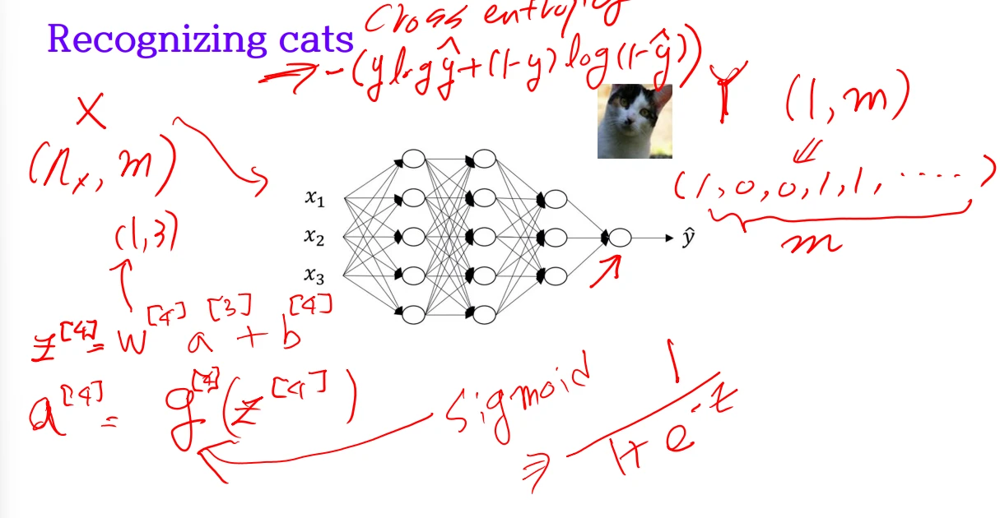
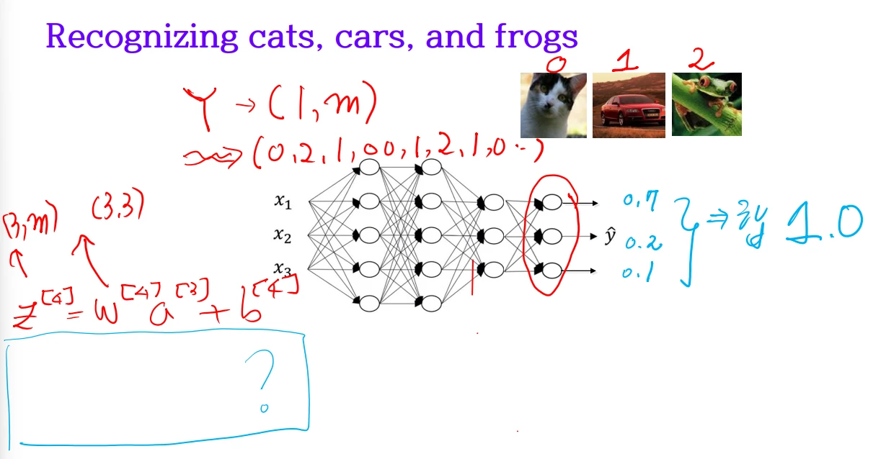
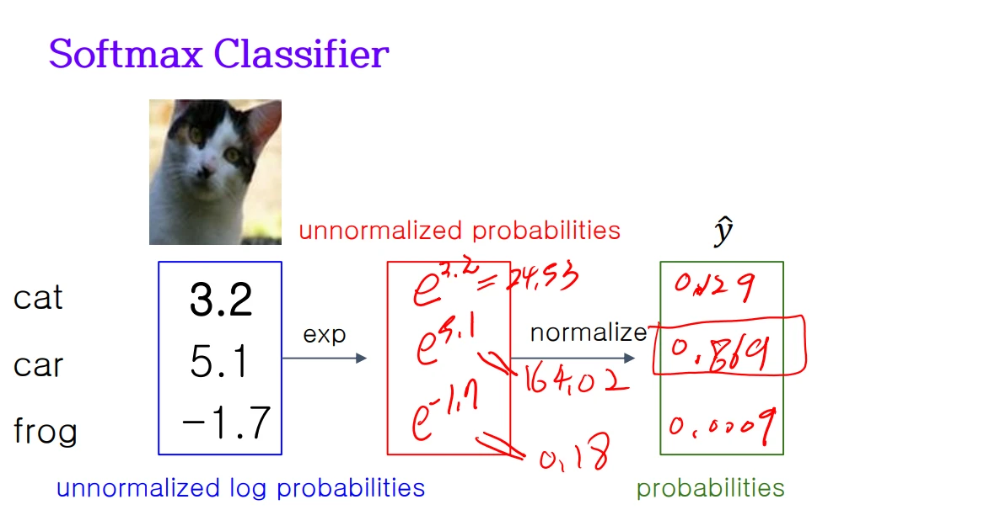
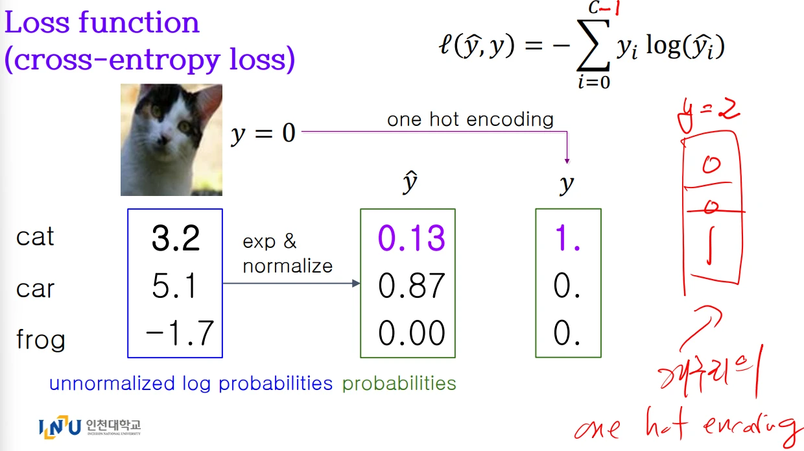
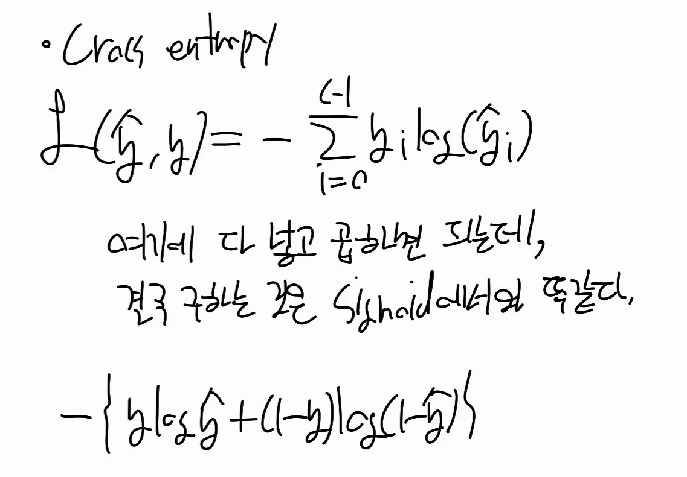

# Multiclass Classification

작성일 2023-12-10 · 최종 수정일 2024-11-15
{ .post-date }

## &lt;Multiclass Classification&gt;

> 이전까지는 고양이 사진인지 아닌지를 구분하는 Binary Classification을 다뤘었다. 이제는 Multi-class Classification에 대해 알아본다.

### Recognizing cats

- 이전에는 레이어를 거치면서 최종적으로 하나의 Activation을 뽑아냈고, 이를 통해서 Label과 정답을 비교하는 Binary Classification을 사용했다.
- 이때는 Activation Function으로 Sigmoid를 사용했었다.

### Recognizing cats, cars and frogs

- 이제는 Multi-class Classification을 위해서 Output Layer를 수정한다. 세 개의 Output이 나가서 Cat, Car, Frog를 구분할 수 있게 된다. (*가중치의 Shape도 바뀌었을 것이다.*)

- 그렇다면, Output이 어떻게 나와야 Classification이 가능할까?

    - Output을 확률로 내보내면 된다. 각각의 노드가 확률을 출력하고, 그 확률을 합쳤을 때 1이 된다면 각 Class별로 확률을 부여하는 것이라고 할 수 있다.

- Layer 4의 중간 결과인 Z[4]는 어떠한 값이라도 나올 수 있다. 이걸 Activation을 거쳐서 확률로 변경하는 것이다.

### Softmax Classifier

- **Unnormalized Log Probabilities** : 확률값이지만 아직 정규화를 하지 않은 형태를 말하며, 보통 **Logit**이라고 부른다.

    - 정규화를 하기 위해서 **Logit**에 **exponential**을 취해준다.  
        (*Log값이니까 exponential을 취해서 Log를 벗겨준다고 생각하는 것이다.*)

    - 이제 이걸 확률값으로 만들기 위해서 다 더하고, 그 값으로 나눠준다.

- 이렇게 **Normalized Probabilities**를 얻을 수 있다.

### Cross-Entropy Loss & One Hot Encoding

- 이제 **Cross Entropy**를 통해서 Loss값을 구해낼 것인데, 그러기 위해서는 Label이 필요하다.
- 확률 문제에서는 **One Hot Encoding**을 사용해서 Label을 만든다.

