# Convolutional Network

작성일 2023-12-12 · 최종 수정일 2025-06-09
{ .post-date }

## &lt;Basic Concepts for CNN&gt;

> 우리는 이전까지 3차원 RGB 데이터를 1차원 vector로 flatten하여 처리하였는데, 이것은 몇 가지 문제점을 가지고 있었다.

1. 이 방식은 사진의 각 픽셀이 가진 고유한 위치적인 특성을 고려하지 않는다.
2. 많은 가중치가 필요하므로, 메모리가 부족할 수 있다.

> 실제 환경에서 적용하는 Image Size는 1000 x 1000은 된다. 이걸 Flatten하면 필요한 weight의 개수만 해도 1,000,000개이다. 즉, Layer에 필요한 Memory가 너무 많아진다는 것이다.

### Filter

> CNN은 구성 요소들의 값을 학습할 수 있는 Filter를 사용한다.

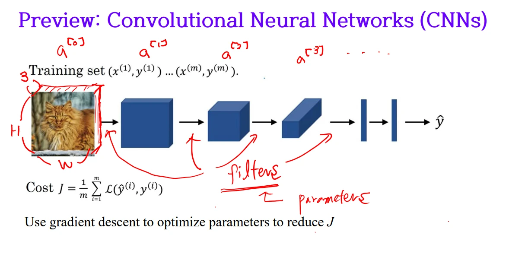

- 현재 Classification의 문제를 다루기 때문에, 최종적으로는 원하는 Class의 개수에 맞춰서 Output을 낸다. 하지만 그 이전까지는 Filter를 사용해서 Image의 차원을 축소하는 과정을 거친다.
- 이전과 마찬가지로 One hot encoding을 통해서 Loss를 계산할 수 있으며, Gradient Descent를 통해서 Cost Function J를 계산한 뒤 Backward Propagation을 진행한다.

### Hierarchical Pattern Detection with Filters

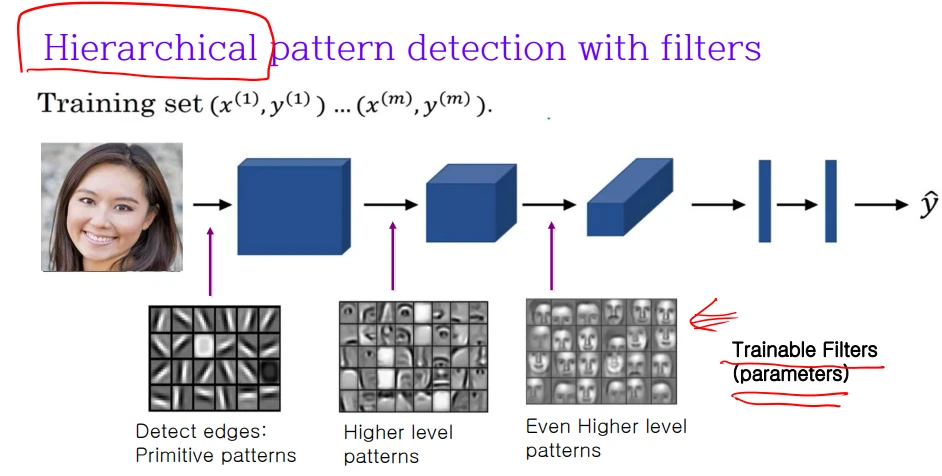

- Convolution에 사용할 수 있는 Filter는 매우 다양하지만, 학습에 사용될 수 있는 Filter를 사람이 결정하는 것은 매우 어려운 일이다. 따라서 Filter의 값도 Random하게 설정한 뒤, 학습을 통해 알아낼 수 있도록 한다.

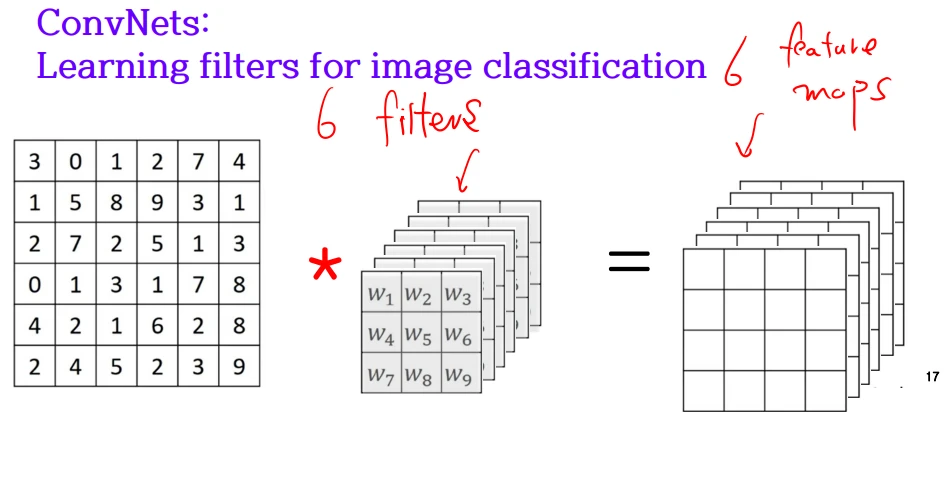

- 그런데, 한 차원을 통과시키는 Filter의 개수를 꼭 하나만 둘 필요는 없으며, 따라서 Filter의 개수가 6개라고 한다면, 각 차원당 6개의 **Feature Map**이 생성된다.

### Padding

> Convolution을 적용하면 Image의 Size는 작아질 수밖에 없다. Image의 Size를 유지하기 위해서는 Filter에 Padding을 적용해야만 한다.

- **Valid**

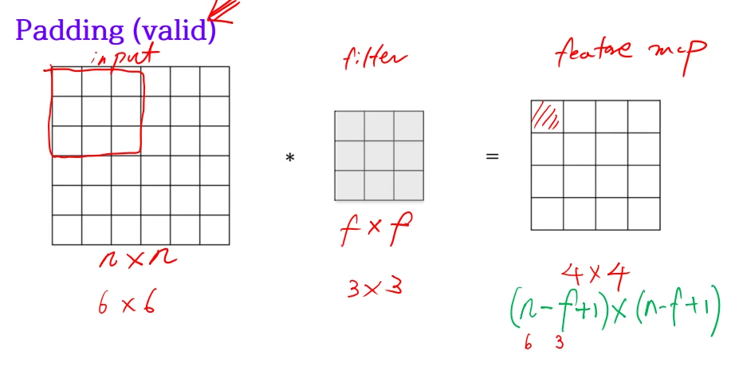

valid 방식은 Image의 Size가 작아지는 것을 허용하는 방식이며, 별도의 Padding을 적용하지 않는다.

**Image** : n*n

**Filter** : f * f

**Feature Map** : (n-f+1) * (n-f+1)

- **Same**

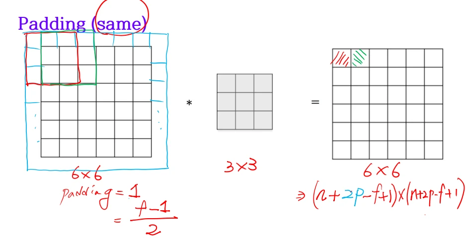

same 방식은 Filter를 거친 후에도 Image의 Size가 그대로 유지되도록 하는 방식이다. 

**Image** : n*n

**Filter** : f * f

**Feature Map** : (n+2p-f+1) * (n+2p-f+1)

⇒ **p** : padding의 size.

- **Padding Size in Same Option** 

$$
p = \frac{f-1}{2}
$$

> 영상처리에서는 Padding의 값을 뭘로 설정하느냐가 매우 중요하지만, Deep Learning에서는 크게 중요하지는 않다.

### Stride

> Stride는 Filter가 Image를 이동하는 간격을 말한다.

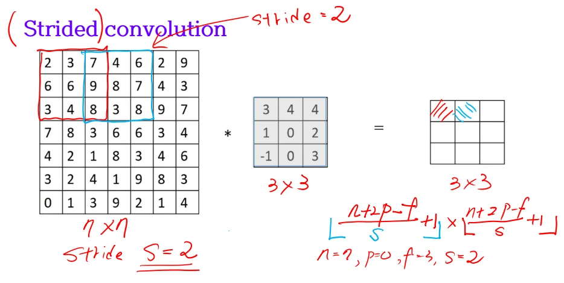

**Image** : n*n

**Filter** : f * f

- **Feature Map Size**

$$
\frac{n+2p-f}{S} + 1
$$

⇒ 이때, S는 Stride Size이다.

---

## &lt;Convolution on RGB images&gt;

> 이전까지는 1 Channel Image에 대한 Convolution을 고려했지만, 이제는 RGB(3 Channel)에 대한 Convolution을 고려한다.

### One Filter

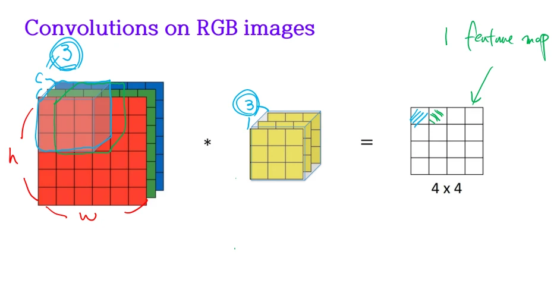

- 이와 같이 3 Channel Image에 한 개의 Filter(*한 개의 Filter가 3 Channel이다.*)를 적용하면 Feature Map은 1 Channel이 된다.

### Multiple Filters

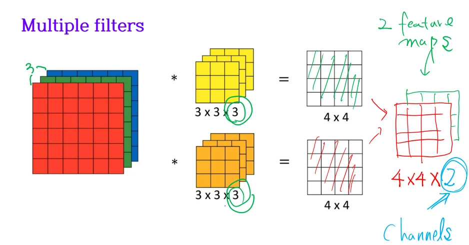

- 그런데 만약 Filter를 두 개 만든다면 Feature Map이 두 개 나오게 된다. 따라서 2채널의 결과가 나오게 된다.

### Activation Maps

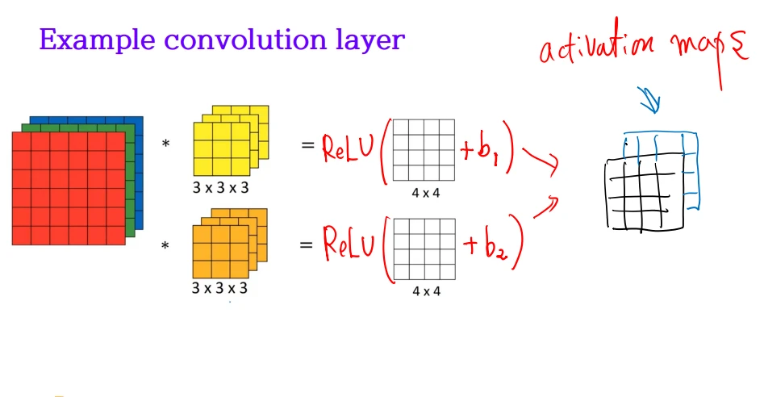

- Convolution의 결과로 얻어진 Feature Map들에 Activation Function을 적용하면 Element wise로 값이 변화되는데, 이를 **Activation Map**이라고 한다.

### Number of parameters in one layer

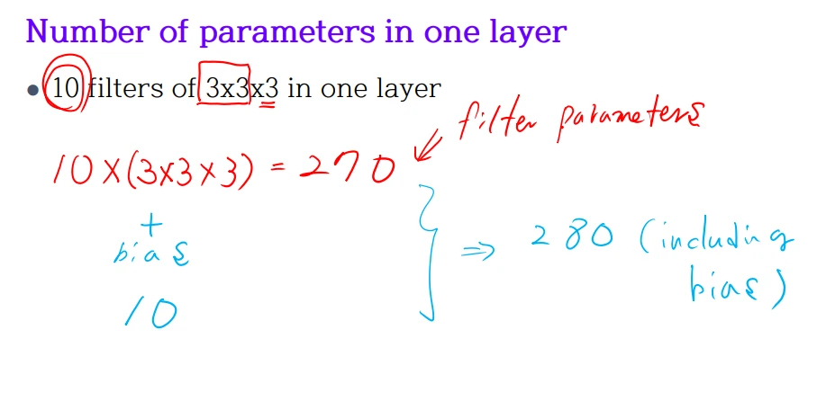

- 만약 3x3x3 Filter를 10개 사용한다고 하면, filter parameter의 개수는 10\*(3\*3\*3)만큼 존재한다.  
    따라서 270개이고, 하나의 channel당 하나의 bias를 가지므로, 하나의 레이어에 총 280개의 parameter가 존재하게 된다.

### Summary : Notations

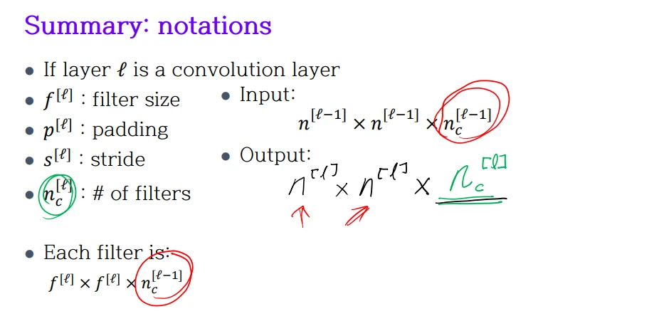

- f[l] : filter size
- p[l] : padding
- s[l] : stride
- Nc[l] : # of filters

- Each filter is : f[l] * f[l] * Nc[l-1]

    ⇒ 현재 filter의 Channel은 현재 Convolution하려는 데이터의 Channel과 똑같이 맞추어야 한다. 그런데 이전 Layer filter의 Channel만큼 현재 레이어의 Input Channel이 결정되므로, Nc[l-1]을 곱해주는 것이다.

- Input : n[l-1] * n[l-1] * Nc[l-1]

    ⇒ 여기 나오는 n은 이전에 나온 공식이다.

    $$
    \frac{n+2p-f}{S} + 1
    $$

- Output : n[l] * n[l] * Nc[l]

    ⇒ Output은 현재 filter를 거치므로 Channel이 바뀌게 된다. 따라서 Nc[l]을 곱해준다. n[l]은 Input에서의 공식과 같이 filtering을 거치며 바뀐 Size를 구하는 공식의 값이다.

---

## &lt;Max Pooling&gt;

> 일반적으로 height와 width를 줄이기 위해서 2*2 filter, stride = 2로 지정하고, 그 곳에서 가장 큰 값을 뽑는 max pooling을 많이 사용한다.

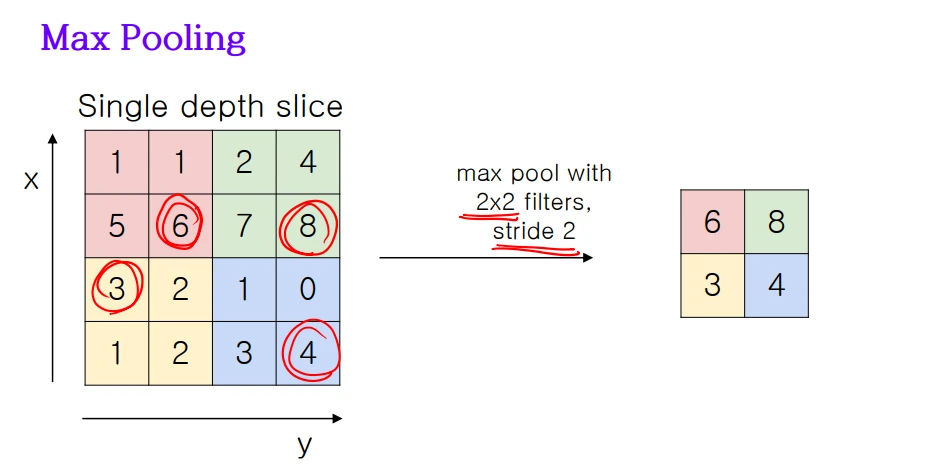

- Stride = 2인 2x2 Maxpool을 나타낸 그림이다.

### 1x1 Convolutions

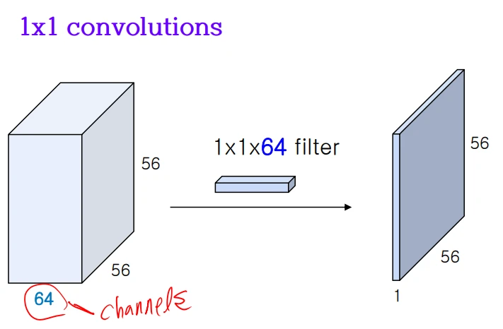

1x1 Convolution은 Image의 Channel을 늘리거나 줄이는데 유용하게 사용할 수 있다. 만약 1x1 Filter를 사용해 Convolution을 하면, Image의 Size를 손상시키지 않은 채로 Channel을 한 개로 만든다.

- **Convolution 계산**

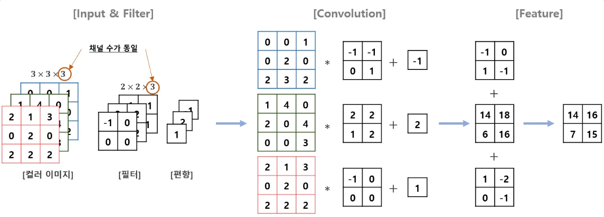

Convolution을 하면 Filter Wise로 연산을 진행한 후, bias를 더한 다음 구해진 값들을 모두 더한다.

⇒ bias의 개수는 동일한 경우도 있고 다른 경우도 있다.

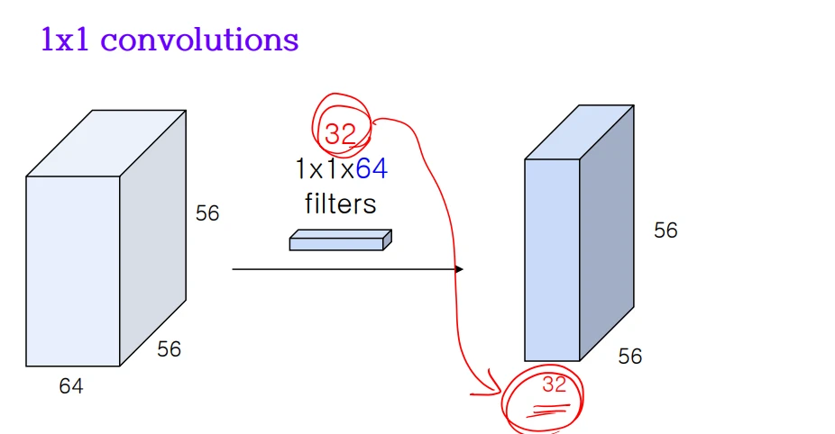

만약 1x1x64 Filter를 32개 사용한다면, Image의 Channel은 32가 될 것이다.

---

## &lt;LeNet5 Example with Keras using MNIST&gt;

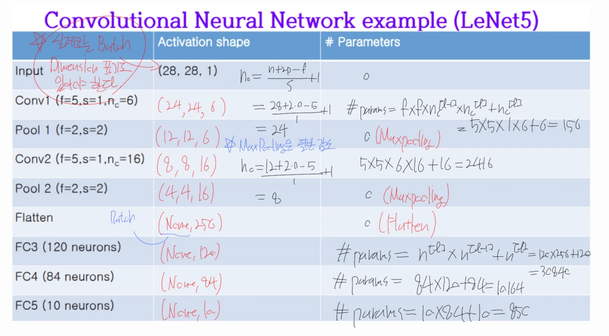

### Model Architecture

```python
model = keras.Sequential([
	layers.Conv2D(6, (5, 5), padding='valid', activation='relu', input_shape=(28, 28, 1)),
	layers.MaxPooling2D(),
	layers.Conv2D(16, (5, 5), padding='valid', activation='relu'),
	layers.MaxPooling2D(),
	layers.Flatten(),
	layers.Dense(120, activation='relu'),
	layers.Dense(80, activation='relu'),
	layers.Dense(10, activation='softmax'),
])
```

```python
model.summary() 
```

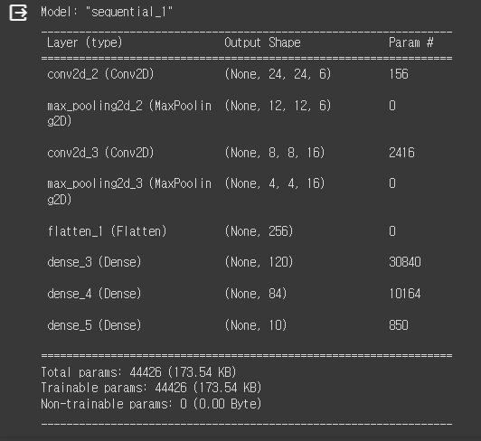

### Adding BatchNormalization

```python
model=keras.Sequential([
    layers.Conv2D(6,(5,5),padding='valid',activation='relu',input_shape=(28,28,1)),
    layers.MaxPooling2D(),
    layers.BatchNormalization(), # Normalization을 하므로 Shape은 변하지 않음.
    layers.Conv2D(16,(5,5),padding='valid',activation='relu'),
    layers.MaxPooling2D(),
    layers.Flatten(),
    layers.Dense(120,activation='relu'),
    layers.Dropout(0.2), # 20%를 Dropout
    layers.Dense(84,activation='relu'),
    layers.Dense(10,activation='softmax')
])
```

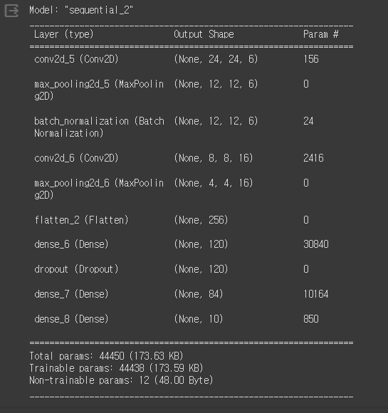

- Batch Normalization은 Shape은 변하지 않지만, Parameter는 추가된다. 감마와 베타.  
    이것이 실제로는 12개의 parameter가 사용되고, 다른 12개는 non-trainable parameter이다.

    ⇒ channel 별로 감마와 베타를 하나씩 갖기 때문에 6개, 6개 사용. 그리고 mean과 stddev도 사용되기 때문에 저장하지만, 이것이 학습되지는 않으므로 non-trainable parameter이다.
