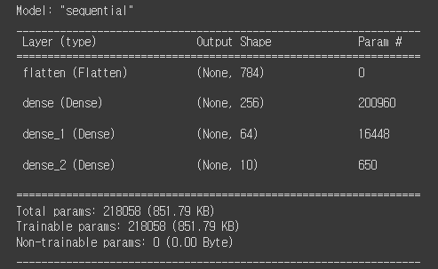

# Tensorflow/Keras Laboratory

작성일 2023-12-12 · 최종 수정일 2025-06-09
{ .post-date }

## &lt;Tensorflow&gt;

### module import

```python
import tensorflow as tf
import numpy as np
```

### tf.constant

> 상수값 Tensor를 만드는 방법

```python
x = tf.constant([[1, 2], [3, 4]])
y = tf.constant([[0, 1], [1, 0]])
```

```python
# NumPy와 마찬가지로 shape과 dtype이 존재함.
print(x)

x = tf.constant([[1, 2], [3, 4]], dtype=tf.float32)
y = tf.constant([[0, 1], [1, 0]], dtype=tf.float32)
print(x.device)

z = x + y

# tensor의 값만 뽑아주기. Tensor.numpy()
print(z.numpy())
```

### tf.ones, tf.random

```python
x1 = tf.ones(shape=(3,2), dtype=tf.float32)
x2 = tf.random.normal(shape=(10,), mean=0, stddev=1.)
#  평균이 0이고 표준편차가 1인 normal distribution
```

- normal distribution : 정규분포, Gaussian Distribution이라고도 한다.

    정규분포에서 평균이 0이고, 표준편차가 1인 것을 표준정규분포라고 한다.

### tf.transpose & tf.matmul

```python
x = tf.constant([[3.2, -1.0], [5.1, 1.0], [-1.7, 2.0]])
y = tf.transpose(x)

z1 = x@y
# python 자체에서 지원하는 행렬곱
print(z1.numpy()) # z1의 값 출력하기

z1 = tf.matmul(x, y)
print(z1.numpy())
```

### tf.nn.softmax

```python
x = tf.constant([[3.2, -1.0], [5.1, 1.0], [-1.7, 2.0]])

z2 = tf.nn.softmax(x, axis=0)
# axis=0으로 지정하면 가장 큰 차원을 기준으로 진행.
```

> rank 2 tensor에서 axis=0이라고 지정하면 같은 row인 것들을 처리하는 것이 아니다.  
>   
> 예를 들어, rank 2 tensor [[3.2, -1.0], [5.1, 1.0], [-1.7, 2.0]]이 있다고 하고, 여기서 axis=0으로 mean을 구하면 3.2, -1.0에 대해서 구하는게 아니라, row 방향!으로 mean을 구한다. 즉, 3.2, 5.1, -1.7에 대해서 구하는 것.  
>   
> 마찬가지로 tf.nn.softmax(x, axis=0)을 해도, 같은 row에 대해서 softmax를 취하는게 아니라 row 방향으로 softmax를 취하는 것이다.

### tf.Variable

> 변수 Tensor를 만드는 방법

```python
v1 = tf.Variable(np.random.randn(5,), dtype=tf.float32)
v1 = tf.Variable(np.random.randn(5,), dtype=tf.float32)

# tf.random.normal(shape=(2,3), mean=0, stddev=1.)

v1[0].assign(1.0) # 값 초기화
print(v1.numpy())

v1.assign_add(v2) # v1에서 v2 더하기
v1.assign_sub(v2) # v1에서 v2 빼기
```

### tf.GradientTape

> GradientTape는 Computational Graph를 자동으로 그려줘서, Backward Pass를 자동으로 수행할 수 있도록 하는 역할을 한다. 이때 연산하는 것은 반드시 Tensor여야 한다.  
> (Tensor Class 내부적으로 처리하는 것이 추상화되어 있는 듯 하다.)

```python
x = tf.Variable(3.0)

with tf.GradientTape() as tape:
	y = x**2

	dy_dx = tape.gradient(y, x)
	print(dy_dx)
```

```python
learning_rate = 0.1
w = tf.Variable(0, dtype = tf.float32)

def train_step(x):
	with tf.GradientTape() as tape:
		cost = x*(w**2 - 10*w + 25)

		dw = tape.gradient(cost, w)
		w.assign_sub(learning_rate*dw)

		return cost

for i in range(20):
	cost = train_step(1.0)
	print(f"step : {i}, w: {w.numpy()}, cost: {cost}")
```

---

## &lt;Keras MNIST&gt;

### Module Import

```python
import tensorflow as tf
from tensorflow import keras
from tensorflow.keras import layers
from tensorflow.keras.datasets import mnist
```

### Model Architecture

```python
model = keras.Sequential([
	layers.Flatten(input_shape=(28, 28)), # 28, 28 Tensor를 넣을 것이고, 이걸 Flatten
	layers.Dense(256, activation="relu"), # node의 개수 256
	layers.Dense(64, activation="relu"), # node의 개수 10
	layers.Dense(10, activation="softmax") # node의 개수 10
])
```

### model.summary()

> 모델 아키텍처에 대한 요약을 보여준다.

```python
model.summary()
```



- Dense Layer 1: 200960 = (784*256)[**weight**] + 256[**bias**]
- Dense Layer 2 : 16448 = (256*64)[**weight**] + 64[**bias**]
- Dense Layer 3 : 650 = (64*10)[**weight**] + 10[**bias**]
- Output Shape : **Batch Dimension**이 포함된다.

### model.compile()

> 모델의 optimizer에 대한 세팅을 진행하고 최종적으로 아키텍처를 확인하는 과정이다.

```python
model.compile(optimizer='adam', loss='sparse_categorical_crossentropy', metrics=['accuracy'])
```

### model.fit()

> Training을 진행하는 단계이다. train_data, train_image, batch_dimension, epochs를 정해준다.

```python
model.fit(train_images, train_labels, batch_size=128, epochs=10) # Keras에서 model을 정답에 맞게 train 시키는 함수.
```

### model.evaluate()

> Test를 진행하는 단계이다.

```python
loss, accuracy = model.evaluate(test_images, test_labels)
```

### model.prediction()

> 모델에 데이터를 하나 넣어 예측해 보는 단계이다.

```python
image = test_images[0]

# data를 모델에 넣을 때는, 반드시 data에 batch dimension을 지정해 주어야 한다.
image = tf.expand_dims(image, 0)
print(image.shape)

pred = model.predict(image) # 데이터 하나에 대한 output을 얻은
tf.argmax(pred, axis=1) # 10개의 출력 결과를 얻음.
```
