# 3주차(Chpt. 1 : Modeling & Coding)

작성일 2023-05-24 · 최종 수정일 2025-05-24
{ .post-date }

- 현실의 Physical World에서는 공간이나 Band Width가 충분하지 않다.

- Digital 공간에서는 Band Width나 Capacity가 매우 빠르게 증가한다.

    - 1 sec of CDDA audio: (일종의 CD)

        - 44100 samples * 2 channels * 16 bits/sample = 1,411,200 bits
        - 샘플링 간격은 1/44100
        - channel은 Left, Right로 두 개
        - 초당 16 bits로 코딩

        1 초에 audio를 저장하는 데만 해도 백 사십만 비트가 필요하게 된다.

    - 1 sec of HD audio:

        - 192,000 samples * 2 channels * 24 or 32 bits = 9,216,000 / 12,288,000 bits

    - 1 sec of CCIR 601 video = 20MB 이상 필요하게 됨.

    - 1 VGA frame (RGB) : 사진 한 장을 frame이라고 함.

        - 1024 * 768 * 24 = 18,874,369 bits
        - 한 프레임이 가진 pixel의 개수. 가로 1024, 세로 763, 24 장의 프레임. 이렇게 하면 1초의 영상이 만들어지게 되고, 18,874,369 bits가 필요하게 된다.

    - HDTV

        - Up to **2,985** Mbps (1920 * 1080 * 24 * 60)
        - 한 장의 프레임은 두 개의 Field로 이루어져 있으며, Field는 홀수 줄만 display 하거나, 짝수 줄만 display를 하게 된다. 즉, 24는 frame, 60은 field를 말함.
        - 1920 * 1080의 동영상을 다른 말로는 2K 동영상이라고 함.
        - HDMI cable : 5-10 Gbps

    - NHK’s 8K (7680 * 4320 * 24 * 30 = 23,380 Gbps)

        - 1920 * 1080의 4배이므로, 7680 * 4320

    이렇듯, 데이터의 양이 매우 많기 때문에 Compression. 압축이 필요하게 된다.

    - Audio 28Mbps → 7~28Mbps
    - Video 24Gbps → 180-600Mbps

- 실시간 application이나 service는 압축이 현실적으로 쉽지 않다. 또한, 압축을 하게 되면 이 데이터를 사용하기 위한 비용도 높아지게 된다.

---

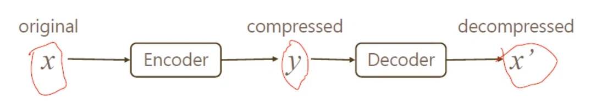

- y를 만들 때까지의 과정을 Encoder라고 하고, x’을 만들 때까지의 과정을 Decoder라고 한다.

- x = x’ 인 경우를 **Lossless Compression** 이라고 한다. (무손실 압축)

    - Entropy Coding, Reversible Coding

- x ≠ x’ 인 경우를 **Lossy Compression** 이라고 한다. (손실 압축)

    - Irreversible Coding

---

- **Compression Ratio** : | x | / | y |

    - ex) | x | = 65,536, | y | = 16,384, compression = 4:1
    - (| x | - | y |) / | x | = 75 %
    - ASCII는 하나의 문자당 8 bits로 표현된다.

    - RGB의 경우는, 모든 컬러는 24(R:8, G:8, B:8)/48/72로 표현할 수 있다.

        - 만약 한 가지 색을 24비트로 표현한다고 하면, 그 색깔 하나는 24 bit로 표현 가능하다.
        - 이때 R, G, B를 표현하는데 각각 8 bit를 할당할 수 있을 것이다.

    - **Distortion** (Lossy Methods)

        - x - x’ : 손실 압축에서 x와 x’의 차분을 말하며, 손실 압축에서는 항상 왜곡(Distortion)이 발생하게 된다.

---

- Modeling & Coding : 비디오 압축, 압축 알고리즘을 개발하기 위해서 먼저 모델링을 개발하며, 진행된 모델에 따라서 코딩을 진행한다.

    - Phase I : **Modeling**

        - Redundancy Information을 추출하는 것을 말한다. 쓸데없는 부분을 말하고, 예측이 가능한 부분이다.

    - Phase II : **Coding**

        - 0과 1로 이루어진 이진수로 데이터를 변환하는 과정이다. 차분치를 잘 코딩하면 되는데, 이를 다른 말로 residual 이라고 한다.

    ⇒ 즉, Redundancy를 최소화 하는 것이 Modeling이며, Residual을 1과 0으로 코딩하는 것이 Coding이다.

- Modeling과 Coding의 예시

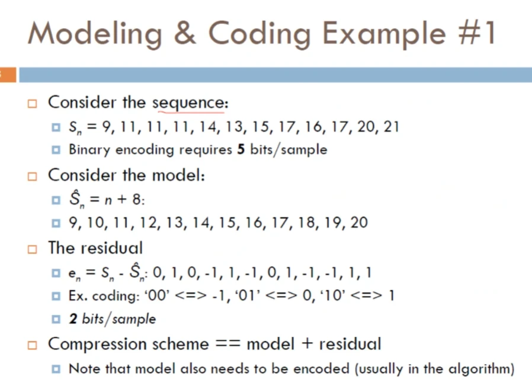

- 모델을 생각하지 않을 때(Original Data)는 첫 번째 예시를 코딩하기 위해 최소 5bit가 필요하게 될 것이다. (0~31까지 표현해야 하므로)

- 만약 다른 모델이 있다고 해보자. Sn = n + 8: 이라는 모델이다. Sn의 위에 붙는 hat 기호는 예측값이라고 생각하면 된다.

    - 이 모델에서 n = 1이면, 값은 9이고, n이 1씩 증가할 때마다 값이 1씩 증가하게 된다.
    - 9, 10, 11, 12, 13, …, 19, 20

    - Residual : 차분치

        - en(error값) = Sn(Original) - Sn(hat, 예측값)
        - 0, 1, 0, -1, 1, -1, 0, 1, -1, -1, 1, 1

    - Residual을 구했으므로, 이를 코딩하면 된다.
    - 현재 코딩해야 하는 숫자는 0, 1, -1 세 개 뿐이기 때문에, -1은 00, 0은 01, 1은 10 이라고 가정하면, 각각의 샘플을 코딩하는데 2 bits만 필요하게 된다.

    > 이렇듯, Compression scheme(압축 방법)에는 model과 residual이 필요하게 된다.  
    > 그런데, 이러한 Model 조차도 Coding이 되어야 한다. 즉, 우리의 모델 Sn(hat)은 n + 8이라고 알려주어야만 한다.

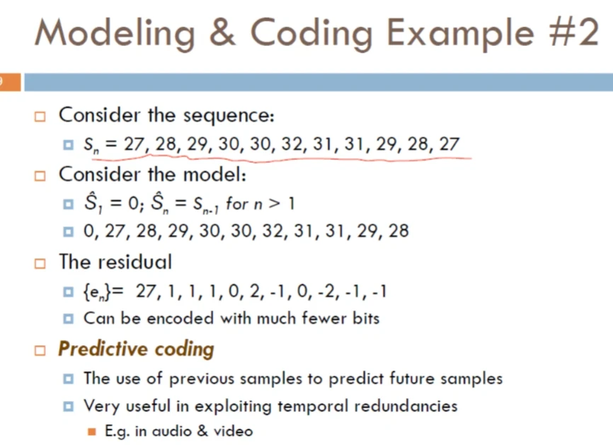

- 이 예시에서는 Sn(Original Signal)이 제시되어 있다.
- Model에서 Sn1 = 0이고, Sn(hat) = Sn-1 for n &gt; 1이다.

이렇게 되면 모델을 적용한 값은 아래와 같이 나오게 된다.

0, 27, 28, 29, 30, 30, 32, 31, 31, 29, 28

- residual
- {en} = 27, 1, 1, 1, 0, 2, -1, 0, -2, -1, -1
- 이전의 original data를 표현하려면 각각 5bit가 필요했지만, Model을 거치고 나면 더 적은 bit를 이용해서 데이터를 표현할 수 있게 된다.
- 현재까지 적용한 방법은 모두 무손실 압축이다. (신호의 손실이 발생하지 않음)

> Predictive Coding  
>   
> 이전에 나온 값을 이용해 미래의 값을 예측하는 방법이다.  
> 실제로 오디오나 비디오에 매우 자주 사용된다.

---

- Redundancy의 종류

    - 공간 Redundancy : 만약 백그라운드가 흰색이라면, 모든 것을 다 코딩할 필요가 없이, 공간이 모두 하얗다고 코딩해버리면 된다.
    - 시간 Redundancy : 100초 이전의 모습과 현재의 모습이 똑같다면 코딩을 굳이 바꿀 필요가 없다.
    - 통계(Statistical) Redundancy : 통계적으로 자주 사용되는 것을 짧게 코딩하고, 적게 사용되는 것을 길게 코딩하는 것이다. ⇒ ex) Morse 부호

- 하나의 흑백 이미지가 있을 때, 그 이미지에서 한 픽셀을 잡고 그것의 왼쪽 픽셀을 모두 빼주게 되면, 다음과 같은 형태로 표현된다.

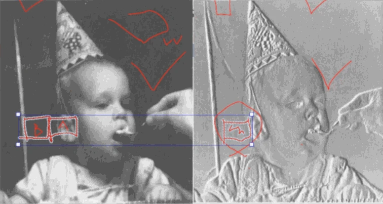

A - B를 오른쪽의 이미지에 집어넣는 것이다.

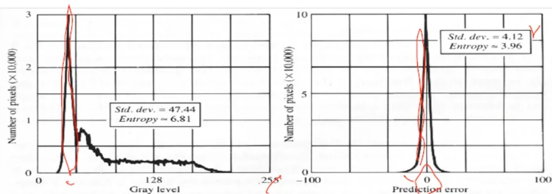

실제로 흑백 이미지에서는 Gray Level이 0에서 매우 크고(배경색이 거의 어둡기 때문. Gray Level이 낮을 수록 어두운 것), 이를 계산하게 되면 오른쪽으로 가서 Prediction Error가 0에 가장 많이 존재하게 된다. 앞선 이유와 같이 거의 배경색이 어둡기 때문이다.

이것은 손실이 발생하지 않는다. 단순히 값을 빼기만 한 것이기 때문에, 오른쪽 영상에서 왼쪽 영상으로 얼마든지 복원할 수 있다.

그래프를 보면 Standard Deviation이 47.44 → 4.12가 되는데, 이는 표준 편차를 말한다. 이전에는 픽셀의 값이 매우 다양하기 때문에 Std. dev. 가 매우 크게 나오는 반면, 오른쪽의 그림은 4bit만 가지고도 코딩이 가능해진다. (Entropy가 약 3.96이기 때문에, 최소 4bit, 왼쪽의 경우는 Entropy가 6.81이기 때문에 최소 7bit가 있어야 Coding이 가능할 것이다.)

- Entropy : 압축이 가능한 최소 비트 수
- Compression Model : Modeling + Coding + Perceptual Model

---

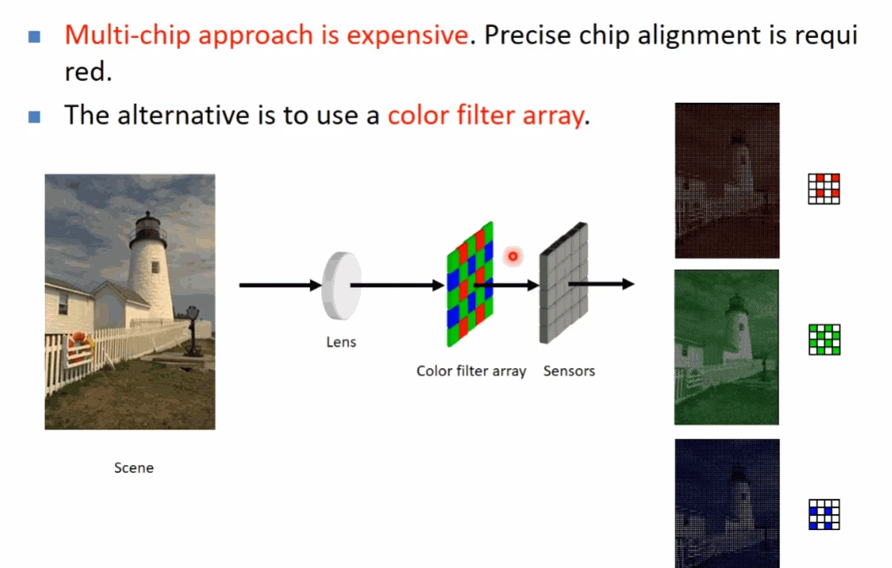

한 이미지에서 컬러를 분리해내기 위해서, Color Filter Array를 통과시킨다. 그러면 각 픽셀은 특정한 색깔만 통과하게 된다. 이를 통해 R, G, B 영역을 구분하게 된다. 이렇게 되면 어떤 문제가 발생할까? 빨간 부분은 정보가 75%가 사라지게 되고, 파란 부분도 75%가 사라지게 되며, 녹색 부분은 50%가 사라지게 된다. 그럼 이제 우리는 사라진 부분을 채워주어야 하는데, 이를 interpolation(보간)이라고 한다. (CFA : Color Filter Array. CFA도 다양한 방식으로 만들 수 있다.)

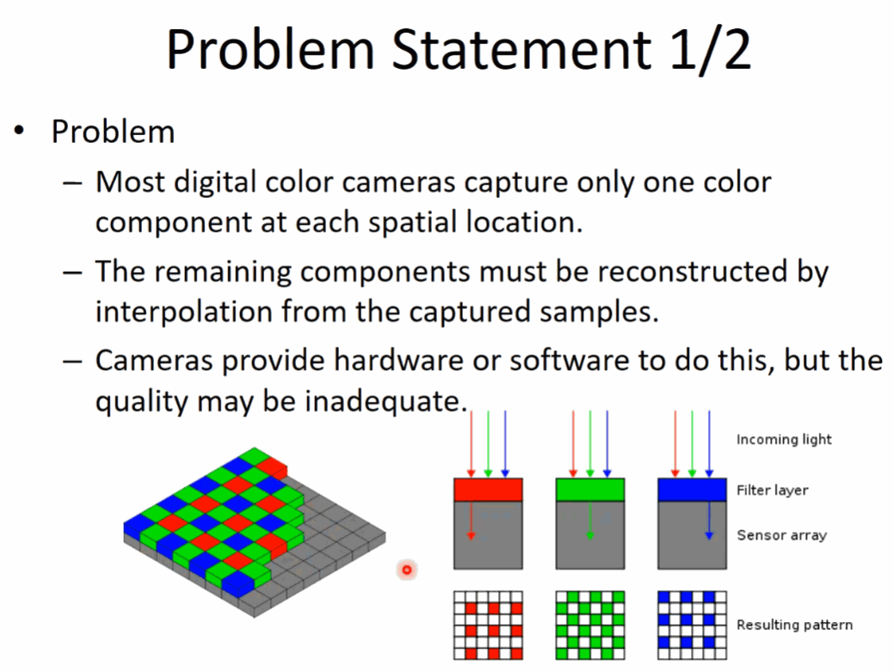

위의 과정을 전문적인 말로 **Demosaicking** 이라고 한다.

- Demosaicking : 디모자이킹의 목적은 최대한 사실적인 컬러를 복원해 내는 것이다.

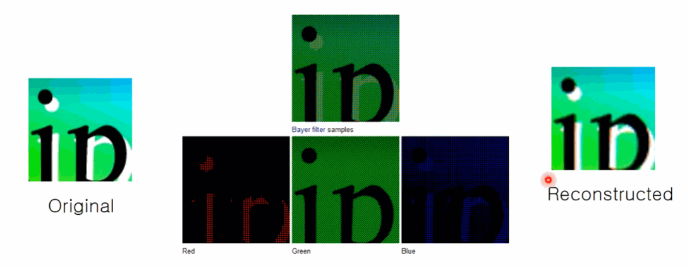

Original과 Reconstructed Image는 약간의 오차가 발생하는데, 이를 왜곡(Distortion)이라고 한다. 디모자이킹은 다른 말로 Color Plane Interpolation이라고도 한다. (Color를 복원해 내는 것)

- Bayer Pattern

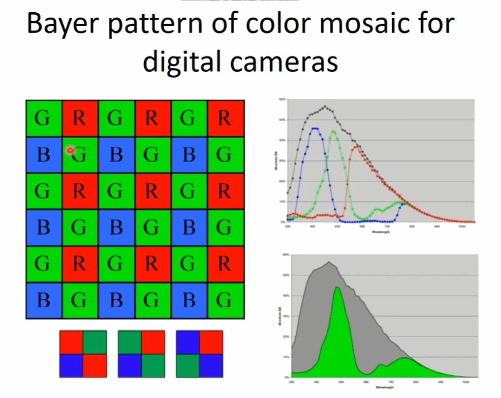

베이어 패턴은 두 개의 G filter와 하나의 R, B filter를 갖는 Filter를 말한다. 파란색은 상대적으로 단파이고, 녹색은 중파이며, 빨간색은 장파이기 때문에 우측 상단의 그래프와 같은 형태가 나타나게 되며, G을 두 개를 넣는 이유는 Green이 밝기 영상과 가장 비슷하고, 노이즈를 가장 덜 탄다는 것이 실험적으로 증명되었기 때문이다.

- 복원 방법

    - Bilinear Interpolation

    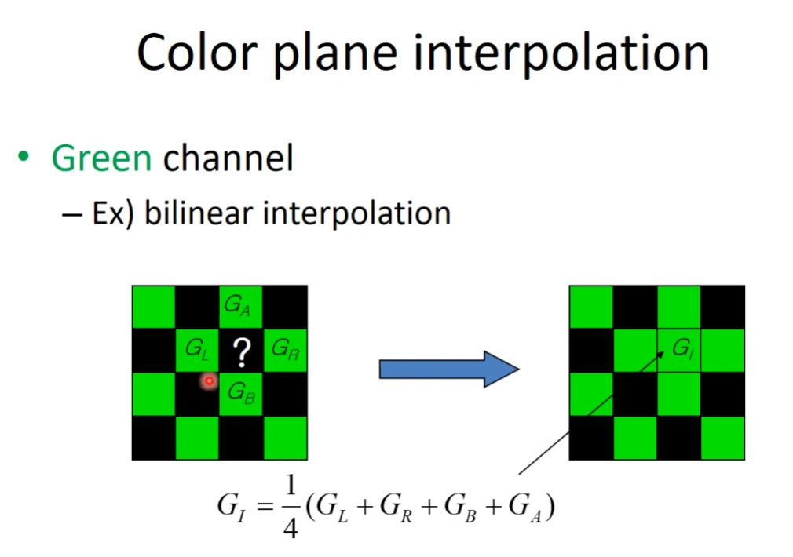

    비어있는 공간의 주위 네 개 픽셀을 다 더하고 평균을 내서 채우는 방법

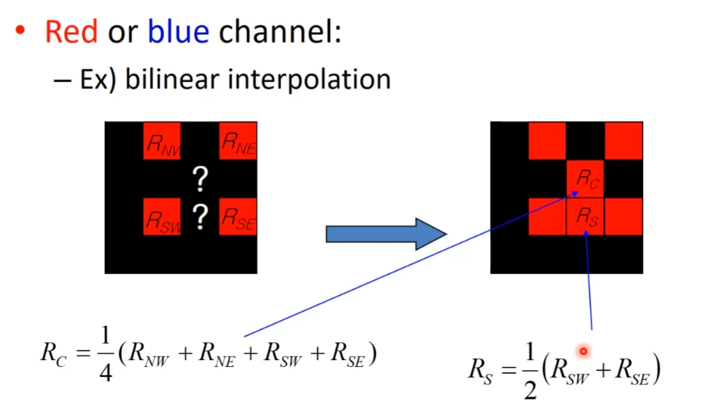

이런 경우에는 왼쪽 오른쪽을 더해서 중앙을 채우기도 한다.

그런데 복원을 진행할 때, 레드와 블루는 원본 데이터가 25%밖에 존재하지 않기 때문에 복원한 영상을 합치면 다소 부족한 부분이 생기게 될 수도 있다.
