# 4주차(Chpt. 2 : Entropy)

- 모든 데이터에는 Redundancy가 존재하기 때문에, 이를 고려하지 않으면 너무 많은 데이터를 코딩하게 될 수 있다.
- 예를 들어 Audio를 Sampling할 때는 사람에게는 가청주파수가 존재하기 때문에 20~20,000Hz 를 고려할 수 있게 된다. 사람이 들을 수 없는 부분까지 코딩을 하는 것은 일종의 Redundancy가 될 수 있다는 것이다.

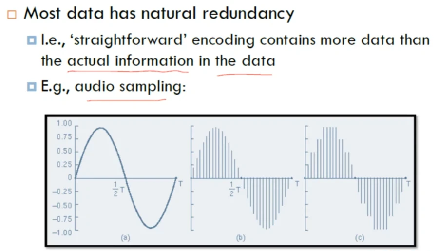

위의 데이터는 대푯값이 존재하게 된다.

- Compression이라는 말은, Squeezing Out이라고 보면 된다. 즉, 정보 표현에 있어서 비효율적인 것을 없애는 것이다. 

    - Lossy Compression에서는 중요하지 않거나 사람이 인식하지 못하는 정보를 제거하게 된다.
    - Video나 Audio를 압축을 하고 MP3 파일 등으로 만든 다음 전송하고나면, 이후에 다시 노래를 듣거나 영상을 볼 수 있도록 Analog로 돌려주어야 한다. 이 신호의 차이가 원본 신호와 크면 안된다.

- 그렇다면 어떤 데이터를 압축할 수 있을까?
- 얼마나 압축할 수 있을까?
- 얼마나 압축해야 효율적인 압축이 될까?
- **Information Theory** : Information의 수학적 특징과 특성을 분석하는 것을 말한다.

---

- Data의 종류

    - Analog Data : 컴퓨터는 Discrete Number로 이루어지기 때문에 표현이 불가능하다.
    - Digital Data : 컴퓨터로 표현이 가능한 정보

    ⇒ 충분한 샘플링만 가능하다면, Digital Data와 Analog Data는 같은 데이터가 된다.

    - 나이퀴스트 샘플링 : 주어진 신호의 최고 주파수의 두 배 이상으로 샘플링을 하면, 오리지널 신호의 복원이 가능하다. (Digital Data와 Analog Data가 똑같은 정보를 갖게 되는것.)

    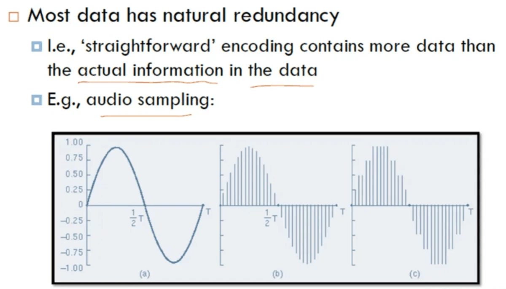

    이전에 나왔던 그림을 다시 보면, (a)는 시간 방면, sample 방면에서 모두 analog이고, (b)는 시간 방면에서는 digital 이지만, sample 방면에서는 analog이다. (c&#41;는 시간, sample 방면 모두에서 digital이다. (sampling 되었기 때문이다.)

---

- Common Symbol Sets

    - ASCII - 256 symbol (한 바이트로 이루어지는 문자)
    - Roman Alphabet + Punctuation(기호들)
    - Braille(브라유의 점자), Morse 등
    - Binary {0, 1}
    - ex) {a, b, c, d} 를 임의로 binary를 매칭하면 a : 00, b : 01, c : 10, d : 11 이라고 할당했다면 a, b, c, d로 표현되는 모든 집합을 binary로 표현할 수 있게 된다.

- Information

    - Claude Shannon은 Coding과 Communication(통신)의 한계를 Probability Theory를 통해 설명한다.
    - 신호를 압축할 때, 압축률이 너무 크면 정보의 손실이 커지고, 압축률이 너무 작으면 파일의 크기가 너무 커진다. 따라서 코딩을 하거나 통신할 때의 압축에 대한 기준을 제공하는 것이 바로 **Information Theory**이다.

- Self-Information

    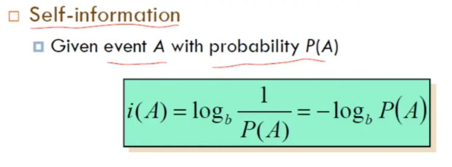

    어떠한 사건 A가 있을 때, 그 사건 A가 일어날 확률은 P(A) 이다. 그러면 Self-Information을 i(A)라고 정의해보자. 우리는 i(A)를 위와 같이 표현한다.

    여기서 b는 밑이고, 우리는 컴퓨터를 사용할 때 2진수를 사용한다. 따라서 b값은 2가 된다. 왜냐면, 정보는 몇 bit인가로 표현되기 때문이다.

    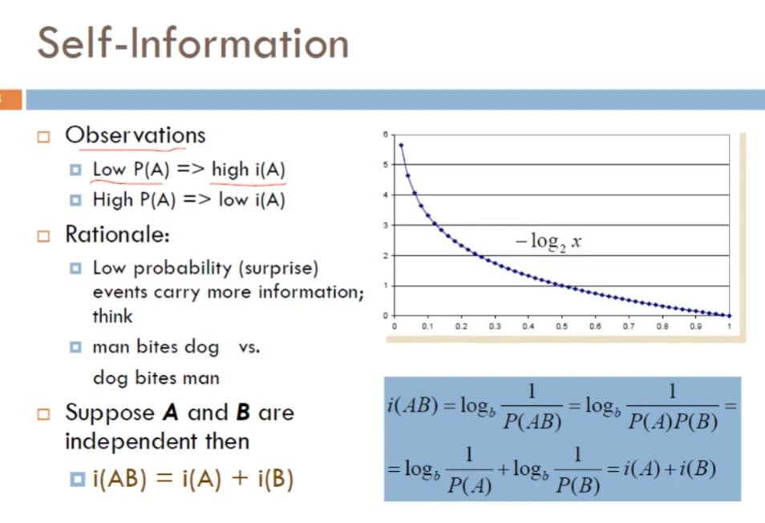

    - 만약 P(A)가 낮다면. 즉, **A가 발생할 확률이 낮다**면, **A의 정보는 크게** 나타나고, P(A)가 높다면. 즉, **A가 발생할 확률이 크다**면, **A의 정보는 작게** 나타난다.

    - 예컨대, 해가 동쪽에서 뜬다는 사실은 확률이 100%이기 때문에, 너무나도 당연한 거라서 정보로서의 가치가 거의 없으므로 그 사건의 정보는 작게 나타난다.

        - 즉, P(A) = 1이기 때문에, i(A) = 0이 된다.

    - 반대로, 있을 수 없는 일이라면 P(A)는 0이 되므로, i(A)는 INF가 된다. 이 경우, 우리가 얻을 수 있는 정보가 매우 많을 것이다.
    - A, B의 발생이 서로 독립적이라고 할 때, A와 B가 동시에 일어나는 사건에 대한 정보는   
        i(AB) = i(A) + i(B)와 같다. (위에 증명이 있음.)

---

- Coin Flip Example

    - Fair Coin : 동전을 던졌을 때 앞면과 뒷면이 나올 확률이 동일한 것. (H: Head, T: Tail)

    If P(H) = P(T) = 1&#47;2, then i(H) = i(T) = -1/log2(1&#47;2) = 1 bit

    - Unfair Coin : 동전을 던질 때 앞면과 뒷면이 나올 확률이 다른 것.

    Let P(H) = 1/8, P(T) = 7/8

    i(H) = 3 bits

    i(T) = 0.193 bits

    P(H) + P(T) = 1

    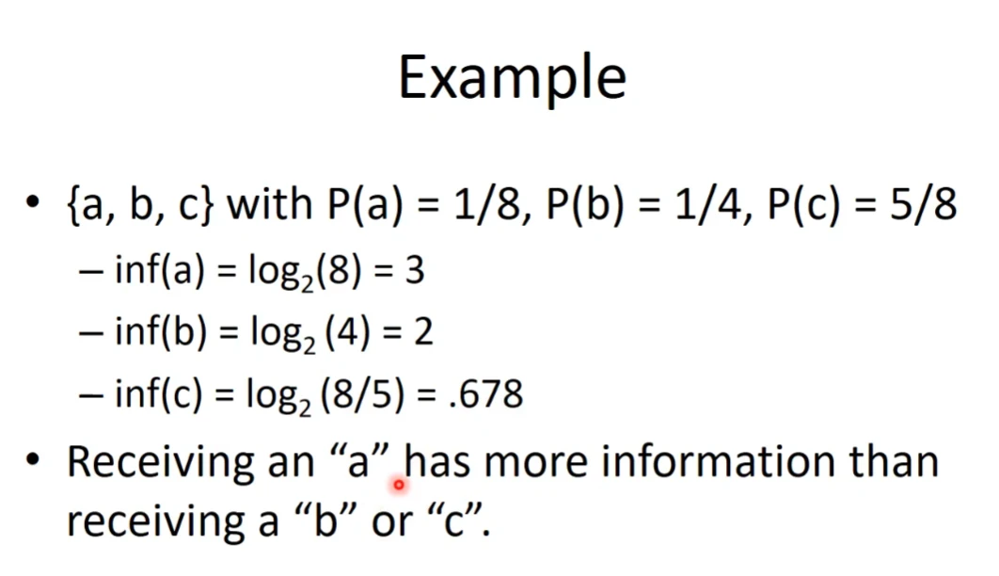

---

- First-Order Entropy

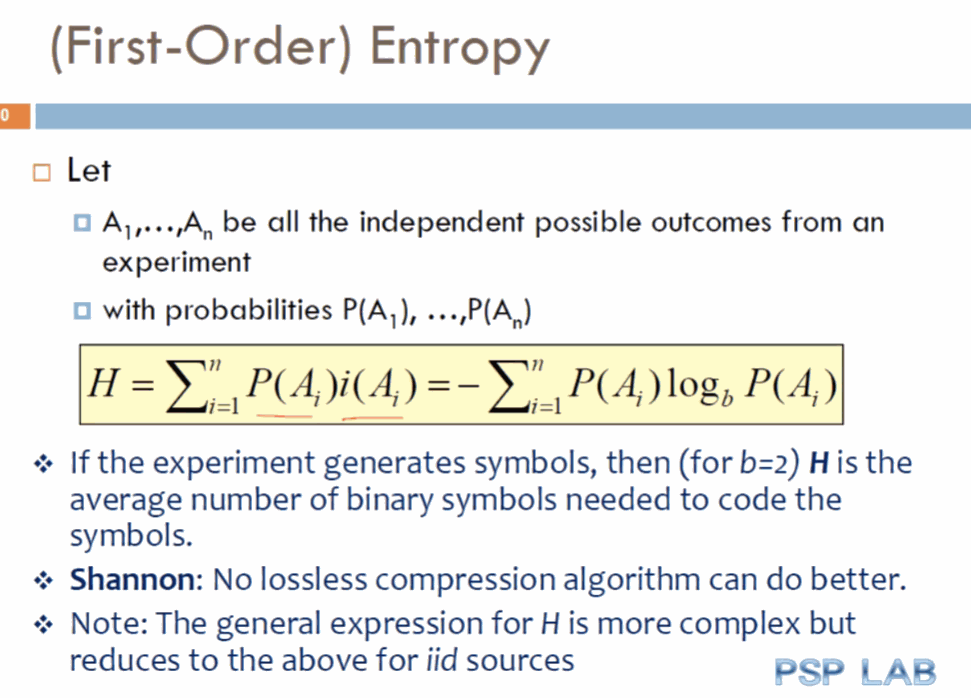

Entropy는 H로 표현하며, **Self-Information과 Event가 발생할 확률의 곱의 총합**이 바로 `Entropy`

- Shannon의 발표 : Lossless compression은 Entropy보다 더 나은 알고리즘을 적용할 수 없다.  
    ⇒ 하지만, 여러 Model을 적용함으로써 Entropy를 더 낮출 수 있다.
- Entropy Example 1

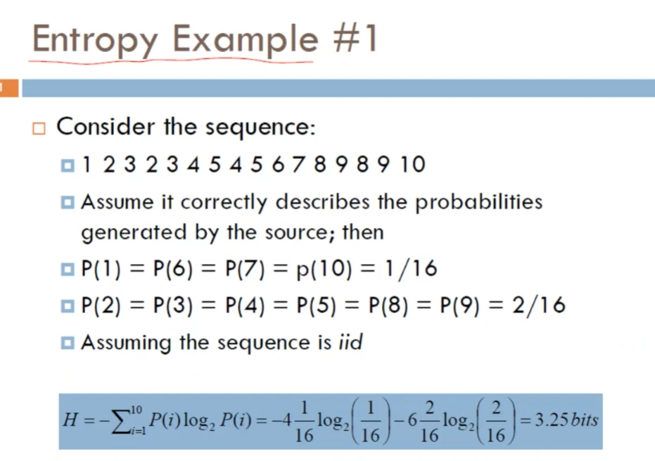

16개의 signal 존재. 위와 같이 계산할 수 있음. 이것이 의미하는 것은 무엇인가?

- 전부 16개의 signal이 있는데, 여기에는 Redundancy가 숨어있다. (이 예시의 경우에는, 똑같은 데이터가 들어온 것이 있음.) 이 Redundancy를 줄이면 3.25 bit만 사용해서 16개의 signal을 모두 coding 할 수 있다는 것을 나타낸다.
- 즉, 3.25라는 bit가 나왔는데, Shannon에 따르면 이보다 더 적은 bit를 사용할 수는 없다는 것을 의미한다.
- Entropy Example 2

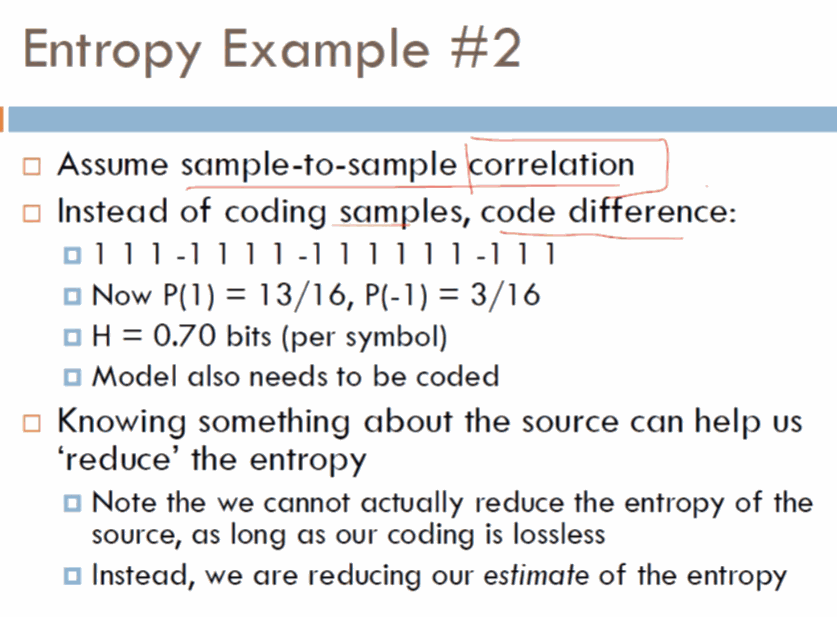

이전 예제에서 증가분을 가져온 것으로 보인다. 즉, 샘플 자체를 코딩하는 것이 아니라 샘플 간의 간격을 Coding 하겠다는 뜻으로 보인다.

그러면 P(1) = 13/16, P(-1) = 3/16. 이것을 이용하여 H를 계산하면, 0.70 bit가 나오게 되고, 이는 심볼당 0.70 bit가 필요하다는 것이다. 

즉, 어떤 특정 심볼이 자주 나오게 된다면, 우리는 이걸 통해서 Redundancy를 줄일 수 있게 된다는 것이다. Entropy를 줄이긴 했는데, 결국 이것도 일종의 Model이다. 이것은 현재 픽셀에서 이전 픽셀을 뺀 것으로 생각할 수 있다.

> 그래서 우리가 어떤 시그널의 source를 안다는 것은, (original source) Entropy를 줄일 수 있다는 것을 의미한다. 우리가 Model을 알면 Entropy를 더 줄일 수도 있다.

Lossy Compression에서는 우리가 인지하지 못하는 부분을 줄이기 때문에, Entropy는 Lossless Coding에서만 적용이 된다.

- Entropy Example 3

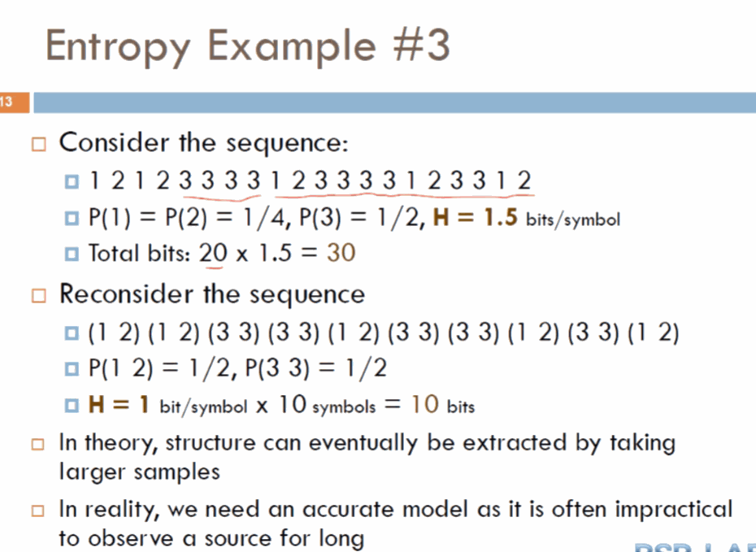

- 1, 2, 3 세 개의 심볼이 있는데, 먼저 빈도를 파악해 본다. 빈도를 파악하면,

    P(1) = 1&#47;4, P(2) = 1&#47;4, P(3) = 1&#47;2 이다.

- 이 상태에서 Entropy를 계산하면, H = 1.5가 나오는 것을 알 수 있다.
- 이렇게 되면 총 20개의 심볼이 있고 각 심볼을 표현하는데 1.5 bit면 충분하기 때문에, 20 * 1.5 = 30 개의 bit가 필요한 것을 알 수 있다.

⇒ Shannon의 법칙에 따르면, 이것보다 더 많이 압축할 수는 없음.

> 그런데 만약 이 sequence를 재배열하게 되면, 좀 더 압축이 가능할 수 있다.

- Reconsider the sequence

이걸 두 문자씩 묶어보면, (1 2), (1 2), (3 3), …, (1 2)와 같은 방식으로 바꿔볼 수도 있다. 이제 이걸 코딩해보면, P(1 2) = 1&#47;2, P(3 3) = 1&#47;2 와 같이 나올 수 있고, 이러면 Entropy H = 1이 되고, 전체 심볼이 10개이기 때문에 총 10bits 만으로 해결할 수 있게 된다.

> **이것이 바로 Model의 힘**이다. 하지만 실제로 이런 Practical한 Model을 찾아내는 것은 쉬운 일은 아니다.

---

## Model

- Models : 데이터를 통해 우리가 얻을 수 있는 모델. 좋은 모델은 좋은 압축을 부르게 된다.

    - Physical models : ex) speech
    - 이런 모델은 대부분 유용하지는 않다.
    - 대신 실험적인 데이터를 주로 사용한다. (관찰을 통해서, statistical 한 방식으로 데이터의 패턴을 분석하는 것이 좋은 모델이라고 볼 수 있다.)

- Probability Models(확률 모델)

    - `Ignorance Model`

        - 대표적으로 ASCII Code가 있음.
        - 모든 Letter들이 같은 확률로 발생할 것이라고 가정한다.
        - 예를 들어 영어 E는 자주 나오고, 영어 Z는 자주 나오지는 않지만, 둘 다 8bit로 길이가 똑같다. 이것이 바로 Ignorance Model이다.
        - 우리가 사용하는 RGB의 경우, 거의 2\^24 bit로 표현된다. 2\^10 * 2\^10 * 2\^4 로 표현된다. 그런데, 우리가 자주 사용하는 색깔은 거의 정해져 있어서 이런 자주 사용하는 색깔을 짧은 코드를 할당할 수도 있을 것인데, RGB는 그렇지 않고 모두 똑같은 길이로 부여한다.
        - 이를 해결할 수 있는 방법은 무엇일까?
        - **모든 Letter들이 같은 확률로 발생할 것이라는 가정을 없앤다.**

    ---

    - `Markov Models`

        - 현재 출력 값이 이전의 세 개의 출력 값들과 비슷하다는 모델이다. 현재의 출력값을 예측하기 위해서는 바로 직전에 나온 것과 직전 직전에 나온 것을 보면 예측 가능한 것이다.

        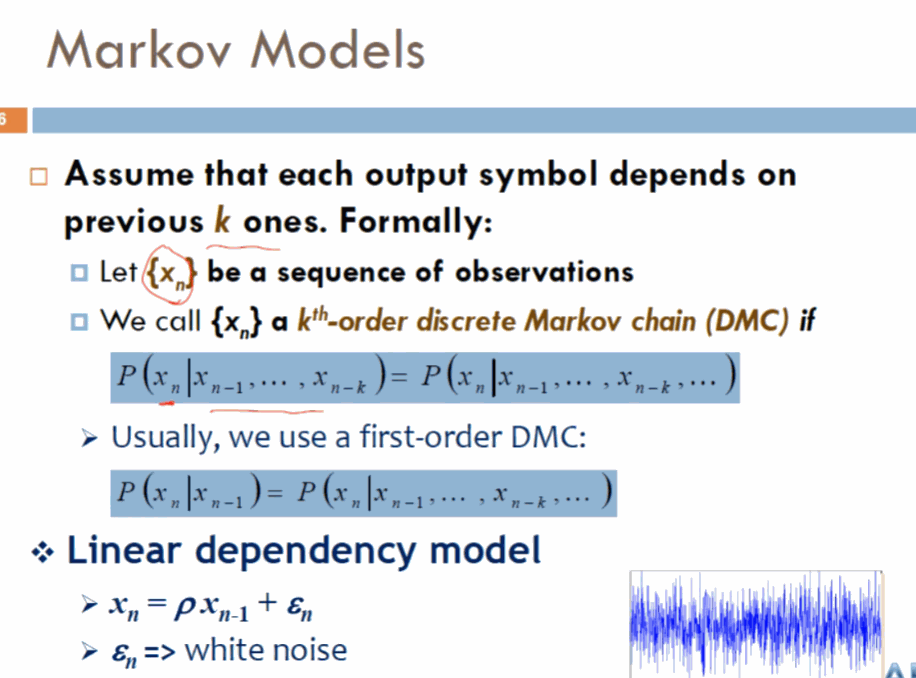

        {xn} : 현재 우리가 보고자 하는 output으로 생각한다.

        아래의 상황일 경우, `k(th)-order discrete Markov chain (DMC)`라고 한다.

        > P(xn | xn-1, … , xn-k) : xn-k부터 xn-1까지의 값을 알 때 xn을 예측할 수 있는 확률은,   
        > P(xn | xn-1, … , xn-k, …) : xn-k 이전부터 xn-1까지의 값을 알고 있을 때 xn을 예측할 수 있는 확률과 같다는 얘기이다.

        보통은, DMC 중에서도 first-order DMC를 주로 사용한다.

        - first-order DMC : 직전의 것만 알았을 때 현재를 예측하는 것은 이전의 모든 것을 알았을 때 현재 값을 예측하는 것과 똑같다고 상정하는 것.

            P(xn | xn-1) = P(xn | xn-1, …, xn-k, …)

        > 영상에서는 위의 가정이 상당히 잘 들어맞는다. 왜냐면, 직전 픽셀이 검정이었다면 다음 픽셀도 검정일 확률이 매우 높고, 갑자기 흰색으로 바뀔 확률은 매우 적기 때문이다. 

        - Linear dependency model

        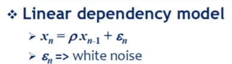

        현재 값 출력 값 (xn)은 직전의 값 (xn-1)에 ρ(로우)를 곱하고, 에러값을 더한 것으로 볼 수 있다. 이때 에러값을 차분치라고 생각할 수 있고, 이를 white noise 라고도 한다.

        ρ는 대부분 1이 될 것이다. (거의 직전 값에 의존하므로)

    ---

    - `Non-linear Markov Models`  

    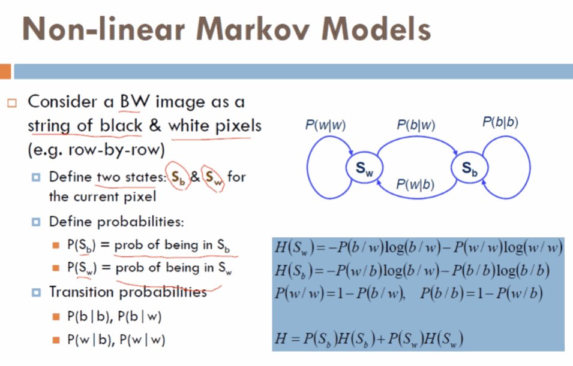

    Black White Pixel이 연속적으로 나타나는 이미지를 생각해보자. 이때 두 개의 상태 Sb, Sw를 정의하고, 각각의 상태(State)가 발생할 확률을 <strong>P(Sb),</strong>  <strong>P(Sw)</strong>라고 하자.

    - Transition : 상태의 변화를 의미함

    P(b | b) : 직전 픽셀이 Black일 때, 현재 픽셀이 Black일 확률

    P(b | w) : 직전 픽셀이 White일 때, 현재 픽셀이 Black일 확률

    P(w | b) : 직전 픽셀이 Black일 때, 현재 픽셀이 White일 확률

    P(w | w) : 직전 픽셀이 White일 때, 현재 픽셀이 White일 확률

    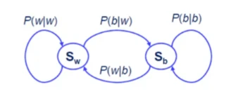

    Sw : White State

    Sb : Black State

    각각의 Transition은 직전 픽셀과 현재 픽셀에 따라 그려지게 될 수 있다.

    - Entropy 계산

    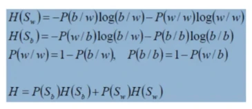

    H(Sb)에서 오타 있음. -P(w/b)log(w/b)-P(b/b)log(b/b)가 맞다.

    최종적으로 Entropy H = P(sb)H(Sb) + P(Sw)H(Sw) 이다.

    ---

- Markov Model (MM) Example

    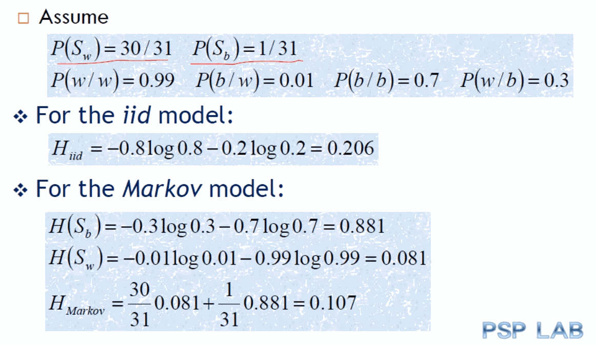

    - **IID model** : Identically Independent Distributed

        (오타 있음.)

        H(iid) = -(30/31)log(30/31) - (1/31)log(1/31) = 0.206

        ⇒ 기본적인 모델의 엔트로피 계산과 똑같은 것으로 보인다. 마르코프 모델은 Transition의 확률도 계산하는 것이다.

    - **Markov model**

        Markov Model을 사용하면 압축이 더욱 잘 된다.

    ---

    - Markov Model을 Text Compression에도 적용할 수 있다.

        - 2nd-order Markov Model을 적용하면, 26개의 문자와 공백을 고려했을 때, Entropy H가 3.1 bits/letter까지 줄어든다.
        - Word-based Model을 사용하면 Entropy H가 2.4 bits/letter 까지 줄어든다.
        - Human Prediction based on 100 letters : 0.6 ≤ H ≤ 1.3 bits/letter까지 줄어들게 된다.

        ⇒ 자료가 길어질수록 prediction이 좋아진다.

        - 현실적 문제점

        하지만, 4th-order Markov Model을 사용하면, 테이블의 사이즈가 95^4가 되므로, 사이즈가 너무 커지게 된다.

        그리고, 빈도가 매우 적은 것들이 존재하기 때문에 이런 것들에 대한 문제도 존재한다.

    ---

## Coding

- **Alphabet** : 특정한 기호를 갖는 Letter
- **Code** : Binary Sequence 들의 집합. 예를 들어, a가 0000 1111에 매칭된다고 하면, 이때 a는 Alphabet이고, 0000 1111은 Code이다.

- **Coding** : Letter를 Code와 Matching 시키는 과정

    - Fixed Length Coding : 모든 Letter가 똑같은 길이의 Code를 갖는 Coding 방법(FLC)
    - Variable Length Coding : Letter가 서로 다른 길이의 Code를 갖는 Coding 방법(VLC)

- **Code Rate** : Code의 길이. Coding이 얼마나 길게 되었는지를 Code Rate로 표현한다.

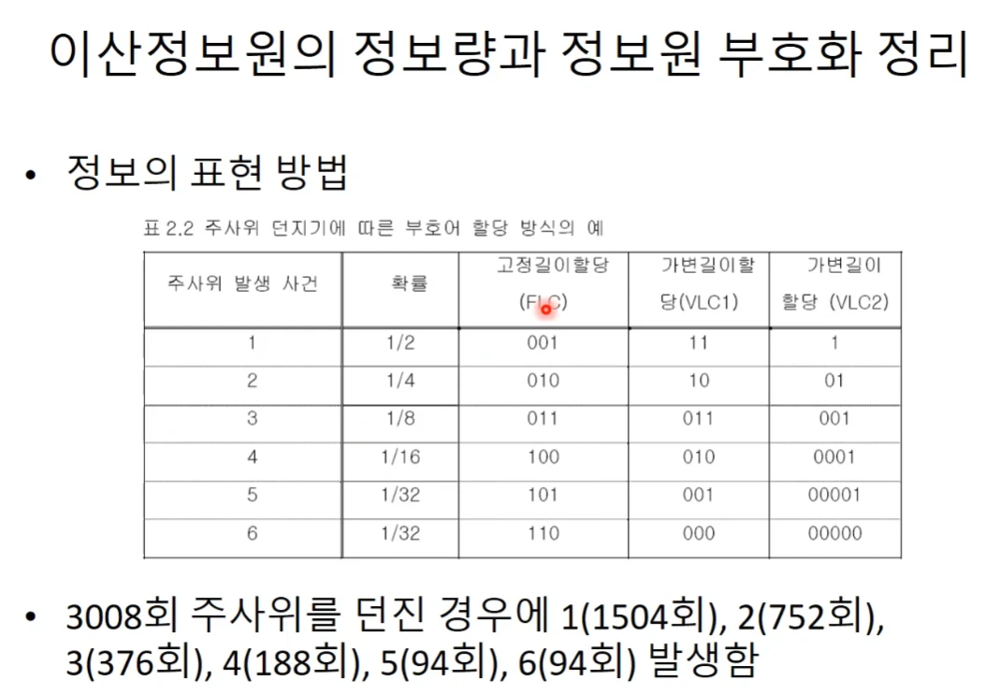

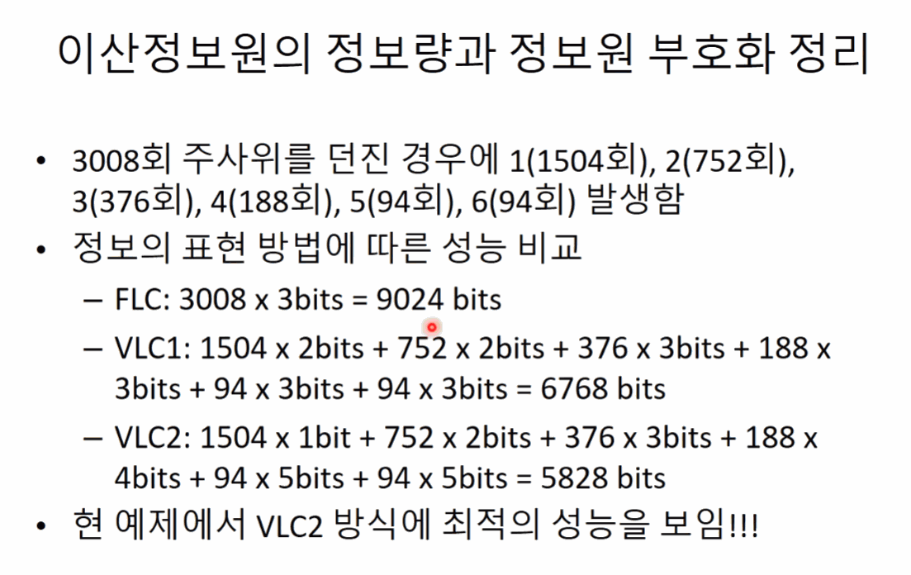

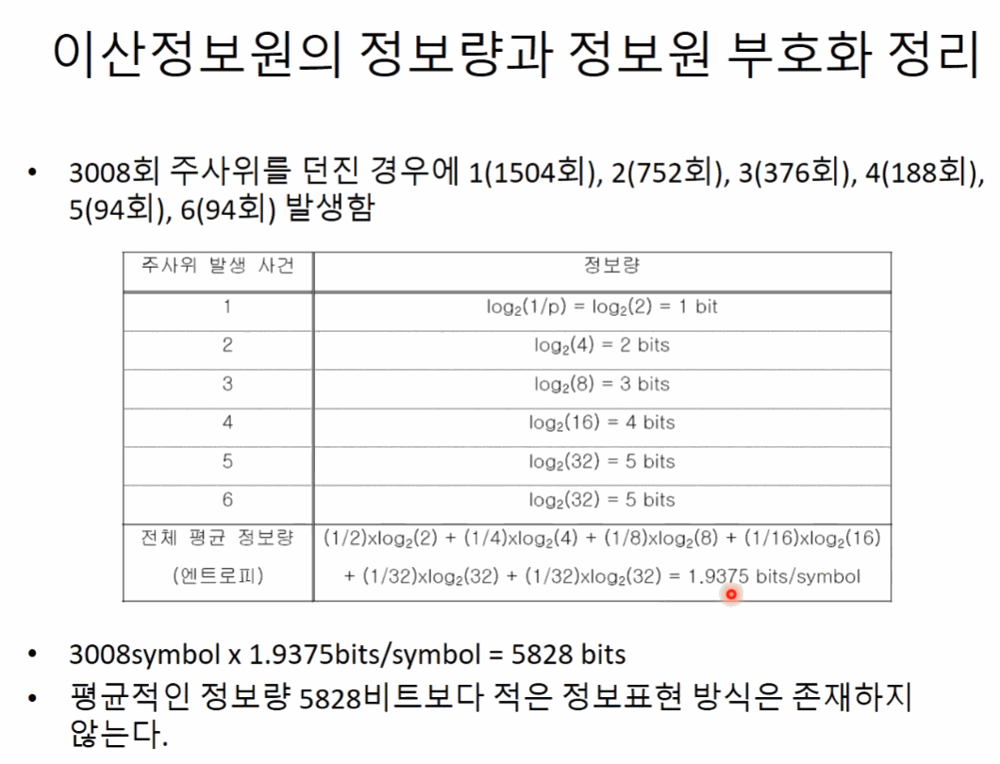

⇒ 엔트로피를 적용했을 때 나오는 비트수보다 더 적은 정보표현 방식은 존재하지 않는다. (만들려면 특별한 Model을 적용해야 함)

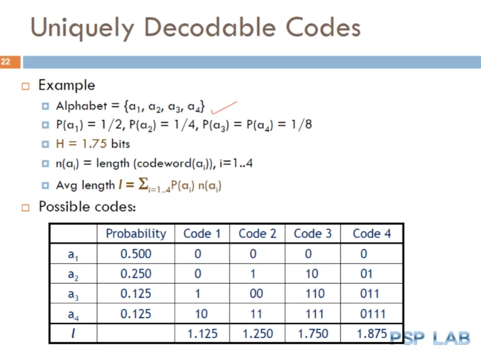

위와 같은 예시가 있을 때, 엔트로피를 계산하면? H = 1.75 bits 이다.

- n(ai) = length(codeword(ai)), i = 1..4   
    **즉, Letter에 할당된 Code의 길이이며, Letter 개수만큼의 길이까지 할당 가능한 것으로 보임.**
- Avg length는 확률\*codeword의 길이

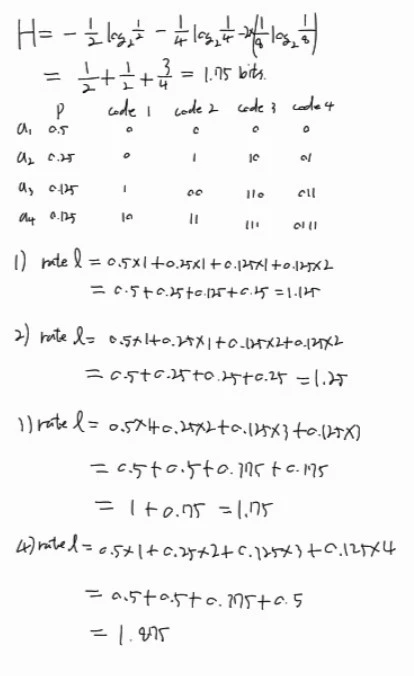

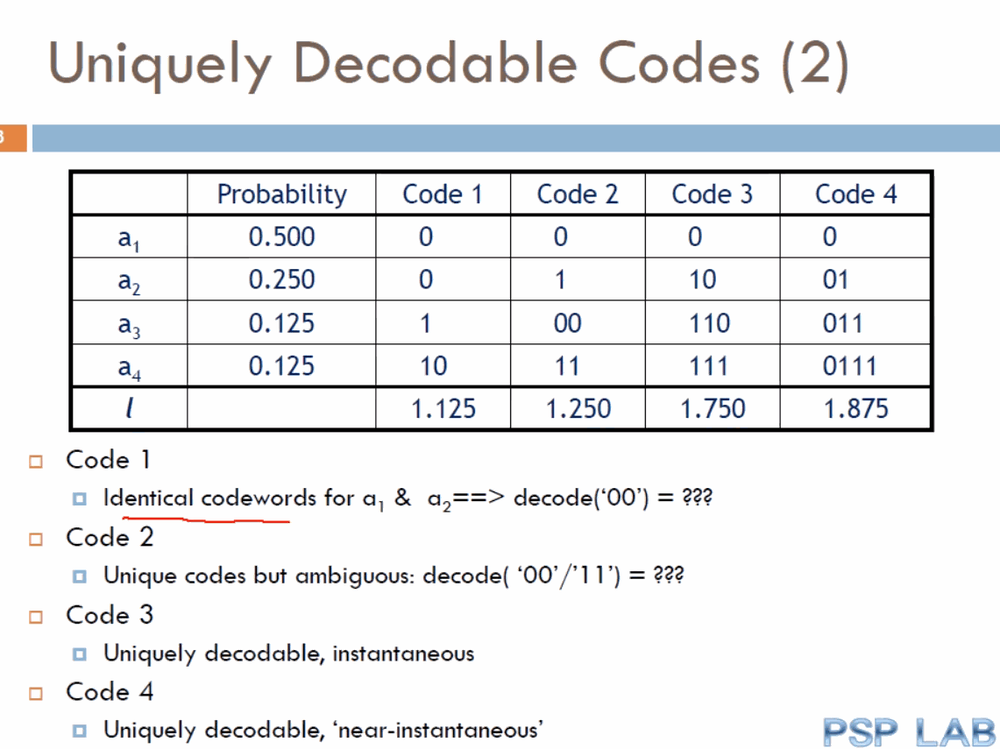

- Code 1 : a1과 a2의 code가 똑같기 때문에 decoding이 불가능하다.
- Code 2 : **Unique Code** 이지만, **ambiguous** 하다. 00일 경우, a1 a1인지 a3인지 구분이 불가능하므로 decoding이 불가능하다.
- Code 3 : 좋은 코드이다. Uniquely Decodable 한 Codes이다. 그래서 실시간 Decoding이 가능하다. (생긴게 모두 다르고, 구분이 가능) ⇒ `Huffman Coding`이라고 한다.
- Code 4 : Uniquely Decodable 하고 거의 실시간으로 Decoding이 가능하다. ⇒ `Golomb Coding` 이라고 한다.

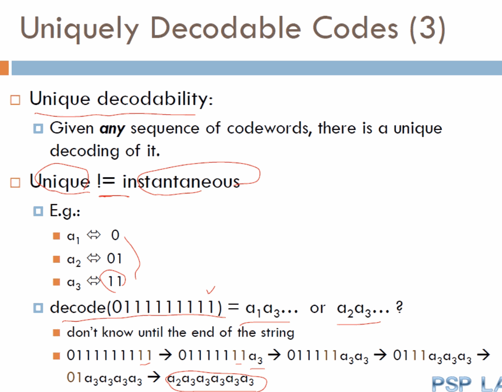

**Decoding을 할 때는 뒤에서부터 진행**해야 한다. 앞에서부터 Decoding 하면 끝나지 않을 수도 있는 것으로 보인다. 위의 예시를 보면, a1a3로 해석이 될 수도 있고, a2a3로 해석이 될 수도 있기 때문에, 뒤에서부터 보면서 해석해야 한다.

- **Unique Decodability** : Unique Decodable한 Codes가 정해졌다면, 어떠한 sequence의 codewords가 들어와도 unique하게 decode가 가능하다. 단, Prefix가 없다면, 뒤에서부터 decoding 필요.

---

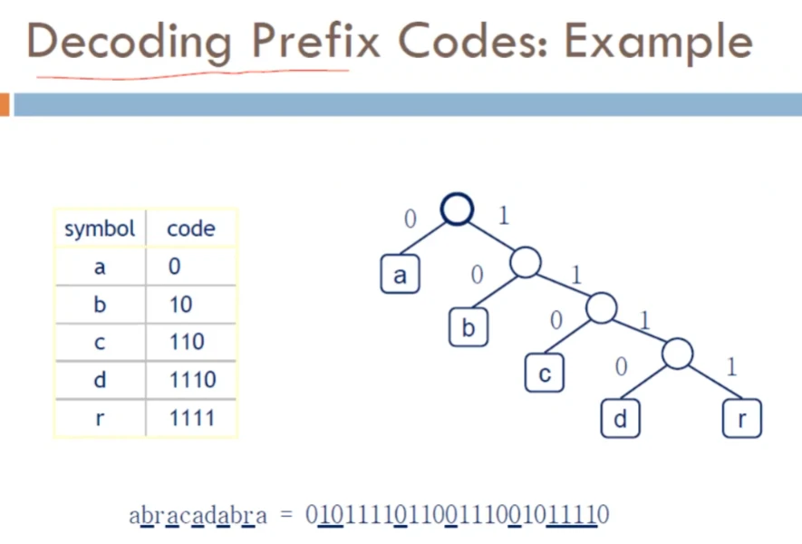

앞에 어떤 부호가 점차 추가되는 것을 Prefix Code라고 한다. Encoding 할 때는 Table이 필요하므로, Decoding 할 때도 똑같은 Table이 필요하게 된다.

이전에는 뒤에서부터 Decoding을 했지만, Prefix가 있는 Code는 앞에서부터 해석해도 된다.

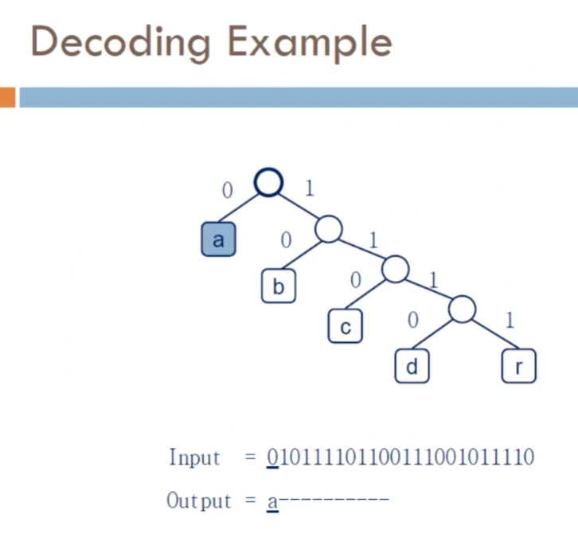

앞에서부터 쭉 해석하면 바로 코드를 얻을 수 있다.

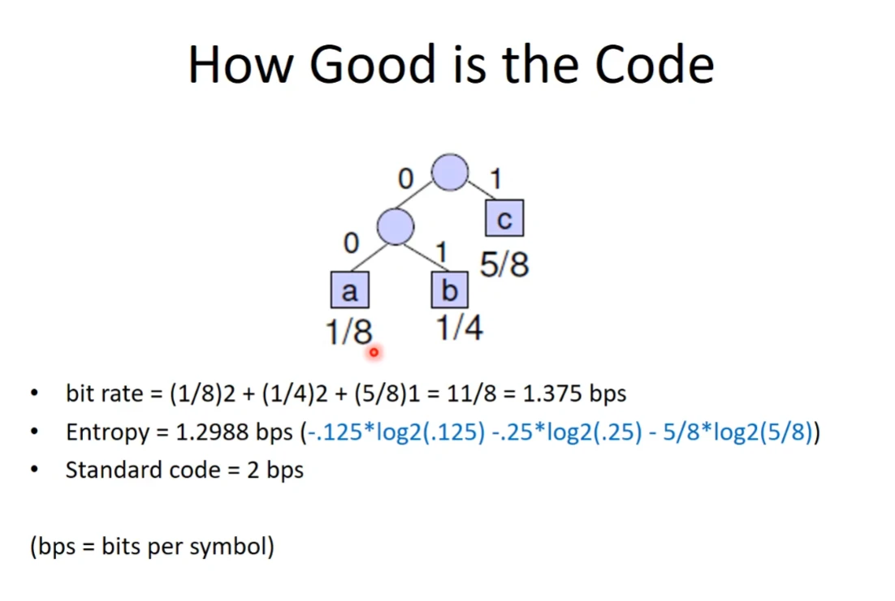

⇒ 1.375 bps - 1.2988 bps가 이 Prefix Codes의 Redundancy라고 볼 수 있다.  
⇒ Standard Coding은 FLC를 얘기하는 것인데, 세 개의 Symbol이 있으므로 최소 두 개의 bit가 필요

---

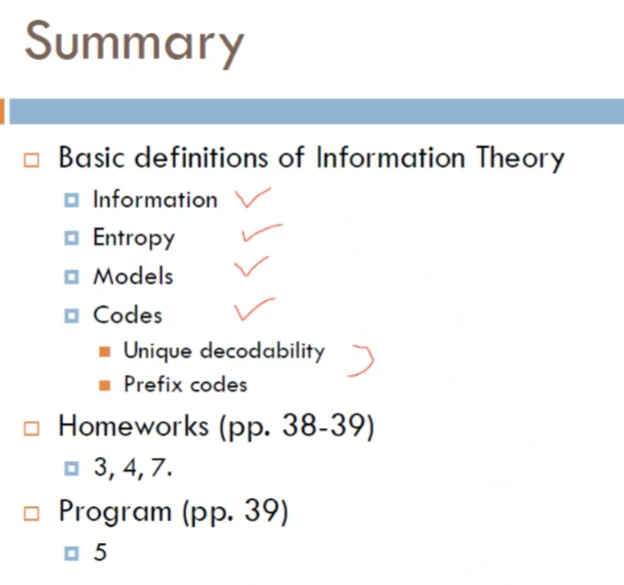

---

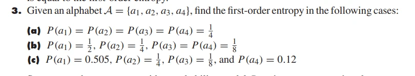

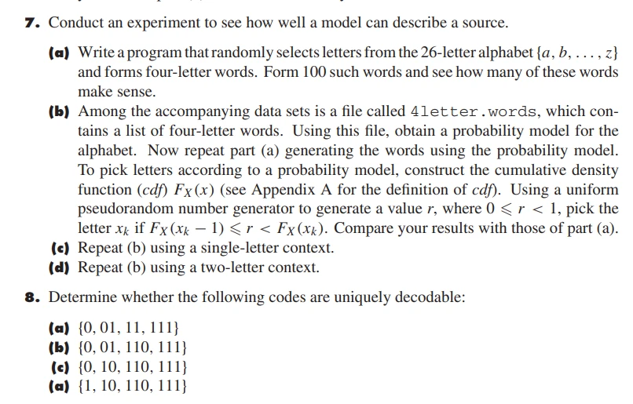
