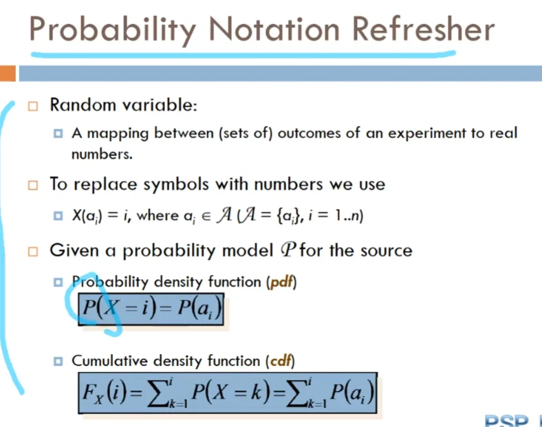
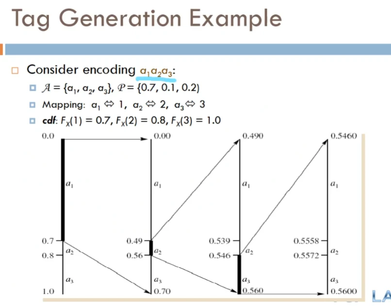
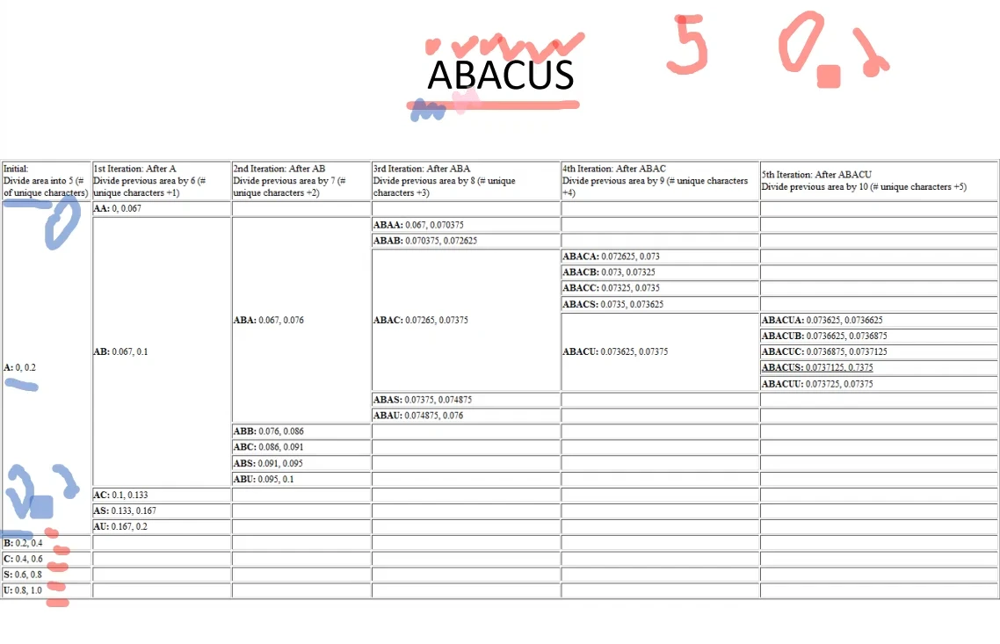
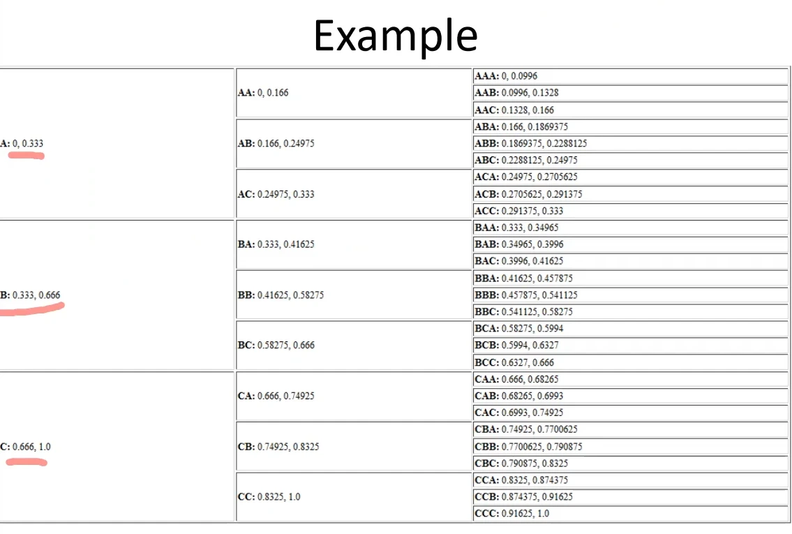
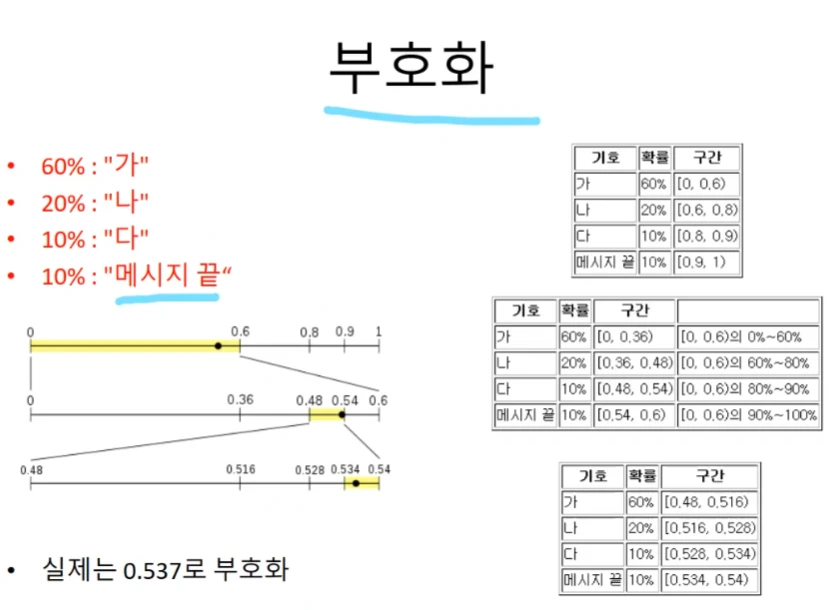
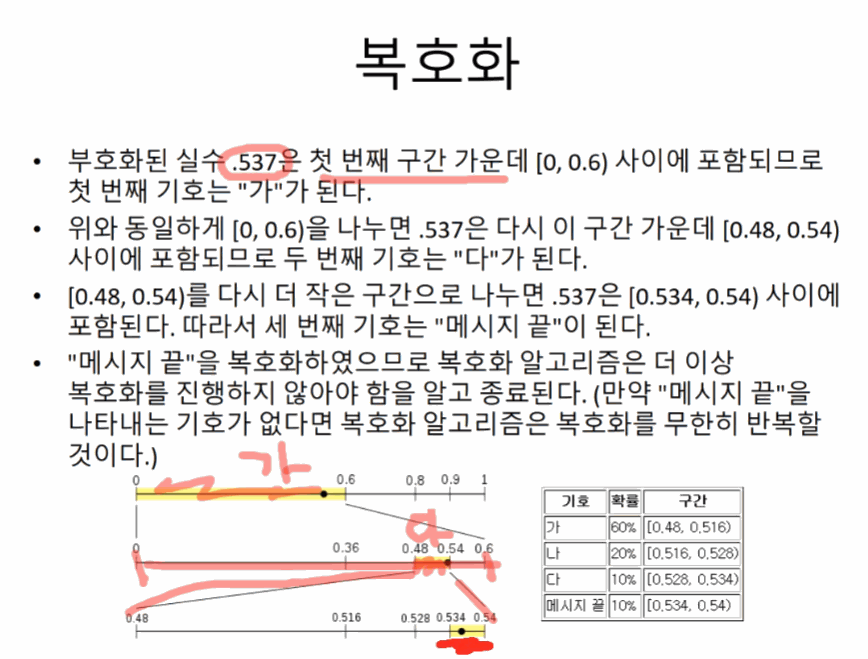

# 6주차 (Chpt. 4 : Arithmetic Coding)

## Arithmetic Coding

Lossless Data Compression(무손실 압축)의 일종으로, Variable-length entropy coding(엔트로피 부호화 알고리즘)이다. 즉, 빈도수가 높은 것에는 짧은 비트를, 빈도수가 높은 것에는 높은 비트를 부여하는 방식과 일맥상통한다.

가장 큰 특징은 모든 Symbol을 0 ~ 1 사이의 특정한 값으로 할당한다는 것이다. 이를 n값이라고 하고, n값은 소수점으로 나오게 된다.

즉, 다른 엔트로피 부호화 알고리즘이 각각의 기호를 1:1로 부호로 대체하는 반면에, 산술 부호화는 전체 메시지를 하나의 실수로 대체한다.

- Basic Idea

    - Generate a unique tag (code) for an entire sequence
    - Tag는 0과 1 사이의 특정한 소수점 숫자이다.

- Probability Density Function (PDF) : P(X = i) = P(ai)

    - X가 i일 때의 확률

- Cumulative Density Function (CDF) : PDF의 모든 합
- Tag Generation Example

A라는 집합 안에 a1, a2, a3가 있고, 각각이 발생할 확률이 주어진다. 이것에 대한 그림을 그린다. 먼저, a1에 대해서만 고려하는 그림을 새롭게 그리게 되며, a1이 0.7이기 때문에 0.0~0.7로 그림이 그려지게 된다. 이때, 이전의 a1, a2, a3의 확률 비율에 맞게 그림을 새롭게 그려준다. 0.7이 최대값이기 때문에 0.7의 70%인 0.49까지를 a1으로 만들고, 0.7의 10%를 더해서 a2가 0.56까지 가게 만들며, 나머지를 a3에 할당하는 방식이다. **새로운 그림을 그리면서 최솟값의 자릿수는 하나씩 늘어나게 된다.**

이와 같은 방식으로 다시 a2에 대한 새로운 그림을 그릴 수 있으며, 다시 동일한 방법을 적용하여 그리면 된다.

똑같은 방법으로 a3에 대해서도 그려주면 된다.

여기까지 진행한다면, 토큰만 같이 넘겨주게 되면 모두 압축된 값으로 생각할 수 있다.

---

- Arithmetic Coding Examples

⇒ 정리하면, 초기에 그림을 하나 그리고 옮겨가면서 그림을 그리는 것은 연속으로 올 확률을 구하는 과정이라고 볼 수 있다. 모든 Symbol이 나타날 확률이 같다고 가정하면 모든것이 0.2의 간격을 갖게 되고, 그렇게 됐을 때 A에 대해서 점차 늘려가게 될 수 있는 것임.

초기에 ‘가’가 들어왔다고 가정해보자. 그러면 그림을 0~0.6에 대해서 그리게 되고, 이후에 ‘다’가 들어오면 0.48~0.54까지로 다시 그려지게 되며, 이후에 ‘메시지 끝’이 도착하면 끝을 알게된다.

- 위와 같이 Arithmetic Coding이 결정되었을 때, ‘0.537’이 들어왔고, 이에 대한 확률을 분석한다.

**부호화된 실수** 0.537이 들어오게 되면 0.537은 “가” 구간에 포함되므로 처음에는 “가”가 들어온 것을 알 수 있고, 다음에는 0.537이 “다” 구간에 포함되므로 “다”가 들어온 것을 알 수 있다. 이후에는 0.537이 “메시지 끝” 구간에 포함되므로, “메시지 끝”이 들어와 Decoding이 종료된다.

- Arithmetic Coding은 압축 대상 부호의 개수가 많을 수록 압축의 한계를 나타내는 정보인 엔트로피에 근접하게 되지만, 각 부호를 압축할 때마다 구간을 계산해 주어야 한다는 복잡함 때문에 Huffman-Coding에 비해 연산량이 매우 크다.
- 그리고 “메시지 끝”을 나타내는 별도의 기호를 사용하거나 몇 개의 기호가 들어있는지에 대한 부가적인 정보가 필요하다는 문제가 있기 때문에, 단순한 메시지의 경우에는 Huffman-Coding보다 효율이 떨어질 수도 있다.
