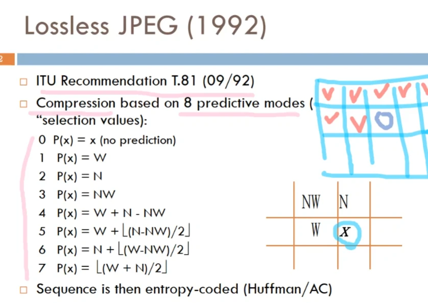
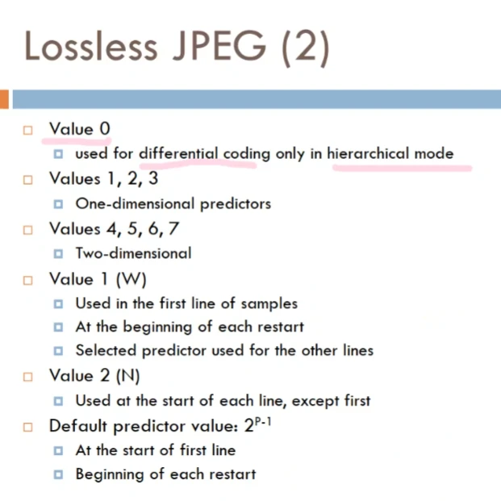
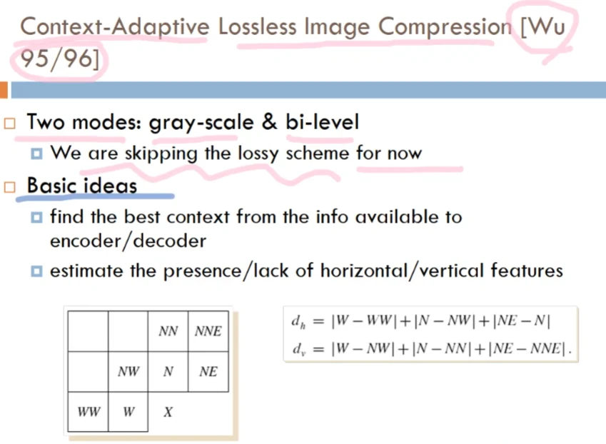
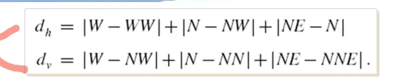
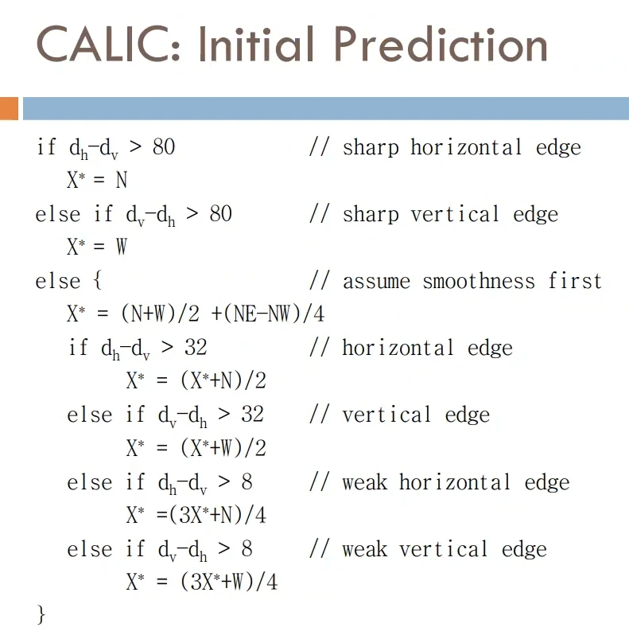

# 7주차 (Chpt. 7 : Lossless Image Compression)

작성일 2023-05-25 · 최종 수정일 2025-05-24
{ .post-date }

## Lossless Image Compression

- 8개의 예측 모드를 사용하는 압축 기법을 말한다.
- 이것은 누군가가 제안한 현재 픽셀을 예측하는 방법의 모드이다.

- Value 1, 2, 3은 1차원적인 예측 모드

    - Value 2는 맨 윗 Row의 경우, N이 없기 때문에 적용할 수 없음.
    - 마찬가지로 Value 1도 맨 처음 Column의 경우 W가 없기 때문에 적용할 수 없음.

- Value 4, 5, 6, 7은 이차원적인 예측 모드

- Default Predictor Value는 2^(P-1)이고, 이때 P는 Pixel. 8 bits를 말한다.

    - 따라서, 2^7 = 128이 Default Predictor Value임을 알 수 있다.

---

## Context-Adaptive Lossless Image Compression

- Lossless JPEG을 개선한 것.
- Gray-scale과 Bi-level 두 개의 모드가 있음.
- 현재는 Lossy Scheme을 skip하므로, Lossless이다.
- 현재로서는 수평/수직 정보의 유용성을 고려하지 않는다.

dh(horizontal) = |W - WW| + |N - NW| + |NE - N|

dv(vertical) = |W - NW| + |N - NN| + |NE - NNE|

d값이 적을 수록 Pattern이 적은 것이기 때문에, 평탄한 영역이라고 해석할 수 있다. 만약, dv &gt; dh라고 한다면, 수평 방향이 평탄하고, vertical 방향은 Pattern이 많다는 것이다.

그렇다면 Pattern이 많은 것을 사용해야 할까 적은 것을 사용해야 할까? Pattern이 많다는 것은 불확실성이 크다는 것이기 때문에, 적은 것을 사용하는 것이 좋다.

- `CALIC`

- dh - dv &gt; 80 이라면, vertical 방향으로는 평탄하다는 뜻이다. 즉, horizontal 방향으로는 pattern이 많다는 것이다.

    - 이렇게 되면 vertical 영역이 reliable 하다.

- dv - dh &gt; 80이라면, vertical 방향으로는 pattern이 많다는 것이므로, horizontal 방향이 reliable 하다.

- 이 두 개가 아닌 경우

    - dh - dv &gt; 32 인 경우, horizontal edge
    - dv - dh &gt; 32 인 경우, vertical edge
    - dh - dv &gt; 8 인 경우, weak horizontal edge 
    - dv - dh &gt; 8인 경우, weak vertical edge
