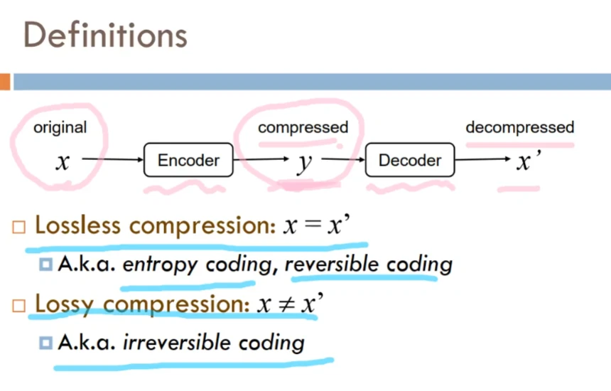
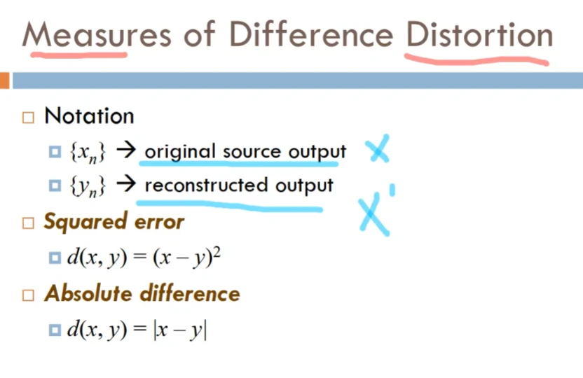
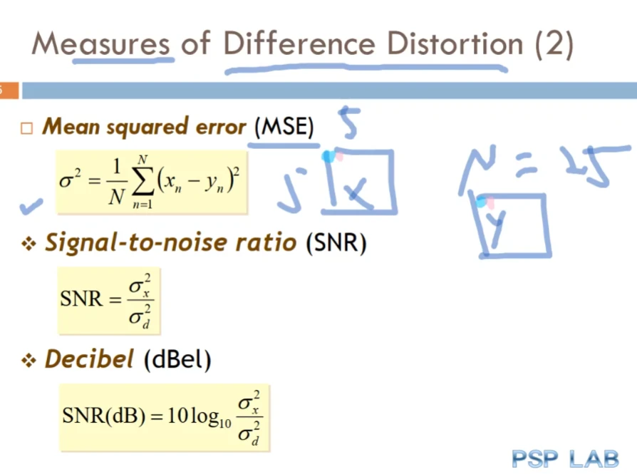
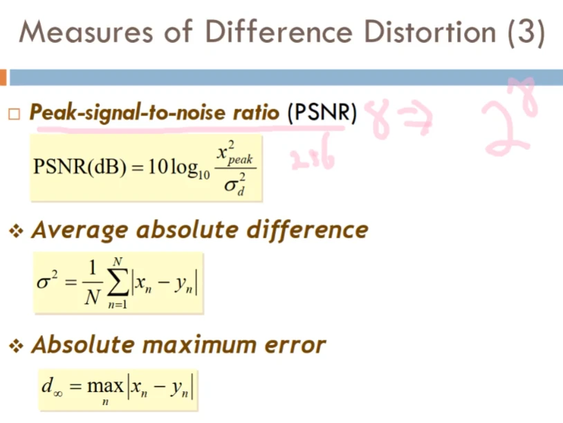
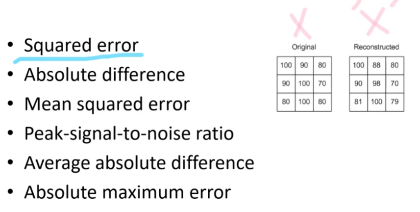
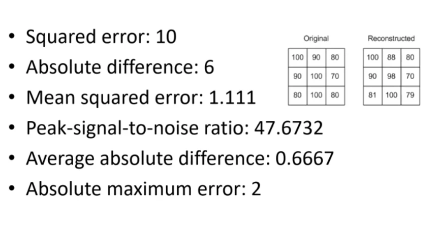

# 8주차 (Chpt. 8 : Lossy Compression)

작성일 2023-05-25 · 최종 수정일 2025-05-24
{ .post-date }

## Definitions About Lossy Compression

- Motivation

    - 왜 굳이 Lossy Compression을 이용할까?
    - Lossless Compression의 압축률이 그렇게 크지 않다는 점에서 기인한다.
    - 예를 들어, 패턴이 매우 복잡한 것이 있는데, 사이즈가 너무 작다면 사람의 눈이 resolution이 이를 따라가지 못해서 Pattern을 파악하지 못하게 된다.
    - 혹은 가청 주파수를 넘어서는 소리가 신호에 포함되어 있다면, 그 데이터들을 제거하여 데이터의 양을 줄일 수 있게 된다. (Redundancy 제거)

- Distortion(왜곡)을 어떻게 측정하는가?

    

    - x와 y의 차분. Squared error를 표현하면 d(x, y) = (x-y)^2이다.
    - 혹은 Absolute Difference를 표현한다면 d(x, y) = |x - y| 이다.
    - 일반적으로 Squared error를 주로 사용하기는 한다. 그 이유는, 제곱 방식은 0에 근접한 것은 더 작아지고, 0에서 먼 것은 더욱 커진다. 그러므로 이 방식이 거리에 대해 가중치를 더 주게 되는 방식이라 주로 사용된다.

- Mean Squared Error (MSE)

    - 가령 5x5를 다룬다고 할 때, 각 픽셀 별로 (x - x’)^2을 N(여기서는 25)으로 나눈 것의 합을 구한 것을 Mean Squared Error라고 할 수 있고, 이를 분산으로 볼 수 있다. (시그마 제곱)

- Signal to noise ratio (SNR)

    - 보통 PSNR로 더 많이 사용하게 된다. Peak signal to noise ratio

- Decibel (dBel)

    - SNR 앞에 10log10을 붙여서 계산하게 된다.

- Peak-signal-to-noise ratio (PSNR)

    만약 8bit 영상에서 peak 값은? 2\^8 이므로, 256이다. 그러므로 xpeak\^2은 256\^2이고, MSE를 구해서 10log10을 취해 계산하면, PSNR (dB)가 구해진다.

- Average Absolute Difference

    - x값과 y값의 차분을 전부 더해서 N으로 나눈 것.

- Absolute Maximum Error

    - 각각의 자리에 대해서 | x - x’ | 을 구하고, 여기서 최대 오차를 찾는 것

---

- Example

