# 9주차 (Chpt. 9 : Quantization)

## Quantization

Quantization이란, 무한대의 정보가 있다고 할 때, 이것에 대표값을 주는 것이 바로 Quantization이다. 그래서 큰 집합을 작은 집합으로 줄이는 것을 목표로 한다.

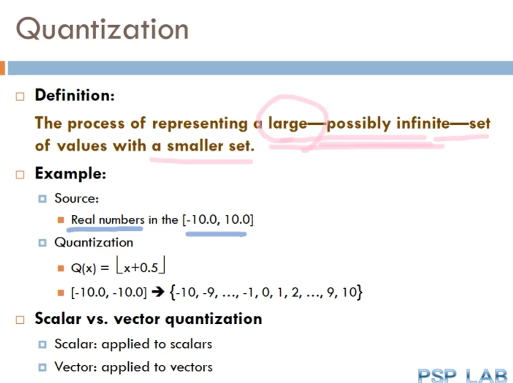

예를 들어 -10.0 ~ 10.0 사이의 모든 실수가 있다고 하면, 대표값이 매우 많을 것이다. 이를 Quantization을 할 수 있다.

Q(x) = floor(x + 0.5)

이렇게 하면 대표값은 총 21개가 나오게 된다. : -10 ~ 10 까지의 정수

- Quantization Example

Codes가 있고, Input Codes의 영역이 아래와 같이 나뉘어져 있다.

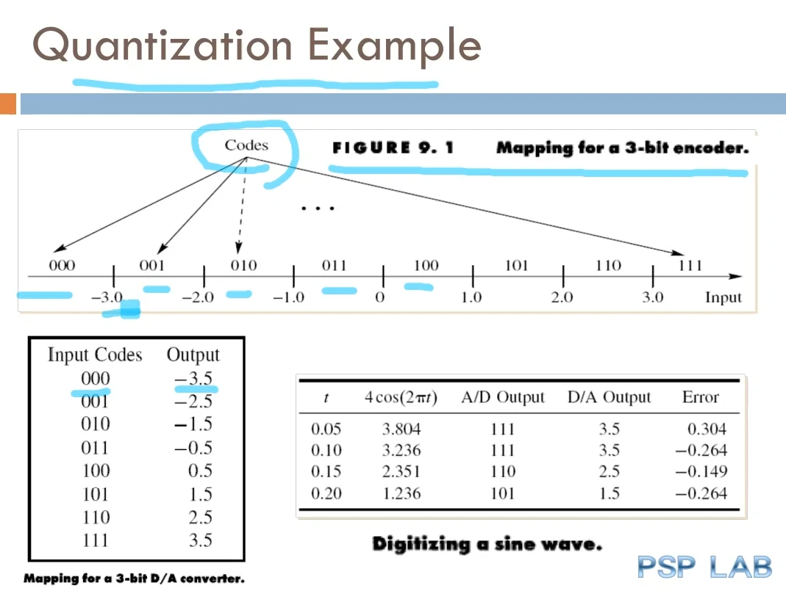

이렇게 되어있을 때, Input Codes가 000이면, Output은 -3.5라고 하고, Input Codes가 001이면 Output은 -2.5 … 111이면 3.5가 나온다고 해보자.

- 이 상황에서 signal x가 4cos(2\*pi\*t)라고 해보자. 이때 t 값에 따라서 값이 정해지게 된다.

예를 들어 t가 0.05라면, 값은 3.804가 되고, t가 0.10이면 값은 3.236이 되고… 이런 식이다.

그렇다면, 3.804는 어디에 있는가? 111로 매칭될 수 있고, 이렇게 되면 D/A output은 3.5가 된다. 실제 값은 3.804였는데, 3.5를 빼면 Error 값은 0.304가 된다.

> 위의 과정은 Quantization의 예시이며, Analog Input을 넣었을 때, 해당되는 구간에 매칭하여 Digital 값을 정하고 이를 Analog로 출력하는 과정을 표현한다.  
>   
> 이것이 Digitalizing 된 Sine Output이다.

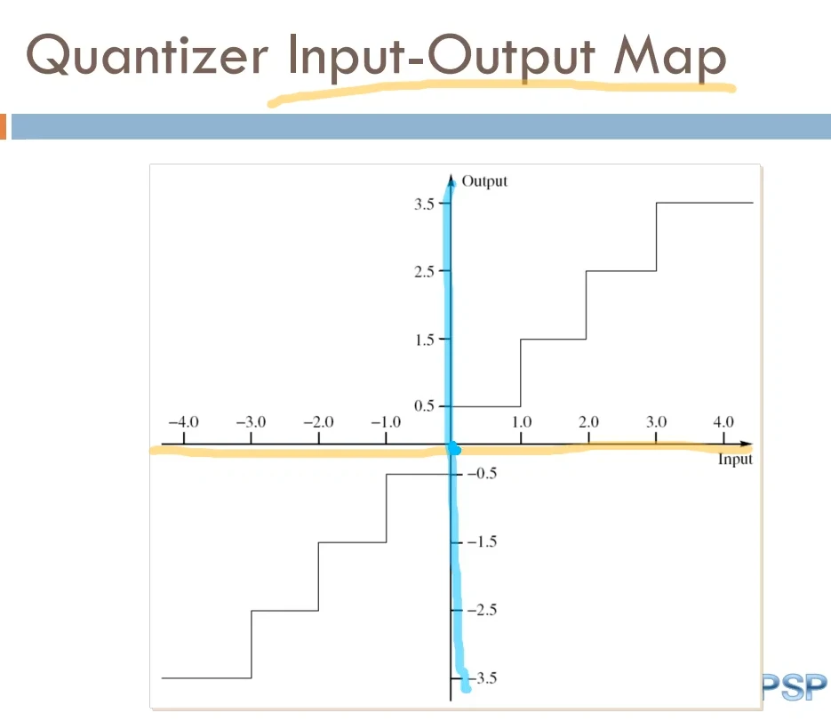

- Input 값이 0부터 1 사이일 때, Quantize된 Output 값은 0.5이다. Q(x) = x + 0.5(midpoint로 상정)
- Input 값이 2에서 3 사이일 때, Output 값은 2.5이다.

⇒ 이런 식으로 Quantize된 값이 Input에 대하여 Output으로 나오게 된다.

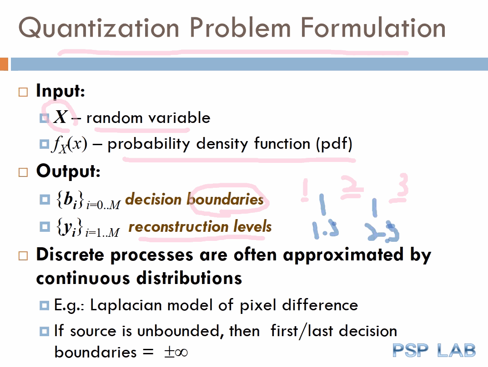

- Input

    - X : random variable ⇒ 확률 밀도 함수의 매개변수
    - fx(X) : probability density function (pdf) ⇒ 이전의 cos 함수

- Output

    - { bi } i = 0 .. M : decision boundaries ⇒ 예를 들어 1과 2 사이라면, 1, 2가 Boundary이다.
    - { yi } i = 1 .. M : reconstruction levels ⇒ 중간 값을 의미. 1.5, 2.5, …

---

- Quantization Error

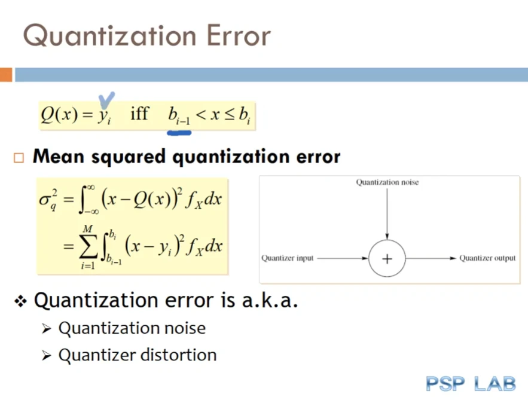

- Q(x) = yi : y는 대표값을 의미함. x는 analog 신호인데, 그것의 boundary가 b(i-1) &lt; x ≤ bi 이다.
- 예를 들어 i가 3이라면, x는 2와 3 사이의 어떠한 실수이며, 대표값은 예를 들면 2.5 등을 줄 수 있을 것이다.
- Mean Squared Quantization Error

이는 시그마의 제곱 꼴. 즉, 분산으로 나오게 되고, x라는 original 값에서 yi를 빼거나, Quantization 값을 뺀 것의 제곱에 확률을 곱한 것을 의미한다.

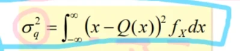

이 공식은 확률 이론에 나오는, 분산을 계산하는 공식이다.

(x - yi)\^2 \* fx(PDF) 의 형태로 나오게 된다.

- Quantizer Output은 Quantizer Input에 noise가 들어간 합의 꼴로 나오게 된다.

예를 들어, 1.5가 대표값이고, 실제값이 1.8이라면, 이때의 Quantization error(noise, distortion)을 0.3이라고 할 수 있다.

이것은 실제로 noise는 아니지만, original 값과 대표값의 차분을 noise라고 생각할 수 있다.

---

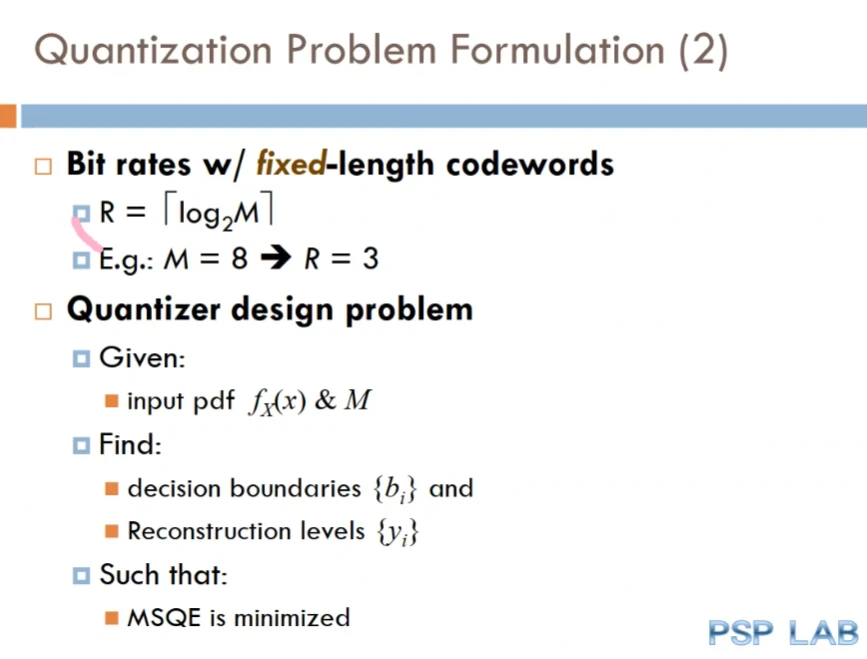

- Bit rates w/ fixed-length codewords

R(rate, 비트 수) = ceiling(log2M)

현재 Quantization을 표현하는데 사용되는 Level이 총 M개라면, codewords의 길이는 log2M이다.

M (difference) 000, 001, 010, 011, …, 111까지 총 8개의 codes가 존재한다면, R = 3이 된다. (필요한 비트 수는 3개)

⇒ 이는 ASCII와 같이 bit 수가 고정적인 것에만 적용 가능한 것으로 보인다.

- `Quantizer Design Problem`

input pdf fx(X)와 M이 주어졌을 때, 우리는 **decision boundaries**  `{bi}`와, **Reconstruction levels**  `{yi}`를 찾게 된다. 이는 MSQE를 최소화 하는 방식으로 찾아야 한다.

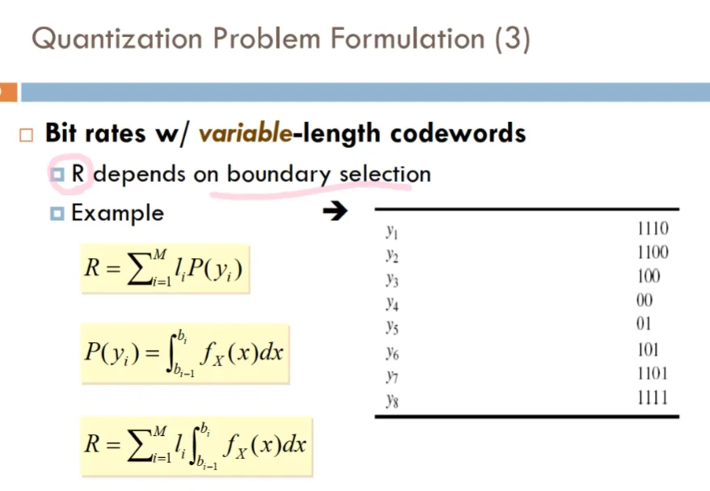

- Rate는 Boundary Selection으로부터 나오게 된다.
- 이전에 Lossless Compression에서 빈도수에 따라 짧은 code를 할당하고, 긴 code를 할당하는 경우가 있었는데, 여기서도 비슷하게 code를 할당한 것으로 볼 수 있다.

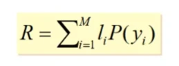

현재 코드는 2비트, 3비트, 4비트가 되는데 l(i)는 bit 길이를 의미하므로, 2~4가 될 수 있다. 여기의 P는 발생 확률이다. y1의 경우 1110이기 때문에 발생 확률이 매우 작을 것이고, 그에 반해 y4, y5의 발생 확률은 매우 높을 것이다.

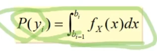

P는 이와 같이 구하게 되고, R에 공식을 넣게 되면 아래와 같다.

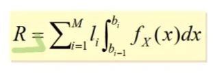

---

- 압축에서 중요한 것은, **코드의 길이(Rate)를 최소화** 하고, **오류(Distortion)를 최소화**하는 것이다.

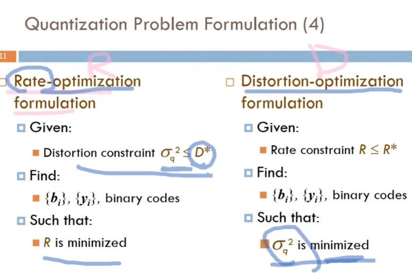

- Rate를 Optimization 하고 싶다는 것은, Distortion을 어떤 특정한 한도(D\*)보다 작게 하면서, R을 최소화 한다는 것이다.
- Distortion을 Optimization하고 싶다는 것은, Rate를 어떤 특정한 한도(D\*)보다 작게 하면서, Distortion을 최소화 한다는 것이다.

---

## Uniform Quantizer

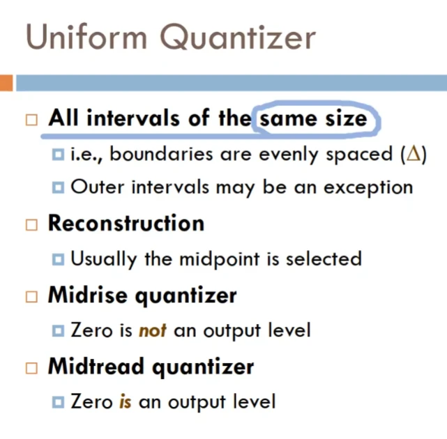

모든 interval을 같은 사이즈로 표현하는 것이다. 본 챕터에서는 Uniform Quantization이 있고, Non-uniform Quantization이 있는데, 이론적으로는 당연히 Non-uniform Quantization이 좋을 것이다. 이것이 빈도에 따라 코드 길이를 다르게 할당하는 것이기 때문이다.

- Uniform Quantization

    - Boundary가 evenly, 균등하게 나눠져 있다. 이를 <strong>∆</strong>라고 한다.

- Reconstruction

    - `대표값`은 중간값으로 설정한다.

- Midrise Quantizer

    - Zero is not an output level

- Midtread Quantizer

    - Zero is an output level

⇒ Zero가 Output이 되냐 안되냐이다.

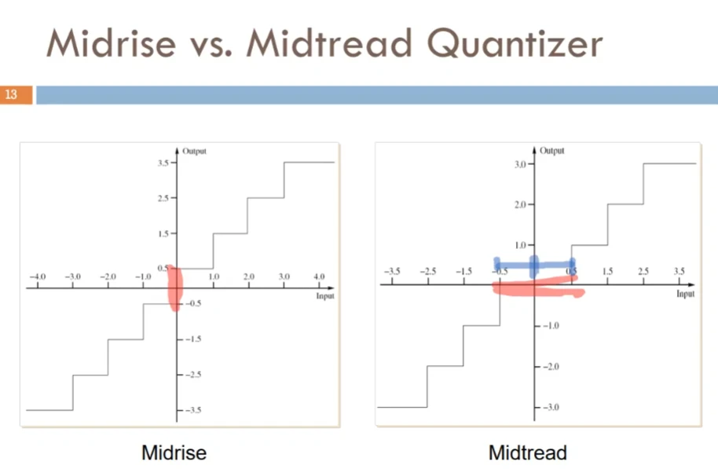

- Midtread는 -0.5, 0.5 사이의 대표값이 0이 된다.

- Midrise의 경우 대표값이 -0.5, 0.5가 된다.

    - Midtread가 선호되는 이유는, 데이터를 송신할 때, 대표값이 0.5라면 0.5를 code로 만들어서 발송해주어야 하는데, 대부분의 경우 한 픽셀과 다음 픽셀의 값이 같기 때문에, 차이가 없어서 0을 송신하게 되는 경우가 많기 때문에 0을 송신하는 것이 이득이 되기 때문이다.

---

- Uniform Quantization of Uniform Source

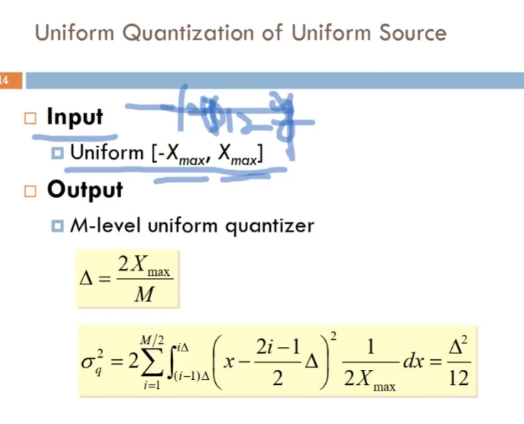

- 이런 상황이라면, Input이 -Xmax ~ Xmax일 때, Total 길이는 2Xmax가 될 것이다.
- Level이 M개라고 한다면, (8개의 Level, 16개의 Level… 이런 식)   
    interval **∆ = 2Xmax / M** 이다.
- 이때, MSQE(Mean Square Quantize Error)를 계산하면 다음과 같다.

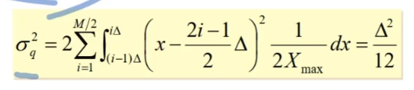

계산을 하고 나면 **∆^2/12** 를 계산하게 된다.

---

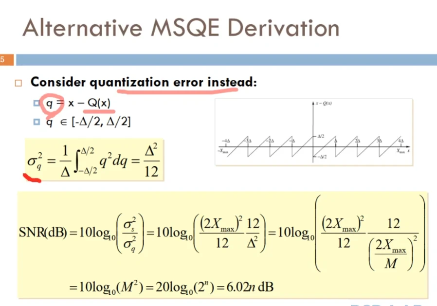

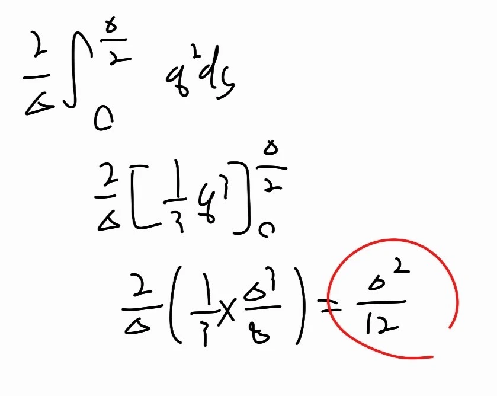

- 이제 Quantization Error를 계산해본다.
- q = x - Q(x) : original 값에서 대표값을 뺀 것.
- 분산값은 이전의 공식에 따라 **∆^2/12**
- SNR 값을 계산하면, 위와 같은 결과가 나오게 된다.
- 6.02n dB가 나오게 된다.
- n이라는 것은 비트수인데, 만약 n이 1이면 시그널이 6dB이고, 2이면 12dB, 8이면 48dB가 된다.
- 영상은 보통 bit 수가 8이기 때문에, 만일 영상의 PSNR이 48dB라는 것은, 에러가 없다는 뜻이다.
- 만약 영상의 bit를 8bits에서 7bits 정도로 줄인다면, PSNR은 대략 42dB가 될 것이다.

어쨌든 식을 풀고 dB을 구해보면 10log10(M\^2)이 나오게 되고, 이것은 20log10(2\^n)이다. 왜냐면, M은 현재 Quantization에서 다루는 Level이고, 이것은 결국 비트의 수를 의미한다.
