# 10주차 (Chpt. 10 : Differential Coding)

## Differential Coding

만약 코드가 변화한다고 할 때, 샘플을 어떻게 정해야 할까? 예를 들어, Original Signal이 1부터 -1까지 변화하는 Cosine 값이라고 해보자. 이를 코딩한다고 하면, +1 ~ -1의 모든 값의 변화를 코딩해야 할 것이다.

그런데, 여기에 Rule을 하나 도입한다고 해보자. 바로 **현재 값에서 이전 값을 빼는 것**이다. 

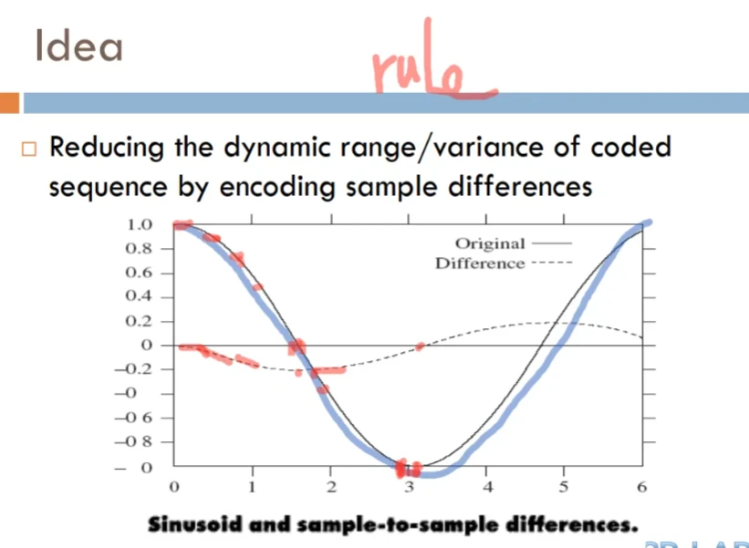

이런 값을 Difference(차분) 값이라고 하는데, 실제로 정보의 손실을 거의 없다고 볼 수 있다.

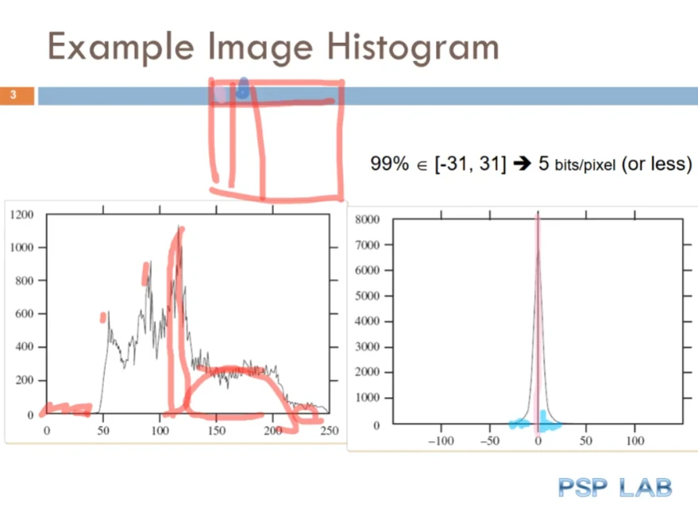

이전에 공부했던 것들 중에서 그림에 대한 예제를 하나 가져온 그래프이다. 이 경우, (좌) 대부분의 픽셀들은 중간 정도의 밝기를 가지고, 밝은 부분이 적지만 넓게 퍼져있으며, 어두운 부분도 존재하지만, 완전히 어두운 부분은 존재하지 않는다.

이를 바탕으로 Differential 값을 확인해 보았더니, 값이 대부분 0에 존재했고, 현재 값에서 이전 값을 뺀 것이 +이거나 -인 경우는 거의 존재하지 않았다.

---

지금까지의 내용의 핵심은 어떤 정보가 있을 때, 그 정보의 **Original 값을 그대로 코딩하는 것**보다 **Differential 값을 코딩하는 것이 더 이득**이라는 것이다.

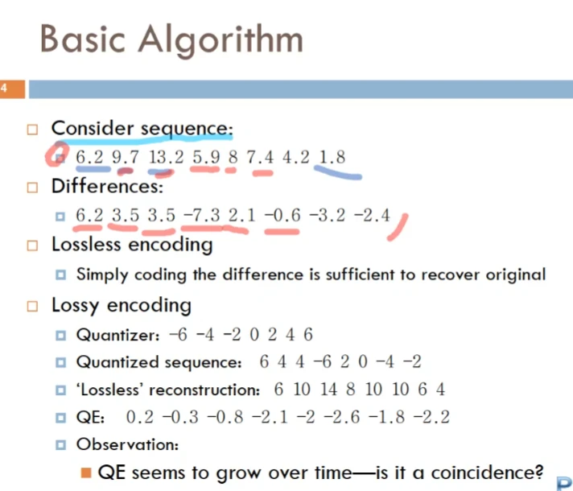

Original 값과 Difference 값은 정보 손실이 거의 존재하지 않는다. 왜냐면, Difference 값으로부터 Original 값을 유추할 수 있기 때문이다.

- Lossless Encoding : Difference 값만을 가지고도 Original 값을 충분히 Recovery 할 수 있다.

- 그런데, Quantization을 이용한다면 정보 손실이 발생하게 된다.

    - Quantizing에 의해 값이 바뀌게 되면 아래와 같이 값이 바뀌게 된다.

    6.2 ⇒ 6

    3.5 ⇒ 4

    3.5 ⇒ 4

    -7.3 ⇒ -6

    2.1 ⇒ 2

    -0.6 ⇒ 0

    -3.2 ⇒ -4

    -2.4 ⇒ -2

    - 그리고 이 값을 복원한다고 해보자.

    초기에 값이 0이라고 생각하고, 

    6 + 0 = 6 (Lossless reconstruction에 의해 만들어지는 값)

    6 + 4 = 10 (Next Quantized Sequence + Lossless Reconstructed Value)

    10 + 4 = 14

    14 + (-6) = 8

    8 + 2 = 10

    10 + 0 = 10

    10 + (-4) = 6

    6 + (-2) = 4

    - 이렇게 복원된 값과 실제 값과의 차분을 구하면? (복원값 - 실제값)

    QE(Quantization Error)

    0.2

    -0.3

    -0.8

    -2.1

    -2

    -2.6

    -1.8

    -2.2

    ⇒ Quantization Error가 시간이 갈수록 점차 증가하게 된다.

---

- Basic Algorithm

Difference : dn = x(n) - x(n-1) , 이전 알고리즘의 문제점에 대해 얘기해본다.

현재 값에서 직전 값을 빼는 것을 Difference라고 한다.

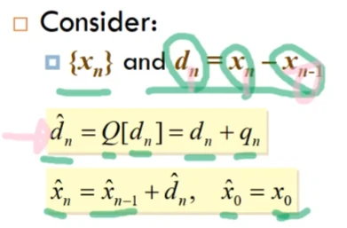

Difference의 예측값(Quantization 값)을 d hat이라고 하는데, 우선 타이핑으로는 D라고 표현한다.

D(n) = Q[dn] = d(n) + q(n) ⇒ 예측값 D(n) = Q[dn]에는 Error값이 들어가므로, d(n) + q(n) 이 된다.

X(n) = X(n-1) + D(n)

D(1) = Q[d(1)] = d(1) + q(1)

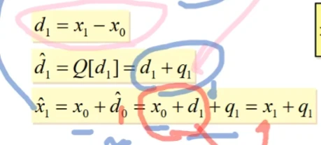

X(1) = x(0) + D(1) = x(0) + d(1) + q(1) = x(1) + q(1)  
(왜냐면, X(0) = x(0) 이다. 그리고 오타 존재함. D(0)가 아니고 D(1)임.)

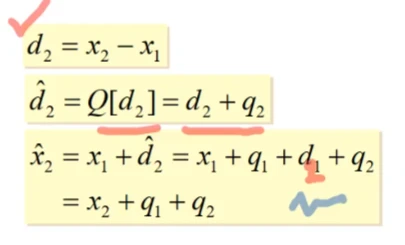

d(2) = x(2) - x(1) (Differential은 실제값의 차분이므로)

D(2) = Q[d(2)] = d(2) + q(2)

X(2) = X(1) + D(2) = x(1) + q(1) + d(2) + q(2)

= x(2) + q(1) + q(2) (정리해보면, x(1) + d(2) = x(2)와 같기 때문에 이와 같이 정리된다.)

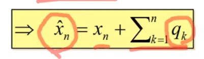

따라서, X(n) = x(n) + sum of qk (from k = 1 to n)

⇒ 즉, 정리를 해보면 애초에 Model 자체가 Quantization Error가 점차 축적되는 Model인 것이다. 제시되었던 기존 모델인 d(n) = x(n) - x(n-1) 자체가 QE가 축적되는 모델인 것임.

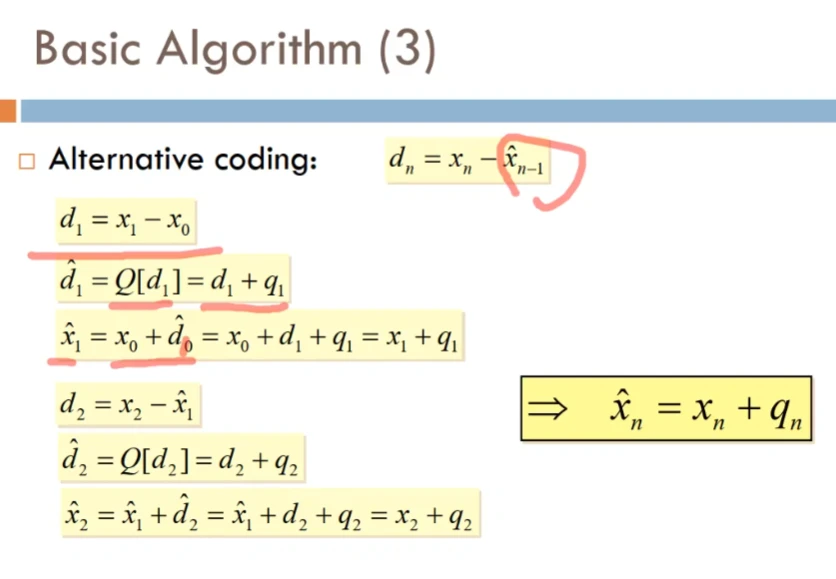

- Difference 값을 현재 값에서 이전 값을 빼면 누적이 발생하는데, **현재 값에서 이전 값의 예측값을 빼면 Error가 누적되지 않는다**는 것을 알 수 있다.

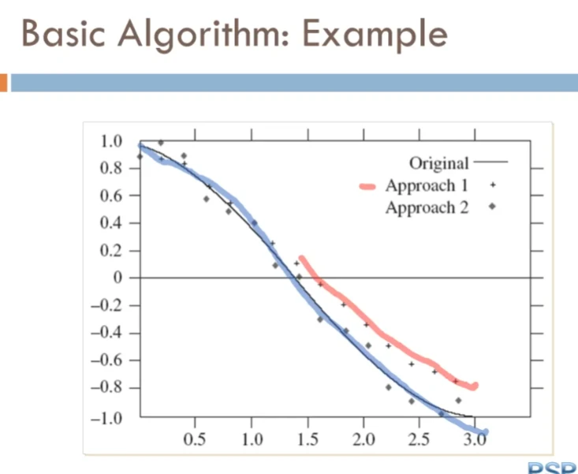

- 이전 방법은 Error가 누적되는 것을 볼 수 있지만, 두 번째 방법은 에러가 거의 누적되지 않는다.

---

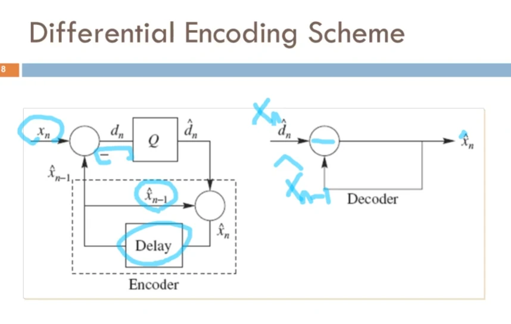

- 이런 방식으로 Video Coding이 이루어지게 된다.

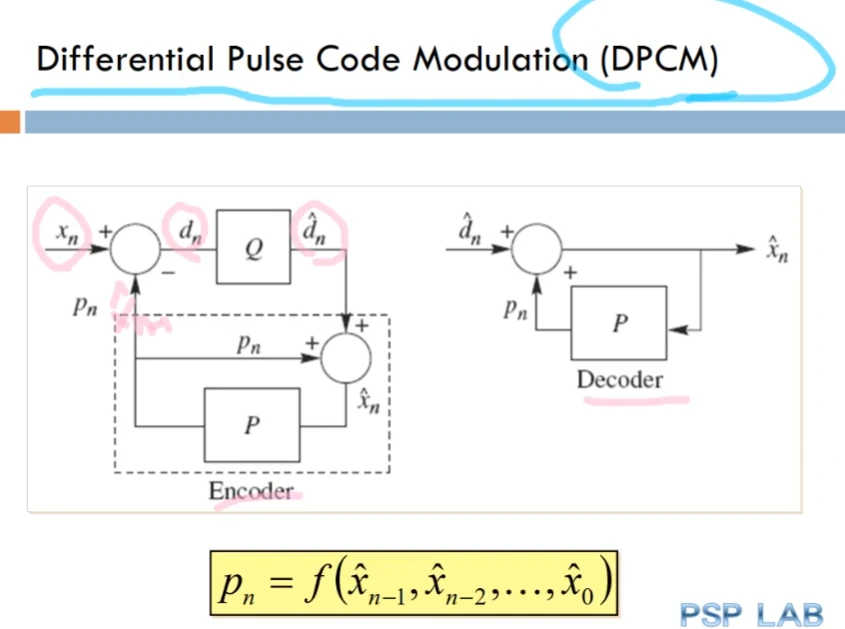
