# 11주차~13주차 (Chpt. 15 : Color Models, DCT, JPEG, Wavelets)

작성일 2023-05-25 · 최종 수정일 2025-05-24
{ .post-date }

- 1666년 아이작 뉴턴이 Prism을 통해서 색깔을 발견 (Infrared, Ultraviolet)

    - Far Infrared, Mid Infrared, Near Infrared과 같이 같은 Infrared도 구분된다.

- 가청주파수가 20Hz ~ 20,000Hz인 것처럼 가시광선의 주파수도 400nm ~ 700nm이다.

- 빛을 측정하는 방법

    - Radiance : 광원의 에너지 세기를 측정하는 단위 (Watt)
    - Luminance : 광원으로부터 받아지는 빛의 양을 측정하는 단위 (lumens, lm)
    - Brightness : 주관적인 밝기. 측정할 수 없다.

    ⇒ 세 가지 모두 다르게 구분은 했지만, 대체로 통용적으로 사용한다.

    ⇒ Luminance와 Brightness는 거의 같은 의미로 사용하기도 함.

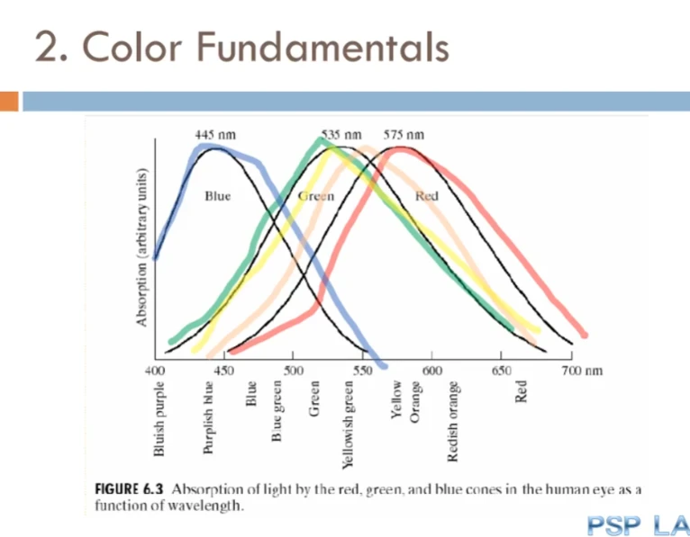

- 서로 다른 색깔은 서로 다른 주파수를 갖게 된다.

- Primary Colors

    - Red, Green, Blue

- Secondary Colors

    - Cyan = G + B
    - Magenta = B + R
    - Yellow = R + G

- W = R + G + B

    - 가산연산으로 이루어진다.

---

- Brightness : Saturation(채도)
- Chromaticity : Hue(색상)

- RGB를 정규화할 필요가 있다.

    - Red 값이 종종 음수로 나올 때가 있는데, 이것이 음수로 나오는 것을 없애고 싶은 경우도 있다.

- Trichromatic Coefficients

x = R/(R+G+B)

y = G/(R+G+B)

z = B/(R+G+B)

x+y+z = 1

---

- Color Models

    - RGB(Red, Green, Blue) : 컴퓨터가 이해하기는 쉽지만, 사람이 이해하기 어렵다.

        - Red가 가질 수 있는 값이 0~255라고 할 때, RGB(100, 3, 80)이 어떤 색깔인지 사람은 바로 구분해낼 수 없다.

    - CMY(Cyan, Magenta, Yellow) : 색에 대한 얘기(Printing)

    - HSI(Hue, Saturation, Intensity) : 사람이 직관적으로 알기 쉬움.

        - Hue는 각도로 알아내는데, 만약 30도라고 한다면, 무슨 색인지 알 수 있을 것이다.
        - Saturation은 색이 새빨간지, 아닌지를 구분할 수 있는 요소이다.(채도)
        - Intensity는 빛이 밝은지 어두운지를 의미한다.

---

- Full Color(True Color)

    - RGB 각각의 요소를 8bits로 표현하는 방법이다.
    - RGB Color는 모두 24bits로 표현된다. 이를 Color Depth라고 한다.
    - 따라서 2^24 개의 Color가 존재하게 된다.

- CMY Model

    - RGB에서 1을 뺀 vector로 구성된다.

    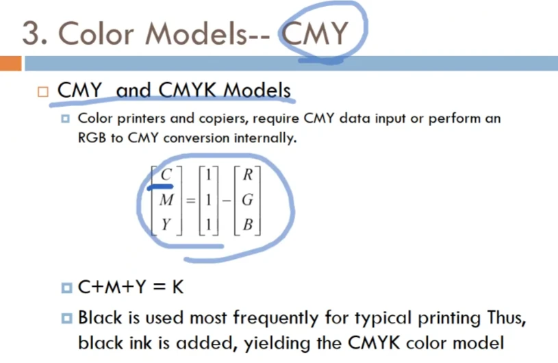

    - Black은 가장 빈번하게 사용되는 Printing Color이기 때문에, CMY에 추가하여 CMYK로 사용하게 된다.

- HSI(Hue, Saturation, Intensity)

    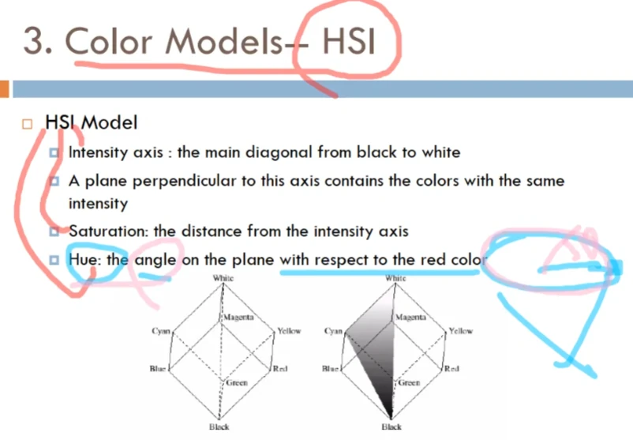

    - Hue는 위의 그림처럼 각도로 표현된다. (원뿔의 각도)
    - Saturation은 채도이다. (원뿔의 반지름)

    - Intensity는 밝기이다. (원뿔의 높이)

        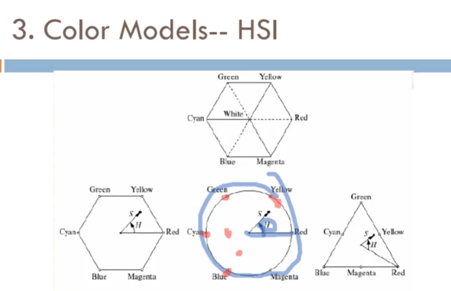

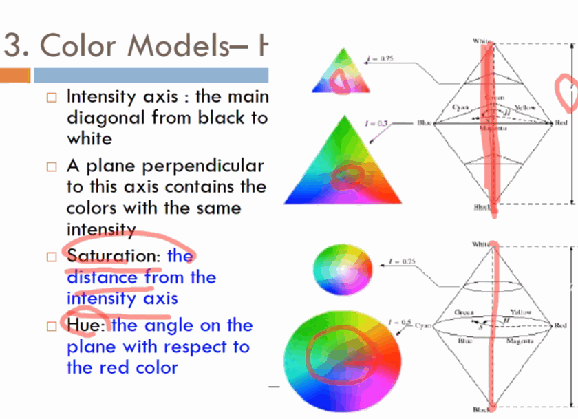

---

- RGB to HSI (변환)

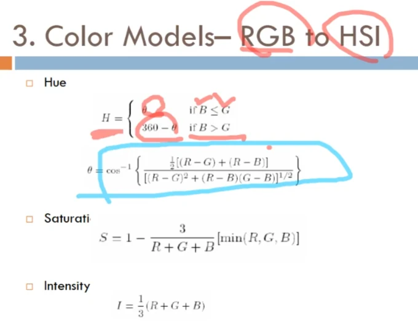

- HSI to RGB (변환)

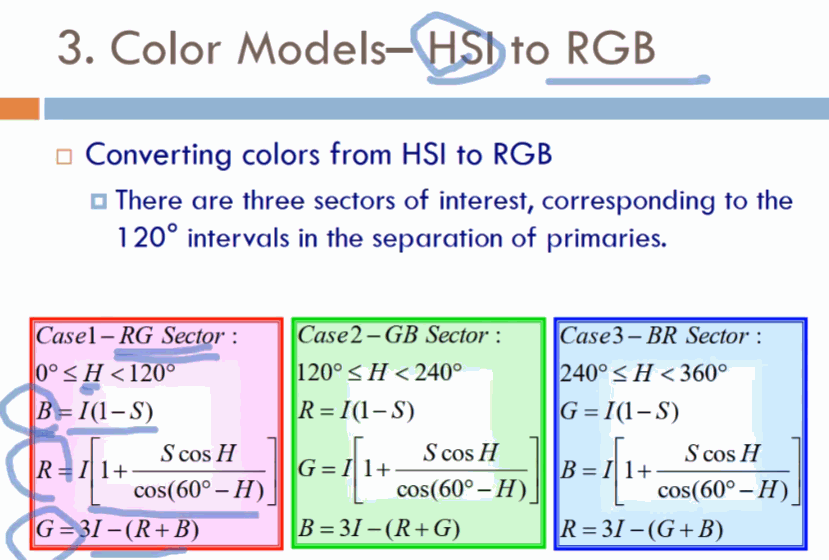

---

- RGB의 문제점 : 사람은 밝기에 민감하고, 컬러에 둔감하다. RGB는 밝기와 컬러가 분리되어 있지 않은데, PAL의 YUV, NTSC의 YIQ 등으로 바꿔줄 수 있다.

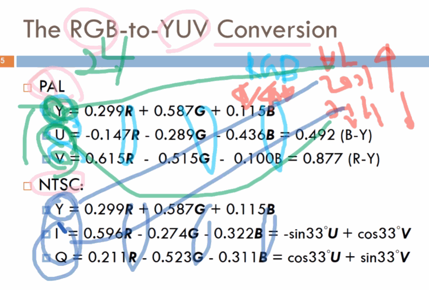

---

## QCIF 영상의 파일 구조

- QCIF 영상은 4:2:0의 파일 구조를 가지게 된다. (176\*144)

    - 176\*144를 하면, 25344가 나오게 되는데, RGB를 Y, Cb, Cr로 바꾸게 된다.
    - 이때 Y의 크기는 25344가 되고, Cb, Cr은 압축을 하게 된다. 이 사이즈를 1:4로 압축하게 된다.
    - 즉, 25344/4인 6336이 Cb가 되고, Cr이 된다.

    - 이것이 가능한 이유는 사람은 Luminance에 민감하고 Color에 둔감하기 때문이다.

        - Cb, Cr은 Color 성분이다.

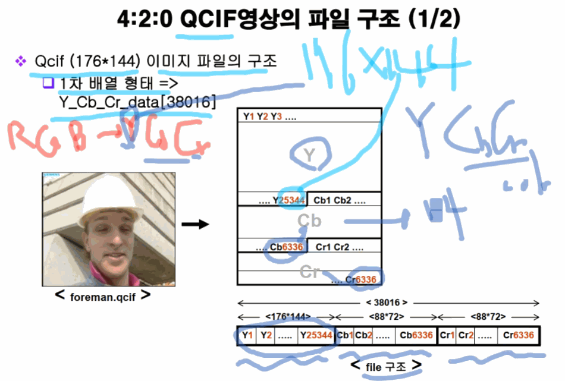

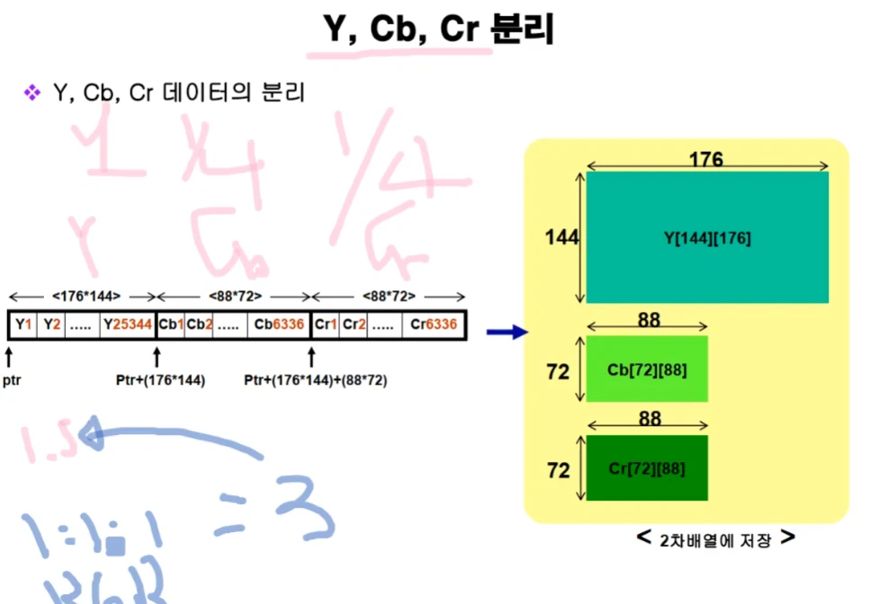

- 1:(1&#47;4):(1&#47;4) 의 비율을 갖게 되는데, RGB는 1:1:1이다. 즉, RGB보다 50%가 감소하게 되는 것.
- 이는 압축이 일어난 것이라고 볼 수도 있을 것이다.

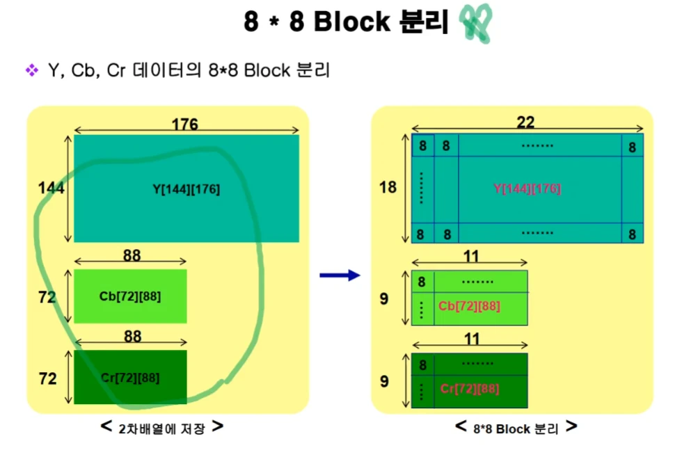

- 모션 예측(Motion Estimation)과 모션 보상(Motion Compensation)은 16 x 16 (Macro Block)이 가장 좋다.
- 하지만 8 x 8은 DCT에 사용되는 기본 블록이다. (Block) DCT(Discrete Cosine Transform)에 사용.
- QCIF영상을 8 x 8 Block으로 나누게 되면, Y는 22 x 18로 바뀌게 되고, Cb, Cr은 11 x 9로 바뀌게 된다.

---

- DCT (Transform Coding)

    - Compaction Efficiency : DCT 변환을 하게 되면 에너지가 한 쪽으로 모이게 되고, 덜 중요한 에너지는 반대쪽으로 모이게 된다. 즉, 중요한 에너지가 한 쪽으로 모이게 되므로 그 곳을 중요하게 코딩하고, 반대쪽은 대충 코딩하거나 아예 0으로 만들어버려도 문제가 되지 않는 방식이다.

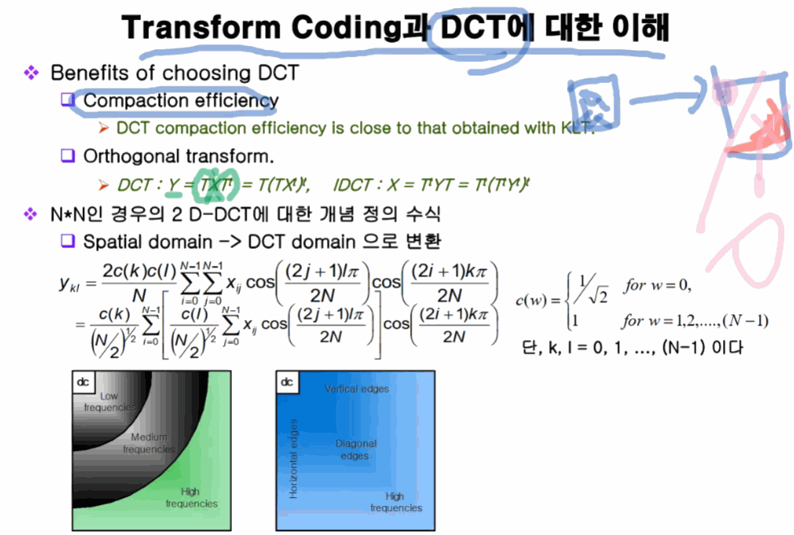

- DCT : Y = TXT\^t ⇒ T(TX\^t)\^t
- IDCT : X = T\^tYT = T\^t(T\^tY\^t)\^T
- 우리가 다루는 Block의 크기는 8 x 8이기 때문에, N = 8이다.
- 위의 복잡한 공식을 거치고 나면, DCT 변환이 이루어져서 영상의 중요한 성분인 DC 성분이 좌측 상단에 존재하게 되고, 중요하지 않은 것은 (AC) 우측 하단에 존재하게 된다.

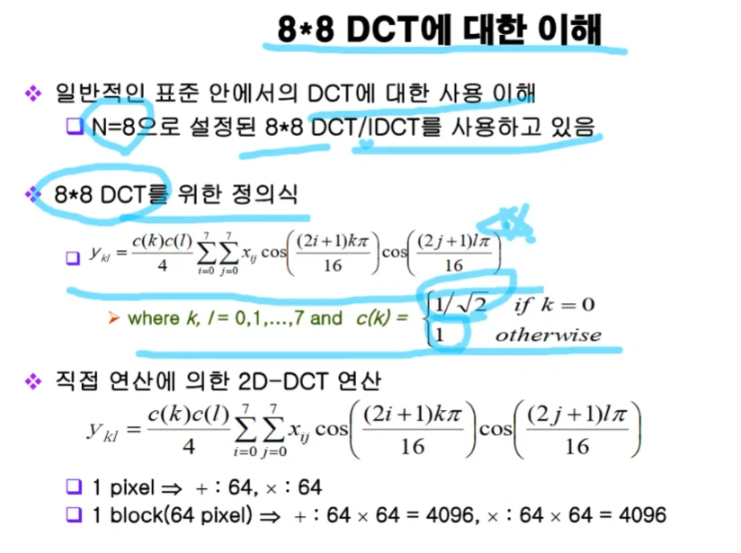

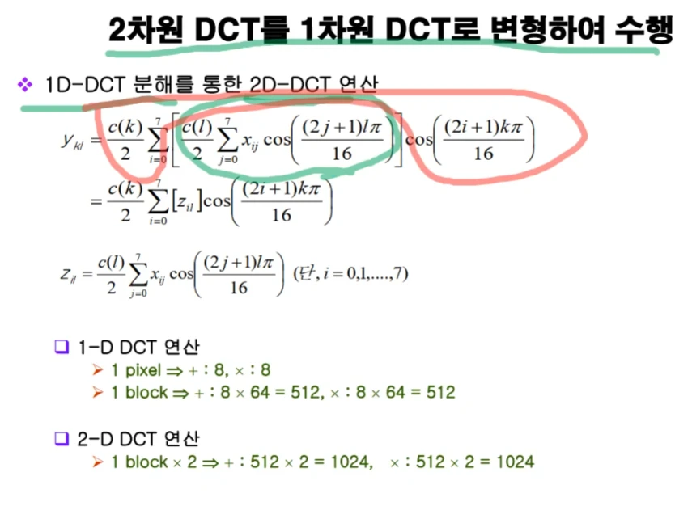

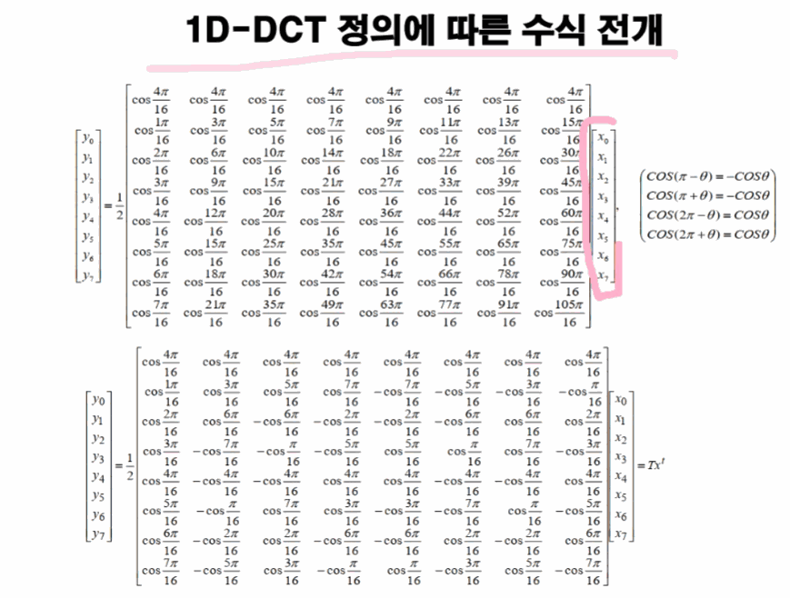

---

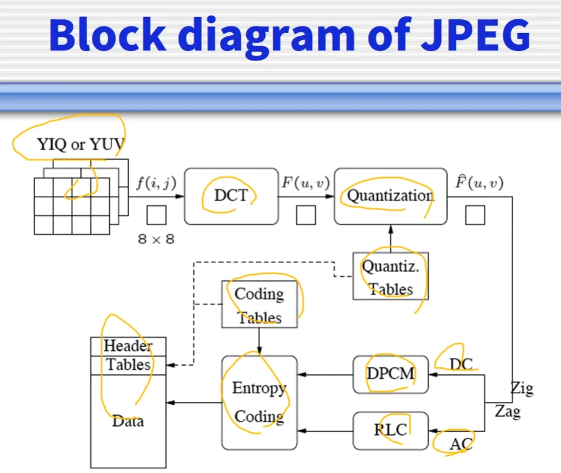

- YIQ : NTSC 방식, YUV : PAL 방식, JPEG은 정지 영상이다.
- 이것을 8 x 8로 쪼갠다.
- f(i, j)는 8 x 8의 작은 영상이고, Y일 수도, Cb, Cr일 수도 있다.
- 이제 DCT를 한다. F(u, v)는 DCT된 결과이고, 에너지가 좌측 상단으로 모인 그림이다.
- Quantization을 하면 Quantization Table을 사용(제공됨)한다.
- 이것을 코딩할 것인데, 첫 번째 픽셀은 DC이고, 나머지 픽셀들은 AC이다.
- 첫 번째 픽셀만 **DPCM**(Differential Pulse Coding Modulation)을 통해서 코딩이 된 것에 대해 Entropy Coding(Huffman, Dictionary, Arithmetic 등의 무손실 압축을 적용)을 적용하여 출력을 낸다.
- 나머지 63 픽셀은 RLC(Run Length Coding)을 통해서 코딩을 한다.
- JPEG(Joint Photographic Experts Group : 제이펙은 정지 화상을 위해 만들어진 손실 압축 방법 표준이다.)

- JPEG 압축과정의 실례

    - 우선 각 픽셀의 RGB 데이터를 YCbCr (or YIQ or YUV)라는 `다른 색공간 데이터로 변환`한다. 이 색공간은 NTSC나 PAL 방식의 컬러 텔레비전 전송에 쓰이는 색공간과 유사하다.
    - Y는 Luminance 성분, Cb, Cr은 Chroma 성분이다.

    - 이 과정에서 Y는 최선을 다해서 코딩하고, Cb, Cr은 대충 코딩한다. 왜냐면, 사람 눈은 Color에 둔감하므로 `크로마 서브샘플링`을 이용해서 `Cb, Cr의 성분의 수를 줄이기도 한다.`  

        `(다운샘플링)`

---

## 색공간

- CMYK : Cyan, Magenta, Yellow, Black

    - Cyan, Magenta, Yellow를 섞으면 Black인데, Black이 많이 쓰여서 굳이 섞어서 쓰면 잉크가 낭비되므로 Black은 따로 추가한다.

- HSV(HSI) : Hue, Saturation, Value(Intensity)

    - Hue : 색상을 알아낼 수 있음. (원뿔의 각도)
    - Saturation : 채도를 알아낼 수 있음. (원뿔의 반지름)
    - Value(Intensity) : 밝기(명도)를 알아낼 수 있음. (원뿔의 높이)

---

- JPEG Encoding Overview

    - Transform RGB to YUV or YIQ and subsample color
    - DCT on 8 x 8 image blocks
    - Quantization
    - Zig-Zag ordering and Run-Length Encoding
    - Entropy Coding

- DCT on Image Blocks 1

    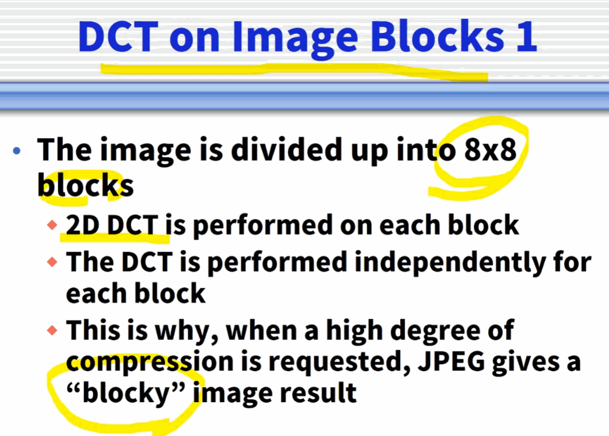

- DCT 이후 Quantization. Table이 제공되면 나눠서 구함.

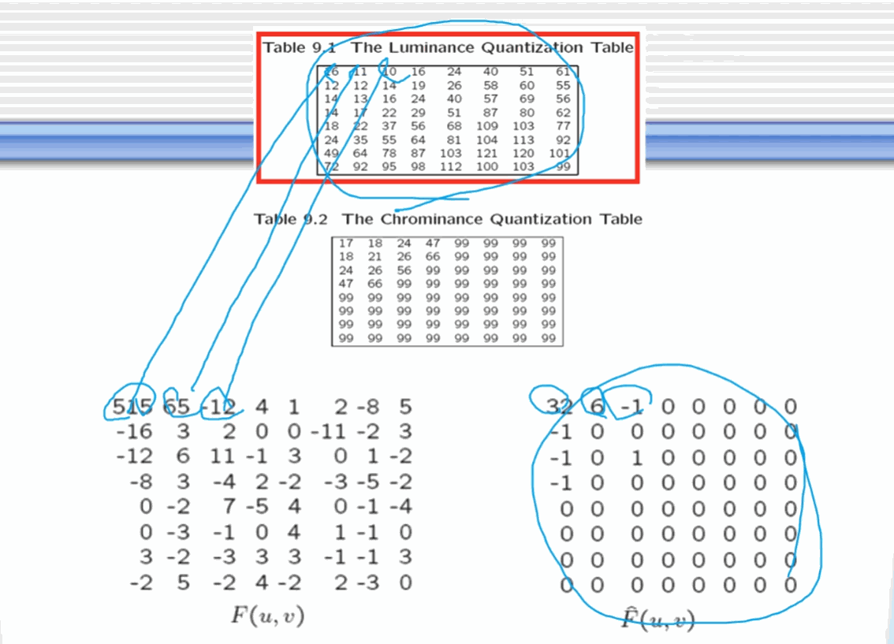

---

## Wavelets Transform

- Waves and Wavelets

    - Wave는 파장, sin파 등을 말한다.
    - Wavelets, 뒤에 let이 붙으면 작다는 뜻인데, (pig + let. piglet 처럼.)
    - Wavelet의 아이디어는 Wave의 컨셉을 유지하면서 Periodicity. 주기성을 없앤 것이다.

- Dilate

    - x: f(2x) ⇒ signal의 수축
    - x: f(x/2) ⇒ signal의 팽창

- Translate

    - x: f(x-2) ⇒ x방향으로+2만큼 이동했다.
    - x: f(x+3) ⇒ x방향으로 -3만큼 이동했다.

- 이와 비슷하게 function에 상수를 곱해서 signal의 크기를 더 키우거나 줄일 수도 있다.

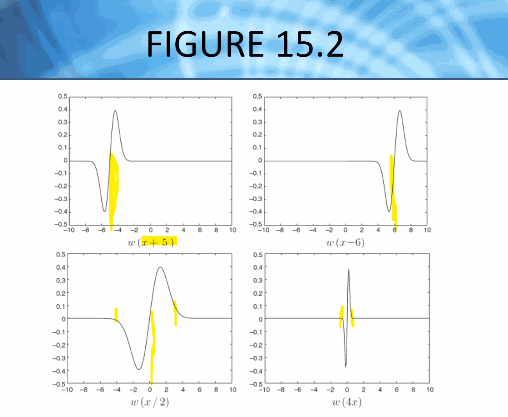

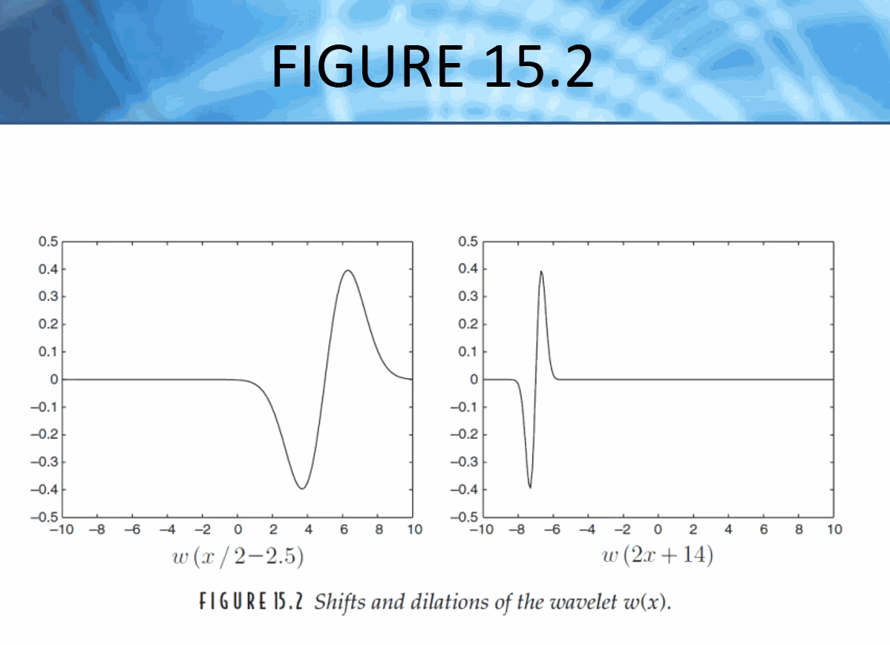

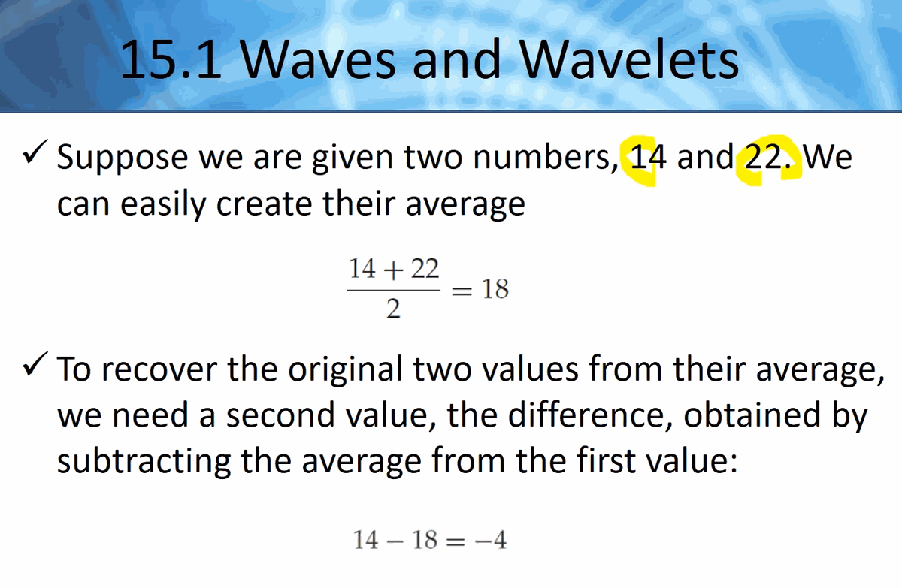

- 두 수 14, 22가 있다면 평균을 구하면 18이다.
- 이때 14에서 평균을 빼면 -4인데, 이때 평균에서 -4를 더하면 Original 값이 나오고, -4를 빼면 더 큰 Original 값이 나오게 된다.

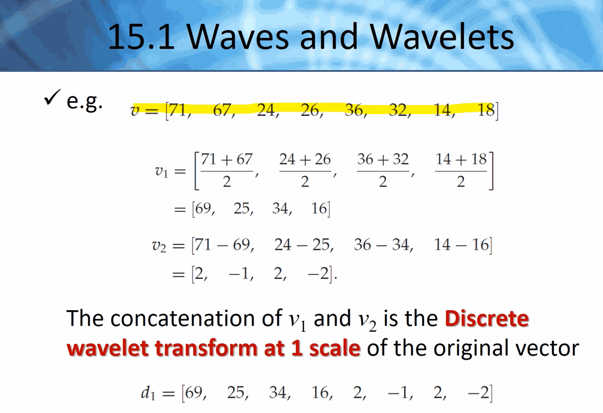

- Original 값들을 두 개씩 묶어서 평균을 구해보자. 그러면 v1이 나오게 된다.
- Original 값에서 평균값을 빼면 v2가 나오게 된다.
- v1에 대해서 v2를 빼고, 더하면 기존 값이 나오게 된다.
- 두 번째 step : 69, 25, 34, 16에 대해서 이전과 같이 두 개로 묶어서 평균을 구한다.

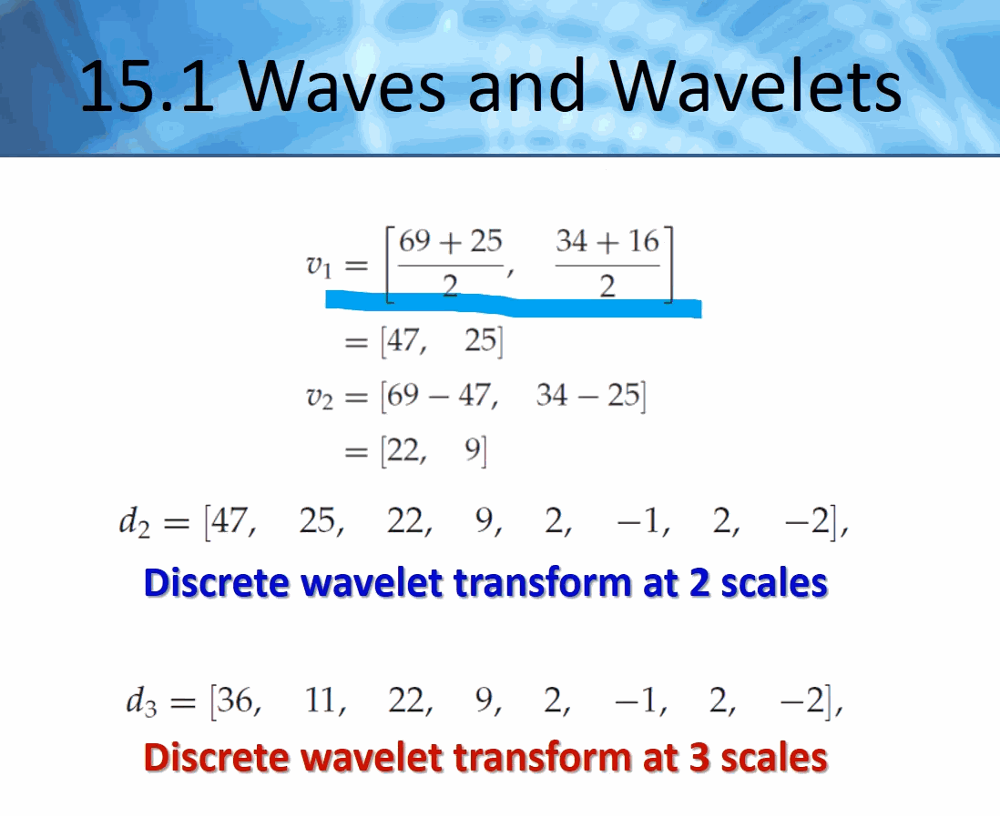

- 그 뒤, 똑같은 방식으로 v1, v2를 구해낸다.
- 이번에는 새롭게 구해진 47, 25에 대해서 wavelet transform을 적용한다.
- 그러면 d3가 구해지게 된다. (세 번째 스케일)
- 이제 이걸 Recovery 한다.

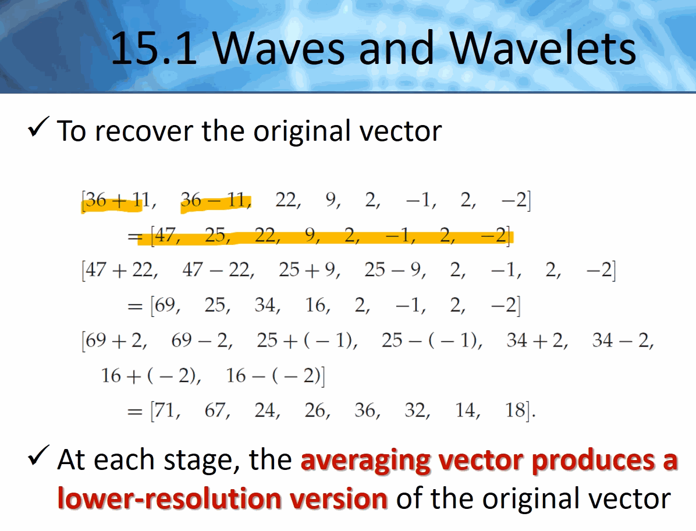

- 이전의 3차 스케일에서 Original 값에 특정 Threshold를 주면 압축이 된다.

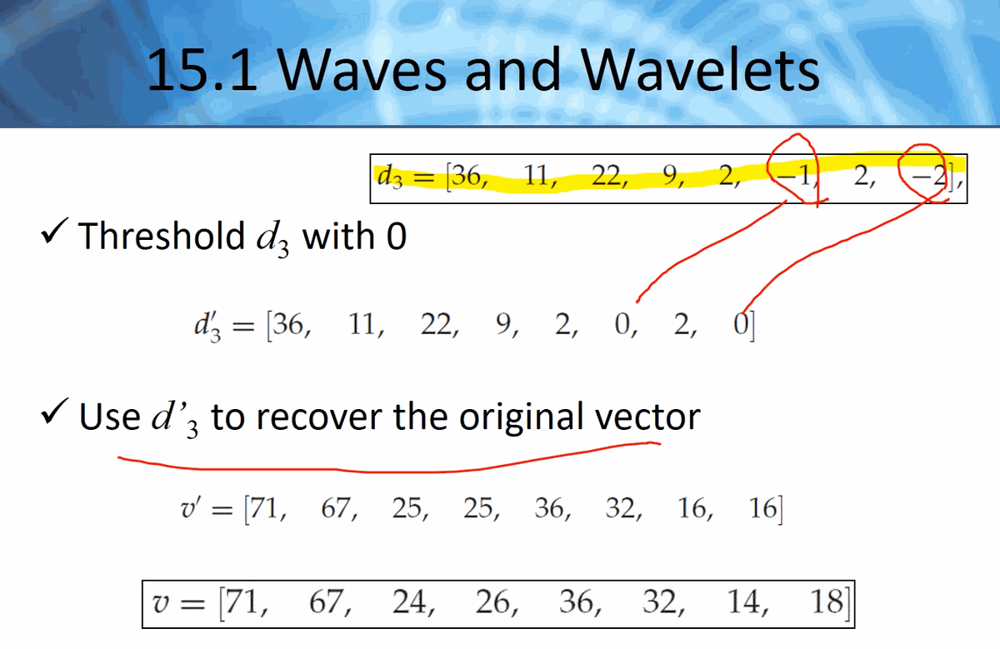

- -값을 0으로 바꾸게 되면, 값이 약간 차이가 생기게 된다. 압축이 되면서 데이터에 손실이 약간 발생하게 된다.
