# What is Image Processing?

## &lt;1.1 Images and Pictures&gt;

- 컴퓨터가 영상을 처리하는 것은 비전, 사람이 처리하는 것은 영상처리

- 사람은 색깔은 빠르게 구분할 수 있는 능력이 있다.

    - 우리는 많은 양의 시각 정보를 매우 빠르게 처리할 수 있다.

## &lt;1.2 What Is Image Processing?&gt;

### Image Processing

- 영상처리란, 영상의 특성이나 요소 등을 바꿔보자는 것이다.

    - 사람이 해석하기 좋아야 한다.

        - 그러므로 밝으면 어둡게, 어두우면 밝게 바꿔야 하며, 흐리면 선명하게 바꿔준다.

    - 기계가 인식할 수 있는 영상을 만들어 낸다.

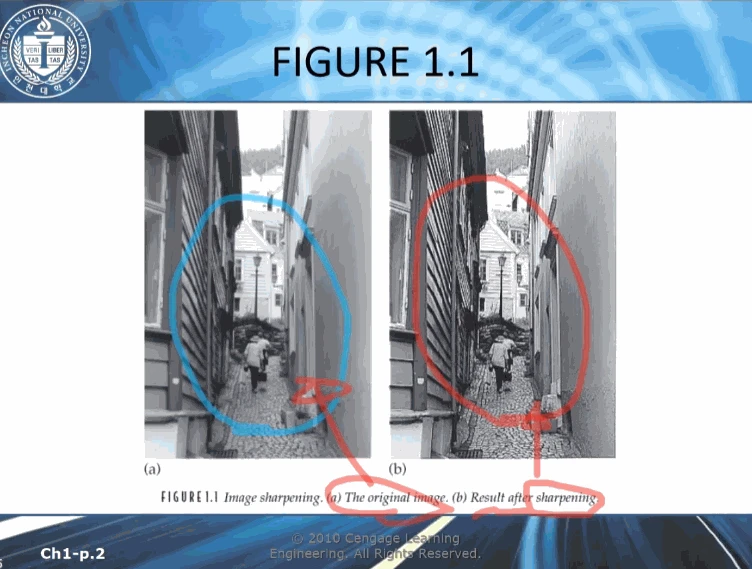

- 왼쪽 영상이 원본 영상이고, 오른쪽 영상은 원본 영상을 더욱 뚜렷하게 만드는 unsharp-masking이 처리된 영상이다. ⇒ 영상 처리의 좋은 예시

- 영상을 좋아지게 한다는 것은 어떤 의미인가?

    - 최대한 영상이 원본과 비슷해지도록 만드는 것이다.
    - 그러나, 노이즈가 많은 환경이나 한밤 중에 영상을 찍는다면, 영상이 오리지널 영상이지만 화질이 좋지 않을 수도 있다.

### Condition 1

- Condition 1 : Enhancing the edges of an image to make it appear sharper

### Performance Assessment

- **Objective Performance Comparison**(객관적인 성능 평가)

    - *Peak Signal to Noise Ratio* (PSNR) : 영상에서 MAX 값은 255이므로, MSE가 중요함.

    - *Mean Squared Error* (MSE) : 모든 픽셀에 대해서, 오리지널 픽셀에서 복원된 픽셀(처리된 픽셀)을 뺀 것을 제곱한 것이다. 제곱을 한 이유는 양수로 만들기 위해서이다.

    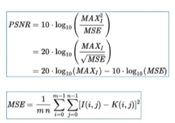

> 그런데 원본 영상 자체가 완벽한 영상이기 힘들기 때문에 PSNR은 절대적인 성능 평가 요소로 사용될 수는 없다.

- **Subjective Performance Comparison**(주관적인 성능 평가)

    - Visual Performance Comparison : 눈으로 보고 평가하기
    - Voting System : 영상을 보여주고 더 나은 영상 투표하기
    - Structure Similarity (SSIM)

    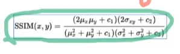

### Median Filter

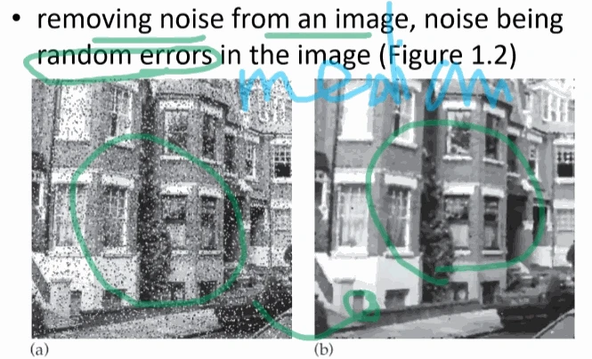

- **Median Filter** : Original 영상에 Noise가 많을 때, Noise를 제거하는 역할을 해주는 Filter

### Removing Motion Blur

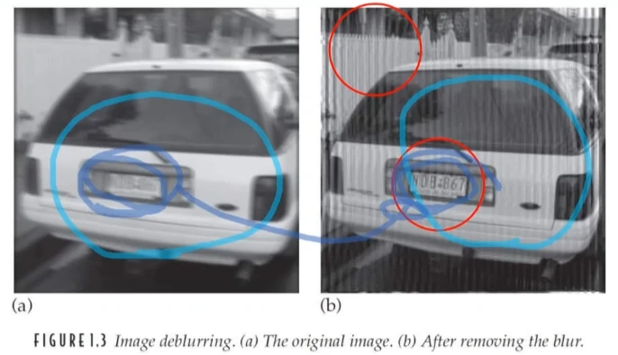

- 사진을 찍을 때 움직여서 생기는 흐릿한 이미지에서, 흐릿함을 제거하고 선명하게 만들 수 있다. 
- 이것은 Frequency Domain에서 다룰 수 있다.

### Condition 2

- Obtaining the edges of an image : Edge를 구해야 한다.

    - 영상의 Edge를 갖고 있다면, 영상에 대한 특성을 파악하기가 굉장히 쉬워진다.

- Edge Detection Algorithm도 굉장히 중요한 요소가 되고, Edge를 개선하는 것도 영상처리의 주요 영역 중 하나이다.

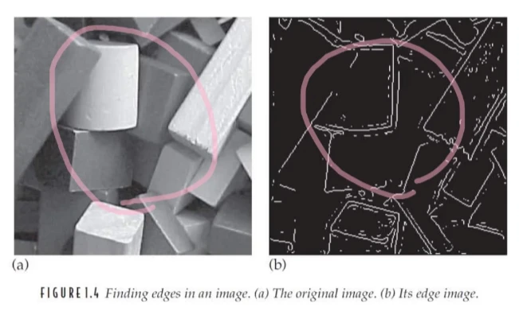

- Edge 검출 이미지 : High Pass Filter를 통해 가능하다. 

- 좌측 이미지는 8bit 이미지이고, 우측 이미지는 Binary Image이다.

    - 만약 영상에 나온 물건의 개수를 세는게 목적이라고 한다면, 두 영상의 차이는 크게 없다고 볼 수 있다.
    - 만약 우리가 사이즈를 알아내는 것이나 동물의 형태 등을 알아내는 것이 목적이라면, 불필요한 디테일은 없어도 된다.

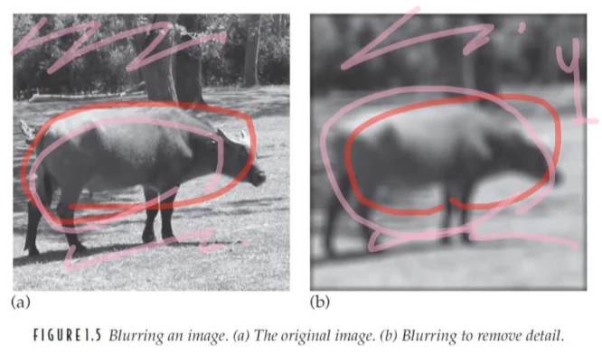

다음과 같은 이미지에서 소가 몇 마리인지 세는게 목적이라면, 배경은 굳이 필요하지 않음.

## &lt;1.3 Image Sampling and Acquistion&gt;

### Sampling

- Sampling이란, Continous Function을 Digitizing 하는 것이다. 즉, 연속 함수를 Digital로 만드는 것이 Sampling이다.

$$
y = sin(x) + \frac{1}{3}sin(3x)
$$

- 10개를 Sampling 한 것

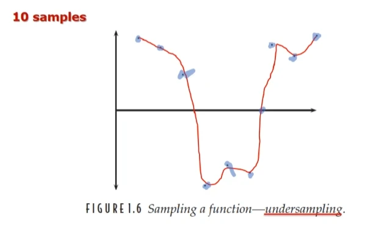

⇒ 이것만 가지고는 Original Signal을 예측하기 쉽지 않다. (**Undersampling**) 즉, 샘플 개수가 충분하지 않다는 것이다.

- 100개를 Sampling 한 것

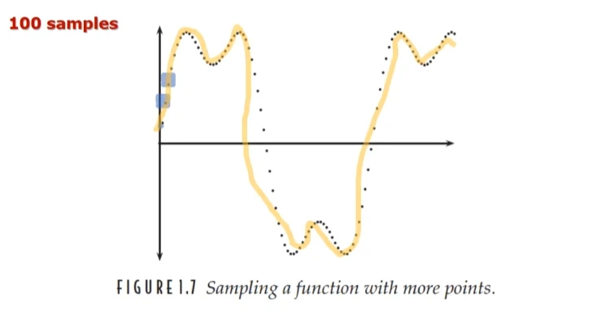

⇒ 충분히 Sampling이 되었기 때문에 Original Signal 복원이 가능하다.

> 즉, Sampling 할 때는 샘플의 개수를 충분히 두는 것이 중요하다.

### Nyquist criterion

- Digital Signal로부터 Continous Function(아날로그 시그널)을 복원하고자 한다면, Sampling Frequency는 최소한 최고 주파수의 두 배 이상이 되어야 한다.

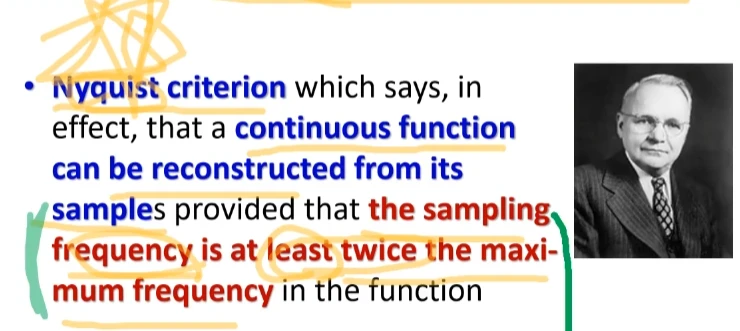

### Nyquist-Shannon Sampling Theorem: Aliasing

- Aliasing : 간섭의 의미를 갖기도 함.

- Spatial Domain

    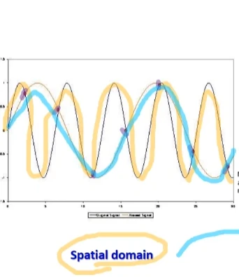

만약 Original Signal이 주황색이고, 샘플링 레이트가 보라색 점에 대해서 적용되었을 때, 이 시그널을 어떻게 복원해야만 할까? ⇒ 파란색이 이어진 신호가 될 것. 이럴 경우 샘플링이 충분하지 않기 때문에 이어버리는 것이 문제가 된다는 것.

- Frequency Domain

    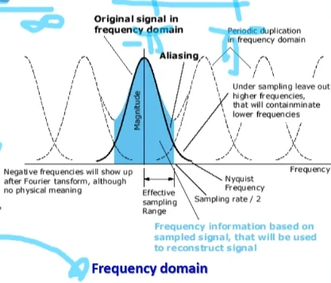

아날로그 신호에서는 Frequency axis에서 -무한대부터, +무한대까지 모든 신호가 나타날 수 있다. 하지만 샘플링을 하는 순간, -π부터 +π 안으로 모든 정보가 압축되어 길게 나타내어 진다.

이때, 압축되어진 영역의 면적은 압축되기 전과 후가 같다.

- Original Signal이 빨간색이고, 샘플링이 충분하지 않을 경우 파란색으로 복원이 된다.

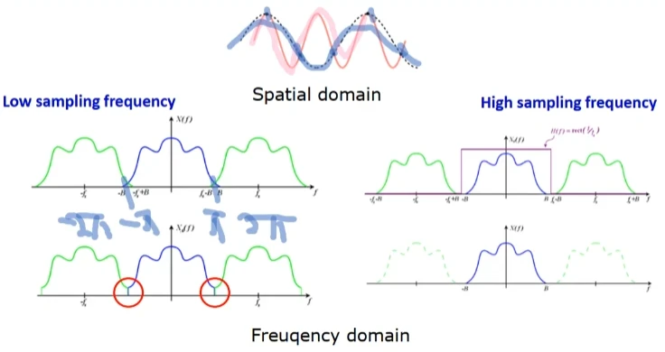

만약 Sampling Rate가 충분하지 않다면, 복원되는 신호가 다소 넓게(왼쪽 이미지) 만들어지고, Sampling Rate가 충분하다면 다소 좁고 길게(오른쪽 이미지) 만들어진다. 이 경우, Low Sampling Frequency(왼쪽 이미지)에서는 중간 중간 신호끼리 겹쳐지는 현상인 **Aliasing**이 발생하게 된다.

⇒ 이런 것에 의해서 Error가 발생한다. 반면 High Sampling Frequency는 Error가 거의 없다.

- Aliasing의 예시

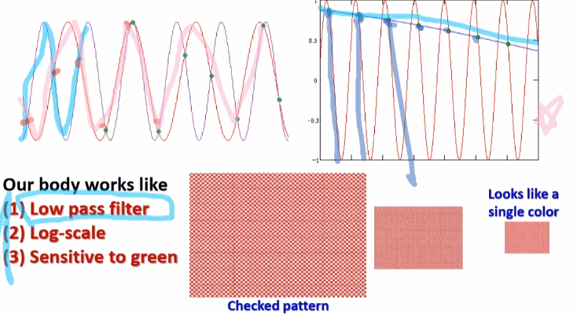

- 원본 신호는 파란색 신호인데, 샘플링이 충분하지 않아서 이어버렸을 때 분홍 신호가 나온다.
- 오른쪽 신호에서는 복원 신호가 직선으로 나오게 될 것이다.
- 사람은 다음 네 가지 특성으로 동작한다.

    1. Low Pass Filter : Frequency가 저주파이다. 섞어서 보는 역할을 해서, 위에 나온 Checked Pattern에 적용하면 Single Color처럼 보인다. 그래서 High Pass Filter처럼 구분해서 보기 보다는 합쳐서 보게 된다.
    2. Log-Scale : 사람은 음악을 들으면 주파수가 로그 스케일로 늘어난다.
    3. Sensitive to Green : 사람은 빨간색이나 파란색보다 초록색에 민감하다.
    4. 색상보다는 밝기에 민감한다.

### Low Pass Filter

Signal을 특정 frequency 이하로는 통과시키고 그 위로는 0으로 만드는 filter이다. 

- 고주파 : 변화가 많은 신호
- 저주파 : 변화가 적은 신호

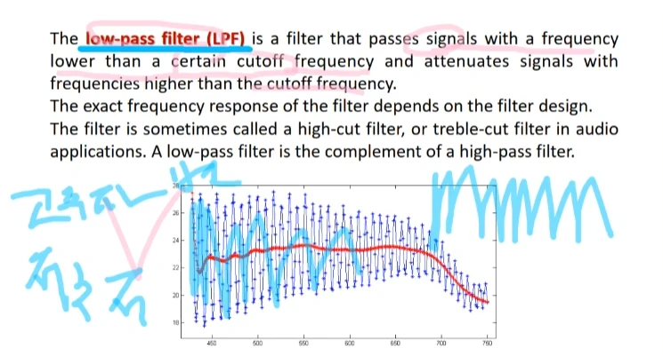

이 신호를 Low Pass Filter에 통과시키면 변화를 줄이게 되는 것이다. 가장 대표적인 것은 **평균 필터**를 사용하는 것이다.

- Examples of aliasing

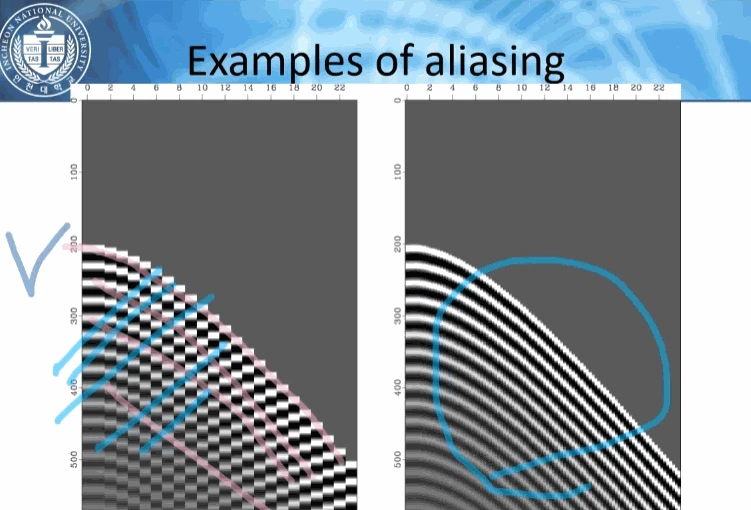

원본은 오른쪽 이미지였는데, 샘플링이 충분하지 않아서 왼쪽 이미지처럼 aliasing이 나타났다.

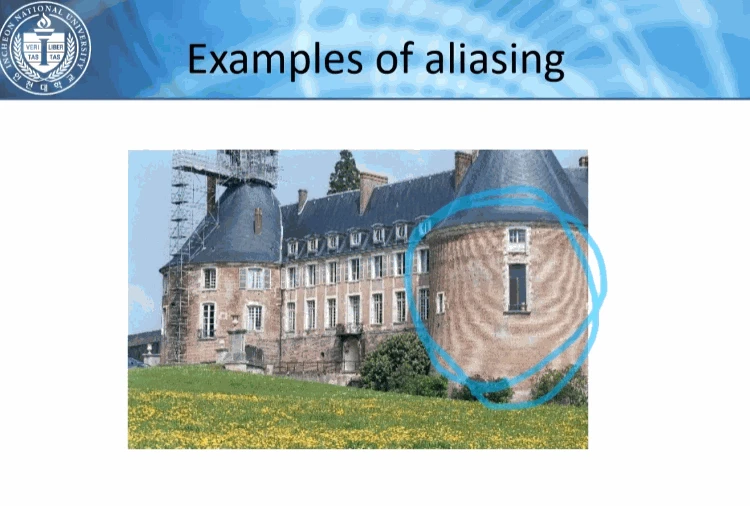

또다른 aliasing의 예시

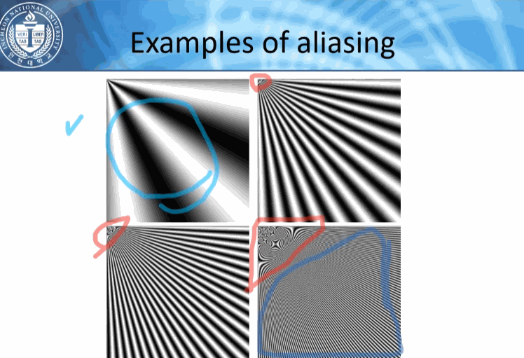

빨간 영역에 점점 aliasing이 추가되고 있음. 파란 영역은 aliasing이 나타나지 않은 부분. 빨간 영역은 좁은 공간 안에 충분한 샘플링이 들어가지 않아서 문제가 생기는 것이라고 할 수 있다.

> 따라서 aliasing을 막기 위해서는 샘플 개수를 충분하게 만들어야 한다.

- Anti-aliasing

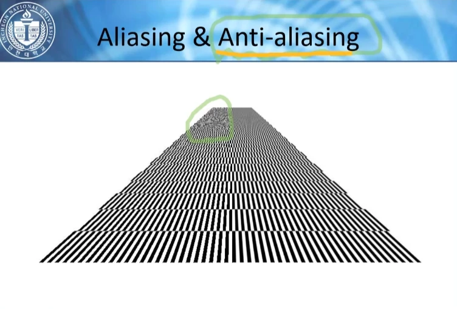

샘플을 충분히 만든 것을 Anti-aliasing이라고 한다.

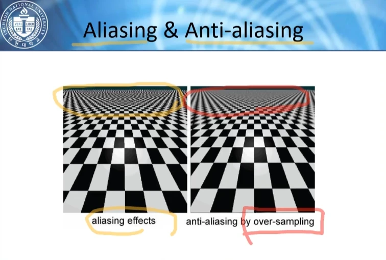

over-sampling을 통해 aliasing 제거

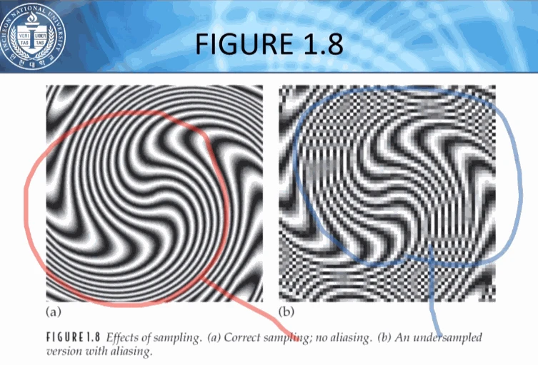

under-sample을 over-sample로 만드는 것이 중요하다.

### Image Acquisition

- CCD Camera : 카메라를 통해서 영상을 획득하는 것 (CMOS, CCD 센서 등을 통해 입력되는 영상의 밝기를 측정할 수 있음.)

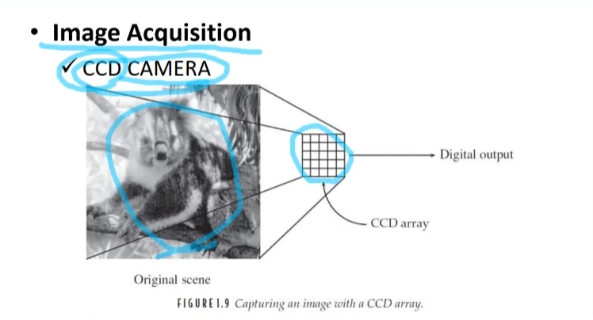

- Scanner

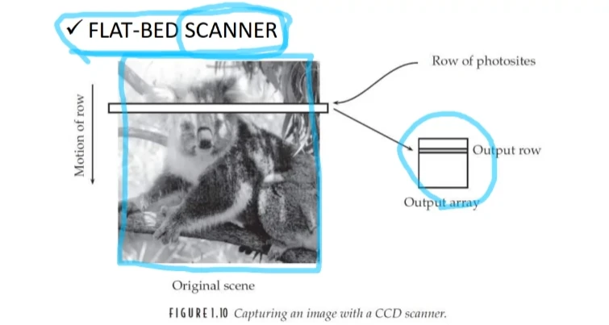

- Other energy sources

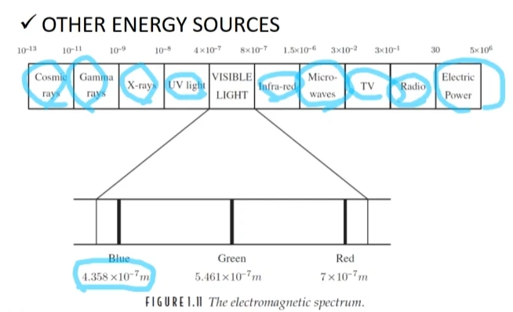

← 자외선, 가시광선, 적외선 → 

파란색, 빨간색 영역은 자외선과 적외선 영역에 겹쳐서 볼 수 있는 영역이 많지는 않다. 그래서 초록색 영역을 가장 많이 볼 수 있다.

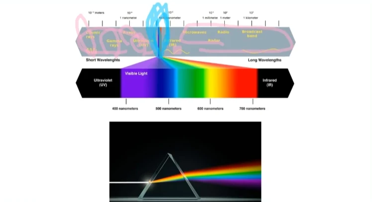

---

## &lt;1.4 Images and Digital Images&gt;

- 영상은 이차원 시그널이다.

$$
f(x, y)
$$

- 비디오는 시간에 따른 영상의 집합이다. 따라서 비디오는 삼차원 함수이다.

- 영상은 밝기(Brightness)를 여러 가지로 나타낼 수 있다.

    - 0~1 : 밝기값을 255로 나눠서 소수로 나타낸 것
    - 0/255~255/255(1) : 밝기값을 255로 나누고 분수로 나타낸 것
    - 0~255 : 밝기값을 정수로 나타낸 것

- 0~255, 혹은 1~256까지의 값으로 나타낼 수도 있음. 다만, 일반적으로는 0~255를 사용

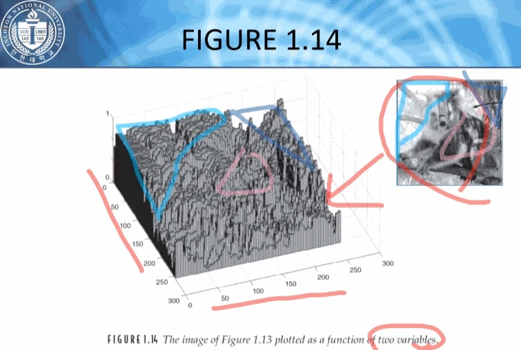

- 특정 영상을 3차원으로 그릴 수도 있다.

- 디지털 이미지는 sample된 point들의 다수의 배열이라고 볼 수 있다.

    - 이를 **pixels** (또는 pels) 라고 한다.
    - 한 pixel이 있다면, 그 pixel 주의의 pixel 들을 **neighborhood**라고 한다.

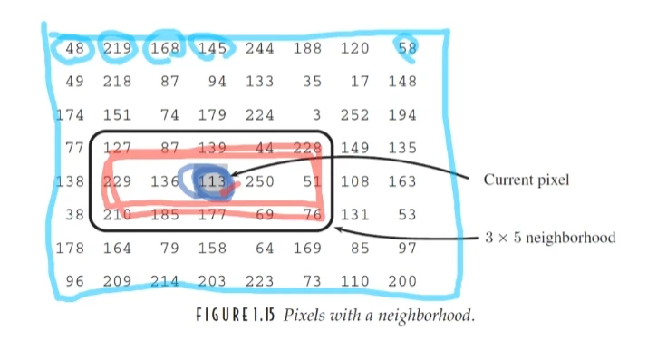

### Filtering Approach

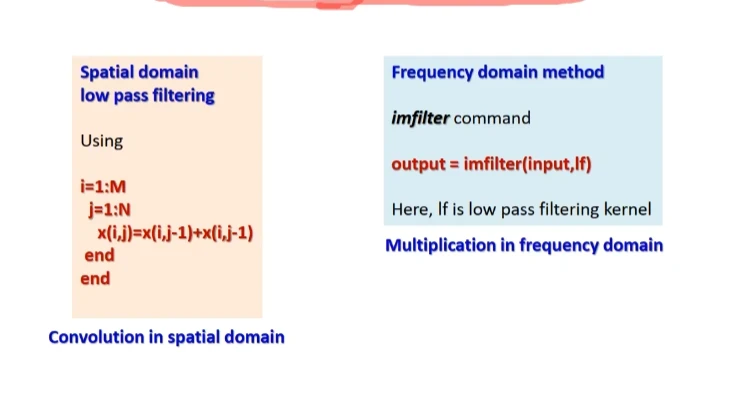

- 영상이 있을 때 noise filter를 통과시키면, noise가 낀 영상이 되고, denoise filter를 넣으면 noise가 없어진 영상이 된다

    - 공간 domain에서의 filtering은 convolution(for문)으로만 이루어진다.
    - 하지만 주파수 domain에서의 filtering은 단순한 곱하기이다.
