# Color Types and Data Types of Image

작성일 2023-10-03 · 최종 수정일 2023-12-05
{ .post-date }

## &lt;2.1 Image and Matlab&gt;

- imread : 이미지를 읽어온다.

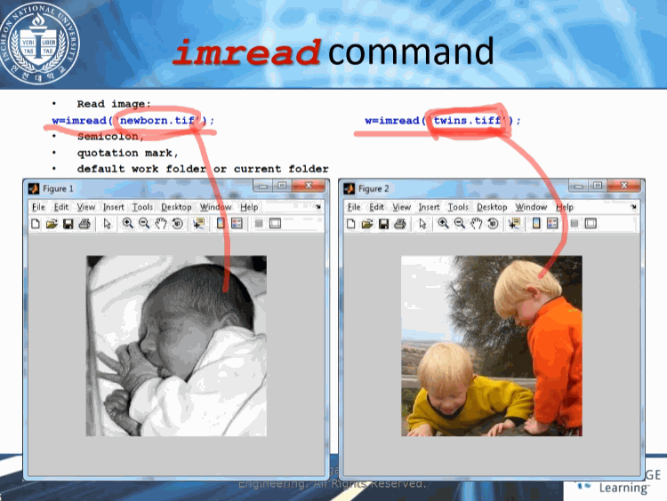

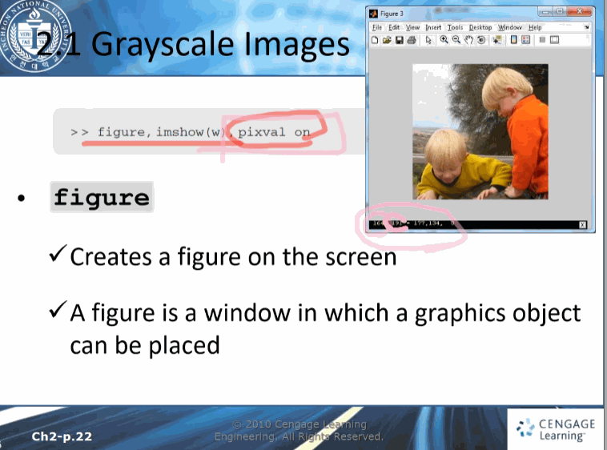

- imshow : imread를 통해 읽어온 이미지를 출력한다.

- pixval on : pixel value를 영상에서 켠다.

    - column number, row number = pixelValue

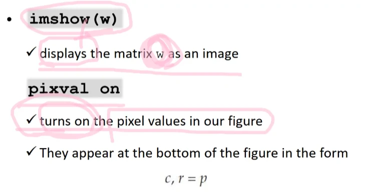

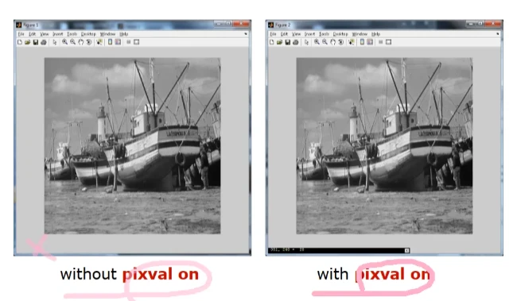

- whitebg(’g’), whitebg([0 1 0]) 등을 통해 배경 색깔 변경 가능

    - Cyan, blue, white, magenta, yellow, red, black 등으로도 변경 가능

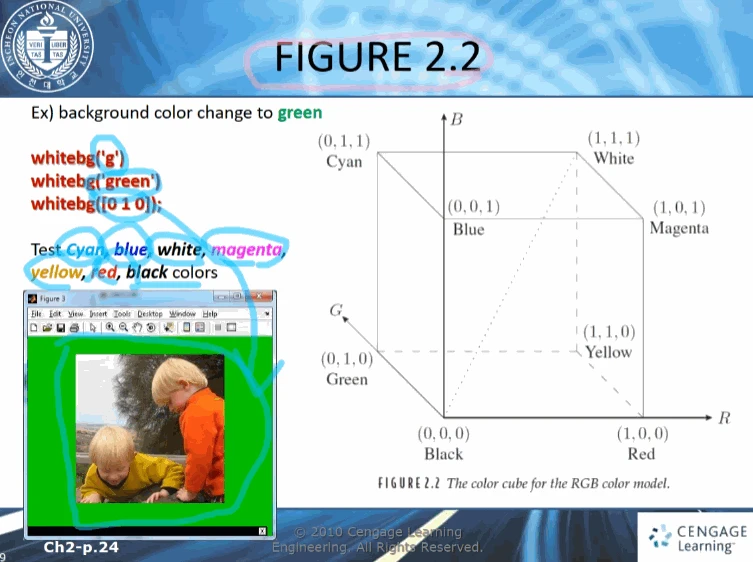

- 어떤 색깔을 섞느냐에 따라 색깔을 만들 수 있음.

---

## &lt;2.2 RGB Images&gt;

### 영상의 R, G, B

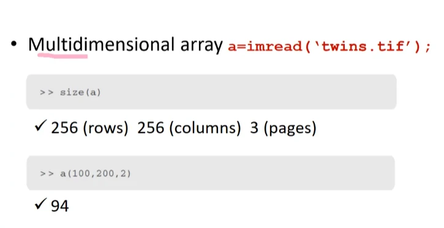

- twins.tif라는 영상을 읽어서 a라는 변수에 넣으면 a의 사이즈는 256\*256\*3이 된다.

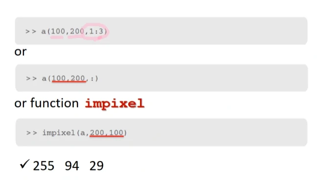

- 100번째 행, 200번째 열의 컬러 정보가 뭐냐라고 쓰면 a(100, 200, 1:3)으로 써도 된다.
- 혹은 a(100, 200, :)으로 써도 된다. (콜론은 모두 포함시키는 것을 의미함)
- impixel(a, 200, 100)을 하면, R, G, B 값을 출력해준다.

### Color

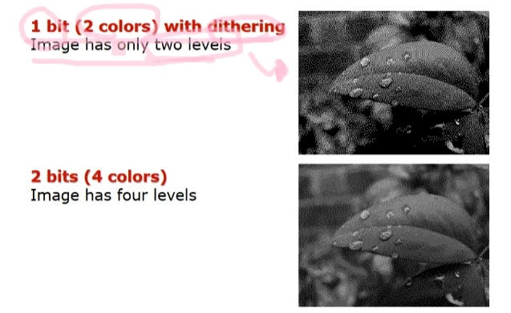

- **dithering** : 흑/백에서 색의 강도를 조절하여 더욱 생동감있는 영상을 만드는 방법. 잉크를 적게 쓰면 밝은 부분 위주로 나타나게 되고, 많이 쓰면 어두운 부분까지 나타나게 된다.

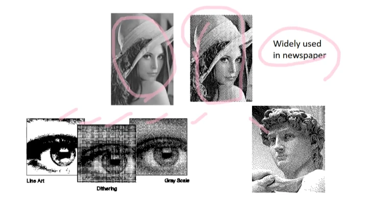

### Color (Indexed Color)

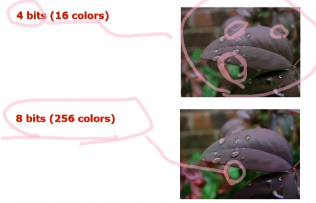

- Indexed Color는 많이 사용되는 색상을 테이블로 저장해두어서 사용하는 방식이다. 4 bits에서는 비슷한 Color를 찾지 못해 오류가 나는 부분이 존재하지만, 8bits에서는 대부분 올바르게 처리된 것을 확인할 수 있다.
- 8-bit color

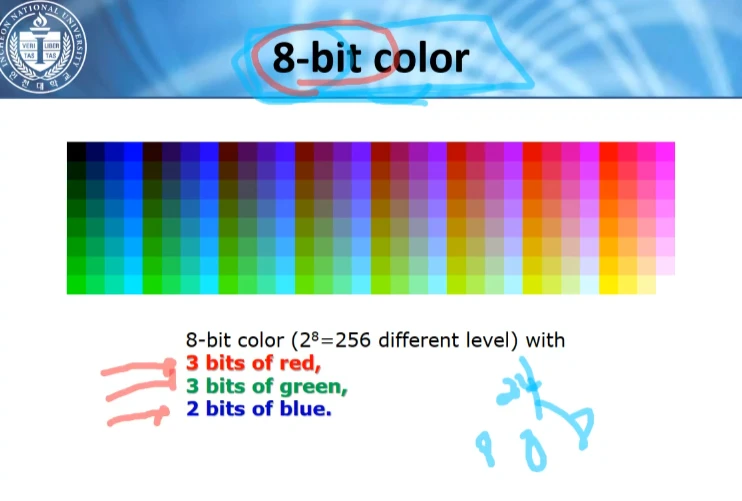

8bit를 사용한다면, 위와 같이 bit를 분배할 수 있다.

- High color (15/16-bit)

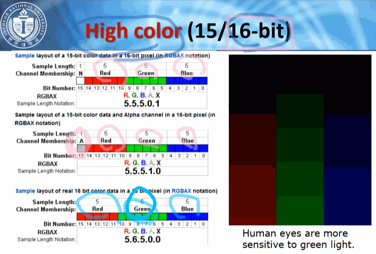

High Color라는 방식은 16bit를 사용하며, 세 가지 방법을 사용한다. 사람의 눈이 그린에 좀 더 초점을 두기 때문에, 그린에 많은 비트를 설정하는 방법이 있다.

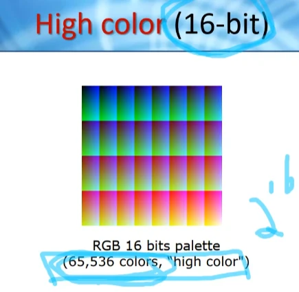

High color는 16bit를 사용하여 65,536개의 color를 구현할 수 있다.

- True Color (24-bit), Deep Color (30/36/48-bit)

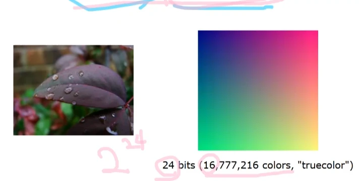

---

## &lt;2.3 Indexed Color Images&gt;

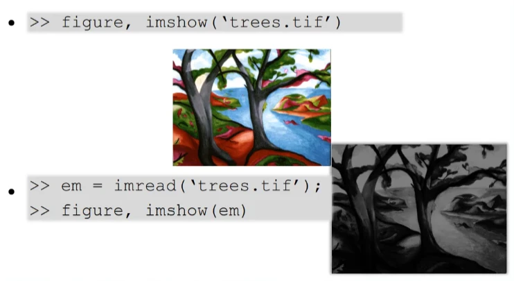

- trees.tif가 Indexed Color인지 알려면 header를 읽어야 한다. 지금은 안다고 가정해보자.
- imread로 읽고 display를 하면 오른쪽 같이 흑백 이미지로 나오게 되는데, 그 이유는 Indexed Color는 Table이 필요하기 떄문이다.

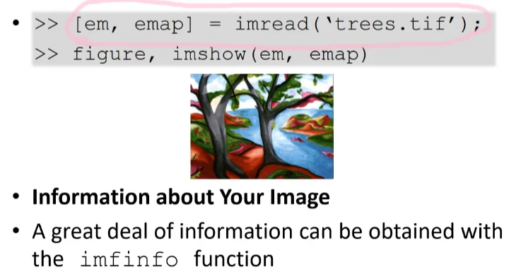

- 그러므로, Indexed Color Image를 읽을 때는 위와 같이 읽어주어야 한다.
- 또한 영상에 대해서 정보를 얻고 싶을 때는, **imfinfo**를 사용한다.

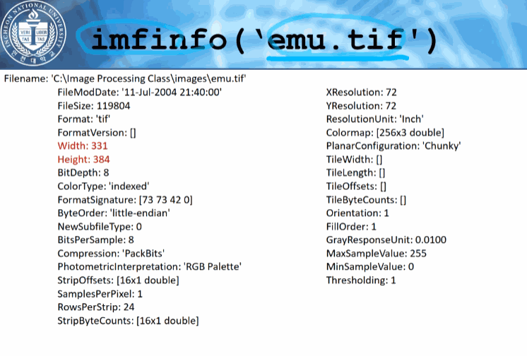

- 파일 생성 시간
- 파일 사이즈
- 포맷
- width
- height
- depth 등

⇒ 다양한 영상 정보를 얻을 수 있다.

---

## &lt;Data Types and Conversions&gt;

### Data Type and Conversions

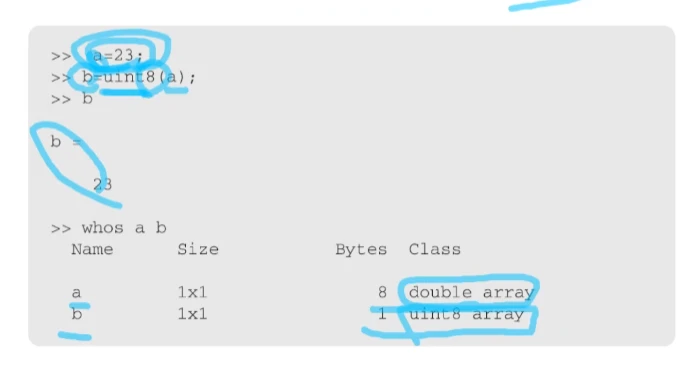

- a는 double이고, b는 uint8. 8byte와 1byte의 차이이다.
- Data types in MATLAB

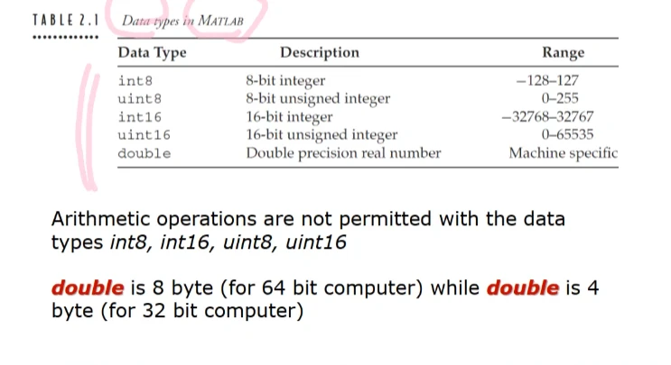

- 매트랩에서 데이터 타입은 위와 같이 정해진다. 

    - int8 : 8bit짜리 int
    - uint8 : unsigned int8
    - int16 : 2byte짜리 int
    - uint16 : 2byte짜리 uint

    - double : machine에 따라 다르다.

        - 64bit computer에서는 8byte를 쓰고, 32bit computer에서는 4byte를 쓴다.

- Converting images in MATLAB

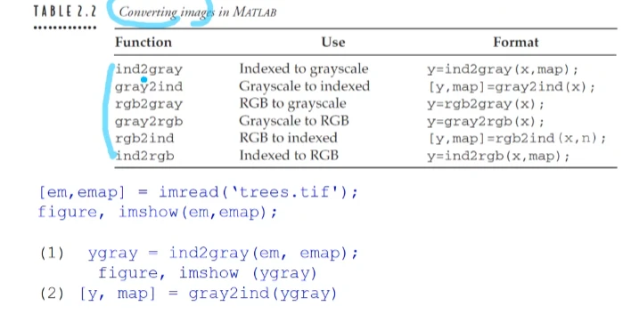

- index to gray : indexed color 영상을 gray format으로 바꾼다. 인자로 image와 map을 넣는다.
- gray to index : gray에서 index를 만든다. return으로 image, map 두 개를 받아야 한다.
- rgb2gray : rgb에서 gray format으로 변환한다.
- gray2rgb : gray에서 rgb로 변환하려면 pseudo color를 이용해야 한다. 사실은 가능하지는 않음.
- rgb2ind
- ind2rgb
- Converting images in MATLAB-2

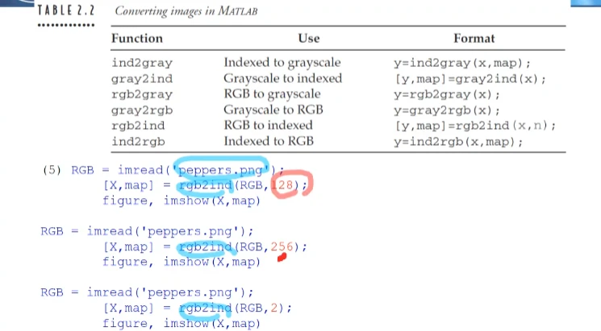

- pepper.png를 rgb2ind로 바꾸는데, index의 개수를 128, 256, 2로 설정 가능하다..

- Converting images in MATLAB-3

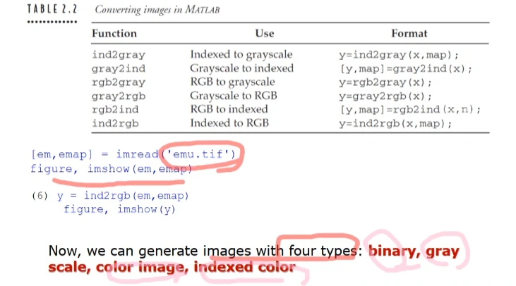

- 이와 같은 방법을 사용해 binary, gray scale, rgb, index image를 자유롭게 생성할 수 있다.

---

## &lt;Images Files and Formats&gt;

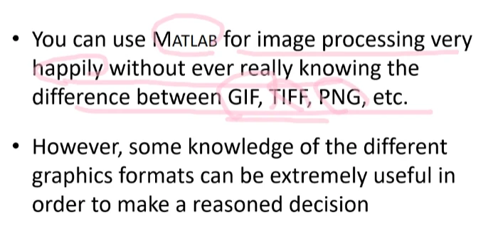

- MATLAB에서는 각각의 영상 포맷을 크게 구분하지 않고 사용해도 된다.

### Header Information

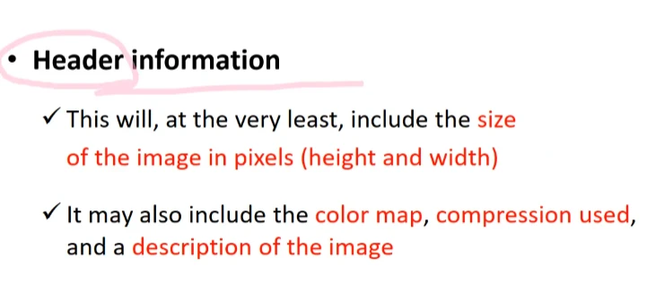

- header는 최소한 size 정보(height, width)를 포함한다.
- 또한 color map, compression used(압축을 사용할지 안할지), 영상의 정보 등을 포함한다.

### Colormap

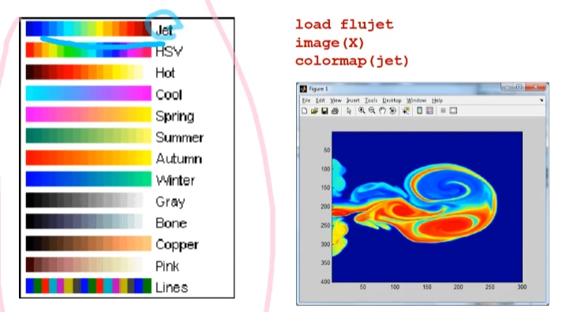

- 기본 Colormap은 Jet이다.

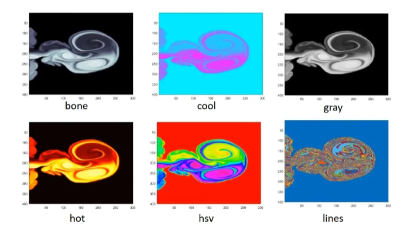

---

## &lt;2.5 Images Files and Formats&gt;

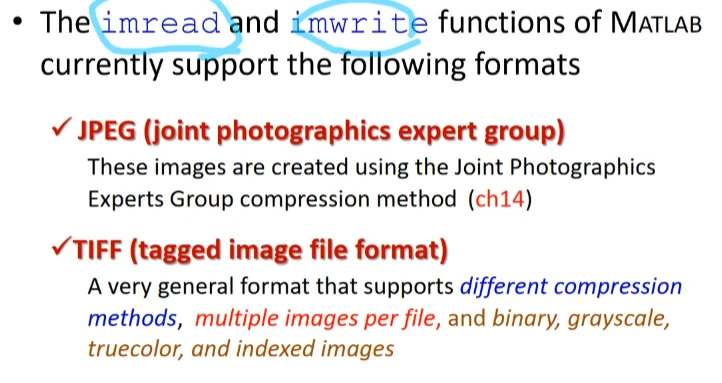

- imread : img를 읽을 때 쓰는 명령어
- imwrite : img를 쓸 때 사용하는 명령어
- JPEG(Joint Photographics Expert Group) : 가장 널리 사용되는 영상 포맷이다. 
- TIFF(Tagged Image File Format) : 널리 많이 사용되는 영상 포맷으로, 압축에도 많이 사용되며 하나의 파일에 다수의 영상을 레이어로 넣을 수도 있고, binary, grayscale, true color, indexed images도 가능한 다재다능한 파일 포맷이다.
- GIF(Graphics Interchange Format) : 굉장히 오래된 format으로, 특허 때문에 제한이 많이 되어있다. GIF는 256개의 color밖에 사용하지 못한다. 그래서 GIF는 아이콘 등에 많이 사용된다.
- BMP(Bitmap) : 마이크로소프트 비트맵 포맷으로 많이 사용되었으며, 현재는 .png로 많이 대체되었음. 무손실 압축이다.
- PNG(Portable Network Graphics) : 무손실 압축이며, BMP보다 사이즈가 작다.

### dumphex

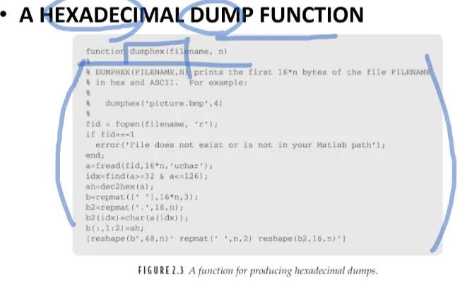

image의 header를 읽을 수 있는 명령어

---

## &lt;2.5.1 Vector vs Raster Images&gt;

- Vector images : vector로 이루어진 영상. 프로그래밍 영상을 의미한다.
- Raster images :  도트로 이루어진 영상. 일반적인 그림들은 모두 Raster 영상이다. Raster 영상이 일반적으로 파일 사이즈가 더 크다.

### Dots Per Inch, DPI

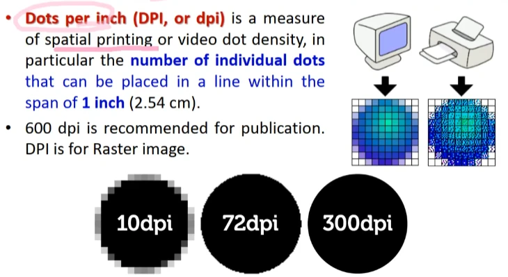

- DPI는 프린팅을 할 때 사용되며, 1인치당 몇 개의 도트가 들어가는지를 의미한다.
- 즉, 1 Inch (2.54cm)를 프린트하는데 몇 개의 dot가 필요한지를 의미한다.

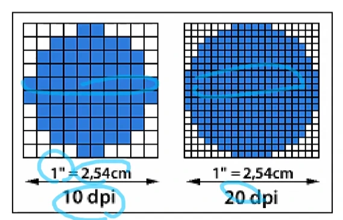

- 도트가 많고 작을수록 정교한 그림 출력이 가능하다.
