# Image Types and Color

## &lt;2.5.2 A Simple Raster Format&gt;

### Raster Format

> Raster Image는 영상(이미지 파일)이며, 헤더안에 대부분의 정보가 포함되어 있다.  
> size of the image, color map, compression 유무 등

---

## &lt;2.5.3 Microsoft BMP&gt;

- 0-1 : Signatrue, 42이면 BMP임.
- 2-5 : FileSize
- 6-9 : Reserved
- 18-21, 22-25 : Width, Height

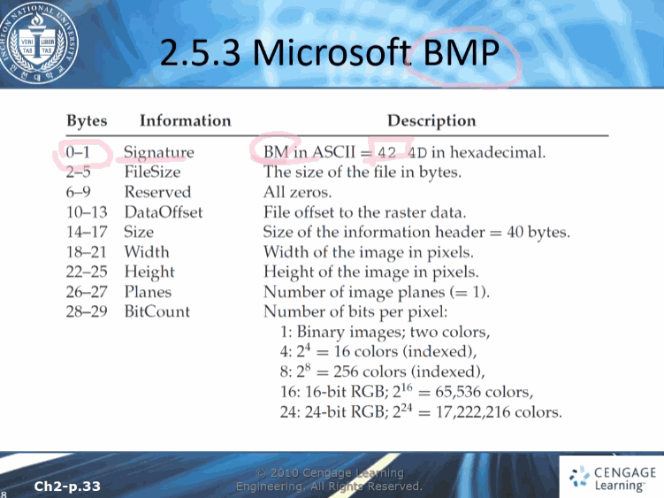

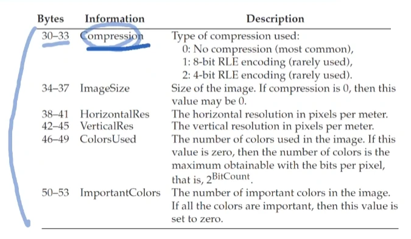

- 30-33 : Compression, 0이면 compression을 하지 않는 것. 1, 2이면 각각 8-bit RLE encoding, 4-bit RLE encoding. (RLE : Run Length Encoding)

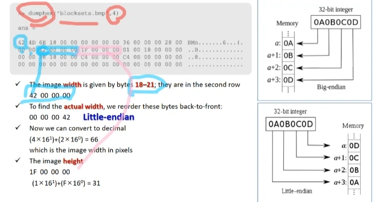

- Image Width : 00 00 00 42
- Image Height : 00 00 00 1F

⇒ Little Endian

---

## &lt;2.5.4 GIF and PNG&gt;

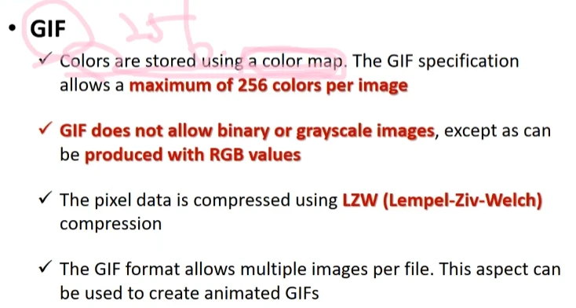

- GIF는 256개의 Color만 사용 가능하며, 이는 Indexed Color라는 얘기이다.
- GIF는 binary나 gray scale image를 사용하지 못한다.
- LZW compression을 사용한다.
- Layer를 이용하여 하나의 파일에 여러 이미지를 표현할 수 있다.

### Image Color

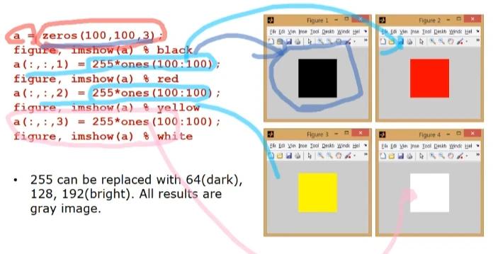

검정색에서 R, G, B 영역을 하나씩 255값으로 바꿨더니, R→Y→W가 되었음.

### Achromatic Color(흑백 영상)

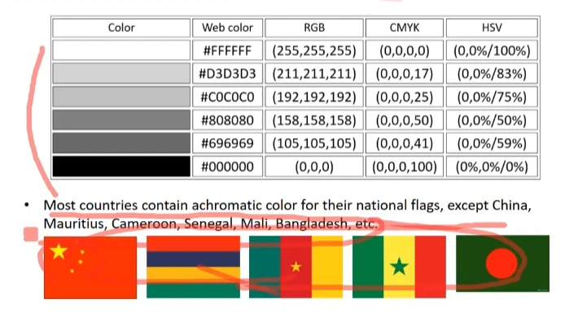

---

## &lt;2.5.4 GIF and PNG&gt;

> PNG는 GIF를 대체하기 위해서 최근에 만들어진 형식이다.

- Patented가 없기 때문에 사용하기가 굉장히 좋다.
- Gray scale, true color, indexed color를 모두 지원한다.

---

## &lt;2.5.5 JPEG&gt;

> JPEG는 lossy compression으로 유명하다. (단, Lossless 버젼도 있음.)  
> **Header의 처음이 FF D8로 시작하면 JPEG**이다.

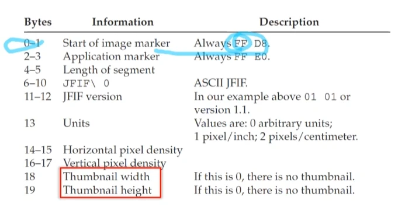

- 18, 19 : 영상의 썸네일 width, height

---

## &lt;2.5.6 TIFF&gt;

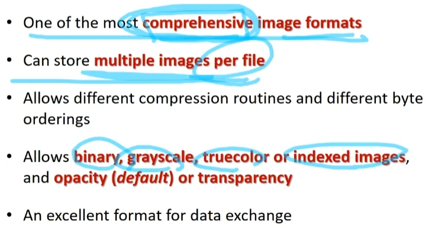

> 가장 종합적인 이미지 포맷 중 하나이다.  
> 하나의 파일에 여러 개의 이미지를 저장할 수 있다.  
> binary, gray scale, true color, indexed color를 지원하며, opacity와 transparency를 지원한다.  
> data를 교환하기 굉장히 좋은 format이다.

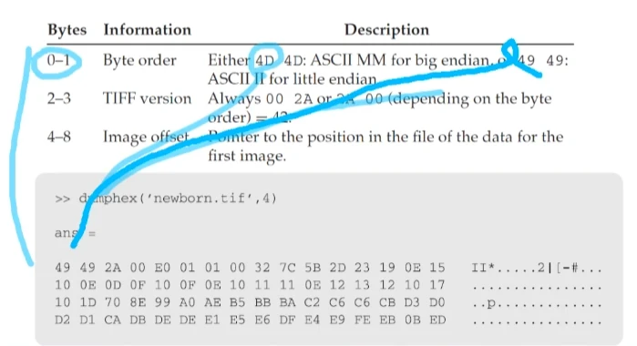

Header가 49 49로 시작함. Little Endian을 사용한다.

---

## &lt;Files in MATLAB&gt;

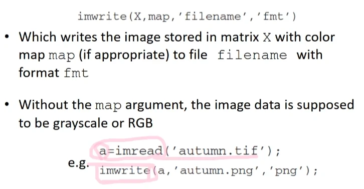

- 이미지를 읽을 때는 imread를 사용한다.
- 이미지를 저장할 때는 imwrite를 사용한다.

### Pseudo Color : Give colors to BW image

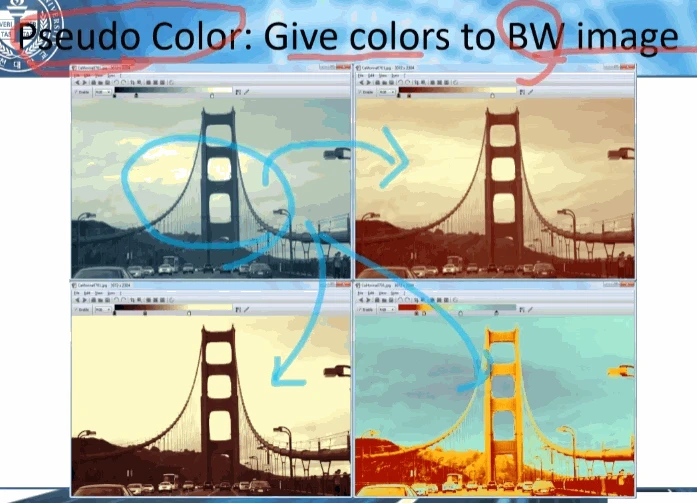

- 알고리즘으로 흑백 영상에 Color를 부여할 수도 있고, 딥러닝을 활용할 수도 있다.

> Color 영상을 만들기 위해서는 어떤 것이 필요할까? R, G, B 값이 필요한데, 사실 이걸 영상에 바로 적용하기는 힘들다. 왜 그러냐면, R, G, B는 압축이 안되어 있기 때문이다.  
>   
> 따라서 R, G, B를 압축이 되어 있는 L(Luminance, 밝기), Cb, Cr로 변경해야 한다.  
> 사람 눈은 밝기에 민감하기 때문에 Luminance가 중요하다.

### Luminance

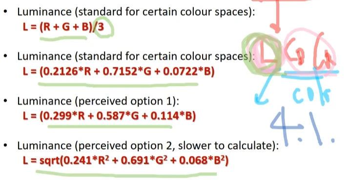

⇒ 사람은 G, R, B 순으로 민감하기 때문에 가중치가 더 높다는 것을 확인할 수 있다.

### An example of pseudo color generation

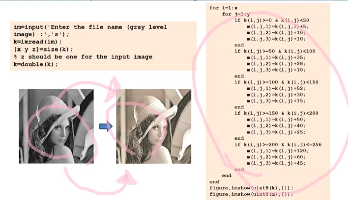

⇒ 현재는 딥러닝을 이용한다.

### Pseudo color for Satellite Image

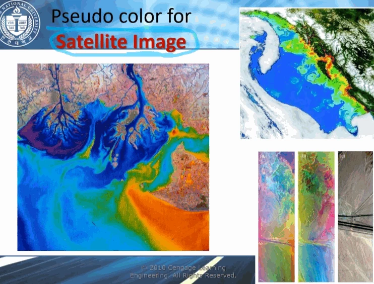

⇒ 위성 영상은 대부분 흑백으로 영상이 촬영되며, 컬러를 입힌 것이다.

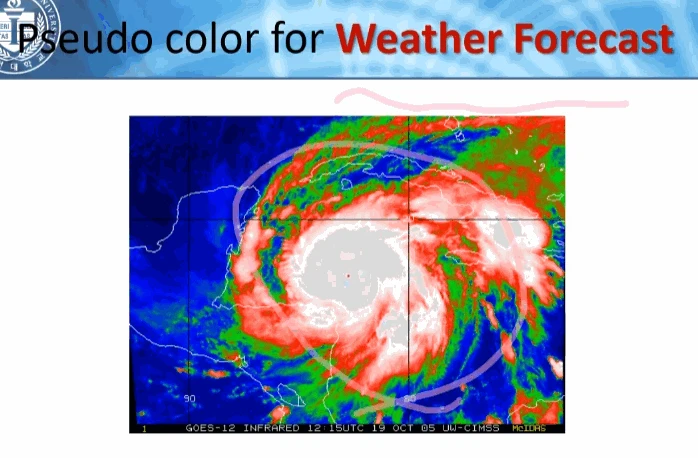

### Electromagnetic Spectrum(가시광선)

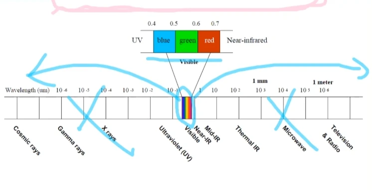

- 우리는 가시광선 내의 빛만 볼 수 있다.

### Panchromatic Imaging

> chromatic : 색깔의 그리스어  
> luminance : 밝기의 그리스어  
> Pan : 모든, 이라는 뜻으로. 우리나라 말 ‘범’은 Pan의 음차이다.  
> Pan ↔ a  
>   
> Panchromatic은 모든 Color를 다 더한 것이다.  
> ⇒ 밝기만 남은 흑백 영상이 나오지만, 모든 색이 다 더해진 것.

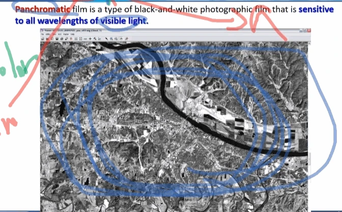

### Multispectral Imaging

> 현대의 스마트폰은 R, G, B 세 개의 스펙트럼을 사용한다.  
> 하지만 위성 영상은 여러 개의 스펙트럼을 사용한다.  
> 그래서 위성 영상은 orange, yellow, cyan, violet도 촬영할 수 있다.  
> 또한, 각 스펙트럼을 관측할 수 있다면, wavelength interval, frequency interval을 볼 수 있다.

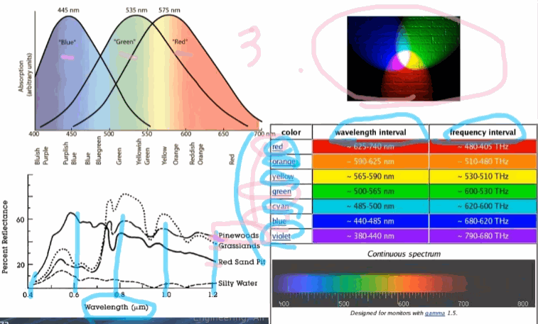

- **Remote Sensing** : 파장에 대해서 사진을 찍었을 때, 주파수 별로 intensity를 파악해보면 어떤 물체가 찍힌 것인지 파악할 수 있다. 이를 Remote Sensing이라고 한다.

### Color Generation

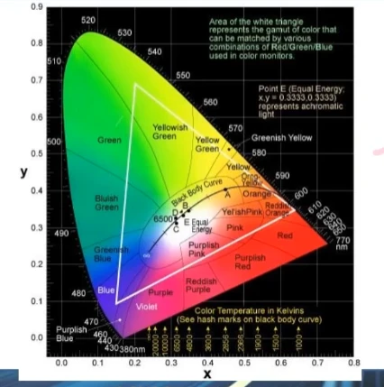

- 사람이 볼 수 있는 색의 영역을 나타낸 것으로, Tongue이라고 한다.
- 핸드폰에서 색을 나타낼 때는, 소자가 나타낼 수 있는 한계치까지만 나타낼 수 있다. (중앙에 있는 흰색 삼각형)

### Rod(간상세포) and Cone(원뿔세포)

- Rod : 밝기를 인식한다.
- Cone : 색깔을 인식한다.

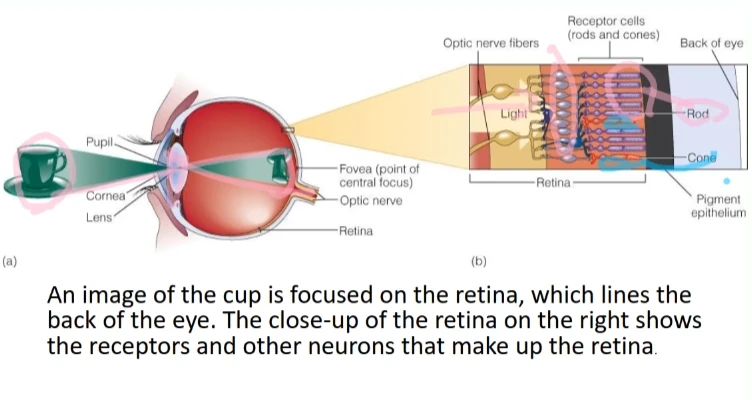

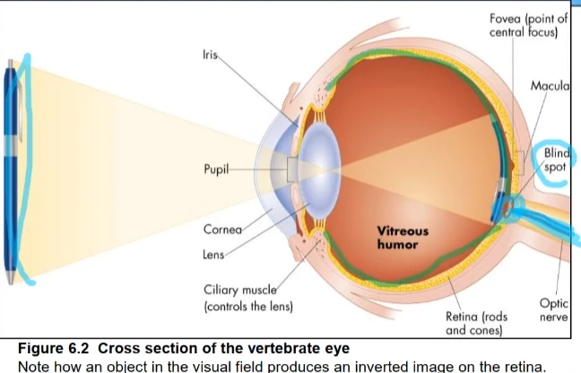

눈에는 다른 신경과 연결되는 Blind Spot이 존재해서, 해당 부분을 제외한 영역에만 상이 맺힌다. (위의 그림에서 녹색으로 표시한 부분. 이 부분만 세포가 존재한다.)

- Cone은 주로 0도에 몰려있고, Rod는 넓게 퍼져있다.

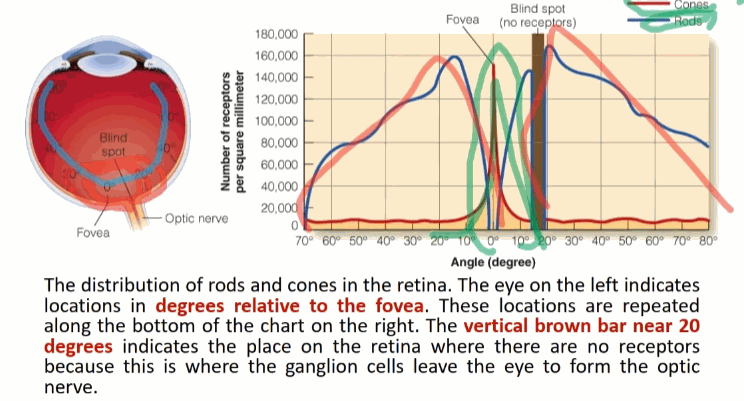

### Hyperspectral image

> 일반적인 사진은 R,G,B 세 개의 채널이 존재하지만, 위성 사진은 파장 별로 사진을 촬영하여 영상을 만들 수 있기 때문에 Panchromatic image를 만들 수 있다.

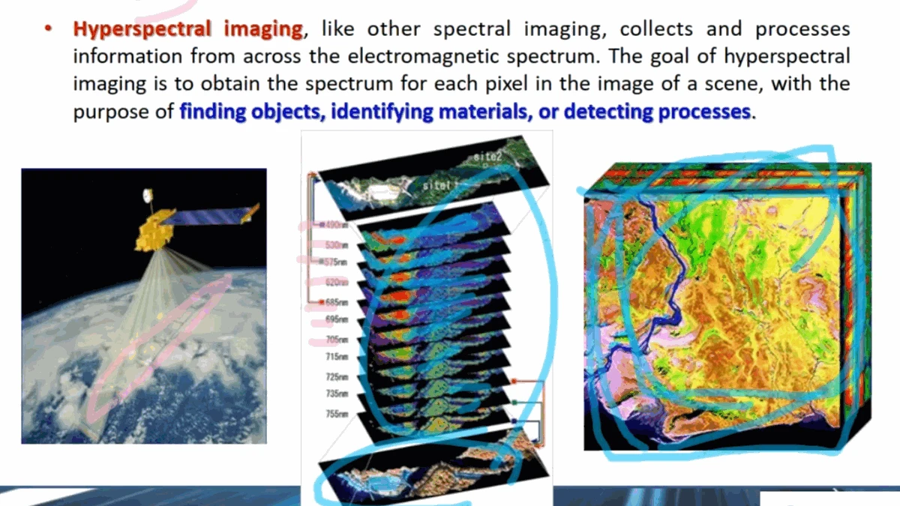

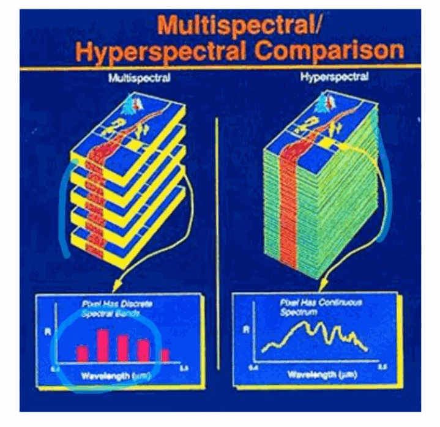

⇒ 사진이 많아지면 많아질수록 continuous signal처럼 된다.

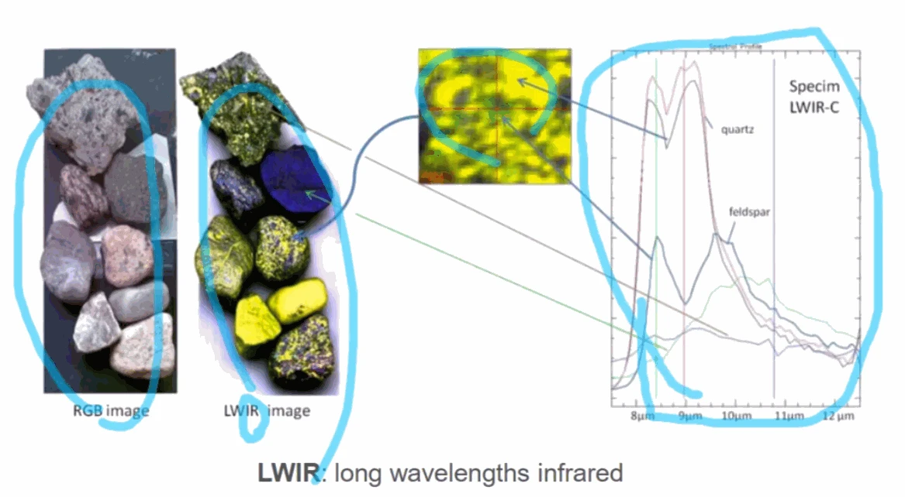

⇒ 적외선으로 촬영한 사진을 통해 광물 분석도 가능

- Infrared의 종류

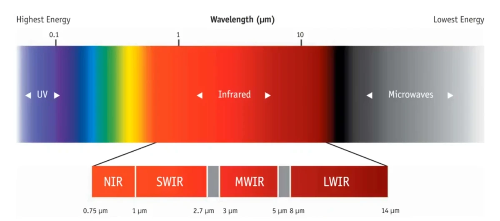

### Remote Sensing

- Passive Sensor : 빛과 같은 소스를 전달받아 센싱하는 것
- Active Sensor : 직접 소스를 방출하여 센싱하는 

---

## &lt;Exercises&gt;

- 사진의 width, height 구하기

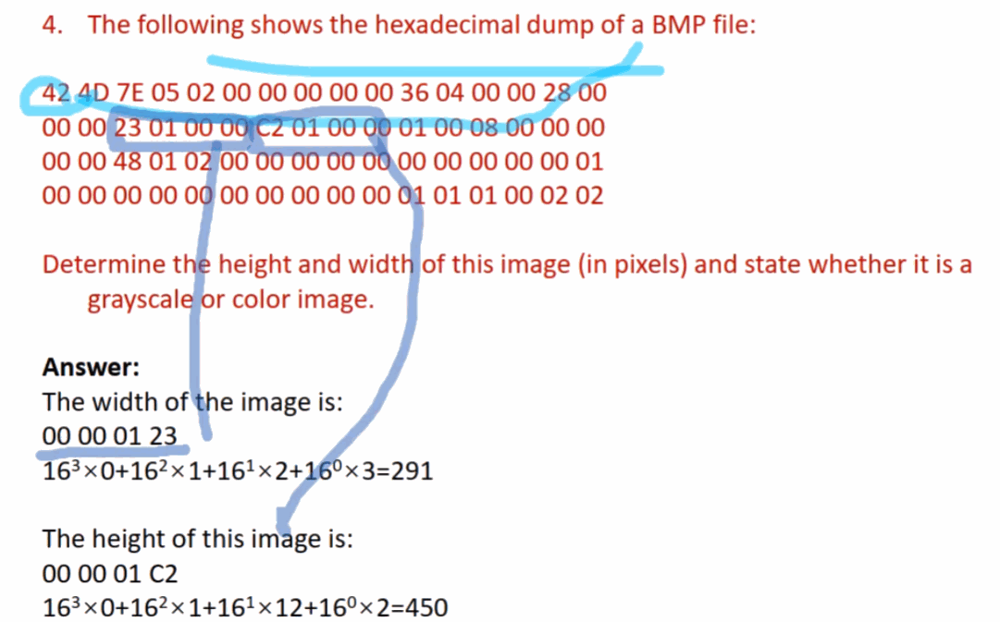

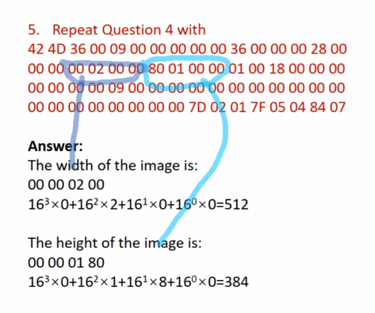
