# Basic of Image Display (Dithering)

> 영상을 복원하기 위해서는 나이퀴스트 샘플링 조건을 만족해야 한다.

---

## &lt;3.1 Introduction&gt;

- 영상이 얼마나 좋은지를 판단하려면, 어떻게 해야할까?

    - 원본 영상을 알아야만 한다.

    - 그 중에 가장 유명한 것은 **PSNR**이다. 

        - Peak signal to noise ratio : 최고 시그널 대비 노이즈의 값
        - 영상에서는 8bit의 최고값인 255가 최대 시그널 값이다.

---

## &lt;3.2 Basics of Image Display&gt;

> 디스플레이에 영향을 주는 요소들은 매우 많다.

- ambient lighting
- the monitor type and settings
- the graphics card
- monitor resolution

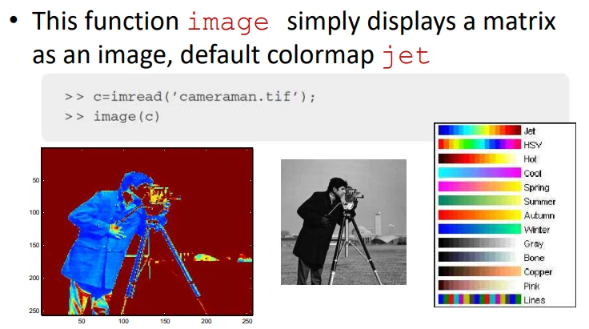

image를 사용하면 왼쪽과 같이 이미지가 표현되고, colormap을 지정해서 색을 채운다. (pseudo color) 가장 많이 사용하는 colormap은 jet이고, 위 이미지는 자동으로 jet로 pseudo color를 채워 표현한 것이다.

Intensity가 높은 것은 빨강, Intensity가 낮은 것은 파랑에 가깝다.

- 영상을 제대로 표현하기 위해서는 Image function에 조건을 주어야 한다.

    - 8bit 영상에서는 Intensity가 256개 표현될 수 있다.

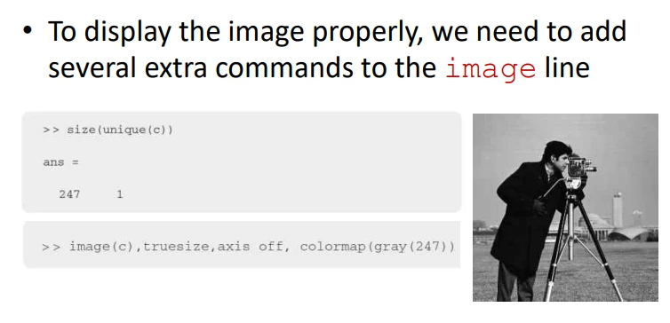

- size(unique(c&#41;)를 통해서 intensity 확인.

- image(c&#41;, truesize, axis off, colormap(gray(247))

    - 만약 intensity가 500이 되면, 영상이 전반적으로 어두워지게 된다.

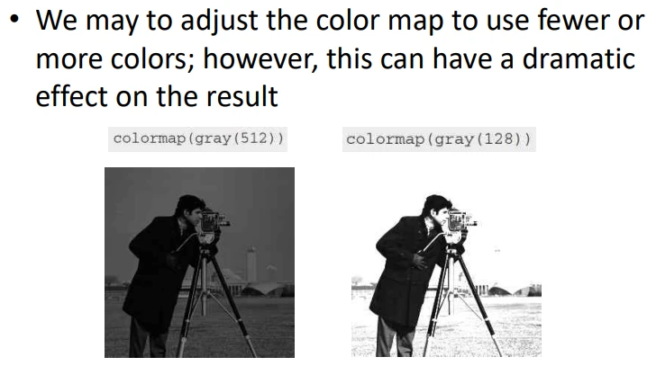

intensity : 512 vs 128, 512가 최대 intensity이면 어둡게 보이고, 128이 최대 intensity이면 밝게 보인다.

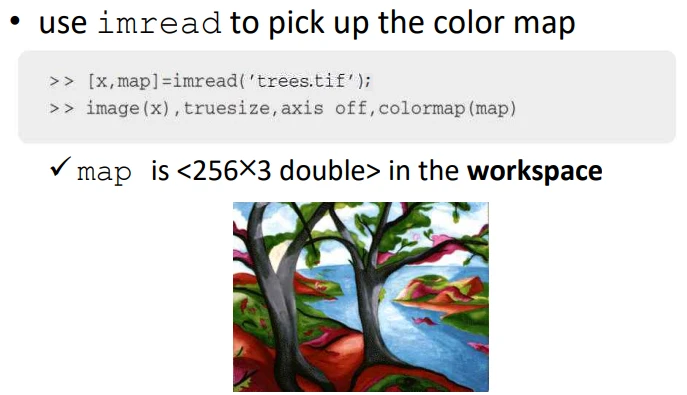

- truecolor : 모든 컬러를 RGB로 표현하는 것.

- indexed color : color map, map의 번호가 필요하다.

    - indexed color로 표현하기 위해서는 table을 만들어야 한다.
    - gif : color의 개수가 256개로 제한된다. (gif가 indexed color)

    | 0 | 1111 1111 / 0000 0000 / 0000 0000 (빨간색) |
    |---|---|
    | 1 | 0000 0000 / 1111 1111 / 0000 0000 (녹색) |
    | 2 | 0000 0000 / 0000 0000 / 1111 1111 (파란색) |
    | … | … |
    | 255 | … |

    ⇒ 이런 식으로 Index Table이 표현된다. 만약 여기에 등장하는 색깔의 개수가 256개를 넘어가면 더 이상 표현되지 못한다.

    ⇒ Index는 8bit, Value는 24bit를 사용하므로, 한 줄을 표현하기 위해서는 32bit가 필요하다.

    ⇒ 실제 이미지에서는 8bit index로 표현하면 된다. (만약 100x100 이미지라면, Indexed Color로 bit를 표현하기 위해서는 8x100x100 개의 bit가 필요하다.)

    ⇒ 단점 : 색깔이 많으면 차라리 RGB를 쓰는게 낫다.

- RGB pixel을 어떻게 켜냐에 따라 색을 만들 수 있음.

    - 가산혼합 : 합칠수록 하얘짐. 
    - 감산혼합 : 합칠수록 어두워짐.

- imwrite : jpg는 imwrite를 할 때 압축률 조절이 가능하나, 다른 것들은 안된다. 

- Color의 종류

    - Logical Color : 0 or 1
    - Gray Scale : 2^8개
    - High Color : 2^16개
    - True Color : 2^24개(1600만개)

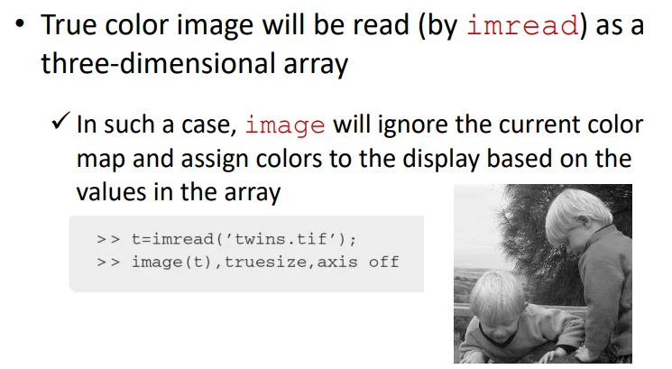

---

## &lt;3.3 The image show&gt;

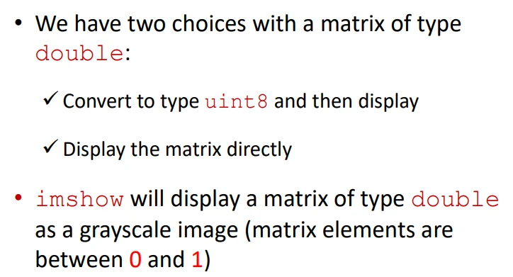

⇒ imshow는 double type의 element로 구성된 matrix를 grayscale image로 출력한다. (0~1)

- We have two choices with a matrix of type double

    - uint8로 convert하고 display
    - matrix를 곧바로 display

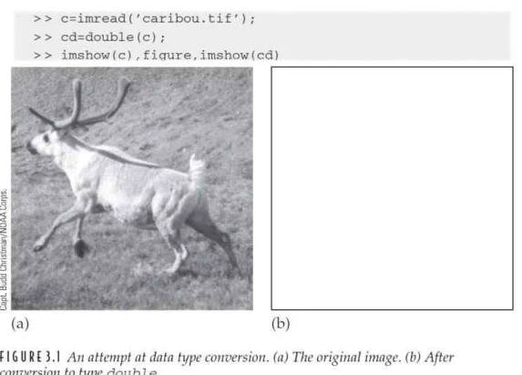

- imshow는 double로 구성된 matrix를 gray scale로 display한다.

    - imread를 하면 dtype이 uint8임.
    - double로 바꾸면, 값이 0~1이 되기 되는데, double type image를 imshow로 출력하면 최대값이 1이때문에 uint8 이미지는 사진이 모두 하얗게 나오게 된다.

    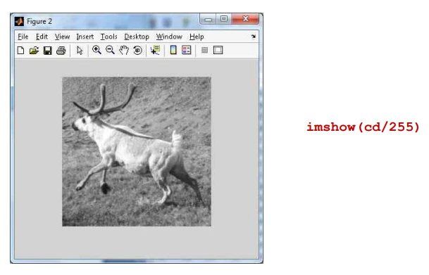

    이미지를 위와 같이 255를 나누어 출력하면, 정상적인 이미지를 얻을 수 있다.

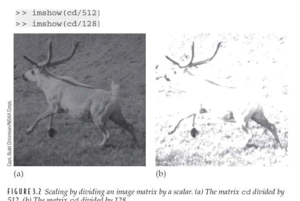

double로 변환한 이미지 cd를 512로 나누면 imshow에서 어둡게 보이고, 128로 나누면 밝게 보이는 것을 확인할 수 있다. (255로 나눴을 때 정규화 되기 때문)

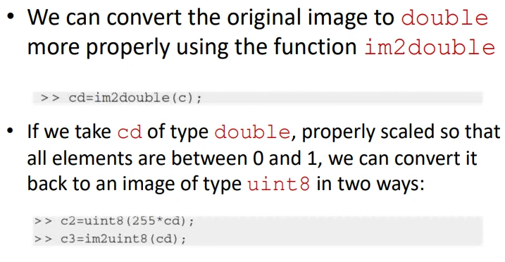

- im2double쓰면 데이터의 정규화도 자동으로 되기 때문에 문제가 없음.
- uint8\*(255\*cd) 혹은 im2uint8(cd)를 통해서 double을 uint8로 되돌릴 수 있음.

---

## &lt;3.3 The imshow Function&gt;

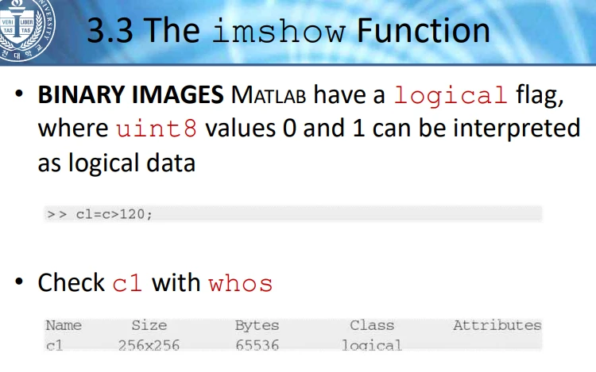

⇒ Logical은 class가 logical로 나온다. (c1 = c &gt; 120 ⇒ 120보다 큰 것은 1 작은 것은 0)

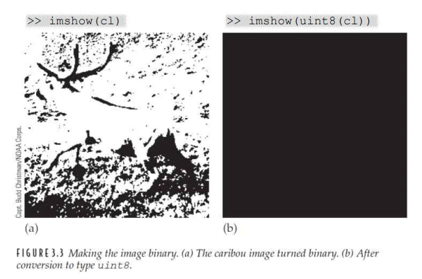

binary image(Logical)를 강제로 uint8로 변환하여 출력했더니, 어둡게 나온다. (당연함. 값이 0~1 사이이기 때문.) ⇒ 제대로 보기 위해서는 255를 곱해야 함.

---

## &lt;3.4 Bit Planes&gt;

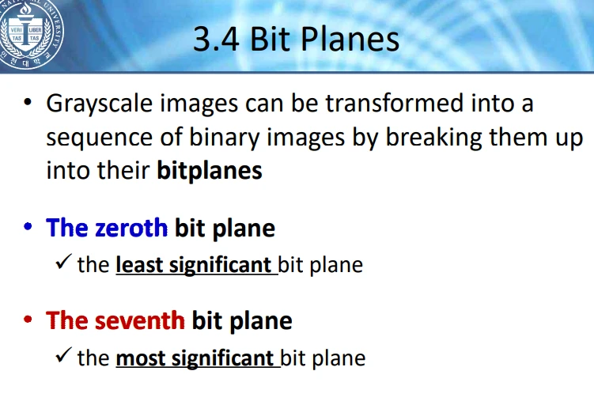

⇒ Gray scale 영상은 8bit로 표현한다.

- The **zeroth** bit plane

    - The least significant bit plane : LSB(1 1 1 1 1 1 1 1 **1**)

- The **seventh** bit plane

    - The most significant bit plane : MSB(**1** 1 1 1 1 1 1 1 1)

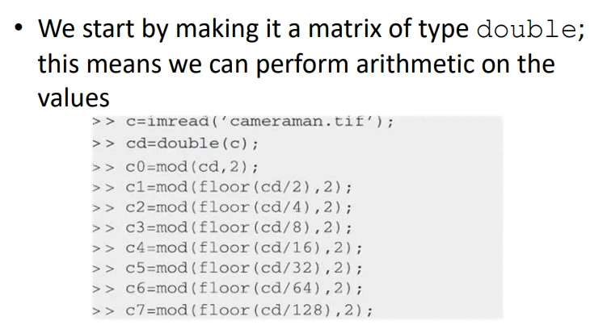

- imread로 읽기
- double로 변환하기
- c0 : modulo 2 ⇒ 0 또는 1이 나옴
- c1, c2, …, c7을 구한다.

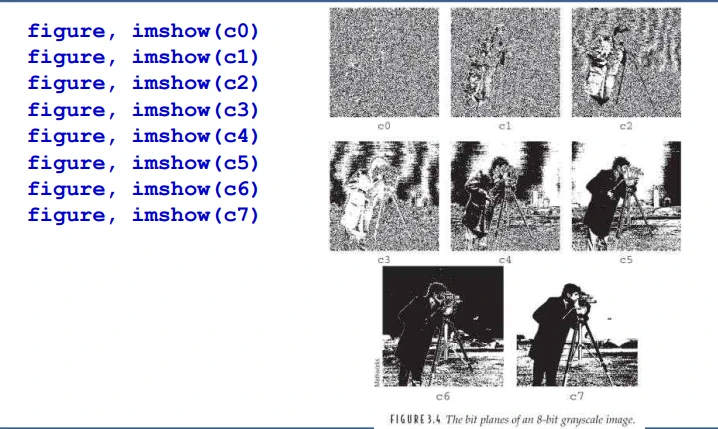

c0가 제일 안중요한 bit plane (**LSB**), c7이 가장 중요한 bit plane (**MSB**)

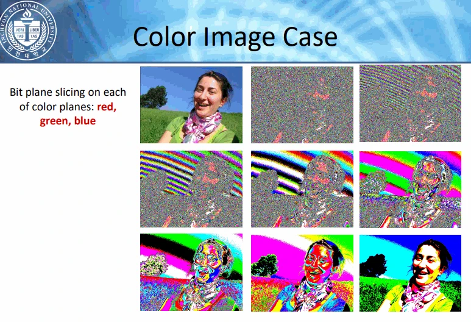

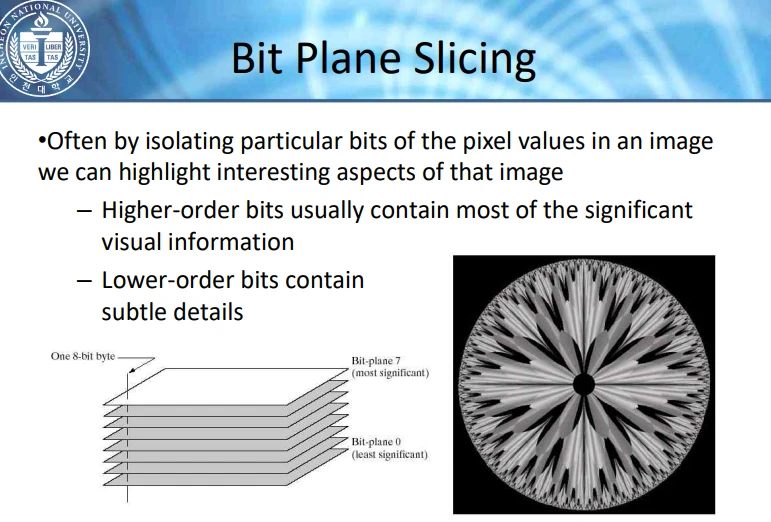

Bit plane slice를 하면, 채널 별로 Logical하게 나뉘어진다. (모두 1bit임)

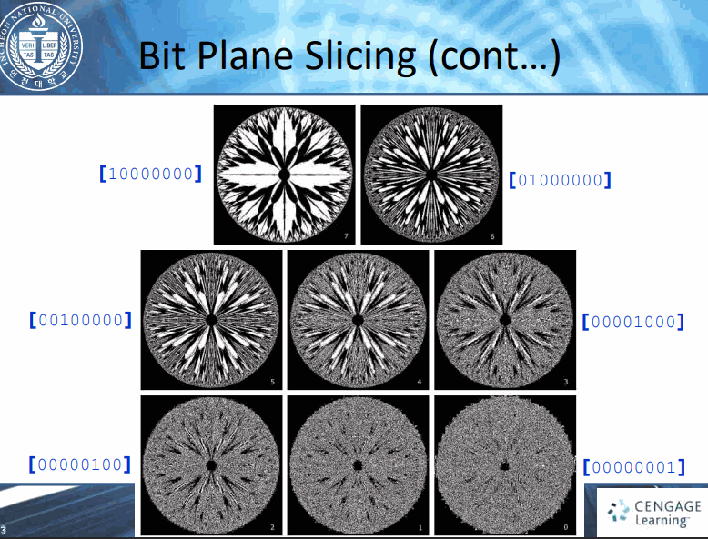

위의 bit plane들은 모두 1bit 씩이며, 제일 중요한 것은 [10000000]이다. 그러나 실제로는 128만큼의 data를 차지하고 있는 것이므로, MSB라고 판단할 수 있다. (가지고 있는 정보 수가 많을수록, 더 중요한 plane이라고 할 수 있다.)

⇒ 이것을 모두 합치면, 위에 있는 원본 영상이 된다.

### Watermark

> 만약 이미지에 대한 저작권을 넣고 싶다면, LSB에 이름을 적을 수 있다.  
> 그러면 합쳤을 때는 안보이면서, watermark의 기능을 할 수 있음.

---

## &lt;3.5 Spatial Resolution(공간 해상도)&gt;

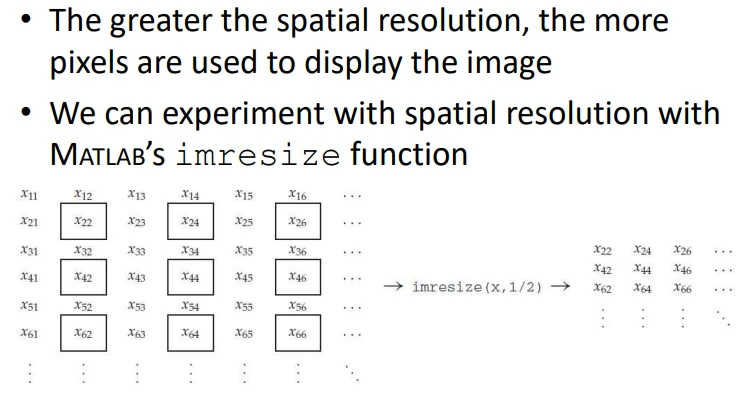

> 해상도의 종류는 시간 해상도, 공간 해상도가 있다.

- 1920\*1080 : 2K, HD(High Definition) TV.
- 3840\*2160 : 4K, UHD(Ultra High Definition) TV.
- 공간 해상도 : 똑같은 크기를 얼마나 많은 pixel로 표현하는지
- 시간 해상도 : 똑같은 영상을 얼마나 많은 frame으로 표현하는지

⇒ 그렇지만, 둘 다 많을 수록 좋긴 하다.

### imresize (공간 해상도 조절)

> 영상의 사이즈를 조절할 수 있다.

- imresize를 가로, 세로 1/2씩 하면, 실제 크기는 1/4이 된 것이다.
- 위의 예시에서는 x22, x24, x26, x42, x44, x46, … 등을 선택했다. 이런 방식으로 Sampling이 가능하다.

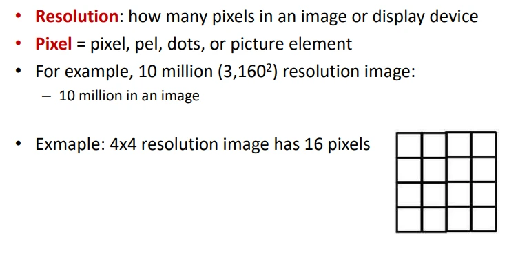

- Resolution : 얼마나 많은 Pixel이 존재하는지 나타내는 metric
- Pixel : pixel, pel, dots …

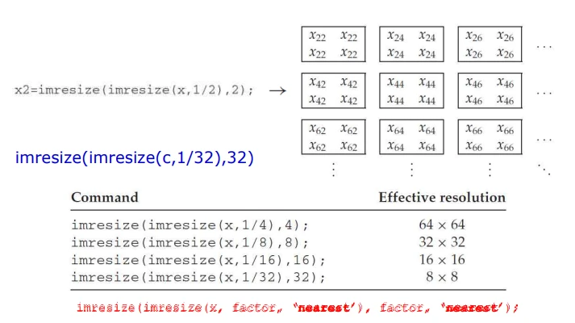

- ex)

    - imresize(c, 1/4) ⇒ c를 1/16로 줄인 것.
    - imresize(imresize(x, 1/4), 4) ⇒ c를 1/16로 줄인 것을 다시 4배 확장한다.

    - imresize(x, factor, ‘nearest’)

        - factor는 얼마나 키우거나 줄일 것인지.
        - nearest는 default이고, 특별한 연산 없이 값을 복사해서 근처 값들을 채운다.

---

## &lt;3.6 Quantization and Dithering&gt;

- 시간에 대한 샘플링은, 시간에 대한 대표값을 정하는 것이다.
- 결과에 대한 대표값은 바로 **Quantization**이다.

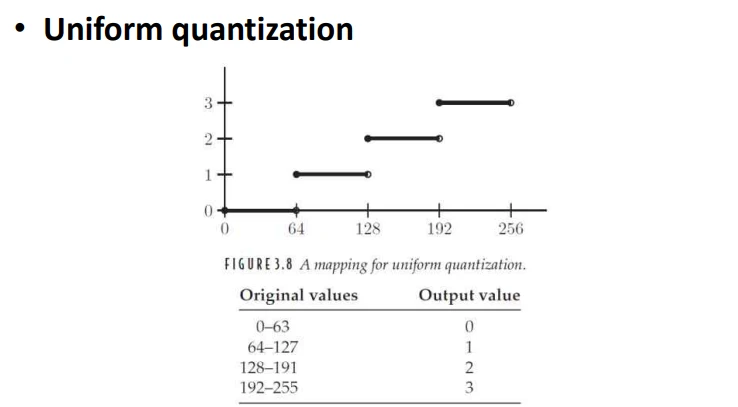

- 분포의 종류

    - uniform : 골고루 나오는 것 (ex. 직선)
    - bias : 특정 부분이 많이 나오는 것 (ex. convex 함수.)

⇒ 분포도에 발생하는 Quantity를 보고 Quantization을 어떻게 할지 결정한다.

⇒ 변화가 많으면 Non-uniform Quantization을 하는 것이 좋음.

- **Uniform Quantization**

    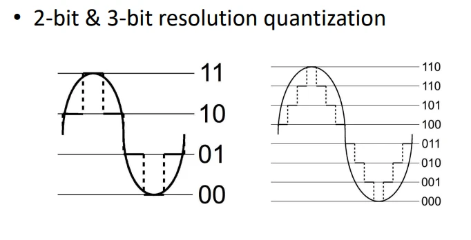

- **Non-uniform Quantization**

> 그런데 Quantization이 약간 어설프니까, 최대한 Resolution을 높이는 것이 좋다.

- **가시광선**

400nm ~ 700nm

사람 눈은 녹색을 인식하는 세포가 가장 많다. 그래서 녹색에 민감한다.

또, 사람은 밝기에 민감하고 색상에 둔감하다.

Television은 Luminance와 Chrominance가 들어와서 밝기와 색상을 표현한다.

- **Chroma Sub-sampling**

4\*4 이미지를 표현할 때, 리소스가 충분하면 각 픽셀마다 R, G, B를 넣으면 된다. 하지만, 그러면 용량이 너무 커지므로 꼼수를 추가할 수 있다.

푸리에 변환 (x, y) ⇒ (r, theta) 으로 바꾸듯이, 

Y(밝기), Cb(녹색과 파란색의 차이), Cr(녹색과 빨간색의 차이)

으로 만들자는 것이다.

예를 들어, R, G, B 각각에 대해 4bit 씩을 부여해서 12bit를 사용했었다면,

YCbCr 4: 2: 0을 사용하여 6bit로 줄일 수 있다.

⇒ 즉, 무시할 색상은 무시해버린다. 그래도 어색하지 않다. 단, Luminance를 건드리면 사람이 매우 어색하게 느낀다.

- **Quantizer**

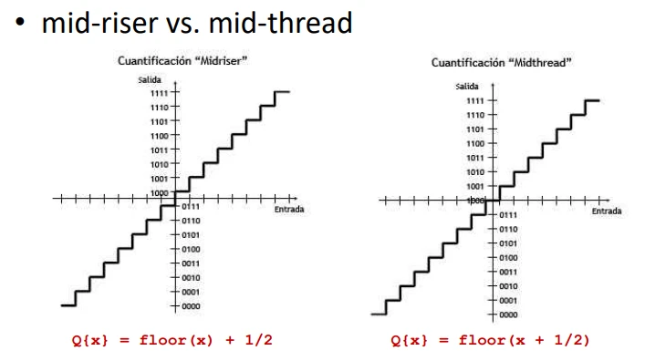

어떤 것이 더 좋은 Quantizer인가? Midthread이다. 그 이유는, Coding을 할 때 이전보다 얼마나 큰지 residual(잔차)을 coding한다. ⇒ 이를 **DPCM**(Differential Pulse Coding Modulation)이라고 한다. 

ex) 1.1 1.2 1.1 1.0 이라는 값이 있을 때, 이전에 나온 값과의 차분을 코딩하는 것이다.

1.1 0.1 -0.1 -0.1 

⇒ 이렇게 하면 대부분 값이 0으로 수렴하는데, 그 값들이 매우 미미하다. 그러므로 0에서 왔다갔다 하는 것들은 대표값을 0으로 주면 좋을 것이다. 그래서 midthread가 좋다.

하지만 midriser의 경우에는 단지 +이고 -이기 때문에 값을 1과 -1로 만들기 때문에 성능이 떨어진다고 볼 수 있다. (노이즈에 매우 민감하다.)

### Grayslice

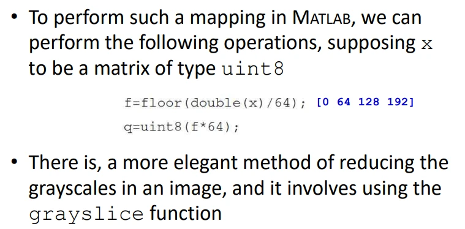

→ 대표값으로 값을 줄여보는 것.  
ex. 2로 나누고 2를 곱했다.

대표값은 0 2 4 6 … 로 갈 것이다.

이 경우는 64로 나누고 64를 곱했으므로,

0 64 128 …

4로 나누고 4를 곱하면

0 4 8 12 …

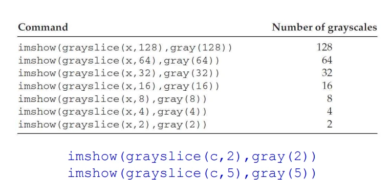

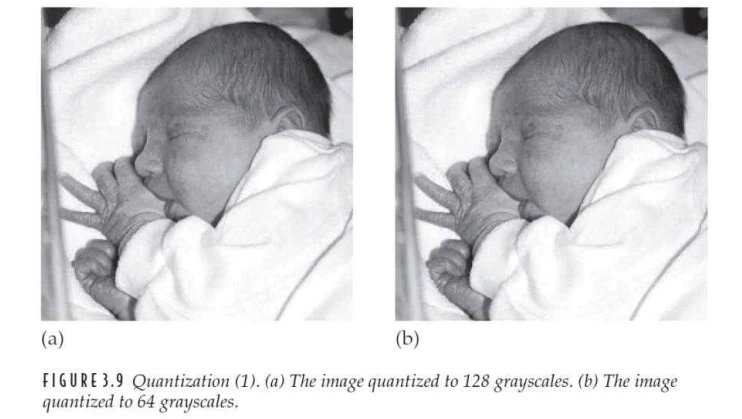

(좌) 128개의 Grayscale (우) 64개의 Grayscale

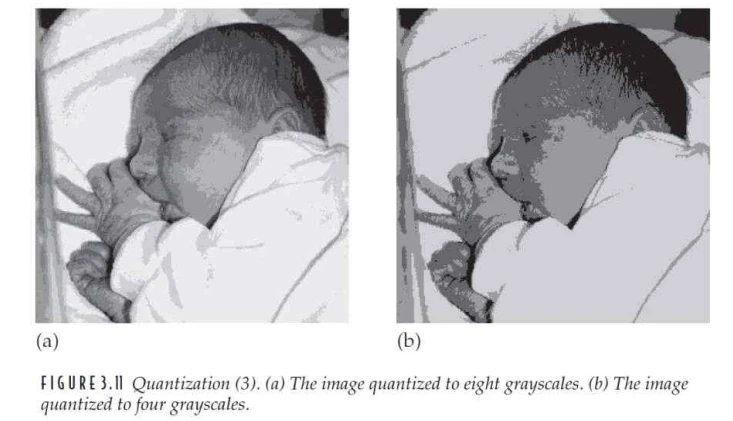

(이런식으로 대표값을 줄여갈 수 있다. ⇒ Grayslice)

### Dithering

> 디더링은, 색깔의 개수를 줄이는 것을 말한다.

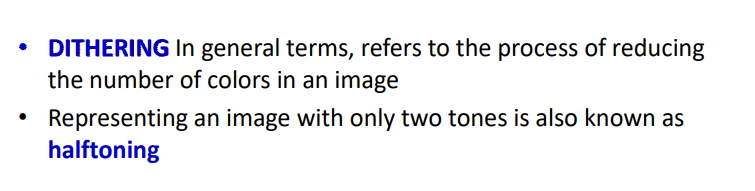

- 색깔을 24bit true color로 표현하면 수천만 개의 색깔을 표현하게 된다. 

    - 이것이 너무 많으므로, 대표값으로 색깔의 수를 줄인다.

- 두 개의 톤으로만 표시되는 이미지를 **halftoning**이라고 한다.

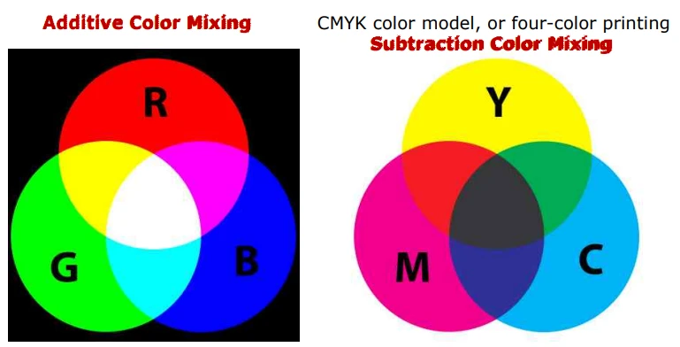

- RGBW : 가산혼합
- CMYK : 감산혼합

프린터에는 CMYK가 토너로 들어있다. K 잉크를 따로 만든 것은, CMY를 다 합쳐 만드는 것보다 따로 만드는게 더 저렴하기 때문이다.

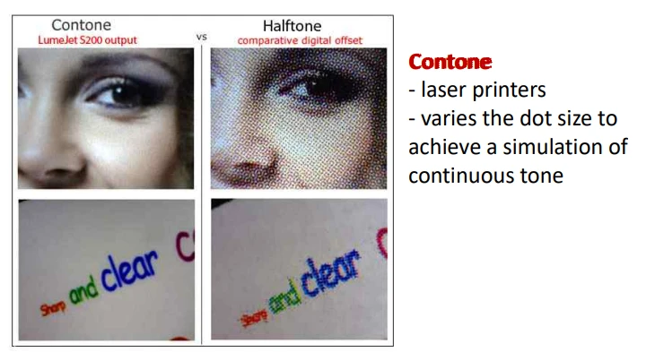

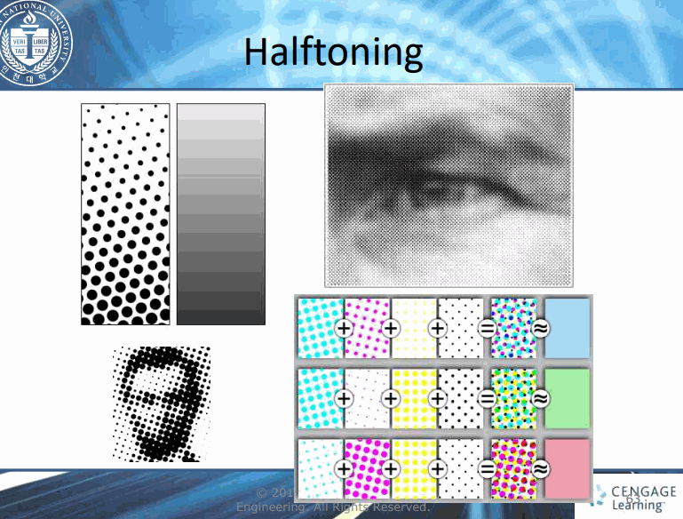

- 왼쪽은 오른쪽 영상을 확대한 영상임.

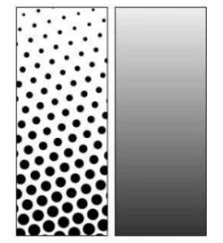

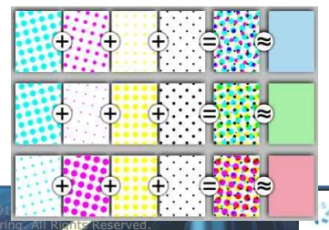

- 색깔을 점으로 찍고 섞으면 색깔처럼 보인다.

    - 과거 도트 프린터 시절에는 이 방식을 사용했음.

- Raster : Pixel (Bit map)
- Vector Image : 화질 손상 x.

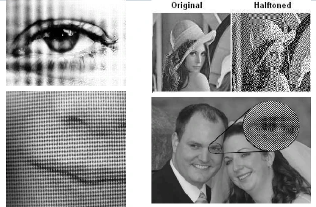

- halftoning

### Dithering Matrix

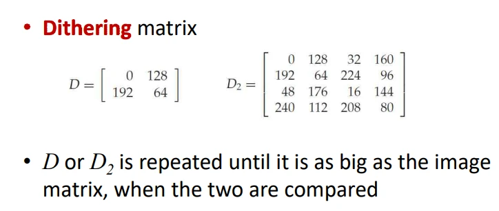

- D를 복사해서 D2로 만든다.

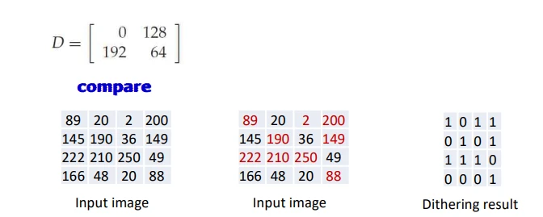

- D를 네 개 이어붙여서 확장하고, 4\*4 Matrix를 만든다.

- 이것과 주어진 Input을 비교해보자.

    - Dithering Matrix가 더 크면 Dithering, 아니라면 Input을 남긴다.
    - 빨간색인 부분은 1, 아니면 0.

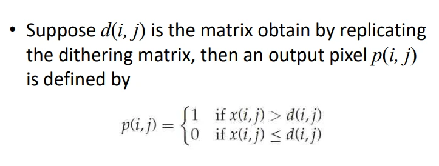

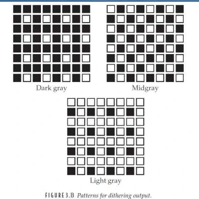

- Dithering Example

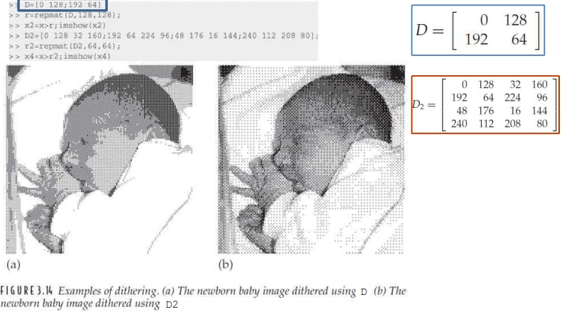

디더링 매트릭스를 각각 적용한 것,

### 디더링의 확장

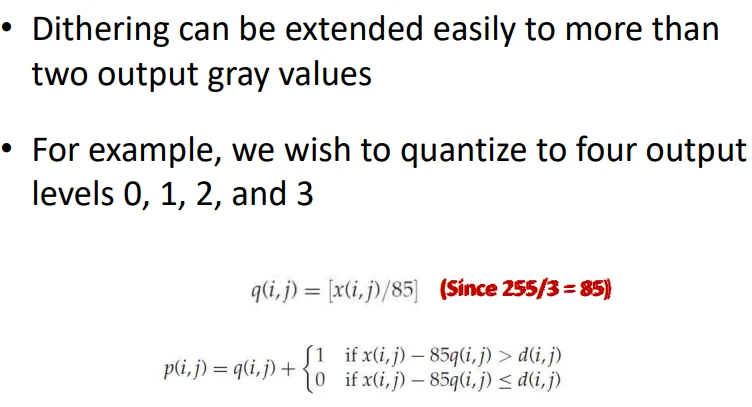

⇒ 네 개의 대표값으로 나타내기 위해서는 85로 나누면 네 개의 범위가 만들어진다. 

- Dithering의 D는 큰 matrix이고, d는 i, j의 dithering이다.

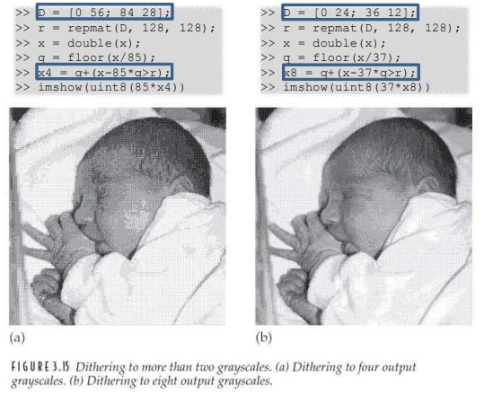

대표값 네 개, 대표값 여덟 개

### Error Diffusion

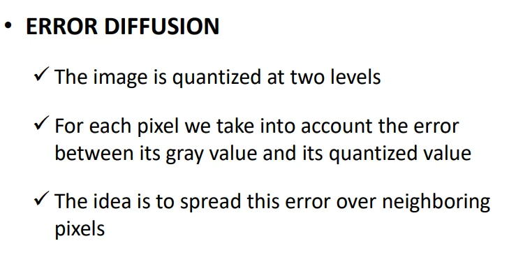

- 전통적인 영상처리에서는 super resolution하는 이유가, 영상을 더 뚜렷하게 보기 위해서이다.
- restoration : 하는 이유는 영상을 복원하기 위해서이다.
- inpaint : 이미지가 부족한 부분을 채우는 기술.

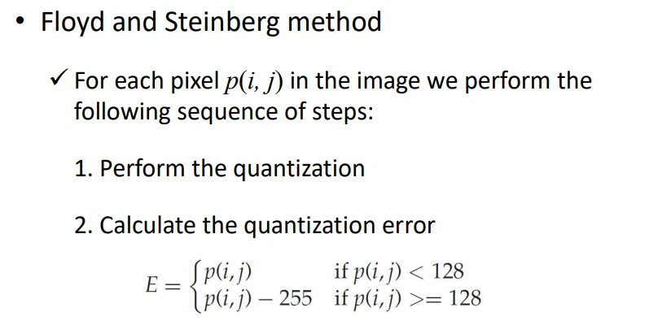

- 어떤 값 p(i, j)에 대해서, 계산한다.

    - 만약 128보다 크다면, 그 자체로 Error이다.
    - 128보다 크다면, 255를 뺀다.

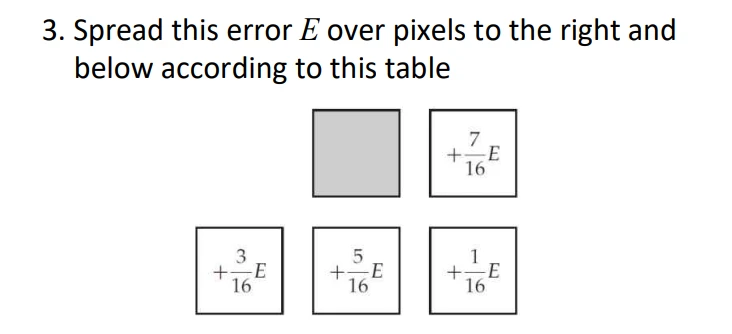

- 만약 회색 부분의 값이 100이라면, Error는 100이다.
- 만약 값이 200이라면, Error는 200 - 255 = -55이다.
- 이렇게 Error값을 구하면 (7/16)\*E + (3/16)\*E + … 을 더하면 가중치가 1이 된다. 이걸 가지고 코드를 짠다.

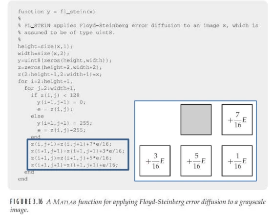

- 복잡하긴 하지만, 결국 Error를 구하라는 것.

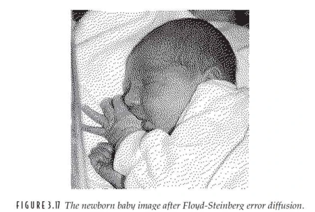

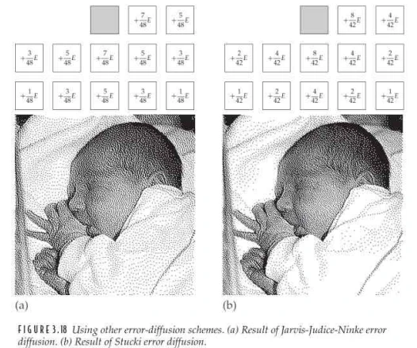

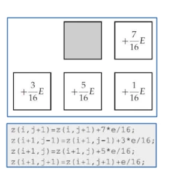

### Half Tone and Dithering

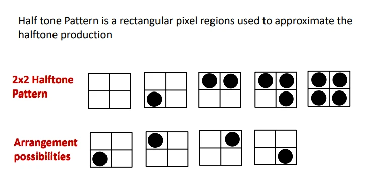

- Half Tone : 밝은 부분은 점을 적게, 어두운 부분은 점을 많게 하는 것.
- 어떻게 점을 찍는 것이 가장 좋은가?

- 점을 찍는 기준.

- Floye-Steinberg Dither도 똑같이 1bit이지만, 더 잘 보인다.
- 다양한 방법이 있다.

